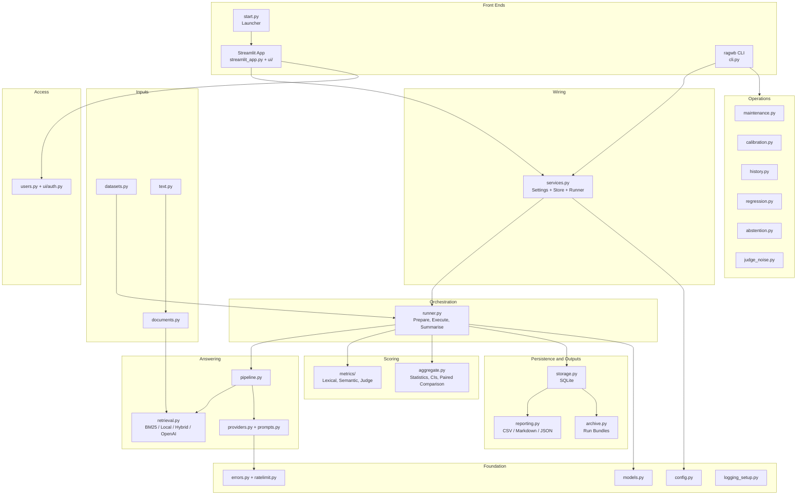
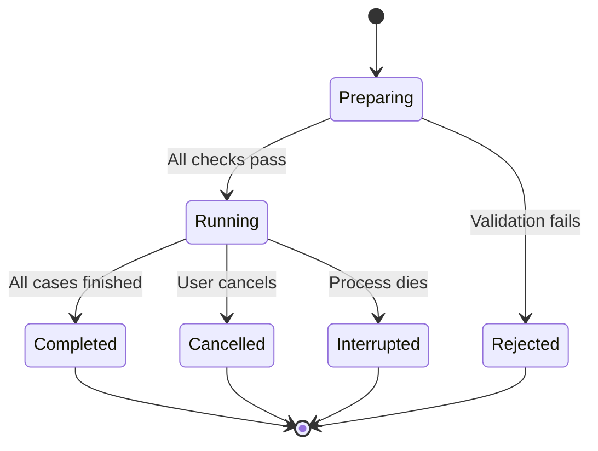
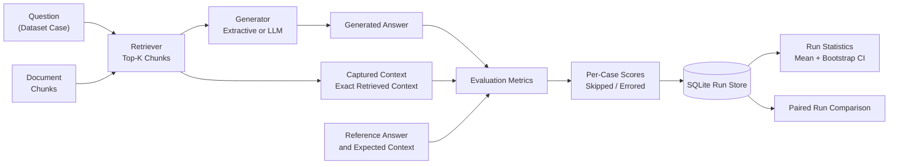
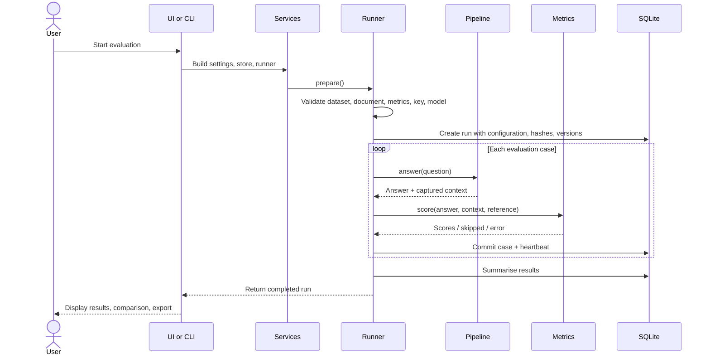
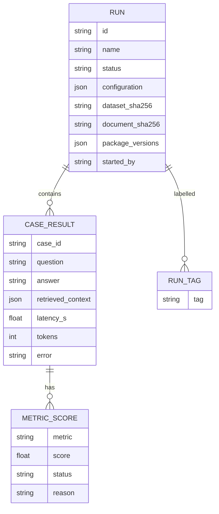

# RAG Evaluation Workbench

<div align="center">

### 🔬 Reproducible RAG Evaluation & Statistical Analysis

**A comprehensive evaluation workbench for retrieval-augmented question-answering systems.**

Measure what RAG pipelines actually retrieve and generate, not just what they claim. RAG Evaluation Workbench executes pipelines against structured datasets, captures the exact retrieved context, evaluates answers using lexical, semantic, and LLM-as-a-judge metrics, and compares experiments using paired statistics and bootstrap confidence intervals. Supports fully offline evaluation and OpenAI-compatible providers.

[](https://www.python.org/)
[](https://streamlit.io/)
[](https://www.sqlite.org/)
[](https://github.com/confident-ai/deepeval)
[](https://pytest.org/)
[](LICENSE)

[Quick Start](#-quick-start) · [Architecture](#-architecture) · [Retrieval & Metrics](#-retrieval-and-evaluation-metrics) · [CLI](#-command-line-interface) · [Testing](#-testing-and-verification) · [Documentation](#-documentation)

</div>

---

## Table of Contents

1. [Why This Project Exists](#1-why-this-project-exists)
2. [Feature Overview](#2-feature-overview)
3. [Quick Start](#3-quick-start)
4. [Architecture](#4-architecture)
5. [How an Evaluation Run Works](#5-how-an-evaluation-run-works)
6. [Retrieval and Answering Modes](#6-retrieval-and-answering-modes)
7. [Metrics](#7-metrics)
8. [Statistics and Comparison](#8-statistics-and-comparison)
9. [Command-Line Reference](#9-command-line-reference)
10. [Web Application](#10-web-application)
11. [Configuration](#11-configuration)
12. [Data Model and Storage](#12-data-model-and-storage)
13. [Security and Access Control](#13-security-and-access-control)
14. [Operations](#14-operations)
15. [Project Layout](#15-project-layout)
16. [Testing and Verification](#16-testing-and-verification)
17. [Documentation Set](#17-documentation-set)
18. [Known Limitations](#18-known-limitations)
19. [Contributing and License](#19-contributing-and-license)

---

## 1. Why This Project Exists

RAG systems are easy to demonstrate but difficult to evaluate reliably. Typical evaluation tooling has three recurring problems, and this workbench is designed to address them.

| Common Problem | Workbench Approach |
|---|---|
| Scoring the model's description of its sources instead of the actual evidence | Scores the exact context returned by the retriever or agent tool, captured for every call |
| Treating failed or skipped scores as zero | Excludes skipped and errored scores from averages while explicitly counting them |
| Reporting averages from small datasets without uncertainty | Provides bootstrap confidence intervals and paired, question-level comparisons |

The workbench does not require an account, server, or API key to be useful.

It includes a complete offline evaluation baseline consisting of:

- BM25 inverted-index retrieval.
- Extractive answer generation.
- Lexical evaluation metrics.

This provides a reproducible baseline against which LLM-powered RAG pipelines can be evaluated.

## 2. Feature Overview

### Core Capabilities

- **Fully Offline Evaluation:** BM25 retrieval, extractive answer generation, and lexical metrics. No network connection, API key, or external service required.
- **OpenAI-Compatible Providers:** Supports OpenAI, Groq (free tier verified), xAI, and compatible endpoints through `OPENAI_BASE_URL`.
- **Multiple Answering Modes:** Supports standard LLM generation, tool-calling agent mode, and offline extractive answering.
- **Local Embeddings:** Optional `fastembed` integration with a small BGE model for local semantic retrieval and semantic evaluation.
- **Hybrid Retrieval:** Combines BM25 and local embedding retrieval using Reciprocal Rank Fusion.
- **Reproducible Evaluation History:** Stores complete run configurations, dataset and document hashes, package versions, per-case latency, token counts, and errors in SQLite.
- **Statistical Comparison:** Paired run comparisons, bootstrap confidence intervals, and regression detection.
- **Judge Validation:** Judge-noise measurement, calibration against pass/fail labels, agreement analysis, Cohen's kappa, and threshold sweeps.
- **Multiple Export Formats:** CSV, Markdown, and re-importable JSON run bundles.
- **Operational Management:** Backup, validated restore, pruning, health checks, and run protection through tags.
- **Access Control:** Shared-password authentication or named accounts with scrypt-hashed passwords and viewer, editor, and admin roles.
- **Single Launcher:** `python start.py` prepares the environment, runs example evaluations, starts the application, and opens the browser.

---

## 3. Quick Start

### Requirements

- Python 3.12 or newer.
- [uv](https://docs.astral.sh/uv/) package manager (recommended).

### Installation and Launch

Run:

```bash
python start.py
```

This command:

1. Prepares the Python environment.
2. Executes five offline example evaluations on the first launch.
3. Starts the Streamlit web application.
4. Opens the application in your browser.

Access the application at:

```text
http://localhost:8501
```

Press `Ctrl+C` to stop the application.

### Launcher Options

| Option | Description |
|---|---|
| `--port 8600` | Run the application on another port |
| `--no-browser` | Prevent automatic browser opening |
| `--no-examples` | Skip first-launch example evaluations |
| `--setup-only` | Prepare the environment and exit |
| `--host 0.0.0.0` | Listen on the network (requires configured login) |
| `--ssl-cert / --ssl-key` | Enable HTTPS |

### Run Your First Evaluation

```bash
uv run ragwb run --name first-run -k 3
```

List available runs:

```bash
uv run ragwb list
```

Inspect a specific run:

```bash
uv run ragwb show <run-id>
```

### Using an OpenAI-Compatible Provider

Create your environment configuration:

```bash
cp .env.example .env
```

Configure:

```env
OPENAI_API_KEY=your_api_key
OPENAI_BASE_URL=your_provider_endpoint
RAGWB_GENERATOR_MODEL=your_generator_model
RAGWB_JUDGE_MODEL=your_judge_model
```

Run an evaluation with LLM-based metrics:

```bash
uv run ragwb run --name judged --provider openai -k 3 \
    --metrics token_f1,context_recall,answer_relevancy,faithfulness,context_relevancy,correctness
```

> **Important:** Provider-backed generation and LLM judge metrics may incur API costs or consume limited provider quotas. The UI displays a warning before starting these evaluations. Configure `RAGWB_MAX_REQUESTS_PER_MINUTE` to control request pacing.

---

## 4. Architecture

The project is implemented as a single Python package named `rag_workbench`.

It exposes two primary interfaces:

- Streamlit web application.
- `ragwb` command-line interface.

Both interfaces call the same underlying package in-process.

There is no separate backend server. The Python package provides the application logic and SQLite manages persistent evaluation history.

### 4.1 Layered Architecture



### 4.2 Layer Responsibilities

| Layer | Modules | Responsibility |
|---|---|---|
| Front Ends | `ui/`, `cli.py`, `start.py` | Input, progress, presentation |
| Wiring | `services.py` | Settings, store, runner, safe uploads |
| Orchestration | `runner.py` | Validation, execution, retries, cancellation, threads, summarisation |
| Answering | `pipeline.py`, `retrieval.py`, `providers.py`, `prompts.py` | Retrieve chunks and produce answers |
| Scoring | `metrics/`, `aggregate.py` | Per-case scores, run statistics, comparisons |
| Inputs | `datasets.py`, `documents.py`, `text.py` | Dataset validation, document chunking, text processing |
| Persistence and Outputs | `storage.py`, `reporting.py`, `archive.py` | SQLite storage, reports, run bundles |
| Operations | `maintenance.py`, `calibration.py`, `history.py`, `regression.py`, `abstention.py` | Health checks, backups, pruning, calibration, history, regression gates, abstention tuning |
| Access | `users.py`, `ui/auth.py` | Authentication, roles, throttling, session revocation |
| Providers | `errors.py`, `ratelimit.py`, `judge_noise.py` | Error classification, request pacing, judge-jitter measurement |
| Foundation | `config.py`, `models.py`, `logging_setup.py` | Configuration, data contracts, redacting logs |

### 4.3 Key Design Decisions

| Decision | Reason |
|---|---|
| Score the context actually returned by the retriever or agent tool | A model's description of evidence is not evidence |
| Support retrieve-then-generate and tool-calling agent modes | Ensures the evaluated context reflects the evidence actually used |
| Provide a complete offline baseline | Makes evaluation possible without credentials or external services |
| Validate all inputs through `prepare()` before writing run data | Prevents invalid configurations from producing misleading partial results |
| Commit results per case with heartbeat tracking | Preserves completed work and identifies interrupted runs |
| Exclude skipped and errored scores rather than assigning zero | Prevents downward bias in metric averages |
| Use bootstrap confidence intervals and paired comparisons | Accounts for uncertainty in small datasets |
| Construct external clients lazily | Importing the package does not require an API key or network |
| Centralise retries in the runner | Prevents multiplied retry attempts and improves observability |
| Apply per-case time limits using daemon threads | Prevents a hung call from blocking the entire evaluation |
| Validate backups before restoring and create safety copies | Protects existing evaluation history |
| Use SQLite with short-lived connections | Simplifies deployment and supports Streamlit reruns and worker threads |
| Read user roles on every page load | Applies account changes and removals immediately |

---

## 5. How an Evaluation Run Works

### 5.1 Run Lifecycle



Before execution, the runner validates:

- Dataset.
- Document collection.
- Selected metrics.
- API credentials, when required.
- Metric thresholds.
- Local model availability, when required.

Invalid configurations are rejected before evaluation data is written.

### 5.2 Per-Case Data Flow



### 5.3 End-to-End Execution Sequence



---

## 6. Retrieval and Answering Modes

### 6.1 Retrieval Methods

| Retriever | Requirements | Description |
|---|---|---|
| `bm25` | None | Inverted-index BM25 retrieval; approximately 3 ms/query on 5,000 chunks (measured here) |
| `local` | `fastembed` | Local BGE-small embedding model; downloaded once (~70 MB), then usable offline |
| `hybrid-local` | `fastembed` | BM25 + local embeddings combined through Reciprocal Rank Fusion |
| OpenAI embeddings | Provider API key | Embedding-based retrieval using an OpenAI-compatible provider |

### 6.2 Answer Generation Modes

| Mode | Description |
|---|---|
| Extractive (Offline) | Selects the best-matching sentences from retrieved chunks without using an LLM |
| Retrieve-then-Generate | An LLM generates an answer using exactly the retrieved context |
| Tool-Calling Agent | The model selects its own search queries; the tool's returned context is captured and evaluated |

If a local embedding model cannot be loaded because it has not been downloaded and network access is unavailable, the run stops immediately with a clear error message rather than failing separately for every case.

---

## 7. Metrics

The workbench supports three evaluation metric families.

| Metric Family | Supported Metrics | Requirements |
|---|---|---|
| Lexical | Token F1, context recall, and related overlap metrics | None |
| Semantic | `semantic_similarity`, `semantic_context_recall` | `fastembed` |
| LLM Judge (DeepEval) | Answer relevancy, faithfulness, context relevancy, correctness | Provider API key |

### Metric Interpretation

- Lexical metrics reward shared words. A correct paraphrase may therefore receive a low score.
- Semantic metrics compare meaning, but remain dependent on the embedding model.
- LLM judge metrics introduce their own evaluation noise.
- Use `judge-noise` to measure judge self-disagreement.
- Use `calibrate` to compare judge outputs against labelled pass/fail examples.
- Metric thresholds are starting points for calibration, not universal standards.

---

## 8. Statistics and Comparison

The workbench provides statistical tools to make evaluation results more meaningful.

### 8.1 Bootstrap Confidence Intervals

Every metric can be reported with its mean and bootstrap confidence interval.

This helps communicate uncertainty, especially when evaluating relatively small datasets.

### 8.2 Paired Run Comparison

Two evaluation runs are compared question by question.

The comparison includes:

- Wins.
- Ties.
- Losses.
- Paired score differences.

Paired comparisons provide more informative evidence than simply comparing two independent averages.

### 8.3 Metadata-Based Slicing

Evaluation results can be broken down using dataset metadata columns.

Examples:

- Question type.
- Difficulty.
- Dataset category.

### 8.4 Regression Gate

Use:

```bash
ragwb regress BASELINE CANDIDATE
```

Exit codes:

| Exit Code | Meaning |
|---|---|
| `0` | No significant regression |
| `3` | Significant regression detected |
| `4` | No valid comparison could be performed |

An empty comparison does not silently pass.

### 8.5 Judge Calibration

Calibration tools provide:

- Agreement analysis.
- Cohen's kappa.
- Threshold sweeps.
- Comparison against pass/fail labels.

---

## 9. Command-Line Reference

Commands that accept a run identifier support:

- Full run ID.
- Unique ID prefix.
- Short ID suffix displayed in the web application.
- Exact run name with at least four characters, matching one run.

For scripts and automation, full IDs are recommended.

| Task | Command |
|---|---|
| Run evaluation | `ragwb run --name NAME -k 3 [--provider openai] [--retriever bm25\|local\|hybrid-local] [--metrics ...] [--workers N] [--limit N]` |
| List or search runs | `ragwb list [--tag T] [--search TEXT]` |
| Show a run | `ragwb show RUN` |
| Compare runs | `ragwb compare A B` |
| Slice by metadata | `ragwb slices RUN --by type` |
| Export run | `ragwb export RUN --format csv\|md\|json` |
| Import run bundle | `ragwb import BUNDLE.json` |
| Validate dataset | `ragwb validate` |
| Score one answer | `ragwb score` |
| View metric catalogue | `ragwb metrics` |
| Run health checks | `ragwb doctor` |
| Tag a run | `ragwb tag RUN --add baseline,keep` |
| Add a note | `ragwb note RUN "text"` |
| Regression gate | `ragwb regress BASELINE CANDIDATE [--metrics ...]` |
| Measure judge noise | `ragwb judge-noise RUN` |
| Generate labels template | `ragwb labels-template` |
| Run calibration | `ragwb calibrate RUN --labels FILE --metric M [--sweep] [--rescore]` |
| Tune abstention | `ragwb tune-abstention` |
| Backup database | `ragwb backup` |
| Restore database | `ragwb restore FILE.db --yes` |
| Prune old runs | `ragwb prune --keep-last N [--yes]` |
| Add user account | `ragwb user add NAME --role viewer\|editor\|admin` |

Runs tagged `keep` are never pruned.

---

## 10. Web Application

The Streamlit interface provides the following pages.

| Page | Purpose |
|---|---|
| Overview | Run list, search, and tags |
| New Evaluation | Configure and start evaluations, monitor progress, cancel runs, and view provider cost warnings |
| Run Results | Summary statistics, individual cases, retrieved chunks, metric explanations, slices, exports, and run management |
| Compare Runs | Configuration differences, means with confidence intervals, and paired per-case differences |
| Datasets and Retrieval | Validate datasets, browse document chunks, and test retrieval |
| Settings and Metrics | Effective configuration, health checks, and metric catalogue |
| Users | Account administration for administrators |

---

## 11. Configuration

Configuration is loaded from environment variables and, when present, the project's `.env` file.

The `.env` file is ignored by Git and Docker configuration.

To disable `.env` loading entirely:

```bash
RAGWB_NO_DOTENV=1
```

### Environment Variables

| Variable | Purpose |
|---|---|
| `OPENAI_API_KEY` | API key for an OpenAI-compatible provider |
| `OPENAI_BASE_URL` | Provider endpoint, e.g. `https://api.groq.com/openai/v1` |
| `RAGWB_GENERATOR_MODEL` | Generator model name |
| `RAGWB_JUDGE_MODEL` | Judge model name |
| `RAGWB_MAX_REQUESTS_PER_MINUTE` | Process-wide request pacing |
| `RAGWB_LOCAL_EMBEDDING_MODEL` | Local embedding model (default BGE small) |
| `RAGWB_APP_PASSWORD` | Shared password for the web application |
| `RAGWB_RUN_VISIBILITY=own` | Restricts users to their own runs |
| `RAGWB_DATA_DIR` | Location of run store, uploads, exports, and logs |
| `RAGWB_NO_DOTENV=1` | Prevents `.env` loading |

### API Key Management

To replace a rotated API key:

```bash
uv run python scripts/set_api_key.py
```

Supported options:

```bash
--stdin
--remove
--check
```

The key is entered through a hidden prompt and is never printed or logged.

---

## 12. Data Model and Storage

The application uses SQLite to store evaluation history.

### Simplified Data Relationships



*This is a simplified view of stored information. The exact database schema is currently version 3 and is documented in the Project Book.*

### Storage Characteristics

- A single SQLite database file is stored under the configured data directory.
- Each database operation uses a short-lived connection.
- Run bundles use validated JSON.
- Run summaries are recomputed during import.
- File paths inside bundles are project-relative.

---

## 13. Security and Access Control

Security and controlled access are important considerations, particularly when multiple users share evaluation history.

| Area | Behaviour |
|---|---|
| Secrets | API keys remain in `.env`, which is Git- and Docker-ignored |
| Logging | Secrets are never displayed or logged; logs are redacted |
| Network Exposure | `--host 0.0.0.0` refuses to start without configured login |
| Authentication | Shared password or named accounts with scrypt-hashed passwords |
| Login Protection | Per-user lockout and global login limits |
| Roles | `viewer`, `editor`, `admin` |
| Role Updates | Changes apply on the next page load |
| Admin Protection | The last administrator cannot be removed |
| HTTPS | Optional through `--ssl-cert` and `--ssl-key` |
| Offline Privacy | Offline mode sends no information externally |
| Provider Privacy | Provider mode sends questions and context to the configured provider |

**Important security note:** Without HTTPS, credentials transmitted over the network are sent in clear text.

The `.env` file is not excluded from ZIP archives or cloud-sync folders. Do not share or sync the project folder while the file exists.

For the complete security discussion, see:

```text
docs/SECURITY.md
```

---

## 14. Operations

The workbench includes tools for maintaining, protecting, and recovering evaluation data.

| Requirement | Command / Mechanism |
|---|---|
| Check application health | `ragwb doctor` |
| Create consistent database backup | `ragwb backup` |
| Restore a database | `ragwb restore FILE --yes` |
| Control database growth | `ragwb prune` |
| Protect important runs | Add the `keep` tag |
| Identify baseline runs | Add the `baseline` tag |
| Gate a pipeline change | `ragwb regress` |

### Backup and Restore

- Backups use timestamped, collision-safe filenames.
- Restore validates the backup before replacing the existing store.
- A safety copy is created before restoration.
- Restore also handles an unreadable existing database.

### Pruning

Old runs can be removed using:

```bash
ragwb prune --keep-last N
```

Runs tagged `keep` are protected from pruning.

### Regression Protection

Use the regression gate in a development or evaluation pipeline to check whether a candidate run introduces a statistically significant regression compared with a baseline.

---

## 15. Project Layout

```text
rag-evaluation-workbench/
│
├── start.py                 # One-command setup and launch
├── streamlit_app.py         # Streamlit entry point
├── pyproject.toml           # Package metadata and tool settings
├── uv.lock                  # Locked dependency set
├── Dockerfile               # Container recipe
├── .env.example             # Configuration template
│
├── src/
│   └── rag_workbench/
│       │
│       ├── cli.py
│       ├── config.py
│       ├── models.py
│       ├── services.py
│       ├── runner.py
│       │
│       ├── pipeline.py
│       ├── retrieval.py
│       ├── providers.py
│       ├── prompts.py
│       │
│       ├── datasets.py
│       ├── documents.py
│       ├── text.py
│       │
│       ├── storage.py
│       ├── reporting.py
│       ├── archive.py
│       │
│       ├── maintenance.py
│       ├── calibration.py
│       ├── history.py
│       ├── regression.py
│       ├── abstention.py
│       │
│       ├── judge_noise.py
│       ├── ratelimit.py
│       ├── errors.py
│       ├── logging_setup.py
│       ├── users.py
│       │
│       ├── metrics/
│       │   └── Lexical, semantic, and judge metrics
│       │
│       └── ui/
│           └── Streamlit pages (views/) and authentication
│
├── examples/                # Sample documents and datasets
├── calibration/             # Re-importable live run and labelling sheets
├── tests/                   # Offline pytest suite
├── scripts/                 # Verification, benchmarks, key management, wheel checks
│
└── docs/
    ├── BUILD_AND_RUN.md
    ├── ARCHITECTURE.md
    ├── API_REFERENCE.md
    ├── TESTING.md
    ├── SECURITY.md
    ├── OPERATIONS.md
    ├── REQUIREMENTS_TRACEABILITY.md
    ├── LIVE_VERIFICATION.md
    ├── KNOWN_LIMITATIONS.md
    ├── project-book/
    └── user-guide/
```

---

## 16. Testing and Verification

The project includes an automated verification script.

### Standard Verification

```bash
uv run python scripts/verify.py
```

### Extended Verification

```bash
uv run python scripts/verify.py --audit --wheel
```

### Verification Coverage

The verification workflow includes:

- Environment validation.
- Lockfile validation.
- Secret scanning.
- Ruff linting.
- Mypy type checking.
- Complete offline pytest suite.
- Test coverage measurement.
- End-to-end offline CLI workflow.
- Optional dependency vulnerability audit.
- Optional clean wheel-install checks.

### Recorded Verification Results

<details>
<summary><strong>Version 1.4.1 — Last Recorded Results</strong></summary>

| Verification | Result |
|---|---|
| Overall Checks | 8/8 passed |
| Tests Passed | 453 |
| Tests Skipped | 2 |
| Code Coverage | 97% |
| Known Vulnerabilities | None reported |
| Wheel Checks | 10/10 |

The test suite does not access the network or external providers.

</details>

---

## 17. Documentation Set

The project includes a comprehensive documentation collection.

| Document | Description |
|---|---|
| `docs/BUILD_AND_RUN.md` | Installation, setup, and execution |
| `docs/ARCHITECTURE.md` | Architecture overview |
| `docs/API_REFERENCE.md` | CLI and Python API reference |
| `docs/TESTING.md` | Testing strategy and per-file test reference |
| `docs/SECURITY.md` | Security overview |
| `docs/OPERATIONS.md` | Operational runbook |
| `docs/REQUIREMENTS_TRACEABILITY.md` | Requirement-to-test mapping |
| `docs/LIVE_VERIFICATION.md` | Verification records against a real provider |
| `docs/KNOWN_LIMITATIONS.md` | Outstanding limitations and unverified areas |
| `docs/project-book/` | Complete technical reference: Project Book (439 pages, Markdown + PDF) |
| `docs/user-guide/` | Practitioner's Guide (173 pages, Markdown + PDF) |

---

## 18. Known Limitations

The project documents its current limitations explicitly.

- **Human Judge Calibration:** No human judge calibration has been completed. A 30-case labelling sheet exists but is blank. Existing calibration results use AI-generated labels and must not be represented as human labels.
- **Provider Verification:** Live provider evidence is from Groq's free tier. Runs against OpenAI itself have not been performed.
- **Docker Verification:** The Dockerfile has not been built in the development environment.
- **Accessibility:** Automated accessibility audits have been performed, but screen-reader testing has not been conducted.
- **Security Review:** No independent security review has been performed.
- **Access Control:** Access control uses three roles. There is no per-user data separation beyond the optional own-runs visibility setting.
- **Metric Reliability:** Lexical and semantic metrics are proxies, and LLM judge metrics are noisy. Thresholds should be treated as starting points.
- **Provider Quotas:** Free-tier provider quotas are limited, so request pacing is important.

For the complete list, see:

```text
docs/KNOWN_LIMITATIONS.md
```

---

## 19. Contributing and License

Contributions are welcome.

Before submitting changes:

1. Set up the development environment using `uv sync`.
2. Run the verification suite:

   ```bash
   uv run python scripts/verify.py
   ```

3. Add tests for every behaviour change.
4. Never include API keys or personal data in source files, tests, logs, or commits.

See `CONTRIBUTING.md` for contribution guidelines.

### License

This project is licensed under the **MIT License**.

See the `LICENSE` file for details.

---

**RAG Evaluation Workbench — Making RAG evaluation reproducible, transparent, and statistically meaningful.**
