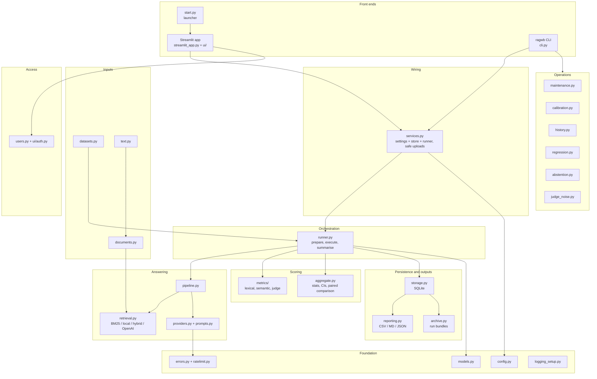
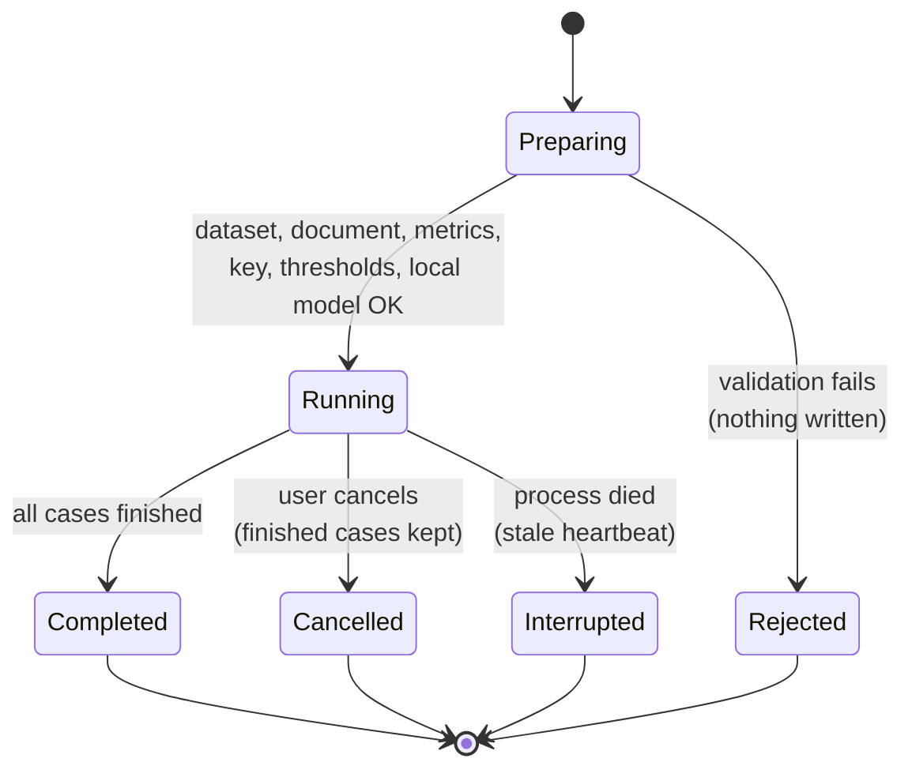
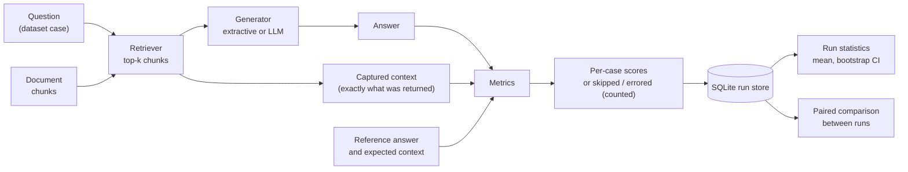
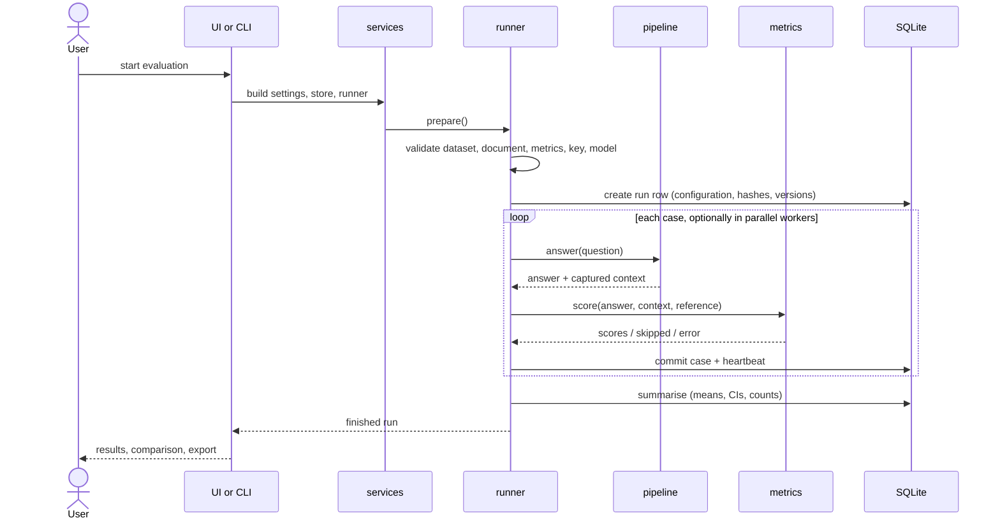
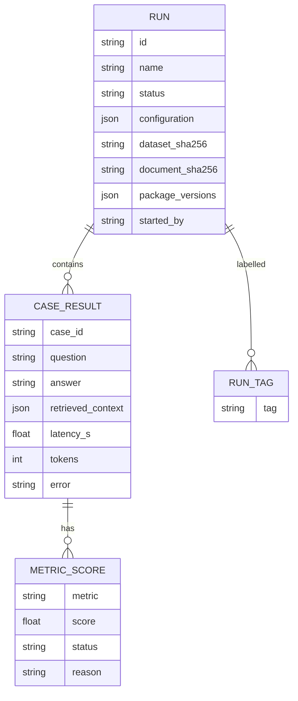

# RAG Evaluation Workbench

**Measure a retrieval-augmented question-answering (RAG) pipeline honestly: run it over a dataset, inspect every answer beside the exact context it saw, and compare runs with paired statistics. Works fully offline, or with an OpenAI-compatible provider when you want LLM judges.**

`Version 1.4.1` · `Python 3.12+` · `MIT licence` · `Streamlit UI + ragwb CLI + SQLite store`

---

## Table of contents

1. [Why this project exists](#1-why-this-project-exists)
2. [Feature overview](#2-feature-overview)
3. [Quick start](#3-quick-start)
4. [Architecture](#4-architecture)
5. [How an evaluation run works](#5-how-an-evaluation-run-works)
6. [Retrieval and answering modes](#6-retrieval-and-answering-modes)
7. [Metrics](#7-metrics)
8. [Statistics and comparison](#8-statistics-and-comparison)
9. [Command-line reference](#9-command-line-reference)
10. [Web application](#10-web-application)
11. [Configuration](#11-configuration)
12. [Data model and storage](#12-data-model-and-storage)
13. [Security and access control](#13-security-and-access-control)
14. [Operations: backup, restore, prune, regression gate](#14-operations)
15. [Project layout](#15-project-layout)
16. [Testing and verification](#16-testing-and-verification)
17. [Documentation set](#17-documentation-set)
18. [Known limitations (honest status)](#18-known-limitations)
19. [Contributing and licence](#19-contributing-and-licence)

---

## 1. Why this project exists

RAG systems are easy to demo and hard to measure. Typical evaluation tooling has three recurring faults, and this workbench is built around avoiding them:

| Common fault | What the workbench does instead |
|---|---|
| Scoring the model's *description* of its sources | The context that is scored is the context the retriever (or the agent's tool) **actually returned**, captured per call |
| Treating failed or skipped scores as `0` | Skipped and errored scores are **excluded and counted**, never imputed, so means are not silently biased down |
| Reporting a mean from 20 questions as a fact | Means come with **bootstrap confidence intervals**; run comparisons are **paired per question** |

It also needs no account, server or key to be useful: a complete offline baseline (BM25 retrieval, extractive answers, lexical metrics) ships in the box and gives LLM-based runs a floor to beat.

---

## 2. Feature overview

- **Fully offline mode.** BM25 inverted-index retrieval, an extractive answer baseline and lexical metrics. No network, no key, no cost.
- **OpenAI-compatible providers.** OpenAI, Groq (free tier verified), xAI and any compatible endpoint via `OPENAI_BASE_URL`. Chat generation, a tool-calling agent mode, and DeepEval LLM-judge metrics.
- **Local embeddings (optional).** `fastembed` with a small BGE model for `local` and `hybrid-local` (BM25 + embeddings, reciprocal-rank fusion) retrieval and for semantic metrics.
- **Reproducible history.** Every run stored in SQLite with full configuration, dataset and document hashes, package versions, per-case latency, tokens and errors.
- **Compare and gate.** Paired comparisons with confidence intervals; `regress` exits non-zero only on a *significant* regression.
- **Judge validation tools.** Judge noise measurement, calibration against pass/fail labels (agreement, Cohen's kappa, threshold sweeps).
- **Exports.** CSV, Markdown, and re-importable JSON run bundles.
- **Operations.** Consistent backups, validated restore with a safety copy, pruning that protects runs tagged `keep`, health checks (`doctor`).
- **Access control for shared use.** One shared password or named accounts (scrypt-hashed) with viewer / editor / admin roles, login throttling, optional TLS.
- **One launcher.** `python start.py` prepares the environment, seeds example runs, starts the app and opens the browser.

---

## 3. Quick start

Requirements: Python 3.12+ (the [uv](https://docs.astral.sh/uv/) package manager is recommended).

```bash
python start.py
```

This single command prepares the environment, runs five offline example evaluations on first launch, starts the web app and opens `http://localhost:8501`. Press `Ctrl+C` to stop.

Useful launcher options:

| Option | Effect |
|---|---|
| `--port 8600` | Use another port |
| `--no-browser` | Do not open a browser |
| `--no-examples` | Skip the first-launch example runs |
| `--setup-only` | Prepare the environment and exit |
| `--host 0.0.0.0` | Listen on the network (requires a login to be configured) |
| `--ssl-cert / --ssl-key` | Serve HTTPS |

First evaluation from the command line:

```bash
uv run ragwb run --name first-run -k 3
uv run ragwb list
uv run ragwb show <run-id>
```

With an OpenAI-compatible provider:

```bash
cp .env.example .env        # then edit: OPENAI_API_KEY, OPENAI_BASE_URL, model names
uv run ragwb run --name judged --provider openai -k 3 \
    --metrics token_f1,context_recall,answer_relevancy,faithfulness,context_relevancy,correctness
```

> Provider runs and judge metrics make paid (or quota-limited) API calls. The UI states this before starting. Use `RAGWB_MAX_REQUESTS_PER_MINUTE` to stay inside a quota.

---

## 4. Architecture

One Python package, `rag_workbench`, holds all behaviour. Two thin front ends call it in-process: the Streamlit app and the `ragwb` CLI. There is **no separate backend server**; the package is the API and SQLite stores history.

### 4.1 Layered architecture



### 4.2 Layer responsibilities

| Layer | Modules | Responsibility |
|---|---|---|
| Front ends | `ui/`, `cli.py`, `start.py` | Input, progress, presentation |
| Wiring | `services.py` | Settings + store + runner; safe uploads |
| Orchestration | `runner.py` | Prepare (validate everything) → execute (retries, cancel, threads) → summarise |
| Answering | `pipeline.py`, `retrieval.py`, `providers.py`, `prompts.py` | Retrieve chunks, produce an answer |
| Scoring | `metrics/`, `aggregate.py` | Per-case metric results; run statistics and comparisons |
| Inputs | `datasets.py`, `documents.py`, `text.py` | Validated cases; document chunks; shared text processing |
| Persistence and outputs | `storage.py`, `reporting.py`, `archive.py` | SQLite; CSV/JSON/MD; run bundles |
| Operations | `maintenance.py`, `calibration.py`, `history.py`, `regression.py`, `abstention.py` | Health checks, backup, pruning; metric-vs-label agreement; tags and search; regression gate; abstention tuning |
| Access | `users.py`, `ui/auth.py` | scrypt accounts with roles, throttling, session revocation |
| Providers | `errors.py`, `ratelimit.py`, `judge_noise.py` | Error classification, request pacing, judge-jitter measurement |
| Foundation | `config.py`, `models.py`, `logging_setup.py` | Settings, data contracts, redacting logs |

### 4.3 Key design decisions

| Decision | Reason |
|---|---|
| Scored context = what the retriever / agent tool returned, captured per call | A model's description of its evidence is not evidence |
| Two pipeline modes: retrieve-then-generate (default) and tool-calling agent | Default mode makes evaluated context exactly the generator's context |
| A real offline baseline | Usable and testable with no key; gives LLM runs a floor to beat |
| `prepare()` validates dataset, document, metrics, key and thresholds *before* any row is written | Invalid configurations never produce misleading partial results |
| Per-case commits with a heartbeat; stale `running` rows become `interrupted` | Crashes keep finished work and are visible |
| Skipped/errored scores excluded and counted, never zero | Zero-imputation biases means downward |
| Bootstrap CIs and paired comparisons | Small datasets need uncertainty |
| Lazy construction of every external client | Importing the package never needs a key or the network |
| Retries in one place (the runner); client-level retries off | Observable attempt counts; no multiplied retry storms |
| Per-case time limit in a daemon thread | A hung call cannot stall a run forever |
| Restore validates before it replaces and writes a safety copy | A bad backup cannot destroy a good store |
| SQLite, one short connection per operation | Zero setup; safe with Streamlit reruns and worker threads |
| Roles read from the users file on every page load | Role changes and removals apply immediately |

---

## 5. How an evaluation run works

### 5.1 Run lifecycle



### 5.2 Per-case data flow



### 5.3 End-to-end sequence



---

## 6. Retrieval and answering modes

| Retriever | Needs | Description |
|---|---|---|
| `bm25` | nothing | Inverted-index BM25; ~3 ms/query on 5,000 chunks (measured here) |
| `local` | `fastembed` (optional extra) | Local embedding model (BGE small); downloaded once (~70 MB), then offline |
| `hybrid-local` | `fastembed` | BM25 + local embeddings fused with reciprocal-rank fusion |
| OpenAI embeddings | provider key | Provider embedding retrieval |

| Answer mode | Description |
|---|---|
| Extractive (offline) | Selects the best-matching sentences from retrieved chunks; no model |
| Retrieve-then-generate | LLM answers from exactly the retrieved context |
| Tool-calling agent | The model chooses its own search queries; the tool's returned context is what is scored |

If a local embedding model cannot be loaded (not downloaded, no network), the run stops immediately with one clear message rather than failing every case.

---

## 7. Metrics

| Family | Metrics | Needs |
|---|---|---|
| Lexical (offline) | Token F1, context recall and related overlap metrics | nothing |
| Semantic (optional) | `semantic_similarity`, `semantic_context_recall` | `fastembed` |
| LLM judge (DeepEval) | answer relevancy, faithfulness, context relevancy, correctness | provider key |

Notes on interpretation:

- Lexical metrics reward shared words, so a correct paraphrase can score low; semantic metrics compare meaning but are a model-dependent proxy.
- Judge metrics are themselves noisy. Use `judge-noise` to measure self-disagreement and `calibrate` to compare a judge with labels before relying on it.
- Thresholds are starting points to calibrate, not standards.

---

## 8. Statistics and comparison

- **Means with bootstrap confidence intervals** for each metric.
- **Paired comparison:** two runs are compared question by question (wins / ties / losses and paired differences), which is more sensitive than comparing two means.
- **Slices:** break scores down by any dataset metadata column (for example question type or difficulty).
- **Regression gate:** `ragwb regress BASELINE CANDIDATE` exits `0` (no significant regression), `3` (significant regression) or `4` (nothing could be checked). An empty check never passes silently.
- **Calibration:** agreement, Cohen's kappa and threshold sweeps against pass/fail labels.

---

## 9. Command-line reference

Every command that takes a run accepts the full id, a unique id prefix, the short id suffix shown in the web app, or an exact run name (at least 4 characters, matching one run). In scripts, prefer full ids.

| Task | Command |
|---|---|
| Run an evaluation | `ragwb run --name NAME -k 3 [--provider openai] [--retriever bm25\|local\|hybrid-local] [--metrics ...] [--workers N] [--limit N]` |
| List / search runs | `ragwb list [--tag T] [--search TEXT]` |
| Show a run | `ragwb show RUN` |
| Compare two runs | `ragwb compare A B` |
| Slice by metadata | `ragwb slices RUN --by type` |
| Export / import | `ragwb export RUN --format csv\|md\|json` · `ragwb import BUNDLE.json` |
| Validate a dataset | `ragwb validate` |
| Score one answer | `ragwb score` |
| Metric catalogue | `ragwb metrics` |
| Health checks | `ragwb doctor` |
| Tag / annotate | `ragwb tag RUN --add baseline,keep` · `ragwb note RUN "text"` |
| Regression gate | `ragwb regress BASELINE CANDIDATE [--metrics ...]` |
| Judge noise | `ragwb judge-noise RUN` |
| Calibration | `ragwb labels-template` · `ragwb calibrate RUN --labels FILE --metric M [--sweep] [--rescore]` |
| Abstention tuning | `ragwb tune-abstention` |
| Backup / restore | `ragwb backup` · `ragwb restore FILE.db --yes` |
| Prune old runs | `ragwb prune --keep-last N [--yes]` (runs tagged `keep` are never pruned) |
| Accounts | `ragwb user add NAME --role viewer\|editor\|admin` |

---

## 10. Web application

| Page | Purpose |
|---|---|
| Overview | Run list, search, tags |
| New evaluation | Configure and start a run, with progress and cancellation; cost warning for provider runs |
| Run results | Summary statistics, every case, retrieved chunks, metric reasons, slices, export and manage |
| Compare runs | Configuration diff, means with CIs, paired per-case differences |
| Datasets and retrieval | Validate a dataset, browse document chunks, try retrieval |
| Settings and metrics | Effective settings, health checks, metric catalogue |
| Users | Account administration (admin role) |

---

## 11. Configuration

Settings come from environment variables and, if present, the project `.env` file (git- and Docker-ignored). Set `RAGWB_NO_DOTENV=1` to skip `.env` entirely.

| Variable | Purpose |
|---|---|
| `OPENAI_API_KEY` | Provider key (any OpenAI-compatible provider) |
| `OPENAI_BASE_URL` | Provider endpoint, for example `https://api.groq.com/openai/v1` |
| `RAGWB_GENERATOR_MODEL` / `RAGWB_JUDGE_MODEL` | Model names from your provider |
| `RAGWB_MAX_REQUESTS_PER_MINUTE` | Process-wide request pacing |
| `RAGWB_LOCAL_EMBEDDING_MODEL` | Local embedding model (default BGE small) |
| `RAGWB_APP_PASSWORD` | Shared password for the web app |
| `RAGWB_RUN_VISIBILITY=own` | Users see only their own runs |
| `RAGWB_DATA_DIR` | Where the run store, uploads, exports and logs live |
| `RAGWB_NO_DOTENV=1` | Do not read `.env` |

Replacing a rotated key: `uv run python scripts/set_api_key.py` (hidden prompt; options `--stdin`, `--remove`, `--check`). The key value is never printed or logged.

---

## 12. Data model and storage



*(Simplified view of the stored information; the exact schema, currently version 3, is documented in the Project Book.)*

- Storage is a single SQLite file under the data directory; one short connection per operation.
- Run bundles are validated JSON; summaries are recomputed on import and paths are project-relative.

---

## 13. Security and access control

| Topic | Behaviour |
|---|---|
| Secrets | Key lives in `.env` (git/Docker-ignored); never displayed or logged; logs are redacted |
| Network exposure | `--host 0.0.0.0` refuses to start without a login configured |
| Authentication | Shared password, or named accounts with scrypt hashes, per-user lockout and a global limit |
| Roles | `viewer`, `editor`, `admin`; changes apply on the next page load; the last admin cannot be removed |
| Transport | `--ssl-cert` / `--ssl-key` for HTTPS; without it, credentials cross the network in clear text |
| Data | Offline mode sends nothing anywhere; provider mode sends questions and context to the provider you configure |
| Folder hygiene | `.env` is not excluded from zips or cloud-sync folders: do not share or sync the folder while it exists |

See `docs/SECURITY.md` for the full threat discussion.

---

## 14. Operations

| Need | Tool |
|---|---|
| Is everything healthy? | `ragwb doctor` |
| Consistent copy of the store | `ragwb backup` (timestamped, collision-safe names) |
| Recover | `ragwb restore FILE --yes` (validates first, writes a safety copy; handles an unreadable store) |
| Control growth | `ragwb prune` (never selects runs tagged `keep`) |
| Protect a baseline | Tag it `keep`; tag it `baseline` as well to find it |
| Gate a change in a pipeline | `ragwb regress` and check the exit code |

---

## 15. Project layout

```
rag-evaluation-workbench/
├── start.py                 one-command setup and launch
├── streamlit_app.py         Streamlit entry point
├── pyproject.toml           package metadata, tool settings
├── uv.lock                  locked dependency set
├── Dockerfile               container recipe (not built in the development environment)
├── .env.example             configuration template (the real .env is git-ignored)
├── src/rag_workbench/       the package
│   ├── cli.py  config.py  models.py  services.py  runner.py
│   ├── pipeline.py  retrieval.py  providers.py  prompts.py
│   ├── datasets.py  documents.py  text.py
│   ├── storage.py  reporting.py  archive.py
│   ├── maintenance.py  calibration.py  history.py  regression.py  abstention.py
│   ├── judge_noise.py  ratelimit.py  errors.py  logging_setup.py  users.py
│   ├── metrics/             lexical, semantic and judge metrics
│   └── ui/                  Streamlit pages (views/) and auth
├── examples/                sample document and datasets
├── calibration/             a re-importable live run and labelling sheets
├── tests/                   offline pytest suite (including Streamlit journeys)
├── scripts/                 verify.py, benchmarks, set_api_key.py, wheel_check.py
└── docs/                    reference documents, Project Book, Practitioner's Guide
```

---

## 16. Testing and verification

```bash
uv run python scripts/verify.py              # standard checks
uv run python scripts/verify.py --audit --wheel
```

Checks run: environment, lockfile, secret scan, ruff + mypy, full offline test suite with coverage, an end-to-end offline CLI workflow, optional dependency vulnerability audit, and optional clean wheel-install checks.

Last recorded result (version 1.4.1): **8/8 checks passed; 453 tests passed, 2 skipped; 97% coverage; no known vulnerabilities; wheel 10/10.** The tests never touch the network or a provider.

---

## 17. Documentation set

| Document | Content |
|---|---|
| `docs/BUILD_AND_RUN.md` | Setup and running |
| `docs/ARCHITECTURE.md` | Architecture summary |
| `docs/API_REFERENCE.md` | CLI and Python API |
| `docs/TESTING.md` | Test strategy and per-file table |
| `docs/SECURITY.md` / `docs/OPERATIONS.md` | Security overview and runbook |
| `docs/REQUIREMENTS_TRACEABILITY.md` | Requirement-to-test matrix |
| `docs/LIVE_VERIFICATION.md` | Record of runs against a real provider |
| `docs/KNOWN_LIMITATIONS.md` | What is not done or not proven |
| `docs/project-book/` | The Project Book: complete technical reference (439 pages, Markdown + PDF) |
| `docs/user-guide/` | The Practitioner's Guide: how to use the project well (173 pages, Markdown + PDF) |

---

## 18. Known limitations

Stated plainly, as the project's own records state them:

- **No human judge calibration yet.** A 30-case labelling sheet exists but is blank. Existing calibration results use labels written by an AI rater and must not be called human labels.
- **Live provider evidence is from Groq's free tier.** Runs against OpenAI itself have not been performed.
- **The Dockerfile has not been built** in the development environment.
- **Accessibility:** automated audits were run; no screen-reader testing has been done.
- **No independent security review** has been performed.
- **Access control is coarse:** three roles, no per-user data separation beyond the optional own-runs visibility setting.
- **Semantic and lexical metrics are proxies;** judge metrics are noisy. Treat thresholds as starting points.
- Free-tier provider quotas are small; pace requests.

Full list: `docs/KNOWN_LIMITATIONS.md`.

---

## 19. Contributing and licence

See `CONTRIBUTING.md`: set up with `uv sync`, check changes with `uv run python scripts/verify.py`, add a test for every behaviour change, and never put a key or personal data in a file, test, log or commit.

Licensed under the **MIT License** (see `LICENSE`).
