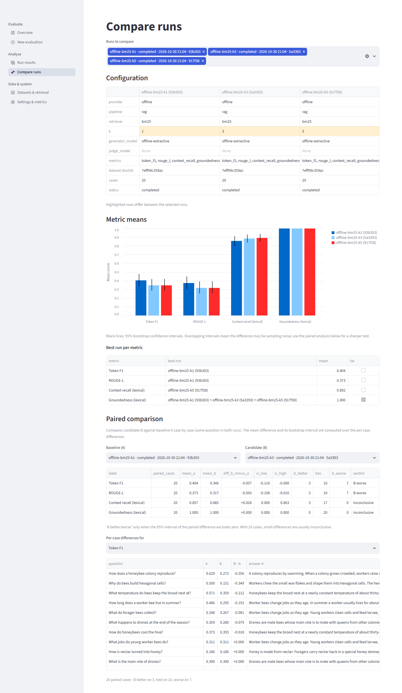

# RAG Evaluation Workbench

Evaluate a retrieval-augmented question-answering (RAG) pipeline over a dataset of questions, inspect every
answer next to the exact context it was given, and compare runs with paired statistics — from a Streamlit
interface or the command line.

* **Runs fully offline.** BM25 retrieval, an extractive answer baseline and lexical metrics need no network and
  no API key, so the whole workflow (and the test suite) works on a laptop with nothing configured.
* **OpenAI + DeepEval when you want them.** With `OPENAI_API_KEY` set: GPT answer generation (retrieve-then-generate
  or a tool-calling agent), OpenAI embedding retrieval, and four LLM-judge metrics (answer relevancy,
  faithfulness, context relevancy, correctness).
* **Honest measurements.** The context that is scored is the context that was retrieved — never the model's own
  description of it. Skipped and failed scores are excluded and counted, never treated as zero. Means come
  with bootstrap confidence intervals; run comparisons are paired per question.
* **Reproducible history.** Every run is stored in SQLite with its full configuration, dataset and document
  hashes, package versions, per-case latency, tokens and errors. Runs export to CSV, Markdown or a JSON bundle
  that can be re-imported.



## Start

Requirements: Python 3.12+ (recommended: [uv](https://docs.astral.sh/uv/) installed).

```bash
python start.py
```

That single command prepares the environment (`uv sync`, or a local `.venv` with pip if uv is not installed),
runs five offline example evaluations on the first launch, starts the app and opens it in your browser at
http://localhost:8501. Press Ctrl+C to stop. Options: `--port 8600`, `--no-browser`, `--no-examples`,
`--setup-only`, `--host` (default localhost; set `RAGWB_APP_PASSWORD` if you expose it).

The bundled example is our own short document about honeybee colonies (`examples/documents/honeybees.pdf`) with
20 questions and reference answers (`examples/datasets/honeybees.jsonl`), plus a set of unanswerable questions and
a paraphrased CSV dataset.

### Command line

```bash
uv run ragwb run --name first-run -k 3
uv run ragwb list
uv run ragwb compare <run-a> <run-b>
uv run ragwb export <run-id> --format md
uv run ragwb slices <run-id> --by type       # scores per metadata value
uv run ragwb doctor                          # health checks
uv run ragwb backup                          # consistent copy of the run store
uv run ragwb restore <backup.db> --yes       # replace the store from a backup (safety copy first)
uv run ragwb tag <run-id> --add baseline     # label runs; then: ragwb list --tag baseline
uv run ragwb regress <baseline> <candidate>  # exit 3 on a significant regression
uv run ragwb user add alice --role viewer    # named account (viewer | editor | admin)
uv run ragwb judge-noise <run-id>            # how much does the LLM judge disagree with itself?
uv run ragwb run --retriever hybrid-local    # BM25 + local embeddings (uv sync --extra semantic)
```

### With OpenAI

```bash
cp .env.example .env      # then set OPENAI_API_KEY
uv run ragwb run --name gpt4o-k3 --provider openai -k 3 \
    --metrics token_f1,context_recall,answer_relevancy,faithfulness,context_relevancy,correctness
```

OpenAI runs and judge metrics make paid API calls; the UI states this before starting. Use
`RAGWB_MAX_REQUESTS_PER_MINUTE` to stay under a provider's quota.

### Where the key lives

Put `OPENAI_API_KEY` (and `OPENAI_BASE_URL`, model names, pacing) in `.env` in the project folder: copy `.env.example` and fill it in.
It is git-ignored and Docker-ignored and is read automatically by the app, the CLI and `start.py`; its value is never displayed or logged.
Do not zip, share or cloud-sync the folder while it exists (see `docs/SECURITY.md`). To replace the key after rotating it at the
provider: `uv run python scripts/set_api_key.py` (hidden prompt; add `--check` to test it).

### With another OpenAI-compatible provider (Groq, xAI Grok, ...)

The OpenAI settings accept any OpenAI-compatible endpoint. In `.env`, put the provider's key in `OPENAI_API_KEY`
and set `OPENAI_BASE_URL` (Groq: `https://api.groq.com/openai/v1`; xAI: `https://api.x.ai/v1`), `RAGWB_GENERATOR_MODEL`
and `RAGWB_JUDGE_MODEL` to model names from that provider's console, then run with `--provider openai --retriever
bm25` (or `local`/`hybrid-local` for embeddings without an API). The offline mode needs no key at all and costs
nothing. Verified against Groq's free tier (see `docs/LIVE_VERIFICATION.md`): answer generation and the DeepEval judge
metrics work, but free-tier daily token quotas are small, so pace requests and expect a multi-metric run to use most of
one model's budget. `scripts/live_smoke.py --yes-spend --retriever bm25 --cases 2` is a small check (despite the flag
name it spends only what your provider charges).

## What you can do

| Task | UI page | CLI |
|---|---|---|
| Configure and run an evaluation, with progress and cancellation | New evaluation | `ragwb run` |
| Inspect summary statistics, every case, retrieved chunks and metric reasons | Run results | `ragwb show` |
| Compare runs: configuration diff, means with CIs, paired per-case differences | Compare runs | `ragwb compare A B` |
| Validate a dataset, browse document chunks, try retrieval | Datasets & retrieval | `ragwb validate` |
| Score one answer ad hoc | — | `ragwb score` |
| Export / import runs | Run results → Export | `ragwb export`, `ragwb import` |
| See effective settings, health checks and the metric catalogue | Settings & metrics | `ragwb metrics`, `ragwb doctor` |
| Break scores down by dataset metadata | Run results → Slices | `ragwb slices` |
| Tag, annotate and search runs | Overview search, Results → Export & manage | `ragwb tag`, `ragwb note`, `ragwb list --search` |
| Gate a change against a baseline run | — | `ragwb regress` |
| Tune the offline abstention threshold on held-out questions | — | `ragwb tune-abstention` |
| Check a metric against human pass/fail labels | — | `ragwb labels-template`, `ragwb calibrate` |

## Project layout

```
start.py                    one-command setup and launch
streamlit_app.py            Streamlit entry point (page navigation)
src/rag_workbench/          the package: config, data models, retrieval, generation, metrics, runner,
                            storage, reporting, CLI, example runs, and ui/ (Streamlit pages)
examples/                   our example document (Markdown source + PDF) and datasets
tests/                      pytest suite (offline; includes Streamlit AppTest journeys)
scripts/                    verify.py, seed_demo_runs.py, make_example_pdf.py
docs/                       architecture, setup, testing, reference docs and the project book
```

## Sharing the app

`python start.py --host 0.0.0.0` listens on the network and refuses to start unless a login exists: either one shared
password (`RAGWB_APP_PASSWORD`) or named accounts (`ragwb user add NAME --role viewer|editor|admin`; each person has their own password and role, failed
sign-ins are throttled per user, runs record who started them, and role changes or removals apply at once). Add `--ssl-cert cert.pem --ssl-key key.pem` to
serve HTTPS; without it credentials cross the network in clear text. Roles are viewer, editor and admin, and every signed-in user sees
every run. A `Dockerfile` is included but was not built in the environment this project was developed in.

## Documentation

* [Build and run](docs/BUILD_AND_RUN.md) · [Architecture](docs/ARCHITECTURE.md) · [Testing](docs/TESTING.md)
* [CLI and Python API reference](docs/API_REFERENCE.md) · [Known limitations](docs/KNOWN_LIMITATIONS.md)
* [Requirements traceability](docs/REQUIREMENTS_TRACEABILITY.md) · [Changelog](CHANGELOG.md)
* [Operations runbook](docs/OPERATIONS.md) · [Security overview](docs/SECURITY.md) · [Live verification record](docs/LIVE_VERIFICATION.md)
* The complete technical book: [`docs/project-book/`](docs/project-book/) (Markdown and PDF)

## Verification

```bash
uv run python scripts/verify.py
```

runs environment and lockfile checks, a secret scan, ruff and mypy, the full offline test suite with coverage and an
end-to-end CLI evaluation in a temporary data directory (`--audit` adds a dependency vulnerability scan). It never pushes, publishes or deletes anything outside that
temporary directory.
