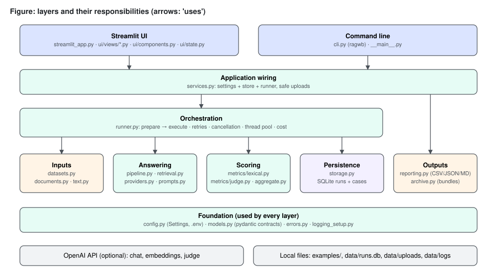
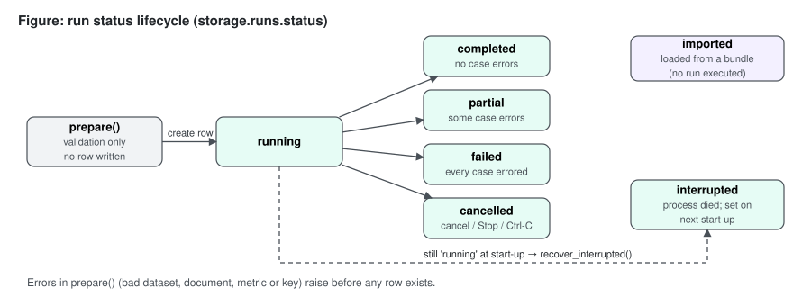
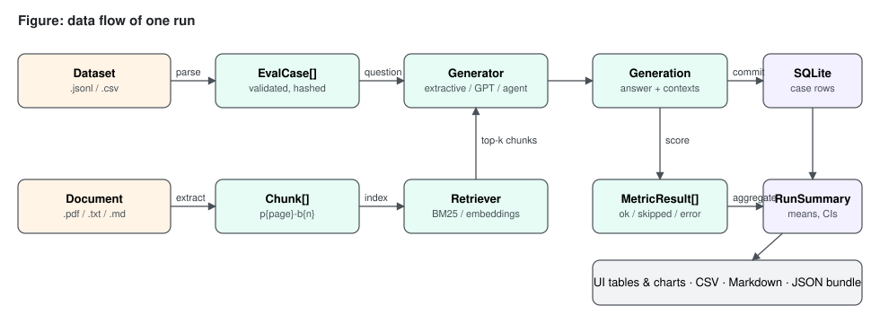

# Architecture

A summary; the project book's Part III (architecture) and Part IV (implementation) go into depth.

## Shape

One Python package, `rag_workbench`, holds all behaviour. Two thin front ends call it in-process: the Streamlit
app (`streamlit_app.py` + `rag_workbench/ui/`, launched by `start.py`) and the `ragwb` CLI. There is no separate backend server: both
front ends run on the user's machine and the package is the API. SQLite stores history.

| Layer | Modules | Responsibility |
|---|---|---|
| Front ends | `ui/`, `cli.py` | input, progress, presentation |
| Wiring | `services.py` | settings + store + runner; safe uploads |
| Orchestration | `runner.py` | prepare (validate everything) → execute (retries, cancel, threads) → summarise |
| Answering | `pipeline.py`, `retrieval.py`, `providers.py`, `prompts.py` | retrieve chunks, produce an answer |
| Scoring | `metrics/`, `aggregate.py` | per-case metric results; run statistics and comparisons |
| Inputs | `datasets.py`, `documents.py`, `text.py` | validated cases; document chunks; shared text processing |
| Persistence & outputs | `storage.py`, `reporting.py`, `archive.py` | SQLite; CSV/JSON/MD; run bundles |
| Operations | `maintenance.py`, `calibration.py`, `history.py`, `regression.py`, `abstention.py` | health checks, backup, pruning; metric-versus-human agreement; tags and search; regression gate; abstention tuning |
| Access | `users.py`, `ui/auth.py` | scrypt-hashed accounts with roles, login throttling, session revocation, optional shared password |
| Providers | `errors.py`, `ratelimit.py`, `judge_noise.py` | error classification (unwrapping, Retry-After), request pacing, judge-jitter measurement |
| Foundation | `config.py`, `models.py`, `errors.py`, `logging_setup.py` | settings, data contracts, error types, redacting (text or JSON) logs |

## Key decisions

| Decision | Why |
|---|---|
| The scored context is whatever the retriever (or the agent's tool) returned, captured per call | A model's description of its evidence is not evidence; scoring it would measure the wrong thing |
| Two pipeline modes: retrieve→generate (default) and tool-calling agent | Default mode makes evaluated context exactly the generator's context; agent mode lets the model choose its own queries |
| A real offline baseline (BM25 + extractive answers + lexical metrics) | Usable and testable with no key or cost; gives LLM runs a floor to beat |
| `prepare()` validates dataset, document, metrics, key and thresholds before any row is written | Invalid configurations never produce misleading partial results |
| Per-case commits with a heartbeat; stale `running` rows become `interrupted` | Crashes and cancellations keep finished work and are visible; live runs in another process are left alone |
| Skipped/errored scores excluded and counted, never zero | Zero-imputation silently biases means downward |
| Bootstrap CIs and paired comparisons | Twenty questions is small; differences need uncertainty |
| Lazy construction of every external client | Importing the package never needs a key or the network |
| Retries in one place (runner), client-level retries off; judge metrics retry transient errors themselves | Observable attempt counts; no multiplied retry storms |
| Per-case time limit in a daemon thread | A hung call cannot stall a run forever (the thread itself cannot be killed) |
| Optional shared password, or named accounts with scrypt hashes, per-user lockout and a global limit | Access control proportionate to a small local tool; coarse roles (viewer, editor, admin), no per-user data separation |
| Regression gate fails only on a significant drop and never passes an empty check | Noise must not fail builds, and silence must not look like success |
| Local embeddings power both optional semantic metrics and `local`/`hybrid-local` retrieval through one embedder interface | One model download serves both; tests use a stand-in embedder |
| Restore validates before it replaces and always writes a safety copy | A bad backup cannot destroy a good store, and a restore can be undone |
| BM25 scores through an inverted index with the original summation order | Faster queries on large documents with bit-identical results |
| Roles are read from the users file on every page load | A role change or removal applies at once; no stale session grants |
| Semantic metrics are optional and refused when their package is absent | The base install stays small and offline; nothing silently degrades |
| SQLite, one short connection per operation | Zero setup; safe with Streamlit reruns and worker threads |
| Run bundles (validated JSON) for exchange | Runs can be shared and re-imported; summaries are recomputed on import, paths are project-relative |

## Run lifecycle

## Data flow

