# RAG Evaluation Workbench — The Project Book

**Engineering, operation and methodology of a retrieval-augmented question-answering evaluation system**

| | |
|---|---|
| Product | RAG Evaluation Workbench (`rag_workbench`, CLI `ragwb`, launcher `start.py`) |
| Product version | 1.4.1 (`src/rag_workbench/__init__.py`) |
| Book edition | 1.4.1 (final), built from the source tree as of 2026-10-31 |
| Prepared for | TheOneAboveALL |
| Prepared by | Claude (Opus 5.5), acting as engineer and technical writer |
| Python | 3.12 (developed and tested on CPython 3.12.15, Windows 11) |
| Source of truth | the repository; where this book and the code disagree, the code is right |

## How to read this book

* **Students** can read Parts I, VI and VII first: what the system is for, how its numbers are computed and
  what they mean, and how to use it.
* **Engineers reviewing the code** should read Parts III–V (architecture, implementation, file-by-file
  reference) and IX (testing).
* **Operators** need Part VIII (setup and operation) and XI (limitations).
* Part II explains the analysis behind the design, and Part X records how the work was carried out, including the
  defects found and fixed along the way.

Conventions: `path/to/file.py:123` points at a line in the final source; *verified* means the statement was checked
by running code or tests, and the command is given so it can be repeated; *rationale* marks a design reason;
*limitation* marks something the system does not do. Numbers quoted from evaluation runs are real outputs of the
example runs that `start.py` creates; illustrative examples are labelled as such.

## Executive summary

RAG Evaluation Workbench measures how well a retrieval-augmented question-answering pipeline answers questions
about a document. Given a dataset of questions (optionally with reference answers) and a source document, it
retrieves passages, produces an answer per question, scores every answer with a chosen set of metrics, stores the
whole run with its configuration, and lets the user inspect individual answers next to the exact passages they
were based on and compare runs with paired statistics.

It runs in two modes. **Offline**, with no API key and no network, it uses BM25 retrieval (hybrid BM25 + embedding fusion is available once a key is configured; local-embedding retrieval, `local` and `hybrid-local`, needs only the optional `semantic` extra), an extractive answer
baseline and five lexical metrics (two optional local-embedding metrics can be added with the `fastembed` package); this is how the test suite and the documented examples run. **With an OpenAI-compatible service**,
it can generate answers with a GPT-style model (retrieve-then-generate or a tool-calling agent), retrieve with API
embeddings, and score with four DeepEval LLM-judge metrics.

One command, `python start.py`, prepares the environment, creates five example evaluations over the bundled
honeybee document on the first launch (three more bundled documents, volcanoes, coffee and lighthouses, are there for your own runs), and opens the application in the browser.

Verified state at the time of writing: 455 tests are collected and, offline, 453 pass and 2 are skipped (the opt-in live
test and the opt-in real-model test); statement coverage is 97 % (3,624 statements, 125 missed) excluding the Streamlit
page scripts, which are covered by UI journey tests; `ruff` and `mypy` are clean over 47 source files; the local
verification script runs six steps (environment, lockfile, secrets, static analysis, tests, end to end), an optional
dependency audit and an optional clean wheel install; the UI was exercised in a real browser and audited with axe-core.
Release 1.3 added a narrow live check: generation and the DeepEval judge metrics were run against Groq's free tier through
its OpenAI-compatible endpoint, and a real local embedding model (`BAAI/bge-small-en-v1.5`) was run on all bundled datasets
(Part XV). Release 1.4 ran the tool-calling agent pipeline live on three cases, installed the wheel into an empty environment
and swept pass thresholds against labels written by an AI rater (Part XVI). **OpenAI itself and API embeddings were not called
live, the Docker image was never built, and the judge was never compared with human labels.**

## Abstract

Evaluating retrieval-augmented generation requires measuring two coupled systems — retrieval and generation —
under conditions where ground truth is partial and some metrics are themselves model judgments. This book
documents a local, reproducible evaluation workbench designed around three principles: score what actually
happened (the retrieved context, not a description of it); never hide missing data (skipped and failed scores
are counted, not zeroed); and report uncertainty (bootstrap confidence intervals and paired comparisons). It
describes the system's architecture, every source file, the mathematical definitions of its metrics (five lexical, four LLM-judge and two optional semantic), its
user interface, its operation and its test suite, together with an honest account of its limitations and of how
it was built.

## Contents

The table of contents of the PDF edition is generated from the headings. The Markdown edition is split into:

| File | Part |
|---|---|
| `00-front-matter.md` | Title, version, executive summary, abstract |
| `01-foundation.md` | Part I — Project foundation (chapters 1–14) |
| `02-design-analysis.md` | Part II — Design analysis (15–26) |
| `03-architecture.md` | Part III — System architecture (27–40) |
| `04-core-implementation.md` | Part IV — Core implementation (41–60) |
| `05-file-reference.md` | Part V — Detailed file-by-file reference |
| `06-evaluation-methodology.md` | Part VI — Evaluation methodology |
| `07-user-interface.md` | Part VII — User interface and workflows |
| `08-setup-and-operation.md` | Part VIII — Setup and operation |
| `09-testing-and-qa.md` | Part IX — Testing and quality assurance |
| `10-development-history.md` | Part X — Development history and engineering decisions |
| `11-security-reliability-limitations.md` | Part XI — Security, reliability and limitations |
| `12-reference-material.md` | Part XII — Reference material (with generated appendices) |
| `13-release-1-1.md` | Part XIII — Release 1.1: from working tool to production-grade tool |
| `14-release-1-2.md` | Part XIV — Release 1.2: history, gates, accounts and packaging |
| `15-release-1-3.md` | Part XV — Release 1.3: live verification, pacing, local embeddings, judge noise and roles |
| `16-release-1-4.md` | Part XVI — Release 1.4: recovery, account management, calibration sweeps, an indexed BM25 and a clean install |


# Part I — Project foundation

## 1. Title page and project identity

**RAG Evaluation Workbench** is a local Python application for evaluating retrieval-augmented question-answering
pipelines. Its identifiers are used consistently across the product:

| Identifier | Value | Where |
|---|---|---|
| Product name | RAG Evaluation Workbench | UI title, README, page title (`streamlit_app.py`) |
| Distribution name | `rag-evaluation-workbench` | `pyproject.toml` |
| Python package | `rag_workbench` | `src/rag_workbench/` |
| Launcher | `start.py` | project root |
| Command-line tool | `ragwb` | `[project.scripts]` in `pyproject.toml` |
| Environment-variable prefix | `RAGWB_` | `src/rag_workbench/config.py` (`ENV_VARS`) |
| Run bundle format | `rag-workbench-run`, version 1 | `src/rag_workbench/archive.py` |

*Rationale for the name.* The product evaluates retrieval-augmented pipelines specifically, not language models in
general, and it is meant to be used iteratively — configure, run, inspect, compare, repeat — which is what a
workbench is for. The short forms `rag_workbench` and `ragwb` avoid collisions with existing evaluation libraries'
import names.

## 2. Version information and documentation date

| Item | Value |
|---|---|
| Product version | 1.4.1 |
| Documentation date | 2026-10-31 |
| Python | ≥ 3.12; pinned to 3.12 in `.python-version`; tested on CPython 3.12.15 |
| Key dependencies (as locked and installed) | Streamlit 1.66.1, pandas 3.1.0, pydantic 2.14.1, PyMuPDF 1.28.2 (constrained below 2.0, see Chapter 109), LangChain 1.4.7, langchain-core 1.7.0, langchain-openai 1.7.2, openai 3.37.0, DeepEval 4.3.1, python-dotenv 1.2.4 |
| Development dependencies | pytest 9.1.1, pytest-cov 7.1.0; docs group: Markdown 3.11.2 |
| Lock file | `uv.lock`, 152 packages (117 in release 1.0; the dev group gained ruff, mypy and pip-audit, and release 1.3 added the optional `semantic` extra, `fastembed`, with its dependencies); `pyproject.toml` states minimum versions only |
| Operating system used for verification | Windows 11 Home 10.0.26300 |

The exact version of every installed package for a given run is recorded in that run's `environment` field
(`runner.environment_info`) and shown on the Run results → Configuration tab.

## 3. Executive summary

See the front matter. In one sentence: the workbench turns "ask questions about a document and see whether the
answers are good" into a repeatable experiment with recorded configuration, per-answer evidence, honest statistics
and a usable interface — offline by default, with OpenAI and DeepEval as optional, explicitly costed extensions,
started by a single command.

## 4. Abstract

See the front matter.

## 5. Problem statement

A retrieval-augmented generation (RAG) system answers a question in two steps: it *retrieves* passages from a
corpus and *generates* an answer conditioned on them. When such a system gives a bad answer, the cause can be
retrieval (the right passage was not found), generation (the passage was found but misused), or the evaluation
itself (the reference answer is paraphrased, the judge is unreliable, the sample is too small). A useful
evaluation tool therefore has to:

1. run the pipeline over many questions under a precisely recorded configuration;
2. keep, for every answer, the exact passages the generator saw;
3. score retrieval and generation separately, with metrics whose requirements and failure modes are explicit;
4. distinguish "scored zero" from "could not be scored";
5. quantify uncertainty, because evaluation sets are small;
6. compare configurations case by case rather than only by averages;
7. survive individual failures (timeouts, rate limits, malformed outputs) without losing work;
8. be usable without paid services, so that development and testing do not cost money;
9. be easy to start: one command from a fresh checkout to a working application.

## 6. Motivation and background

**Retrieval-augmented generation** grounds a language model's answers in external documents, reducing
unsupported statements and letting the knowledge base change without retraining. Its quality depends on the
retriever (which passages are found, typically the top *k* by a similarity score), on the generator (whether it
uses those passages faithfully), and on their interaction (more passages raise the chance that the answer is
present but add distracting text).

**Evaluation approaches** fall into two broad families, both implemented here:

* *Reference-based lexical metrics* compare the answer with a human-written reference answer by word overlap —
  exact match and token F1 as used for extractive question answering (SQuAD), and ROUGE-L from summarisation.
  They are cheap, deterministic and reproducible, but blind to paraphrase.
* *LLM-as-a-judge metrics* ask a language model to assess an answer against a rubric — whether it addresses the
  question, whether its claims are supported by the context, whether it agrees with the reference. They capture
  meaning but are themselves model outputs, vary between judge models, and cost money.

Retrieval quality can be measured separately from answer quality: if the words of the reference answer are not
in the retrieved passages, no generator could have produced it from them. The workbench's lexical *context
recall* implements exactly this proxy; DeepEval's *contextual relevancy* is the judge-based counterpart.

The bundled example is deliberately small — a two-page document about honeybee colonies, written for this
project, and twenty questions — which makes every answer inspectable by a person. That smallness is also the main
statistical limitation, and the reason confidence intervals and paired comparisons are first-class features.

## 7. Objectives

| # | Objective | Measured by |
|---|---|---|
| O1 | Evaluate a RAG pipeline over a question dataset end to end | an offline run completes for the bundled dataset (verified) |
| O2 | Score what actually happened | stored context equals retriever output (test `test_rag_pipeline_evaluates_exactly_the_retrieved_chunks`) |
| O3 | Work without network or keys | full test suite runs with an empty `OPENAI_API_KEY` |
| O4 | Support real LLM generation and judging when configured | OpenAI and DeepEval adapters (tested with fakes) |
| O5 | Make results reproducible and auditable | configuration, hashes and package versions stored per run |
| O6 | Make uncertainty visible | bootstrap CIs on every mean; paired comparison verdicts |
| O7 | Be robust to failures | per-case error capture, retries, cancellation, interruption recovery |
| O8 | Provide a usable interface | six-page Streamlit app with UI journey tests (and, since release 1.2, a scripted accessibility check, Part XIV §158) |
| O9 | Start with one command | `python start.py` (verified from an empty data directory) |
| O10 | Be documented to the level of the code | this book and its generated appendices |

## 8. Scope and explicit non-goals

**In scope:** single-document (or single-corpus-file) question answering; datasets in JSONL or CSV; PDF, TXT and
Markdown documents; BM25, API-embedding, hybrid (reciprocal-rank-fusion) and local-embedding retrieval (`bm25`, `embedding`, `hybrid`, `local`, `hybrid-local`); offline extractive and OpenAI generation (two pipeline
shapes); eleven metrics (five lexical, four LLM-judge, and two optional semantic metrics that need a local embedding model); local SQLite history; CSV, JSON and Markdown exports; run bundles; a Streamlit UI, a CLI and
a one-command launcher.

**Non-goals** (deliberate, with reasons):

| Non-goal | Reason |
|---|---|
| A hosted multi-user service, an identity platform (password reset, per-user separation of runs), an HTTP API (release 1.1 adds an optional shared password, Part XIII; release 1.2 adds named accounts and TLS for a small trusted team, Part XIV; release 1.3 adds three coarse roles, viewer, editor and admin, Part XV; release 1.4 adds an admin Accounts page, password change and an optional UI-level run filter, Part XVI) | the users are individuals on their own machines; both front ends call the package in-process |
| Training or fine-tuning models | evaluation only |
| Multi-document corpora with metadata filtering, vector databases | an in-memory index is sufficient at the document sizes targeted; a vector store would add operational weight without a requirement |
| Model providers other than OpenAI-compatible ones | one well-supported API shape keeps the scope testable; any service that speaks the OpenAI protocol works through `OPENAI_BASE_URL` (release 1.3 ran one, Groq's free tier, live: Part XV) |
| Benchmark leaderboards or claims about model quality | the bundled dataset is too small to support general claims |
| Human annotation workflows | recommended as future work for judge validation |

## 9. Stakeholders and intended users

| Stakeholder | Interest |
|---|---|
| The project owner (a student) | a complete, explainable, demonstrable evaluation system and its documentation |
| A developer of a RAG pipeline | find out which configuration (retriever, *k*, model, prompt) answers better, and why individual answers fail |
| A reviewer or examiner | check that numbers are genuine, methods are sound and limitations are stated |
| A future maintainer | understand the code quickly and change it safely (tests, references) |

## 10. Functional requirements

The traceability matrix (`docs/REQUIREMENTS_TRACEABILITY.md`, reproduced in Part XII) maps each requirement to code
and tests. In summary:

| ID | Requirement |
|---|---|
| R1 | Answer questions about a document with a retrieval-augmented pipeline |
| R2 | Evaluate over a dataset of questions with optional reference answers |
| R3 | Provide LLM-judge metrics: answer relevancy, faithfulness, contextual relevancy, GEval correctness (threshold 0.7) |
| R4 | Summarise each metric: mean, pass/fail counts, pass rate, uncertainty |
| R5 | Compare runs; show the best run per metric |
| R6 | Make *k* and every other parameter configurable without editing code |
| R7 | Provide a Python-native user interface |
| R8 | Start the whole application with one command |
| R9 | Run end to end without network or keys |
| R10 | Use provider adapters with explicit variables, timeouts and retries |
| R11 | Record real retrieved context, latency, tokens and errors per case |
| R12 | Tolerate partial failures and interruptions without losing completed work |
| R13 | Persist runs with reproducibility metadata |
| R14 | Export CSV, JSON and Markdown; re-import JSON |
| R15 | Validate datasets with actionable, line-numbered errors |
| R16 | Support the workflow configure → run with progress → inspect → compare → export → history in the UI |
| R21 | Score a single answer ad hoc |
| R22 | Ship example data owned by the project |

## 11. Non-functional requirements

| ID | Requirement | How it is met |
|---|---|---|
| N1 | Import safety: importing never needs a key or the network | lazy construction of every external client (Part IV) |
| N2 | Determinism of the offline path | BM25 ties broken by document order; extractive selection deterministic; bootstrap seeded |
| N3 | No secret disclosure | `SecretStr`; `public_dict()`; log and traceback redaction; secret scan in `verify.py` |
| N4 | Bounded inputs | size and count limits for datasets, documents, fields and bundles (`Settings`) |
| N5 | Reasonable local footprint | SQLite; no services to run; one command to start |
| N6 | Testability | 455 collected tests (453 run offline, 2 opt-in tests skipped: one live, one with a real model); fakes for every external dependency |
| N7 | Platform | developed and verified on Windows; paths handled with `pathlib`; the launcher uses only the standard library |
| N8 | Privacy | no telemetry (DeepEval opt-out, Streamlit usage statistics off); data stays in `data/`; app bound to localhost |

## 12. Acceptance criteria

1. `python start.py` sets up the environment and serves the UI; the first launch creates example runs.
2. An offline evaluation of the bundled dataset completes from the UI and from the CLI.
3. Each case shows the answer, the reference, the retrieved passages with scores, and every metric's result and reason.
4. Two runs can be compared, with confidence intervals and a per-case paired analysis.
5. A failing case is recorded with its error and does not stop the run.
6. Invalid datasets and impossible configurations are rejected before a run starts, with a clear message.
7. Results export to CSV, JSON and Markdown; JSON exports re-import.
8. The test suite passes offline; `scripts/verify.py` passes.

All eight were met at the time of writing; the evidence is listed in the acceptance-test matrix (Part XII).

## 13. Assumptions, constraints and dependencies

* **Assumption:** the dataset's reference answers are correct and written from the document. The bundled ones were
  written for the honeybee document; they are paraphrases, not extracts, which matters for lexical metrics.
* **Assumption:** one source document per run. Multiple documents can be concatenated into one text file.
* **Constraint:** no paid API calls or external AI services were authorised during development (release 1.3 added a narrow live check on a free tier, Part XV; release 1.4 added a live agent-pipeline run on the same tier, Part XVI), so most of the OpenAI
  paths could not be exercised live.
* **Constraint:** the environment is a student's Windows laptop; setup must be one command and need no services.
* **Dependency:** OpenAI's API for the optional generator, embeddings and judge; DeepEval's metric implementations
  and prompts for the judge metrics (their exact prompts belong to the installed DeepEval version, 4.3.1).
* **Dependency:** PyMuPDF for PDF text extraction (block-level layout analysis) and for generating the example PDF.
* **Example data:** the honeybee document, its PDF rendering and all datasets were written for this project.

## 14. Glossary

| Term | Meaning in this project |
|---|---|
| Abstention | an answer that declines to answer; recognised by `text.is_abstention` (e.g. "does not provide enough information") |
| Agent pipeline | a LangChain tool-calling agent that decides when and how to call the retrieval tool |
| BM25 | Okapi BM25, a term-frequency / inverse-document-frequency ranking function |
| Bootstrap CI | a confidence interval obtained by resampling cases with replacement and taking percentiles of the resampled means |
| Bundle | a JSON file containing one run and its case results (`rag-workbench-run` format) |
| Case | one dataset row: a question, optional reference answer and metadata |
| Chunk | a retrievable unit of the document (a PDF text block or a paragraph), id `p{page}-b{n}` |
| Context | the passages given to the generator for one question |
| Context recall (lexical) | share of the reference answer's content terms present in the context |
| DeepEval | the open-source library providing the judge metrics |
| Example runs | the five offline runs `start.py` creates on first launch (`rag_workbench.demo`) |
| Extractive generator | the offline baseline that answers with the best-matching sentences from the context |
| Faithfulness | (judge) share of the answer's claims supported by the context |
| GEval | DeepEval's rubric-based judge metric, used for correctness |
| Groundedness (lexical) | share of the answer's content terms present in the context |
| Judge | the language model that scores answers in LLM-as-a-judge metrics |
| *k* | the number of chunks retrieved per query |
| Lexical metric | a metric computed from word overlap |
| Paired comparison | comparing two runs question by question rather than by their averages |
| Pass rate | share of scored cases whose score is at least the metric's threshold |
| Provenance warning | a note stored with an imported run explaining why its numbers need care |
| RAG | retrieval-augmented generation |
| Reference answer | the dataset's expected answer for a question |
| Run | one execution of a pipeline over a dataset with fixed configuration |
| Skipped | a metric that could not be computed for a case (missing input); excluded from means |
| Token F1 | harmonic mean of precision and recall of answer tokens against reference tokens |


# Part II — Design analysis

Part I said what the workbench must do. This Part records the analysis that turned those requirements into a
design: what one evaluation case must capture, which mistakes RAG evaluations commonly make and how the design
prevents each, how technologies, data, metrics and the baseline were chosen, and how the result is verified. Part
III then describes the architecture that came out of it.

## 15. From problem to design

The design was derived in four steps, each recorded in a chapter of this Part:

1. **Unit of evidence (Chapter 16).** Decide what must be recorded for one question so that any number shown later
   can be traced back to inputs, outputs and configuration.
2. **Failure analysis (Chapter 17).** List the ways an evaluation of this kind produces misleading numbers, and
   turn each into a design constraint.
3. **Choices (Chapters 18–22).** Select technologies, example data, metrics, the offline baseline and the storage
   model against those constraints.
4. **Qualities (Chapters 23–26).** Fix the interface, reliability, security and verification strategies.

The guiding rule throughout was: *every number the product shows must be computable again from what it stored*.

## 16. What one evaluation case must capture

| Element | Why it is needed | Where it lives |
|---|---|---|
| Question, reference answer, case id, metadata | the input and the ground truth (when present) | `EvalCase`, copied into `CaseResult` |
| The answer | the output being judged | `CaseResult.answer` |
| **The passages the generator actually saw**, with ids, ranks and scores | faithfulness and retrieval metrics are only meaningful against the true context | `CaseResult.contexts` (`RetrievedChunk`) |
| Where the context came from | the retriever directly, or the agent's tool calls | `CaseResult.context_source` |
| Each metric's status, score, threshold, pass flag and reason | "0.0" and "not computable" must never be confused; reasons make scores explainable | `MetricResult` |
| Latency, tokens, cost, attempts, error | operational quality and failure analysis | `CaseResult` fields |
| The full run configuration, dataset and document hashes, package versions | reproduction and like-for-like comparison | `RunRecord` |

A consequence of this table is that the pipeline interface returns a `Generation` object containing the contexts
alongside the answer: retrieval output is part of the result, not a side effect.

## 17. Pitfalls in evaluating RAG pipelines

Each pitfall below is a way an evaluation can produce confident but wrong numbers. The right-hand column is the
design constraint adopted to prevent it.

| Pitfall | Effect | Constraint adopted |
|---|---|---|
| Scoring the model's own description of its sources (e.g. a "context" field in a structured answer) instead of the retrieved text | faithfulness and context relevancy measure the model's narrative, not the retrieval | contexts are captured from the retriever or the tool call that returned them; any self-report is stored separately and never scored |
| Run labels or file names carrying parameters ("k3") while the code used something else | comparisons silently mix configurations | the complete `RunConfig` is stored with every run; labels are free text and carry no meaning |
| All-or-nothing batch jobs that write results only at the end | one timeout loses every answer | each case is committed as soon as it finishes; failures become recorded case errors |
| Expensive work at import time (building indexes, creating API clients) | nothing can run, or be tested, without credentials and network | every external client is created lazily, on first use |
| A mandatory paid service | development and testing cost money; examiners cannot run it | a complete offline path (BM25, extractive baseline, lexical metrics) |
| Treating "could not score" as zero | means are biased downwards and failures are hidden | `skipped` and `error` statuses, excluded from statistics and counted |
| Comparing means of small samples without uncertainty | noise is read as improvement | bootstrap intervals on every mean; paired comparisons with an explicit "inconclusive" verdict |
| Parameters hard-coded in scripts, duplicated per experiment | drift between copies | one parameterised runner; configuration only through `RunConfig`, CLI flags, UI or environment |
| Unvalidated inputs | crashes mid-run, or quietly wrong data | datasets, documents, bundles and settings validated before any work starts |
| Silent telemetry or secrets in logs | privacy and security exposure | telemetry disabled; keys held as `SecretStr` and redacted from logs and tracebacks |

## 18. Technology selection

| Concern | Choice | Alternatives considered | Reason |
|---|---|---|---|
| Language | Python 3.12 | — | the evaluation and LLM ecosystem is Python-first; the user works in Python |
| Packaging | uv + `pyproject.toml` + `uv.lock`, hatchling editable install | pip + requirements.txt; Poetry | reproducible lock, fast installs; `start.py` falls back to pip when uv is absent |
| Data contracts | pydantic v2 | dataclasses | validation at boundaries (config, bundles, persisted JSON) for free |
| PDF text | PyMuPDF block extraction (< 2.0) | pdfminer, pypdf | robust layout blocks ≈ paragraphs; PyMuPDF 2.0 was excluded after measuring a 3 s model-loading import (Chapter 109) |
| Offline retrieval | own BM25 implementation | rank-bm25 package | about 50 lines, deterministic, no dependency; fully testable against a hand computation and, since release 1.4 (an inverted index, Part XVI §175), against the textbook definition with exact float equality |
| Dense retrieval | OpenAI-compatible embeddings + LangChain `InMemoryVectorStore`; since release 1.3 also a local embedding model (`fastembed`) scored by plain cosine similarity in `LocalEmbeddingRetriever` | FAISS, Chroma | a single document needs no external index |
| Generation | LangChain `ChatOpenAI`; `create_agent` for the agent mode | raw OpenAI SDK | structured output and tool calling with little code; easy to fake in tests |
| Judge metrics | DeepEval | RAGAS, custom prompts | ready, documented metrics for exactly these four properties |
| Persistence | SQLite (stdlib) | JSON files, PostgreSQL | transactional, zero setup, one file |
| UI | Streamlit | Gradio, a JavaScript front end | Python-native, data-oriented widgets and charts; no build tooling |
| Charts | Altair (ships with Streamlit) | matplotlib | interactive, declarative, fixed [0, 1] scales |
| Tests | pytest + Streamlit AppTest | Selenium/Playwright | runs headless and offline in seconds |

## 19. Example data design

The bundled example was written for this project so that it is free to use and its properties are known.

* **Document.** `examples/documents/honeybees.md` — a title and ten paragraphs about honeybee colonies (castes,
  the queen, worker roles, drones, the waggle dance, honey, beeswax, temperature control, swarming, pollination
  and threats). `scripts/make_example_pdf.py` renders it to a two-page PDF with one text block per paragraph, so
  the PDF path of the system is exercised: extraction yields 11 chunks (the title plus ten paragraphs).
* **Main dataset.** `examples/datasets/honeybees.jsonl` — 20 questions (ids `q01`–`q20`), each answerable from one
  paragraph, with **paraphrased** reference answers. Paraphrase is deliberate: it shows the gap between lexical
  overlap and correctness that Part VI discusses.
* **Unanswerable set.** `honeybees_unanswerable.jsonl` — four questions the document cannot answer (reference = the
  standard abstention sentence) and two answerable controls, labelled in `metadata.type`. It tests whether a
  pipeline abstains.
* **CSV variant.** `honeybees_paraphrased.csv` — five further paraphrased questions with a `topic` column,
  exercising the CSV format and metadata columns.

The document's title becoming a retrievable chunk was kept rather than filtered, because real documents have
headings and the effect on retrieval is instructive (Part VI).

## 20. Metric selection

Nine metrics were chosen to cover answer quality and retrieval quality, each with and without a judge model:

| Question asked | Offline (lexical) | With a judge (DeepEval) |
|---|---|---|
| Is the answer correct? | exact match, token F1, ROUGE-L | correctness (GEval) |
| Is the answer supported by its context? | groundedness | faithfulness |
| Did retrieval find what was needed? | context recall | contextual relevancy |
| Does the answer address the question? | — | answer relevancy |

Requirements are declared per metric (`requires_reference`, `requires_context`, `requires_openai`), so the runner
can refuse impossible configurations up front and each case can report *why* a metric was skipped. Thresholds
are configurable per run; the defaults (0.7 for the judge metrics and for lexical context recall and groundedness,
0.5 for token F1 and ROUGE-L, 1.0 for exact match) are conventions, not calibrated values, and the book says so
wherever they appear.

## 21. Offline baseline design

The offline pipeline had to be genuine — producing answers by computation, not canned responses — so that offline
runs exercise every code path and give LLM runs a floor to beat:

* **Retrieval:** BM25 over content tokens (lower-cased, stop words removed, light plural stemming).
* **Generation:** the extractive generator selects up to *n* sentences from the retrieved passages, weighted by the
  inverse document frequency of question terms they contain, and returns them in reading order; if no sentence
  shares a content term with the question it returns the abstention sentence.
* **Known character:** groundedness is ~1.0 by construction (it copies sentences); token F1 is bounded by how much
  the reference paraphrases the document; it rarely abstains. These properties are documented as features of the
  baseline, not hidden.

## 22. Persistence design

Two tables — `runs` and `case_results` — with pydantic models serialised as JSON and a few indexed columns. Cases
are committed one at a time; each commit refreshes the run's heartbeat, so a run whose process died can be told
apart from a run still executing elsewhere. Exchange between machines uses a separate, validated bundle format
rather than copying database files: bundles carry project-relative paths only, and their summaries are recomputed
from the cases on import.

## 23. Interface design principles

* The workflow follows the evaluation itself: data → pipeline → metrics → run → inspect → compare → export.
* Invalid configurations are visible *before* running (disabled button plus the reason), not as a failure later.
* Every number has its provenance one click away: case table → case detail → retrieved chunks and metric reasons.
* Uncertainty is shown with the number: error bars on charts, intervals in tables, "inconclusive" verdicts.
* Costs are announced before an OpenAI run starts.
* Stored text is rendered as text; values that reach HTML are escaped.
* The app opens with real example results (created by `start.py`), so a new user sees what a finished evaluation
  looks like before configuring one.

## 24. Reliability design

| Threat | Response |
|---|---|
| Transient provider errors (rate limits, timeouts, 5xx) | classified (also when wrapped by DeepEval's tenacity `RetryError`), retried with exponential back-off and jitter stretched to the provider's `Retry-After` hint (capped at 60 s), attempts recorded; optional request pacing (`RAGWB_MAX_REQUESTS_PER_MINUTE`) avoids hitting the limit |
| Permanent provider errors (bad key, bad request) | not retried; recorded as the case's error |
| Unexpected exceptions in a case | caught per case; the run continues; the log keeps the traceback |
| User stops the run | finished cases kept; run marked `cancelled` |
| Process dies | finished cases kept; run marked `interrupted` once its heartbeat is 15 minutes old |
| Corrupt or hostile bundle | rejected by format/version/schema validation before anything is written |

## 25. Security and privacy design

The threat model is a single user on their own machine handling possibly sensitive documents and an API key. The
design therefore keeps everything local (data in `data/`, app bound to `localhost`), disables telemetry, never
writes the key anywhere, bounds every input, sanitises uploaded file names, neutralises spreadsheet formulas in CSV
exports, and escapes stored values before they reach HTML. Part XI examines each measure.

## 26. Verification strategy

| Level | Method |
|---|---|
| Functions | unit tests with hand-computed expectations (BM25, F1, ROUGE-L, bootstrap) |
| Modules | contract tests for every error path (datasets, documents, storage, bundles, configuration) |
| External services | fakes: scripted chat model, deterministic fake embeddings, fake DeepEval metrics |
| System | end-to-end offline runs over the example data, reproducibility checks, CLI tests |
| UI | Streamlit AppTest journeys plus manual checks in a real browser and captured screenshots |
| Whole product | `scripts/verify.py` (environment, lockfile, secret scan, static analysis, tests with coverage, CLI end to end) and `python start.py` from an empty data directory |


# Part III — System architecture

This part describes how the RAG Evaluation Workbench is put together: which modules exist, what each one owns, how data and control move between them, how the program runs on a machine, and why the structure looks the way it does. Every statement about behaviour is taken from the current source; locations are given as `file:line`. Where a reason is my reading of the code rather than something the code or its comments state, it is marked **rationale:**. Limitations are named as such.

## 27. Final architecture overview

### 27.1 The system in one paragraph

The workbench is started with one command, `python start.py`. That launcher prepares the environment, creates example runs on first launch and opens the app (§35.2). Behind it sits a single Python package, `rag_workbench` (`src/rag_workbench/`), with two thin front ends: a Streamlit multi-page application (`streamlit_app.py` plus `src/rag_workbench/ui/`) and a command-line interface (`ragwb`, declared in `pyproject.toml:20-21` and implemented in `src/rag_workbench/cli.py`). Both front ends obtain the same `AppContext` (settings plus a SQLite run store) from `services.open_context` (`src/rag_workbench/services.py:27`) and drive the same `EvaluationRunner` (`src/rag_workbench/runner.py:71`). A run takes a validated dataset of questions and a source document, builds a retrieval-augmented answering pipeline, answers every question, scores every answer with a chosen set of metrics, commits each case to SQLite as soon as it finishes, and finally stores an aggregate summary with bootstrap confidence intervals. Stored runs can be compared case by case, exported to CSV, JSON or Markdown, and re-imported from JSON bundles. There is no separate server process, message queue, or HTTP API.

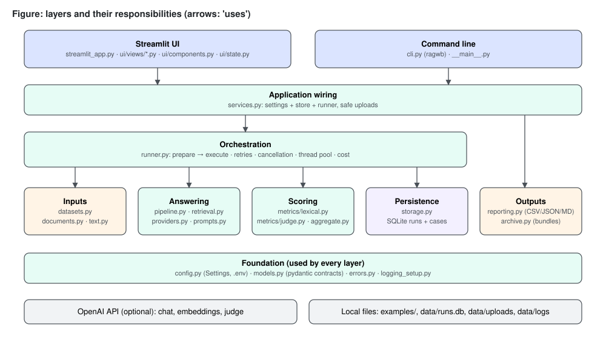

The figure shows the layers (front ends, wiring, orchestration, inputs, answering, scoring, persistence, outputs) above a foundation of configuration, data contracts, errors and logging; arrows mean "uses". The launcher `start.py`, which starts the Streamlit layer, is outside the figure.

### 27.2 Layers

| Layer | Modules | Owns |
|---|---|---|
| Launcher | `start.py` (project root, standard library only) | Environment setup, first-launch examples, starting Streamlit on `localhost` (or another host with a login, optionally over TLS) |
| Front ends | `streamlit_app.py`, `ui/views/*.py`, `ui/components.py`, `ui/state.py`, `cli.py`, `__main__.py` | Input collection, presentation, exit codes |
| Wiring | `services.py`, `demo.py` | Building settings + store + runner; safe upload storage; listing known files; the five offline example runs |
| Orchestration | `runner.py` | Preparing and executing runs: retries, cancellation, thread pool, cost |
| Inputs | `datasets.py`, `documents.py`, `text.py` | Dataset parsing and validation; document chunking; tokenisation |
| Answering | `pipeline.py`, `retrieval.py`, `providers.py`, `prompts.py` | Retrieval, answer generation, agent tool capture |
| Scoring | `metrics/` (`base.py`, `lexical.py`, `semantic.py`, `judge.py`, `__init__.py`), `aggregate.py` | Per-case metric results; run summaries; paired comparison |
| Persistence | `storage.py` | SQLite schema and all reads/writes |
| Outputs | `reporting.py`, `archive.py` | Data frames, CSV/JSON/Markdown exports, bundle import |
| Run management and checks | `history.py`, `regression.py`, `abstention.py`, `calibration.py`, `maintenance.py`, `users.py`, `ratelimit.py`, `judge_noise.py` | Tags, notes and search; the regression gate; held-out abstention tuning; label calibration with threshold sweeps; doctor, backup, restore, prune, rerun; named accounts with roles, password change and a last-admin guard; request pacing; judge-noise measurement (added in releases 1.1 to 1.4; Parts XIII to XVI) |
| Foundation | `config.py`, `models.py`, `errors.py`, `logging_setup.py` | Settings, pydantic contracts, exception hierarchy, redacting logger |

### 27.3 Two execution profiles

The same code paths serve two profiles that differ only in which components the factories construct:

| Profile | Retriever | Generator | Metrics | Network |
|---|---|---|---|---|
| Offline (default) | `BM25Retriever` (`retrieval.py:40`) | `ExtractiveGenerator` (`providers.py:37`) | Lexical (`metrics/lexical.py`) | None |
| OpenAI-compatible API | `BM25Retriever`, `EmbeddingRetriever` (`retrieval.py:127`) or `HybridRetriever` (`retrieval.py:94`, reciprocal-rank fusion of the two) | `OpenAIChatGenerator` (`providers.py:91`) or `AgentRAGPipeline` (`pipeline.py:61`) | Lexical and/or DeepEval judge (`metrics/judge.py`) | OpenAI-compatible API |
| Offline with local embeddings (release 1.3, optional `semantic` extra) | `LocalEmbeddingRetriever` (`retrieval.py:181`) or a `HybridRetriever` of BM25 and it | `ExtractiveGenerator` | Lexical, plus the two semantic metrics | None after the one-time model download |

Selecting a component that needs a key without `OPENAI_API_KEY` raises `ConfigError` before any run row is written (`pipeline.py:180-183`, `metrics/__init__.py:28-30`). The two optional semantic metrics and the `local` and `hybrid-local` retrievers are a third kind of requirement: they need no key but a local embedding model through the `fastembed` package, and are refused with an install hint when it is absent (`metrics/__init__.py:25-27`, `pipeline.py:130-132`, Parts XIV §155 and XV §162).

### 27.4 What the architecture guarantees

These are properties the structure enforces, each traceable to code:

1. **Import safety.** Importing the package never reads a key, builds an index or touches the network (`__init__.py:1-5`). Heavy third-party modules are imported inside the functions that need them: PyMuPDF in `documents._pdf_blocks` (`documents.py:88`), LangChain/OpenAI in the generator, agent and embedding constructors (`providers.py:95`, `pipeline.py:66`, `retrieval.py:149-150`), DeepEval inside `JudgeMetric.score` and the judge factory (`metrics/judge.py:83`, `:110`, `:118`). I checked this by importing `rag_workbench.cli` and `rag_workbench.runner` and listing loaded top-level modules: of DeepEval, LangChain, OpenAI, PyMuPDF, pandas and Streamlit, only pandas was loaded (it is imported at module level by `reporting.py:10`).
2. **The evaluated context is the context the generator received.** In `rag` mode the same `contexts` list is passed to the generator and stored (`pipeline.py:54-56`); in `agent` mode the chunks returned by the tool are captured per call (`pipeline.py:83-90`). The model's own description of its evidence is kept only as `model_context_claim` (`models.py:61`) and is never scored, because a model's description of its evidence is not evidence (`pipeline.py:12-15`). Context metrics therefore judge exactly the text the answer was produced from.
3. **Validation before side effects.** `EvaluationRunner.prepare` (`runner.py:83-99`) validates metrics, thresholds, dataset, document, pipeline and metric construction; only `execute` writes a row (`runner.py:117`).
4. **Progress survives failure.** Each case is committed in its own transaction as soon as it is produced, and the same transaction refreshes the run's heartbeat (`runner.py:124-125`, `storage.py:117-125`).
5. **Missing is not zero.** Skipped and errored metrics are counted, never averaged in as zero (`metrics/base.py:9`, `aggregate.py:47-72`).

## 28. Architectural principles

The principles below are visible in the code. For each, the table names where it is applied and what it costs.

| Principle | Where applied | Cost accepted |
|---|---|---|
| One core, thin front ends | CLI and UI both call `services.open_context` and `EvaluationRunner`; neither contains evaluation logic | Front-end conveniences (e.g. default run names) are duplicated in small ways between `cli.build_config` and `new_run.py` |
| Explicit data contracts | Every boundary passes pydantic models from `models.py` (`EvalCase`, `Chunk`, `RetrievedChunk`, `Generation`, `MetricResult`, `CaseResult`, `RunConfig`, `RunSummary`, `RunRecord`) | Some duplication between `CaseResult` and `Generation` fields |
| Deterministic by default | BM25 tie-break by document order (`retrieval.py:85-86`); extractive generator sorting (`providers.py:79-82`); fixed bootstrap seed (`aggregate.py:20`); failure injection seeded per question (`providers.py:65`) | Confidence intervals do not vary between recomputations, so they never reflect judge noise (stated in the UI caption at `ui/views/results.py:89-90`) |
| Fail per case, not per run | `EvaluationRunner.evaluate_case` never raises (`runner.py:184-215`); `Metric.evaluate` converts exceptions into `error` results (`metrics/base.py:83-90`) | A systematically broken configuration can produce a run full of error rows instead of stopping at the first case; the `failed` status makes this visible |
| Validate early, with locations | Dataset issues carry line numbers (`datasets.py:30-36`); configuration errors name the environment variable (`config.py:226-232`) | More code in the input modules than a "parse and hope" approach |
| Secrets never leave the process | `SecretStr` (`config.py:64`), `public_dict` (`config.py:163-169`), `RunConfig` has no key field (`models.py:114-115`), log redaction (`logging_setup.py:22-66`) | The key cannot be shown in the UI even for debugging |
| Lazy construction | Embedding index built on first query (`retrieval.py:146-160`); DeepEval objects created per measurement (`metrics/judge.py:118-132`) | First case of an embedding run is slower; per-case judge object creation overhead |
| Local-first | SQLite file under `data/` (`config.py:60`, `:103-105`); no service dependencies for offline use | No separation of runs below the page level (by default every signed-in user sees every run; `RAGWB_RUN_VISIBILITY=own` filters the pages only, Part XVI §173.4) and no e-mail password reset; the only access control is an optional shared password or named accounts with three roles (`ui/auth.py`, Part XIV §156, Part XV §165 and Part XVI §173) |

**Rationale:** an evaluation tool is used to compare configurations repeatedly, often without network access or budget. It should be importable and testable without a key. It should produce a usable result offline. It should not lose an hour of judged cases because case 41 hit a rate limit. Each principle above serves one of those three needs.

## 29. Module and package organization

### 29.1 Repository layout

```text
rag-evaluation-workbench/
├── pyproject.toml            project metadata, dependencies, ragwb script, pytest/coverage config
├── uv.lock, .python-version  locked environment (Python 3.12)
├── .env.example              every supported variable, all optional
├── .streamlit/config.toml    local-only Streamlit settings
├── start.py                  one-command launcher (standard library only)
├── streamlit_app.py          Streamlit entry point (page navigation only)
├── src/rag_workbench/        the package (src layout, installed editable by uv)
│   ├── __init__.py           version; DeepEval telemetry opt-out
│   ├── __main__.py           python -m rag_workbench
│   ├── config.py  models.py  errors.py  logging_setup.py
│   ├── maintenance.py        doctor, backup, restore, prune, rerun
│   ├── calibration.py        human-label agreement (Cohen's kappa)
│   ├── history.py  regression.py  abstention.py  users.py   tags/notes/search, regression gate, abstention tuning, accounts (1.2; roles 1.3; management 1.4)
│   ├── ratelimit.py  judge_noise.py   request pacing, judge-noise measurement (1.3)
│   ├── text.py  datasets.py  documents.py
│   ├── retrieval.py  providers.py  prompts.py  pipeline.py
│   ├── metrics/              base.py  lexical.py  semantic.py  judge.py  __init__.py (registry)
│   ├── aggregate.py  runner.py  storage.py
│   ├── reporting.py  archive.py  services.py  demo.py  cli.py
│   └── ui/                   auth.py  state.py  components.py  views/{overview,new_run,results,compare,data,settings,users}.py
├── tests/                    pytest suite (418 collected; offline; AppTest for the UI)
├── Dockerfile, .dockerignore container recipe (never built, Part XIV §157.4)
├── examples/                 datasets/honeybees{.jsonl,_unanswerable.jsonl,_paraphrased.csv}, volcanoes/coffee/lighthouses.jsonl,
│                             documents/{honeybees,volcanoes,coffee,lighthouses}.{md,pdf}
├── scripts/                  verify.py, benchmark.py, live_smoke.py, seed_demo_runs.py, make_example_pdf.py
└── data/                     runtime: runs.db, users.json (if accounts exist), uploads/, exports/, logs/ (git-ignored)
```

The package is built with hatchling from `src/rag_workbench` (`pyproject.toml:19-24`). `uv sync` (or `pip install -e .` in the launcher's fallback) installs it in editable mode, so `python -m rag_workbench` and the `ragwb` script work from any working directory. The example PDF is generated from the Markdown source by `scripts/make_example_pdf.py`, which writes one text block per paragraph (`scripts/make_example_pdf.py:1-7`). The product therefore ships both a PDF and a Markdown version of the same text, one for each extraction path.

### 29.2 Size of the modules

The package is small; the largest modules are the runner and the CLI. Line counts (from `wc -l`):

| Module | Lines | Module | Lines |
|---|---:|---|---:|
| `cli.py` | 644 | `metrics/judge.py` | 135 |
| `runner.py` | 278 | `logging_setup.py` | 105 |
| `maintenance.py` | 294 | `text.py` | 100 |
| `calibration.py` | 260 | `ui/auth.py` | 261 |
| `reporting.py` | 208 | `metrics/base.py` | 98 |
| `datasets.py` | 204 | `ui/components.py` | 99 |
| `models.py` | 197 | `archive.py` | 82 |
| `config.py` | 239 | `services.py` | 82 |
| `aggregate.py` | 179 | `ui/state.py` | 48 |
| `storage.py` | 205 | `demo.py` | 47 |
| `pipeline.py` | 178 | `metrics/__init__.py` | 57 |
| `retrieval.py` | 216 | `errors.py`, `prompts.py` | 91, 34 |
| `documents.py` | 134 | `metrics/lexical.py` | 121 |
| `providers.py` | 119 | `ui/views/*.py` | 902 in total |

Release 1.2 added `abstention.py` (177), `users.py` (now 160), `metrics/semantic.py` (now 123), `regression.py` (107) and `history.py` (80); release 1.3 added `ratelimit.py` (55) and `judge_noise.py` (116); `users.py` is now 200 lines, and release 1.4 added one source file, the admin page `ui/views/users.py` (72 lines). Outside the package, `start.py` has 219 lines and `streamlit_app.py` 42.

### 29.3 Organising rules

- **One concern per module.** `text.py` holds every tokenisation rule so that BM25, the extractive generator and lexical metrics agree on what a "term" is (`text.py:1-3`).
- **Metrics are a sub-package** because they have their own contract (`metrics/base.py`), two families and a registry (`metrics/__init__.py:11-12`).
- **UI views are page scripts, not modules with functions.** Each file under `ui/views/` runs top to bottom on every Streamlit rerun; shared helpers live in `ui/components.py` and `ui/state.py`. The coverage configuration omits the views (`pyproject.toml:58`) because they are exercised by Streamlit's AppTest in-process.
- **No module in the core imports the UI.** The `ui` package imports the core; nothing in the core imports `streamlit`.

## 30. Component responsibilities

The table lists each component's single responsibility, its main public surface and what it explicitly does not do.

| Component | Responsibility | Public surface | Does not |
|---|---|---|---|
| `config.Settings` / `load_settings` | Read and validate `RAGWB_*` and `OPENAI_*` variables; resolve relative paths against the project root | `Settings` (frozen), `load_settings(env, dotenv)`, `ENV_VARS`, `ConfigError` | Persist the key; read config files other than `.env` |
| `models` | Data contracts shared by every layer | Nine pydantic models, status literals | Contain behaviour beyond small helpers (`total_tokens`, `score`) |
| `errors` | Separate retryable from permanent provider failures; translate OpenAI SDK exceptions | `ProviderError`, `TransientProviderError`, `classify_openai_error` | Retry anything |
| `text` | Tokenise, stem, normalise, split sentences, detect abstentions | `tokenize`, `content_tokens`, `squad_normalize`, `split_sentences`, `is_abstention` | Language-specific stemming beyond English plurals |
| `datasets` | Parse JSONL/CSV into `EvalCase` with line-numbered errors and warnings | `parse_dataset`, `validate_file`, `load_dataset`, `DatasetReport`, `DatasetError` | Drop invalid rows silently |
| `documents` | Turn a PDF/TXT/MD file into ordered `Chunk`s with stable ids; hash files | `load_chunks`, `file_sha256`, `DocumentError` | OCR, table extraction |
| `retrieval` | Map a query to top-k chunks | `Retriever` protocol, `BM25Retriever`, `EmbeddingRetriever` | Re-rank, filter by metadata |
| `providers` | Turn question + passages into an answer | `Generator` protocol, `ExtractiveGenerator`, `OpenAIChatGenerator`, `GeneratorOutput` | Retrieve; retry |
| `pipeline` | Compose retriever + generator (or agent) and record context provenance | `Pipeline` protocol, `RAGPipeline`, `AgentRAGPipeline`, `build_pipeline`, `build_retriever` | Score |
| `metrics` | Score one case with one metric, with skip/error semantics | `Metric`, `MetricSpec`, `MetricInput`, `METRIC_SPECS`, `build_metrics`, `validate_metric_names` | Aggregate |
| `aggregate` | Summarise a run; compare two runs per case | `summarize_run`, `summarize_metric`, `bootstrap_ci`, `percentile`, `paired_comparison` | Read storage |
| `runner` | Orchestrate a run end to end | `EvaluationRunner.prepare/execute/run/evaluate_case`, `Progress`, `PreparedRun`, `new_run_id`, `environment_info` | Present anything |
| `storage` | SQLite schema, transactions, reads and writes | `RunStore`, `StorageError` | Business rules (apart from interrupted-run recovery) |
| `reporting` | Data frames and exports | `cases_dataframe`, `summary_dataframe`, `comparison_dataframe`, `export_run`, `write_export`, `safe_filename` | Import |
| `archive` | Validate and import run bundles | `load_bundle`, `import_bundle`, `BundleError` | Execute anything from a bundle |
| `services` | Composition root; safe uploads; file discovery | `AppContext`, `open_context`, `save_upload`, `bundled_datasets`, `list_files` | Evaluate |
| `demo` | Define and run the five offline example evaluations over the bundled honeybee data | `demo_configs`, `seed_demo_runs` (`demo.py:24-47`) | Use the network; fake results (every example is a real run) |
| `start.py` (root) | Prepare the environment, seed examples into an empty store, launch Streamlit on `localhost` (or, with a login, another `--host`, optionally over TLS) | `main` with `--port`, `--host`, `--ssl-cert`, `--ssl-key`, `--no-browser`, `--no-examples`, `--setup-only` (`start.py:192-215`) | Import the package itself — it runs the package in the project's virtual environment through subprocesses |
| `logging_setup` | Configure the `rag_workbench` logger once, with redaction | `configure_logging`, `RedactSecretsFilter`, `RedactingFormatter` | Configure third-party loggers |
| `cli` | Parse arguments, call the core, print, set exit codes | `main`, `build_parser`, `build_config` | Hold state between invocations |
| `ui.*` | Render pages; cache the context; keep the selected run | `get_context`, `context_or_stop`, `select_run`, chart/format helpers | Run evaluations outside the session script thread |

### 30.1 Extension points

The responsibilities above translate into a small number of places where the system can be extended without touching the runner:

| To add | Change | Constraint the code imposes |
|---|---|---|
| A lexical metric | A scorer `(MetricInput) -> (score, reason)` and a `Metric(MetricSpec(...), scorer)` entry in `LEXICAL_METRICS` (`metrics/lexical.py:103-121`) | Score in [0, 1]; raise `MetricSkipped` for "not applicable", never return 0 for it |
| A judge metric | A spec in `JUDGE_SPECS` and a branch in the judge factory (`metrics/judge.py:27-45`, `:118-132`) | Fresh metric object per measurement; `requires_openai=True` so validation demands a key |
| A retriever | A class with `name` and `retrieve(query, k)`, plus a branch in `build_retriever` (`pipeline.py:127-130`) and the `RetrieverName` literal (`config.py:44`) | Return `RetrievedChunk`s with 1-based ranks; build expensive state lazily; translate SDK errors as `EmbeddingRetriever.retrieve` does (`retrieval.py:165-172`) so the runner can retry them |
| A generator or provider | A class with `model` and `generate(question, passages)`, a branch in `build_pipeline`, the `ProviderName` literal (`config.py:42`) | Translate SDK errors into `ProviderError` / `TransientProviderError`; disable SDK retries |
| An export format | A branch in `export_run` and an entry in `EXPORT_FORMATS` (`reporting.py:17`, `:188-195`) | Neutralise untrusted text for the target format |

The literals in `config.py` drive `RunConfig` validation, but the CLI `choices` (`cli.py:530-532`) and the UI option lists (`ui/views/new_run.py:98`, `:103`, `:108`) are separate hard-coded lists, so a new provider or retriever has to be added in three places (literal, factory, front-end options); the code has no plug-in discovery.

## 31. Data flow

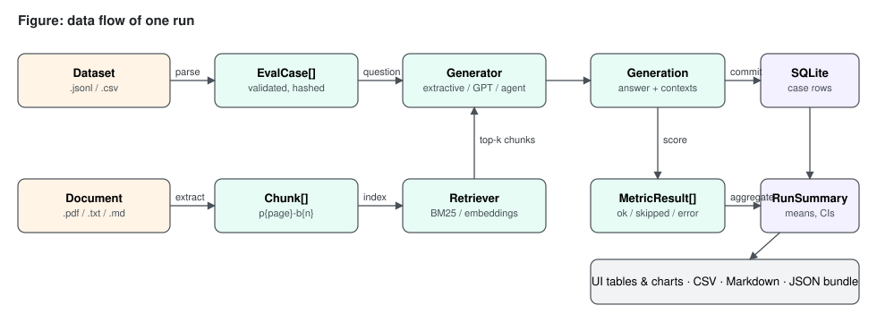

The figure follows one run from the two input files to the persisted rows, the aggregate summary and the outputs (UI tables, CSV, Markdown, JSON bundle).

### 31.1 Inputs to cases and chunks

- A dataset file is read as bytes, hashed with SHA-256 (`datasets.py:71`), size-checked, decoded as UTF-8 with optional BOM (`datasets.py:80`) and parsed row by row into `EvalCase(id, question, expected_answer, metadata)` (`models.py:22-28`). Missing ids become `case-001`, `case-002`, … (`datasets.py:189-190`).
- A document is split into raw blocks (PyMuPDF text blocks sorted top-to-bottom then left-to-right, `documents.py:99-100`; or blank-line paragraphs for text files, `documents.py:113`), whitespace-normalised, split further if longer than 2,000 characters (`documents.py:23`, `:117-134`), and given ids `p{page}-b{n}` (`documents.py:61`). The file's SHA-256 is computed separately by `file_sha256` (`documents.py:30-35`).

### 31.2 Cases to generations

For each case, `Pipeline.answer(question)` returns a `Generation` (`models.py:50-67`): the answer string, the list of `RetrievedChunk(chunk_id, text, page, score, rank)` the answer was produced from, `context_source` (`retriever` or `agent_tool`), the model name, latency in milliseconds, token counts when the provider reports them, the queries sent to the retriever and, for the agent, the model's context claim.

### 31.3 Generations to metric results

The runner builds a frozen `MetricInput(question, answer, expected_answer, contexts)` where `contexts` are the texts of the retrieved chunks (`runner.py:223-224`). Each metric returns a `MetricResult(name, status, score, threshold, passed, reason)` (`models.py:70-86`). Scores are validated to lie in [0, 1] (`models.py:81-86`). Before that, `Metric.evaluate` turns a score more than `SCORE_TOLERANCE = 1e-9` outside the range into a metric `error`, and clamps only floating-point noise inside the tolerance (`metrics/base.py:23`, `:92-96`).

### 31.4 Results to storage and summary

A `CaseResult` (`models.py:89-111`) gathers the case, the generation fields, cost, the attempt count, any error and the metric results. It is serialised whole into `case_results.data_json` (`storage.py:117-125`). When the run ends, `summarize_run` (`aggregate.py:75-92`) produces a `RunSummary` with one `MetricSummary` per metric (count scored/skipped/error, mean, median, standard deviation, min, max, bootstrap CI, pass count and rate) plus latency mean and p95, token totals and cost total; it is stored in `runs.summary_json` (`storage.py:127-135`).

### 31.5 Storage to outputs

Reads reconstruct pydantic models from JSON (`storage.py:175-189`, `:190-199`). `reporting.py` flattens them into pandas data frames for the UI and the CSV export (`reporting.py:30-50`), writes a Markdown report (`reporting.py:140-185`) or a JSON bundle that `archive.py` can re-import (`reporting.py:114-125`, `archive.py:59-81`). A bundle carries the dataset and document paths in portable form — relative to the project root, or the bare file name for files elsewhere — so no absolute local path leaves the machine (`reporting.py:103-111`, `:118-122`). On import the summary is recomputed from the bundle's cases rather than read from the file (`archive.py:67-72`).

### 31.6 Data flow of a comparison

Comparison reads only stored data; nothing is re-evaluated:

```text
RunStore.get_run(A), get_run(B)            → RunRecord (config["metrics"] decides the shared metrics)
RunStore.get_case_results(A), (B)          → list[CaseResult], ordered by position
reporting.run_metrics(run)                 → metrics in configuration order (reporting.py:26-27)
for metric in shared metrics:
    aggregate.paired_comparison(resA, resB, metric)
        key = normalised question text      → {key: score} per run, scored cases only
        keys = intersection                 → diffs = B − A
        bootstrap_ci(diffs), wins/ties/losses
reporting.comparison_dataframe             → one row per metric (CLI table, UI table)
```

Because pairing uses the question text, the UI warns when the selected runs have different dataset hashes: only questions present in both runs are compared (`ui/views/compare.py:45-47`).

### 31.7 What each persisted artefact contains

| Artefact | Contains | Does not contain |
|---|---|---|
| `runs.config_json` | Full `RunConfig`, effective thresholds, the pipeline's actual model name (`runner.py:113-114`); dataset and document paths as given (absolute for CLI runs, `cli.py:48-49`) | API key, base URL |
| `runs.heartbeat_at` | Time of the last committed case (or of creation) (`storage.py:112`, `:123`); read by `RunStore.heartbeat` (`storage.py:169-173`), which the restore guard uses (Part XVI §171.3) | — |
| `runs.environment_json` | Package version, Python version, platform, versions of seven tracked packages (`runner.py:45`, `:270-278`) | Environment variables |
| `runs.dataset_sha256` / `document_sha256` | Content hashes of the inputs (`runner.py:99`) | The input files themselves |
| `case_results.data_json` | Everything in `CaseResult`, including chunk texts | — |

## 32. Control flow

### 32.1 Run status lifecycle

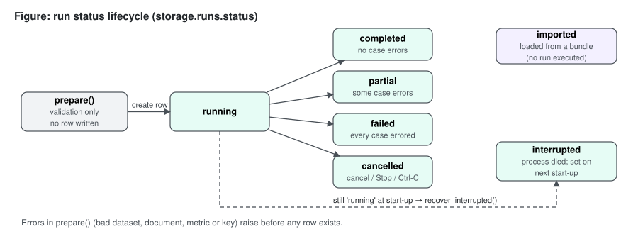

The figure shows the seven values of `RunStatus` (`models.py:12`): no row exists during `prepare()`; a row is created as `running`; it ends as `completed`, `partial`, `failed` or `cancelled`; a row left `running` by a dead process becomes `interrupted` at a later start-up, once its heartbeat is older than 15 minutes (`storage.py:29`, `:135-147`); bundles enter as `imported`.

The final status is decided in `execute` (`runner.py:138-140`): `failed` when results exist and all of them are errors, `partial` when some are, `completed` otherwise; `cancelled` when the cancel event was set (`runner.py:130-131`) or any exception escaped the loop (`runner.py:132-137`).

### 32.2 CLI control flow

```text
ragwb <command> [options]
  └─ cli.main(argv)                                   cli.py:490
       ├─ build_parser().parse_args(argv)             argparse exits 2 on bad usage
       ├─ open_context(load_settings(), console_logging=False)
       │     ├─ configure_logging()                   file log under data/logs
       │     ├─ RunStore(db_path)                     creates schema / migrates v1 → v2
       │     └─ store.recover_interrupted()           stale running → interrupted
       ├─ args.func(args, ctx)                        cmd_run / cmd_list / ...
       └─ except (BundleError, ConfigError, DatasetError, DocumentError,
                  StorageError, LookupError, ValueError)
                → "error: ..." on stderr, exit 1      cli.py:639-643
```

`cmd_run` returns 0 only for a `completed` run and 2 otherwise (`cli.py:79`), so scripts can distinguish "the tool failed" (1) from "the run finished with case errors or was cancelled" (2). `KeyboardInterrupt` is not in the caught tuple, so Ctrl-C ends the process with a traceback; before it propagates, the runner has already marked the run `cancelled` (`runner.py:132-137`).

### 32.3 Streamlit control flow

Streamlit re-executes the current page script from the top on every interaction. `streamlit_app.py` registers six pages in three groups, adds a seventh, *Accounts*, to an admin's sidebar only, and calls `st.navigation(pages).run()` (`streamlit_app.py:23-42`). Every page begins with `ctx = context_or_stop()` (for example `ui/views/overview.py:11`), which returns the process-wide cached `AppContext` or renders a configuration error and calls `st.stop()` (`ui/state.py:23-29`). Pages stop early with `st.stop()` when a precondition fails (no runs, fewer than two runs, invalid selection).

On the New evaluation page, pressing *Run evaluation* calls `runner.prepare(config)` inside a `try` that turns `ConfigError`, `DatasetError`, `DocumentError` and `ValueError` into an error box (`ui/views/new_run.py:197-213`), then `runner.execute(prepared, progress=on_progress)` (`ui/views/new_run.py:226-231`). The progress callback updates a progress bar and the last eight case lines (`ui/views/new_run.py:216-224`). When the user presses Streamlit's Stop button, Streamlit raises an exception inside the script thread; it surfaces from the callback inside the runner's loop and is handled by the `except BaseException` branch, which records the run as `cancelled` and re-raises (`runner.py:132-137`, comment at line 133).

### 32.4 Per-case control flow

```text
evaluate_case(prepared, case, position)               runner.py:184
  try _evaluate_case:
     _generate_with_retries(pipeline, question, max_retries)
        loop: pipeline.answer(question)
              TransientProviderError → sleep(base·2^(attempt-1) + jitter), retry
                                       until attempt > max_retries → error
              ProviderError          → error (no retry)
              other Exception        → error "Unexpected <Type>: ..."
     generation is None → CaseResult(status="error", attempts, error)
     else for each metric: metric.evaluate(MetricInput, threshold)
          → CaseResult(status="ok", ..., metrics={...}, cost_usd)
  except Exception → CaseResult(status="error", error="Internal <Type>: ...")
```

## 33. Sequence diagrams

### 33.1 An offline run started from the UI

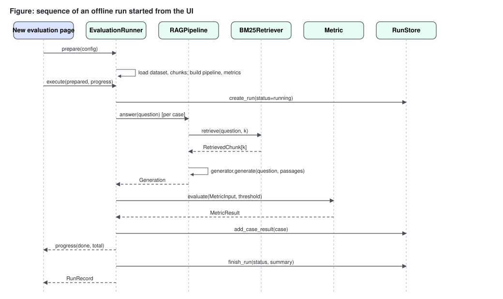

The figure shows the New evaluation page calling `prepare`, then `execute`; the runner creating the run row, asking the pipeline for an answer per case (retriever, then generator), scoring each metric, committing the case, reporting progress, and finally writing the summary.

Points worth noting in that sequence:

- `create_run` happens only after `prepare` has returned, which is why a misconfigured run leaves no trace in the store (tested by `tests/test_runner.py:135`, `test_validation_happens_before_a_run_is_created`).
- `add_case_result` and `progress` are called by the thread that called `execute` — the Streamlit script thread or the CLI's main thread — even when cases are evaluated on worker threads, because the worker results are consumed through the `_iter_results` generator (`runner.py:124-129`, `:152-181`).

### 33.2 The agent pipeline

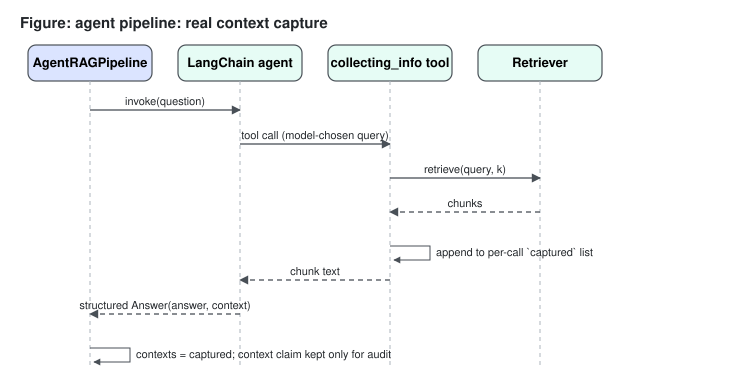

The figure shows `AgentRAGPipeline` invoking a LangChain agent, the agent choosing to call the `collecting_info` tool with its own query, the tool calling the retriever and appending the returned chunks to a per-call list, and the structured `Answer(answer, context)` coming back; the captured chunks become the evaluated context and the context claim is kept only for audit.

The `captured` and `queries` lists are local variables of `answer()` (`pipeline.py:80-81`); the tool is defined as a closure over them (`pipeline.py:80-90`). A new tool and a new agent are created per question (`pipeline.py:96-97`). **Rationale:** closure-local capture is what makes the agent safe to run on several threads at once. A module-level "last retrieved context" variable would be overwritten by concurrent questions and would attribute one question's chunks to another.

### 33.3 Paired comparison from the CLI

```text
user            cli.cmd_compare        RunStore            reporting                 aggregate
 │ compare A B        │                    │                    │                         │
 │──────────────────▶ │ get_run(A), get_run(B)                  │                         │
 │                    │──────────────────▶ │                    │                         │
 │                    │ get_case_results(A), (B)                │                         │
 │                    │──────────────────▶ │                    │                         │
 │                    │ comparison_dataframe(runA, resA, runB, resB)                      │
 │                    │───────────────────────────────────────▶ │ for each shared metric: │
 │                    │                    │                    │ paired_comparison(...)  │
 │                    │                    │                    │───────────────────────▶ │
 │                    │                    │                    │ ◀── n_pairs, means, CI, │
 │                    │ ◀──────────────── DataFrame ─────────── │     wins/ties/losses    │
 │ ◀── table ──────── │                    │                    │                         │
```

(`cli.py:115-124`, `reporting.py:72-82`, `aggregate.py:164-179`.)

### 33.4 Importing a bundle

```text
archive.import_bundle(store, path)                        archive.py:59
  load_bundle(path)                                       archive.py:34
     size ≤ 50 MB? → json.loads → format == "rag-workbench-run"? version == 1?
     RunRecord.model_validate(payload["run"]); CaseResult.model_validate(each case)
     duplicate case ids? → BundleError
  store.get_run(run.id) exists? → return None             (idempotent)
  summary = summarize_run(cases, metrics, thresholds)     (never trusted from the file)
  record = run with status="imported", summary, config += {original_status, imported_from}
  store.create_run(record)
  for case: store.add_case_result(...)
     StorageError → store.delete_run(run.id); raise        (all or nothing, archive.py:77-79)
```

## 34. Component interaction diagrams

### 34.1 Who calls whom during a run

```text
            ┌──────────────┐        ┌───────────────┐
            │ CLI / UI page│───────▶│ services       │ open_context → AppContext(settings, store)
            └──────┬───────┘        └───────────────┘
                   │ ctx.runner()
                   ▼
            ┌──────────────┐ prepare ┌─────────────┐  ┌─────────────┐
            │EvaluationRunner│──────▶│ datasets     │  │ documents    │
            │               │───────▶│ load_dataset │  │ load_chunks  │
            │               │        └─────────────┘  └─────────────┘
            │               │ pipeline_factory ─▶ pipeline.build_pipeline ─▶ retrieval / providers
            │               │ metrics_factory  ─▶ metrics.build_metrics   ─▶ lexical / judge
            │               │ execute
            │               │───▶ RunStore.create_run
            │               │───▶ Pipeline.answer ───▶ Retriever.retrieve, Generator.generate
            │               │───▶ Metric.evaluate
            │               │───▶ RunStore.add_case_result   (per case)
            │               │───▶ aggregate.summarize_run ──▶ RunStore.finish_run
            └──────────────┘
```

### 34.2 Interaction rules

| From | May call | Never calls |
|---|---|---|
| Front ends | `services`, `runner`, `storage` (reads, delete), `reporting`, `archive`, `datasets.validate_file`, `documents.load_chunks`, `retrieval.BM25Retriever` (playground) | Providers or metrics directly — except `ragwb score`, which builds metrics to score one answer (`cli.py:344-372`) |
| `runner` | `datasets`, `documents`, `pipeline` (via factory), `metrics` (via factory), `aggregate`, `storage` | `reporting`, UI |
| `pipeline` | `retrieval`, `providers`, `documents`, `prompts`, `errors` | `storage`, `metrics` |
| `metrics` | `text`, `errors`, DeepEval | `pipeline`, `storage` |
| `aggregate` | `models` only | Anything with I/O |
| `storage` | `models` only | Any evaluation code |

The interaction rules mean the scoring and aggregation layers are pure functions of their inputs (apart from the judge's network calls), which is what lets the test suite check them against hand-computed values (`tests/test_metrics.py`, `tests/test_aggregate.py`).

## 35. Deployment and runtime architecture

### 35.1 Deployment model

The workbench is a local, single-user application. The project requires Python `>=3.12` (`pyproject.toml:6`), `.python-version` pins 3.12, and the project's virtual environment runs Python 3.12.15 (`.venv\Scripts\python.exe --version`). Dependencies are locked in `uv.lock`. There is no container image, no service definition and no remote deployment in the repository. The `.streamlit/config.toml` comment states that the project "is not deployed from the UI" (`.streamlit/config.toml:8`).

### 35.2 The launcher: `start.py`

`python start.py` is the supported way to start the product. The file uses only the standard library, "so it runs before any dependency is installed" (`start.py:15`). `main` (`start.py:192-215`) runs four steps:

```text
python start.py [--port N] [--host H] [--ssl-cert F --ssl-key F] [--no-browser] [--no-examples] [--setup-only]
  0 host_problem(--host, password_configured() or accounts_configured())   start.py:84-117, 198-201
      a non-local host without RAGWB_APP_PASSWORD or user accounts → exit before anything is installed
      tls_problem(--ssl-cert, --ssl-key)                  start.py:120-129
      a lone or missing certificate/key file → exit before anything is installed
  1 prepare_environment()                                start.py:47-63
      uv on PATH → uv sync --frozen --inexact   (UV_HTTP_TIMEOUT defaults to 180 s)
      no uv      → require Python ≥ 3.12; python -m venv .venv (if missing);
                   .venv python -m pip install -e . pytest pytest-cov
  2 unless --no-examples: store_is_empty()?              start.py:66-72
      runs `open_context().store.list_runs()` inside .venv in a subprocess
      empty → create_examples(): demo.seed_demo_runs()   start.py:75-81
  3 --setup-only → print "setup complete", exit 0
  4 launch(free_port(--port), open_browser, --host, ssl_cert, ssl_key)   start.py:132-189, 208
      first free TCP port from 8501 (50 candidates, probed on 127.0.0.1)
      .venv python -m streamlit run streamlit_app.py --server.port P
            --server.address H --server.headless true --browser.gatherUsageStats false
            [--server.sslCertFile C --server.sslKeyFile K]   (HTTPS; a warning is printed for a non-local host without TLS)
      (H is localhost unless --host says otherwise; 0.0.0.0 and :: are probed as localhost)
      poll http(s)://H:P/_stcore/health until "ok" (90 s; certificate not verified for this local probe) → open the browser
      Ctrl+C → terminate, wait 10 s, then kill
```

Design points visible in the code:

- **Nothing outside the project folder is changed.** Packages go into `.venv` (`start.py:5-6`, `:31-32`).
- **The launcher never imports `rag_workbench`.** The store probe and the example runs execute in the virtual environment's interpreter through `subprocess` (`start.py:66-81`). **Rationale:** the launcher's own interpreter may be a system Python without the dependencies.
- **Examples are created only into an empty store.** A second launch does not re-seed (`start.py:210-211`). If seeding fails, the app still starts (`start.py:80-81`).
- **The server is local and private by default.** The address and the statistics flag are passed on the command line as well as set in `.streamlit/config.toml`, and `DEEPEVAL_TELEMETRY_OPT_OUT=1` is set in the child environment (`start.py:158-160`). Listening on any other address is refused unless a login (the shared password or named accounts) is configured (`start.py:117-122`, `:198-201`); Parts XIII and XIV explain the logins, and `--ssl-cert`/`--ssl-key` add HTTPS (`start.py:162-163`).
- **Failure messages are specific.** They cover a failed `uv sync` (with a hint about slow networks), a missing Python 3.12, a failed `pip install`, a store that cannot be opened (with the last 2,000 characters of its stderr), and an app that exits during start-up (`start.py:52-63`, `:69-70`, `:169-170`).

### 35.3 Processes

| Process | Started by | Lifetime | Holds |
|---|---|---|---|
| Launcher | `python start.py` | Until Ctrl+C or the server exits | Only the server's process handle (`start.py:169`) |
| Streamlit server | `start.py` (or `uv run streamlit run streamlit_app.py`); listens on `localhost` unless `--host` and a login say otherwise (`start.py:160`, `.streamlit/config.toml:16-17`) | Until stopped | One cached `AppContext` per server process (`ui/state.py:17-20`); one script thread per browser session |
| CLI | `ragwb <command>` or `python -m rag_workbench` | One command | A fresh `AppContext` per invocation (`cli.py:681`) |
| Worker threads | `ThreadPoolExecutor` inside a run with `max_workers > 1` (`runner.py:161`) | One run | Nothing persistent; return `CaseResult`s |

### 35.4 Start-up sequence of the app and the CLI

What happens when each application process starts, in order. For the Streamlit server this follows the launcher's step 4 in §35.2.

| Step | Streamlit server (first page view) | CLI command |
|---|---|---|
| 1 | `streamlit_app.py` sets `DEEPEVAL_TELEMETRY_OPT_OUT`, page config, CSS, navigation | `cli.main` parses arguments (argparse rejects bad usage before anything else) |
| 2 | The page calls `context_or_stop()` → cached `get_context()` | `open_context(load_settings(), console_logging=False)` |
| 3 | `load_settings` reads `.env` (no override) and the environment; invalid values → error box and `st.stop()` | Invalid values → `error: Invalid configuration: …`, exit 1 |
| 4 | `configure_logging` attaches the redacting file handler once | Same, per process |
| 5 | `RunStore(db_path)` creates `data/`, the schema and the version stamp (schema 3) if needed, and migrates an older store by adding whichever of `heartbeat_at` and `tags_json` it lacks (`storage.py:74-81`) | Same |
| 6 | `recover_interrupted()` relabels `running` rows whose heartbeat is older than 15 minutes | Same |
| 7 | The page reads the store and renders | The command handler runs |

Steps 2–6 run once per Streamlit server process because the context is a cached resource; a new browser session reuses it. The CLI repeats them for every command.

### 35.5 Files at run time

All mutable state lives under the data directory (`RAGWB_DATA_DIR`, default `<project>/data`, `config.py:60`):

| Path | Written by | Notes |
|---|---|---|
| `data/runs.db` | `RunStore` | SQLite; one connection per operation (`storage.py:85-98`) |
| `data/users.json` | `UserStore` (`ragwb user add`) | Only when named accounts exist: salts and scrypt hashes, never passwords (`rag_workbench/users.py:83-89`) |
| `data/uploads/` | `services.save_upload` | Content-addressed names (`services.py:51-55`) |
| `data/exports/` | `ragwb export` (`cli.py:257-262`) | UI downloads are streamed, not written here |
| `data/logs/rag_workbench.log` | `RotatingFileHandler`, 2,000,000 bytes × 3 backups (`logging_setup.py:94`) | Falls back to console-only if the directory is not writable (`logging_setup.py:95-96`) |

The data directory is git-ignored (`.gitignore`). Read-only inputs ship in `examples/`.

### 35.6 Network

The offline profile makes no network calls. The OpenAI profile calls the OpenAI API (or `OPENAI_BASE_URL`) for chat completions, embeddings and DeepEval judge calls. Two telemetry channels are disabled: DeepEval telemetry by `DEEPEVAL_TELEMETRY_OPT_OUT=1` set with `setdefault` both in the package (`__init__.py:11`) and in the Streamlit entry point (`streamlit_app.py:10`), and explicitly in the launcher's child environment (`start.py:157`); Streamlit usage statistics by `gatherUsageStats = false` (`.streamlit/config.toml:5`). The Streamlit server binds to `localhost` (`server.address`, `.streamlit/config.toml:16-17`, commented "Local tool without authentication: listen on this machine only"), so it is not reachable from other machines unless the user overrides that setting.

### 35.7 Concurrent processes on one store

Because every process opens its own connections with a 15-second busy timeout (`storage.py:87`), a CLI run and a Streamlit session can share `runs.db` (release 1.4 tests this with four CLI processes and a reading fifth, Part XVI §172). Recovery of dead runs is designed for this. `open_context` calls `recover_interrupted()` every time it runs (`services.py:32`), but the statement only touches runs that look dead:

```text
UPDATE runs SET status = 'interrupted', finished_at = ?
WHERE status = 'running' AND COALESCE(heartbeat_at, created_at) < now − STALE_AFTER_S
```

(`storage.py:154-166`; `STALE_AFTER_S = 15 * 60`, `storage.py:29`.) `create_run` stamps `heartbeat_at` and every `add_case_result` refreshes it in the same transaction as the case insert (`storage.py:107`, `:117`), so a run that another process is still executing keeps a fresh heartbeat and is left alone. The window is generous on purpose: the comment at `storage.py:27-28` estimates that one slow case with default settings (four attempts of up to 60 s plus back-off) takes about five minutes. If a live run is ever marked wrongly — no case finished within 15 minutes — its own `finish_run` still writes the real final status (`storage.py:127-135`).

**Rationale:** a simpler rule — relabel every `running` row at start-up — would be wrong as soon as two processes share a store. Starting any CLI command (even `ragwb list`) during a run in the app would mark that live run `interrupted`. The heartbeat turns "is this run still alive?" into a question the database can answer without lock files or process ids. **Limitation:** a run whose process died within the last 15 minutes keeps showing `running` until a later start-up.

## 36. Configuration architecture

### 36.1 Sources and precedence

Configuration has three layers, all funnelled through `load_settings` (`config.py:204-232`):

1. Defaults declared on `Settings` (`config.py:39-70`).
2. `.env` in the project root, loaded with `override=False` (`config.py:212`) — so real environment variables win over `.env`.
3. Process environment variables, mapped through the explicit `ENV_VARS` table (`config.py:173-197`).

Blank values are treated as unset (`config.py:218-219`); the test fixture relies on this to neutralise a developer's `.env` key by setting `OPENAI_API_KEY` to the empty string (`tests/conftest.py:25`). Relative paths are resolved against the project root, not the working directory (`config.py:221-223`). Validation failures are re-raised as one `ConfigError` that names the environment variable rather than the field (`config.py:226-232`).

### 36.2 Settings versus run configuration

There are two configuration objects with different lifetimes:

| | `Settings` (`config.py:54`) | `RunConfig` (`models.py:114`) |
|---|---|---|
| Scope | Process | One run |
| Source | Environment / `.env` | CLI arguments or New evaluation form |
| Mutable | No (`frozen`, `config.py:57`) | Not mutated after creation |
| Contains secrets | Yes (`SecretStr`) | No — by design ("Contains no secrets", `models.py:115`) |
| Persisted | Only as `public_dict()` on the Settings page | Yes, whole, in `runs.config_json` |

Some settings act as defaults for run fields: `generator_model`, `judge_model`, `embedding_model`, `max_retries`, `request_timeout_s` and `max_workers` are copied into the `RunConfig` by the front ends (`cli.py:60-62`, `ui/views/new_run.py:199-208`). Input limits (`max_dataset_bytes`, `max_document_bytes`, `max_cases`, `max_field_chars`) and pricing stay in `Settings` and are read by the runner at execution time (`runner.py:89-93`, `:258-262`). Cost is computed from the prices in effect when the run executes, and since release 1.1 those prices are copied into the run configuration as `prices_usd_per_mtok` (`runner.py:114`, `:254-256`), so a stored `cost_usd` can be traced back to the price that produced it. **Limitation:** the prices are whatever the operator configured; nothing checks them against the provider's price list.

### 36.3 Environment variables

| Variable | Setting | Default | Constraint |
|---|---|---|---|
| `OPENAI_API_KEY` | `openai_api_key` | unset | `SecretStr` |
| `OPENAI_BASE_URL` | `openai_base_url` | unset | — |
| `RAGWB_DATA_DIR` | `data_dir` | `<project>/data` | path |
| `RAGWB_DATASET` | `default_dataset` | `examples/datasets/honeybees.jsonl` | path |
| `RAGWB_DOCUMENT` | `default_document` | `examples/documents/honeybees.pdf` | path |
| `RAGWB_GENERATOR_MODEL` | `generator_model` | `gpt-4o` | — |
| `RAGWB_EMBEDDING_MODEL` | `embedding_model` | `text-embedding-3-large` | — |
| `RAGWB_JUDGE_MODEL` | `judge_model` | `gpt-4o` | — |
| `RAGWB_REQUEST_TIMEOUT_S` | `request_timeout_s` | 60 | 0 < x ≤ 600 |
| `RAGWB_MAX_RETRIES` | `max_retries` | 3 | 0–10 |
| `RAGWB_RETRY_BASE_DELAY_S` | `retry_base_delay_s` | 1.0 | 0–60 |
| `RAGWB_MAX_REQUESTS_PER_MINUTE` | `max_requests_per_minute` | unset (no pacing) | 0 < x ≤ 6000 (release 1.3, `config.py:79`) |
| `RAGWB_LOCAL_EMBEDDING_MODEL` | `local_embedding_model` | `BAAI/bge-small-en-v1.5` | — (`config.py:72`; the model cache is `<data dir>/models`, `config.py:113-115`) |
| `RAGWB_MAX_WORKERS` | `max_workers` | 4 | 1–32 |
| `RAGWB_PRICE_INPUT_PER_MTOK` | `price_input_per_mtok` | unset | ≥ 0 |
| `RAGWB_PRICE_OUTPUT_PER_MTOK` | `price_output_per_mtok` | unset | ≥ 0 |
| `RAGWB_MAX_DATASET_BYTES` | `max_dataset_bytes` | 5,000,000 | > 0 |
| `RAGWB_MAX_DOCUMENT_BYTES` | `max_document_bytes` | 25,000,000 | > 0 |
| `RAGWB_MAX_CASES` | `max_cases` | 5,000 | > 0 |
| `RAGWB_MAX_FIELD_CHARS` | `max_field_chars` | 20,000 | > 0 |
| `RAGWB_LOG_LEVEL` | `log_level` | `INFO` | DEBUG…CRITICAL (`config.py:92`, `:95-101`) |
| `RAGWB_RUN_VISIBILITY` | `run_visibility` | `shared` | `shared` or `own`; with accounts, `own` hides other users' runs from non-admins in the web pages only (release 1.4, `config.py:94`, `:198`; Part XVI §173.4) |

The Streamlit upload ceiling (`maxUploadSize = 25` MB, `.streamlit/config.toml:14`) is set to match the default document limit; it is a separate setting, so raising `RAGWB_MAX_DOCUMENT_BYTES` alone does not raise the browser upload ceiling.

### 36.4 Configuration changes at run time

The UI caches the context with `st.cache_resource` (`ui/state.py:17`), so settings are read once per server process. The Settings page says so ("Restart the app after changing them", `ui/views/settings.py:30-31`). The CLI reads settings on every invocation.

## 37. Dependency relationships

### 37.1 Internal dependencies

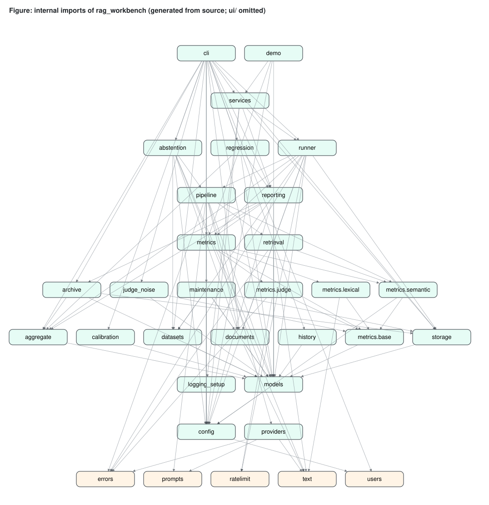

The figure is generated from the source and shows which modules import which (the `ui` package is omitted); `config`, `models`, `errors`, `prompts` and `text` sit at the bottom, `runner`, `services`, `cli` and `demo` at the top. `start.py` is not part of the package and imports none of it.

The import graph is acyclic. Verified edges from the `import` statements:

| Module | Imports (internal) |
|---|---|
| `models` | `config` |
| `text`, `errors`, `prompts`, `config` | — |
| `datasets` | `models` |
| `documents` | `models`, `text` |
| `retrieval` | `errors`, `models`, `text` |
| `providers` | `errors`, `prompts`, `text` |
| `pipeline` | `config`, `documents`, `errors`, `models`, `prompts`, `providers`, `retrieval` |
| `metrics.base` | `models` |
| `metrics.lexical` | `text`, `metrics.base` |
| `metrics.judge` | `errors`, `metrics.base` |
| `metrics` (package) | `config`, `metrics.base`, `metrics.judge`, `metrics.lexical` |
| `aggregate` | `models` |
| `storage` | `models` |
| `archive` | `aggregate`, `models`, `storage` |
| `reporting` | `aggregate`, `config`, `metrics`, `models`; `archive` lazily inside `export_json` (`reporting.py:116`) |
| `runner` | `aggregate`, `config`, `datasets`, `documents`, `errors`, `metrics`, `models`, `pipeline`, `storage` |
| `logging_setup` | `config` |
| `services` | `config`, `logging_setup`, `reporting`, `runner`, `storage` |
| `demo` | `metrics`, `models`, `services` |
| `cli` | `archive`, `config`, `datasets`, `documents`, `metrics`, `models`, `reporting`, `runner`, `services`, `storage` |

### 37.2 Third-party dependencies

| Package (`pyproject.toml:7-18`) | Used by | Loaded |
|---|---|---|
| `pydantic>=2.13` | `config`, `models`, `archive` | At import |
| `python-dotenv>=1.0` | `config.load_settings` | At import |
| `pandas>=3.0.6` | `reporting`, UI | At import of `reporting` |
| `pymupdf>=1.28.2,<2` | `documents._pdf_blocks` | Lazily, on first PDF |
| `langchain-openai>=1.6.6` | `OpenAIChatGenerator`, `AgentRAGPipeline`, `EmbeddingRetriever` | Lazily, when constructed |
| `langchain>=1.4.2` | `AgentRAGPipeline.answer` (`create_agent`, `tool`) | Lazily, per question |
| `deepeval>=4.2.6` | `metrics/judge.py` | Lazily, per measurement |
| `streamlit>=1.64.0` | `streamlit_app.py`, `ui/` | Only by the UI |
| `altair` (via Streamlit) | `ui/components.py`, `ui/views/results.py` | Only by the UI |

PyMuPDF is capped below 2.0. The comment in the manifest gives the reason: "PyMuPDF 2.0 adds onnxruntime + layout models loaded at import … that plain block extraction does not need" (`pyproject.toml:13-15`). Development groups add `pytest`, `pytest-cov`, `ruff`, `mypy` and `pip-audit` (`pyproject.toml:23-30`) and `markdown` for the book build (`pyproject.toml:31-33`). The `openai` SDK is not listed directly; it is installed through `langchain-openai` and DeepEval, and `errors.classify_openai_error` imports it lazily and tolerates its absence (`errors.py:42-45`).

## 38. Design patterns and why they were selected

| Pattern | Instance | Why (documented or **rationale**) |
|---|---|---|
| Structural interfaces (Protocol) | `Retriever` (`retrieval.py:34-37`), `Generator` (`providers.py:31-34`), `Pipeline` (`pipeline.py:35-36`) | **Rationale:** lets tests pass plain fake objects (`fake_pipeline_cls` in `tests/conftest.py`) without inheritance, and keeps LangChain types out of the interfaces |
| Factory | `build_pipeline` (`pipeline.py:152`), `build_retriever` (`:127`), `build_metrics` (`metrics/__init__.py:34`), `build_judge_metric` (`metrics/judge.py:102`) | Invalid combinations are rejected in one place with a `ConfigError` (`pipeline.py:152`) |
| Registry | `METRIC_SPECS`, `LEXICAL_METRICS`, `JUDGE_SPECS` (`metrics/__init__.py:11-12`, `lexical.py:103`, `judge.py:27`) | One catalogue feeds validation, the CLI `metrics` command, the UI metric picker and labels |
| Template method | `Metric.evaluate` performs requirement checks, exception capture, the score range check and pass/fail; `score` is the variable step; `JudgeMetric` overrides `score` (`metrics/base.py:75-98`, `judge.py:66-99`) | Every metric gets identical skip/error semantics |
| Dependency injection | `EvaluationRunner(settings, store, pipeline_factory=, metrics_factory=, sleep=)` (`runner.py:72-80`) | Retry back-off and failure paths are tested without real sleeps or providers (`tests/test_runner.py:67-80`) |
| Result objects instead of exceptions | `MetricResult.status`, `CaseResult.status/error`, `DatasetReport.errors/warnings` | A run must continue past a bad case, so that one failed call never costs the results already computed; a dataset must report all problems, not the first |
| Exception translation | `classify_openai_error` (`errors.py:37-54`) | The runner retries by type, independent of the SDK; messages never include request headers |
| Composition root / facade | `services.open_context` and `AppContext` (`services.py:18-35`) | CLI and UI are wired identically |
| Repository | `RunStore` (`storage.py:64`) | SQL is confined to one module |
| Observer callback | `progress: Callable[[Progress], None]` (`runner.py:48-57`) | The runner has no UI dependency; CLI prints, UI updates widgets |
| Cancellation token | `threading.Event` (`runner.py:102-109`) | Cooperative stop that works for both sequential and pooled execution |
| Bounded producer/consumer | `_iter_results` generator keeping at most `2 × workers` futures (`runner.py:161-178`) | Memory stays bounded and cancellation takes effect quickly |
| Lazy initialisation | `EmbeddingRetriever._ensure_index` with a lock (`retrieval.py:146-160`) | Constructing the object never calls the API (`retrieval.py:5-6`) |
| Immutable value objects | `Settings` frozen; `MetricInput`, `MetricSpec` frozen dataclasses | Shared safely across threads |
| Versioned interchange format | Bundle `format`/`version` (`archive.py:25-26`); `PRAGMA user_version` with an in-place, column-based migration (v1 and v2 → v3, `storage.py:74-81`) | Future changes can be detected instead of misread, and old stores are upgraded |
| Heartbeat liveness | `runs.heartbeat_at` refreshed per committed case; recovery only after `STALE_AFTER_S` (`storage.py:29`, `:117`, `:135-147`) | Processes sharing a store need no lock file or PID bookkeeping (**rationale**) |

## 39. Alternatives considered

Each row names a design choice visible in the code, the alternative it excludes and the reason. A reason quoted from a code comment is cited; one that is my reading is marked rationale.

| Decision | Alternative | Outcome and reason |
|---|---|---|
| Streamlit calls the package in-process | FastAPI (or other HTTP) backend | **Rationale:** no client other than the bundled UI and CLI needs the core, and an HTTP layer would add authentication, a job model for long runs and a network-exposed service able to spend the API key (Chapter 55) |
| LangChain `InMemoryVectorStore` | FAISS / Chroma | **Rationale:** the example document has 11 chunks and local documents are limited to 25 MB; an in-memory store that is already a dependency rebuilds in one pass per run, and a persistent vector database would add a service and an index to keep in sync |
| One runner driven by `RunConfig` | A script per experiment | **Rationale:** every experiment is a configuration, so it is validated, stored and comparable; copies of scripts drift apart |
| Retrieve-then-generate as default | Agent as default | The agent is offered with the OpenAI provider. `rag` is the default because its evaluated context is, by construction, exactly what the generator saw (`pipeline.py:5-7`) |
| Extractive offline generator | A mock that returns fixed answers, or a local LLM | **Rationale:** fixed answers would make offline scores meaningless. A local LLM would add a large dependency and make offline results non-deterministic. The extractive baseline is a real, reproducible lower bound (`providers.py:3-7`) |
| Light suffix stemmer | Porter stemmer | "Deliberately minimal (no Porter stemmer) to keep behaviour predictable" (`text.py:61`) |
| Runner-level retries | SDK-level retries | The OpenAI client's retry loop is disabled (`max_retries=0`) so retries happen "in one place, observable attempt counts" (`providers.py:98-101`) |
| Synchronous DeepEval measurement | DeepEval `async_mode` | Measured synchronously "so failures are attributable to a single case" (`metrics/judge.py:3-5`) |
| SQLite with JSON columns | ORM; fully normalised metric tables | **Rationale:** standard library only, one file, transactional; JSON columns keep the schema stable while the models evolve. Short per-operation transactions in the default journal mode keep the store a single file, which matters when the project folder is synced by a cloud-drive client |
| Threads | `asyncio` | **Rationale:** the generators and DeepEval are called through synchronous APIs (`invoke`, `measure`), and the provider work is I/O-bound, so a thread pool parallelises without rewriting call paths |
| Explicit, validated bundle import | Importing result files automatically at start-up | **Rationale:** an import that runs on every start couples every command to the validity of external files. One malformed score would break `ragwb list`. Importing is therefore an explicit command (`ragwb import <bundle.json>…`, `cli.py:301-305`) with full validation and an all-or-nothing write |
| Heartbeat-based recovery | Mark every `running` row interrupted at start-up; lock files | See §35.7: start-up recovery must not relabel a run that another process is still executing |
| Stdlib-only launcher (`start.py`) | Shell scripts per platform; asking users to run `uv sync` and `streamlit run` themselves | **Rationale:** one Python file runs on every platform before any dependency exists, and it can fall back from `uv` to `venv` + `pip` (`start.py:45-58`) |

## 40. Architectural trade-offs

### 40.1 In-process evaluation in the UI

*Gained:* no second process, no API to secure, no serialisation layer; the UI can show live progress with a callback. *Given up:* a run occupies the session's script thread until it ends. The user can stop it, but the page cannot be used for other work during the run, and closing the browser tab does not hand the run to a background worker. For runs of a few dozen offline cases this is invisible (Chapter 58 quotes a warm 20-case in-process run taking about 0.3 s); for long OpenAI runs the CLI is the better tool.

### 40.2 JSON documents in SQLite

*Gained:* one `INSERT` per case, schema stability, exact round trips of pydantic models (`tests/test_storage.py:20`). *Given up:* SQL cannot query metric scores directly; every read parses JSON, and `list_runs` parses every run's configuration and summary (`storage.py:180-183`). At the scale of a local workbench (hundreds of runs) this is acceptable; a large shared history would want indexed metric columns.

### 40.3 Determinism versus realism

*Gained:* the offline pipeline and lexical metrics give identical scores on reruns (`tests/test_runner.py:35`, `test_offline_runs_are_reproducible`), which makes them dependable regression signals. *Given up:* the offline baseline is not a language model. It copies sentences, so its lexical groundedness is 1.0 by construction (stated on the Settings page, `ui/views/settings.py:50-51`, and visible in every example run: `ragwb show` reports groundedness 1.000 for all five). Lexical metrics measure word overlap, not meaning (`metrics/lexical.py:3-6`).

### 40.4 Fixed-seed bootstrap

*Gained:* the same results always give the same interval (`aggregate.py:4-5`). *Given up:* the interval reflects sampling of questions only, not the variance of a judge model across repeated calls — the UI says this explicitly (`ui/views/results.py:89-90`).

### 40.5 Pairing by question text

*Gained:* runs over different dataset files that contain the same questions can be compared, even when ids differ (`aggregate.py:151-166`). *Given up:* two differently worded versions of a question are treated as different cases, and if one dataset contains the same normalised question twice, the dictionary keeps only one score per question (`aggregate.py:167-167`). The dataset validator warns about duplicate questions (`datasets.py:100-102`).

### 40.6 Per-operation connections

*Gained:* no connection objects shared between threads or Streamlit reruns; each operation commits or rolls back on its own (`storage.py:85-98`). *Given up:* the cost of opening a connection per case result. Measured runs show this is not a bottleneck at the sample's scale.

### 40.7 Local by default, with an optional login

*Gained:* nothing to configure, nothing to leak to other users. *Given up:* by default the Streamlit app has no login, and anyone who can reach its port can run evaluations (spending the configured OpenAI key) and delete runs. The shipped configuration limits this to the local machine by binding to `localhost` (`.streamlit/config.toml:16-17`); other local users and processes on that machine can still reach it. Releases 1.1 and 1.2 added two optional logins in front of the pages, a shared password and named accounts (`ui/auth.py:132-140`; Parts XIII §144 and XIV §156), and `start.py --ssl-cert/--ssl-key` serves HTTPS. Release 1.3 added three coarse roles (viewer, editor, admin) enforced in the page scripts (`ui/auth.py:34-39`, Part XV §165). Even then every signed-in user sees every run unless `RAGWB_RUN_VISIBILITY=own` is set, which filters the web pages only (Part XVI §173.4), and there is no e-mail password reset (an admin sets a new password).

### 40.8 Summary

| Decision | Optimises for | Pays with |
|---|---|---|
| In-process runs, no API | Simplicity, live progress | Blocking session; no remote clients |
| JSON documents in SQLite | Schema stability, exact round trips | No SQL over metrics; parse cost on reads |
| Offline extractive baseline + lexical metrics | Reproducibility, zero cost | Surface-level quality signal |
| Fixed-seed bootstrap | Recomputable intervals | No judge-noise estimate in the interval itself (`ragwb judge-noise` measures it separately, Part XV §164) |
| Pairing by question text | Cross-dataset comparisons | Sensitive to rewording and duplicates |
| Per-case commits, per-operation connections | Durability, thread/rerun safety | Throughput at very large scale |
| Fail per case | Runs that finish and explain themselves | Misconfiguration can show up as many error rows instead of one crash |
| Lazy third-party imports | Fast, key-free import; offline tests | First use of a provider pays the import cost |
| Local, no login by default, bound to `localhost` | Zero setup | Must not be re-bound to a shared network without a login (and TLS) |
| Heartbeat-based recovery | Safe sharing of one store by several processes | A dead run stays `running` for up to 15 minutes |


# Part IV — Core implementation

Part III described the shape of the system. This part goes inside the functions: how each important piece of code works, what it guarantees, what it deliberately does not do, and where it is limited. Line references (`file:line`) point at the current source. Short code excerpts are copied verbatim. Design reasons that are my reading of the code, rather than statements from the code or its comments, are marked **rationale:**.

## 41. Application entry points

The supported way to start the product is `python start.py`. Behind the launcher there are four ways into the program, and all of them end at the same composition root, `services.open_context` (`src/rag_workbench/services.py:27-35`).

| Entry point | Defined in | What it does first |
|---|---|---|
| `python start.py` | `start.py` (project root, standard library only) | Prepares `.venv`, seeds the example runs into an empty store, starts the Streamlit app on `localhost` and opens the browser (§41.1) |
| `ragwb <command>` | `pyproject.toml:20-21` → `rag_workbench.cli:main` | Parses arguments, then `open_context(load_settings(), console_logging=False)` (`cli.py:674-682`) |
| `python -m rag_workbench <command>` | `src/rag_workbench/__main__.py:1-5` | `sys.exit(main())` — identical to `ragwb` |
| `streamlit run streamlit_app.py` | `streamlit_app.py` | Sets the telemetry opt-out, page config and CSS, registers six pages, runs navigation |
| Python import | `rag_workbench` package | Nothing expensive: sets `DEEPEVAL_TELEMETRY_OPT_OUT` with `setdefault` and defines `__version__ = "1.4.1"` (`__init__.py:11-13`) |

### 41.1 `start.py`

The launcher is a 212-line script whose module docstring is its manual (`start.py:1-16`). `main` parses seven flags — `--port` (default 8501), `--host` (default `localhost`), `--ssl-cert`, `--ssl-key`, `--no-browser`, `--no-examples` and `--setup-only` (`start.py:194-202`) — changes to the project root, refuses a non-local host that has no login (shared password or accounts) and a malformed TLS pair, and then calls the steps in order (`start.py:192-215`):

```python
    os.chdir(ROOT)
    problem = host_problem(args.host, password_configured() or accounts_configured()) or tls_problem(
        args.ssl_cert, args.ssl_key)
    if problem:
        sys.exit(f"[start] {problem}")
    prepare_environment()
    if not args.no_examples and store_is_empty():
        create_examples()
    if args.setup_only:
        say("setup complete")
        return 0
    return launch(free_port(args.port), not args.no_browser, args.host, args.ssl_cert, args.ssl_key)
```

(`start.py:204-215`.) The functions it calls:

| Function | Lines | Behaviour |
|---|---|---|
| `prepare_environment` | `start.py:47-63` | With `uv` on `PATH`: `uv sync --frozen --inexact`, with `UV_HTTP_TIMEOUT` defaulting to 180 s; on failure, exit with a message. Without `uv`: refuse Python older than 3.12, create `.venv` with `python -m venv` if it is missing, and `pip install -e . pytest pytest-cov` into it |
| `store_is_empty` | `start.py:66-72` | Runs `open_context(console_logging=False).store.list_runs()` with the `.venv` interpreter in a subprocess and compares the printed count with `0`. A failure exits with the last 2,000 characters of the child's stderr |
| `password_configured` | `start.py:84-94` | True if `RAGWB_APP_PASSWORD` is non-blank in the environment or in `.env` (the launcher reads `.env` itself because it cannot import the package) |
| `accounts_configured` | `start.py:98-109` | True if `<data dir>/users.json` lists a user (or cannot be parsed) and is larger than two bytes (release 1.2; see Part XIV §156.7 for the case this misjudges) |
| `host_problem` | `start.py:112-117` | Returns an error message for a host outside `localhost`, `127.0.0.1`, `::1` when no login (shared password or accounts) is set, otherwise `None` |
| `tls_problem` | `start.py:120-129` | Returns a message if only one of `--ssl-cert`/`--ssl-key` is given or a file is missing, otherwise `None` |
| `create_examples` | `start.py:75-81` | Runs `demo.seed_demo_runs(open_context(...))` in the same way and prints each run's name and status. A failure is reported, and the app still starts |
| `free_port` | `start.py:132-137` | Probes `127.0.0.1` from the preferred port upwards (50 candidates) and returns the first port nothing is listening on |
| `wait_until_ready` | `start.py:140-154` | Polls `http(s)://<host>:<port>/_stcore/health` every 0.5 s until it answers `ok`, the server process exits, or 90 s pass; with HTTPS the certificate is not verified, because the probe talks to the launcher's own local server |
| `launch` | `start.py:157-189` | Starts `python -m streamlit run streamlit_app.py --server.port P --server.address H --server.headless true --browser.gatherUsageStats false` (plus `--server.sslCertFile`/`--server.sslKeyFile` for HTTPS, and a printed warning for a non-local host without TLS) with `DEEPEVAL_TELEMETRY_OPT_OUT=1`, opens the browser once healthy, waits for the server, and on Ctrl+C terminates it (kill after 10 s) |

The example runs come from `rag_workbench.demo` (`demo.py:24-47`), which defines five offline configurations over the bundled honeybee data. `demo_configs` returns them as BM25 at k = 1, 3 and 5 over `honeybees.jsonl`, an unanswerable-question run over `honeybees_unanswerable.jsonl`, and a run with `offline_failure_rate=0.3`. `seed_demo_runs` executes each with the normal runner and returns the stored records. They are genuine evaluations, so "rerunning reproduces the same scores" (`demo.py:4`; `tests/test_runner.py:165`, `test_demo_runs_are_genuine_and_reproducible`). `scripts/seed_demo_runs.py` is a thin command-line wrapper around the same function (`scripts/seed_demo_runs.py:16-26`).

**Rationale:** keeping the launcher free of third-party imports — and having it talk to the package only through the `.venv` interpreter — means the first command a user types works on a machine with nothing installed except Python. Probing for an empty store rather than a marker file means that deleting `data/` resets the first-launch behaviour.

### 41.2 `open_context`

```python
def open_context(settings: Settings | None = None, *, console_logging: bool = True) -> AppContext:
    """Load settings, configure logging, open the store and mark runs left ``running`` as interrupted."""
    settings = settings or load_settings()
    configure_logging(settings, console=console_logging)
    store = RunStore(settings.db_path)
    recovered = store.recover_interrupted()
```

(`services.py:27-32`.) Four things happen in order: settings are loaded and validated (raising `ConfigError` on bad values); the `rag_workbench` logger is configured once per process; the SQLite store is opened, creating the schema or migrating an older one if necessary; and runs left in `running` whose heartbeat is older than 15 minutes — runs whose process has died — are relabelled `interrupted` (Chapter 52). The returned `AppContext` is a two-field dataclass whose `runner()` method builds a fresh `EvaluationRunner` on each call (`services.py:18-24`). Building a runner is cheap — its constructor only stores references (`runner.py:72-80`).

Both front ends pass `console_logging=False`: the CLI prints its own output and the Streamlit server has its own console, so the package logs only to the rotating file.

### 41.3 The Streamlit entry script

`streamlit_app.py` is 42 lines. It sets the telemetry opt-out again before importing Streamlit (`streamlit_app.py:10`) — **rationale:** the entry script may be the first code Streamlit executes, before any `rag_workbench` import — calls `st.set_page_config(... layout="wide")` (`:18`) and `apply_style()` (`:19`), builds absolute page paths from `VIEWS = Path(__file__).resolve().parent / "src" / "rag_workbench" / "ui" / "views"` (`:23`), and groups the pages:

| Group | Page | Script | URL path |
|---|---|---|---|
| Evaluate | Overview (default) | `overview.py` | `/` |
| Evaluate | New evaluation | `new_run.py` | `/new-run` |
| Analyse | Run results | `results.py` | `/results` |
| Analyse | Compare runs | `compare.py` | `/compare` |
| Data & system | Datasets & retrieval | `data.py` | `/data` |
| Data & system | Settings & metrics | `settings.py` | `/settings` |

(`streamlit_app.py:24-37`.) Since release 1.4 a seventh page, *Accounts* (`users.py`, URL path `/accounts`, group *Admin*), is added to the dictionary only when named accounts exist and the signed-in role is `admin` (`streamlit_app.py:39-40`; Part XVI §173.1). The last line, `st.navigation(pages).run()` (`:42`), executes the selected page.

## 42. Core domain concepts and data models

All shared data types are pydantic models in `src/rag_workbench/models.py`. They are the vocabulary of the system; storage writes them as JSON and reads them back with `model_validate_json`.

### 42.1 Status vocabularies

| Literal | Values | Defined |
|---|---|---|
| `RunStatus` | `running`, `completed`, `partial`, `failed`, `cancelled`, `interrupted`, `imported` | `models.py:12` |
| `CaseStatus` | `ok`, `error` | `models.py:13` |
| `MetricStatus` | `ok`, `skipped`, `error` | `models.py:14` |
| `ContextSource` | `retriever`, `agent_tool` | `models.py:15` |

Both context sources name *retrieval output*: either the chunks the retriever returned for the question, or the chunks returned to the agent's tool. The vocabulary has no value for "what the model says it used", because that is never scored. The Results page shows the source above the context list ("chunks returned by the retriever" / "chunks returned to the agent's tool", `ui/views/results.py:163-164`).

### 42.2 Models

| Model | Fields (abridged) | Notes |
|---|---|---|
| `EvalCase` (`:22`) | `id`, `question`, `expected_answer?`, `metadata` | One dataset row |
| `Chunk` (`:31`) | `id`, `text`, `page`, `source` | Unit of retrieval |
| `RetrievedChunk` (`:40`) | `chunk_id`, `text`, `page`, `score`, `rank` (1-based) | A chunk as returned for one query |
| `Generation` (`:50`) | `answer`, `contexts`, `context_source`, `model`, `latency_ms`, token counts, `retrieval_queries`, `model_context_claim` | Output of `Pipeline.answer`; `total_tokens` property returns `None` only when both counts are unknown (`:63-67`) |
| `MetricResult` (`:70`) | `name`, `status`, `score?`, `threshold?`, `passed?`, `reason?` | Validator rejects scores outside [0, 1] (`:80-85`) |
| `CaseResult` (`:88`) | case identity, `status`, answer, contexts, latency, tokens, `cost_usd`, `attempts`, `error`, `metrics` | `score(metric)` helper returns `None` when absent (`:107-109`) |
| `RunConfig` (`:112`) | name, paths, provider, pipeline, retriever, `k` (1–50), metrics (non-empty, unique), thresholds, models, workers (1–32), retries (0–10), timeout, answer sentences (1–10), `limit`, `notes`, `offline_failure_rate` (0–1), `seed` | "Everything needed to reproduce a run. Contains no secrets." (`:113`) |
| `MetricSummary` (`:145`) | counts, mean, median, std, min, max, CI, threshold, `n_passed`, `pass_rate` | One metric over a run |
| `RunSummary` (`:164`) | case counts, per-metric summaries, latency mean/p95, token totals, cost total | |
| `RunRecord` (`:176`) | `id`, `name`, `status`, timestamps, `config` (dict), hashes, `n_cases`, `summary?`, `environment`, `notes` | `config` is a plain dict, so imported bundles may carry extra keys (`provenance_warnings`, `original_status`, `imported_from`) |

### 42.3 Two deliberate splits

- **`Generation` vs `CaseResult`.** A generation is what the pipeline knows; a case result adds what the runner knows (position, attempts, error, cost, metrics). Keeping them apart means pipelines never construct storage objects.
- **`RunConfig` (typed) vs `RunRecord.config` (dict).** The record stores `config.model_dump(mode="json")` plus the effective thresholds and the pipeline's real model name (`runner.py:113-114`). For an offline run, `generator_model` therefore reads `offline-extractive` (`providers.py:45`) even though the form left it blank; `ragwb show` on the k = 3 example run prints exactly that.

## 43. Main execution pipeline

### 43.1 `RAGPipeline.answer`

```python
    def answer(self, question: str) -> Generation:
        start = time.perf_counter()
        contexts = self.retriever.retrieve(question, self.k)
        output = self.generator.generate(question, [c.text for c in contexts])
```

(`pipeline.py:52-55`.) The method times retrieval plus generation with `perf_counter`, retrieves the top-k chunks for the question, passes exactly their texts to the generator, and returns a `Generation` whose `contexts` is the same list and whose `context_source` is `"retriever"` (`pipeline.py:56-58`). There is no point at which the evaluated context could diverge from the generator's input; `tests/test_providers_pipeline.py:92` (`test_rag_pipeline_evaluates_exactly_the_retrieved_chunks`) asserts this.

### 43.2 `AgentRAGPipeline.answer`

The agent mode lets a tool-calling model decide when and how to search, while the evaluated context remains real retrieval output (`pipeline.py:61-124`):

1. Lists `captured` and `queries` are created as locals (`:79-80`).
2. A LangChain `@tool` named `collecting_info` is defined as a closure. Each call retrieves `k` chunks for the model's query, appends the query, and appends only chunks not already captured, de-duplicating by `chunk_id` (`:82-89`). It returns the joined chunk texts to the model.
3. A pydantic `Answer(answer, context)` schema is declared as the structured response format (`:91-96`). The system prompt names the tool exactly as it is registered, `collecting_info` (`prompts.py:13`); a prompt that names a non-existent tool leaves the model to guess.
4. `create_agent(model=self._llm, tools=[collecting_info], system_prompt=AGENT_SYSTEM_PROMPT, response_format=Answer)` builds the agent; `agent.invoke` runs it (`:92-96`). SDK exceptions are translated by `classify_openai_error` (`:97-101`).
5. A missing or blank structured answer is a `ProviderError` (`:103-105`).
6. Token usage is summed over all `AIMessage`s in the transcript; if none reported usage, the counts stay `None` rather than `0` (`:106-113`).
7. Captured chunks are re-ranked 1…n in capture order (`:114-115`), so `rank` describes the order the agent saw them across all its tool calls, not the retriever's per-query rank.
8. The returned `Generation` has `context_source="agent_tool"`, the captured chunks as `contexts`, the list of model-chosen queries and the model's `context` field as `model_context_claim` (`:116-120`).

`tests/test_providers_pipeline.py:126` (`test_agent_pipeline_captures_real_tool_output_not_self_report`) checks that the stored context is the tool output, not the self-report. **Limitation:** if the agent answers without calling the tool, `contexts` is empty; context-based metrics are then `skipped` ("no retrieved context for this case", `metrics/base.py:80-82`), which is honest but means the agent's answer is scored only on reference metrics.

### 43.3 `build_pipeline`

`build_pipeline(config, settings, chunks=None)` (`pipeline.py:146-162`) is the only place that decides which concrete classes run:

| `provider` | `pipeline` | `retriever` | Result |
|---|---|---|---|
| `offline` | `rag` | `bm25` | `RAGPipeline(BM25Retriever, ExtractiveGenerator)` |
| `offline` | `rag` | `embedding` | `RAGPipeline(EmbeddingRetriever, ExtractiveGenerator)` — the generator's IDF table comes from a separate BM25 index over the same chunks (`:150`); needs a key for the embeddings |
| `offline` | `agent` | any | `ConfigError`: "The agent pipeline needs a tool-calling LLM…" (`:147-148`) |
| `openai` | `rag` | any | `RAGPipeline(retriever, OpenAIChatGenerator)` |
| `openai` | `agent` | any | `AgentRAGPipeline(retriever, …)` |

`_require_key` raises a `ConfigError` that names `OPENAI_API_KEY` and suggests the offline alternative (`pipeline.py:175-178`).

## 44. Evaluation lifecycle

The run lifecycle figure is in Chapter 32. This chapter follows the code.

### 44.1 Prepare

`EvaluationRunner.prepare(config)` (`runner.py:83-99`) performs every check that can fail before anything is written:

1. `validate_metric_names(config.metrics, self.settings)` — unknown names, empty list, judge metrics without a key (`metrics/__init__.py:18-31`).
2. Thresholds must belong to known metrics and lie in [0, 1] (`runner.py:85-87`).
3. `load_dataset` with the configured limits; `DatasetError` on any validation error (`runner.py:89-90`).
4. `config.limit` truncates the case list (`runner.py:91-92`).
5. `load_chunks` with the document size limit (`runner.py:93`).
6. The pipeline and metrics are built through the injected factories (`runner.py:94-96`).
7. Effective thresholds are resolved: the configured override, else the metric's default (`runner.py:97`).
8. Both input files are hashed (`runner.py:99`).

The result is a `PreparedRun` dataclass (`runner.py:60-68`). The UI deliberately calls `prepare` and `execute` separately (`ui/views/new_run.py:210`, `:228`) so that configuration errors appear as "Configuration rejected: …" before the progress bar is shown.

### 44.2 Execute

`execute(prepared, progress, cancel)` (`runner.py:107-143`):

1. Builds the `RunRecord` with a new id, status `running`, the serialised configuration plus effective thresholds and real model name, hashes, case count, `environment_info()` and notes, and inserts it (`:111-117`).
2. Logs the start with provider, pipeline, retriever and `k` (`:118-119`).
3. Iterates over `_iter_results` and, for each result, commits it, appends it, and calls `progress` (`:124-129`).
4. Decides the status (`:130-140`) and calls `_finish` (`:141`, defined at `:148-150`), which aggregates with `summarize_run` and writes status, summary and `finished_at`.
5. Returns the stored record (`:143-146`), so the caller sees exactly what was persisted.

### 44.3 Status rules

| Final status | Condition | Code |
|---|---|---|
| `completed` | No case has `status == "error"` | `runner.py:140` |
| `partial` | At least one error, at least one success | `runner.py:140` |
| `failed` | Results exist and every one is an error | `runner.py:140` |
| `cancelled` | Cancel event set, or any `BaseException` escaped the loop | `runner.py:130-137` |
| `interrupted` | Row still `running`, with no heartbeat for 15 minutes, when a process opens the store | `storage.py:154-166` |
| `imported` | Row created by `archive.import_bundle` | `archive.py:71` |

A cancelled run still gets a summary over the cases it finished (`tests/test_runner.py:97`: two cases recorded, `summary.n_cases == 2`).

### 44.4 Run identifiers

```python
def new_run_id(name: str) -> str:
    slug = re.sub(r"[^a-z0-9]+", "-", name.lower()).strip("-")[:40] or "run"
    return f"{utcnow():%Y%m%d-%H%M%S}-{slug}-{uuid.uuid4().hex[:6]}"
```

(`runner.py:265-267`.) The id is sortable by UTC time, readable, restricted to `[a-z0-9-]`, and made unique by six hex characters of a UUID4 — for example `20261023-194808-offline-bm25-k3-2d53f3` for the k = 3 example run. The UI recognises this shape with a regular expression to show only the random suffix as a short id (`ui/state.py:14`, `:40-42`).

## 45. Dataset ingestion and validation

### 45.1 Accepted formats

| Format | Required | Optional | Other columns/keys |
|---|---|---|---|
| JSONL (`.jsonl`) | `question` | `expected_answer`, `id`, `metadata` (object) | Warning "ignored unknown field(s)" (`datasets.py:198-202`) |
| CSV (`.csv`) | header with `question` | `expected_answer`, `id` | Collected into `metadata` (`datasets.py:163-166`) |

### 45.2 `parse_dataset`

`parse_dataset(data, name, *, max_bytes, max_cases, max_field_chars)` (`datasets.py:68-113`) works on bytes so that the UI (uploads) and files share one code path:

1. Hash the raw bytes (`:71`) — the hash identifies the exact file version in the run record.
2. Reject unsupported suffixes and oversize input immediately (`:73-78`).
3. Decode as `utf-8-sig`, which accepts and strips a byte-order mark; report the failing byte offset otherwise (`:80-83`).
4. Produce `(line_number, row_dict)` pairs with `_jsonl_rows` or `_csv_rows`. JSONL blank lines are skipped; invalid JSON and non-object lines are errors with the column of the decode failure (`:138-152`). CSV uses `csv.DictReader` and records `reader.line_num` (`:155-168`), which is the physical line of the row's end, so multi-line quoted fields report their last line.
5. For each row, enforce the case limit (`:90-92`), convert with `_row_to_case`, reject duplicate ids as errors (`:96-99`) and duplicate questions (case- and whitespace-insensitive) as warnings (`:100-102`).
6. An empty dataset is an error (`:107-108`); missing reference answers produce one summary warning stating that reference-based metrics will be skipped (`:109-112`).

`_row_to_case` (`datasets.py:171-204`) checks types precisely: `question` must be a non-blank string; `expected_answer` must be a string, and a blank one becomes `None`; both are length-limited; `id` may be a string or an integer but not a boolean (`:191` excludes `bool`, which is a subclass of `int` in Python); `metadata` must be an object. Missing ids become `case-{position:03d}`, where `position` counts accepted cases (`:189-190`).

### 45.3 Reports, not exceptions

Parsing never raises for content problems. It returns a `DatasetReport` with `cases`, `errors`, `warnings` and `sha256`; `ok` means "no errors and at least one case" (`datasets.py:39-55`). `load_dataset` is the strict wrapper used by the runner: it raises `DatasetError`, whose message lists the first five errors and how many more exist (`datasets.py:58-65`, `:116-121`). `validate_file` checks existence and the size on disk before reading the file (`datasets.py:124-134`), so an oversize file is never loaded into memory. The `ragwb validate` command and the New evaluation page both use the report form to show every issue (`cli.py:266-270`, `ui/views/new_run.py:57-66`).

### 45.4 Documents

`load_chunks(path, *, max_chars=2000, max_bytes=None)` (`documents.py:38-65`) validates existence, suffix (`.pdf`, `.txt`, `.md`) and size, extracts raw blocks, splits long blocks, and assigns ids `p{page}-b{n}` numbered per page (`:56-61`). An empty result is a `DocumentError` ("No extractable text found", `:62-63`), which covers image-only PDFs.

- **PDF** (`_pdf_blocks`, `documents.py:87-105`): opens with PyMuPDF (any open failure becomes a `DocumentError`), takes `page.get_text("blocks")`, keeps text blocks (type 0), sorts them by `(y0, x0)` — top-to-bottom, then left-to-right — and normalises whitespace: PyMuPDF block text contains the PDF's line breaks, and `normalize_whitespace` collapses them, so a chunk is one line of prose (`tests/test_documents.py:13` asserts no chunk contains a newline).
- **Text/Markdown** (`_text_blocks`, `documents.py:108-114`): UTF-8 only, split on blank lines after normalising Windows line endings, all on page 1. Since release 1.4.1, for `.md` files only, a leading ATX heading marker (`#` to `######` followed by a space, `_ATX_MARKER`) is stripped from each paragraph, so a title chunk reads `Honeybees: Life Inside the Colony` and no longer begins with `# `; the words are kept and `.txt` files are untouched.
- **Long blocks** (`_split_long`, `documents.py:117-134`): sentences are packed greedily into pieces of at most `max_chars`; a single sentence longer than the limit is hard-split.

On the bundled `honeybees.pdf` this yields 11 chunks: the title block `p1-b1` ("Honeybees: Life Inside the Colony"), nine paragraphs `p1-b2`…`p1-b10` and one paragraph on page 2, `p2-b1` (`tests/test_documents.py:7-14`). The log line "Loaded 11 chunks from honeybees.pdf" records each load (`documents.py:64`).

## 46. Model/provider abstraction

### 46.1 Interfaces

Three `Protocol`s decouple the runner from concrete providers:

```python
class Retriever(Protocol):
    name: str

    def retrieve(self, query: str, k: int) -> list[RetrievedChunk]: ...
```

(`retrieval.py:34-37`.) `Generator` exposes `model: str` and `generate(question, passages) -> GeneratorOutput` (`providers.py:31-34`); `Pipeline` exposes `model: str` and `answer(question) -> Generation` (`pipeline.py:35-39`). `GeneratorOutput` is a dataclass of `answer` and optional token counts (`providers.py:24-26`).

### 46.2 Implementations

| Class | Kind | Key implementation details |
|---|---|---|
| `BM25Retriever` (`retrieval.py:40`) | Offline retriever | Precomputes term counts, lengths, an inverted index and IDF at construction; deterministic ties (Chapter 60) |
| `EmbeddingRetriever` (`retrieval.py:127`) | OpenAI retriever | Builds a LangChain `InMemoryVectorStore` with `OpenAIEmbeddings` on first query under a lock (`:140-153`); translates SDK errors from index building and querying with `classify_openai_error` (`:158-165`); maps hits back to chunks through `metadata["chunk_id"]` (`:168`) |
| `LocalEmbeddingRetriever` (`retrieval.py:181`) | Local retriever (release 1.3) | Cosine similarity between a query vector and chunk vectors from a local model; vectors computed once, on the first query, under a lock; ties go to the earlier chunk; makes no network call after the one-time model download (Part XV §162) |
| `ExtractiveGenerator` (`providers.py:37`) | Offline generator | IDF-weighted sentence selection; model name `offline-extractive`; optional deterministic failure injection |
| `OpenAIChatGenerator` (`providers.py:91`) | OpenAI generator | `ChatOpenAI(temperature=0, timeout=…, max_retries=0)` (`:101-102`); system + user messages; reports `input_tokens`/`output_tokens` from `usage_metadata` (`:115-119`); blank answer → `ProviderError` (`:116-117`) |
| `AgentRAGPipeline` (`pipeline.py:61`) | OpenAI pipeline | Tool-calling agent; context captured from tool calls |

### 46.3 Error translation

`classify_openai_error(exc)` (`errors.py:37-54`) maps SDK exceptions onto two classes:

| OpenAI exception | Mapped to | Runner behaviour |
|---|---|---|
| `RateLimitError`, `APITimeoutError`, `APIConnectionError`, `InternalServerError` | `TransientProviderError` (carrying the provider's `Retry-After` seconds when it sent one, `errors.py:79-86`) | Retry with back-off, at least as long as `Retry-After` (capped at 60 s, `errors.py:24-34`) |
| `AuthenticationError` | `ProviderError("OpenAI rejected the API key (AuthenticationError). Check OPENAI_API_KEY.")` | Fail the case, no retry |
| Any other `OpenAIError` | `ProviderError` | Fail the case, no retry |
| Not an OpenAI error | `None` (caller re-raises) | Runner records "Unexpected …" |

Since release 1.3 the exception is first unwrapped with `_unwrap` (`errors.py:58-76`), which follows tenacity's `RetryError.last_attempt` and `__cause__` links to the *first* OpenAI SDK error and stops there: DeepEval wraps provider errors in `RetryError`, and an earlier version of the walk went on to the underlying `httpx` transport error (both defects were found by the live runs, Part XV §160). Messages say "OpenAI-compatible API" for transient errors because the endpoint need not be OpenAI. Messages are built from `str(exc)` truncated to 300 characters (`errors.py:89-91`); the docstring notes that they never include request headers (`errors.py:40`). Every OpenAI call site uses the same idiom — try, classify, `raise mapped from exc`, otherwise re-raise (`providers.py:107-113`, `pipeline.py:99-105`, `retrieval.py:165-172`, `metrics/judge.py:88-94`). Classifying in the embedding retriever matters because both building the index and querying it call the embeddings API. An unclassified rate limit there would be recorded as "Unexpected …" and never retried (`tests/test_retrieval.py:70`, `test_embedding_errors_are_classified_for_retry`).

### 46.4 Why retries are not in the SDK

Both OpenAI-backed classes pass `max_retries=0` to `ChatOpenAI`; the comment explains: "Retries are handled by the runner (one place, observable attempt counts), so the client's own retry loop is disabled" (`providers.py:98-101`). The attempt count is then stored per case (`CaseResult.attempts`) and shown with errors ("Error after N attempt(s)", `ui/views/results.py:155`). **Limitation:** `EmbeddingRetriever` still passes the configured `max_retries` to `OpenAIEmbeddings` (`retrieval.py:152-152`), so the client library retries embedding calls internally first. Only when it gives up does the classified error reach the runner, which then applies its own back-off. Those inner retries are not counted in `attempts`, and the two layers can multiply the total wait.

## 47. Prompt and task configuration

### 47.1 Prompts

`prompts.py` holds the only prompt text in the product. Both prompts restrict the model to the supplied evidence and define one exact abstention sentence:

```python
ABSTAIN_ANSWER = "The PDF does not provide enough information to answer the question."
```

(`prompts.py:8`.) `RAG_SYSTEM_PROMPT` tells the model to answer "using ONLY the numbered context passages provided" and to reply with that sentence if they do not contain the answer (`prompts.py:21-26`). The user message is built by `rag_user_prompt`, which numbers passages `[1] … [k]` (`prompts.py:29-34`). `AGENT_SYSTEM_PROMPT` instructs the agent to use `collecting_info` before answering and to base answers only on retrieved information (`prompts.py:10-19`).

The exact abstention sentence is what makes abstentions machine-recognisable: `text.is_abstention` matches it and a few paraphrases with four regular expressions (`text.py:36-41`, `:98-100`), and the extractive generator returns the same constant when it finds no overlapping sentence (`providers.py:80-81`).

### 47.2 Task configuration

The "task" a run performs is described entirely by `RunConfig` (Chapter 42) and assembled by the two front ends:

| Field | CLI (`cli.py:40-65`) | UI (`ui/views/new_run.py`) |
|---|---|---|
| metrics | `--metrics` or defaults: lexical four for offline, lexical + judge for OpenAI (`cli.py:41-42`) | Multiselect limited to metrics usable with the current key (`:125-131`) |
| thresholds | repeated `--threshold metric=value`; malformed values → `ConfigError` (`cli.py:43-49`) | Number inputs per selected metric (`:135-140`) |
| judge model | Recorded only if a judge metric is selected (`cli.py:57-58`) | Text input shown only if a judge metric is selected (`:132-134`) |
| workers | `--workers`, else 1 offline / `RAGWB_MAX_WORKERS` for OpenAI (`cli.py:60`) | Number input with the same default (`:144`) |
| answer sentences | `--answer-sentences` (default 2) | Shown for offline only (`:115-118`) |
| failure injection | `--inject-failures` | Slider for offline only (`:145-149`); skip-headings checkbox and (offline) min-evidence slider `:150-158` |

The judge-model rule keeps the configuration honest: an offline run must not claim a judge model that never ran. The comment at `cli.py:57` states it.

### 47.3 Judge rubric

The GEval correctness criterion is a constant: "Determine whether the actual output is factually correct based on the expected output" (`metrics/judge.py:25`). The comment above it summarises the rubric: "the judge compares the answer with the reference answer for factual agreement" (`metrics/judge.py:24`). Changing the criterion text changes what the score means, so it is a module constant rather than a setting.

## 48. Metric calculation and aggregation

### 48.1 The metric contract

A metric is a `Metric(spec, scorer)` (`metrics/base.py:58-63`). `MetricSpec` (`:37-46`) carries name, label, family (`lexical`, `semantic` or `llm_judge`), description, default threshold and four requirement flags (reference, context, OpenAI, and since release 1.2 a local embedding model). `Metric.evaluate(inp, threshold=None)` (`:75-98`) is the single entry point:

```python
        if self.spec.requires_reference and not inp.expected_answer:
            return MetricResult(name=self.name, status="skipped", threshold=threshold,
                                reason="no expected_answer for this case")
```

(`metrics/base.py:77-79`.) After the reference and context checks, it calls `score`. A `MetricSkipped` raised by the scorer becomes `skipped` with its message (`:84-85`). Any other exception becomes `error` with `"{Type}: {message}"` truncated to 500 characters and a warning log line (`:86-89`). The returned score is then range-checked:

```python
        score = float(score)
        if not -SCORE_TOLERANCE <= score <= 1 + SCORE_TOLERANCE:  # a scorer bug, not a low/high score
            return MetricResult(name=self.name, status="error", threshold=threshold,
                                reason=f"score {score!r} outside [0, 1]")
        score = min(1.0, max(0.0, score))  # absorb floating-point noise only
```

(`metrics/base.py:93-97`, with `SCORE_TOLERANCE = 1e-9` at `:23`, commented "e.g. GEval can return 1.0000000000000002".) A score outside the range by more than the tolerance is treated as a scorer bug and recorded as a metric `error`. A value just outside the range is float noise and is clamped. Only then is `passed = score >= threshold` computed (`:96-97`). Clamping every score silently would have hidden a broken scorer behind plausible 0s and 1s. `tests/test_metrics.py:148` (`test_out_of_range_scores_are_errors_but_float_noise_is_absorbed`) covers both branches.

### 48.2 Catalogue

| Metric | Family | Default threshold | Needs | Computation |
|---|---|---:|---|---|
| `exact_match` | lexical | 1.0 | reference | SQuAD-normalised strings equal (`lexical.py:17-20`) |
| `token_f1` | lexical | 0.5 | reference | Multiset token overlap F1 (`lexical.py:23-36`) |
| `rouge_l` | lexical | 0.5 | reference | LCS-based F1 (`lexical.py:52-60`) |
| `context_recall` | lexical | 0.7 | reference, context | Share of reference content terms present in context (`lexical.py:63-81`) |
| `groundedness` | lexical | 0.7 | context | Share of answer content terms present in context (`lexical.py:84-100`) |
| `answer_relevancy` | llm_judge | 0.7 | OpenAI | DeepEval `AnswerRelevancyMetric` |
| `faithfulness` | llm_judge | 0.7 | context, OpenAI | DeepEval `FaithfulnessMetric` |
| `context_relevancy` | llm_judge | 0.7 | context, OpenAI | DeepEval `ContextualRelevancyMetric` |
| `correctness` | llm_judge | 0.7 | reference, OpenAI | DeepEval `GEval` with the correctness criterion |

(Specs at `metrics/lexical.py:103-121` and `metrics/judge.py:27-45`; the same table is printed by `ragwb metrics`.)

Two lexical metrics skip in specific situations rather than produce misleading numbers:

- `context_recall` skips when the reference itself is an abstention — an unanswerable case — because "the reference's words ('not enough information') say nothing about retrieval" (`lexical.py:69-71`).
- `groundedness` skips abstaining answers: "nothing to ground" (`lexical.py:90-91`).

Both also skip when the text has no content terms after stop-word removal (`lexical.py:73-74`, `:93-94`). Their reasons list up to eight missing or unsupported terms (`lexical.py:79-80`, `:98-99`), which is what the case-detail view shows next to the score.

### 48.3 Judge metrics

`JudgeMetric.score` (`metrics/judge.py:83-98`) builds a DeepEval `LLMTestCase` with `input`, `actual_output`, `expected_output` and `retrieval_context` (or `None` when empty), obtains a **fresh** DeepEval metric from the factory, calls `measure` synchronously, translates SDK errors, rejects a `None` score, and returns the score with the reason truncated to 2,000 characters. The factory (`:118-132`) creates a new `deepeval.models.OpenAIModel(model, api_key, temperature=0, timeout, base_url?)` for every measurement (`:110-116`) and passes `async_mode=False` and `include_reason=True` (GEval does not take `include_reason`, so it is removed for that metric, `:129`). The module docstring gives the reason for fresh objects: DeepEval metrics "hold per-measurement state, so sharing them across threads would be unsafe" (`metrics/judge.py:3-4`).

### 48.4 Aggregation

`summarize_metric(name, results, threshold)` (`aggregate.py:47-71`) classifies every case exactly once:

| Case situation | Counted as |
|---|---|
| `case.status == "error"` | `n_error` |
| Case ok but metric absent | `n_skipped` |
| Metric `ok` with a score | scored (and `n_passed` if passed) |
| Metric `skipped` | `n_skipped` |
| Metric `error` | `n_error` |

Mean (`statistics.fmean`), median, sample standard deviation (only with two or more scores), min and max are computed over scored values; `pass_rate = n_passed / n_scored`; the CI comes from `bootstrap_ci` (Chapter 60). With no scored values everything is `None`, not zero (`tests/test_aggregate.py:35`). `summarize_run` (`aggregate.py:75-92`) adds latency mean and 95th percentile over successful cases (linear interpolation, `aggregate.py:37-44`), token totals and cost total — each `None` when no case reported the quantity, so "unknown" is never shown as 0.

The `injected-failures-30pct` example run illustrates the counts. `ragwb show` reports 20 cases, 17 ok and 3 errors (q03, q16 and q17), and every metric reports `scored 17, err 3`. Its token-F1 mean of 0.344 is over the 17 scored cases only. The unanswerable example shows skips: context recall is `scored 2, skip 4`, because the four unanswerable references are abstentions.

## 49. Evaluation orchestration

### 49.1 The runner's dependencies

```python
class EvaluationRunner:
    def __init__(self, settings: Settings, store: RunStore, *,
                 pipeline_factory: Callable[..., Pipeline] = build_pipeline,
                 metrics_factory: Callable[..., list[Metric]] = build_metrics,
                 sleep: Callable[[float], None] = time.sleep):
```

(`runner.py:71-75`.) The three keyword-only parameters exist for tests: a fake pipeline factory scripts provider failures per question, and a fake `sleep` records back-off delays instead of waiting (`tests/test_runner.py:63-80`).

### 49.2 Case evaluation

`evaluate_case` (`runner.py:184-206`) runs the case in a daemon thread and waits for it for at most `case_timeout_s` (default 600 s, `RAGWB_CASE_TIMEOUT_S`; `runner.py:191-199`). If the thread is still alive after the limit, the case is recorded as an `error` ("Case exceeded the N s time limit and was abandoned") and the run moves on (`runner.py:200-205`); Python cannot kill a thread, so the abandoned call may keep running until its own HTTP timeout and its result is discarded (`runner.py:187-189`). The thread runs `_evaluate_case_guarded` (`runner.py:208-215`), which turns any internal exception into an `error` case with `"Internal {Type}: {message}"` and logs the traceback. `_evaluate_case` (`runner.py:217-232`):

1. Calls `_generate_with_retries`. If it returns no generation, the case is recorded as `error` with the attempt count and message (`:220-222`).
2. Builds `MetricInput` from the case and the generation's context texts (`:223-224`).
3. Evaluates every metric with its effective threshold (`:225`).
4. Returns an `ok` `CaseResult` with rounded latency, tokens, `_cost(generation)`, attempts and metric results (`:226-232`).

A case is `error` only when no answer was produced. A metric that fails is recorded inside an `ok` case as a metric `error`, so one broken judge call does not discard the answer or the other metrics.

### 49.3 Cost

`_cost` (`runner.py:258-262`) returns `None` unless both prices and both token counts are known; otherwise `(prompt_tokens × input_price + completion_tokens × output_price) / 1,000,000`. The settings comment explains why prices default to unset: "prices change; when unset, cost is reported as unknown instead of guessed" (`config.py:82-83`). The prices in effect are stored with every run under `prices_usd_per_mtok` (`runner.py:114`, `:254-256`), so an old run keeps the prices it was costed with. Judge-model cost is captured separately: `JudgeMetric._measure` reads DeepEval's `evaluation_cost` (`metrics/judge.py:97-99`) and `Metric.evaluate` stores it as `MetricResult.cost_usd` (`metrics/base.py:92`, `:96-97`). **Limitation:** judge token counts are not available, and the `evaluation_cost` figure has never been checked against a live call.

### 49.4 Environment capture

`environment_info()` (`runner.py:270-278`) records the workbench version, Python version, `platform.platform()` and the installed versions of `deepeval`, `langchain`, `langchain-openai`, `openai`, `pymupdf`, `streamlit` and `pydantic` (`runner.py:45`), with `None` for packages that are not installed. Together with the two file hashes and the full configuration, this is the run's provenance.

## 50. Result representation

### 50.1 In storage

Run-level fields are columns; everything structured is JSON (`storage.py:31-57`):

| Table | Columns |
|---|---|
| `runs` | `id` (PK), `name`, `status`, `created_at`, `finished_at`, `config_json`, `dataset_sha256`, `document_sha256`, `n_cases`, `summary_json`, `environment_json`, `notes`, `heartbeat_at` |
| `case_results` | `run_id` (FK → `runs.id`, `ON DELETE CASCADE`), `case_id`, `position`, `status`, `data_json`; PK `(run_id, case_id)` |

An index on `runs(created_at)` supports the newest-first listing (`storage.py:56`).

### 50.2 In memory and in the UI

`reporting.cases_dataframe` (`reporting.py:30-49`) flattens each `CaseResult` into one row with identity, answer, error, latency, tokens, cost, attempts, the number and ids of contexts, and three columns per metric: `<m>` (score), `<m>_passed`, `<m>_status`. The Cases tab filters on `<m>_passed == False`, which deliberately excludes unscored rows (`None`) from "below threshold" (`ui/views/results.py:119-120`). `summary_dataframe` gives one row per run with configuration essentials and metric means (`reporting.py:53-69`); `comparison_dataframe` gives one row per shared metric with paired statistics and a `ci_excludes_zero` flag (`reporting.py:72-82`).

### 50.3 In the CLI

`_print_summary` (`cli.py:82-96`) prints counts, mean latency and a fixed-width table of mean, 95% CI, pass rate and scored/skipped/error counts, followed by any provenance warnings carried by an imported run, each prefixed with `!`. For the k = 3 example run (`ragwb show 20261023-194808-offline-bm25-k3-2d53f3`) it prints:

```text
cases 20  ok 20  errors 0  mean latency 0.2 ms
metric                          mean           95% CI    pass  scored  skip  err
Token F1                       0.346      0.285-0.419      5%      20     0    0
ROUGE-L                        0.317      0.252-0.393      5%      20     0    0
Context recall (lexical)       0.885      0.839-0.930     95%      20     0    0
Groundedness (lexical)         1.000      1.000-1.000    100%      20     0    0
```

## 51. Error handling and recovery

### 51.1 Exception hierarchy

| Exception | Base | Raised by | Meaning |
|---|---|---|---|
| `ConfigError` | `ValueError` | `config`, `metrics`, `pipeline`, `runner.prepare`, `cli.build_config` | Invalid or missing configuration |
| `DatasetError` | `ValueError` | `datasets.load_dataset` | Dataset has validation errors (carries the report) |
| `DocumentError` | `ValueError` | `documents.load_chunks` | Unreadable, unsupported or empty document |
| `ProviderError` | `RuntimeError` | providers, pipeline, judge | Permanent model-call failure |
| `TransientProviderError` | `ProviderError` | `classify_openai_error` | Retryable model-call failure |
| `MetricSkipped` | `Exception` | lexical scorers | Control flow: produce a `skipped` result |
| `StorageError` | `RuntimeError` | `RunStore` | Store cannot be opened, is from a newer schema, or any SQLite operation fails (all `sqlite3` errors are translated) |
| `BundleError` | `ValueError` | `archive.load_bundle` | Not a valid run bundle |

### 51.2 Where each failure is absorbed

| Failure | Absorbed at | Effect |
|---|---|---|
| Bad configuration/dataset/document | `prepare` raises; CLI prints `error: …` exit 1 (`cli.py:682-686`); UI shows "Configuration rejected" (`new_run.py:211-213`) | No run row |
| Transient provider error | `_generate_with_retries` (`runner.py:241-247`) | Retried up to `max_retries` |
| Permanent provider error | `_generate_with_retries` (`runner.py:248-249`) | Case `error` |
| Unexpected exception in a pipeline | `_generate_with_retries` (`runner.py:250-252`) | Case `error` "Unexpected Type: …", traceback logged |
| Exception elsewhere in case evaluation | `_evaluate_case_guarded` (`runner.py:208-215`) | Case `error` "Internal Type: …" |
| Metric failure or out-of-range score | `Metric.evaluate` (`metrics/base.py:83-95`) |
| Case that never returns | `evaluate_case` time limit (`runner.py:197-205`) | Case `error` "…exceeded the N s time limit and was abandoned" | Metric `error` inside an `ok` case |
| Cancellation / Stop / Ctrl-C | `execute` (`runner.py:132-137`) | Run `cancelled` with summary of finished cases, exception re-raised |
| Process death | `recover_interrupted` at a start-up at least 15 minutes after the last heartbeat (`services.py:32-34`, `storage.py:154-166`) | Run `interrupted`; finished cases kept |
| SQLite failure (locked, corrupt, unwritable) | `RunStore._connect` (`storage.py:93-96`) | `StorageError`, reported by the CLI as `error: …` (exit 1) |
| Bundle write failure | `import_bundle` (`archive.py:77-79`) | Partially imported run deleted |

### 51.3 Injected failures

`ExtractiveGenerator._maybe_fail` (`providers.py:60-66`) raises `ProviderError("Injected offline failure …")` when `random.Random(f"{seed}:{question}").random() < failure_rate`. The seed string makes the decision a pure function of seed and question, so a rerun fails on the same cases (`tests/test_providers_pipeline.py:30`). It is raised as a permanent error on purpose; the comment says retrying "a deterministic failure would only add back-off delay" (`providers.py:63-64`). With the default settings, three retries of a deterministic failure would add about 7–10 s of sleeping per failing case (1–2 + 2–3 + 4–5 s, §60.6) and change nothing.

### 51.4 Gaps

- **One translation point for SQLite errors.** Every store operation goes through `_connect`, which turns any `sqlite3.Error` other than an integrity error into `StorageError` (`storage.py:93-96`). A locked or corrupted database therefore surfaces in the CLI as `error: …` with exit code 1, never as a traceback, whichever method hit it (`tests/test_storage.py:95`, `test_sqlite_errors_become_storage_errors`).
- **Limitation:** if `finish_run` itself fails at the end of `execute`, the run stays `running` until a start-up at least 15 minutes after its last heartbeat marks it `interrupted`; the committed case results remain.

## 52. Persistence and storage

### 52.1 Connection discipline

```python
    @contextmanager
    def _connect(self) -> Iterator[sqlite3.Connection]:
        conn = sqlite3.connect(self.path, timeout=15)
        conn.row_factory = sqlite3.Row
        conn.execute("PRAGMA foreign_keys = ON")
```

(`storage.py:87-89`.) Every method opens a connection and uses `with conn:` so that the transaction commits on success and rolls back on exception (`:91`). `sqlite3.IntegrityError` is re-raised unchanged so that callers can turn constraint violations into specific messages; every other `sqlite3.Error` becomes `StorageError("Run store error (runs.db): …")` (`:93-96`). The connection is closed in `finally` (`:92-93`). The 15-second timeout lets a writer wait for another process's lock. Foreign keys are enabled per connection because SQLite does not persist that setting; it is what makes `DELETE FROM runs` cascade to `case_results` (`tests/test_storage.py:44`).

### 52.2 Schema versioning

At construction the store creates its tables if absent and reads `PRAGMA user_version` (`storage.py:67-83`). The current version is `SCHEMA_VERSION = 3` (`storage.py:26`):

| Stored version | Action |
|---|---|
| 0 (new file) | Tables created with the v3 schema; stamped 3 |
| 1 | `ALTER TABLE runs ADD COLUMN heartbeat_at TEXT`, then the column added for 3; stamped 3 (`storage.py:76-77`) |
| 2 | `ALTER TABLE runs ADD COLUMN tags_json TEXT NOT NULL DEFAULT '[]'`; stamped 3 (`storage.py:78-79`) |
| 3 | Nothing |
| > 3 | `StorageError` "was created by a newer version (schema N)" (`storage.py:72-73`) |

Since release 1.2 the migration does not trust the version number alone: it asks `PRAGMA table_info(runs)` which columns exist and adds whichever of `heartbeat_at` and `tags_json` is missing (`storage.py:74-79`, Part XIV §152.2). The migration runs inside the same transaction as the schema script. `OSError` (for example an unwritable directory) is reported as a `StorageError` too (`storage.py:82-83`). Tests cover the migration (`tests/test_storage.py:77`, `test_schema_v1_store_is_migrated`) and the refusal (`tests/test_storage.py:102`). Version 2 exists to support heartbeat-based recovery (§52.3); version 3 adds run tags (Part XIV §152).

### 52.3 Writes

| Method | SQL | Failure mapping |
|---|---|---|
| `create_run` (`:101-115`) | `INSERT INTO runs …` with JSON-serialised config, summary and environment (`ensure_ascii=False` keeps non-ASCII readable) and `heartbeat_at = now` | `IntegrityError` → "A run with id … already exists"; other errors → `StorageError` via `_connect` |
| `add_case_result` (`:117-125`) | `INSERT INTO case_results …` with `model_dump_json()`, then `UPDATE runs SET heartbeat_at = now` in the same transaction | `IntegrityError` (duplicate case or missing run) → `StorageError` |
| `finish_run` (`:127-135`) | `UPDATE runs SET status, summary_json, finished_at` | Zero rows updated → `StorageError("Run … not found")` |
| `set_tags` / `set_notes` (`:137-148`) | `UPDATE runs SET tags_json = ?` / `UPDATE runs SET notes = ?` (release 1.2) | Zero rows updated → `StorageError("Run … not found")` |
| `delete_run` (`:150-152`) | `DELETE FROM runs WHERE id = ?` | Returns whether a row was deleted |
| `recover_interrupted(stale_after_s=STALE_AFTER_S)` (`:154-166`) | `UPDATE runs SET status = 'interrupted', finished_at = now WHERE status = 'running' AND COALESCE(heartbeat_at, created_at) < now − stale_after_s` | Returns the count |

The heartbeat makes recovery safe when several processes share one store. `STALE_AFTER_S` is 15 minutes (`storage.py:29`). The comment explains the margin: one slow case can take "4 attempts x 60 s + delays", about five minutes with default settings (`storage.py:27-28`). A run being executed by another process keeps committing cases and is therefore never older than the cutoff. A run without a heartbeat — rows from a v1 store — falls back to `created_at`. Even if a live run were marked wrongly, its own `finish_run` overwrites the status with the real outcome. All timestamps are written by `utcnow().isoformat()` as ISO-8601 strings with the same UTC offset, so the string `<` comparison in SQL orders them chronologically. Without the heartbeat, recovery would have to treat every `running` row as dead, and `ragwb list` alone could relabel a live run in another process (`tests/test_storage.py:57`, `test_recover_interrupted_only_touches_stale_runs`; `:69`, `test_case_commits_refresh_the_heartbeat`).

All values are passed as parameters (`?`); the only formatted SQL is the `PRAGMA user_version = {SCHEMA_VERSION}` statement, whose value is a module constant (`storage.py:81`).

### 52.4 Reads

`get_run`, `list_runs` (newest first, ties by id), `get_case_results` (ordered by `position`) and `count_case_results` (`storage.py:175-193`). `_row_to_run` (`storage.py:196-205`) rebuilds a `RunRecord`, parsing timestamps with `datetime.fromisoformat` and JSON columns with `json.loads` / `model_validate_json`. Because case results are always read ordered by `position`, the order in which worker threads finished does not matter (`tests/test_runner.py:124`, which also checks that a four-worker run's answers equal a serial run's).

### 52.5 Bundles

A bundle is `{"format": "rag-workbench-run", "version": 1, "run": RunRecord, "cases": [CaseResult…]}` written by `export_json` (`reporting.py:114-125`). `load_bundle` (`archive.py:34-56`) enforces a 50,000,000-byte limit, UTF-8 JSON, the format tag and version, validates the run and every case with pydantic, and rejects duplicate case ids. `import_bundle` (`archive.py:59-81`) is idempotent: an existing id returns `None`. It sets status `imported` and keeps the exported status as `config["original_status"]` and the file name as `config["imported_from"]`. It deletes the run again if any case insert fails.

`import_bundle` also **recomputes the summary** from the bundle's cases with `summarize_run`, using the bundle's metric list and thresholds. The summary stored in the file is discarded: "The summary shown for an imported run is recomputed from its cases, never taken from the file" (`archive.py:67-72`). A bundle whose summary disagrees with its cases therefore cannot misreport means or intervals (`tests/test_archive_reporting.py:82`, `test_bundle_summary_is_recomputed_not_trusted`).

On export, `export_json` replaces `dataset_path` and `document_path` with `portable_path(...)`: a path relative to the project root when the file lies inside it, otherwise only the file name. The comment gives the reason: absolute local paths "reveal user names and folders" (`reporting.py:103-111`, `:118-122`; `tests/test_archive_reporting.py:93`). The run stored locally keeps its original paths; only the shared bundle is made portable.

## 53. Reporting and exports

| Format | Function | Content | Encoding |
|---|---|---|---|
| CSV | `export_csv` (`reporting.py:92-100`) | `cases_dataframe` — one row per case | UTF-8 with BOM, "so Excel detects UTF-8" (`:100`) |
| JSON | `export_json` (`reporting.py:114-125`) | Full run bundle, re-importable; input paths made portable | UTF-8, indented, `ensure_ascii=False` |
| Markdown | `export_markdown` (`reporting.py:140-185`) | Header, provenance warnings, summary table, failed cases, the five lowest-scoring cases per metric with reasons, a closing caveat | UTF-8 |

`export_run` dispatches by format and raises `ValueError` for unknown formats (`reporting.py:188-195`). The CLI writes to `data/exports/<safe id>.<fmt>` or `--out-dir` (`cli.py:259-264`, `reporting.py:204-208`); the UI streams the same bytes through `st.download_button` without writing to disk (`ui/views/results.py:180-188`).

Details that matter:

- **Formula neutralisation.** `_csv_safe` prefixes a `'` to any text cell starting with `=`, `+`, `-`, `@`, tab or carriage return (`reporting.py:18`, `:85-89`). `export_csv` applies it to every column that is neither numeric nor boolean; the comment records why the check is not `dtype == object`: "pandas 3 stores text with a dedicated 'str' dtype, not object" (`reporting.py:94-97`). A check for `object` dtype would silently skip every text column under pandas 3; `test_csv_export_neutralises_formulas` guards the behaviour (`tests/test_archive_reporting.py:119`).
- **Markdown cell escaping.** `_md_cell` escapes `|` and replaces newlines so that answers cannot break table rows (`reporting.py:136-137`).
- **Honest footer.** Every Markdown report ends with "Judge-model scores are model assessments, not ground truth; lexical scores measure word overlap, not meaning" (`reporting.py:183-184`).
- **Unknown values.** `_fmt` renders `None` as an em dash, never as 0 (`reporting.py:128-133`).

## 54. Logging and diagnostics

### 54.1 Logger configuration

`configure_logging(settings, console=True)` (`logging_setup.py:79-105`) configures only the `rag_workbench` logger:

- Level from `RAGWB_LOG_LEVEL` (validated in `config.py:92-103`), applied on every call (`logging_setup.py:82`).
- Idempotent: a private attribute `_rag_workbench_configured` prevents duplicate handlers when Streamlit reruns or tests call it again (`:83-84`, `:104`); `close_logging` (`:69-76`) detaches the handlers so a test or a data-directory deletion can start clean.
- A `RotatingFileHandler` at `data/logs/rag_workbench.log`, 2,000,000 bytes, three backups, UTF-8 (`:94`); if the directory cannot be created, a warning is logged and file logging is skipped (`:92-96`).
- An optional console handler (`:97-98`); both front ends turn it off.
- A `RedactingFormatter` with format `"%(asctime)s %(levelname)-7s %(name)s: %(message)s"` (`:90`), or, with `RAGWB_LOG_FORMAT=json`, a `RedactingJsonFormatter` that writes one JSON object per line with `ts`, `level`, `logger`, `message` and, for exceptions, `exc` (`:33-48`, `:87-88`).
- `propagate = False` so records do not reach the root logger (`:103`).

### 54.2 Redaction

Redaction happens at two levels, sharing one `redact` function. `RedactSecretsFilter.redact` replaces the configured API key (if at least eight characters) with `***` and anything matching `sk-[A-Za-z0-9_\-]{8,}` with `sk-***` (`logging_setup.py:18`, `:56-59`).

1. **Filter** (`logging_setup.py:51-66`), attached to every handler. It formats the message (`record.getMessage()`). Only if redaction changes it does it replace `record.msg` and clear `record.args` (`:61-66`). This redacts secrets passed as `%s` arguments as well as literal text, before any handler sees the record.
2. **Formatter** (`RedactingFormatter`, `logging_setup.py:22-30`), set on every handler. It redacts the *fully formatted* output — "including exception tracebacks and stack info" — by running `redact` over `super().format(record)` (`:29-30`). The filter alone could not do this, because a traceback is only rendered by the formatter. An exception message containing a key, logged with `log.exception`, would otherwise reach the file unredacted.

The two levels are complementary: the filter cannot see a traceback, and the formatter alone would leave secrets in `record.args` for any handler without it. The module docstring calls redaction "a second line of defence; the code itself never logs credentials" (`logging_setup.py:4-5`). `tests/test_cli_services.py:91` checks both replacement rules, and `tests/test_cli_services.py:79` (`test_redacting_formatter_covers_tracebacks`) checks the traceback case.

### 54.3 What is logged

| Event | Level | Location |
|---|---|---|
| Chunks loaded from a document | INFO | `documents.py:64` |
| Run started (cases, provider, pipeline, retriever, k) | INFO | `runner.py:118-119` |
| Transient error and retry delay | INFO | `runner.py:246` |
| Unexpected error answering a question (with traceback) | ERROR | `runner.py:251` |
| Internal error evaluating a case (with traceback) | ERROR | `runner.py:212` |
| Case abandoned after the time limit | ERROR | `runner.py:201` |
| Judge metric transient error and retry | INFO | `metrics/judge.py:76` |
| Metric failure | WARNING | `metrics/base.py:88` |
| Run cancelled after n/N cases | WARNING | `runner.py:136` |
| Run finished with status | INFO | `runner.py:142` |
| Runs marked interrupted at start-up | WARNING | `services.py:34` |
| Bundle imported / already present | INFO | `archive.py:80`, `:63` |

A sample from the project's log file (`data/logs/rag_workbench.log`, observed):

```text
2026-10-24 01:18:08,641 INFO    rag_workbench.runner: Run 20261023-194808-offline-bm25-k3-2d53f3 started: 20 cases, provider=offline, pipeline=rag, retriever=bm25, k=3
2026-10-24 01:18:08,783 INFO    rag_workbench.runner: Run 20261023-194808-offline-bm25-k3-2d53f3 finished with status completed
```

Log timestamps are local time, while run ids and stored timestamps are UTC (`models.py:18-19`), which is why the id above shows 19:48 and the log 01:18 on the next day (the machine's clock is UTC+5:30).

### 54.4 Diagnostics outside the log

Each case carries its own diagnosis: `error`, `attempts`, per-metric `status` and `reason`. The run carries `environment` and the input hashes, shown on the Configuration tab (`ui/views/results.py:173-178`). The Settings page shows the effective configuration with the key replaced by `openai_api_key_configured` (`config.py:163-169`, `ui/views/settings.py:32-33`) and the paths of the store, uploads, exports and log (`ui/views/settings.py:53-58`).

## 55. API endpoints

### 55.1 There is no HTTP API

The workbench exposes no HTTP endpoints of its own. The Streamlit server serves the user interface, but the product defines no REST, RPC or webhook routes. This is deliberate. The only clients are the bundled Streamlit app, which calls the package in-process, and the CLI. **Rationale:** an HTTP layer would need real authentication, request validation and a job model for long runs, and it would expose an OpenAI-key-spending service on the network; none of that is needed by a single local user. The two programmatic surfaces are the CLI and the Python package.

### 55.2 CLI surface

| Command | Arguments | Effect | Exit codes |
|---|---|---|---|
| `run` | `--name`, `--dataset`, `--document`, `--provider {offline,openai}`, `--pipeline {rag,agent}`, `--retriever {bm25,embedding,hybrid,local,hybrid-local}`, `-k`, `--metrics`, `--threshold M=V` (repeatable), `--model`, `--judge-model`, `--workers`, `--limit`, `--answer-sentences`, `--inject-failures`, `--min-evidence`, `--skip-headings`, `--seed`, `--notes`, `--quiet` | Execute and store a run; print progress and summary | 0 completed, 2 partial/failed/cancelled, 1 error |
| `list` | `[--search WORD...] [--tag T] [--status S]` | Table of stored runs, optionally filtered, with a `tags` column (`cli.py:99-112`) | 0 |
| `show` | `run_id` | Configuration essentials and summary; since 1.4.1 also the run's tags and notes when it has any | 0, 1 unknown id |
| `compare` | `run_a run_b` | Paired comparison of B against A | 0, 1 no shared metric / unknown id |
| `export` | `run_id --format {csv,json,md} --out-dir` | Write an export file | 0, 1 |
| `validate` | `dataset` | Print cases, errors, warnings | 0 valid, 1 invalid |
| `delete` | `run_id --yes` | Delete a run (refuses without `--yes`; an unknown id prints `No run with id …` on stderr) | 0 deleted, 1 refused or unknown id (`cli.py:274-282`) |
| `metrics` | — | Describe all metrics | 0 |
| `import` | `bundle.json…` (one or more, required) | Import bundles written by `export --format json`, idempotently (`cli.py:301-305`, `:510-512`) | 0, 1 invalid bundle |
| `score` | `--question --answer --expected --context… --metrics --judge-model` | Score one answer; nothing stored | 0, 1 |
| `labels-template` | `run_id --out FILE [--force]` | Write a CSV for human pass/fail labelling (`cli.py:302-310`) | 0, 1 |
| `calibrate` | `run_id --labels FILE --metric M [--sweep] [--rescore]` | Agreement and Cohen's kappa between a metric and labels (`cli.py:333-367`; the header reads `<metric> vs labels from <file>, run <name> [<id>]`, and since 1.4.1 `--rescore` stops with a `ConfigError` when the metric can be computed for no case); `--sweep` adds agreement at every threshold 0.10-0.95 and `--rescore` computes an offline or local-model metric from stored answers (`cli.py:313-330`; Part XVI §174) | 0, 1 if nothing could be compared |
| `slices` | `run_id --by FIELD` | Per-value summary of a dataset metadata field (`cli.py:370-389`) | 0, 1 |
| `rerun` | `run_id [--name] [--quiet]` | Repeat a stored run from its recorded configuration, warning if the dataset or document hash changed (`cli.py:392-409`) | like `run` |
| `backup` | `[--out-dir]` | Verified copy of the run store (`cli.py:424-427`) | 0, 1 |
| `restore` | `backup [--yes] [--force]` | Replace the run store with a backup after validating it; writes a `pre-restore-*` safety copy first and refuses recently active runs unless `--force` (`cli.py:418-427`; release 1.4, Part XVI §171) | 0, 1 |
| `prune` | `[--keep-last N] [--older-than-days D] [--yes]` | Select old runs, never one tagged `keep` (1.4.1); a dry run unless `--yes` (`cli.py:430-443`) | 0, 1 |
| `doctor` | — | Installation, configuration and store checks, no network (`cli.py:465-474`) | 0, 1 if any check fails |
| `tag` | `run_id [--add a,b] [--remove c]` | Edit a run's tags (`cli.py:115-121`; Part XIV §152) | 0, 1 |
| `note` | `run_id [TEXT] [--clear]` | Set or clear a run's note (`cli.py:221-228`) | 0, 1 |
| `regress` | `baseline candidate [--max-drop] [--min-pairs] [--max-error-increase] [--metrics]` | Regression gate (`cli.py:138-147`; Part XIV §153; since 1.4.1 a `--metrics` name that is not shared by both runs is an error, exit 1, that lists the shared metrics) | 0 pass, 3 regression, 4 nothing judged |
| `tune-abstention` | `[--dataset … --document …]` | Choose `min_evidence` on a development half, report on a test half (`cli.py:124-135`; Part XIV §154) | 0, 1 |
| `user` | `add\|remove\|set-role\|set-password\|list [NAME] [--role R] [--replace] [--password-stdin] [--force]` | Manage web-app accounts and their roles (`cli.py:159-193`; Part XIV §156, Part XV §165) | 0, 1 |
| `judge-noise` | `run_id [--repeats 3] [--metrics …] [--limit N] [--yes]` | Re-score a run's stored answers several times and report within-case SD, between-case SD, noise/signal and verdict flips per judge metric; makes API calls and asks for `--yes` above 30 measurements (`cli.py:197-219`; Part XV §164) | 0, 1 |

The parser also has a global `--version` flag (`cli.py:525`). The CLI therefore has 24 commands: the ten of release 1.0, seven added in 1.1 (Part XIII), five added in 1.2 (`tag`, `note`, `regress`, `tune-abstention` and `user`, Part XIV), one added in 1.3 (`judge-noise`, Part XV; `user` also gained `set-role`) and one added in 1.4 (`restore`, Part XVI; `user` also gained `set-password` and `--force`, and `calibrate` gained `--sweep` and `--rescore`).
(Parser at `cli.py:521-671`; handlers at `cli.py:69-519`.) A run argument is resolved by `_get_run`: the exact id, otherwise a unique id prefix, a unique id suffix (the short id the web app shows; at least 4 characters) or an exact run name; several matches raise a `LookupError` that lists up to five ids and asks for more of the id, and no match raises one with a hint to use `list` (`cli.py:503-518`), which `main` reports as `error: …` (`cli.py:639-643`). `ragwb score` scores one answer with chosen metrics without running a pipeline or storing anything, which is useful for checking how a metric reacts to a specific answer (`cli.py:476-487`).

### 55.3 Python surface

The package does not declare a stable public API (`__all__` in `__init__.py` lists only `__version__`; `metrics/__init__.py:52-55` declares the metric exports). The functions the front ends use are nevertheless a coherent programmatic interface:

```text
from rag_workbench.services import open_context
ctx = open_context()                                  # settings + store (+ interrupted-run recovery)
runner = ctx.runner()                                 # EvaluationRunner
prepared = runner.prepare(RunConfig(...))             # validates; raises ConfigError / DatasetError / DocumentError
run = runner.execute(prepared, progress=cb, cancel=event)   # RunRecord as stored
cases = ctx.store.get_case_results(run.id)            # list[CaseResult]
reporting.comparison_dataframe(run_a, cases_a, run_b, cases_b)
reporting.write_export(run, cases, "md", out_dir)
archive.import_bundle(ctx.store, path)
```

| Function | Signature (abridged) | Defined |
|---|---|---|
| `load_settings` | `(env=None, *, dotenv=True) -> Settings` | `config.py:204` |
| `open_context` | `(settings=None, *, console_logging=True) -> AppContext` | `services.py:27` |
| `EvaluationRunner.run` | `(config, progress=None, cancel=None) -> RunRecord` | `runner.py:102` |
| `EvaluationRunner.evaluate_case` | `(prepared, case, position) -> CaseResult` | `runner.py:184` |
| `build_pipeline` | `(config, settings, chunks=None) -> Pipeline` | `pipeline.py:146` |
| `build_metrics` | `(names, settings, *, judge_model=None, timeout_s=None) -> list[Metric]` | `metrics/__init__.py:34` |
| `Metric.evaluate` | `(inp: MetricInput, threshold=None) -> MetricResult` | `metrics/base.py:75` |
| `summarize_run` | `(results, metric_names, thresholds) -> RunSummary` | `aggregate.py:75` |
| `paired_comparison` | `(results_a, results_b, metric, *, tie_tolerance=1e-9) -> PairedComparison` | `aggregate.py:164` |
| `validate_file` / `parse_dataset` | `(path, **limits)` / `(data, name, **limits) -> DatasetReport` | `datasets.py:124`, `:68` |
| `load_chunks` | `(path, *, max_chars=2000, max_bytes=None) -> list[Chunk]` | `documents.py:38` |

**Limitation:** because this surface is not declared public, it carries no compatibility promise beyond what the tests exercise.

## 56. Frontend implementation

This chapter covers how the Streamlit pages are built; user workflows are described elsewhere in the book.

### 56.1 Page scripts and the rerun model

Each file in `src/rag_workbench/ui/views/` is a script that Streamlit executes from top to bottom on every widget interaction. The scripts therefore follow a fixed shape: obtain the context, read from the store, render, and stop early when a precondition fails. For example, the Compare page stops with an info box when fewer than two runs exist (`ui/views/compare.py:15-18`) and the Results page stops when the selected run has no summary yet (`ui/views/results.py:60-62`).

### 56.2 State and caching

| Mechanism | Used for | Location |
|---|---|---|
| `st.cache_resource` | One `AppContext` per server process (settings + store) | `ui/state.py:17-20` |
| `st.session_state["selected_run_id"]` | The run selected on one page, preselected on Results | `ui/state.py:13`, `:32-37` |
| `st.session_state["_dataset_upload_id"]` / `["_document_upload_id"]` | Save an upload once per new file, so a later manual selection is not overridden on rerun | `ui/views/new_run.py:43-48`, `:76-81` |
| `st.session_state["dataset_choice"]` / `["document_choice"]` | Preselect the just-uploaded file | `ui/views/new_run.py:47`, `:80` |
| Widget `key`s | Keep widget values across reruns (`results_run`, `compare_runs`, `metrics`, …) | throughout |
| `st.query_params` | Deep links: `?run=`, `?tab=`, `?case=` on Results; `?runs=id1,id2` on Compare | `ui/views/results.py:33`, `:73-76`, `:140`; `ui/views/compare.py:20-21` |

`context_or_stop` wraps the cached factory: a `ConfigError` (for example an out-of-range `RAGWB_MAX_WORKERS`) becomes an error message plus "Fix the variable in `.env` … and restart the app" and `st.stop()` (`ui/state.py:23-29`). Because the context is a cached resource, it is shared by all browser sessions of the server; this is safe because `RunStore` holds only a path and opens connections per operation, and `Settings` is frozen.

Nothing else is cached. Pages re-read the run list on every rerun, and the New evaluation and Datasets pages re-extract the selected document on every rerun (`ui/views/new_run.py:91`, `ui/views/data.py:62`). **Rationale:** reading from SQLite every time means a run finished in another session or by the CLI appears without cache invalidation; the cost is discussed in Chapter 58.

### 56.3 Navigation

Pages link to each other with `st.page_link` using the script path, e.g. after a run finishes (`ui/views/new_run.py:248`) or when a row is selected on the Overview table (`ui/views/overview.py:61-66`). Selecting a row stores the run id in session state; the Results page then prefers the `?run=` query parameter, then the session selection, then the newest run (`ui/views/results.py:31-36`). The Results page also accepts `?tab=` with the keys `summary`, `cases`, `case`, `config`, `export` mapped to tab titles and passed as `st.tabs(..., default=...)` (`ui/views/results.py:72-76`); the screenshot tooling uses these links (`scripts/seed_demo_runs.py`).

### 56.4 Executing a run from a page

The New evaluation page builds a `RunConfig` from widget values, calls `prepare`, then `execute` with a callback that writes into two placeholders created beforehand — a `st.progress` bar and an `st.empty` code box showing the last eight case lines (`ui/views/new_run.py:216-224`). Because Streamlit widgets can be updated from the running script, progress appears live without threads or polling. Before the button is enabled, the page computes a list of blocking problems (dataset invalid, no chunks, no metric, OpenAI selected without a key, empty name) and disables the button while any remain (`ui/views/new_run.py:177-189`, `:196`). Options that cannot work are not offered: the agent pipeline only appears for the OpenAI provider and the embedding retriever only when a key exists (`ui/views/new_run.py:103`, `:108`); judge metrics are hidden without a key, and semantic metrics without the optional package (`ui/views/new_run.py:130-131`).

### 56.5 Shared components

`ui/components.py` holds presentation helpers:

- `score_chart` (`:70-87`) draws Altair bars on a fixed `[0, 1]` y-scale "so differences are not visually exaggerated", with optional black rule marks for the CI and grouped bars via `xOffset`.
- `status_badge` maps statuses to Streamlit badge colours (`:13-16`, `:42-43`).
- `fmt` renders `None`/NaN as an em dash (`:46-51`).
- `provenance_warnings` renders an imported run's warnings in a bordered box (`:61-67`).
- `metric_columns_config` attaches each metric's description as column help (`:90-92`).
- `short_path` shows paths relative to the project root when possible (`:31-39`).

`ui/state.py` adds two labelling helpers used by every run selector. `short_id` returns only the random suffix of generated ids (`ui/state.py:40-42`). `run_label` joins name, status, creation time and short id, but leaves out the time for imported runs (`ui/state.py:45-48`). **Rationale:** an imported run's `created_at` comes from the bundle, so it would mislead as a "when was this run here" label.

### 56.6 Rendering untrusted text

Document text and retrieved chunks are rendered with `st.text`, which shows text literally; the comment says it is "never interpreted as markdown/HTML" (`ui/views/results.py:169`, `ui/views/data.py:87`). One header line on the Results page is built as HTML with `unsafe_allow_html=True`. It interpolates configuration values and the run id, each passed through `html.escape` first: "Config values can come from imported bundles, so every value is HTML-escaped before entering the markup" (`ui/views/results.py:3`, `:45-49`). Chapter 59 records how this was found.

## 57. Background tasks and concurrency

### 57.1 No background jobs

There is no scheduler, queue, daemon or background worker. A run executes synchronously in the thread that calls `execute`: the CLI's main thread or the Streamlit script thread of the session that pressed the button. The only concurrency is optional parallelism *within* a run.

### 57.2 The bounded thread pool

```python
        with ThreadPoolExecutor(max_workers=workers, thread_name_prefix="ragwb") as pool:
            pending: set[Future] = set()
            queue = iter(cases)
```

(`runner.py:161`.) With `max_workers == 1` the runner simply loops and checks the cancel event before each case (`runner.py:155-160`). With more workers, `_iter_results` (`runner.py:152-181`):

1. Submits cases until `2 × workers` futures are pending (`:162-168`). **Rationale:** enough queued work to keep threads busy, without submitting the whole dataset — which would make cancellation slow and hold every pending future in memory.
2. Waits with `FIRST_COMPLETED` (`:173`), yields the finished results sorted by position within that batch (`:171-172`), then tops the pending set back up (`:175-178`) unless cancellation was requested (`:173-174`).
3. In `finally`, calls `future.cancel()` on everything still pending (`:179-181`); futures that have not started are cancelled, running ones finish and the executor's context exit waits for them.

Because `_iter_results` is a generator consumed by `execute`, all side effects — `add_case_result`, `progress` callbacks — happen on the consuming thread, one at a time. SQLite is therefore written from a single thread per run, and Streamlit widgets are only touched by the script thread.

### 57.3 Thread safety of shared components

| Component shared across workers | Why it is safe |
|---|---|
| `BM25Retriever` | Read-only after construction |
| `EmbeddingRetriever` | Index creation guarded by `threading.Lock` (`retrieval.py:143`, `:140`) |
| `ExtractiveGenerator` | Read-only state; failure injection uses a local `random.Random` per call (`providers.py:65`) |
| `OpenAIChatGenerator` / agent | One `ChatOpenAI` client; agent tool and capture lists created per question (`pipeline.py:80-97`) |
| Lexical metrics | Stateless functions |
| Judge metrics | Fresh DeepEval metric and model objects per measurement (`metrics/judge.py:87`, `:89`) |
| `PreparedRun` | Not mutated during execution |

`tests/test_runner.py:124` runs the real dataset with four workers and checks that all 20 cases are present in position order and that the answers equal those of a serial run.

### 57.4 Cancellation semantics

| Trigger | Mechanism | Result |
|---|---|---|
| Caller sets the `cancel` event | Sequential loop returns before the next case; pooled loop stops submitting and drains in-flight cases | `cancelled`, finished cases kept (`tests/test_runner.py:97`) |
| Exception raised inside `progress` (Streamlit Stop) | `except BaseException` in `execute` sets the event, finishes as `cancelled`, re-raises | `cancelled` (`tests/test_runner.py:111`) |
| Ctrl-C in the CLI | `KeyboardInterrupt` reaches the same branch | `cancelled`, traceback printed |
| Process killed | No code runs | Row stays `running` until a start-up at least 15 minutes after the last heartbeat (`recover_interrupted`) |

**Limitation:** cancellation is cooperative. An in-flight OpenAI call is not aborted; it completes (or times out after `request_timeout_s`) before the run ends. Retry sleeps are not interrupted either.

### 57.5 Retry back-off

`_generate_with_retries` (`runner.py:234-252`) sleeps `retry_base_delay_s × 2^(attempt−1)` plus uniform jitter in `[0, retry_base_delay_s]` before each retry (`:244-245`). The algorithm and its rationale are in Chapter 60.

## 58. Performance-sensitive code

### 58.1 Observed numbers

These come from the project's own data and ad-hoc timing of the 1.0 build. The offline scale benchmark added in 1.1 (`scripts/benchmark.py`) is described in Part XIII:

- `ragwb show` reports a mean per-case latency of 0.2 ms for the k = 1 and k = 3 example runs and 0.3 ms for k = 5. This is retrieval plus extractive generation, as timed inside `RAGPipeline.answer`.
- A complete 20-case offline run of the default configuration takes about 0.3 s when executed in-process with an already-open context (measured 0.31–0.33 s over three runs). That includes metric scoring, 20 per-case commits and the bootstrap summary. The measurement used `EvaluationRunner.run`, timed with `time.perf_counter`, with `RAGWB_DATA_DIR` pointing at a temporary directory and one warm-up run first.
- A cold `ragwb run --quiet` of the same configuration — process start, imports, opening the store and the run — takes about 3 s on an otherwise idle machine (measured 2.9–3.4 s).
- `pytest` collects 455 tests; 453 pass offline and two opt-in tests are skipped, one live and one with a real model (Part IX).

These are orders of magnitude from one Windows laptop, not a benchmark. On the example data the evaluation itself costs little offline. A cold CLI invocation is dominated by interpreter start-up and imports, which take roughly ten times as long as the run itself. OpenAI runs are dominated by network latency, which the thread pool addresses.

### 58.2 Hot paths and their complexity

| Code | Complexity | Notes |
|---|---|---|
| `BM25Retriever.__init__` (`retrieval.py:45-63`) | O(total tokens) | Term counters, lengths, the inverted index (`_postings`), per-chunk length normalisation and IDF precomputed once per run |
| `BM25Retriever.score` (`retrieval.py:65-79`) | O(sum of the postings lengths of the query terms) | Since release 1.4 only chunks that contain a query term are touched (it was O(N × \|q\|) before, a scan of every chunk); scores are bit-for-bit those of the scan (Part XVI §175) |
| `BM25Retriever.retrieve` (`retrieval.py:81-91`) | O(N log N) | Full sort instead of a heap; fine for tens to thousands of chunks |
| `ExtractiveGenerator.generate` (`providers.py:68-88`) | O(sentences × tokens) | Re-tokenises the retrieved passages on every question; nothing is cached between questions |
| `_lcs_length` (`lexical.py:39-49`) | O(n × m) time, O(m) memory | Rolling row; answers and references are short |
| `bootstrap_ci` (`aggregate.py:23-34`) | O(B × n + B log B), B = 2,000 | Runs once per metric per summary and once per metric per paired comparison |
| `RunStore.add_case_result` | One connection + one transaction per case | Durability is chosen over throughput |
| `RunStore.list_runs` | Parses every run's JSON | Called on each rerun of several pages |

### 58.3 Deliberate performance choices

- **Precomputation in BM25** keeps per-query work to dictionary lookups. The offline generator reuses the retriever's IDF table instead of computing its own (`pipeline.py:158`).
- **Lazy embedding index** defers the embedding API calls to the first query and builds the index once per run (`retrieval.py:146-160`).
- **Bounded submission** (`2 × workers`) caps memory and keeps cancellation responsive (`runner.py:167`, `:177`).
- **Streaming file hashing** reads 64 KiB blocks (`documents.py:33`), so hashing a large document does not load it whole (the parser still loads it).
- **Size limits before reading.** `validate_file` and `load_chunks` check the size on disk before reading the content (`datasets.py:130-134`, `documents.py:47-49`).
- **Dependency weight.** PyMuPDF is pinned below 2.0 (`pyproject.toml:13-15`). PyMuPDF 2.0 loaded `onnxruntime` and layout models at import, which block extraction does not use. With the pin, `uv.lock` lists 117 packages (count the `[[package]]` entries).

### 58.4 Known costs

- **Limitation:** the New evaluation and Datasets pages call `load_chunks` on every rerun (`ui/views/new_run.py:91`, `ui/views/data.py:62`), re-parsing the PDF each time a widget changes; each rerun writes another "Loaded 11 chunks from honeybees.pdf" line to the log. For a 25 MB PDF this would make the page sluggish; `st.cache_data` keyed on path and modification time would remove it.
- **Limitation:** the Retrieval playground rebuilds a `BM25Retriever` for every query (`ui/views/data.py:80`).
- **Limitation:** judge metrics create a new DeepEval model object per measurement (`metrics/judge.py:110-116`, `:89`). This is chosen for thread safety; the overhead is small next to the API call.

## 59. Security-sensitive code

The threat model is a single user on their own machine, who may load files from elsewhere (datasets, documents, run bundles) and who has an OpenAI key worth protecting.

### 59.1 Secret handling

| Measure | Code |
|---|---|
| Key held as `SecretStr`; masked in `repr` | `config.py:64` |
| Key presence exposed as a boolean only | `has_openai_key` (`config.py:144-146`), `public_dict` (`config.py:163-169`) |
| Key never part of a run configuration or bundle | `RunConfig` has no key field (`models.py:114-140`) |
| Key read with `get_secret_value()` only where a client is constructed | `pipeline.py:139`, `:165`; `metrics/__init__.py:46`; `config.py:152-155` |
| Log redaction of the configured key and `sk-…` patterns, in messages and in formatted tracebacks | `logging_setup.py:18-66` |
| Shared bundles carry no absolute local paths | `reporting.py:103-122` |
| Error messages built without request headers; authentication error replaced by a fixed sentence | `errors.py:40`, `:50-51` |
| `.env` git-ignored | `.gitignore` |
| Telemetry disabled (DeepEval, Streamlit) | `__init__.py:11`, `streamlit_app.py:10`, `.streamlit/config.toml:5` |

`scripts/verify.py` additionally scans the project tree for API-key-shaped strings and `.env` files (its step 3).

### 59.2 Untrusted files

| Input | Protection | Code |
|---|---|---|
| Uploaded file names | Suffix allow-list; size limit; name reduced to `[A-Za-z0-9._-]`, length-limited and prefixed with 12 hex characters of the content hash; resolved target must be inside `uploads/` | `services.py:38-60`, `reporting.py:198-201` |
| Upload overwrite | Content-addressed name and `if not target.exists()` — an upload can never replace a different file | `services.py:55`, `:58-59` |
| Datasets | Size, case-count and field-length limits; strict typing; no evaluation of content | `datasets.py:68-204` |
| Documents | Suffix and size limits; PyMuPDF open errors contained | `documents.py:44-49`, `:90-93` |
| Run bundles | 50 MB limit; JSON only (never executed); format/version check; full pydantic validation; duplicate-id check; summary recomputed from cases; atomic import | `archive.py:34-81` |
| Imported config values in HTML | `html.escape` before `unsafe_allow_html` markup | `ui/views/results.py:45-50` |
| Export file names | `safe_filename` on the run id | `reporting.py:198-208` |
| CSV exports | Spreadsheet formula neutralisation | `reporting.py:85-100` |
| Display of document text | `st.text` (literal) | `ui/views/results.py:169`, `ui/views/data.py:87` |
| SQL | Parameterised statements throughout | `storage.py` |
| Destructive actions | UI delete requires typing the run id (`ui/views/results.py:215-216`); CLI delete requires `--yes` (`cli.py:275-277`) | |

### 59.3 Residual risks

- **Mitigated — HTML in the Results header.** The Results header line passes `provider`, `pipeline`, `retriever`, `k`, `generator_model`, `judge_model` and the run id into `st.markdown(..., unsafe_allow_html=True)`. `RunRecord.config` is an untyped dict, so an imported bundle can contain arbitrary strings in those fields. Every value therefore passes through `html.escape` before it enters the markup (`ui/views/results.py:45-50`; `tests/test_ui.py:169`, `test_imported_config_values_are_html_escaped`). The rule for future code is that any new `unsafe_allow_html` call must escape its inputs the same way.
- **Limitation — PDF parsing.** PyMuPDF is native code processing untrusted PDFs. Size limits reduce, but do not remove, the risk of a malicious document.
- **Limitation — no per-user separation below the page level.** By default (no login configured) anyone who can reach the Streamlit port can run evaluations with the configured key, upload files and delete runs. The shipped configuration binds the server to `localhost` (the config comment reads "Local tool without authentication: listen on this machine only", `.streamlit/config.toml:16-17`), so other machines cannot reach it. Other users and processes on the same machine still can. Release 1.1 adds an optional shared password (`RAGWB_APP_PASSWORD`, `ui/auth.py`) that gates the whole app, and `start.py` refuses a non-local `--host` unless one is set (`start.py:112-117`); it is a single shared secret, not user management, and traffic is not encrypted (Part XIII). Release 1.2 adds named accounts with scrypt-hashed passwords and attributable sign-ins (`users.py`, `ui/auth.py`) and HTTPS through `start.py --ssl-cert/--ssl-key` (Part XIV §156); release 1.3 adds three roles (Part XV §165) and release 1.4 an admin Accounts page, self-service password change and an optional run filter (`RAGWB_RUN_VISIBILITY=own`, Part XVI §173). There is still no e-mail password reset, and the run filter is applied in the web pages only: the command line and anyone with file access to `data/` see every run.
- **Limitation — CLI paths are trusted.** `--dataset`, `--document`, `--out-dir` and bundle paths are used as given; this is appropriate for a local command-line tool run by the file owner.

## 60. Important algorithms and their reasoning

### 60.1 Okapi BM25 retrieval

**What.** For query terms *q* and chunk *d*:

```text
score(d, q) = Σ_{t ∈ q}  IDF(t) · tf(t,d)·(k1 + 1) / ( tf(t,d) + k1·(1 − b + b·|d|/avgdl) )
IDF(t)      = ln( 1 + (N − n_t + 0.5) / (n_t + 0.5) )
k1 = 1.5,  b = 0.75
```

**How.** Terms are `content_tokens` — NFKC-normalised, lower-cased `\w+` tokens with English stop words removed and a light plural stemmer applied (`text.py:49-78`). The constructor counts term frequencies per chunk, chunk lengths in content tokens, the average length (guarded against zero) and document frequencies, then computes IDF (`retrieval.py:51-63`). Since release 1.4 the constructor also builds an inverted index, `term -> [(chunk index, term frequency)]`, so a term's document frequency is the length of its postings list. `score` loops over the query terms in order and, for each, over that term's postings only, adding the term's contribution to each chunk's accumulator (`retrieval.py:65-79`); because every chunk still receives its contributions in query order starting from `0.0`, the floating-point sums equal those of the earlier per-chunk scan exactly (Part XVI §175.3). Query terms are not de-duplicated, so a term repeated in the query counts twice. `retrieve` sorts by `(-score, index)` (`retrieval.py:86`), so ties — including the all-zero case of a query with no matching term — fall back to document order, and the result is fully deterministic. Scores are rounded to six decimals for storage.

**Worked example (computed with the code).** For the four test chunks in `tests/conftest.py` and the query "What do forager bees collect?", `content_tokens` yields `['forager', 'bee', 'collect']`. "Forager" and "collect" each occur in one chunk, so each has IDF ln(1 + 3.5/1.5) ≈ 1.204. "Bee" occurs in two chunks, so its IDF is ln 2 ≈ 0.693; "Honeybees" stems to `honeybee`, not `bee`, so the first chunk does not count. The chunk scores are 0.0, 2.7875, 0.7345 and 0.0. The forager chunk `p1-b2` ranks first, and the winter-cluster chunk `p1-b3`, which shares only "bees", ranks second.

**Why.** The non-negative IDF variant (`retrieval.py:41`) keeps terms that occur in more than half the chunks from contributing negative scores — important in a single-topic document where words like "honeybee" are everywhere. The parameters are the standard values cited at `retrieval.py:30-31`. BM25 needs no model, no network and no randomness, which is what an offline, reproducible baseline requires. **Limitation:** it is purely lexical. On the bundled PDF, the question "Which parasite threatens honeybee colonies?" (case a2 of `honeybees_unanswerable.jsonl`) yields the terms `['parasite', 'threaten', 'honeybee', 'colony']`. The document says "parasitic varroa mite" and "threats", which the light stemmer does not map to `parasite` and `threaten`, so only the generic terms match. Length normalisation then ranks the four-word title chunk `p1-b1` first (2.611), ahead of the opening paragraph `p1-b2` (2.313); the paragraph that actually names the varroa mite, `p2-b1`, comes third (1.564). The k = 3 example run shows the same pattern more widely: the title chunk is among the retrieved chunks for 9 of the 20 questions.

### 60.2 Extractive answer selection

**What.** The offline "generator" returns up to `max_sentences` sentences from the retrieved passages, chosen by IDF-weighted overlap with the question, in their original order.

**How** (`providers.py:68-88`):

1. Optional failure injection (Chapter 51).
2. `q_terms` = set of the question's content tokens.
3. Every passage is split into sentences (`text.split_sentences`, which splits after `.`, `!` or `?` when followed by whitespace and an optional quote/bracket and a capital letter or digit, `text.py:33`, `:90-95`). For each sentence, the weight is the sum of IDF values of the *distinct* question terms it contains; terms absent from the corpus IDF table get the maximum IDF ("unseen terms are treated as rare", `providers.py:55`). A running `order` counter records the sentence's position across all passages.
4. Sentences with weight > 0 are sorted by `(-weight, order)` and the top `max_sentences` kept (`providers.py:79`).
5. No positive-weight sentence → the standard abstention answer (`providers.py:80-81`).
6. The chosen sentences are re-sorted by `order` and joined (`providers.py:72`), so the answer reads in document order.

**Worked example (computed with the code).** With the same four chunks, retrieving `k = 2` for "What do forager bees collect?" and selecting two sentences gives: "Forager bees collect nectar, pollen and water. In winter the bees cluster together and shiver to stay warm." The first sentence matches all three terms. The second matches only the lower-IDF "bee", but it still has positive weight, so it fills the second slot.

**Why.** It is a transparent lower bound: an answer built only from retrieved text, so differences between retrieval settings show up in the answer metrics without an LLM in the loop. **Limitations** the example shows directly: any shared term, however common, counts as evidence, so the baseline rarely abstains. In the unanswerable example run it answers all four unanswerable questions (u1–u4) with document sentences instead of the abstention sentence, so exact match is 0 on all six cases. For example, u1 asks "How much honey does a colony produce in a year?" and gets "Honey is made from nectar. …". Its lexical groundedness is 1.0 by construction because every word comes from the context. A title chunk without terminal punctuation counts as one "sentence", which is why the answer to a2 begins "Honeybees: Life Inside the Colony Honeybees are social insects …".

### 60.3 Longest common subsequence (ROUGE-L)

**What.** ROUGE-L F1 = 2PR/(P + R), where P = LCS/|answer| and R = LCS/|reference| over SQuAD-normalised tokens (`lexical.py:52-60`).

**How.** `_lcs_length` (`lexical.py:39-49`) is the classic dynamic programme `L[i][j] = L[i−1][j−1] + 1` if tokens match, else `max(L[i−1][j], L[i][j−1])`, kept as a single previous row plus the current row:

```python
    prev = [0] * (len(b) + 1)
    for x in a:
        curr = [0]
        for j, y in enumerate(b, start=1):
            curr.append(prev[j - 1] + 1 if x == y else max(prev[j], curr[j - 1]))
        prev = curr
```

(`lexical.py:43-48`.) For "forager bees collect nectar and pollen" against "foragers collect nectar pollen and water" the function returns 3, for the common subsequence collect, nectar, pollen; "forager" and "foragers" do not match, because these metrics do not stem (computed with the code).

**Why.** LCS rewards in-order overlap without requiring contiguity, which token F1 ignores. The rolling row reduces memory from O(nm) to O(m); time stays O(nm), acceptable for short answers. Normalisation follows SQuAD v1.1, so the lexical metrics are comparable with common QA practice. It lower-cases after NFKC normalisation, removes ASCII punctuation, removes the articles a/an/the and collapses whitespace (`text.py:81-87`). It extends SQuAD in one respect: every character in a Unicode punctuation category (`P*`) is also replaced by a space. This covers curly quotes, dashes and ellipses, which `string.punctuation` misses (`text.py:84-85`). Without that step, an answer containing "queen’s" or an en dash could fail exact match against an otherwise identical reference. `tests/test_text.py:55` (`test_squad_normalize_drops_unicode_punctuation`) covers it. Unlike `content_tokens`, SQuAD normalisation keeps stop words, "as in the original SQuAD evaluation script" (`text.py:13-14`).

### 60.4 Percentile bootstrap confidence interval

**What.** A 95% interval for the mean of a metric's scored values.

**How** (`aggregate.py:23-34`):

```python
    rng = random.Random(seed)
    n = len(values)
    means = sorted(sum(rng.choices(values, k=n)) / n for _ in range(resamples))
    alpha = (1 - confidence) / 2
    low = means[max(0, math.floor(alpha * resamples))]
    high = means[min(resamples - 1, math.ceil((1 - alpha) * resamples) - 1)]
```

With B = 2,000 resamples and α = 0.025, the bounds are the sorted resample means at indices 50 and 1,949. Fewer than two values give `(None, None)`.

**Why.** The percentile bootstrap makes no normality assumption, which matters because metric scores are bounded in [0, 1] and often pile up at 0 or 1 (every example run has groundedness 1.0 on every case, giving the degenerate interval 1.000–1.000). The fixed seed (12345, `aggregate.py:20`) makes the interval a deterministic function of the scores, so a stored summary can be recomputed exactly (`tests/test_aggregate.py:41`). **Limitation:** the interval covers sampling of questions only; it says nothing about judge-model variability (`ui/views/results.py:89-90`), and with 20 cases it is wide.

### 60.5 Paired comparison

**What.** For one metric, compare candidate run B against baseline run A on the cases both scored.

**How** (`aggregate.py:151-179`):

1. Key every case by its question, lower-cased and whitespace-collapsed (`_case_key`, `:151-152`), ignoring case ids so runs over differently-identified datasets still pair.
2. Keep only cases with a score in each run; intersect the keys (`:169-171`).
3. Differences `d_i = B_i − A_i` (`:170`); mean difference and a bootstrap CI of the differences (same function, same seed) (`:171`).
4. Wins, ties and losses with a tolerance of 1e-9 (`:177-178`).
5. `significant` is true when the CI excludes zero (`:145-148`); the UI turns this into "B better", "B worse" or "inconclusive" (`ui/views/compare.py:101-103`).

**Why.** Pairing removes the between-question variance that dominates unpaired comparisons: two runs over the same 20 questions differ much less from each other than the questions differ in difficulty. The example runs show the effect. `ragwb compare` with k = 1 as A and k = 3 as B gives:

| Metric | Mean A | Mean B | Mean B − A | 95% CI | B better / tied / worse | CI excludes 0 |
|---|---:|---:|---:|---|---|---|
| Token F1 | 0.404 | 0.346 | −0.057 | [−0.116, −0.008] | 3 / 10 / 7 | yes |
| ROUGE-L | 0.373 | 0.317 | −0.056 | [−0.108, −0.010] | 3 / 10 / 7 | yes |
| Context recall | 0.857 | 0.885 | +0.028 | [0.000, 0.062] | 3 / 17 / 0 | no |

More context helps retrieval slightly but measurably *hurts* the extractive answers. With three chunks, the two highest-weighted sentences more often come from a less relevant chunk — often the title chunk — and overlap less with the reference. Comparing k = 3 with k = 5 gives identical token-F1 scores on all 20 cases and a context-recall gain of 0.007, which is inconclusive. Comparing the two runs' separate intervals instead would ignore that the same questions appear in both, and so would be a weaker test. **Limitation:** "significant" is a bootstrap heuristic at 95%, uncorrected for testing several metrics at once.

### 60.6 Retry with exponential back-off and jitter

**What.** Retry transient provider failures with increasing delays.

**How** (`runner.py:234-252`):

```python
                delay = self.settings.retry_base_delay_s * 2 ** (attempt - 1)
                delay += random.uniform(0, self.settings.retry_base_delay_s)  # jitter avoids synchronized retries
```

(`runner.py:244-245`.) Attempt 1 is the first call. After a `TransientProviderError`, if `attempt > max_retries` the case fails with "… (gave up after N attempts)"; otherwise the runner sleeps through the injectable `sleep` and tries again. With the default base of 1 s and `max_retries = 3`, the waits are about 1–2 s, 2–3 s and 4–5 s, for at most four calls. Permanent `ProviderError`s and unexpected exceptions are not retried. `tests/test_runner.py:67` checks two sleeps of 1–2 s and 2–3 s before a third attempt succeeds; `tests/test_runner.py:82` checks that `max_retries = 2` gives up after three attempts.

**Why.** Rate limits and 5xx errors are usually short-lived; exponential growth backs off quickly under sustained pressure, and the jitter — as the inline comment says — keeps parallel workers that failed together from retrying in lock-step. Classifying errors first (Chapter 46) keeps the back-off from being wasted on failures that cannot succeed, such as a rejected key. **Limitation:** the delay has no upper cap other than the bounded `max_retries` (≤ 10) and base delay (≤ 60 s), so extreme settings could produce very long waits, and the sleep is not interruptible by cancellation.


# Part V — Detailed file-by-file reference

This Part walks through the repository one file at a time. It is meant to be read next to the code: every
statement here was checked against the source, and line numbers are given as `file.py:N` (relative to the
file's own directory where unambiguous, otherwise to the project root). Line numbers written as `file.py:N` (in the prose of every Part) are checked against the final source by a script. The
"Line" columns of the interface tables in sections V.1-V.39 were written for release 1.0 and re-checked only for the
files that sections V.41 onwards and Parts XIV and XV re-describe (`start.py` and `ui/auth.py` are current); for every other file
`docs/project-book/generated/source-inventory.md` lists each definition with its current line number and is regenerated
from the code by `docs/project-book/tools/generate_reference.py`. When this Part
and the code disagree, the code is right.

Conventions used in every section:

* **Path**: the file's path relative to the project root.
* **Imports**: *internal* means modules of `rag_workbench`; *third-party* means installed distributions.
  Imports that happen inside a function (lazy imports) are marked as such, because they matter: the package
  promises that importing it never touches the network or builds an index.
* **Public interface**: a table of the names other modules use. "Line" is the line of the `def`/`class`
  statement.
* **Tests**: test files live in `tests/`; `docs/project-book/generated/test-catalogue.md` lists every test
  function (418 collected in release 1.4). The shared fixtures in `tests/conftest.py` force every test offline: `OPENAI_API_KEY` is set to the
  empty string (which also stops `.env` from supplying one), `RAGWB_DATA_DIR` points at the test's `tmp_path`,
  and `RAGWB_RETRY_BASE_DELAY_S` is `0` (`conftest.py:22-31`).

The order of the sections is: the launcher `start.py` and the Streamlit entry point; the package, from the
foundation modules upward (configuration, errors, logging, data contracts, text processing, inputs, retrieval,
generation, pipelines, metrics, aggregation, storage, orchestration, bundles, reporting, wiring, example runs,
CLI); the user interface; the scripts; the documentation tooling; and the configuration and data assets. A coverage table at the end maps
every file in the source inventory to its section.

---

## V.1 `start.py` — the one-command launcher

**Path:** `start.py` (212 lines). Usage: `python start.py [--port N] [--host H] [--ssl-cert F --ssl-key F] [--no-browser] [--no-examples] [--setup-only]`.

**Purpose and responsibilities.** The single entry point for a person who has just downloaded the project: prepare
the environment, create the example runs on the first launch, start the Streamlit app on this machine only, open
the browser, and stop cleanly on Ctrl+C (docstring, lines 1-16). It uses **only the Python standard library**
(line 15), because it must run before any dependency is installed.

**Imports.** Standard library only: `argparse`, `os`, `shutil`, `socket`, `subprocess`, `sys`, `time`,
`ssl` (release 1.2), `urllib.request`, `webbrowser`, `pathlib`. It never imports `rag_workbench` itself; everything that needs the
package runs in a child process with the environment's interpreter.

| Name | Line | Signature | Purpose |
|---|---:|---|---|
| `ROOT`, `VENV`, `VENV_PYTHON`, `MIN_PYTHON`, `LOCAL_HOSTS` | 31-35 | constants | Project root (the script's folder), `.venv`, its interpreter (`Scripts/python.exe` on Windows, `bin/python` elsewhere), `(3, 12)` and the local host names. |
| `say` | 38 | `(message)` | Print `[start] message`, flushed. |
| `run` | 42 | `(cmd, **kwargs) -> CompletedProcess` | Echo the command, then `subprocess.run` it in `ROOT`. |
| `prepare_environment` | 47 | `()` | uv or venv+pip set-up. |
| `store_is_empty` | 66 | `() -> bool` | Ask the installed package how many runs are stored. |
| `create_examples` | 75 | `()` | Run the five example evaluations. |
| `password_configured` | 84 | `(env=None, env_file=None) -> bool` | True if `RAGWB_APP_PASSWORD` is non-blank in the environment or in `.env`. |
| `accounts_configured` | 98 | `(env=None) -> bool` | True if `<data dir>/users.json` lists a user (or cannot be parsed) and is larger than two bytes (release 1.2). |
| `host_problem` | 112 | `(host, password_set) -> str \| None` | The refusal message for a non-local host without a login (shared password or accounts), else `None`. |
| `tls_problem` | 120 | `(cert, key) -> str \| None` | A message if only one TLS file is given or a file is missing, else `None` (release 1.2). |
| `free_port` | 132 | `(preferred) -> int` | First port in `preferred..preferred+49` on which nothing accepts a connection. |
| `wait_until_ready` | 140 | `(port, process, timeout=90, host="localhost", https=False) -> bool` | Poll Streamlit's health endpoint (certificate not verified when `https`). |
| `launch` | 157 | `(port, open_browser, host="localhost", ssl_cert=None, ssl_key=None) -> int` | Start Streamlit, open the browser, wait, handle Ctrl+C. |
| `main` | 192 | `() -> int` | Parse flags and run the steps in order. |

**How it works, step by step.**

1. `main` (185-208) parses `--port` (default 8501), `--host` (default `localhost`), `--ssl-cert`, `--ssl-key`,
   `--no-browser`, `--no-examples` and `--setup-only` (187-195), changes into `ROOT` (197), so the launcher behaves the same
   from any working directory, and refuses a non-local `--host` when neither `RAGWB_APP_PASSWORD` nor user accounts exist
   (`host_problem`), or a TLS pair that is incomplete or missing a file (`tls_problem`) (198-201).
2. `prepare_environment` (46-62). If `uv` is on `PATH` it runs `uv sync --frozen --inexact` (50): `--frozen`
   installs exactly what `uv.lock` pins without re-resolving, and `--inexact` leaves packages that are not in the
   lock installed instead of removing them. `UV_HTTP_TIMEOUT` defaults to 180 seconds unless the user has set it
   (49). A failure exits with a message suggesting a retry on slow networks (51). Without uv, it requires Python
   3.12+ (53-56), creates `.venv` with `python -m venv` if it does not exist (57-60), and runs
   `pip install --quiet -e . pytest pytest-cov` with the venv's interpreter (61-62). Nothing is installed outside
   the project folder (docstring, line 6).
3. `store_is_empty` (65-71) runs a one-line probe in the environment's interpreter — `open_context(...)` then
   `len(store.list_runs())` — and treats output `0` as empty. Opening the context also creates the data directory
   and performs the normal start-up recovery (V.24). If the probe fails, the launcher exits with the last 2,000
   characters of the child's stderr (69-70): an unusable run store or configuration is reported before the app
   starts.
4. Unless `--no-examples` is given, an empty store triggers `create_examples` (74-80), which runs
   `rag_workbench.demo.seed_demo_runs` (V.25) in a child process and prints each run's name and status. A failure
   here is reported but not fatal: the app starts without examples (79-80). Because the check is "store is empty",
   later launches never re-seed, and a user who deletes some runs keeps the rest.
5. `--setup-only` stops here with "setup complete" (205-207).
6. `free_port` (125-130) probes `127.0.0.1` with `connect_ex` from the preferred port upward and returns the first
   port with no listener; it exits if 50 consecutive ports are taken. `--port` is therefore a preference, not a
   guarantee.
7. `launch` (150-182) starts `python -m streamlit run streamlit_app.py --server.port <port> --server.address
   <host> --server.headless true --browser.gatherUsageStats false` with `DEEPEVAL_TELEMETRY_OPT_OUT=1` in the
   child's environment (151-153); with both TLS files it adds `--server.sslCertFile` and `--server.sslKeyFile` (155-156),
   and for a non-local host without TLS it prints a warning that credentials cross the network unencrypted
   (157-159); `<host>` is `localhost` unless `--host` is given, and `0.0.0.0` or `::` are probed as
   `localhost` (160). The address and statistics flags repeat `.streamlit/config.toml` (V.39), so the
   app stays local-only even if that file is changed. `wait_until_ready` (133-147) polls
   `http(s)://<host>:<port>/_stcore/health` every 0.5 s for up to 90 s and returns early if the child exits; for HTTPS it
   skips certificate verification (135-136), because the probe only ever talks to the server the launcher itself started. When
   the app is ready the launcher prints the URL and opens it with `webbrowser.open` unless `--no-browser`
   (164-168); if the child exited during start-up it exits with the child's code (169-170); if it is merely slow it
   says so and keeps waiting (171-173). It then blocks on `process.wait()`.
8. Ctrl+C (`KeyboardInterrupt`, 175-181) terminates the child, waits up to 10 s and kills it if necessary. `main`
   returns the child's exit code or 0, which becomes the launcher's exit status (182, 211-212).

**Inputs and outputs.** Flags in; console messages prefixed `[start]`, an environment in `.venv`, example runs in
the configured data directory, and a running server on `http://<host>:<port>`.

**Configuration.** No `Settings` are read directly; the child processes read `.env` and `RAGWB_*` as usual (for
example `RAGWB_DATA_DIR` decides which store is probed and seeded). `UV_HTTP_TIMEOUT` is honoured when set.

**Error behaviour.** Every unrecoverable step ends with `sys.exit("[start] ...")` and a specific message: uv sync
failed, Python too old without uv, venv creation or pip install failed, the run store could not be opened, no free
port, a non-local host without a login, an unusable TLS option pair, or the app exited during start-up. Example creation failing is the only non-fatal error.

**Verification.** The host, login, account-detection and TLS-option rules (`password_configured`, `accounts_configured`, `host_problem`, `tls_problem`) and the readiness polling are covered by `tests/test_start.py` (14 tests); TLS was additionally checked end to end with a throwaway self-signed certificate (Part XIV §156.6); the rest is checked by hand: on an empty data directory,
`python start.py --setup-only` creates the five example runs and exits; `python start.py --no-browser` then serves
`http://localhost:8501` (or the next free port) and does not create the runs again.

**Design rationale.** A single stdlib-only script removes the "install the right tools first" step: uv gives
locked, reproducible installs when present, and the venv/pip fallback needs nothing beyond Python 3.12. Seeding
examples on first launch means a new user opens an app that already contains real results to explore, without a
network connection or an API key.

**Limitations.** The pip fallback installs from `pyproject.toml` lower bounds, not from `uv.lock`, so its versions
may differ from the locked ones. The uv branch assumes uv's default project environment `.venv` (it then runs
`VENV_PYTHON`); a custom `UV_PROJECT_ENVIRONMENT` would not be found. `free_port` and Streamlit's own bind are two
separate steps, so another process could take the port in between.

---

## V.2 `streamlit_app.py` — Streamlit entry point

**Path:** `streamlit_app.py` (42 lines). Started with `uv run streamlit run streamlit_app.py`.

**Purpose.** Declare the multipage navigation and nothing else. Every page is a script under
`src/rag_workbench/ui/views/`; the entry point only wires them into `st.navigation`. There is no separate
backend process: pages call the `rag_workbench` package in-process (module docstring, lines 3-4).

**Imports.** Standard library `os`, `pathlib.Path`; third-party `streamlit`; internal
`rag_workbench.ui.auth` (`render_account`, `require_login`) and `rag_workbench.ui.components.apply_style`.

**What it does, line by line.**

| Lines | Behaviour |
|---|---|
| 10 | `os.environ.setdefault("DEEPEVAL_TELEMETRY_OPT_OUT", "1")` before `streamlit` and the package are imported. The package `__init__` does the same; doing it here too means the variable is set even before any import that could transitively load DeepEval, so no anonymous telemetry is sent by default. `setdefault` lets a user opt back in by exporting `0`. |
| 18 | `st.set_page_config(page_title="RAG Evaluation Workbench", page_icon=":material/fact_check:", layout="wide")`. |
| 19 | `apply_style()` injects the small CSS block from `ui/components.py`. |
| 20-21 | `require_login(context_or_stop().settings)` blocks every page behind the login form when a shared password or user accounts are configured (a no-op otherwise); `render_account` adds the sidebar "Signed in as … / Sign out" block (V.43). |
| 23 | `VIEWS` is resolved from `__file__`, so the app works regardless of the current working directory. |
| 24-37 | Three navigation sections: **Evaluate** (Overview — the default page — and New evaluation, `url_path="new-run"`), **Analyse** (Run results `results`, Compare runs `compare`), **Data & system** (Datasets & retrieval `data`, Settings & metrics `settings`). |
| 39-40 | Release 1.4: when named accounts exist and the signed-in role is `admin`, an **Admin** section with the *Accounts* page (`users.py`, `url_path="accounts"`, V.56) is added; no other user sees it. |
| 42 | `st.navigation(pages).run()` executes the selected page script. |

**Interfaces.** None (a page script). The `url_path` values are part of the public surface: deep links such as
`/results?run=<id>&tab=case&case=q10` and `/compare?runs=a,b` (built by `scripts/seed_demo_runs.py:29-41`)
depend on them.

**Configuration.** None directly; `.streamlit/config.toml` (section V.39) supplies server and theme settings.

**Tests.** Every test in `tests/test_ui.py` starts from this file: `AppTest.from_file(ENTRY, ...)` with
`ENTRY = PROJECT_ROOT / "streamlit_app.py"` (`test_ui.py:11, 21-28`), then `switch_page(...)` to the page under
test.

**Limitations.** The page list is static; adding a page means editing this file. Page scripts are referenced by
filesystem path, so renaming a view file breaks both this list and every `st.page_link` that points at it.

---

## V.3 Package markers: `__init__.py`, `__main__.py`, `ui/__init__.py`, `ui/views/__init__.py`

**`src/rag_workbench/__init__.py`** (15 lines). The docstring opens with the product name ("RAG Evaluation
Workbench: evaluate a retrieval-augmented QA pipeline over a dataset.") and states the package's import-safety contract:
importing it "never contacts a network service, reads an API key, or builds an index" (lines 3-4), so the CLI,
the UI and the tests can import everything without a key or a connection, and expensive objects are built only
when a run needs them. Line 11 sets `DEEPEVAL_TELEMETRY_OPT_OUT=1` with `setdefault` before any submodule can
import DeepEval, which otherwise sends anonymous telemetry. Line 13 defines
`__version__ = "1.2.0"`, which `runner.environment_info()` records in every run and the Settings page displays.
`__all__ = ["__version__"]`.

**`src/rag_workbench/__main__.py`** (5 lines). `sys.exit(main())` with `main` from `.cli`, so
`python -m rag_workbench <command>` is equivalent to the `ragwb` console script declared in `pyproject.toml`.
Test: `test_cli_services.py::test_module_entry_point_runs_in_a_subprocess` runs the module in a subprocess and
asserts exit code 0. `scripts/verify.py` drives the end-to-end check through this entry point
(`verify.py:137-178`).

**`src/rag_workbench/ui/__init__.py`** (1 line): docstring only, `"""Streamlit user interface."""`.

**`src/rag_workbench/ui/views/__init__.py`** (empty). The view files are page scripts executed by Streamlit,
not modules imported by anything; the marker only keeps the directory a regular package.

---

## V.4 `src/rag_workbench/config.py` — centralised settings

**Path:** `src/rag_workbench/config.py` (236 lines).

**Purpose and responsibilities.** One place where every tunable value is defined, validated and documented:
model names, timeouts, retry policy, worker count, optional prices, input limits, file locations and log level.
Nothing else in the code hard-codes a model name, limit or path, and every path is resolved against the project
root rather than the current working directory.

**Imports.** Standard library `os`, `pathlib.Path`, `typing.Literal`. Third-party `python-dotenv`
(`load_dotenv`), `pydantic` (`BaseModel`, `Field`, `SecretStr`, `ValidationError`, `field_validator`). No internal
imports: this is a leaf module that everything else may import.

### Public interface

| Name | Line | Signature | Purpose |
|---|---:|---|---|
| `PROJECT_ROOT` | 37 | `Path` | `Path(__file__).resolve().parents[2]` — the repository root, valid because the package is installed in editable mode from `src/` (comment, line 20). |
| `EXAMPLES_DIR` | 39 | `Path` | `PROJECT_ROOT / "examples"`, or the copy bundled in a wheel (`rag_workbench/_examples`) when the former does not exist; used by `tune-abstention`, the demo runs and the dataset picker since release 1.4. |
| `ProviderName`, `PipelineMode`, `RetrieverName` | 24-26 | `Literal` aliases | `"offline"\|"openai"`, `"rag"\|"agent"`, `"bm25"\|"embedding"\|"hybrid"\|"local"\|"hybrid-local"`; reused by `models.RunConfig`. |
| `ConfigError` | 50 | `class ConfigError(ValueError)` | Raised for missing or invalid configuration, everywhere in the package. |
| `Settings` | 54 | pydantic model, `frozen` | Runtime settings; build with `load_settings`. |
| `Settings.db_path` / `uploads_dir` / `exports_dir` / `log_path` | 80 / 79 / 83 / 87 | properties | `data_dir/runs.db`, `data_dir/uploads`, `data_dir/exports`, `data_dir/logs/rag_workbench.log`. |
| `Settings.has_openai_key` | 145 | property → `bool` | True only if a key is set *and* non-blank after `strip()`. |
| `Settings.public_dict()` | 163 | `() -> dict` | `model_dump(mode="json")` without `openai_api_key`, plus `openai_api_key_configured: bool`. |
| `ENV_VARS` | 173 | `dict[str, str]` | Environment variable → field name; the single source for the docs and the Settings page. |
| `load_settings` | 204 | `(env: dict[str, str] \| None = None, *, dotenv: bool = True) -> Settings` | Build settings from the environment. |

### Fields (`config.py:39-70`)

| Field | Default | Constraint | Environment variable |
|---|---|---|---|
| `project_root` | `PROJECT_ROOT` | — | (none) |
| `data_dir` | `PROJECT_ROOT/data` | path | `RAGWB_DATA_DIR` |
| `default_dataset` | `examples/datasets/honeybees.jsonl` | path | `RAGWB_DATASET` |
| `default_document` | `examples/documents/honeybees.pdf` | path | `RAGWB_DOCUMENT` |
| `openai_api_key` | `None` | `SecretStr` | `OPENAI_API_KEY` |
| `openai_base_url` | `None` | — | `OPENAI_BASE_URL` |
| `generator_model` | `gpt-4o` | — | `RAGWB_GENERATOR_MODEL` |
| `embedding_model` | `text-embedding-3-large` | — | `RAGWB_EMBEDDING_MODEL` |
| `judge_model` | `gpt-4o` | — | `RAGWB_JUDGE_MODEL` |
| `request_timeout_s` | `60.0` | `0 < x <= 600` | `RAGWB_REQUEST_TIMEOUT_S` |
| `max_retries` | `3` | `0..10` | `RAGWB_MAX_RETRIES` |
| `retry_base_delay_s` | `1.0` | `0..60` | `RAGWB_RETRY_BASE_DELAY_S` |
| `max_workers` | `4` | `1..32` | `RAGWB_MAX_WORKERS` |
| `price_input_per_mtok` / `price_output_per_mtok` | `None` | `>= 0` | `RAGWB_PRICE_INPUT_PER_MTOK` / `RAGWB_PRICE_OUTPUT_PER_MTOK` |
| `max_dataset_bytes` | `5_000_000` | `> 0` | `RAGWB_MAX_DATASET_BYTES` |
| `max_document_bytes` | `25_000_000` | `> 0` | `RAGWB_MAX_DOCUMENT_BYTES` |
| `max_cases` | `5_000` | `> 0` | `RAGWB_MAX_CASES` |
| `max_field_chars` | `20_000` | `> 0` | `RAGWB_MAX_FIELD_CHARS` |
| `log_level` | `INFO` | one of DEBUG/INFO/WARNING/ERROR/CRITICAL, upper-cased (`_valid_level`, lines 71-72) | `RAGWB_LOG_LEVEL` |

`model_config = {"frozen": True}` (line 37) makes a `Settings` instance immutable, so the object cached by the
Streamlit app (one per server process) cannot be mutated by one page and silently affect another.

### How `load_settings` works (`config.py:204-232`)

1. If `env` is `None` (the normal case), it loads `PROJECT_ROOT/.env` with `override=False` — real environment
   variables win over the file — and then snapshots `os.environ` (lines 133-164). If the caller passes an explicit
   `env` dict, neither `.env` nor `os.environ` is consulted; the tests use this to build isolated settings
   (`load_settings({...}, dotenv=False)` in `test_runner.py:68`). The `dotenv` flag only matters when `env` is
   `None`.
2. For each entry of `ENV_VARS`, a missing or whitespace-only value is skipped (lines 168-142): **blank means
   unset**. Because `load_dotenv` does not override existing variables, an exported-but-empty
   `OPENAI_API_KEY=` also prevents `.env` from supplying a key — the mechanism `conftest.py:25` relies on.
3. Path fields (`_PATH_FIELDS`, line 152) are `expanduser()`-ed and, when relative, resolved against
   `PROJECT_ROOT`, not the CWD (lines 144-174). Other values are passed as stripped strings; pydantic coerces
   numbers.
4. A pydantic `ValidationError` is converted into a `ConfigError` whose message names the *environment
   variable*, not the field: `_env_name` (lines 186-162) maps the field in `err["loc"][0]` back through
   `ENV_VARS`. `from None` suppresses the pydantic traceback.

**Error behaviour.** `ConfigError("Invalid configuration: RAGWB_MAX_WORKERS: Input should be less than or equal to
32")`-style messages. The CLI prints them as `error: ...` with exit code 1 (`cli.py:639-643`); the UI shows them
via `ui/state.context_or_stop` and stops the page.

**Secret handling.** `openai_api_key` is a `SecretStr`, so its value never appears in `repr`. The value is read
with `.get_secret_value()` only at the points that construct clients (`pipeline.py:139, 165`,
`metrics/__init__.py:46`, `config.py:152-155` for the log redactor, used at `logging_setup.py:85`). `public_dict()` is the only serialisation used for display
(Settings page) and never contains the key.

**Tests.** `tests/test_config.py`: `test_defaults_resolve_inside_project`,
`test_relative_paths_are_resolved_against_project_root`, `test_absolute_path_kept`,
`test_numeric_parsing_and_blank_values_ignored`, `test_invalid_values_raise_config_error_naming_the_variable`
(parametrised), `test_secret_never_exposed`.

**Limitations.** `PROJECT_ROOT` was derived from the source location in release 1.0, which in a non-editable wheel install would have
pointed into `site-packages`' parent. Since release 1.2 it is `RAGWB_HOME`, else the checkout (recognised by `pyproject.toml`), else the
current directory, and since release 1.4 a clean wheel install has been verified for the command-line tool (Part XVI §176). `.env` is loaded into the process environment (a side effect of `load_dotenv`), so it affects child
processes too. Settings are read once per process; the UI says to restart after changing them.

---

## V.5 `src/rag_workbench/errors.py` — provider error hierarchy

**Path:** `src/rag_workbench/errors.py` (91 lines).

**Purpose.** Separate model-call failures that retrying can fix from those it cannot, and translate OpenAI SDK
exceptions into that vocabulary in one place. The runner's retry loop depends on this split.

**Imports.** None at module level; `openai` is imported lazily inside `classify_openai_error` (line 20).

| Name | Line | Signature | Purpose |
|---|---:|---|---|
| `ProviderError` | 6 | `class ProviderError(RuntimeError)` | Non-retryable failure (bad key, invalid request, empty answer, injected offline failure). |
| `TransientProviderError` | 10 | `class TransientProviderError(ProviderError)` | Retryable failure (rate limit, timeout, connection error, 5xx). |
| `classify_openai_error` | 14 | `(exc: BaseException) -> ProviderError \| None` | Map an OpenAI SDK exception; `None` if `exc` is not an OpenAI error. |
| `_short` | 34 | `(exc, limit=300) -> str` | `str(exc)` (or the type name if empty), truncated to 300 characters with `...`. |

**Mapping (`errors.py:46-54`).** `openai.RateLimitError`, `APITimeoutError`, `APIConnectionError`,
`InternalServerError` → `TransientProviderError("OpenAI <Type>: <message>")`. `openai.AuthenticationError` →
`ProviderError` with a fixed text that names `OPENAI_API_KEY` but does **not** echo the SDK message (which may
contain a key fragment). Any other `openai.OpenAIError` → `ProviderError("OpenAI <Type>: <message>")`. Anything
else → `None`, and the caller re-raises the original exception.

Because `TransientProviderError` subclasses `ProviderError`, a caller that only cares about "a provider failed"
can catch the base class; the runner catches the subclass first (`runner.py:241, 221`).

**Callers.** `providers.OpenAIChatGenerator.generate` (`providers.py:109-113`), `pipeline.AgentRAGPipeline.answer`
(`pipeline.py:99-105`), `retrieval.EmbeddingRetriever.retrieve` (`retrieval.py:165-172`),
`metrics/judge.JudgeMetric.score` (`judge.py:89-95`). `providers.ExtractiveGenerator`
raises `ProviderError` directly for injected failures.

**Tests.** `test_providers_pipeline.py::test_classify_openai_errors` builds real `openai` exception objects with
`httpx` responses and checks: rate limit and timeout are transient; authentication maps to a plain
`ProviderError` mentioning `OPENAI_API_KEY` and not containing `"sk-abc"`; a `ValueError` maps to `None`.

**Limitations.** Only OpenAI SDK exception types are recognised. Exceptions raised by other layers (for example
an `httpx` error that a wrapper does not convert, or an error raised by DeepEval itself) return `None`; in the
runner they become "Unexpected ..." case errors and are not retried.

---

## V.6 `src/rag_workbench/logging_setup.py` — logging with redaction

**Path:** `src/rag_workbench/logging_setup.py` (105 lines).

**Purpose.** Configure the `rag_workbench` logger once per process with a rotating file handler (and optionally a
console handler), and mask secrets in everything written — message, traceback and stack info — as a second line
of defence; the code itself never logs credentials (docstring, lines 3-5).

**Imports.** Standard library `logging`, `re`, `logging.handlers.RotatingFileHandler`; internal
`.config.Settings`.

| Name | Line | Signature | Purpose |
|---|---:|---|---|
| `_KEY_PATTERN` | 18 | regex `sk-[A-Za-z0-9_\-]{8,}` | Anything shaped like an OpenAI key (this also covers `sk-proj-...` keys, since `-` is in the class). |
| `RedactingFormatter` | 22 | `logging.Formatter` subclass, `(fmt, redactor)` (23) | `format` (27) runs the standard formatting — including the `exc_info` traceback and `stack_info` text — and passes the whole result through `redactor.redact`. |
| `RedactSecretsFilter` | 51 | `logging.Filter` subclass | Masks known secrets and key-shaped strings. |
| `RedactSecretsFilter.__init__` | 52 | `(secrets: list[str])` | Keeps only secrets of length >= 8 (short strings would cause spurious replacements). |
| `RedactSecretsFilter.redact` | 56 | `(text: str) -> str` | Replace each secret with `***`, then `_KEY_PATTERN` with `sk-***`. |
| `RedactSecretsFilter.filter` | 61 | `(record) -> bool` | Formats the message (`getMessage()`), redacts it, and if it changed stores the redacted text in `record.msg` with `record.args = None`. Always returns `True` (never drops a record). |
| `configure_logging` | 79 | `(settings: Settings, *, console: bool = True) -> logging.Logger` | Idempotent configuration. |

**How `configure_logging` works.** It always sets the logger level from `settings.log_level` (line 82). If the
logger already carries the attribute `_rag_workbench_configured` it returns immediately (lines 83-84) — so handlers
are attached exactly once, however often Streamlit reruns or tests call it. Otherwise it creates the filter with
the configured key (if any), a `RedactingFormatter("%(asctime)s %(levelname)-7s %(name)s: %(message)s",
redactor)` sharing the same redactor (line 85), a `RotatingFileHandler(settings.log_path, maxBytes=2_000_000,
backupCount=3, encoding="utf-8")` — skipped with a warning if the log directory cannot be created (lines 92-96) —
and a `StreamHandler` when `console=True`. Each handler gets both the formatter and the filter (lines 99-69). They
are attached **to the handlers**, not to the logger: records emitted by child loggers such as
`rag_workbench.runner` propagate to the parent's handlers without passing through the parent logger's own
filters, so a logger-level filter would miss them. The filter redacts the message early (so any other handler
or code inspecting the record sees the masked text); the formatter is what covers tracebacks, which the filter
cannot reach because the traceback text is produced only during formatting. `propagate = False` (line 103) keeps
records out of the root logger (and out of Streamlit's console output).

**Configuration.** `log_level`, `log_path` (derived from `data_dir`), `openai_api_key`.

**Callers.** `services.open_context` (`services.py:30`). The CLI and the Streamlit app both pass
`console_logging=False`, so in normal use logs go only to `data/logs/rag_workbench.log`.

**Tests.** `test_cli_services.py::test_secret_redaction_filter` asserts that a record formatted as
`"key=<secret> other=sk-..."` comes out as `"key=*** other=sk-***"`;
`test_cli_services.py::test_redacting_formatter_covers_tracebacks` formats a record whose `exc_info` carries an
exception message containing the secret and asserts the secret is absent and `"boom with ***"` present — the case
that matters for `log.exception(...)` calls such as `runner.py:212, 224`.

**Limitations.** (1) The first configuration wins: because of the idempotency flag, a later call with a different
key or log path does not reconfigure handlers (only the level changes). (2) Redaction is string replacement of the
one configured key plus the `sk-` pattern; other secrets (for example a key for a custom `OPENAI_BASE_URL`
provider with a different shape) are only masked if they equal the configured key. (3) The idempotency marker is a private attribute set on the logger
object (`_rag_workbench_configured`, lines 83 and 71), not a module global, so it survives module reloads.

---

## V.7 `src/rag_workbench/models.py` — data contracts

**Path:** `src/rag_workbench/models.py` (197 lines).

**Purpose.** The pydantic models that flow between every layer: dataset rows, document chunks, retrieval hits,
generations, metric results, case results, run configuration, summaries and stored run records. Storage writes
them as JSON, bundles embed them, the UI reads them; keeping them in one module keeps those layers consistent.

**Imports.** Standard library `datetime`, `typing`; third-party `pydantic`; internal `.config` (the three
`Literal` aliases).

### Type aliases (`models.py:12-15`)

* `RunStatus = Literal["running", "completed", "partial", "failed", "cancelled", "interrupted", "imported"]`
* `CaseStatus = Literal["ok", "error"]`
* `MetricStatus = Literal["ok", "skipped", "error"]`
* `ContextSource = Literal["retriever", "agent_tool"]` — where a case's stored context came from: the chunks the
  retriever returned for the question (`rag` pipeline) or the chunks the agent's retrieval tool returned (`agent`
  pipeline). There is deliberately no value for a model's own description of its evidence; such text is kept only
  in `Generation.model_context_claim` and never stored as context.

### Models

| Name | Line | Fields (defaults) | Notes |
|---|---:|---|---|
| `utcnow()` | 18 | — | `datetime.now(timezone.utc)`; all timestamps are timezone-aware UTC. |
| `EvalCase` | 22 | `id`, `question`, `expected_answer=None`, `metadata={}` | One dataset row. |
| `Chunk` | 31 | `id`, `text`, `page`, `source` | `id` has the form `p{page}-b{n}` (from `documents.py`). |
| `RetrievedChunk` | 40 | `chunk_id`, `text`, `page`, `score`, `rank` | `rank` is 1-based. |
| `Generation` | 50 | `answer`, `contexts`, `context_source="retriever"`, `model`, `latency_ms`, `prompt_tokens=None`, `completion_tokens=None`, `retrieval_queries=[]`, `model_context_claim=None` | Output of `Pipeline.answer`. `model_context_claim` holds the agent's self-reported context "for audit only" (line 61). `total_tokens` property (63-67) is `None` only when both counts are `None`. |
| `MetricResult` | 70 | `name`, `status`, `score=None`, `threshold=None`, `passed=None`, `reason=None` | `_bounded` validator (80-85) rejects scores outside [0, 1]. |
| `CaseResult` | 89 | `case_id`, `position`, `question`, `expected_answer`, `status`, `answer=None`, `contexts=[]`, `context_source=None`, `latency_ms`, `prompt_tokens`, `completion_tokens`, `cost_usd` (all `None`), `attempts=1`, `error=None`, `metrics={}` | Everything stored per case. `score(metric)` (107) returns the score or `None` when the metric is missing or not `ok`. |
| `RunConfig` | 114 | see below | "Everything needed to reproduce a run. Contains no secrets." |
| `MetricSummary` | 150 | `name`, `n_scored`, `n_skipped`, `n_error`, `mean`, `median`, `std`, `min`, `max`, `ci_low`, `ci_high`, `threshold`, `n_passed`, `pass_rate` | Produced by `aggregate.summarize_metric`. |
| `RunSummary` | 169 | `n_cases`, `n_ok`, `n_error`, `metrics: dict[str, MetricSummary]`, `mean_latency_ms`, `p95_latency_ms`, `total_prompt_tokens`, `total_completion_tokens`, `total_cost_usd` | Produced by `aggregate.summarize_run`. |
| `RunRecord` | 182 | `id`, `name`, `status`, `created_at`, `finished_at=None`, `config: dict`, `dataset_sha256`, `document_sha256`, `n_cases=0`, `summary=None`, `environment={}`, `notes=None` | One row of the `runs` table. |

### `RunConfig` (`models.py:114-147`)

| Field | Default / constraint | Meaning |
|---|---|---|
| `name` | 1..120 chars | Human-readable run name. |
| `dataset_path`, `document_path` | required strings | Input files. |
| `provider` | `"offline"` | `offline` or `openai`. |
| `pipeline` | `"rag"` | `rag` or `agent`. |
| `retriever` | `"bm25"` | `bm25` or `embedding`. |
| `k` | `3`, `1..50` | Chunks retrieved per query. |
| `metrics` | at least one; `_unique_metrics` (137-142) rejects duplicates | Metric names (validated against the registry by the runner, not here). |
| `thresholds` | `{}` | Per-metric pass thresholds; the runner validates names and range. |
| `generator_model`, `embedding_model`, `judge_model` | `None` | Explicit models; `None` means "use the Settings default" (generator, embedding) or "no judge used". |
| `max_workers` | `1`, `1..32` | Parallel cases. |
| `max_retries` | `3`, `0..10` | Retries for transient errors. |
| `request_timeout_s` | `60.0`, `> 0` | Per-call timeout. |
| `max_answer_sentences` | `2`, `1..10` | Extractive generator only. |
| `limit` | `None`, `>= 1` | Evaluate only the first N cases. |
| `notes` | `None` | Free text. |
| `offline_failure_rate` | `0.0`, `0..1` | Deterministic failure injection for the offline provider (comment line 138). |
| `seed` | `0` | Seed for failure injection. |

`RunRecord.config` is deliberately a plain `dict`, not a `RunConfig`: the runner stores the dumped config plus
resolved values (`thresholds` filled with defaults, the actual `generator_model`), and imported bundles carry
extra keys (`original_status`, `imported_from`, and optionally `provenance_warnings`) that a strict model would
reject.

**Error behaviour.** Constructing any model with invalid data raises `pydantic.ValidationError`, which is a
subclass of `ValueError`; the CLI (`cli.py:685`) and the New evaluation page (`new_run.py:211`) catch
`ValueError` for that reason.

**Tests.** Exercised throughout; `test_storage.py::test_round_trip_preserves_unicode_and_order` checks JSON
round-tripping, `test_metrics.py` exercises `MetricResult`, and `test_archive_reporting.py` validates whole
bundles against these models.

**Limitations.** `RunConfig` does not cross-validate fields (for example `provider="offline"` with
`pipeline="agent"`); that is `pipeline.build_pipeline`'s job, so it happens at `prepare()` time.

---

## V.8 `src/rag_workbench/text.py` — text normalisation

**Path:** `src/rag_workbench/text.py` (100 lines).

**Purpose.** The deterministic, Unicode-aware text functions shared by BM25 retrieval, the extractive generator,
document chunking and the lexical metrics. Keeping them in one module guarantees that the retriever and the
metrics agree on what a "term" is.

**Imports.** Standard library `re`, `string`, `unicodedata`. No internal imports.

| Name | Line | Signature | Purpose |
|---|---:|---|---|
| `STOPWORDS` | 15 | `frozenset[str]` | ~130 English function words. Used only for content-token measures; SQuAD F1/EM keep stop words (comment, lines 12-14). |
| `ABSTENTION_PATTERNS` | 36 | `tuple[re.Pattern, ...]` | Four case-insensitive patterns that recognise "not enough information" replies. |
| `normalize_whitespace` | 44 | `(text) -> str` | `" ".join(text.split())`. |
| `tokenize` | 49 | `(text) -> list[str]` | NFKC-normalise, lower-case, then `\w+` matches (Unicode). |
| `stem` | 58 | `(token) -> str` | Minimal plural stripping. |
| `content_tokens` | 76 | `(text) -> list[str]` | `[stem(t) for t in tokenize(text) if t not in STOPWORDS]`. |
| `squad_normalize` | 81 | `(text) -> str` | SQuAD v1.1 normalisation. |
| `split_sentences` | 90 | `(text) -> list[str]` | Regex sentence splitter. |
| `is_abstention` | 98 | `(answer) -> bool` | Any abstention pattern matches. |

**Internal logic.**

* `stem` (lines 65-73): tokens of length <= 3 and digit strings are returned unchanged; `-ies` → `-y` when the
  token is longer than 4 characters (`colonies → colony`); `-sses/-shes/-ches/-xes/-zes` lose `es`
  (`boxes → box`); a final `s` is dropped unless the token ends in `ss`, `us` or `is` (`workers → worker`,
  `grass`, `status`, `analysis` unchanged). The docstring explains the choice: predictable behaviour rather than
  a Porter stemmer.
* Stop-word removal happens **before** stemming, on the lower-cased token (line 78).
* `squad_normalize` (lines 83-87): NFKC + lower-case, delete every ASCII punctuation character **and the
  apostrophe variants `‘ ’ ʼ`** via `str.translate` with `_PUNCT_TABLE` (line 34; ASCII deletion is what the
  SQuAD v1.1 evaluation script does), then replace every remaining character whose Unicode category starts with `P` —
  curly double quotes, dashes, ellipses — with a space (line 85), replace the articles `a|an|the` with a space,
  and squash whitespace. So `"The  Queen's diet: ROYAL, jelly!"` → `"queens diet royal jelly"`, and
  `"The queen’s diet — “jelly”…"` → `"queens diet jelly"`: both apostrophe styles join `queen` and `s`
  identically.
* `split_sentences` (lines 90-95) normalises whitespace and splits with `_SENTENCE_RE`
  (`(?<=[.!?])\s+(?=["'(\[]?[A-Z0-9])`, line 28): a split happens at whitespace preceded by `.`, `!` or `?` and
  followed by an optional opening quote/bracket and an upper-case ASCII letter or digit.
* `ABSTENTION_PATTERNS` (lines 36-36): "does not provide/contain enough information", "not/n't enough/sufficient
  information", "cannot (be) answer(ed)", "no (relevant) information". The pipeline's own abstention sentence
  (`prompts.ABSTAIN_ANSWER`) matches the first.

**Interactions.** `retrieval.BM25Retriever` and `providers.ExtractiveGenerator` use `content_tokens`;
`documents._split_long` and the extractive generator use `split_sentences`; `metrics/lexical.py` uses
`squad_normalize`, `content_tokens` and `is_abstention`.

**Tests.** `tests/test_text.py`: `test_stem` (parametrised word list), `test_tokenize_is_unicode_aware`
(`"Abejas RÉINE 蜜蜂!"` → `["abejas", "réine", "蜜蜂"]`),
`test_content_tokens_drop_stopwords_and_stem`, `test_squad_normalize_matches_reference_behaviour`,
`test_normalize_whitespace_collapses_newlines`, `test_split_sentences`, `test_is_abstention` (parametrised),
`test_squad_normalize_drops_unicode_punctuation`.

**Limitations.** English-only stop words and stemming. Since release 1.1 `tokenize`/`content_tokens` keep a word with
apostrophes between letters whole and then delete the apostrophes (`queen's`, `queen’s` and `queens` all give
`queens`; `can't` gives `cant`; `text.py:29-31`, `:49-55`), so possessives and contractions no longer leave a stray
content token as they did in release 1.0. The stop-word list contains `no`, `nor` and `not`, so
content-token measures (BM25, groundedness, context recall) ignore negation: "drones can sting" and "drones
cannot sting" share the same content terms except `cannot`. Sentence splitting misfires on abbreviations followed
by a capital ("e.g. The") and does not split sentences that start with a lower-case or non-Latin character.
Abstention detection is pattern-based; a model that declines in other words ("I don't know") is not recognised.

---

## V.9 `src/rag_workbench/datasets.py` — dataset parsing and validation

**Path:** `src/rag_workbench/datasets.py` (204 lines).

**Purpose and responsibilities.** Turn a `.jsonl` or `.csv` file into a list of `EvalCase` objects, and report
every problem with a line number instead of dropping rows silently (docstring, lines 11-12). Errors make the
dataset unusable; warnings do not.

**Imports.** Standard library `csv`, `hashlib`, `io`, `json`, `dataclasses`, `pathlib.Path`; internal
`.models.EvalCase`.

### Public interface

| Name | Line | Signature | Purpose |
|---|---:|---|---|
| `SUPPORTED_SUFFIXES` | 26 | `{".jsonl", ".csv"}` | Also used by the UI file uploader. |
| `DatasetIssue` | 31 | dataclass `(line: int \| None, message: str)` | One problem; `__str__` (35) renders `"line N: message"` or just the message. |
| `DatasetReport` | 40 | dataclass `(name, cases=[], errors=[], warnings=[], sha256="")` | Result of parsing. |
| `DatasetReport.ok` | 50 | property | `not errors and bool(cases)` — an empty dataset is never ok. |
| `DatasetReport.n_with_reference` | 54 | property | Count of cases with a non-empty `expected_answer`. |
| `DatasetError` | 58 | `class DatasetError(ValueError)`, `__init__(report)` (61) | Carries the report; message lists the first five errors plus "(+N more)". |
| `parse_dataset` | 68 | `(data: bytes, name: str, *, max_bytes=5_000_000, max_cases=5_000, max_field_chars=20_000) -> DatasetReport` | Parse raw bytes; `name`'s suffix selects the format. |
| `load_dataset` | 116 | `(path, **limits) -> list[EvalCase]` | Validate and raise `DatasetError` if not ok. |
| `validate_file` | 124 | `(path, **limits) -> DatasetReport` | Validate a file on disk without raising. |

### How parsing works

**`parse_dataset` (`datasets.py:68-113`).**

1. The report is created with `sha256` of the raw bytes (line 71) — the same bytes later hashed for the run
   record.
2. Early, single-error exits (each returns immediately): unsupported suffix (72-75); size above `max_bytes`
   (76-78); not decodable as `utf-8-sig` (79-83; the `-sig` codec silently accepts a UTF-8 byte-order mark,
   which Excel adds).
3. Rows are produced by `_jsonl_rows` or `_csv_rows` as `(line_number, dict)` pairs (85). Those helpers append
   their own errors to the report.
4. Each row is converted by `_row_to_case` (93). The loop then enforces cross-row rules:
   * reaching `max_cases` appends an error and stops (90-92) — the dataset becomes invalid rather than being
     truncated;
   * a duplicate `id` is an **error** naming the first line it appeared on (96-99);
   * a duplicate question (compared lower-cased with whitespace collapsed, line 99) is a **warning** (101-102).
5. After the loop: no cases and no errors → error "dataset contains no cases" (107-108); cases without a
   reference produce one summary warning that reference-based metrics will be skipped for them (109-112).

**`_jsonl_rows` (138-152).** Iterates `text.splitlines()` with 1-based line numbers, skips blank lines, reports
`invalid JSON (<msg> at column N)` and "expected a JSON object, got <type>" per line, and keeps going, so one
pass lists every broken line.

**`_csv_rows` (155-168).** Uses `csv.DictReader`. If the header lacks a `question` column (after stripping
header names) it reports an error on line 1 and returns no rows. For each row it strips header names, moves
every column other than `id`, `question`, `expected_answer`, `metadata` into a `metadata` dict (empty values
dropped), and records `reader.line_num` — the physical line on which the record ended, which differs from the
record index when a quoted field spans lines.

**`_row_to_case` (171-204).** Per-row validation, in order: `question` must be a non-empty string (173-176);
`expected_answer` must be a string if present (177-180), and an all-whitespace reference is treated as absent
(181-182); `question` and `expected_answer` longer than `max_field_chars` are errors (183-187); `id` defaults to
`case-{position:03d}` when missing or blank, must otherwise be a string or integer but not a bool (186-193;
`bool` is excluded explicitly because it is a subclass of `int`); `metadata` must be a dict (196-199); unknown
top-level keys produce a warning and are ignored (200-202). The returned case has `question` and
`expected_answer` stripped.

**`validate_file` (124-135)** reports "file not found" without raising, and checks the size with `stat()` before
reading the file into memory, so an oversized upload is rejected without loading it.

**Inputs and outputs.** Bytes or a path in; a `DatasetReport` (or a list of `EvalCase`) out. The `position` used
for default ids is the index among *accepted* cases, which equals the row order whenever the dataset is valid.

**Configuration.** Callers pass `max_dataset_bytes`, `max_cases` and `max_field_chars` from `Settings` (runner,
CLI `validate`, New evaluation and Datasets pages). The functions' own defaults equal the Settings defaults.

**Error behaviour.** `parse_dataset` and `validate_file` never raise for bad content; `load_dataset` raises
`DatasetError` (a `ValueError`) whose message shows up to five issues. In a run, `EvaluationRunner.prepare`
calls `load_dataset`, so an invalid dataset aborts before any run row is written.

**Tests.** `tests/test_datasets.py`: `test_real_dataset_is_valid`, `test_ids_metadata_and_optional_reference`,
`test_blank_lines_ignored_and_bom_accepted`, `test_errors_are_reported_with_line_numbers` (parametrised over
broken inputs), `test_duplicate_questions_are_warnings_not_errors`, `test_empty_dataset_is_an_error`,
`test_limits`, `test_non_utf8_and_unsupported_type`, `test_non_ascii_round_trip`,
`test_csv_format_with_extra_columns_as_metadata`, `test_csv_requires_question_column`,
`test_load_dataset_raises_with_summary`. `test_runner.py::test_validation_happens_before_a_run_is_created` checks
that a missing dataset raises `DatasetError` and creates no run.

**Design rationale.** Line-numbered errors and warnings make the validator usable as a pre-flight check from the
CLI (`ragwb validate`) and the UI. Duplicate ids are errors because case ids key the `case_results` table
(primary key `(run_id, case_id)`); duplicate questions are only warnings because they are legal, though they
weaken paired comparison (which keys on question text).

**Limitations.** JSONL unknown keys are ignored (with a warning), not merged into metadata as in CSV. CSV
metadata values are always strings. The whole file is decoded into memory (bounded by `max_bytes`).

---

## V.10 `src/rag_workbench/documents.py` — document loading and chunking

**Path:** `src/rag_workbench/documents.py` (134 lines).

**Purpose.** Read the source document (PDF, plain text or Markdown) and split it into retrievable `Chunk`s with
stable ids, plus a streaming SHA-256 helper used to fingerprint inputs.

**Imports.** Standard library `hashlib`, `logging`, `pathlib`; internal `.models.Chunk`,
`.text.normalize_whitespace`, `.text.split_sentences`; third-party `pymupdf`, imported lazily inside
`_pdf_blocks` (line 88) because it is a heavy native module and text documents do not need it.

| Name | Line | Signature | Purpose |
|---|---:|---|---|
| `SUPPORTED_SUFFIXES` | 22 | `{".pdf", ".txt", ".md"}` | Also used by the UI uploader. |
| `DEFAULT_MAX_CHUNK_CHARS` | 23 | `2_000` | Upper bound on a chunk's length. |
| `DocumentError` | 26 | `class DocumentError(ValueError)` | Unreadable document, unsupported type, too large, or no text. |
| `file_sha256` | 30 | `(path: Path) -> str` | Hex SHA-256, read in 64 KiB blocks (`1 << 16`, line 33). |
| `load_chunks` | 38 | `(path, *, max_chars=2000, max_bytes=None) -> list[Chunk]` | Load and chunk a document. |
| `_pdf_blocks` | 87 | `(path) -> list[tuple[int, str]]` | `(page, text)` per PyMuPDF text block. |
| `_text_blocks` | 108 | `(path) -> list[tuple[int, str]]` | `(1, paragraph)` per blank-line-separated paragraph. |
| `_split_long` | 117 | `(text, max_chars) -> list[str]` | Split an over-long block on sentence boundaries. |

**How `load_chunks` works (`documents.py:38-65`).** Checks, in order: the path is a file (42-43); the suffix is
supported (44-46); the size does not exceed `max_bytes` when given (47-49). It then gets raw blocks from
`_pdf_blocks` or `_text_blocks`, passes each through `_split_long`, and numbers the resulting pieces per page
(56-61): ids are `p{page}-b{n}` with `n` counting from 1 on each page. An empty result raises
`DocumentError("No extractable text found in <name>")` (62-63), which is what a scanned, image-only PDF produces.

**`_pdf_blocks` (87-105).** `pymupdf.open` failures of any type are wrapped in `DocumentError` (68-71; PyMuPDF
raises several internal exception types). For each page (1-based), it takes `page.get_text("blocks")`, keeps
text blocks (`b[6] == 0`, i.e. not image blocks), sorts them by `(y0, x0)` — top to bottom, then left to right
(100) — and keeps each non-empty block after whitespace normalisation. For a typical single-column PDF this gives
one chunk per paragraph (module docstring, line 3); `examples/documents/honeybees.pdf` yields 11 chunks: the title
`p1-b1`, paragraphs `p1-b2`…`p1-b10` and `p2-b1`. The dependency is pinned below PyMuPDF 2 in `pyproject.toml` because 2.0 loads layout models at import
time that this plain block extraction does not need (section V.39).

**`_text_blocks` (108-114).** Reads UTF-8 (a decode error becomes `DocumentError`), normalises `\r\n`, splits on
`"\n\n"` and normalises whitespace inside each paragraph. All text chunks are on page 1. Since release 1.4.1 a `.md` file
also has a leading ATX heading marker (`_ATX_MARKER`, `^#{1,6}\s+`) removed from each paragraph, once, because `# Title` is markup
rather than text; the heading words stay, and `.txt` files are not touched (`tests/test_cli_polish.py`).

**`_split_long` (117-134).** Blocks within `max_chars` are returned as-is. Longer blocks are split into sentences
and greedily packed into pieces of at most `max_chars`; a single sentence longer than `max_chars` is hard-cut
into `max_chars`-sized slices first (124-126), which can split a word.

**Configuration.** Callers pass `max_bytes=settings.max_document_bytes`. `max_chars` is not exposed through
`Settings`; every caller uses the default 2,000.

**Interactions.** `runner.prepare` (chunks plus `file_sha256` of dataset and document), `pipeline.build_pipeline`
(when called without chunks), the New evaluation page (chunk count, k slider bound) and the Datasets page
(chunk browser and retrieval playground).

**Tests.** `tests/test_documents.py`: `test_real_pdf_chunks` (11 chunks from the shipped PDF, the first being the title "Honeybees: Life Inside the Colony"),
`test_text_document_split_on_blank_lines`, `test_long_blocks_are_split_on_sentences`, `test_errors` (missing
file, unsupported type, whitespace-only text, size limit, a non-PDF file named `.pdf`, Latin-1 text), `test_sha256_is_stable` (the SHA-256 of `abc`).

**Limitations.** Reading order is a geometric sort, so multi-column layouts interleave columns. No OCR. Chunk ids
are stable only while the document and `max_chars` are unchanged. Headings and tables are treated as ordinary
blocks.

---

## V.11 `src/rag_workbench/retrieval.py` — retrievers

**Path:** `src/rag_workbench/retrieval.py` (209 lines).

**Purpose.** Map a query to the top-k chunks. Two implementations share a structural `Retriever` protocol: an
offline, deterministic Okapi BM25 and an OpenAI-embedding retriever whose index is built lazily.

**Imports.** Standard library `math`, `threading`, `collections.Counter`, `typing.Protocol`; internal
`.errors.classify_openai_error`, `.models.Chunk`, `.models.RetrievedChunk`, `.text.content_tokens`. Lazy (inside
`_ensure_index`): `langchain_core.vectorstores.InMemoryVectorStore`, `langchain_openai.OpenAIEmbeddings`.

| Name | Line | Signature | Purpose |
|---|---:|---|---|
| `BM25_K1`, `BM25_B` | 26, 22 | `1.5`, `0.75` | Standard Okapi parameters. |
| `Retriever` | 34 | `Protocol`: `name: str`; `retrieve(query, k) -> list[RetrievedChunk]` | Interface used by pipelines. |
| `BM25Retriever` | 40 | `(chunks, *, k1=1.5, b=0.75)` | Offline lexical retrieval. `name = "bm25"`. |
| `BM25Retriever.score` | 65 | `(query) -> list[float]` | One BM25 score per chunk, in document order. |
| `BM25Retriever.retrieve` | 81 | `(query, k) -> list[RetrievedChunk]` | Top-k with deterministic tie-breaking. |
| `BM25Retriever.idf` | 62 | `dict[str, float]` attribute | Also reused by the extractive generator. |
| `BM25Retriever._postings`, `_len_norm` | 56, 60 | inverted index `term -> [(chunk index, tf)]`; per-chunk `k1 * (1 - b + b * len / avg_len)` | Release 1.4: `score` visits only the chunks that contain a query term. |
| `EmbeddingRetriever` | 127 | `(chunks, *, model, api_key, base_url=None, timeout_s=60.0, max_retries=3)` | Dense retrieval. `name = "embedding"`. |
| `EmbeddingRetriever.retrieve` | 162 | `(query, k) -> list[RetrievedChunk]` | Builds the index on first use, then similarity search; maps OpenAI errors. |

### BM25 internals

*Indexing* (`__init__`, 45-63): an empty chunk list raises `ValueError`. Each chunk becomes a `Counter` of its
content tokens (stemmed, stop words removed); document lengths are token counts; the average length falls back
to `1.0` if no chunk has any content term (53). Since release 1.4 the constructor also builds an inverted index (56-59): for each
term, a list of `(chunk index, term frequency)` pairs, so a term's document frequency is the length of its list, and the
chunk-dependent part of the denominator is computed once per chunk (60). IDF uses the
non-negative variant

    idf(t) = ln(1 + (N - n_t + 0.5) / (n_t + 0.5))

(lines 61-63), which stays positive even for terms that occur in more than half of the chunks; the classic
Robertson–Spärck Jones form goes negative there, which would make a common query term *reduce* a chunk's score.

*Scoring* (`score`, 65-79): the query is tokenised the same way; for each query term in order, and for each chunk in that term's
postings list, it adds `idf(t) * tf * (k1 + 1) / (tf + len_norm)` to the chunk's accumulator (line 78). Query terms are
iterated as a list, so a term repeated in the query contributes once per occurrence. Terms absent from the
corpus have no postings and are skipped (73-75). Every chunk's accumulator still receives its contributions in query order,
starting from `0.0`, which is why the floating-point sums are identical to those of the pre-1.4 scan over every chunk
(`tests/test_bm25_equivalence.py`; Part XVI §175).

*Ranking* (`retrieve`, 81-91): `k < 1` raises `ValueError`. Chunk indices are sorted by `(-score, index)`
(line 86), so ties — including the all-zero case of a query with no shared content term — are broken by document
order, and results are fully reproducible. `k` larger than the corpus returns every chunk. Scores are rounded to
6 decimals in the returned `RetrievedChunk` (ranking uses the unrounded values); ranks are 1-based.

### Embedding retriever internals

The constructor (121-133) stores parameters and a `chunk id → Chunk` map but creates **no** client — so building a
pipeline never calls the API (module docstring, lines 5-6). `_ensure_index` (136-149) runs under a
`threading.Lock`: the first caller creates `OpenAIEmbeddings(model, api_key, base_url, request_timeout,
max_retries)`, an `InMemoryVectorStore`, and adds all chunk texts with `ids` and `metadata={"chunk_id": ...}`;
concurrent callers on a thread pool wait for the same index rather than embedding the document several times.
`self._store` is assigned only after `add_texts` succeeds (148), so a failed build leaves no half-built index and
the next call tries again. `retrieve` (151-167) checks `k`, then runs the index build and
`similarity_search_with_score(query, k=k)` inside one `try` (154-161) — both call the embeddings API — and maps
each hit back to the original chunk through `metadata["chunk_id"]`, so returned text, page and id are the stored
chunk's. The score is the store's similarity value (cosine similarity, per the module docstring).

**Configuration.** `embedding_model` (from `RunConfig.embedding_model` or `Settings.embedding_model`),
`openai_api_key`, `openai_base_url`, `request_timeout_s`, `max_retries` — supplied by
`pipeline.build_retriever`.

**Error behaviour.** `ValueError` for empty chunk lists and `k < 1`. Any exception from the index build or the
query is passed through `errors.classify_openai_error` (158): rate limits, timeouts, connection errors and 5xx
become `TransientProviderError`, so the runner retries the case with back-off exactly as for a chat failure; other
OpenAI errors become `ProviderError` (recorded without retry); non-OpenAI exceptions are re-raised unchanged and
recorded by the runner as "Unexpected ..." errors. Unlike the chat generators, which set `max_retries=0` and leave
retries to the runner (V.13), the embeddings client keeps its own retry loop (`max_retries` is passed through,
line 104), so a transient embedding failure can be retried by the client and then again by the runner.

**Tests.** `tests/test_retrieval.py`: `test_bm25_score_matches_hand_computation` (recomputes the formula by
hand), `test_bm25_ranks_relevant_chunk_first`, `test_bm25_is_deterministic_with_ties`,
`test_k_larger_than_corpus_and_invalid_k`, `test_embedding_retriever_is_lazy_and_maps_ids` (monkeypatches
`OpenAIEmbeddings` with LangChain's `DeterministicFakeEmbedding`; asserts nothing is created at construction,
exactly one client is created on first retrieval, and the index is reused),
`test_embedding_errors_are_classified_for_retry` (a fake embeddings class raising `openai.RateLimitError` from
`embed_documents` makes `retrieve` raise `TransientProviderError`).

**Limitations.** BM25 is purely lexical: synonyms and paraphrases do not match (the
`honeybees_paraphrased.csv` dataset exists to show this). The embedding index lives in memory and is rebuilt for
every run; there is no persistent vector store.

---

## V.12 `src/rag_workbench/prompts.py` — prompts

**Path:** `src/rag_workbench/prompts.py` (34 lines). **Imports:** none.

**Purpose.** The system prompts and user-prompt template of the OpenAI-backed pipelines, and the exact abstention
sentence shared by the prompts, the extractive generator and abstention detection.

| Name | Line | Signature | Purpose |
|---|---:|---|---|
| `ABSTAIN_ANSWER` | 8 | `str` | `"The PDF does not provide enough information to answer the question."` |
| `AGENT_SYSTEM_PROMPT` | 10 | `str` | Agent instructions: use the `collecting_info` tool before answering, answer only from retrieved information, reply exactly `ABSTAIN_ANSWER` otherwise. |
| `RAG_SYSTEM_PROMPT` | 21 | `str` | Retrieve-then-generate instructions: use only the numbered passages, be concise, abstain with the exact sentence. |
| `format_context` | 29 | `(passages: list[str]) -> str` | `"[1] text\n\n[2] text..."`. |
| `rag_user_prompt` | 33 | `(question, passages) -> str` | `"Context passages:\n<numbered passages>\n\nQuestion: <question>"`. |

**Design rationale.** The agent prompt names the tool exactly as it is registered (docstring, lines 4-5); a
prompt that named a different tool would leave the model guessing. A single fixed abstention sentence
makes abstentions machine-recognisable (`text.is_abstention`), which the lexical metrics use to skip cases instead
of scoring them as wrong.

**Tests.** `test_providers_pipeline.py::test_openai_generator_records_tokens_and_prompt` asserts that the user
message contains `"[1] Bees collect nectar."`; the extractive-generator tests compare against `ABSTAIN_ANSWER`.

**Limitations.** The agent prompt's wording (including its lower-case opening) is short and has not been tuned. Prompts are not configurable and not recorded in the run configuration, so
editing them changes results without a visible configuration difference between runs.

---

## V.13 `src/rag_workbench/providers.py` — answer generators

**Path:** `src/rag_workbench/providers.py` (119 lines).

**Purpose.** Turn a question plus retrieved passage texts into an answer. Two generators share the `Generator`
protocol: an offline extractive baseline (explicitly *not* a language model, docstring lines 3-7) and an OpenAI
chat model via LangChain.

**Imports.** Standard library `random`, `dataclasses`, `typing.Protocol`; internal `.errors`
(`ProviderError`, `classify_openai_error`), `.prompts` (`ABSTAIN_ANSWER`, `RAG_SYSTEM_PROMPT`, `rag_user_prompt`),
`.text` (`content_tokens`, `split_sentences`). Lazy: `langchain_openai.ChatOpenAI` (constructor, line 95),
`langchain_core.messages` (in `generate`, line 104).

| Name | Line | Signature | Purpose |
|---|---:|---|---|
| `GeneratorOutput` | 25 | dataclass `(answer, prompt_tokens=None, completion_tokens=None)` | Generator result. |
| `Generator` | 31 | `Protocol`: `model: str`; `generate(question, passages) -> GeneratorOutput` | Interface used by `RAGPipeline`. |
| `ExtractiveGenerator` | 37 | `(idf, *, max_sentences=2, failure_rate=0.0, seed=0)` | Offline baseline; `model = "offline-extractive"`. |
| `ExtractiveGenerator.generate` | 68 | `(question, passages) -> GeneratorOutput` | Select best-matching sentences. |
| `OpenAIChatGenerator` | 91 | `(*, model, api_key, base_url=None, timeout_s=60.0)` | OpenAI chat model, temperature 0. |
| `OpenAIChatGenerator.generate` | 103 | `(question, passages) -> GeneratorOutput` | One chat call. |

### `ExtractiveGenerator`

*Construction* (47-58): `max_sentences < 1` raises `ValueError`. `default_idf = max(idf.values(), default=1.0)`
(55): a question term that never occurs in the document is treated as maximally rare.

*Generation* (68-88):

1. `_maybe_fail(question)` (60-66): when `failure_rate > 0`, draws `random.Random(f"{seed}:{question}").random()`
   and raises `ProviderError("Injected offline failure (offline_failure_rate > 0)")` if the draw is below the
   rate. A string seed makes the outcome depend only on seed and question, so a rerun fails on the same cases.
   The *non-transient* class is used on purpose: retrying a deterministic failure would only add back-off delay
   (comment, lines 53-54).
2. Every passage is split into sentences; each sentence's weight is the sum of IDF values of the *distinct*
   content terms it shares with the question (73-78). The running `order` index records each sentence's
   position across the passage list, which arrives in rank order.
3. Sentences with positive weight are sorted by `(-weight, order)` and the top `max_sentences` kept (79). If none
   remains, the answer is `ABSTAIN_ANSWER` (80-81) — also the result for an empty passage list.
4. The selected sentences are joined **in their original order** (72), so the answer reads as document text
   rather than as a ranked list.

No token counts are reported (`prompt_tokens` stays `None`), so cost is unknown rather than zero.

### `OpenAIChatGenerator`

The constructor (94-101) creates `ChatOpenAI(model=..., temperature=0, api_key=..., base_url=..., timeout=timeout_s,
max_retries=0)`. The client's own retry loop is disabled because the runner performs retries in one observable
place and records the attempt count (comment, lines 83-84). `generate` (103-119) sends
`[SystemMessage(RAG_SYSTEM_PROMPT), HumanMessage(rag_user_prompt(...))]`; any exception goes through
`classify_openai_error` and is re-raised as `ProviderError`/`TransientProviderError` when recognised (107-113). A
non-string `content` is stringified; an empty answer raises `ProviderError("Model returned an empty answer")`
(116-117). Token counts come from `response.usage_metadata` (`input_tokens`, `output_tokens`) when present.

**Configuration.** `max_answer_sentences`, `offline_failure_rate`, `seed` (RunConfig) for the extractive
generator; `generator_model`, `openai_api_key`, `openai_base_url`, `request_timeout_s` for the OpenAI one — all
passed in by `pipeline.build_pipeline`.

**Tests.** `tests/test_providers_pipeline.py`: `test_extractive_generator_selects_matching_sentences_in_order`,
`test_extractive_generator_abstains_without_overlap`, `test_failure_injection_is_deterministic` (rate 1.0 always
raises; rate 0.5 with seed 3 gives identical, mixed outcomes on two passes),
`test_openai_generator_records_tokens_and_prompt` and `test_openai_generator_errors` (both replace `_llm` with a
scripted object, so no network is used).

**Limitations.** Sentence selection inherits `split_sentences`' rules: a block without terminal punctuation, such
as the example document's title chunk `p1-b1`, counts as one sentence and can be copied into an answer (the
example run's answer to `a2` begins "Honeybees: Life Inside the Colony Honeybees are social insects …"). The
baseline also never abstains when any sentence shares a content term with the question, which on the example
data means it answers all four unanswerable questions. The extractive baseline can only copy sentences, so its lexical groundedness is about 1.0 by
construction (the Settings page states this) and its F1 against paraphrased references is low. It is a lower
bound and a test vehicle, not a competitor to an LLM.

---

## V.14 `src/rag_workbench/pipeline.py` — pipelines and the pipeline factory

**Path:** `src/rag_workbench/pipeline.py` (178 lines).

**Purpose and responsibilities.** Define the two answering pipelines and assemble the right one from a
`RunConfig`. The module's central invariant (docstring, lines 5-14): the context recorded for evaluation is the
context the generator actually saw — in `rag` mode by construction, in `agent` mode by capturing every tool
result per question. The agent's self-reported context is stored only as `model_context_claim` and never scored:
a model's description of its evidence is not evidence, so faithfulness and context metrics are computed against
what the retriever actually returned. The capture list is local to each call rather than shared state, so
concurrent questions on the thread pool cannot see each other's chunks.

**Imports.** Standard library `time`, `dataclasses`, `typing.Protocol`; internal `.config` (`ConfigError`,
`Settings`), `.documents.load_chunks`, `.errors` (`ProviderError`, `classify_openai_error`), `.models`
(`Chunk`, `Generation`, `RetrievedChunk`, `RunConfig`), `.prompts.AGENT_SYSTEM_PROMPT`, `.providers`,
`.retrieval`. Lazy: `langchain_openai.ChatOpenAI` (constructor), and inside `AgentRAGPipeline.answer`:
`langchain.agents.create_agent`, `langchain.tools.tool`, `langchain_core.messages`, `pydantic`.

### Public interface

| Name | Line | Signature | Purpose |
|---|---:|---|---|
| `Pipeline` | 34 | `Protocol`: `model: str`; `answer(question) -> Generation` | What the runner calls. |
| `RAGPipeline` | 42 | dataclass `(retriever, generator, k)`; `model` property (45) | Retrieve top-k, then generate from exactly those chunks. |
| `RAGPipeline.answer` | 51 | `(question) -> Generation` | |
| `AgentRAGPipeline` | 60 | `(retriever, *, k, model, api_key, base_url=None, timeout_s=60.0)` | LangChain tool-calling agent. |
| `AgentRAGPipeline.answer` | 73 | `(question) -> Generation` | |
| `build_retriever` | 126 | `(config, chunks, settings) -> Retriever` | BM25 or embeddings. |
| `build_pipeline` | 138 | `(config, settings, chunks=None) -> Pipeline` | The factory the runner uses. |
| `_require_key` | 167 | `(settings, what) -> None` | `ConfigError` if no API key. |

### `RAGPipeline.answer` (51-57)

Starts a `perf_counter` timer, retrieves `k` chunks for the question, passes their texts to the generator, and
returns a `Generation` with `contexts` = the retrieved chunks, `context_source="retriever"`, the generator's model
and token counts, `retrieval_queries=[question]`, and `latency_ms` covering retrieval plus generation.

### `AgentRAGPipeline`

*Construction* (63-71): stores the retriever and `k`; creates a `ChatOpenAI` client with temperature 0 and
`max_retries=0` (runner-level retries, as in V.13).

*`answer`* (73-123), step by step:

1. Two lists local to this call, `captured` and `queries` (79-80). Because they are created per call, concurrent
   questions on the thread pool never share state.
2. The tool `collecting_info(query)` (82-89) is a closure defined for this call: it retrieves `k` chunks for the
   **model-chosen** query, records the query, appends hits whose `chunk_id` was not already captured, and returns
   the chunk texts joined by blank lines to the model. Its docstring is the tool description the model sees.
3. A pydantic `Answer(answer, context)` model (91-93) is the structured response format; its `context` field
   is what ends up in `model_context_claim`.
4. `create_agent(model=self._llm, tools=[collecting_info], system_prompt=AGENT_SYSTEM_PROMPT,
   response_format=Answer)` (95-96) builds the agent; `agent.invoke({"messages": [HumanMessage(question)]})` runs
   it (98-104). Exceptions are classified with `classify_openai_error`; unrecognised ones propagate unchanged.
   Latency covers the whole agent loop.
5. A missing `structured_response` or an empty answer raises `ProviderError("Agent returned no structured
   answer")` (106-108).
6. Token usage is summed over every `AIMessage` that carries `usage_metadata` (109-116); if none does, both
   counts are `None` rather than 0.
7. Captured chunks are re-ranked 1..n in capture order (117-118): the per-call retrieval rank is replaced by the
   order in which the agent obtained them.
8. The `Generation` has `contexts=captured`, `context_source="agent_tool"`, `retrieval_queries=queries` and
   `model_context_claim=structured.context` (119-123).

If the agent answers without calling the tool, `captured` is empty; context-requiring metrics then report
`skipped` ("no retrieved context for this case") rather than judging the answer against nothing.

### `build_retriever` (126-132) and `build_pipeline` (138-161)

`build_retriever` returns `BM25Retriever(chunks)` for `bm25`; for `embedding` it requires a key and returns an
`EmbeddingRetriever` with `config.embedding_model or settings.embedding_model`, the key, the base URL, and the
run's timeout and retry count.

`build_pipeline` loads chunks itself if none are passed (134-135; the runner always passes them), builds the
retriever, then:

| provider | pipeline | Result |
|---|---|---|
| `offline` | `agent` | `ConfigError("The agent pipeline needs a tool-calling LLM; ...")` (139-140) |
| `offline` | `rag` | `RAGPipeline(retriever, ExtractiveGenerator(idf, ...), k)`; the IDF table comes from the BM25 retriever, or from a throw-away `BM25Retriever(chunks)` when the embedding retriever is used (141) |
| `openai` | `agent` | `AgentRAGPipeline(retriever, k, model, key, base_url, timeout)` (149-151) |
| `openai` | `rag` | `RAGPipeline(retriever, OpenAIChatGenerator(...), k)` (152-154) |

For `openai`, `_require_key` runs first (156) and the model is `config.generator_model or
settings.generator_model` (158). With `build_retriever`, the possible `ConfigError`s are: agent with the offline
provider; OpenAI provider without a key; embedding retriever without a key. `_require_key`'s message names what
needs the key and suggests the offline provider with BM25.

**Configuration.** `provider`, `pipeline`, `retriever`, `k`, `generator_model`, `embedding_model`,
`max_answer_sentences`, `offline_failure_rate`, `seed`, `request_timeout_s`, `max_retries` from `RunConfig`;
`openai_api_key`, `openai_base_url`, `generator_model`, `embedding_model`, `max_document_bytes` from `Settings`.

**Error behaviour.** `ConfigError` for invalid combinations (raised during `runner.prepare`, before any run row
exists). At answer time: `ProviderError`/`TransientProviderError` for classified failures, other exceptions
unchanged — the runner turns all of them into case errors.

**Tests.** `tests/test_providers_pipeline.py`: `test_rag_pipeline_evaluates_exactly_the_retrieved_chunks`,
`test_build_pipeline_validation` (each `ConfigError` path), `test_build_openai_pipelines_with_key` (constructing
clients makes no network call), `test_agent_pipeline_captures_real_tool_output_not_self_report` (a scripted
`GenericFakeChatModel` subclass that accepts `bind_tools` first calls `collecting_info`, then returns an `Answer`
whose `context` is "I invented this context."; the test asserts that the recorded contexts are exactly the chunk
the tool returned for the model's query "forager collect nectar", `p1-b2`, that `context_source == "agent_tool"`, and that the self-report survives only as `model_context_claim`; token usage is summed over both model messages, 250/30).

**Limitations.** The agent is rebuilt for every question (the tool is a per-call closure), which adds a little
setup time per case. How LangChain surfaces an exception raised *inside* the tool (for example an embedding
failure) depends on its agent tool-error handling and was not verified for this book. Agent runs are not
deterministic even at temperature 0, because the model chooses the queries and the number of tool calls.

---

## V.15 `src/rag_workbench/metrics/__init__.py` — metric registry

**Path:** `src/rag_workbench/metrics/__init__.py` (57 lines).

**Purpose.** The single registry of metric names, the default metric selections, name/key validation, and the
factory that turns names into `Metric` objects for a run.

**Imports.** Internal `..config` (`ConfigError`, `Settings`), `.base` (`Metric`, `MetricInput`, `MetricSkipped`,
`MetricSpec`), `.judge` (`JUDGE_SPECS`, `build_judge_metric`), `.lexical.LEXICAL_METRICS`. Importing the package
does **not** import DeepEval: `judge.py` imports it only inside functions.

| Name | Line | Signature | Purpose |
|---|---:|---|---|
| `METRIC_SPECS` | 10 | `dict[str, MetricSpec]` | Lexical specs followed by judge specs; insertion order is the display order everywhere (`ragwb metrics`, Settings page, New evaluation multiselect). |
| `DEFAULT_OFFLINE_METRICS` | 12 | `["token_f1", "rouge_l", "context_recall", "groundedness"]` | Default for offline runs, the UI, `ragwb score` and the example runs. `exact_match` is excluded (too strict for sentence-length answers). |
| `DEFAULT_JUDGE_METRICS` | 13 | `list(JUDGE_SPECS)` | Added to the offline defaults by the CLI when `--provider openai` and no `--metrics` are given. |
| `validate_metric_names` | 16 | `(names, settings=None) -> None` | Raise `ConfigError` for unknown names, an empty list, or judge metrics without a key. |
| `build_metrics` | 29 | `(names, settings, *, judge_model=None, timeout_s=None) -> list[Metric]` | Validate, then build in the given order. |

**Logic.** `validate_metric_names` (16-26) checks unknown names first (the message lists all available names),
then emptiness, then — only when `settings` is given — whether any selected spec has `requires_openai` while
`settings.has_openai_key` is false. `build_metrics` (29-42) calls the validator, then returns the shared
`LEXICAL_METRICS` instances for lexical names (they are stateless, so sharing them across threads and runs is
safe) and a new `JudgeMetric` for each judge name, with `judge_model or settings.judge_model` and
`timeout_s or settings.request_timeout_s`.

**Callers.** `runner.EvaluationRunner.prepare` (validation and building via the injectable `metrics_factory`),
`cli.cmd_score`, the UI (specs only), `reporting.metric_label`.

**Tests.** `test_metrics.py::test_registry_and_validation` (registry equals the union of both families; the three
`ConfigError` messages; `build_metrics` keeps order and returns a `JudgeMetric` for `correctness` when a key is
configured).

---

## V.16 `src/rag_workbench/metrics/base.py` — the metric contract

**Path:** `src/rag_workbench/metrics/base.py` (98 lines).

**Purpose.** Define what a metric is and implement the one wrapper (`Metric.evaluate`) that all metrics share, so
that requirement checks, skip semantics, error capture, range checking and pass/fail are identical for lexical and
judge metrics. The three-status contract is stated in the docstring (lines 3-9): `ok` (score in [0, 1], `passed =
score >= threshold`), `skipped` (a required input is absent), `error` (the computation raised). Skipped and errored
results are excluded from means, never counted as zero.

**Imports.** Standard library `logging`, `dataclasses`, `typing`; internal `..models.MetricResult`.

| Name | Line | Signature | Purpose |
|---|---:|---|---|
| `SCORE_TOLERANCE` | 23 | `1e-9` | How far outside [0, 1] a score may be and still count as floating-point noise (the comment cites GEval returning `1.0000000000000002`). |
| `Family` | 25 | `Literal["lexical", "semantic", "llm_judge"]` | Metric family (`semantic` added in release 1.2). |
| `MetricInput` | 29 | frozen dataclass `(question, answer, expected_answer, contexts: list[str])` | What every metric receives. Contexts are texts only. |
| `MetricSpec` | 37 | frozen dataclass `(name, label, family, description, default_threshold, requires_reference=False, requires_context=False, requires_openai=False, requires_local_model=False)` | Static description of a metric. |
| `MetricSkipped` | 48 | `Exception` subclass | Raised inside a scorer to report `skipped` with a reason. |
| `Scorer` | 53 | `Callable[[MetricInput], tuple[float, str]]` | A plain scoring function returning `(score, reason)`. |
| `Metric` | 57 | `(spec, scorer=None)` | A named scorer plus its requirements. |
| `Metric.name` | 65 | property | `spec.name`. |
| `Metric.score` | 68 | `(inp, threshold) -> tuple[float, str]` | Calls the scorer; subclasses without one override it (`JudgeMetric`). `NotImplementedError` if neither. |
| `Metric.evaluate` | 74 | `(inp, threshold=None) -> MetricResult` | The shared wrapper. |

**`Metric.evaluate` step by step (74-96).**

1. `threshold` defaults to `spec.default_threshold` (75).
2. If the spec requires a reference and `inp.expected_answer` is falsy → `skipped`, reason "no expected_answer for
   this case" (76-78). If it requires context and `inp.contexts` is empty → `skipped`, "no retrieved context for this
   case" (79-81). These checks run before any computation, so a judge metric never makes an API call for a case it
   cannot score.
3. `self.score(inp, threshold)` is called. `MetricSkipped` → `skipped` with the exception text as reason (84-85).
   Any other `Exception` is logged at WARNING and becomes `error` with reason `"<Type>: <message>"` truncated to 500
   characters (86-89) — one failing metric never aborts a case or a run.
4. Range check (92-96): the score is converted with `float()`. A value outside
   `[-SCORE_TOLERANCE, 1 + SCORE_TOLERANCE]` is treated as a scorer bug, not as a very low or high score, and
   becomes `error` with reason `"score <value> outside [0, 1]"` (92-94); NaN fails the comparison and is reported the
   same way. Only a value within the tolerance is clamped to [0, 1] (95), which absorbs floating-point noise without
   hiding real out-of-range results (and keeps the `MetricResult._bounded` validator from rejecting `1.0000000000000002`).
5. `ok` result with `passed = score >= threshold` (96-97). The threshold is always stored on the result, including
   for skipped and errored outcomes.

The `float()` conversion sits outside the `try`, so a scorer that returns a non-numeric score raises from
`evaluate`; in a run, `EvaluationRunner.evaluate_case` catches that and records the whole case as an "Internal ..."
error (V.21).

**Design rationale.** Putting requirement checks in the spec rather than in each scorer keeps the scorers pure
functions and lets the UI and CLI describe each metric's needs from data (`ragwb metrics`, the Settings table).
The explicit `skipped` status is what makes missing references and abstentions visible as counts instead of zeros.

**Tests.** `test_metrics.py::test_skips_are_not_zero`, `test_custom_threshold_and_errors_are_captured` (a custom
threshold is respected; a scorer raising `RuntimeError` yields `error` with the message and `score is None`),
`test_judge_metric_requirements_and_failures`, `test_out_of_range_scores_are_errors_but_float_noise_is_absorbed`
(a scorer returning 5.0 gives `error` with "outside [0, 1]" and no score; `1.0000000000000002` is stored as 1.0).

**Limitations.** `passed` is always derived from this wrapper's comparison, never from a library's own success
flag. Thresholds are inclusive (`>=`), which matters for `exact_match` (threshold 1.0).

---

## V.17 `src/rag_workbench/metrics/lexical.py` — offline lexical metrics

**Path:** `src/rag_workbench/metrics/lexical.py` (121 lines).

**Purpose.** Five deterministic, offline metrics that measure surface overlap, not meaning (docstring, lines 3-6):
useful as regression signals and sanity checks, misleading as judgements of correctness.

**Imports.** Standard library `collections.Counter`; internal `..text` (`content_tokens`, `is_abstention`,
`squad_normalize`), `.base` (`Metric`, `MetricInput`, `MetricSkipped`, `MetricSpec`).

| Name | Line | Default threshold | Needs | Definition |
|---|---:|---:|---|---|
| `exact_match` | 17 | 1.0 | reference | 1.0 if `squad_normalize(answer) == squad_normalize(reference)`, else 0.0. |
| `token_f1` | 23 | 0.5 | reference | SQuAD token F1 over normalised tokens, multiset overlap. |
| `_lcs_length` | 39 | — | — | Longest common subsequence length, O(len(a)·len(b)) time, one rolling row of memory. |
| `rouge_l` | 52 | 0.5 | reference | ROUGE-L F1 = 2PR/(P+R) with P = LCS/len(answer), R = LCS/len(reference). |
| `context_recall` | 63 | 0.7 | reference, context | Distinct reference content terms found in the joined contexts / distinct reference content terms. |
| `groundedness` | 84 | 0.7 | context | Distinct answer content terms found in the joined contexts / distinct answer content terms. |
| `LEXICAL_METRICS` | 103 | — | — | `dict[str, Metric]` built from five `Metric(MetricSpec(...), scorer)` pairs (lines 106-118). |

**Internal details.**

* `token_f1` (23-36) keeps stop words (SQuAD practice) because it uses `squad_normalize(...).split()`, not
  `content_tokens`. An answer or reference that is empty after normalisation scores 0.0 with an explanatory reason
  (27-28); no overlap scores 0.0 "no shared tokens". The reason string reports precision, recall and the overlap
  count — the explanation shown in the case detail view.
* `rouge_l` (52-60) returns 0.0 "no common subsequence" when the LCS is empty. Word order matters:
  `"nectar collect bees"` vs `"bees collect nectar"` has LCS 1, score 1/3 (asserted in
  `test_rouge_l_hand_computed`).
* `context_recall` (63-81) raises `MetricSkipped` when the **reference** is itself an abstention — an unanswerable
  case, whose reference words say nothing about retrieval (69-71) — and when the reference has no content terms
  (73-74). The reason lists up to eight missing terms.
* `groundedness` (84-100) raises `MetricSkipped` when the **answer** abstains (90-91) or has no content terms. The
  reason lists up to eight unsupported terms.
* Both content-term metrics use **sets** of stemmed, stop-word-free tokens, so repetition does not inflate them.

**Inputs/outputs.** `MetricInput` in, `(score, reason)` out; `Metric.evaluate` wraps them into `MetricResult`.

**Tests.** `tests/test_metrics.py`: `test_exact_match`, `test_token_f1_hand_computed` (P = 3/5, R = 1 → 0.75,
with `and` counted), `test_token_f1_counts_multiset_overlap` (`"pollen pollen pollen"` vs `"pollen nectar"` → 0.4),
`test_rouge_l_hand_computed`, `test_context_recall_and_groundedness` (3/4 each, with the missing/unsupported term
named in the reason), `test_skips_are_not_zero` (missing reference, empty context, abstaining answer, stop-word-only
reference, unanswerable reference). `cli.cmd_score` gives the same functions an interactive front end.

**Design rationale and limitations.** Lexical metrics make the full system runnable and testable without network
access or cost, and give deterministic numbers for regression checks. Their failure modes are
documented in the module and the UI: a correct paraphrase scores low on F1/ROUGE-L; a fluent wrong answer that
reuses the reference answer's words scores high; `groundedness` of the extractive baseline is about 1.0 by construction;
content-term measures ignore negation (V.8).

---

## V.18 `src/rag_workbench/metrics/judge.py` — LLM-as-a-judge metrics

**Path:** `src/rag_workbench/metrics/judge.py` (135 lines).

**Purpose.** Four DeepEval-backed metrics scored by an OpenAI judge model: answer relevancy, faithfulness,
context relevancy and correctness (GEval). The docstring is explicit about their status: model opinions under a
rubric, not ground truth; they vary between judge models and, less, between repeated calls (lines 7-8).

**Imports.** Standard library `logging`, `random`, `time`, `typing`, `collections.abc.Callable`; internal `..errors.TransientProviderError`, `..errors.classify_openai_error`, `.base`. Lazy (inside
functions): `deepeval.test_case.LLMTestCase` (line 79), `deepeval.models.OpenAIModel` (106), `deepeval.metrics`
and `deepeval.test_case.SingleTurnParams` (114-115).

| Name | Line | Signature | Purpose |
|---|---:|---|---|
| `CORRECTNESS_CRITERIA` | 25 | `str` | GEval criteria: "Determine whether the actual output is factually correct based on the expected output". |
| `JUDGE_SPECS` | 27 | `dict[str, MetricSpec]` | The four specs, all with default threshold 0.7 and `requires_openai=True`. |
| `JudgeMetric` | 48 | `Metric` subclass, `(spec, factory, *, max_retries=2, retry_base_delay_s=1.0, sleep=time.sleep)` | `factory(threshold)` returns a fresh DeepEval metric object. |
| `JudgeMetric.score` | 64 | `(inp, threshold) -> ScoreOutcome` | Retry loop (exponential back-off plus jitter) around `_measure` for transient provider errors (release 1.1). |
| `JudgeMetric._measure` | 78 | `(inp, threshold) -> (score, reason, cost)` | One synchronous DeepEval measurement; also returns DeepEval's `evaluation_cost` when it is a number. |
| `build_judge_metric` | 98 | `(name, *, model, api_key, base_url=None, timeout_s=60.0, max_retries=2, retry_base_delay_s=1.0) -> JudgeMetric` | Create a judge metric for one of the four names. |

| Metric | DeepEval class | Extra requirement | Uses |
|---|---|---|---|
| `answer_relevancy` | `AnswerRelevancyMetric` | — | question, answer |
| `faithfulness` | `FaithfulnessMetric` | context | answer, retrieved context |
| `context_relevancy` | `ContextualRelevancyMetric` | context | question, retrieved context |
| `correctness` | `GEval(name="Correctness", criteria=CORRECTNESS_CRITERIA, evaluation_params=[ACTUAL_OUTPUT, EXPECTED_OUTPUT])` | reference | answer, reference |

**How a judgement is made.** `JudgeMetric.score` (64-76) calls `_measure` and, on a `TransientProviderError`, sleeps
`base × 2^(attempt−1)` plus up to `base` seconds of jitter and tries again, up to `max_retries` times (Part XIII §141.2).
`_measure` (78-95) builds an `LLMTestCase(input=question,
actual_output=answer, expected_output=reference, retrieval_context=contexts or None)`, obtains a **new** DeepEval
metric from the factory, and calls `metric.measure(test_case)`. Exceptions are mapped by `classify_openai_error`
when they are OpenAI errors and re-raised (84-90); `Metric.evaluate` then records them as `error`. A `None` score
raises `RuntimeError("judge returned no score")` (91-92), also recorded as `error`. The reason is stripped and
truncated to 2,000 characters.

`build_judge_metric` (98-129) raises `KeyError` for non-judge names. Its inner `judge_model()` (106-112) constructs a
`deepeval.models.OpenAIModel(model, api_key, temperature=0, timeout)` plus `base_url` when configured; `factory`
(114-128) calls it **every time**, so each measurement gets its own model object and metric object. Common
arguments are `threshold`, `model`, `async_mode=False` and `include_reason=True`; `include_reason` is removed for
GEval (line 125).

**Design rationale.** Fresh objects per case: DeepEval metric objects hold per-measurement state (score, reason),
so sharing one across worker threads would be unsafe (docstring, lines 3-5). Synchronous mode makes each failure
attributable to one case. The judge model is explicit and recorded in the run configuration (`cli.build_config`
records it only when a judge metric runs). The correctness criteria (line 25) ask only for factual agreement
between the answer and the reference, so a correct paraphrase is not penalised for wording — the gap the lexical
reference metrics leave open.

**Configuration.** `judge_model` (RunConfig or Settings), `openai_api_key`, `openai_base_url`,
`request_timeout_s`.

**Error behaviour.** A judge failure never fails the case: the case stays `ok` with that metric `error`. There is
**bounded retry** for judge calls since release 1.1: a transient error (rate limit, timeout, connection, 5xx) is retried
with back-off and jitter up to the run's `max_retries`; only after the budget is spent, or for a permanent error, does
it become a metric error.

**Tests.** `tests/test_metrics.py`: `test_judge_metric_uses_fresh_metric_and_threshold` (a fake DeepEval metric
returns 0.82 with threshold 0.9 → `ok`, `passed False`, reason stripped; a second evaluation builds a second object
with the default threshold 0.7), `test_judge_metric_requirements_and_failures` (missing reference → skipped;
`openai.RateLimitError` → `error` mentioning `RateLimitError`; `None` score → `error`),
`test_build_judge_metric_constructs_deepeval_objects_without_network` (real DeepEval objects are constructed with
the right thresholds and class, no API call).

**Limitations.** Judge cost is whatever DeepEval reports as `evaluation_cost` (stored as `MetricResult.cost_usd`, summed
in `RunSummary.total_judge_cost_usd`) and has never been compared with a real invoice; judge token counts and latency are
not measured. DeepEval's internal behaviour (prompting, any retries it performs) is outside this module's control. Judge scores
are not reproducible in the strict sense.

---

## V.19 `src/rag_workbench/aggregate.py` — summaries and paired comparison

**Path:** `src/rag_workbench/aggregate.py` (179 lines).

**Purpose.** Turn per-case results into a `RunSummary`, and compare two runs case by case. The rules in the
docstring (lines 3-5) are the statistical contract of the product: missing values are excluded and counted, never
imputed as zero; confidence intervals are percentile-bootstrap intervals of the mean with a fixed seed, so the same
results always give the same interval.

**Imports.** Standard library `math`, `random`, `statistics`, `dataclasses`; internal `.models` (`CaseResult`,
`MetricSummary`, `RunSummary`).

| Name | Line | Signature | Purpose |
|---|---:|---|---|
| `BOOTSTRAP_RESAMPLES`, `CONFIDENCE`, `BOOTSTRAP_SEED` | 18-20 | `2_000`, `0.95`, `12345` | Bootstrap parameters. |
| `bootstrap_ci` | 23 | `(values, *, resamples=2000, confidence=0.95, seed=12345) -> (low, high) \| (None, None)` | Percentile bootstrap CI of the mean. |
| `percentile` | 37 | `(values, q) -> float \| None` | Linear-interpolation percentile, `q` in [0, 100]. |
| `summarize_metric` | 47 | `(name, results, threshold) -> MetricSummary` | One metric across a run. |
| `summarize_run` | 75 | `(results, metric_names, thresholds) -> RunSummary` | Whole-run summary. |
| `PairedComparison` | 131 | dataclass `(metric, n_pairs, mean_a, mean_b, mean_diff, ci_low, ci_high, wins, ties, losses)` | B versus A on shared cases. |
| `PairedComparison.significant` | 146 | property → `bool` | True when the CI of the paired difference excludes zero. |
| `_case_key` | 151 | `(case) -> str` | Question lower-cased, whitespace collapsed. |
| `paired_comparison` | 164 | `(results_a, results_b, metric, *, tie_tolerance=1e-9) -> PairedComparison` | Paired analysis. |

**`bootstrap_ci` (23-34).** Fewer than two values → `(None, None)`. Otherwise a `random.Random(seed)` draws
`resamples` samples of size `n` with replacement (`rng.choices`), computes their means, sorts them, and returns
`means[floor(alpha * R)]` and `means[ceil((1 - alpha) * R) - 1]` with `alpha = 0.025` — the 51st and 1,950th of
2,000 sorted means. Because the seed is fixed and the input order is the case order, identical results always give
identical intervals.

**`percentile` (37-44).** Sorted values, position `(n - 1) * q / 100`, linear interpolation between neighbours;
`None` for an empty list. Used for p95 latency.

**`summarize_metric` (47-72)** classifies each case:

| Case situation | Counted as |
|---|---|
| case `status == "error"` | `n_error` |
| case ok but metric absent from `case.metrics` | `n_skipped` |
| metric `ok` with a score | scored (and `n_passed` if `passed`) |
| metric `skipped` | `n_skipped` |
| metric `error` | `n_error` |

Mean (`statistics.fmean`), median, sample standard deviation (only with more than one score), min, max, CI and
`pass_rate = n_passed / n_scored` are computed over scored values only; all are `None` when nothing was scored.

**`summarize_run` (75-92).** Counts cases, `ok` cases and errors; summarises each requested metric with its
threshold; mean and p95 latency over `ok` cases; token totals and total cost as sums over cases that report them,
or `None` when no case does (so "unknown" is never shown as 0).

**`paired_comparison` (164-179).** Builds `{question_key: score}` for each run, keeping only scored cases (120-121),
intersects the keys (sorted, so the bootstrap input order is deterministic), computes `diffs = B - A`, the
bootstrap CI of the differences, means of A and B over the paired cases only, and win/tie/loss counts with
`tie_tolerance`. Pairing by normalised question text rather than case id (docstring, line 166) lets runs over
differently-built datasets (for example with and without explicit ids) be compared on the questions they share.

**Interactions.** `runner._finish` and `archive.import_bundle` (which recomputes every imported summary) call
`summarize_run`; `reporting.comparison_dataframe` and the Compare page
call `paired_comparison`.

**Tests.** `tests/test_aggregate.py`: `test_missing_values_are_excluded_not_zeroed` (`(n_scored, n_skipped,
n_error) == (2, 1, 2)`), `test_empty_summary`, `test_bootstrap_is_deterministic_and_brackets_mean`,
`test_percentile`, `test_paired_comparison_matches_by_question_text`, `test_paired_comparison_significance_flag`.
`test_archive_reporting.py::test_export_import_round_trip` and `test_bundle_summary_is_recomputed_not_trusted`
check that the summary recomputed by `summarize_run` on import equals the original run's.

**Limitations.** The CI reflects sampling over these questions, not judge noise or generation randomness (the
Results page caption says so). With 20 cases, intervals are wide. Duplicate questions within one run collapse to
one key in pairing (the last one wins). The percentile bootstrap is slightly anti-conservative for very small n; no
BCa correction or multiple-comparison adjustment is applied across metrics.

---

## V.20 `src/rag_workbench/storage.py` — SQLite run store

**Path:** `src/rag_workbench/storage.py` (205 lines).

**Purpose and responsibilities.** Persist runs and per-case results in one SQLite file (`data/runs.db`), commit
each case as soon as it is produced, keep a per-run heartbeat so that only runs whose process has really died are
recovered as `interrupted`, migrate older stores, refuse stores written by a newer schema, and report every SQLite
failure as one exception type. Because every case is committed immediately, a crash, a cancellation or a failed
API call never loses the cases that already finished.

**Imports.** Standard library `json`, `sqlite3`, `contextlib.contextmanager`, `datetime` (`datetime`,
`timedelta`), `pathlib`, `typing`; internal `.models` (`CaseResult`, `RunRecord`, `RunStatus`, `RunSummary`,
`utcnow`).

### Schema (`storage.py:26-52`, `SCHEMA_VERSION = 3`, line 26)

* `runs(id TEXT PRIMARY KEY, name, status, created_at, finished_at, config_json, dataset_sha256, document_sha256,
  n_cases INTEGER DEFAULT 0, summary_json, environment_json DEFAULT '{}', notes, heartbeat_at, tags_json DEFAULT '[]')`, plus index
  `idx_runs_created` on `created_at`.
* `case_results(run_id REFERENCES runs(id) ON DELETE CASCADE, case_id, position, status, data_json,
  PRIMARY KEY (run_id, case_id))`.

Rows store the pydantic models as JSON (`config_json`, `summary_json`, `environment_json`, `data_json`); scalar
columns duplicate the fields used for ordering and filtering (design notes, lines 3-12). Timestamps are ISO-8601
strings of UTC datetimes, so lexical order equals chronological order — `recover_interrupted` relies on this when
it compares heartbeat strings. `heartbeat_at` is internal: it is not part of `RunRecord` and `_row_to_run` does
not read it.

`STALE_AFTER_S = 15 * 60` (line 29): a `running` run with no committed case for 15 minutes is considered dead. The
comment (27-28) explains the generous value: one slow case can take several timeouts plus back-off (4 attempts × 60
s plus delays is about 5 minutes with default settings).

### Public interface

| Name | Line | Signature | Purpose |
|---|---:|---|---|
| `SCHEMA_VERSION` | 26 | `3` | Stored in `PRAGMA user_version`. |
| `STALE_AFTER_S` | 29 | `900` | Default staleness window for recovery. |
| `StorageError` | 60 | `class StorageError(RuntimeError)` | The store cannot be opened, read or written. |
| `RunStore` | 64 | `(path)` | Opens/creates/migrates the database. |
| `create_run` | 101 | `(record: RunRecord) -> None` | Insert a run row with an initial heartbeat. |
| `add_case_result` | 117 | `(run_id, result: CaseResult) -> None` | Insert one case and refresh the run's heartbeat, in one transaction. |
| `finish_run` | 127 | `(run_id, status, summary, finished_at=None) -> None` | Set final status, summary, finish time. |
| `set_tags` | 137 | `(run_id, tags: list[str]) -> None` | Replace a run's tags (release 1.2); `StorageError` if the run does not exist. |
| `set_notes` | 144 | `(run_id, notes: str \| None) -> None` | Replace or clear a run's note (release 1.2). |
| `delete_run` | 150 | `(run_id) -> bool` | Delete a run (cases cascade). |
| `recover_interrupted` | 154 | `(stale_after_s: float = STALE_AFTER_S) -> int` | Stale `running` runs → `interrupted`; returns the count. |
| `heartbeat` | 169 | `(run_id) -> datetime \| None` | Release 1.4: when a case of the run was last committed (or `None`); read by the restore guard (Part XVI §171.3). |
| `get_run` | 175 | `(run_id) -> RunRecord \| None` | |
| `list_runs` | 180 | `() -> list[RunRecord]` | Newest first (`ORDER BY created_at DESC, id`). |
| `get_case_results` | 185 | `(run_id) -> list[CaseResult]` | Ordered by `position`. |
| `count_case_results` | 191 | `(run_id) -> int` | |
| `_row_to_run` | 196 | `(row) -> RunRecord` | Decode a row. |

**Internal logic.**

* `__init__` (65-83) creates the parent directory and runs the idempotent `CREATE ... IF NOT EXISTS` script. It
  then reads `PRAGMA user_version`: a version above 3 raises `StorageError("... was created by a newer version
  (schema N)")` (72-73); then, instead of trusting the number, it reads `PRAGMA table_info(runs)` and adds whichever
  of `heartbeat_at` and `tags_json` is missing with `ALTER TABLE runs ADD COLUMN ...` (74-79; the
  `CREATE TABLE IF NOT EXISTS` does not alter an existing table); any version below 3 — including 0 for a fresh
  file — is then set to 3 (80-81). All of this runs in one transaction. `OSError` (for example `mkdir` below a file)
  and SQLite errors raised while connecting become `StorageError("Cannot open run store ...")` (82-83); an SQLite
  error inside the schema script itself (for example a file that is not a database) has already been translated by
  `_connect` into `StorageError("Run store error ...")`, which passes through unchanged.
* `_connect` (85-98) opens a **new connection per operation** with a 15-second busy timeout, `sqlite3.Row` rows and
  `PRAGMA foreign_keys = ON` (needed per connection for the cascade), and uses the connection as a transaction
  context — commit on success, rollback on exception — then closes it. Short-lived connections are safe across
  Streamlit reruns and threads (design note, line 5). It is also the single place where SQLite errors are
  translated (design note, line 10): `sqlite3.IntegrityError` is re-raised unchanged so callers can turn constraint
  violations into specific messages (93-94); every other `sqlite3.Error` raised inside the block becomes
  `StorageError("Run store error (<file name>): <message>")` (95-96).
* `create_run` (101-115) inserts the row with `heartbeat_at = utcnow()` (112) and `tags_json` (113) and maps `IntegrityError` to "A run
  with id ... already exists". `add_case_result` (117-125) inserts the case and runs `UPDATE runs SET heartbeat_at
  = now` in the same transaction (123), and maps `IntegrityError` to "Case ... already recorded for run ... (or run
  missing)" — the foreign key makes inserting a case for an unknown run an integrity error.
* `finish_run` (127-135) raises `StorageError("Run ... not found")` when no row was updated.
* `set_tags` and `set_notes` (137-148) are single `UPDATE` statements that raise `StorageError("Run ... not found")` when no row matches.
* `recover_interrupted` (154-166) computes `cutoff = now - stale_after_s` and runs one `UPDATE ... SET status =
  'interrupted', finished_at = now WHERE status = 'running' AND COALESCE(heartbeat_at, created_at) < cutoff`. Runs
  migrated from version 1 have no heartbeat and fall back to their creation time. A run that another process is
  still executing keeps committing cases, so its heartbeat stays fresh and it is left alone; this matters because
  `services.open_context` calls this method at every start-up — for example when the CLI starts while the UI is
  running an evaluation. If a run is wrongly marked (no case finished within the window), its own `finish_run`
  still sets the final status later (docstring, 157-159).

**Error behaviour.** Every method reports SQLite failures as `StorageError`: opening via `__init__`'s handler,
constraint violations via the specific messages of `create_run`/`add_case_result`, everything else via `_connect`.
`finish_run` also raises `StorageError` for an unknown run. Two narrow exceptions to the rule: `sqlite3.connect`
and the `PRAGMA foreign_keys` statement run before `_connect`'s `try`, so a failure to open the file after
construction would still surface as a raw `sqlite3.Error`; and an `IntegrityError` from a method other than the two
inserts would propagate unchanged (none of the other statements can violate a constraint). Corrupt JSON in a row
would surface as a pydantic `ValidationError` from `_row_to_run` / `get_case_results`.

**Concurrency.** The runner writes every case from the thread that consumes results (V.21), not from worker
threads, so writes are serialised in practice; the busy timeout covers a second process (for example the CLI
while the UI is open). WAL mode is not enabled.

**Tests.** `tests/test_storage.py`: `test_round_trip_preserves_unicode_and_order` (cases inserted out of order come
back ordered by position), `test_duplicates_and_missing_runs_are_errors`, `test_finish_list_delete_cascade`
(cascade verified with a raw SQL count), `test_recover_interrupted_only_touches_stale_runs` (a run whose heartbeat
is set to the year 2000 becomes `interrupted`; a freshly created `running` run and a completed run are untouched),
`test_case_commits_refresh_the_heartbeat` (an old heartbeat is refreshed by `add_case_result`, so nothing is
recovered), `test_schema_v1_store_is_migrated` (a hand-built version-1 database is upgraded to the current `user_version`,
its heartbeat-less `running` run is recovered via `created_at`, and new runs can be created),
`test_sqlite_errors_become_storage_errors` (after dropping `case_results`, `get_case_results` raises
`StorageError` matching "Run store error"), `test_newer_schema_is_refused`,
`test_unwritable_location_reports_storage_error` (accepts `StorageError` or `OSError`).

**Limitations.** Migrations are column-based (v1 and v2 stores gain the columns they lack); there is no other kind. Staleness is time-based: a run whose single case takes longer
than `STALE_AFTER_S` could be marked `interrupted` by another process's start-up before it finishes (it is then
corrected by its own `finish_run`). There is no full-text search or per-metric column (filtering happens in
pandas); the whole case list of a run is loaded into memory for display and export.

---

## V.21 `src/rag_workbench/runner.py` — evaluation orchestration

**Path:** `src/rag_workbench/runner.py` (278 lines).

**Purpose and responsibilities.** Execute one evaluation run end to end: validate everything before writing
anything, create the run row, evaluate cases sequentially or on a thread pool, retry transient generation
failures with exponential back-off and jitter, record each finished case immediately, honour cancellation, and
finish with a summary and a status that reflects what happened. The lifecycle is documented in the module
docstring (lines 3-13). The guiding rule is that one failing case or metric never aborts a run, and that every
run records what is needed to interpret and reproduce it: configuration, input hashes, package versions, latency,
tokens and (when prices are configured) cost.

**Imports.** Standard library `logging`, `platform`, `random`, `re`, `sys`, `threading`, `time`, `uuid`,
`concurrent.futures` (`FIRST_COMPLETED`, `Future`, `ThreadPoolExecutor`, `wait`), `dataclasses`,
`importlib.metadata`, `pathlib`, `typing`. Internal: `__version__`, `.aggregate.summarize_run`, `.config`
(`ConfigError`, `Settings`), `.datasets.load_dataset`, `.documents` (`file_sha256`, `load_chunks`), `.errors`
(`ProviderError`, `TransientProviderError`), `.metrics` (`METRIC_SPECS`, `Metric`, `MetricInput`, `build_metrics`,
`validate_metric_names`), `.models`, `.pipeline` (`Pipeline`, `build_pipeline`), `.storage.RunStore`.

### Public interface

| Name | Line | Signature | Purpose |
|---|---:|---|---|
| `Progress` | 49 | dataclass `(done, total, case_id, status, message)` | Passed to the progress callback after every case. |
| `ProgressCallback` | 57 | `Callable[[Progress], None]` | |
| `PreparedRun` | 61 | dataclass `(config, cases, pipeline, metrics, thresholds, dataset_sha256, document_sha256)` | Everything validated and built, nothing written. |
| `EvaluationRunner` | 71 | `(settings, store, *, pipeline_factory=build_pipeline, metrics_factory=build_metrics, sleep=time.sleep)` | The orchestrator; factories and `sleep` are injectable for tests. |
| `prepare` | 83 | `(config) -> PreparedRun` | Phase 1: validation and construction. |
| `run` | 102 | `(config, progress=None, cancel=None) -> RunRecord` | `prepare` then `execute`. |
| `execute` | 107 | `(prepared, progress=None, cancel=None) -> RunRecord` | Phases 2-4. |
| `evaluate_case` | 184 | `(prepared, case, position) -> CaseResult` | One case; never raises. |
| `new_run_id` | 265 | `(name) -> str` | `YYYYmmdd-HHMMSS-<slug>-<6 hex>`. |
| `environment_info` | 270 | `() -> dict` | Versions recorded with each run. |

Private: `_finish` (145), `_iter_results` (152), `_evaluate_case` (217), `_generate_with_retries` (234),
`_cost` (258); `_TRACKED_PACKAGES` (45).

### `prepare` (83-99) — no side effects

1. `validate_metric_names(config.metrics, settings)` (84): unknown metrics, empty selection, judge metrics
   without a key.
2. Thresholds: any key not in `METRIC_SPECS` or value outside [0, 1] → `ConfigError("Invalid threshold(s): ...")`
   (85-87).
3. `load_dataset` with the Settings limits (89-90) → `DatasetError` on any validation error; then truncation to
   `config.limit` (91-92).
4. `load_chunks` with `max_document_bytes` (93) → `DocumentError`.
5. `pipeline_factory(config, settings, chunks)` (94) → `ConfigError` for invalid provider/pipeline/retriever/key
   combinations. No network call happens here (lazy clients, lazy embedding index).
6. `metrics_factory(config.metrics, settings, judge_model=config.judge_model, timeout_s=config.request_timeout_s)`
   (95-96).
7. Effective thresholds: the configured value or the spec default, for every metric (97).
8. SHA-256 of the dataset and document files (99).

Because all of this precedes `store.create_run`, a configuration error never leaves a half-created run behind
(`test_validation_happens_before_a_run_is_created` asserts `store.list_runs() == []` after four failing
configurations). The UI calls `prepare` separately so it can show "Configuration rejected" before starting the
progress bar.

### `execute` (107-143)

1. Creates a `RunRecord` with a fresh id, status `running`, `created_at`, and a `config` that is
   `config.model_dump(mode="json")` **overridden** with the effective `thresholds` and
   `generator_model = prepared.pipeline.model` (113-114) — so an offline run records `offline-extractive`, and an
   OpenAI run records the model actually used even when the config left it `None`. Hashes, `n_cases` (after
   `limit`), `environment_info()` and notes are stored; `store.create_run` writes the row (117).
2. Iterates `_iter_results`; each result is written with `store.add_case_result` **before** the progress callback
   runs (125-129), so a crash or a stop inside the callback never loses a finished case.
3. If the cancel event is set after the loop, status is `cancelled` (130-131).
4. Any `BaseException` during the loop — explicitly including `KeyboardInterrupt` and Streamlit's `StopException`
   raised inside `progress` (comment, line 133) — sets the cancel event, finishes the run as `cancelled` with the
   results so far, logs a warning and **re-raises** (132-137). The UI's Stop button and Ctrl-C in the CLI therefore
   both leave a consistent, summarised, `cancelled` run.
5. Otherwise the status is `failed` if every case errored, `partial` if some did, `completed` if none did
   (138-140); `_finish` stores the summary (145-147, via `summarize_run`) and `get_run` returns the stored record.

The `failed` rule requires `results` to be non-empty; an empty result list cannot occur without cancellation,
because a validated dataset always has at least one case and `limit` is at least 1.

### `_iter_results` (152-181) — sequential or bounded parallel execution

* `max_workers == 1` (155-160): a plain loop that checks the cancel event **before** each case and stops
  immediately.
* `max_workers > 1` (161-181): a `ThreadPoolExecutor(thread_name_prefix="ragwb")`. It submits at most
  `2 × workers` cases up front (165-168) rather than queueing the whole dataset, so cancellation does not leave
  hundreds of queued futures. It then waits with `FIRST_COMPLETED`, yields each completed batch sorted by position
  (171-172), and refills the window from the same iterator — unless the cancel event is set (173-174), in which
  case it only drains what is already in flight. The `finally` block cancels futures that have not started (179-181)
  when the generator is closed early, for example because the consumer raised.

Results are yielded in completion order (sorted only within each batch); the store returns them ordered by
`position`, so the stored run is identical to a sequential one (`test_parallel_execution_keeps_every_case` checks
positions 1..20 and identical answers to a serial run). `future.result()` cannot raise because `evaluate_case`
never raises.

### `evaluate_case` / `_evaluate_case` (184-232)

`evaluate_case` wraps `_evaluate_case` in a catch-all: any exception (a bug in a metric wrapper, a pydantic
validation failure) is logged with traceback and turned into an `error` case with message
`"Internal <Type>: <msg>"` truncated to 500 characters (209-215). `_evaluate_case` calls
`_generate_with_retries`; if no generation was obtained it returns an `error` case with the attempt count and
error text, and **no metrics** (220-222). Otherwise it builds a `MetricInput` from the question, answer, reference
and the *texts of the recorded contexts* (223-224) — the same contexts stored on the case, which is what makes the
scored context auditable — evaluates every metric with its effective threshold (225), and returns an `ok` case
with answer, contexts, context source, latency (rounded to 3 decimals), token counts, cost, attempts and metric
results (226-232).

### `_generate_with_retries` (234-252)

| Exception from `pipeline.answer` | Behaviour |
|---|---|
| none | return `(generation, attempt, None)` |
| `TransientProviderError` | if `attempt > max_retries` → give up with `"<msg> (gave up after N attempts)"`; else sleep `retry_base_delay_s * 2**(attempt-1) + uniform(0, retry_base_delay_s)` and retry (214-220) |
| `ProviderError` (non-transient) | return the error immediately (221-222) |
| any other `Exception` | log with traceback, return `"Unexpected <Type>: <msg>"` truncated to 500 (223-225) |

So `max_retries = 3` allows up to 4 attempts. The jitter term avoids synchronised retries across worker threads
(comment, line 218). `sleep` is injected, which lets `test_transient_errors_are_retried_with_backoff` assert the
exact delays (two sleeps, in [1, 2] and [2, 3] seconds for base delay 1) without waiting.

### `_cost` (258-262), `new_run_id` (265-267), `environment_info` (270-278)

`_cost` returns `(prompt_tokens × input price + completion_tokens × output price) / 1e6` only when both prices and
both token counts are known; otherwise `None` — prices are deliberately unset by default because they change
(`config.py:60-61`). `new_run_id` slugifies the name to `[a-z0-9-]`, at most 40 characters (or `run`), and adds a
UTC timestamp and six hex characters of a UUID4: unique, sortable, and free of path separators (the UI's
`state.GENERATED_ID` regex recognises this shape). `environment_info` records the package version, Python version,
`platform.platform()` and the installed versions of `deepeval`, `langchain`, `langchain-openai`, `openai`,
`pymupdf`, `streamlit`, `pydantic` (`None` when not installed).

**Configuration.** From `Settings`: `max_dataset_bytes`, `max_cases`, `max_field_chars`, `max_document_bytes`,
`retry_base_delay_s`, `price_input_per_mtok`, `price_output_per_mtok` (plus everything the factories read). From
`RunConfig`: `metrics`, `thresholds`, `limit`, `max_workers`, `max_retries`, `judge_model`, `request_timeout_s`,
`notes`, `name`.

**Error behaviour seen by callers.** `prepare`/`run` raise `ConfigError`, `DatasetError`, `DocumentError` (all
`ValueError`s) before any write. `execute` raises `StorageError` if the store fails, and re-raises any
`BaseException` from the loop after marking the run cancelled. Provider and metric failures never propagate; they
are data in the stored run.

**Tests.** `tests/test_runner.py` (13 tests): `test_offline_end_to_end_on_the_real_dataset`,
`test_offline_runs_are_reproducible`, `test_missing_reference_skips_reference_metrics`,
`test_partial_and_failed_statuses`, `test_transient_errors_are_retried_with_backoff`, `test_retries_give_up`
(`max_retries=2` → exactly 3 calls), `test_unexpected_exceptions_do_not_abort_the_run`,
`test_cancellation_event_stops_and_records_progress` (2 of 4 cases stored, summary over 2),
`test_exception_in_progress_callback_marks_run_cancelled` (a custom `BaseException` from the callback propagates,
run `cancelled`, one case stored), `test_parallel_execution_keeps_every_case`,
`test_validation_happens_before_a_run_is_created`, `test_limit_and_cost` (2 × 7e-5 USD with prices 2 and 10),
`test_run_ids_are_safe_and_unique`. Most use `conftest.FakePipeline`, injected through `pipeline_factory`.

**Limitations.** Judge metrics are retried only for transient errors and only up to `max_retries` (V.18). A case that exceeds
`case_timeout_s` is abandoned but its daemon thread keeps running until its own HTTP timeout (Part XIII §141.1). In parallel mode a cancellation still completes the cases
already in flight (up to `2 × workers`), and they are stored. Cancellation is cooperative: a single slow model call
is not interrupted. A `StorageError` raised while finishing a cancelled run would replace the original exception (which survives only
as its `__context__`). Runs are
executed synchronously in the caller's thread (in the UI, the Streamlit script thread); there is no background job
queue.

---

## V.22 `src/rag_workbench/archive.py` — run bundles

**Path:** `src/rag_workbench/archive.py` (82 lines).

**Purpose.** Validate and import *run bundles*: single JSON files holding one run and all its case results.
`reporting.export_json` writes them; this module reads them, so runs can be moved between machines or kept as
reference results. Importing never executes anything — the file is parsed as JSON and validated against the
pydantic models before a single row is written (docstring, lines 3-5). Imported runs get status `imported`, and
the status they had when exported is kept in `config["original_status"]` (lines 7-8).

**Imports.** Standard library `json`, `logging`, `pathlib`; third-party `pydantic.ValidationError`; internal
`.aggregate.summarize_run`, `.models` (`CaseResult`, `RunRecord`), `.storage` (`RunStore`, `StorageError`).

| Name | Line | Signature | Purpose |
|---|---:|---|---|
| `BUNDLE_FORMAT`, `BUNDLE_VERSION`, `MAX_BUNDLE_BYTES` | 25-27 | `"rag-workbench-run"`, `1`, `50_000_000` | Format marker, version, size cap. |
| `BundleError` | 30 | `class BundleError(ValueError)` | Not a valid bundle. |
| `load_bundle` | 34 | `(path, *, max_bytes=50_000_000) -> tuple[RunRecord, list[CaseResult]]` | Read and validate. |
| `import_bundle` | 59 | `(store, path) -> str \| None` | Import; `None` if a run with that id exists. |

**Bundle layout.** `{"format": "rag-workbench-run", "version": 1, "run": <RunRecord as JSON>, "cases":
[<CaseResult as JSON>, ...]}`.

**`load_bundle` (34-56)** rejects, each with a `BundleError` naming the file: a missing file (36-37); a file larger
than `max_bytes`, checked with `stat()` before reading (38-39); invalid UTF-8 or JSON (40-43); a payload that is not
an object with the right `format` (44-45); an unsupported `version` (46-47); a missing `run` key or any pydantic
validation failure of the run or any case (48-52, message truncated to 500 characters); duplicate case ids (53-55),
which would otherwise violate the `case_results` primary key halfway through an import.

**`import_bundle` (59-81).** Loads the bundle; if `store.get_run(run.id)` exists it logs and returns `None`
(idempotent re-import, 62-64). Otherwise it records provenance in the config — `original_status` (kept from a
previous import if present, else the bundle's status) and `imported_from` (the file name) (65-66). The summary is
**recomputed from the cases, never taken from the file** (comment, line 67): the metric names are the config's
`metrics` (or, failing that, the bundle summary's metric names), thresholds come from the config's `thresholds`
(`None` for metrics without one), and `summarize_run` builds a fresh `RunSummary` (68-70). The run is stored as a
copy with status `imported`, `n_cases = len(cases)` and the recomputed summary (71-73). Cases are inserted one by
one; if any insert raises `StorageError`, the run is deleted again and the error re-raised (74-79): all or nothing.
Recomputing means a bundle cannot show means, CIs or pass rates that its own cases do not support — a hand-edited
or corrupted summary is simply discarded.

**Interactions.** `cli.cmd_import` (`ragwb import <bundle.json> ...`, at least one path required). The UI has no
import button; imported runs appear on every page like other runs, marked with the violet `imported` badge, and
`ui/components.provenance_warnings` shows any `config["provenance_warnings"]` a bundle carries.

**Tests.** `tests/test_archive_reporting.py` builds its bundles by exporting two real offline runs over the example
data (fixture `two_runs`, k = 1 and k = 3): `test_export_import_round_trip` (import into a second store returns the
same id, identical cases, status `imported` with `original_status == "completed"`, the recomputed context-recall
mean equals the original, and a second import returns `None`), `test_invalid_bundles_are_rejected` (parametrised:
not JSON, wrong format, wrong version, invalid run; plus missing file and size limit),
`test_duplicate_case_ids_rejected`, `test_bundle_summary_is_recomputed_not_trusted` (a bundle whose stored Token F1
mean is tampered to 0.999 imports with the true mean). `test_cli_services.py::test_import_command` covers the CLI
path, and `test_ui.py::test_results_for_imported_run_show_provenance` imports a bundle carrying a provenance warning.

**Design rationale.** Bundles are the safe interchange format: no pickle, no code, schema-validated, and imported
runs are visibly marked `imported` so they are never mistaken for runs executed on this machine.

**Limitations.** A bundle whose run id already exists is skipped, not merged or renamed; to import two different
runs with the same id one must be deleted first. The whole file is read into memory (bounded by 50 MB). Individual
case scores and metric statuses are validated against the models but are otherwise taken as recorded; only the
aggregate is recomputed.

---

## V.23 `src/rag_workbench/reporting.py` — tables and exports

**Path:** `src/rag_workbench/reporting.py` (208 lines).

**Purpose.** Build the pandas DataFrames shown by the UI and the CLI, and the three export formats: CSV (one row
per case), JSON (a re-importable run bundle, safe to share) and Markdown (a human-readable report).

**Imports.** Standard library `io`, `json`, `re`, `pathlib`; third-party `pandas`; internal
`.aggregate.paired_comparison`, `.config.PROJECT_ROOT`, `.metrics.METRIC_SPECS`, `.models`. Lazy: the `.archive` constants are imported inside
`export_json` (line 116). The code does not state the reason, and `archive` does not import `reporting`, so no
import cycle requires it; its effect is only that importing `reporting` does not load `archive` and `storage`.

| Name | Line | Signature | Purpose |
|---|---:|---|---|
| `EXPORT_FORMATS` | 17 | `("csv", "json", "md")` | Allowed formats (CLI choices, UI download buttons). |
| `metric_label` | 21 | `(name) -> str` | The spec's label, or a title-cased fallback for unknown names. |
| `run_metrics` | 26 | `(run) -> list[str]` | `config["metrics"]`, or the summary's metric names if the config has none. |
| `cases_dataframe` | 30 | `(run, results) -> DataFrame` | One row per case. |
| `summary_dataframe` | 53 | `(runs) -> DataFrame` | One row per run. |
| `comparison_dataframe` | 72 | `(run_a, results_a, run_b, results_b) -> DataFrame` | One row per shared metric. |
| `_csv_safe` | 85 | `(value)` | Formula-injection guard. |
| `export_csv` | 92 | `(run, results) -> bytes` | UTF-8 CSV with BOM. |
| `portable_path` | 103 | `(path: str) -> str` | Relative paths unchanged; absolute paths made relative to the project root when inside it, otherwise reduced to the file name. |
| `export_json` | 114 | `(run, results) -> bytes` | Run bundle without absolute local paths. |
| `_fmt`, `_md_cell` | 128, 134 | helpers | Number formatting with `—` for `None`; escape `|` and newlines for Markdown tables. |
| `export_markdown` | 140 | `(run, results, *, worst=5) -> str` | Report. |
| `export_run` | 188 | `(run, results, fmt) -> bytes` | Dispatch by format; `ValueError` for others. |
| `safe_filename` | 198 | `(text) -> str` | Filesystem-safe name. |
| `write_export` | 204 | `(run, results, fmt, out_dir) -> Path` | Write `<safe run id>.<fmt>`. |

**DataFrames.**

* `cases_dataframe` (30-50): columns `position, case_id, status, question, expected_answer, answer, error,
  latency_ms, prompt_tokens, completion_tokens, cost_usd, attempts, n_contexts, context_ids` (comma-joined chunk
  ids), then for every run metric `<m>` (score), `<m>_passed`, `<m>_status`.
* `summary_dataframe` (53-69): `run_id, name, status, created_at, provider, pipeline, retriever, k,
  generator_model, n_cases, n_errors, mean_latency_ms` plus one column per summarised metric with its mean.
* `comparison_dataframe` (72-82): for metrics present in both runs' metric lists (order of run A), the
  `paired_comparison` fields renamed for display — `paired_cases, mean_a, mean_b, diff_b_minus_a, ci_low,
  ci_high, b_better, ties, b_worse, ci_excludes_zero` — plus `metric` and `label`.

**Exports.**

* `export_csv` (92-100) neutralises spreadsheet formula injection: every non-numeric, non-boolean column is mapped
  through `_csv_safe`, which prefixes `'` to strings starting with `=`, `+`, `-`, `@`, tab or carriage return
  (prefix list, line 18). All columns are checked because pandas 3 stores text with a dedicated string dtype rather
  than `object` (comment, line 95). The bytes are encoded `utf-8-sig` so Excel detects UTF-8.
* `export_json` (114-125): `{"format", "version", "run", "cases"}` with `indent=2`, `ensure_ascii=False`; this is
  exactly what `archive.load_bundle` accepts. Because bundles are meant to be shared, `config["dataset_path"]` and
  `config["document_path"]` are rewritten with `portable_path` (116-120; comment, line 119): an absolute path inside
  the project becomes project-relative (for example `examples/datasets/honeybees.jsonl`), and an absolute path
  elsewhere — an upload in a custom data directory, a temporary file — is reduced to its file name, so a bundle
  never reveals user names or folder layouts. `portable_path` (103-111) resolves the path before comparing with
  `PROJECT_ROOT`. Only the exported copy is changed; the stored run keeps its absolute paths.
* `export_markdown` (140-185): a header block (run id, status, creation time, provider/pipeline/retriever, k,
  generator and judge models, dataset and document file names with the first 12 hex digits of their SHA-256), any
  provenance warnings as block quotes, a summary line (cases, errors, latency mean/p95, tokens, cost) and a metric
  table (mean, CI, median, pass rate, threshold, scored/skipped/errors), a "Failed cases" table, and for each metric
  the `worst` lowest-scoring cases with question and the first 200 characters of the reason. It ends with a
  reminder that judge scores are model assessments and lexical scores measure word overlap.
* `safe_filename` (198-201) replaces every run of characters outside `[A-Za-z0-9._-]` with `_`, strips leading and
  trailing `.`/`_`, falls back to `export`, and truncates to 100 characters, so `../../etc/passwd` becomes
  `etc_passwd`. `write_export` (204-208) creates the output directory and overwrites an existing file of the same
  name.

**Configuration.** None directly; the CLI defaults `out_dir` to `Settings.exports_dir`.

**Tests.** `tests/test_archive_reporting.py`: `test_csv_export_neutralises_formulas`
(`=HYPERLINK(...)` and `+1 cmd|...` are prefixed), `test_json_and_markdown_exports` (bundle fields, report title,
metric table, "Lowest ..." section, failed-case table with escaped `|` and flattened newline, `ValueError` for
`xlsx`), `test_write_export_and_safe_filenames`, `test_summary_and_comparison_frames`
(the fixture's two real runs, k = 1 and k = 3, appear in the summary frame, and the comparison frame pairs all
20 cases), `test_example_paths_become_project_relative` (a bundle of a run over the example data stores
`examples/datasets/honeybees.jsonl` and `examples/documents/honeybees.pdf`),
`test_exported_bundles_contain_no_absolute_paths` (a run over temporary files exports `dataset_path ==
"small.jsonl"`, with no leading separator or drive colon in either path).

**Limitations.** A bundle exported from a run whose inputs lie outside the project keeps only file names, so on
import the paths no longer locate the files (the SHA-256 hashes still identify them). The CSV guard also prefixes legitimate text that starts with `-` (for example a bulleted answer).
Markdown exports are not localised and show at most `worst` cases per metric. There is no export of a comparison
(comparisons are shown in the UI and CLI only).

---

## V.24 `src/rag_workbench/services.py` — application wiring

**Path:** `src/rag_workbench/services.py` (82 lines).

**Purpose.** The small amount of glue shared by the CLI and the Streamlit app: building a context (settings,
logging, store, crash recovery), storing uploads safely, and listing selectable datasets and documents.

**Imports.** Standard library `hashlib`, `logging`, `dataclasses`, `pathlib`; internal `.config`
(`Settings`, `load_settings`), `.logging_setup.configure_logging`, `.reporting.safe_filename`,
`.runner.EvaluationRunner`, `.storage.RunStore`.

| Name | Line | Signature | Purpose |
|---|---:|---|---|
| `AppContext` | 19 | dataclass `(settings, store)` | What the UI caches and the CLI passes to commands. |
| `AppContext.runner` | 23 | `() -> EvaluationRunner` | A new runner bound to the context. |
| `open_context` | 27 | `(settings=None, *, console_logging=True) -> AppContext` | Load settings (unless given), configure logging, open the store, recover interrupted runs. |
| `save_upload` | 38 | `(settings, filename, data, *, allowed_suffixes, max_bytes) -> Path` | Store an upload safely. |
| `bundled_datasets` | 63 | `(settings) -> list[Path]` | Default dataset, then `examples/datasets/*.jsonl|*.csv` sorted. |
| `list_files` | 70 | `(settings, suffixes, extra) -> list[Path]` | `extra` files that exist, then uploads of the given types newest first, de-duplicated by resolved path. |

**`open_context` (27-35).** `recover_interrupted()` runs at every start-up with the default staleness window; a
non-zero count is logged as a warning. This is where runs left `running` by a killed process become
`interrupted` — but only once their heartbeat is older than `storage.STALE_AFTER_S` (15 minutes), so opening the
CLI while the UI is executing a run does not mark that live run as interrupted (V.20).

**`save_upload` (38-60).** Rejects disallowed suffixes and oversized data with `ValueError` (46-50). The target
name is `<first 12 hex of SHA-256(content)>-<safe_filename(stem)[:60]><suffix>` in `uploads_dir` (51-55); a
resolved-parent check rejects anything that would land outside the directory (56-57, defence in depth — the
sanitised name already contains no separators). The file is written only if it does not exist (58-59), so
re-uploading the same file is a no-op and two different files can never overwrite each other (their names carry
different hashes).

**`list_files` (70-82).** The default dataset is also inside `examples/datasets`, so `bundled_datasets` lists it
twice; the resolved-path de-duplication (77-81) removes the second occurrence.

**Tests.** `test_cli_services.py::test_save_upload_sanitises_names` (`"../../evil name.jsonl"` lands in
`uploads_dir` as `<hash>-evil_name.jsonl`; same content gives the same hash prefix; bad suffix and size raise
`ValueError`; `list_files` puts the bundled file first and includes the upload). `open_context` is used by most CLI
tests.

**Limitations.** Uploads are never cleaned up automatically. `list_files` sorts uploads by modification time,
which `save_upload` does not refresh for a re-upload of identical content.

---

## V.25 `src/rag_workbench/demo.py` — the example runs

**Path:** `src/rag_workbench/demo.py` (46 lines).

**Purpose.** Define and execute the five offline example evaluations over the bundled honeybee data. `start.py`
runs them on the first launch so the app opens with real results, and `scripts/seed_demo_runs.py` runs them for the
documentation (docstring, lines 1-5). They need no network and no API key; rerunning reproduces the same scores
with new run ids.

**Imports.** Standard library `pathlib`; internal `.metrics.DEFAULT_OFFLINE_METRICS`, `.models` (`RunConfig`,
`RunRecord`), `.services.AppContext`.

| Name | Line | Signature | Purpose |
|---|---:|---|---|
| `demo_configs` | 24 | `(project_root, dataset, document) -> dict[str, RunConfig]` | The five configurations, keyed `k1`, `k3`, `k5`, `unanswerable`, `failures`. |
| `seed_demo_runs` | 42 | `(ctx: AppContext) -> dict[str, RunRecord]` | Run every configuration with `ctx.runner()` and return the stored runs by key. |

**The five configurations (`demo.py:24-39`).** All use the offline provider, the `rag` pipeline and BM25.

| Key | Run name | Dataset | k | Metrics | Shows |
|---|---|---|---:|---|---|
| `k1` | `offline-bm25-k1` | default (`honeybees.jsonl`) | 1 | offline defaults | retrieval depth 1 |
| `k3` | `offline-bm25-k3` | default | 3 | offline defaults | the default depth |
| `k5` | `offline-bm25-k5` | default | 5 | offline defaults | retrieval depth 5 |
| `unanswerable` | `unanswerable-k3` | `examples/datasets/honeybees_unanswerable.jsonl` | 3 | `exact_match`, `token_f1`, `context_recall`, `groundedness` | abstention handling and skips |
| `failures` | `injected-failures-30pct` | default | 3 | offline defaults | `offline_failure_rate=0.3`: deterministic injected failures, a `partial` run |

The "default" dataset and document are `Settings.default_dataset` and `Settings.default_document`
(`seed_demo_runs`, lines 34-37), so `RAGWB_DATASET`/`RAGWB_DOCUMENT` redirect four of the runs; the unanswerable
dataset is always taken from `examples/` under `project_root` (line 24).

**What the example runs produce.** On the current data, `ragwb show <run id>` prints these metric means (rerun
`uv run python scripts/seed_demo_runs.py` with `RAGWB_DATA_DIR` set to an empty folder to reproduce them):

| Run | Cases (ok/errors) | Token F1 | ROUGE-L | Context recall | Groundedness |
|---|---|---:|---:|---:|---:|
| `offline-bm25-k1` | 20/0 | 0.404 | 0.373 | 0.857 | 1.000 |
| `offline-bm25-k3` | 20/0 | 0.346 | 0.317 | 0.885 | 1.000 |
| `offline-bm25-k5` | 20/0 | 0.346 | 0.317 | 0.892 | 1.000 |
| `injected-failures-30pct` | 17/3 (`q03`, `q16`, `q17` fail) | 0.344 | 0.320 | 0.881 | 1.000 |

`unanswerable-k3` (6 cases) scores exact match 0.000 over all 6 cases, Token F1 0.039, groundedness 1.000, and
context recall 1.000 over the 2 answerable cases, with the 4 unanswerable cases **skipped** (their reference is the
abstention sentence). The extractive baseline never abstains on the four unanswerable questions: it always finds
some sentence that shares a content word. `ragwb compare` on `k1` versus `k3` reports a Token F1 difference of
−0.057 with CI −0.116…−0.008, which excludes zero: deeper retrieval makes the baseline's answers *worse* on this
metric (k = 3 is better on 3 cases, tied on 10 and worse on 7) — with more passages to choose from, its two best-weighted sentences
can come from a less relevant chunk — while context recall rises by 0.028 (CI 0.000…0.062,
inconclusive); `k5` answers are identical to `k3`'s. These are the runs and numbers shown in the book's screenshots.

**Error behaviour.** None of its own: `runner.run` raises before writing anything if a dataset or document is
missing or invalid (V.21); `start.py` reports such a failure and continues without examples.

**Tests.** `tests/test_runner.py::test_demo_runs_are_genuine_and_reproducible` runs `seed_demo_runs` twice on an
empty store: the five keys exist, `failures` is `partial` and `k3` `completed`, `unanswerable` has 6 cases, and the
second `k3` run has exactly the same Token F1 mean as the first.

**Design rationale.** Keeping the example definitions in the package (not in a script) lets the launcher, the
documentation script and the tests share one definition; the runs are ordinary evaluations, so everything the app
shows for them is produced by the same code path as a user's own runs.

---

## V.26 `src/rag_workbench/cli.py` — command-line interface

**Path:** `src/rag_workbench/cli.py` (644 lines). Entry points: the `ragwb` console script
(`pyproject.toml`, `[project.scripts]`) and `python -m rag_workbench`.

**Purpose.** Every core operation without the UI: run, list, show, compare, export, validate, delete, describe
metrics, import bundles, and score a single answer. The full help text is captured in
`docs/project-book/generated/cli-reference.md`.

**Imports.** Standard library `argparse`, `sys`, `pathlib`; internal `.archive`, `.config`, `.datasets`
(`DatasetError`, `validate_file`), `.documents.DocumentError`, `.metrics`, `.models.RunConfig`, `.reporting`,
`.runner.Progress`, `.services.open_context`, `.storage.StorageError`.

### Commands and functions

| Command | Function (line) | Behaviour | Exit codes |
|---|---|---|---|
| `run` | `cmd_run` (47) | Build a `RunConfig` (`build_config`), run it with a progress printer (`[ n/N] ok  case-id` or `ERR` plus the message; suppressed by `--quiet`), print the summary. | 0 if `completed`; **2** if `partial`, `failed` or `cancelled`; 1 on configuration errors |
| `list` | `cmd_list` (77) | `summary_dataframe` restricted to `run_id, name, status, provider, pipeline, retriever, k, n_cases, n_errors`; a hint when empty. | 0 |
| `show RUN_ID` | `cmd_show` (88) | Name, id, status, creation time, key config fields, summary table. | 0; 1 for an unknown id |
| `compare A B` | `cmd_compare` (98) | `comparison_dataframe(A, B)` printed with three decimals. | 0; 1 if the runs share no metric |
| `export RUN_ID` | `cmd_export` (110) | `write_export` in `--format csv|json|md` to `--out-dir` or `Settings.exports_dir`. | 0 |
| `validate FILE` | `cmd_validate` (118) | Case count, reference count, every error and warning, then `valid`/`INVALID`. | 0 valid; 1 invalid |
| `delete RUN_ID --yes` | `cmd_delete` (131) | Refuses without `--yes`; prints `deleted`, or `No run with id '...'.` on stderr for an unknown id (135-139). | 0 if deleted; 1 without `--yes` or for an unknown id |
| `metrics` | `cmd_metrics` (142) | Name, family, default threshold, requirements, description for every spec. | 0 |
| `import BUNDLE [BUNDLE...]` | `cmd_import` (151) | Import the given bundle files (at least one path is required, `nargs="+"`, line 345); per file `imported as <id>` or `already present, skipped`. | 0; 1 if a bundle is invalid or missing; 2 (argparse) without a path |
| `score` | `cmd_score` (158) | Evaluate `--metrics` (default: the offline defaults) on `--question`, `--answer`, optional `--expected` and repeatable `--context`; prints score, pass/fail or status, reason. Nothing is stored. | 0; 1 for unknown metrics or judge metrics without a key |

Helpers: `_print_summary` (66) prints the metric table (mean, CI, pass rate, scored/skipped/errors) and any
provenance warnings; `_get_run` (503) resolves an exact id, a unique prefix or suffix of at least 4 characters, or an exact run name, and raises
`LookupError` for an unknown or ambiguous reference (the ambiguous message names up to five matches); `build_parser` (521-671) defines the
arguments; `main` (674-687).

### `build_config` (25-48)

* Metrics: `--metrics` split on commas, else `DEFAULT_OFFLINE_METRICS` for the offline provider and offline +
  judge defaults for `openai` (26-27).
* `--threshold metric=value` (repeatable) parsed with `partition("=")`; a non-numeric value raises
  `ConfigError("Bad --threshold ...")` (28-34). Unknown metric names in thresholds are rejected later by
  `prepare`.
* Paths: `--dataset`/`--document` or the Settings defaults, resolved to absolute paths (38-39) so the stored config
  is unambiguous.
* `judge_model` is recorded only if a selected metric needs OpenAI (36, 43) — "so the config never claims one that
  wasn't used" (comment, line 38). `embedding_model` is recorded only for the embedding retriever (40).
* Workers: `--workers`, else 1 for offline and `Settings.max_workers` for OpenAI (45). `max_retries` and
  `request_timeout_s` always come from Settings (46) — there are no CLI flags for them.
* `--answer-sentences` (default 2), `--limit`, `--notes`, `--inject-failures` (default 0.0) and `--seed` (default 0)
  map to the corresponding `RunConfig` fields; `--model` maps to `generator_model`.

Run options and defaults (from `build_parser`): `--name cli-run`, `--provider offline`, `--pipeline rag`,
`--retriever bm25`, `-k 3`.

### `main` (387-397) and error behaviour

`main` parses arguments, opens a context with `console_logging=False` (logs go to the file only, keeping stdout
clean), and dispatches to `args.func`. `BundleError`, `ConfigError`, `DatasetError`, `DocumentError`,
`StorageError`, `LookupError` and `ValueError` are printed to stderr as `error: <message>` with exit code 1. Since
pydantic's `ValidationError` subclasses `ValueError`, an invalid `RunConfig` (for example `-k 0`) is reported the
same way. `argparse` errors exit with code 2 before `main`'s handler runs. `KeyboardInterrupt` is not caught: the
runner marks the run `cancelled` and Python prints a traceback.

**Tests.** `tests/test_cli_services.py`: `test_cli_run_list_show_compare_export` (also asserts `judge_model` is
`None` for lexical-only runs), `test_cli_errors_are_reported_not_raised` (OpenAI without key, unknown metric,
`-k 0`, unknown run, bad threshold, invalid dataset, delete without `--yes`, deleting an already-deleted run,
missing bundle — all exit 1),
`test_injected_failures_give_partial_run_exit_code` (all cases fail → status `failed`, exit 2),
`test_module_entry_point_runs_in_a_subprocess`, `test_import_command` (export a run as JSON, import it while it
exists — "already present" — then delete and import again — "imported as"), `test_score_command`.
`scripts/verify.py` repeats the main workflow against a temporary data directory.

**Limitations.** `score` uses default thresholds only. There is no
`--max-retries`/`--timeout` flag; set `RAGWB_MAX_RETRIES`/`RAGWB_REQUEST_TIMEOUT_S` instead.

---

## V.27 `src/rag_workbench/ui/state.py` — cached context and session helpers

**Path:** `src/rag_workbench/ui/state.py` (48 lines).

**Purpose.** One `AppContext` per Streamlit server process, a uniform way for pages to fail on configuration
errors, the "selected run" shared between pages, and run labels.

**Imports.** Standard library `re`; third-party `streamlit`; internal `rag_workbench.config.ConfigError`,
`rag_workbench.models.RunRecord`, `rag_workbench.services` (`AppContext`, `open_context`). Absolute imports are used
because page scripts are executed by Streamlit rather than imported as package modules.

| Name | Line | Signature | Purpose |
|---|---:|---|---|
| `SELECTED_RUN` | 13 | `"selected_run_id"` | Session-state key. |
| `GENERATED_ID` | 14 | regex `^\d{8}-\d{6}-.+-[0-9a-f]{6}$` | Shape of `runner.new_run_id` ids. |
| `get_context` | 18 | `() -> AppContext`, `@st.cache_resource(show_spinner="Opening the run store…")` | `open_context(console_logging=False)` once per process. |
| `context_or_stop` | 23 | `() -> AppContext` | On `ConfigError`: show the error and a hint to fix `.env`, then `st.stop()`. |
| `select_run` / `selected_run_id` | 32 / 36 | | Write/read `st.session_state["selected_run_id"]`. |
| `short_id` | 40 | `(run) -> str` | The 6-hex suffix for generated ids, the whole id otherwise (for example an imported run whose id was chosen by hand). |
| `run_label` | 45 | `(run) -> str` | `"name · status · YYYY-mm-dd HH:MM · short id"`; the date is omitted for imported runs (their creation time is not when they were loaded). |

**Design notes.** Caching the context means settings are read and `recover_interrupted` runs once per server
process, not on every rerun; the cached `Settings` is frozen (V.4). An exception raised by the cached function is
not cached, so after fixing `.env` and restarting, the next rerun retries. `tests/test_ui.py` clears
`st.cache_resource` before and after each test (`fresh_cache` fixture) so each test gets a context bound to its own
temporary data directory.

**Limitations.** The run store path and settings are fixed for the lifetime of the server process; changing
`.env` requires a restart (the Settings page says so).

---

## V.28 `src/rag_workbench/ui/components.py` — presentation helpers

**Path:** `src/rag_workbench/ui/components.py` (99 lines).

**Purpose.** Formatting and chart helpers shared by the pages.

**Imports.** Third-party `altair`, `pandas`, `streamlit`; internal `rag_workbench.metrics.METRIC_SPECS`,
`rag_workbench.models.RunRecord`, `rag_workbench.reporting.metric_label`.

| Name | Line | Signature | Purpose |
|---|---:|---|---|
| `STATUS_COLORS` | 15 | `dict` | completed green, partial orange, failed red, cancelled/interrupted gray, running blue, imported violet. |
| `CSS` / `apply_style` | 18 / 27 | `() -> None` | Injects padding, max width 1400 px, metric font size and the `.eval-muted` class. |
| `short_path` | 33 | `(path, root) -> str` | Project-relative POSIX path, or the absolute path for files outside the project (uploads in a custom data dir). |
| `status_badge` | 44 | `(status) -> str` | Streamlit Markdown badge `:<color>-badge[status]`. |
| `fmt` | 48 | `(value, digits=3, suffix="") -> str` | `—` for `None`/NaN; fixed decimals for floats. |
| `family_caption` | 56 | `(metric) -> str` | "LLM judge (DeepEval)" or "lexical overlap (offline)". |
| `provenance_warnings` | 63 | `(run) -> None` | Bordered box headed "Imported run — read the provenance notes before comparing" listing `config["provenance_warnings"]`. |
| `score_chart` | 72 | `(df, *, x, y, color=None, ci=None, height=320, y_title="Mean score") -> alt.Chart` | Bar chart on a fixed [0, 1] axis with optional CI rules. |
| `metric_columns_config` | 92 | `(metrics) -> dict` | `NumberColumn` per metric with label, `%.3f` and the description as help. |

**`score_chart` (72-89).** The y scale is fixed to `domain=[0, 1]` so small differences are not visually
exaggerated (docstring). With `color`, bars are grouped by `xOffset`. Tooltips list every column (numbers with
`.3f`). With `ci=(low, high)`, a black `mark_rule` from `low` to `high` is layered on each bar, sharing the x and
xOffset encodings.

**Interactions.** Only the page scripts use it. `provenance_warnings` reads keys that only imported bundles carry;
no code in the package writes `provenance_warnings`.

**Tests.** Indirectly through `tests/test_ui.py` (for example `test_results_for_imported_run_show_provenance`
asserts "Imported run" appears).

---

## V.29 `src/rag_workbench/ui/views/overview.py` — Overview page

**Path:** `src/rag_workbench/ui/views/overview.py` (88 lines). Default page (`/`).

**Purpose.** Show what exists, point a new user at the first step, list recent runs and plot one metric across runs.

**Imports.** `pandas`, `streamlit`; internal `ui.state` (`context_or_stop`, `select_run`, `short_id`),
`ui.components` (`score_chart`, `status_badge`), `reporting` (`metric_label`, `summary_dataframe`).

**Flow.**

1. KPI row (20-25): runs stored (including imported bundles), new runs (non-imported), cases evaluated (sum of
   `n_cases` over non-imported runs), and whether an OpenAI key is configured.
2. Empty state (27-32): when there is no non-imported run, a box explains the offline default ("It takes a few
   seconds at most and needs no API key") and links to the New evaluation page. After `python start.py` this box
   normally does not appear, because the first launch creates the five example runs (V.1).
3. If no runs exist at all the page stops (34-35).
4. Recent runs table (37-53): selected columns of `summary_dataframe`, with `created_at` shown as "imported" for
   imported runs; single-row selection stores the run as selected and shows a link to the results page.
5. One metric across runs (55-71): a selectbox over every metric name present in any summary, defaulting to
   `correctness` when present; bars of each run's mean with 95 % CI (oldest first), and a caption warning that runs
   with different datasets, retrievers or judges are not directly comparable.
6. A caption when imported runs carry provenance warnings (73-74), and the store and log paths (75).

**Tests.** `test_ui.py::test_overview_empty_state_then_runs` (KPIs `0`/`0`/`not set`, the empty-state text, no
table) and `test_ui.py::test_overview_lists_stored_runs` (two stored runs → "Runs stored" = 2, one table, no
empty-state text).

---

## V.30 `src/rag_workbench/ui/views/new_run.py` — New evaluation page

**Path:** `src/rag_workbench/ui/views/new_run.py` (248 lines). URL `/new-run`.

**Purpose.** Configure a run with validation feedback *before* anything executes, launch it with live progress,
and summarise the result. The page builds the same `RunConfig` the CLI builds and drives the same runner.

**Imports.** `pandas`, `streamlit`; internal `ui.state` (`context_or_stop`, `select_run`), `ui.components`
(`short_path`, `status_badge`), `config.ConfigError`, `datasets` (`DatasetError`, `SUPPORTED_SUFFIXES`,
`validate_file`), `documents` (`SUPPORTED_SUFFIXES`, `DocumentError`, `load_chunks`), `metrics`
(`DEFAULT_OFFLINE_METRICS`, `METRIC_SPECS`), `models.RunConfig`, `reporting.metric_label`, `runner.Progress`,
`services` (`bundled_datasets`, `list_files`, `save_upload`), `storage.StorageError`.

### Section 1 — Data (29-88)

* **Dataset upload** (32-43): `st.file_uploader` restricted to `.jsonl`/`.csv`; its help text describes the format and shows the configured
  size limit (`Size limit: {max_dataset_bytes / 1e6:g} MB`, line 34). A new upload is saved with
  `save_upload` (limit `max_dataset_bytes`) **once per upload** — tracked by `upload.file_id` in
  `st.session_state["_dataset_upload_id"]` — and preselected through `st.session_state["dataset_choice"]`. Saving
  only once keeps a later manual selection from being overridden on every rerun (comment, line 35). A
  `ValueError` from `save_upload` is shown as an error.
* **Dataset selection** (44-51): `list_files(s, DATASET_SUFFIXES, bundled_datasets(s))`; the page stops if there is
  none. Options are shown as project-relative paths.
* **Validation feedback** (52-64): `validate_file` with the Settings limits on every rerun; success shows
  "N cases · M with reference answers", failure lists up to ten errors; warnings in an expander; a 20-row preview.
* **Document** (66-88): the same upload pattern with `.pdf/.txt/.md` and `max_document_bytes`; `load_chunks`
  shows "N chunks extracted" or the `DocumentError`, leaving `chunks = []`.

### Section 2 — Pipeline (91-118)

Provider radio (`offline`/`openai`) with a warning when OpenAI is chosen without a key; the pipeline radio offers
`agent` only for `openai`; the retriever radio offers `embedding` only when a key is configured; the k slider runs
from 1 to `min(10, number of chunks)` (default 3). For OpenAI a generator-model text input (default
`Settings.generator_model`); for offline a "Sentences per extractive answer" input (1-10, default 2).

### Section 3 — Metrics (121-159)

The multiselect offers only metrics usable with the current key (122), defaulting to the offline defaults. A
judge-model input appears only when a selected metric needs OpenAI (129-131), so `judge_model` stays `None` for
lexical-only runs, as in the CLI. Per-metric threshold inputs (0-1, step 0.05, spec default) sit in an expander.
"Advanced": parallel cases (1-32; default 1 offline, `Settings.max_workers` otherwise), "Evaluate first N cases
(0 = all)", seed, the failure-injection slider (offline only) and notes.

### Section 4 — Run (148-215)

* Default name `"{provider}-{pipeline}-{retriever}-k{k}"` (163).
* **Problem list** (166-178): invalid dataset, no usable document text, no metric, OpenAI without key, empty name.
  Any problem disables the Run button and is shown as one warning.
* **Cost notice** (180-183): for OpenAI or judge runs, the number of generation calls (cases after `limit`) and a
  note about judge calls.
* **Start** (185-202): builds `RunConfig` (with `embedding_model` only for the embedding retriever,
  `limit=None` for 0, `max_retries`/`request_timeout_s` from Settings) and calls `runner.prepare`. `ConfigError`,
  `DatasetError`, `DocumentError` and `ValueError` (which covers pydantic validation) show "Configuration
  rejected: ..." and stop.
* **Execute** (204-219): a progress bar and a code box with the last eight case outcomes (`✓`/`✗ case — error`)
  updated from the `on_progress` callback; `runner.execute` runs inside a spinner whose text explains that
  Streamlit's Stop button cancels and that finished cases are kept. Pressing Stop raises Streamlit's stop exception
  inside the callback; the runner marks the run `cancelled` and re-raises (V.21). A `StorageError` is shown and
  stops the page.
* **Result** (220-236): the run becomes the selected run; a success message (or a warning if the status is not
  `completed`) with the status badge and `n_ok/n_cases`; a caption when cases failed; one metric tile per metric
  (mean, with scored/skipped/error counts as help); a link to the results page.

**Configuration.** Reads `has_openai_key`, `generator_model`, `judge_model`, `embedding_model`, `max_workers`,
`max_retries`, `request_timeout_s`, `max_dataset_bytes`, `max_document_bytes`, `max_cases`, `max_field_chars`.

**Tests.** `tests/test_ui.py`: `test_new_run_journey_offline_then_results_and_compare` (validation messages "20
cases · 20 with reference answers" and "11 chunks extracted", judge metrics absent from the options without a key,
an offline run named `ui-offline` completes, then the results and compare pages render),
`test_new_run_blocks_invalid_inputs` (an invalid dataset disables the button; an empty metric selection is listed
as a problem), `test_openai_option_explains_missing_key`, `test_failure_injection_shows_partial_run`.

**Limitations.** The k slider caps k at 10 although `RunConfig` allows 50 (use the CLI for more). The run executes
in the script thread, so the page is busy until it finishes or is stopped. Validation runs on every rerun (cheap for
the bundled sizes; bounded by the limits for uploads).

---

## V.31 `src/rag_workbench/ui/views/results.py` — Run results page

**Path:** `src/rag_workbench/ui/views/results.py` (220 lines). URL `/results`.

**Purpose.** Inspect one run: header and provenance, KPIs, summary statistics, a filterable case table, a case
detail view with the exact context that was scored, the stored configuration and environment, exports and
deletion.

**Imports.** Standard library `html.escape`; `altair`, `pandas`, `streamlit`; internal `ui.state` (`context_or_stop`, `run_label`, `select_run`,
`selected_run_id`), `ui.components` (`family_caption`, `fmt`, `metric_columns_config`, `provenance_warnings`,
`status_badge`), `reporting` (`EXPORT_FORMATS`, `cases_dataframe`, `export_run`, `metric_label`, `run_metrics`,
`safe_filename`).

**Run selection and deep links (29-41).** A `?run=<id>` query parameter takes precedence over the session's
selected run (comment, line 22); the selectbox shows `run_label`s, and the chosen run becomes the selected run.
`?tab=summary|cases|case|config|export` selects the initial tab through `st.tabs(..., default=...)` (68-72), and
`?case=<case_id>` preselects the case in the detail tab (139-141). These are the links the screenshot page list
uses.

**Header (43-58).** Name and status badge; provider, pipeline, retriever, k, generator, judge and id in one muted
HTML line rendered with `unsafe_allow_html=True` (45-48). Because config values can come from imported bundles
(comment, line 44), every value and the run id are passed through `html.escape` before entering the markup, so a
bundle cannot inject HTML or script into the page; provenance warnings for imported runs; a warning for `cancelled`/`interrupted` runs stating how many of
`n_cases` were evaluated; notes. A run without a summary (still running elsewhere) stops with an info message.

**KPIs (60-66).** Cases `n_ok/n_cases`, errors, mean latency (p95 as help), tokens (or `—` when unknown; cost as
help, with a hint to set `RAGWB_PRICE_*`).

**Tabs.**

* *Summary* (74-109): per-metric table (method family, mean, CI, median, std, pass rate as a progress column,
  threshold, scored/skipped/errors) with a caption that means exclude skipped and errored cases and that intervals
  reflect question sampling, not judge noise; a faceted histogram of scores per metric (bins of 0.1 on [0, 1]) built
  from `cases_dataframe` melted to long form.
* *Cases* (111-131): filters for status, "Below threshold on <metric>" (rows where `<m>_passed == False`; unscored
  cases, whose value is `None`, are excluded — comment, line 120) and a case-insensitive literal search over question
  and answer; the table shows position, id, status, question, answer, metric scores, latency, attempts, error.
* *Case detail* (133-167): question with status badge, expected and pipeline answers side by side, the error and
  attempt count for failed cases, a per-metric table (status, score, threshold, passed, reason), and the context
  labelled by `context_source` (line 159) — "chunks returned by the retriever" or "chunks returned to the agent's
  tool" ("none" for a failed case). Each chunk is shown with rank and id, plus page and score when `page` is
  non-zero (it always is for chunks from `documents.load_chunks`, whose pages start at 1), and its text is rendered with
  `st.text` so document content is never interpreted as Markdown or HTML (comment, line 166).
* *Configuration* (169-174): the stored config and environment as collapsed JSON, and both SHA-256 hashes.
* *Export & manage* (176-195): one download button per format (`export_run`, file name `safe_filename(run.id)`),
  and a deletion expander that enables "Delete run" only when the typed text equals the run id (for an imported
  run the warning adds that it can be imported again from its bundle file, line 165); afterwards the selection is
  cleared and the page reruns.

**Tests.** `test_ui.py::test_new_run_journey_offline_then_results_and_compare` (KPI "Cases" = "20/20", five tabs,
the detail of `q04` shows "chunks returned by the retriever" and a caption starting `rank 1 · p1-b`),
`test_results_for_imported_run_show_provenance` (a bundle exported from a real run with an added provenance warning
is imported; the page shows "Imported run" and the warning text), `test_imported_config_values_are_html_escaped` (a
bundle whose `generator_model` is `` renders as escaped text in the header line).

**Limitations.** Every rerun loads all case results of the selected run and regenerates all three export payloads
for the download buttons. The search is a substring match, not full-text search.

---

## V.32 `src/rag_workbench/ui/views/compare.py` — Compare runs page

**Path:** `src/rag_workbench/ui/views/compare.py` (128 lines). URL `/compare`.

**Purpose.** Compare two or more runs: configuration differences, metric means with confidence intervals, the
best run per metric, and a paired case-by-case analysis of a candidate against a baseline.

**Imports.** `pandas`, `streamlit`; internal `ui.state` (`context_or_stop`, `run_label`, `short_id`),
`ui.components` (`provenance_warnings`, `score_chart`), `aggregate.paired_comparison`, `reporting`
(`comparison_dataframe`, `metric_label`, `run_metrics`).

**Flow.**

1. Needs at least two stored runs (15-18). `?runs=id1,id2,...` preselects runs when at least two valid ids are
   given; otherwise the three most recent runs are preselected (20-21). Fewer than two selected → warning and stop.
2. *Configuration* (30-53): a table with one column per run and rows provider, pipeline, retriever, k,
   generator_model, judge_model, metrics, dataset SHA-256 prefix, cases, status. Rows whose values differ across
   runs (`nunique(axis=1) > 1`) are highlighted. Different dataset hashes trigger a warning that cases are paired by
   question text, so only shared questions are compared. Imported runs' provenance notes are available in an
   expander.
3. *Metric means* (56-73): grouped bars (one colour per run) with CI rules; a missing CI (fewer than two scored
   cases) is drawn as a zero-length interval at the mean (64-65). The caption notes that overlapping intervals may
   be sampling noise and points to the paired analysis.
4. *Best run per metric* (75-83): the run with the highest mean; ties within 1e-9 are shown as `A = B` with
   `tie = True`, not broken arbitrarily (comment, line 78).
5. *Paired comparison* (86-108): baseline A and candidate B selectboxes (defaults: the first and second chosen
   runs; identical choices stop with a hint); `comparison_dataframe(A, B)` plus a verdict column — "no paired cases"
   when `paired_cases == 0`, "B better"/"B worse" only when the CI of the paired difference excludes zero (sign of
   the mean difference), "inconclusive" otherwise (101-103). The caption warns that with 20 cases small differences
   are usually inconclusive.
6. *Per-case differences* (110-128): for one shared metric, a table of question, A and B scores, `B - A` and both
   answers, sorted by difference, for questions scored in both runs (pairing by normalised question text, as in
   `aggregate._case_key`), and a caption with wins, ties and losses from `paired_comparison`.

**Tests.** `test_ui.py::test_new_run_journey_offline_then_results_and_compare` (with a stored k = 1 run to compare
against, the page renders without exceptions, shows "Highlighted rows differ" and a caption mentioning paired cases).

**Limitations.** Means of runs over different datasets or judges are plotted side by side; the page warns but does
not prevent it. If the chosen runs share no metric (for example a lexical-only run and a judge-only run), the paired section stops
with "These runs share no metric." Statistical testing is per metric with no multiple-comparison correction.

---

## V.33 `src/rag_workbench/ui/views/data.py` — Datasets & retrieval page

**Path:** `src/rag_workbench/ui/views/data.py` (87 lines). URL `/data`.

**Purpose.** Browse datasets and document chunks, and try BM25 retrieval interactively, without running an
evaluation.

**Imports.** `pandas`, `streamlit`; internal `ui.state.context_or_stop`, `ui.components.short_path`, `datasets`
(`SUPPORTED_SUFFIXES`, `validate_file`), `documents` (`SUPPORTED_SUFFIXES`, `DocumentError`, `load_chunks`),
`retrieval.BM25Retriever`, `services` (`bundled_datasets`, `list_files`).

| Name | Line | Purpose |
|---|---:|---|
| `short(path)` | 22 | `short_path(path, s.project_root)`, used as `format_func`. |

**Tabs.** *Datasets* (26-56): select a dataset; KPIs for cases, references, errors and warnings; every error and
warning; a table with id, question, reference and word counts; the SHA-256; a format reference in an expander.
*Document chunks* (58-69): every chunk with id, page, length and text, plus totals. *Retrieval playground*
(71-87): a query (default "How is nectar turned into honey?", line 74) and a k slider; a fresh `BM25Retriever` over the selected
document's chunks shows ranked hits with page and BM25 score; when every score is zero a warning explains that no
chunk shares a content word and that results are in document order. Embedding retrieval is deliberately not offered
here to avoid cost (caption, lines 69-70).

**Tests.** `test_ui.py::test_data_and_settings_pages` (Cases 20, Errors 0, a caption mentioning BM25).

**Limitations.** The playground uses the document selected in the second tab (the variable `chunks` from that
tab); it rebuilds the BM25 index on every rerun, which is cheap for small documents.

---

## V.34 `src/rag_workbench/ui/views/settings.py` — Settings & metrics page

**Path:** `src/rag_workbench/ui/views/settings.py` (57 lines). URL `/settings`.

**Purpose.** Show the effective configuration without secrets, the environment-variable mapping, the metric
catalogue with interpretation notes, and storage locations.

**Imports.** `pandas`, `streamlit`; internal `ui.state.context_or_stop`, `rag_workbench.__version__`,
`config.ENV_VARS`, `metrics.METRIC_SPECS`.

**Content.** `Settings.public_dict()` as a two-column table (28-32) — the key itself is never displayed, only
`openai_api_key_configured`; `ENV_VARS` in an expander; `METRIC_SPECS` as a table (label, family, default
threshold, requirements, description) followed by four notes: lexical metrics compare words; judge metrics are an
LLM's assessment and not ground truth; skipped metrics are excluded from means; the offline generator's
groundedness is about 1.0 by construction. Finally the run store, uploads, exports and log paths with the run count,
the package version, and how to reset local data (delete the data directory).

**Tests.** `test_ui.py::test_data_and_settings_pages` asserts the "Metric catalogue" subheader and that no `sk-`
string appears in the rendered text.

---

## V.35 `scripts/verify.py` — local verification sequence

**Path:** `scripts/verify.py` (203 lines). Usage: `uv run python scripts/verify.py [--quick] [--audit]`.

**Purpose.** One command that checks the environment, the lockfile, the tree for secrets, static analysis (ruff and mypy), the test
suite and an offline end-to-end CLI workflow (plus, with `--audit`, a dependency vulnerability scan), printing `[PASS]`/`[FAIL]` per step and exiting non-zero if any step fails. Apart from the optional `--audit`, it
contacts no remote service and writes only to a temporary directory, pytest's temporary directories and the
coverage data file (docstring, lines 17-21).

**Imports.** Standard library only (`argparse`, `importlib`, `os`, `re`, `shutil`, `subprocess`, `sys`,
`tempfile`, `pathlib`). The package is exercised through subprocesses (`python -m rag_workbench`, `python -m
pytest`).

| Function | Line | What it checks |
|---|---:|---|
| `step(name, ok, detail="")` | 43 | Records a result in the module-level `results` list and prints it. |
| `run(cmd, env=None, cwd=ROOT)` | 48 | `subprocess.run` with captured UTF-8 output (`errors="replace"`). |
| `check_environment()` | 53 | Python >= 3.12 and importable `rag_workbench`, `streamlit`, `pandas`, `pydantic`, `pymupdf`, `langchain`, `langchain_openai`, `deepeval`, `pytest`. |
| `check_lockfile()` | 66 | `uv lock --check --offline`; reported as passed-but-skipped when `uv` is not on `PATH`. |
| `check_secrets()` | 75 | Walks the tree (skipping `.venv`, `__pycache__`, `.pytest_cache`, `data`, `build`, `.git`); fails if a `.env` file exists or any file under 5 MB contains a match of `KEY_PATTERN` (line 37) that does not contain `FAKE_MARKER` (line 38, `b"not-a-real"`). |
| `check_static()` | 90 | Runs `ruff check .` and `mypy`; reports "clean (ruff, mypy)", or a note if a tool is not installed. |
| `check_audit()` | 104 | Only with `--audit`: exports the locked runtime requirements with `uv export --frozen --no-dev --no-hashes --no-emit-project` and runs `pip-audit --no-deps --disable-pip` over them; the only step that contacts a remote service. |
| `check_tests(quick)` | 122 | `pytest -q -p no:cacheprovider`, with `-m "not ui"` for `--quick`, otherwise with `--cov --cov-report=term`; reports the summary line and the coverage total; prints the last 4,000 characters of output on failure. |
| `check_end_to_end()` | 137 | See below. |
| `main()` | 182 | Runs the six checks in order (and the audit when asked) and prints `N/M checks passed`. |

**End-to-end check (137-179).** Since release 1.2 it also runs `tag`, a filtered `list`, `regress` of a run against itself, `tune-abstention` over the unanswerable dataset, `user list` and an unfiltered `backup` (lines 171-177); the original description follows. In a `TemporaryDirectory` with `RAGWB_DATA_DIR` pointing at it, an empty
`OPENAI_API_KEY` and telemetry opt-out: `validate` every example dataset; an offline `run` with k = 3 that must
print `Run <id>: completed`; `show`; `export` in all three formats; `import` of the exported JSON bundle (a
round trip through `load_bundle`; the run already exists, so it is reported as skipped, line 122); a second run
with k = 1 and a successful `compare`; a run with `--inject-failures 1.0 --limit 2` expecting exit 2;
`run --provider openai` expecting a clean exit 1 without a key; and, since release 1.1, a run over the unanswerable
dataset followed by `slices --by type`, `labels-template`, `backup` and `doctor`.

**Design notes.** Because the `.env` check fails the step whenever a `.env` exists, a developer with a local key
file sees `secrets` fail by design — the message says the file must never be shared. The script is the single
command that answers "does this checkout work?" without network access: `uv run python scripts/verify.py` prints
`6/6 checks passed` on a healthy tree (7/7 with `--audit`).

**Secret pattern (lines 37-38).** `KEY_PATTERN = rb"sk-(?:[A-Za-z0-9]+-)?[A-Za-z0-9_\-]{20,}"` matches classic
`sk-...` keys as well as prefixed project and service-account keys (`sk-proj-...`, `sk-svcacct-...`): an optional
alphanumeric segment followed by `-`, then at least 20 key characters including `_` and `-`. Every match is checked
against `FAKE_MARKER`; deliberately fake keys used in tests carry the text `not-a-real` and are ignored (line 83),
so the test suite can contain key-shaped strings without failing the step.

**Limitations.** The key pattern is a heuristic: it finds OpenAI-shaped keys only, and any real key that happened to
contain `not-a-real` would be ignored. Coverage omits `ui/views/*` (see `pyproject.toml`).

---

## V.36 `scripts/seed_demo_runs.py` — example runs for the documentation

**Path:** `scripts/seed_demo_runs.py` (47 lines). Usage: `uv run python scripts/seed_demo_runs.py [--pages FILE]`.

**Purpose.** A thin command-line wrapper around `rag_workbench.demo.seed_demo_runs` (V.25): add the five offline
example runs to the configured run store, print their ids and statuses, and optionally write the page list used by
the screenshot tool (docstring, lines 1-7). `start.py` creates the same runs automatically on a first launch.

**Imports.** Standard library `argparse`, `json`, `pathlib`; internal `rag_workbench.demo.seed_demo_runs`,
`rag_workbench.services.open_context`.

| Function | Line | Signature | Purpose |
|---|---:|---|---|
| `main` | 20 | `() -> None` | Seed the runs, print `key  run-id  status`, write `--pages` if given. |

**`--pages` (27-43).** Writes a JSON list of eleven `[name, path]` pairs, from `01-overview` (`/`) to
`11-unanswerable`, using the new run ids in deep links — for example `/results?run=<k3>&tab=case&case=q10`,
`/results?run=<k3>&tab=config` (`06-run-configuration`), `/results?run=<failures>&tab=cases` and
`/compare?runs=<k1>,<k3>,<k5>`. `docs/project-book/tools/capture_screenshots.py` consumes this file; the committed
`docs/project-book/tools/screenshot_pages.json` is one such file.

**Error behaviour and side effects.** No handling of its own: an exception (for example a `ConfigError` from
`.env`) propagates with a traceback. It writes to the configured data directory, and every call adds five new runs
(it does not check whether example runs already exist); set `RAGWB_DATA_DIR` to keep the main store untouched.

---

## V.37 `scripts/make_example_pdf.py` — generate the example PDF

**Path:** `scripts/make_example_pdf.py` (50 lines). Usage: `uv run python scripts/make_example_pdf.py [name]` (the name defaults to `honeybees`; release 1.2 added the
argument so the volcanoes, coffee and lighthouses documents could be rendered the same way).

**Purpose.** Render `examples/documents/<name>.md` to `examples/documents/<name>.pdf`, so that the PDF
extraction path (`documents._pdf_blocks`) has bundled examples whose content is known exactly (docstring,
lines 1-8).

**Imports.** Standard library `argparse`, `pathlib`; third-party `pymupdf` (imported at module level — this is a developer
script, not part of the package).

| Name | Line | Signature | Purpose |
|---|---:|---|---|
| `ROOT`, `DOCUMENTS` | 17-18 | `Path` | Project root and `examples/documents`; the source is `DOCUMENTS/<name>.md`, the target the same path with `.pdf` (`main`, 25-26). |
| `MARGIN, GAP, FONT_SIZE, TITLE_SIZE` | 19 | `56, 12, 11, 18` | Layout in points. |
| `main` | 22 | `() -> None` | Parse the optional name, build and save the PDF. |

**How it works (`make_example_pdf.py:22-46`).** The source is split on blank lines; the first block is the title
(its leading `#` and spaces stripped, line 29) and the rest are paragraphs. On an A4 page (595 × 842 points) the
title is written with `insert_text` in Helvetica Bold (`hebo`) at 18 pt (29). Each paragraph is written with
`insert_textbox` in Helvetica (`helv`) at 11 pt, line height 1.35, into the rectangle from the current position
to the bottom margin (33-34). `insert_textbox` returns the unused height; a negative value means the text did not
fit and nothing was written, so the script starts a new page and retries the same paragraph (35-39). Otherwise the
cursor moves down by the used height plus `GAP`. Metadata (title, creator) is set and the file is saved with
`garbage=4, deflate=True` (40-41); the script prints the page and paragraph counts.

**Result.** One PyMuPDF text block per paragraph, which is what `documents.load_chunks` turns into one chunk per
paragraph: the current PDF has 2 pages and 11 chunks — the title `p1-b1` ("Honeybees: Life Inside the Colony"),
paragraphs `p1-b2`…`p1-b10`, and `p2-b1` (asserted by `test_documents.py::test_real_pdf_chunks`). Loading the
Markdown source directly also gives 11 chunks, all on page 1 (`p1-b1`…`p1-b11`), because text files have no pages.
The output is deterministic apart from PDF metadata timestamps (docstring, line 7), so regenerating changes the
file's SHA-256 even when the content is identical — and with it the document hash recorded by new runs.

**Limitations.** Only the layout this one document needs: no Markdown formatting beyond the title line, no
hyphenation, and a paragraph taller than a whole page would loop forever (each retry on a fresh page would fail
again); the example's paragraphs are far shorter than that.

---

## V.38 Documentation tooling (`docs/project-book/tools/`)

These three scripts produce the book's generated appendices, figures and screenshots (a fourth,
`build_book.py`, assembles and renders the book itself and is not described here). They are not part of the
product (not covered by tests or coverage) but are kept in the repository so the book can be rebuilt from the code.

### `generate_reference.py` (174 lines)

**Purpose.** Write the Markdown files in `docs/project-book/generated/` from the code itself, so reference tables
cannot drift (docstring, lines 5-12). **Imports:** `ast`, `pathlib`; lazily `rag_workbench.config`,
`rag_workbench.metrics`, `rag_workbench.cli`.

| Function | Line | Output |
|---|---:|---|
| `summary(node)` | 25 | First paragraph of a docstring, on one line. |
| `signature(fn)` | 30 | `name(args, *, kwonly, **kwargs)` without annotations or defaults. |
| `source_inventory()` | 42 | `source-inventory.md`: per file (all of `src/`, `start.py`, `streamlit_app.py`, `scripts/*.py`) line count, number of top-level classes, number of all function/method nodes (`ast.walk`), and each top-level class, method and function with line number and docstring summary. |
| `directory_tree()` | 75 | `directory-tree.md`, excluding runtime and generated folders and `.claude`. |
| `env_vars()` | 93 | `env-vars.md` from `ENV_VARS` and `Settings.model_fields` (defaults made project-relative, constraints from field metadata). |
| `metric_catalogue()` | 112 | `metric-catalogue.md` from `METRIC_SPECS`. |
| `test_catalogue()` | 125 | `test-catalogue.md`: every top-level `test_*` function with its docstring or first `assert` line, marked when parametrised. |
| `cli_reference()` | 151 | `cli-reference.md`: `ragwb --help` and each subparser's help (reads argparse's private `_actions` to find the subparsers). |
| `main()` | 163 | Writes all six files and prints their line counts. |

**Limitation.** Signatures omit annotations and defaults; the inventory's "functions/methods" count includes nested
functions (for example `on_progress` in `new_run.py`), which is why that page shows one function although it
defines no top-level function.

### `diagrams.py` (296 lines)

**Purpose.** Generate the SVG figures in `docs/project-book/figures/`: `architecture.svg`, `data-flow.svg`,
`run-lifecycle.svg`, `sequence-run.svg`, `sequence-agent.svg` and `module-graph.svg`. **Imports:** `ast`,
`html.escape`, `pathlib`.

* `Svg` (25-73): a minimal SVG builder (`box`, `arrow`, `text`, `save`) with a fixed palette and an arrow marker;
  `edge_between` (76-91) clips a centre-to-centre line to both box borders.
* `architecture`, `data_flow`, `lifecycle` (94-163) and `sequence` (166-189) are declared by hand: they describe the
  design and must be updated when it changes. The lifecycle figure encodes the run statuses of V.21 and the
  start-up recovery of V.20/V.24; the two sequence diagrams (built in `main`, 260-288) show an offline run from the
  UI and the agent's context capture.
* `module_graph` (192-255) is **derived from the source**: it parses every module of `rag_workbench` except `ui/`
  and `__main__`, resolves relative and absolute `rag_workbench.` imports to module names, lays modules out by
  dependency depth (leaves at the bottom) and draws an edge per import. It cannot drift from the code.

### `capture_screenshots.py` (154 lines)

**Purpose.** Capture full-page PNG screenshots of a locally running app for the book, using the Chrome DevTools
Protocol directly over `websockets` (described in the docstring as already a Streamlit dependency) with headless
Chrome or Edge. **Imports:** `argparse`, `asyncio`, `base64`, `json`, `shutil`, `subprocess`, `tempfile`, `time`,
`urllib.request`, `pathlib`, third-party `websockets`; lazily `PIL` (`Image`, `ImageChops`) for cropping.

* `main` (123-150) refuses any `--base` other than `http://localhost...`/`http://127.0.0.1...` (131-132), starts the
  browser headless with a temporary profile and a remote-debugging port, waits for the DevTools endpoint, runs
  `capture`, and always terminates the browser and deletes the profile.
* `CDP.call` (61-70) sends a JSON-RPC message and waits for the reply with the same id.
* `capture` (73-105) forces light colour scheme and a fixed 1440 × 2800 viewport, navigates to each page, and polls
  `READY_JS` (35-46) every 0.5 s: the page counts as ready when the Streamlit app exists, no skeleton is shown, the
  status widget is not "running", markdown has rendered, and the page fingerprint (text length and element count)
  has been stable for 3 s; after 60 s it captures anyway with a warning.
* `trim_bottom` (108-120) crops the empty area below the content, ignoring the 300-pixel sidebar whose background
  runs the full height.

The page list (`--pages`) is the JSON written by `seed_demo_runs.py --pages`; output goes to
`docs/project-book/screenshots/` (twelve PNG files: the eleven pages of the list, plus `12-slices.png`, the Summary tab of the
unanswerable run with the metadata breakdown, captured separately).

---

## V.39 Project configuration and data assets

### `pyproject.toml`

* **Project** (lines 1-18): name `rag-evaluation-workbench`, version `1.2.0`, `requires-python >=3.12`. Runtime
  dependencies with lower bounds: `deepeval>=4.2.6` (judge metrics; used only with a key), `langchain>=1.4.2`
  (agent), `langchain-openai>=1.6.6` (chat and embeddings), `pandas>=3.0.6`, `pydantic>=2.13`,
  `pymupdf>=1.28.2,<2`, `python-dotenv>=1.0`, `streamlit>=1.64.0`. The PyMuPDF upper bound is explained by the
  comment at lines 13-14: PyMuPDF 2.0 adds onnxruntime and layout models loaded at import time (about 3 s
  measured), which plain block extraction does not need. The list contains only packages the code imports.
* **Console script** (20-21): `ragwb = "rag_workbench.cli:main"`.
* **Dependency groups** (23-33): `dev` (`pytest>=8.3`, `pytest-cov>=6.0`, `ruff>=0.8`, `mypy>=1.13`, `pip-audit>=2.7`;
  installed by default through `[tool.uv] default-groups = ["dev"]`, lines 45-46) and `docs` (`markdown>=3.7`, for rendering the
  book).
* **Build** (35-43): hatchling, wheel package `src/rag_workbench`, and (42-43) a `force-include` table mapping `examples` to `rag_workbench/_examples` so a wheel carries the example data (release 1.2).
* **pytest** (48-54): `testpaths = ["tests"]`, `addopts = "-ra"`, markers `ui` for the AppTest journeys (used by
  `verify.py --quick` to skip them) and `live` for the opt-in paid tests.
* **coverage** (56-58): source `rag_workbench`, omitting `*/ui/views/*` because page scripts run in-process under
  AppTest, which coverage cannot attribute reliably.

The exact resolved versions are pinned in `uv.lock` (141 `[[package]]` entries, up from 117 because the dev group gained ruff, mypy and pip-audit), which `verify.py` checks with
`uv lock --check --offline`.

### `.streamlit/config.toml`

`[browser] gatherUsageStats = false` (no Streamlit usage statistics); `[client] toolbarMode = "minimal"` (hides
developer/deploy controls); `[server] maxUploadSize = 25` (MB, matching the default document limit — datasets are
further limited to 5 MB by the application), `headless = true`, and `address = "localhost"` (lines 16-17): the
file's comment says the tool has no authentication by default, so it listens on this machine only (the optional shared
password or named accounts, `start.py --host` and `--ssl-cert/--ssl-key` are the supported way to change that, Part XIII §144 and Part XIV §156); `[theme] primaryColor = "#3b5bdb"` with no base
theme, so the app follows the viewer's light/dark preference.

### `.env.example`

A commented template of every variable in `config.ENV_VARS`, with the defaults of V.4. Only `OPENAI_API_KEY=` is
uncommented (and empty). The header states that everything is optional and that without a key the workbench runs
fully offline. Copy it to `.env`; `load_settings` reads `.env` from the project root without overriding real
environment variables.

### `.gitignore`

Ignores `.env` (secrets), `data/` (run store, uploads, exports, logs), `.venv/`, `__pycache__/`, `*.py[cod]`,
`.pytest_cache/`, `.coverage`, `htmlcov/`, `.deepeval/` (an empty cache folder DeepEval creates in the working
directory when imported), `build/`, `dist/`, `*.egg-info/`, and `docs/project-book/build/`
(generated book builds; the Markdown sources and PDF are kept).

### `examples/` data assets

All example data was written for this project: one short document about honeybee colonies and three datasets
over it, and (release 1.2) three more documents, each with a 30-question dataset tagged by `type`, `difficulty` and
`topic`: `examples/documents/{volcanoes,coffee,lighthouses}.{md,pdf}` (15 chunks each: a title and 14 paragraphs) and
`examples/datasets/{volcanoes,coffee,lighthouses}.jsonl` (Part XIV §151). The table below describes the honeybee assets.

| Asset | Content | Used by |
|---|---|---|
| `examples/documents/honeybees.md` | The source text: a `# Honeybees: Life Inside the Colony` title line and ten blank-line separated paragraphs (the colony, the queen, workers, drones, the waggle dance, honey, beeswax, temperature control, swarming, pollination and threats). As a Markdown document it loads as 11 chunks `p1-b1`…`p1-b11`. | Input of `scripts/make_example_pdf.py`; selectable as a document in the UI. |
| `examples/documents/honeybees.pdf` | Generated from the Markdown by `scripts/make_example_pdf.py` (V.37): 2 A4 pages, 11 chunks — title `p1-b1` ("Honeybees: Life Inside the Colony"), paragraphs `p1-b2`…`p1-b10` and `p2-b1`. | Default document (`Settings.default_document`); `conftest.REAL_PDF`; `test_documents.py::test_real_pdf_chunks`; the example runs. |
| `examples/datasets/honeybees.jsonl` | 20 questions with ids `q01`…`q20`, every one with a reference answer (for example `q01` "How many queens does a typical honeybee colony have?" → "A colony normally has a single queen."). | Default dataset (`Settings.default_dataset`); `conftest.REAL_DATASET`; four of the five example runs; UI tests ("20 cases · 20 with reference answers"). |
| `examples/datasets/honeybees_unanswerable.jsonl` | 6 rows: four questions the document cannot answer (`u1`-`u4`, for example "How much honey does a colony produce in a year?", reference = the exact abstention sentence, `metadata.type = "unanswerable"`) and two answerable controls (`a1`, `a2`, `metadata.type = "answerable"`). | The `unanswerable-k3` example run: `context_recall` is skipped for the four unanswerable references, and the extractive baseline's answers show that it does not abstain. |
| `examples/datasets/honeybees_paraphrased.csv` | 5 rows, columns `id, question, expected_answer, topic` (ids `p1`…`p5`; `topic` becomes metadata), with questions and references paraphrased away from the document's wording. | Demonstrates the CSV format and the limits of lexical metrics and BM25 on paraphrase. |

Two properties of this data are visible in the example runs. The title chunk `p1-b1` has no terminal punctuation,
so `split_sentences` returns it whole as one "sentence". It is also retrieved often: it is very short, and BM25's
length normalisation favours a short chunk that contains a query term such as *honeybee* or *colony*. The extractive generator can then select it: its answer to `a2` ("Which
parasite threatens honeybee colonies?") is the title followed by the first sentence of `p1-b2`, "Honeybees: Life
Inside the Colony Honeybees are social insects …". And none of the six unanswerable-dataset answers is an exact match
(exact match 0/6), since the baseline answers every question with copied sentences.

---

## V.40 Coverage table

Every file listed in `docs/project-book/generated/source-inventory.md` (the original 40 files, the five added in release 1.1, V.41-V.45, and the five added in release 1.2, V.47-V.51, the two added in release 1.3, V.53-V.54, and the one source file and two scripts added in release 1.4, V.56-V.57), and the other files this Part describes.

| File (inventory) | Lines | Section |
|---|---:|---|
| `src/rag_workbench/__init__.py` | 15 | V.3 |
| `src/rag_workbench/__main__.py` | 5 | V.3 |
| `src/rag_workbench/aggregate.py` | 179 | V.19 |
| `src/rag_workbench/archive.py` | 82 | V.22 |
| `src/rag_workbench/cli.py` | 644 | V.26 |
| `src/rag_workbench/config.py` | 239 | V.4 |
| `src/rag_workbench/datasets.py` | 204 | V.9 |
| `src/rag_workbench/demo.py` | 47 | V.25 |
| `src/rag_workbench/documents.py` | 134 | V.10 |
| `src/rag_workbench/errors.py` | 91 | V.5 |
| `src/rag_workbench/logging_setup.py` | 105 | V.6 |
| `src/rag_workbench/metrics/__init__.py` | 57 | V.15 |
| `src/rag_workbench/metrics/base.py` | 98 | V.16 |
| `src/rag_workbench/metrics/judge.py` | 135 | V.18 |
| `src/rag_workbench/metrics/lexical.py` | 121 | V.17 |
| `src/rag_workbench/models.py` | 197 | V.7 |
| `src/rag_workbench/pipeline.py` | 178 | V.14 |
| `src/rag_workbench/prompts.py` | 34 | V.12 |
| `src/rag_workbench/providers.py` | 119 | V.13 |
| `src/rag_workbench/reporting.py` | 208 | V.23 |
| `src/rag_workbench/retrieval.py` | 216 | V.11 |
| `src/rag_workbench/runner.py` | 278 | V.21 |
| `src/rag_workbench/services.py` | 82 | V.24 |
| `src/rag_workbench/storage.py` | 205 | V.20 |
| `src/rag_workbench/text.py` | 100 | V.8 |
| `src/rag_workbench/ui/__init__.py` | 1 | V.3 |
| `src/rag_workbench/ui/components.py` | 99 | V.28 |
| `src/rag_workbench/ui/state.py` | 48 | V.27 |
| `src/rag_workbench/ui/views/__init__.py` | 0 | V.3 |
| `src/rag_workbench/ui/views/compare.py` | 129 | V.32 |
| `src/rag_workbench/ui/views/data.py` | 87 | V.33 |
| `src/rag_workbench/ui/views/new_run.py` | 248 | V.30 |
| `src/rag_workbench/ui/views/overview.py` | 89 | V.29 |
| `src/rag_workbench/ui/views/results.py` | 220 | V.31 |
| `src/rag_workbench/ui/views/settings.py` | 57 | V.34 |
| `start.py` | 219 | V.1 |
| `streamlit_app.py` | 42 | V.2 |
| `scripts/make_example_pdf.py` | 50 | V.37 |
| `scripts/seed_demo_runs.py` | 47 | V.36 |
| `scripts/verify.py` | 203 | V.35 |
| `src/rag_workbench/maintenance.py` | 294 | V.41 |
| `src/rag_workbench/calibration.py` | 260 | V.42 |
| `src/rag_workbench/ui/auth.py` | 261 | V.43 |
| `scripts/benchmark.py` | 90 | V.44 |
| `scripts/live_smoke.py` | 106 | V.45 |
| `src/rag_workbench/history.py` | 80 | V.47 |
| `src/rag_workbench/regression.py` | 107 | V.48 |
| `src/rag_workbench/abstention.py` | 177 | V.49 |
| `src/rag_workbench/users.py` | 200 | V.50 |
| `src/rag_workbench/metrics/semantic.py` | 123 | V.51 |
| `src/rag_workbench/ratelimit.py` | 55 | V.53 |
| `src/rag_workbench/judge_noise.py` | 116 | V.54 |
| `src/rag_workbench/ui/views/users.py` | 72 | V.56 |
| `scripts/wheel_check.py` | 86 | V.57 |
| `scripts/benchmark_documents.py` | 104 | V.57 |

| File (outside the inventory) | Section |
|---|---|
| `docs/project-book/tools/generate_reference.py`, `diagrams.py`, `capture_screenshots.py` (and `screenshot_pages.json`) | V.38 |
| `pyproject.toml`, `.streamlit/config.toml`, `.env.example`, `.gitignore` | V.39 |
| `Dockerfile`, `.dockerignore` | V.52 |
| `examples/documents/honeybees.md`, `examples/documents/honeybees.pdf`, `examples/datasets/honeybees.jsonl`, `honeybees_unanswerable.jsonl`, `honeybees_paraphrased.csv`; `examples/documents/{volcanoes,coffee,lighthouses}.{md,pdf}`, `examples/datasets/{volcanoes,coffee,lighthouses}.jsonl` | V.39 |

All 40 inventoried files of release 1.0 (the five files added in 1.1 are V.41-V.45) — the 35 files under `src/rag_workbench/`, `start.py`, `streamlit_app.py` and the 3 scripts — are covered; test modules are referenced from the section of the code they exercise rather than documented separately.

---

## V.41 `src/rag_workbench/maintenance.py` — operations tooling (release 1.1)

**Path:** `src/rag_workbench/maintenance.py` (294 lines). **Purpose.** Local operations helpers used by the CLI and the
Settings page: health checks, a verified backup of the run store, its restore (release 1.4), a retention policy, and rebuilding a run
configuration for a re-run. Nothing here calls the network (docstring, lines 1-5).

| Name | Line | Signature | Purpose |
|---|---:|---|---|
| `Check` | 36 | frozen dataclass `(name, status, detail)` | One health-check result; status is `ok`, `warn` or `fail`. |
| `run_doctor` | 43 | `(settings, *, config_file=None) -> list[Check]` | Runs nine probes; a crashing probe becomes a failed `diagnostics` check (51-55). |
| `_check_store` | 95 | `(settings) -> Check` | Opens the store, runs `PRAGMA integrity_check` and reads `user_version`; warns about abandoned `running` runs (109-113). |
| `_check_exposure` | 148 | `(settings, config_file) -> Check` | Reads `server.address` from `.streamlit/config.toml`; fails when exposed or unset without a password. |
| `backup_store` | 168 | `(store_path, dest_dir) -> Path` | SQLite online backup of a read-only connection (179-183), integrity-checked, removed on failure (192-194). |
| `select_prunable` | 203 | `(runs, *, keep_last=None, older_than_days=None) -> list[RunRecord]` | Retention selection; refuses an empty policy (206-207); never selects a live `running` run (215-216). |
| `restore_store` | 228 | `(backup_path, store_path, safety_dir, *, force=False) -> (Path, Path \| None)` | Release 1.4: validates the backup (237-252), refuses a recently active run (255-262), writes a `pre-restore-*` safety copy (263-264), stages and replaces atomically (265-271), reports a Windows lock (272-275), migrates (276). Part XVI §171. |
| `rerun_config` | 280 | `(run, *, name=None, project_root=None) -> RunConfig` | Rebuilds and re-validates a stored configuration; resolves relative paths against the project root. |

**Tests.** `tests/test_maintenance.py` (21 tests per `docs/TESTING.md`). **Limitations and rationale:** Part XIII §143.

---

## V.42 `src/rag_workbench/calibration.py` — judge-versus-human agreement (release 1.1)

**Path:** `src/rag_workbench/calibration.py` (215 lines). **Purpose.** Compare one metric's pass/fail verdicts on a run with
human labels and report agreement and Cohen's kappa. The module docstring (lines 1-17) names the limits: kappa is
unstable on small samples, depends on the pass rate, and says nothing about other settings.

| Name | Line | Signature | Purpose |
|---|---:|---|---|
| `MIN_RELIABLE_N`, `MAX_LABEL_FILE_BYTES` | 29-30 | `30`, `5_000_000` | Small-sample flag and label-file size limit. |
| `LabelsError` | 36 | `ValueError` subclass | Missing, unreadable or malformed labels file. |
| `parse_label` | 40 | `(value) -> bool or None` | `pass/fail`, `true/false`, `yes/no`, `1/0`; blank is `None`; anything else raises. |
| `load_labels` | 54 | `(path) -> dict[str, bool]` | CSV (`case_id,human_pass`) or JSONL; rejects duplicates and bad headers with line numbers. |
| `Agreement` | 114 | frozen dataclass | Confusion counts plus `accuracy`, `precision`, `recall`, `kappa`, `small_sample`. |
| `cohen_kappa` | 156 | `(tp, fp, fn, tn) -> float or None` | `(observed - expected) / (1 - expected)`; `None` when undefined. |
| `interpret_kappa` | 168 | `(kappa) -> str` | Landis and Koch verbal bands. |
| `calibrate` | 179 | `(results, labels, metric) -> Agreement` | Builds the 2x2 table against the metric's own `passed` flag. |
| `DEFAULT_SWEEP` | 203 | tuple, 0.10 ... 0.95 | Release 1.4: the candidate pass thresholds of `--sweep`. |
| `sweep_thresholds` | 206 | `(results, labels, metric, thresholds=DEFAULT_SWEEP) -> list[(float, Agreement)]` | Agreement at each threshold from the stored scores; unscored and unknown cases excluded. |
| `best_threshold` | 238 | `(rows) -> float \| None` | Highest kappa, then accuracy, then the lower threshold; optimistic by construction (Part XVI §174). |
| `labelling_sheet` | 248 | `(run, results) -> bytes` | CSV for human labelling, formula-prefix guarded (213). |

**Tests.** `tests/test_calibration.py` (39 tests per `docs/TESTING.md`), including the hand-computed example
(`test_kappa_hand_computed`, line 30: 20/5/10/15 gives observed 0.7, expected 0.5, kappa 0.4). Worked example and
limits: Part XIII §142.4.

---

## V.43 `src/rag_workbench/ui/auth.py` — optional access control (release 1.1, extended in 1.2 and 1.3)

**Path:** `src/rag_workbench/ui/auth.py` (261 lines). **Purpose.** A login in front of the whole Streamlit app. Two modes,
chosen by what is configured (accounts take precedence): **named accounts** created with `ragwb user add` (V.50), or the
**shared password** `RAGWB_APP_PASSWORD`; a no-op when neither exists (docstring, lines 1-13).

| Name | Line | Signature | Purpose |
|---|---:|---|---|
| `MAX_FAILURES`, `WINDOW_S`, `SESSION_KEY`, `USER_KEY` | 31-34 | `5`, `60.0`, `"_authenticated"`, `"_user"` | Per-key lockout parameters and the two session keys. |
| `GLOBAL_MAX_FAILURES`, `MAX_TRACKED_USERNAMES` | 35-36 | `30`, `1000` | The loose limit across all usernames per window; the bound on tracked names. |
| `LoginThrottle` | 45 | class with injectable clock | Thread-safe sliding-window limiter: `retry_after` (54), `record_failure` (63), `reset` (69). |
| `password_matches` | 80 | `(supplied, expected) -> bool` | `hmac.compare_digest` on UTF-8 bytes (constant time), used by the shared-password mode. |
| `ThrottleSet` | 84 | `(max_failures, window_s, global_max, clock)` | One limiter per username (including unknown names) plus one global limiter; memory bounded at 1,000 names. |
| `_throttle`, `_throttles` | 107, 112 | `@st.cache_resource` | One shared-password throttle and one `ThrottleSet` per server process. |
| `current_user` | 123 | `() -> str \| None` | The signed-in username (none in shared-password mode). |
| `require_login` | 132 | `(settings) -> None` | Shows the right form and calls `st.stop()` until valid credentials are entered (128-134). |
| `_login_with_accounts` | 151 | `(users) -> None` | Username and password form; normalises the name, checks the throttle, verifies, logs `sign-in ok/failed/refused`. |
| `_login_with_shared_password` | 182 | `(settings) -> None` | The release 1.1 form, unchanged in behaviour. |
| `visible_runs` | 219 | `(settings, runs) -> list` | Release 1.4: with `RAGWB_RUN_VISIBILITY=own` and named accounts, non-admins see their own runs and runs with no owner (219-228). |
| `render_account` | 231 | `(settings) -> None` | Sidebar "Signed in as …", a *Change password* expander (239-256; release 1.4) and a Sign out button. |

Called from `streamlit_app.py:20-21`. **Tests.** `tests/test_auth.py` (8 tests, shared password) and `tests/test_users.py`
(21 tests, accounts: sign-in gate, lockout, sign-out, `started_by`). **Limits:** throttle state is in memory and resets on
restart; the shared-password throttle is process-wide (a nuisance user can lock everyone out for a minute); passwords are
not encrypted in transit unless TLS is used (`start.py --ssl-cert`); a removed user's session now ends on its next page
load and roles gate the page scripts (release 1.3, Part XV §165); see Part XIII §144, Part XIV §156 and Part XV §165.

---

## V.44 `scripts/benchmark.py` — offline scale benchmark (release 1.1)

**Path:** `scripts/benchmark.py` (90 lines). Usage: `uv run python scripts/benchmark.py [--sizes N ...] [--workers W]`.
Generates a dataset of the requested size from the example document (`make_dataset`, 32-40), runs it offline in a
temporary data directory with four lexical metrics, and reports run time, throughput, read-back time, CSV export time,
peak Python memory (`tracemalloc`, measured in a separate pass since release 1.4) and database size (`bench`, 43-68). Exit status 1 if a run did not complete or lost a
case on read-back (84-86). Measured results (corrected in release 1.4: the first timings ran under `tracemalloc`, and the conclusion that four workers are slower
than one offline was withdrawn; four workers are about 15 % faster at 1,000 cases):
Part XIII §146. No automated test asserts timings.

---

## V.45 `scripts/live_smoke.py` — guarded live smoke test (release 1.1)

**Path:** `scripts/live_smoke.py` (106 lines). Usage: `uv run python scripts/live_smoke.py --yes-spend [--cases N]
[--skip-judge] [--pipeline rag|agent] [--retriever bm25|embedding|hybrid]`. **It makes paid API calls.** It refuses to run
without `--yes-spend` (39-42), without `OPENAI_API_KEY` (54-56), and with more than five cases (27, 43-45); it runs in a
temporary data directory (57-59) and prints PASS/FAIL per check (79-97). Its guards and failure path are tested
without spending (`tests/test_live.py`); **the success path has been run only against Groq's free tier (2 cases, 12 of 12 checks, Part XV §160), never against OpenAI itself.**
See Part XIII §147.

---

## V.46 Release 1.1 changes to existing files

| File | Change | Where described |
|---|---|---|
| `config.py` | `case_timeout_s`, `app_password`, `log_format`, `backups_dir`, `has_app_password`, `secret_values`; `RetrieverName` gains `hybrid`; `ENV_VARS` gains three variables | Part XIII §141, §144, §148 |
| `models.py` | `RunConfig.case_timeout_s`, `min_evidence`, `skip_headings`; `MetricResult.cost_usd`; `RunSummary.total_judge_cost_usd` | §141, §142 |
| `runner.py` | per-case time limit in a daemon thread; prices stored with the run | §141.1, §141.3 |
| `metrics/judge.py`, `metrics/base.py` | judge retry with jitter; cost capture; scores outside [0, 1] are errors | §141.2, §141.3, §149 |
| `retrieval.py`, `pipeline.py` | `HybridRetriever` (reciprocal-rank fusion) and its wiring | §142.1 |
| `providers.py`, `documents.py` | `min_evidence` abstention; `is_heading`, `drop_headings` | §142.2 |
| `aggregate.py` | `slice_results`, `metadata_keys`, judge-cost total | §142.3 |
| `text.py` | apostrophes inside words are deleted, not split on | §142.5 |
| `logging_setup.py` | `RedactingJsonFormatter`, `close_logging` | §143.5, §144.5 |
| `cli.py` | seven new commands, `--version`, new `run` options | §143, §148.2 |
| `start.py` | `--host`, `password_configured`, `host_problem` | §144.3 |
| `streamlit_app.py`, `ui/views/*` | login gate; slices, Health checks, hybrid / min-evidence / skip-headings controls | §142, §144 |
| `scripts/verify.py` | six steps (static analysis added), optional `--audit` | §145.1 |

---

## V.47 `src/rag_workbench/history.py` — tags, notes and run search (release 1.2)

**Path:** `src/rag_workbench/history.py` (80 lines). **Purpose.** The rules for organising a run history, shared by the CLI
and the UI: what a tag may look like, how notes are validated, and a plain case-insensitive search over the fields a person
remembers a run by (docstring, lines 1-6). Imports `re`, `collections.abc.Iterable` and `.models.RunRecord`.

| Name | Line | Signature | Purpose |
|---|---:|---|---|
| `MAX_TAGS`, `MAX_TAG_LENGTH`, `MAX_NOTES_CHARS` | 15-17 | `10`, `30`, `2000` | Limits. |
| `TagError` | 21 | `ValueError` subclass | An unacceptable tag or note. |
| `normalise_tags` | 25 | `(tags) -> list[str]` | Lowercase, strip, spaces to hyphens, de-duplicate in first-seen order, validate. |
| `parse_tag_list` | 41 | `(text) -> list[str]` | Commas or whitespace separate tags. |
| `validate_notes` | 46 | `(notes) -> str \| None` | Blank means no note; over 2,000 characters is refused. |
| `search_runs` | 63 | `(runs, query="", *, tag=None, status=None) -> list[RunRecord]` | Every query word must appear in the run's id, name, notes, tags, status, provider, pipeline, retriever or dataset/document file names (`_haystack`, 54). |

**Tests.** `tests/test_history.py` (14 tests). **Limits and rationale:** Part XIV §152.

---

## V.48 `src/rag_workbench/regression.py` — the regression gate (release 1.2)

**Path:** `src/rag_workbench/regression.py` (107 lines). **Purpose.** Decide whether a candidate run is measurably worse than
a baseline, per shared metric, using the paired bootstrap of V.19, and turn that into an exit code (docstring, lines 1-17).

| Name | Line | Signature | Purpose |
|---|---:|---|---|
| `Verdict`, `EXIT_OK`, `EXIT_REGRESSION`, `EXIT_UNJUDGED` | 28-29 | literal type; `0`, `3`, `4` | The five verdicts and the three exit statuses. |
| `Finding` | 33 | frozen dataclass | One metric: verdict, pairs, means, difference, interval. |
| `RegressionReport` | 45 | frozen dataclass | Findings, both error rates, `error_regression`, the settings; `exit_code` (54-59). |
| `check_regression` | 66 | `(baseline, baseline_cases, candidate, candidate_cases, *, max_drop=0.02, min_pairs=10, max_error_increase=0.05, metrics=None)` | Verdict per metric plus the error-rate rule. |
| `format_regression` | 88 | `(report) -> str` | The printed table, PASS / FAIL / NOT JUDGED line and the `possible` note. |

**Tests.** `tests/test_regression.py` (10 tests). **Limits and rationale:** Part XIV §153.

---

## V.49 `src/rag_workbench/abstention.py` — held-out tuning of `min_evidence` (release 1.2)

**Path:** `src/rag_workbench/abstention.py` (177 lines). **Purpose.** Choose the offline generator's abstention threshold on a
development half of the questions and report it on a held-out half next to the untuned default (docstring, lines 1-17).

| Name | Line | Signature | Purpose |
|---|---:|---|---|
| `THRESHOLDS`, `MIN_RELIABLE_UNANSWERABLE` | 33-34 | `0.0 … 0.9`; `30` | The search grid and the sample-size warning level. |
| `Setting` | 38 | frozen dataclass `(min_evidence, skip_headings)` | One point of the grid. |
| `Confusion` | 47 | frozen dataclass `(tp, fn, fp, tn)` | Abstention decisions with `abstain_recall`, `answer_rate`, `balanced_accuracy` (63-74). |
| `TuningReport` | 81 | dataclass | Chosen and baseline settings, development scores, test confusions, sizes, notes. |
| `should_abstain` | 92 | `(case) -> bool` | A question should be declined when its reference is itself an abstention. |
| `split_cases` | 96 | `(cases, salt="") -> (dev, test)` | Deterministic split by the parity of a SHA-256 byte. |
| `tune` | 121 | `(settings, pairs, *, thresholds=THRESHOLDS) -> TuningReport` | Grid search on development halves, report on test halves. |
| `format_report` | 160 | `(report) -> str` | The printed comparison. |

**Tests.** `tests/test_abstention.py` (6 tests). **Result, limits and rationale:** Part XIV §154 — the tuned setting is a poor
trade and the default stays off.

---

## V.50 `src/rag_workbench/users.py` — named accounts (release 1.2)

**Path:** `src/rag_workbench/users.py` (200 lines; 160 in release 1.2, roles in 1.3, management in 1.4). **Purpose.** An optional account store for the web app: one JSON file,
`<data dir>/users.json`, holding for each user a random salt, a scrypt hash and a creation time; never a password
(docstring, lines 1-8).

| Name | Line | Signature | Purpose |
|---|---:|---|---|
| `SCRYPT_N`, `SCRYPT_R`, `SCRYPT_P` | 27 | `2**14`, `8`, `1` | The hash cost. |
| `MIN_PASSWORD_LENGTH`, `MAX_PASSWORD_LENGTH`, `USERNAME_RE` | 28-30 | `10`, `200`, `^[a-z0-9][a-z0-9._-]{0,31}$` | Input rules. |
| `UserError` | 40 | `ValueError` subclass | Bad username, password or users file. |
| `normalise_username` | 44 | `(name) -> str` | Strip, lowercase, validate. |
| `_hash` | 52 | `(password, salt) -> bytes` | `hashlib.scrypt`, 32-byte output. |
| `UserStore` | 56 | `(path)` | `names` (74), `has_users` (77, fails closed on a damaged file), `add` (92), `role_of` (108), `entries` (119), `admins` (125), `_guard_last_admin` (129), `set_password` (139), `set_role` (155), `remove` (168), `verify` (182: constant-time compare; unknown users cost the same hashing work). Release 1.4 added `entries`, `admins`, `_guard_last_admin`, `set_password` and the `force` argument. |

**Tests.** `tests/test_users.py` (21 tests). **Limits and rationale:** Part XIV §156, including the empty-users-file gap of
§156.7.

---

## V.51 `src/rag_workbench/metrics/semantic.py` — optional embedding metrics (release 1.2)

**Path:** `src/rag_workbench/metrics/semantic.py` (123 lines). **Purpose.** Two offline metrics that compare meaning with a
local sentence-embedding model through the optional `fastembed` package: `semantic_similarity` (answer versus reference)
and `semantic_context_recall` (best chunk versus reference) (docstring, lines 1-20).

| Name | Line | Signature | Purpose |
|---|---:|---|---|
| `INSTALL_HINT` | 34 | string | The message shown when the package is missing. |
| `Embedder` | 38 | `Protocol` | `embed(texts) -> list[list[float]]`. |
| `semantic_available` | 42 | `() -> bool` | Is `fastembed` importable? |
| `cosine` | 46 | `(a, b) -> float` | Cosine similarity in [-1, 1]; 0.0 for a zero vector. |
| `FastEmbedEmbedder` | 55 | `(model_name)` | The real embedder (lazy import, lock around the shared ONNX session). **Never executed in this project.** |
| `local_embedder` | 72 | `@lru_cache(maxsize=2)` | One embedder per model name. |
| `SemanticMetric` | 76 | `Metric` subclass | Builds its embedder on first use; scores clipped to [0, 1]. |
| `SEMANTIC_SPECS`, `build_semantic_metric` | 106, 118 | specs (threshold 0.7); factory | Registry entries and construction. |

**Tests.** `tests/test_semantic.py` (10 tests, with a deterministic stand-in embedder). **Limits:** Part XIV §155.4.

---

## V.52 Release 1.2 changes to existing files, and new non-code files

| File | Change | Where described |
|---|---|---|
| `config.py` | `_find_project_root` (`RAGWB_HOME`, checkout check, working-directory fallback), packaged `EXAMPLES_DIR`, `local_embedding_model`, `users_path`, `has_users`, `login_required`, `user_accounts_configured` in `public_dict`; two `ENV_VARS` entries | Part XIV §155, §156, §157 |
| `models.py` | `RunRecord.tags`; `RunConfig.started_by` | §152, §156.4 |
| `storage.py` | schema 3, column-based migration, `set_tags`, `set_notes` | §152.2 |
| `cli.py` | five new commands (`tag`, `note`, `regress`, `tune-abstention`, `user`), filtered `list` | §152-§154, §156 |
| `metrics/base.py`, `metrics/__init__.py` | `semantic` family, `requires_local_model`, refusal with an install hint | §155 |
| `ui/auth.py`, `streamlit_app.py` | accounts mode, `ThrottleSet`, `current_user`, `render_account` | §156 |
| `ui/components.py`, `ui/views/*` | `st.header` section headings (h2) and CSS; Overview search and tag filter; Results *Tags and notes* expander; `started_by` on new runs; semantic metrics offered when installed | §152.4, §158 |
| `start.py` | `accounts_configured`, `tls_problem`, `--ssl-cert/--ssl-key`, HTTPS readiness probe | §156.6 |
| `pyproject.toml` | version 1.2.0; wheel `force-include` of `examples` | §157.3 |
| `scripts/make_example_pdf.py` | optional document-name argument | §151.2 |
| `Dockerfile`, `.dockerignore` | new; the image has never been built | §157.4 |
| `examples/` | three documents (Markdown and PDF) and three tagged datasets | §151 |

---

## V.53 `src/rag_workbench/ratelimit.py` — request pacing (release 1.3)

**Path:** `src/rag_workbench/ratelimit.py` (55 lines). **Purpose.** Space model operations evenly so a provider's
request-rate quota is not hit. **Imports:** standard library only (`threading`, `time`).

| Name | Line | Signature | Purpose |
|---|---:|---|---|
| `RateLimiter` | 19 | `class RateLimiter(max_per_minute, *, clock, sleep)` | `interval = 60 / max_per_minute` (`:26`); `acquire()` reserves the next slot under a lock and sleeps until it (`:32-43`); `None` means no limit and `acquire` returns 0 at once; zero or negative raises `ValueError` (`:24-25`). The clock and the sleep function are injectable so tests never wait. |
| `limiter_for` | 50 | `(max_per_minute) -> RateLimiter` | A process-wide registry keyed by the setting, so answer generation and judge metrics share one limiter (`:46-55`). |

**Callers.** `EvaluationRunner._generate_with_retries` (`runner.py:234`) and `JudgeMetric.score` (`metrics/judge.py:66-67`,
constructed with `limiter_for(...)` at `metrics/judge.py:135`). **Tests.** `tests/test_ratelimit.py` (8 tests). **Limits and design:**
Part XV §161.

---

## V.54 `src/rag_workbench/judge_noise.py` — judge call-to-call noise (release 1.3)

**Path:** `src/rag_workbench/judge_noise.py` (116 lines). **Purpose.** Re-score the stored answers of a run several times and
report how much a judge disagrees with itself. **Imports:** `statistics`, internal `metrics.base` and `models`.

| Name | Line | Signature | Purpose |
|---|---:|---|---|
| `NoiseRow` | 30 | frozen dataclass | One row per metric: cases with at least two usable repeats, repeats, within SD, between SD, verdict flips, failed measurements, skipped cases; properties `noise_to_signal` (within / between, `None` when either is missing or the between SD is 0) and `small_sample` (fewer than `MIN_RELIABLE_CASES = 10`). |
| `estimate_operations` | 51 | `(cases, n_metrics, repeats) -> int` | Judge measurements a call would make (answered cases x metrics x repeats). |
| `measure_noise` | 55 | `(cases, metrics, thresholds, repeats, *, progress) -> list[NoiseRow]` | Fewer than two repeats raises `ValueError`; failed measurements are counted as errors and excluded, never scored as zero. |
| `format_noise` | 95 | `(rows) -> str` | The table printed by `ragwb judge-noise`, with notes for small samples, noise/signal above 0.5, excluded failures and a between SD of 0. |

**Tests.** `tests/test_judge_noise.py` (8 tests). **Design and the one measurement made:** Part XV §164.

---

## V.55 Release 1.3 changes to existing files

| File | Change | Where described |
|---|---|---|
| `config.py` | `RetrieverName` gains `local` and `hybrid-local`; `local_model_dir` (`<data dir>/models`); `max_requests_per_minute` and `RAGWB_MAX_REQUESTS_PER_MINUTE` | Part XV §161, §162 |
| `errors.py` | `TransientProviderError.retry_after_s`, `backoff_delay`, `_unwrap`, `_retry_after`; "OpenAI-compatible API" in transient messages | §160, §161 |
| `retrieval.py`, `pipeline.py` | `LocalEmbeddingRetriever`; `build_retriever` branches for `local` and `hybrid-local` | §162 |
| `metrics/semantic.py`, `metrics/__init__.py` | `cache_dir` and `local_embedder(model, cache_dir)`, shared by the retriever and the semantic metrics | §162.2 |
| `metrics/judge.py`, `runner.py` | pacing (`limiter_for(...).acquire()`) and `backoff_delay` in both retry loops | §161 |
| `cli.py` | `judge-noise`; `user --role` and `user set-role`; local retrievers in `run --retriever` | §162, §164, §165 |
| `users.py` | `ROLES`, `DEFAULT_ROLE`, `role_of`, `set_role`; accounts with no stored role count as `editor` | §165 |
| `ui/auth.py`, `ui/views/new_run.py`, `ui/views/results.py` | `PERMISSIONS`, `current_role`, `can`; session ends when the account is removed; role shown in the sidebar; read-only pages for viewers; local retriever options when the extra is installed | §165 |
| `pyproject.toml`, `uv.lock`, `.env.example` | optional extra `semantic = [fastembed]`; version 1.3.0; two new variables | §162, §168 |
| `calibration/` | labelling sheet and a re-importable run bundle for the judge-versus-human check | §163 |

---

## V.56 `src/rag_workbench/ui/views/users.py` — the Accounts page (release 1.4)

**Path:** `src/rag_workbench/ui/views/users.py` (72 lines). **Purpose.** An admin-only page to list accounts, add one, change a
role, reset a password and remove an account. It is a page script (no functions of its own except a helper), registered only for an
admin of an installation with named accounts (see V.2, lines 39-40).

**Imports.** pandas and streamlit; internal `ui.auth` (`current_role`, `current_user`), `ui.state.context_or_stop` and `users`
(`MIN_PASSWORD_LENGTH`, `ROLES`, `UserError`, `UserStore`).

| Lines | Behaviour |
|---|---|
| 10-15 | gets the context and, unless accounts exist and the role is `admin`, shows "Managing accounts needs an admin account." and stops |
| 19-23 | role legend and the table of `UserStore.entries()` (`user`, `role`, `created`; no secret material) |
| 26-36 | `flash(action, ...)`: runs a store action; a `UserError` or a missing user becomes an on-page error |
| 39-47 | *Add an account* form (username, password, role; default `editor`) |
| 49-62 | *Change an account*: select an account, set its role, reset its password (no check of the old password) |
| 64-72 | *Remove this account* expander: typing the username enables the button; the signed-in admin cannot remove themself |

**Tests.** `tests/test_accounts_admin.py` (11 tests), including the routing test for non-admins (`:79`) and the admin journey
(`:90`). **Limits and rationale:** Part XVI §173. The page has no screenshot and was not audited with axe-core.

---

## V.57 `scripts/wheel_check.py` and `scripts/benchmark_documents.py` — release 1.4 verification scripts

`scripts/wheel_check.py` (86 lines) builds the wheel, installs it with its dependencies from PyPI into a throwaway virtual
environment and runs ten checks from an empty folder (`check`, 26; `main`, 36; `verify.py --wheel` runs it). It needs the network and
`uv`; it removes everything it creates. `scripts/benchmark_documents.py` (104 lines) generates synthetic text documents and a
200-page PDF from the vocabulary of the bundled example and reports load time, chunk count, BM25 index time, query p50 and p95 and
Python-level peak memory (`bench`, 57; `main`, 80). It was corrected in release 1.4 to time with no tracer and measure memory in a separate pass
(Part XVI §175.4). Neither script is run by the test suite. **Described in:** Part XVI §175 and §176.

---

## V.58 Release 1.4 changes to existing files

| File | Change | Where described |
|---|---|---|
| `maintenance.py` | `restore_store` | Part XVI §171 |
| `storage.py` | `RunStore.heartbeat` | §171.3 |
| `cli.py` | `restore`; `user set-password` and `--force`; `calibrate --sweep` and `--rescore` (`_rescored`); `_read_password`; `tune-abstention` uses `EXAMPLES_DIR` | §171, §173, §174, §176.2 |
| `calibration.py` | `DEFAULT_SWEEP`, `sweep_thresholds`, `best_threshold` | §174 |
| `users.py` | `entries`, `admins`, `_guard_last_admin`, `set_password`, `force` on `remove` and `set_role` | §173 |
| `ui/auth.py` | `visible_runs`; *Change password* expander | §173.3, §173.4 |
| `config.py` | `run_visibility` and `RAGWB_RUN_VISIBILITY` | §173.4 |
| `retrieval.py` | BM25 inverted index (`_postings`, `_len_norm`); identical scores | §175 |
| `demo.py`, `services.py` | use `EXAMPLES_DIR` | §176.2 |
| `streamlit_app.py` | conditional Accounts page | §173.1 |
| `ui/views/overview.py`, `results.py`, `compare.py` | list runs through `visible_runs` | §173.4 |
| `scripts/verify.py` | `--wheel` | §176.1 |
| `pyproject.toml`, `uv.lock` | version 1.4.0 | §179 |


# Part VI — Evaluation methodology

This Part covers what the workbench measures, how each number is computed and how far each number
can be trusted. Every formula here was read from the source, and every result came from running the
code. File references have the form `path:line` relative to `src/rag_workbench/` unless another
root is given.

The chapter uses two kinds of example:

* **Illustrative input.** A question, answer, reference and context written for this chapter on the
  honeybee theme of the bundled examples. Each one is scored with `ragwb score`, which stores
  nothing (`cli.py:476-487`). They were run with `RAGWB_DATA_DIR` set to a temporary directory, so the
  project's data directory was not touched.
* **Stored results.** The five example runs in the project's run store (`data/runs.db`), read with
  `ragwb list`, `ragwb show` and `ragwb compare`. All five are genuine offline evaluations of the
  bundled honeybee data, defined in `demo.py:24-39`. They are created on first launch by
  `python start.py`, or by `scripts/seed_demo_runs.py`, and rerunning them reproduces the same scores.

---

## 61. The evaluation model

### 61.1 What is being evaluated

The object under test is a *pipeline*: a function from a question to a `Generation`. A `Generation`
holds the answer, the context chunks the answer was generated from, and bookkeeping such as latency
and token counts (`models.py:50-67`). There are two pipeline shapes:

* **Retrieve → generate** (`pipeline.py:42-58`). The pipeline retrieves the top-k chunks for the
  question and generates from exactly those chunks, so the chunks stored for evaluation are, by
  construction, the chunks the generator saw.
* **Tool-calling agent** (`pipeline.py:61-124`, OpenAI only). The model decides when to call the
  retrieval tool and with what query. Every chunk the tool returns is captured (`pipeline.py:84-90`)
  and becomes the evaluation context. The agent's own description of its context is stored
  separately as `model_context_claim` and is never scored (`pipeline.py:124`), because a model's
  description of its evidence is not evidence.

The offline pipeline pairs a BM25 retriever (`retrieval.py:40-91`, with k1 = 1.5 and b = 0.75 at
`retrieval.py:26-27`) with an **extractive generator** (`providers.py:37-88`). The extractive
generator is not a language model. It splits the retrieved passages into sentences and ranks them by
the summed IDF of the content terms each shares with the question. It returns the top
`max_sentences` (default 2) in their original order. If no sentence shares a content term with the
question, it returns the fixed abstention sentence (`providers.py:79-81`, sentence defined at
`prompts.py:8`). The generator exists so the whole system can run without a network, and so there is
a lower-bound baseline to compare other pipelines against.

### 61.2 The unit of measurement

The unit of measurement is the *case*: one dataset row (question, optional reference answer,
metadata) run through the pipeline once and scored by every selected metric (`runner.py:217-232`).
For each case and metric, the runner builds a `MetricInput` with four fields: question, answer,
expected answer, and the list of context texts (`metrics/base.py:28-34`, built at
`runner.py:223-224`). It then calls the metric's `evaluate` method (`runner.py:225`).

A run is a set of cases evaluated under one fixed configuration. A run summary aggregates each
metric over the run's cases (§70). A comparison pairs the cases of two runs by question text and
analyses the per-case differences (§72).

### 61.3 Three metric families

| Family | Metrics | How computed | Network |
|---|---|---|---|
| Lexical | `exact_match`, `token_f1`, `rouge_l`, `context_recall`, `groundedness` | Deterministic string and token-set arithmetic (`metrics/lexical.py`) | None |
| Semantic (optional, release 1.2) | `semantic_similarity`, `semantic_context_recall` | Cosine similarity of local sentence embeddings (`metrics/semantic.py`); needs the `fastembed` package | None after the one-time model download |
| LLM judge | `answer_relevancy`, `faithfulness`, `context_relevancy`, `correctness` | A DeepEval metric object prompts an OpenAI judge model (`metrics/judge.py`) | OpenAI API |

`ragwb metrics` prints the catalogue straight from the registry:

```text
exact_match        lexical    threshold 1.0  needs: reference
token_f1           lexical    threshold 0.5  needs: reference
rouge_l            lexical    threshold 0.5  needs: reference
context_recall     lexical    threshold 0.7  needs: reference, context
groundedness       lexical    threshold 0.7  needs: context
semantic_similarity semantic   threshold 0.7  needs: reference, fastembed
semantic_context_recall semantic   threshold 0.7  needs: reference, context, fastembed
answer_relevancy   llm_judge  threshold 0.7  needs: OpenAI
faithfulness       llm_judge  threshold 0.7  needs: context, OpenAI
context_relevancy  llm_judge  threshold 0.7  needs: context, OpenAI
correctness        llm_judge  threshold 0.7  needs: reference, OpenAI
```

The description line printed under each entry is omitted here. The default offline metric set is
`token_f1, rouge_l, context_recall, groundedness` (`metrics/__init__.py:14`), so `exact_match` must be
asked for explicitly, and the two semantic metrics are never defaults. With the OpenAI provider, the CLI adds all four judge metrics by default
(`cli.py:41-42`).

The semantic family is described in Part XIV §155: it scores meaning rather than shared words, so a correct paraphrase
can score high where token F1 scores it low. It was written and unit-tested with a deterministic stand-in embedder, and in release 1.3 it was run once with a real local model (`BAAI/bge-small-en-v1.5`, Part XV §162);
the scores that run produced are in Part XV and **no semantic score appears elsewhere in this Part**; they sit between 0.63 and 0.76 for extractive answers and the model's cosines have a high floor, so the 0.7 thresholds are
unvalidated. Release 1.4 swept `semantic_similarity` against labels written by an AI rater (30 cases of one document): agreement 0.867 at 0.70 and 0.967 for thresholds 0.55-0.65. The default was not changed and no human labels exist (Part XVI §174).

No judge metric was run for this Part of the book (written with no API key). Release 1.3 later ran the judge metrics against a free-tier OpenAI-compatible service on small samples (Part XV §160), and those numbers appear only in Part XV. The
judge metrics are described here from the code and the installed DeepEval library (§69),
and no judge scores appear in this Part.

### 61.4 Reference-based and reference-free metrics

A *reference-based* metric needs a gold answer (`expected_answer`). These are `exact_match`,
`token_f1`, `rouge_l`, `context_recall`, `correctness` and the two semantic metrics. A *reference-free* metric judges the answer
or the context against the question or the context only. These are `groundedness`,
`answer_relevancy`, `faithfulness` and `context_relevancy`.

The distinction limits what a number can tell you. Reference-based metrics measure agreement with an
answer someone chose, so they penalise a correct answer that is phrased differently. Reference-free
metrics work on unlabelled questions, but they cannot catch an answer that is fluent, grounded in the
context and relevant to the question, yet wrong because the context itself was wrong or incomplete.

Three of the metrics measure *retrieval* rather than the answer: `context_recall` (lexical,
reference-based), `semantic_context_recall` (semantic, reference-based) and `context_relevancy` (judge, reference-free). The other eight measure the
*answer*.

---

## 62. Ground-truth requirements

### 62.1 What the dataset must contain

A dataset row needs a `question`; `expected_answer`, `id` and `metadata` are optional
(`datasets.py:1-13`). The validator does three things:

* It rejects a missing or empty question, a non-string reference, over-long fields, duplicate ids and
  invalid JSON lines, and reports each with its line number (`datasets.py:171-204`,
  `datasets.py:138-152`).
* It turns an empty or whitespace-only `expected_answer` into "no reference" (`datasets.py:180-182`).
* It warns, without failing, on duplicate questions (`datasets.py:100-102`) and on cases without a
  reference ("reference-based metrics will be skipped for them", `datasets.py:109-112`).

The bundled examples are `examples/datasets/honeybees.jsonl` (20 questions, ids q01–q20, all with
references), `honeybees_unanswerable.jsonl` (u1–u4 unanswerable, a1–a2 answerable, marked in
`metadata.type`) and `honeybees_paraphrased.csv` (p1–p5, with a `topic` column).

### 62.2 What a good reference looks like for these metrics

The lexical reference-based metrics compare tokens, so the *wording* of the reference becomes part of
the measurement:

* **Exact match.** The reference must be the exact short answer a system is expected to produce, in
  SQuAD style: an entity, a number or a short phrase. With full-sentence references, exact match is
  close to useless. In the stored `unanswerable-k3` run it is 0 on all six cases, including the two
  answerable ones (§74.5).
* **Token F1 and ROUGE-L.** A long reference lowers recall for short correct answers, and a short
  reference lowers precision for verbose answers. The honeybee references are full sentences, for
  example "Foragers collect nectar, pollen, water and plant resin."
* **Context recall.** Every content word in the reference counts as a fact the context should
  contain. Words that survive the stop list without carrying the answer count too: "normally",
  "roughly", "exist", "mainly" and "perform" all appear as "missing" terms in the stored runs (§74).
* **Unanswerable questions.** The reference should be the abstention sentence. `context_recall`
  detects an abstention reference and skips the case (`metrics/lexical.py:69-71`). `exact_match` then
  rewards a pipeline only if it produces exactly that sentence after normalisation.

Only one reference per case is supported. The original SQuAD evaluation takes the maximum score over
several references; this implementation does not.

---

## 63. Text processing shared by the metrics

All lexical metrics, BM25 retrieval and the extractive generator use the functions in `text.py`.
There are two different normalisations, and which one a metric uses changes how it behaves.

### 63.1 SQuAD normalisation (used by exact match, token F1, ROUGE-L)

`squad_normalize` (`text.py:81-87`) does five things in order:

1. Applies Unicode NFKC normalisation and lower-cases the text.
2. **Deletes** every character in Python's `string.punctuation` (ASCII punctuation) together with the
   typographic and modifier apostrophes `‘`, `’` and `ʼ` (`text.py:34`), so every apostrophe style is
   treated like the ASCII `'`.
3. **Replaces with a space** every remaining character whose Unicode category is punctuation (`P*`:
   curly double quotes, dashes, ellipses and so on) (`text.py:84-85`). Steps 2–3 go further than the
   SQuAD v1.1 script, which removes only ASCII punctuation.
4. Replaces the whole words `a`, `an` and `the` with a space.
5. Collapses runs of whitespace.

Tokens are then produced by splitting on spaces. Stop words are **kept**, as in the SQuAD v1.1
script. Running the function shows the consequences:

* Apostrophes are deleted whatever their style, so a possessive merges with its noun.
  `"The queen's diet - nectar"` and `"The queen’s diet — “nectar”…"` both become
  `queens diet nectar`.
* An answer and a reference that differ only in punctuation style therefore normalise to the same
  string (worked example E7, §68).
* This applies to SQuAD normalisation. Since release 1.1 the content-token path (§63.2) treats apostrophes
  between letters the same way: it keeps the word whole and deletes the apostrophe (§63.3).

### 63.2 Content tokens (used by context recall, groundedness, BM25)

`content_tokens` (`text.py:76-78`) runs `tokenize`, removes stop words, then applies `stem`:

* `tokenize` (`text.py:49-55`) applies NFKC, lower-cases and extracts words made of `\w+` runs that may contain
  apostrophes between letters (`text.py:30`); the apostrophes are then deleted (`text.py:31`), so "queen's" becomes
  `queens`. It still splits on hyphens: "thirty-five" gives `thirty` and `five`.
* The stop list (`text.py:15-27`) is a compact English list of 132 words.
* `stem` (`text.py:58-73`) is a deliberately minimal suffix stripper. Tokens of three characters or
  fewer, and digit strings, are left alone. `-ies` becomes `-y`; `-sses`, `-shes`, `-ches`, `-xes` and
  `-zes` lose `-es`; and a final `-s` is removed unless the word ends in `ss`, `us` or `is`. It does
  not handle `-ing`, `-ed`, `-er`, adjective forms or irregular forms.

A probe sentence gives:

```text
content_tokens("The queen's eggs don't all hatch; eating, dancing, shivering, colonies, boxes,
                grass, status, feet, workers' abdomens")
['queen', 'egg', 'dont', 'hatch', 'eating', 'dancing', 'shivering', 'colony', 'box',
 'grass', 'status', 'feet', 'worker', 'abdomen']
```

So `dancing` ≠ `dance`, `shivering` ≠ `shiver`, `feet` ≠ `foot`, and in the stored data `parasitic`
≠ `parasite` and `threats` ≠ `threatens` (§74.3). These mismatches recur in the stored runs.

### 63.3 Apostrophes (changed in release 1.1)

*Release 1.0 behaviour (now fixed).* The tokenizer split on every apostrophe, so a possessive ("queen's") or a
contraction ("don't") left a stray content term: `queen` plus `s`, or `don` plus `t`. A reference with a possessive
therefore got a spurious "fact" that context recall looked for. The probe above printed `'queen', 's'` and
`'don', 't'` under 1.0.

*Release 1.1 behaviour.* `queen's`, `queen’s` (typographic) and `queens` now tokenise identically, and `don't` becomes
`dont` (`text.py:29-31`, `:49-55`; the changelog lists it under *Changed*). The change is a deliberate trade: a rare
verbatim-apostrophe word is no longer split, at the price that `don't` and `dont` are one token. The probe above shows
the 1.1 output.

**Count in the bundled examples.** A scan of all questions and references in the three example
datasets, and of every chunk of the example document, found no word with an internal apostrophe.
The one apostrophe in the data is the trailing plural possessive in "workers'" (reference q13, and
chunk `p1-b8`). It was reduced to `workers` with no stray token under 1.0 and still is. As a result, none of the
stored scores in §74 is affected by the 1.1 change; the changelog states that the five example runs score
identically under 1.0.0 and 1.1.0, and (re-checked: 86 cases, 0 differences) under 1.2.0. Release 1.3 did not change how any metric is computed; it added pacing and retry hints around the model calls (Part XV). Release 1.4 changed how BM25 finds its scores (an inverted index) but not the scores: the five example runs, 86 cases, score identically under 1.0.0 and 1.4.0, with 0 differences, and a test compares every score with the textbook definition by exact float equality (Part XVI §175).

### 63.4 Abstention detection

`is_abstention` (`text.py:98-100`) returns true if any of four case-insensitive patterns occurs
anywhere in the text (`text.py:36-41`):

* `does not (provide|contain) enough information`
* `(not|n't) (enough|sufficient) information`
* `cannot (be )?answer(ed)?`
* `no (relevant )?information`

It searches rather than matching the whole text, so it also fires on phrases embedded in longer
answers. Probes run for this chapter:

| Text | `is_abstention` |
|---|---|
| "There is no information about winter survival." | True |
| "I don't know." | False |
| "The yield cannot be answered precisely, but it is about 25 kg." | True |

The patterns are tuned to the pipelines' own abstention sentence (`prompts.py:8`), which both OpenAI
prompts tell the model to use verbatim (`prompts.py:10-26`). Other refusals are not recognised, and a
substantive answer that happens to contain one of the phrases is misclassified as an abstention.

---

## 64. The metric contract

Every metric returns a `MetricResult` with one of three statuses (`metrics/base.py:1-9`,
`models.py:70-86`):

* **ok** — a score in [0, 1], with `passed = score >= threshold`.
* **skipped** — a required input was missing, or the metric decided it does not apply.
* **error** — the computation raised, or produced a score outside [0, 1]. The error text is kept,
  truncated to 500 characters.

The wrapper `Metric.evaluate` (`metrics/base.py:74-96`) applies these rules in order:

1. **Threshold.** Use the run's per-metric threshold, otherwise the metric's default
   (`metrics/base.py:75`).
2. **Missing reference.** If the metric requires a reference and `expected_answer` is empty, the
   result is skipped with reason "no expected_answer for this case" (`metrics/base.py:76-78`).
3. **Missing context.** If the metric requires context and the context list is empty, the result is
   skipped with reason "no retrieved context for this case" (`metrics/base.py:79-81`).
4. **Run the scorer.** A `MetricSkipped` exception gives skipped, with its message
   (`metrics/base.py:84-85`). Any other exception gives error (`metrics/base.py:86-89`).
5. **Range check** (`metrics/base.py:92-95`). A score below −10⁻⁹ or above 1 + 10⁻⁹
   (`SCORE_TOLERANCE`, `metrics/base.py:23`) is treated as a scorer bug. It is recorded as status
   **error** with reason "score … outside [0, 1]". A NaN fails the same comparison and is also an
   error.
6. **Clamp.** The remaining score is clamped into [0, 1], which absorbs only floating-point noise, and
   `passed` is set (`metrics/base.py:95-97`).

Step 4 isolates failures: one failing metric does not abort the case or the run. Steps 5 and 6
separate two cases that a plain clamp would merge. GEval returning 1.0000000000000002, the example in
the comment at `metrics/base.py:23`, is recorded as 1.0. A genuinely out-of-range value such as 1.3
becomes a visible error instead of being reported as a perfect score. Both behaviours were checked
directly for this chapter: 1.3 and NaN gave status `error`, 1.0000000000000002 gave 1.0 and −10⁻¹²
gave 0.0.

Thresholds affect only `passed` and the pass rate. They never change a score or a mean.

---

## 65. Lexical answer metrics

### 65.1 Exact match (`exact_match`)

**What it measures:** whether the answer and the reference are the same string after SQuAD
normalisation.

**Formula** (`metrics/lexical.py:17-20`):

  EM = 1 if `squad_normalize(answer) == squad_normalize(reference)` else 0.

**Inputs:** answer and reference. **Skipped** when there is no reference. **Default threshold:** 1.0,
which simply makes "pass" mean "matched".

**How to read it:** EM is the share of cases answered with exactly the reference string. It is
meaningful for short factoid references, and for checking whether a pipeline emits the exact
abstention sentence on unanswerable questions.

**Where it misleads:** any difference beyond case, punctuation, articles and whitespace counts as a
full miss. "A single queen" against "A colony normally has a single queen" scores 0, and so does a
correct answer followed by an explanatory sentence. With sentence-length references EM is nearly
always 0 and tells you almost nothing.

### 65.2 Token F1 (`token_f1`)

**What it measures:** bag-of-words overlap between the answer and the reference.

**Formula** (`metrics/lexical.py:23-36`). Let P be the multiset of SQuAD-normalised answer tokens and
G the multiset of reference tokens. Let overlap be |P ∩ G| taken as a multiset (Python
`Counter(pred) & Counter(gold)`). Then:

  precision = overlap / |P|, recall = overlap / |G|, F1 = 2 · precision · recall / (precision + recall).

If either side is empty after normalisation, or the overlap is 0, the score is 0.0 with status
**ok** (not skipped). The reason string reports precision, recall and the number of shared tokens.

**Inputs:** answer and reference. **Skipped** without a reference. **Default threshold:** 0.5.

**How to read it:** precision is the share of the answer's tokens that also appear in the reference;
recall is the share of the reference's tokens the answer covers. Stop words count: articles are
removed, but "of", "and" and "in" all add to the overlap.

**Where it misleads:**

* **Word order is ignored.** An answer that inverts the reference's meaning by swapping two words
  scores 1.0 (worked example E3, §68).
* **Correct paraphrases score low** (E2).
* **Verbose answers lose precision even when fully correct.** In the stored `offline-bm25-k3` run,
  "What jobs do young worker bees do?" scores 0.311 with "precision 0.18, recall 1.00": the answer
  contains every reference token, plus two sentences about other jobs.
* **Shared function words** give unrelated answers spurious partial credit.

### 65.3 ROUGE-L (`rouge_l`)

**What it measures:** in-order overlap, as the longest common subsequence (LCS) of SQuAD-normalised
tokens.

**Formula** (`metrics/lexical.py:39-60`). The LCS length comes from a standard dynamic programme with
a single rolling row (`metrics/lexical.py:39-49`). With L = LCS(P, G):

  precision = L / |P|, recall = L / |G|, ROUGE-L = 2 · precision · recall / (precision + recall).

This is the equally weighted F1 form (β = 1); the original ROUGE-L definition allows a recall
weighting β, which is not used here. An LCS of zero gives 0.0 with status ok.

**Inputs, skip rule and threshold:** the same as token F1; the default threshold is 0.5.

**How to read it:** like token F1, but it also rewards keeping the reference's word order. In this
implementation ROUGE-L never exceeds token F1, because an LCS is a multiset intersection with an
added order constraint. In the stored runs the two metrics are equal on many cases, and ROUGE-L is
lower where the answer reorders the reference's words (for q01 in `offline-bm25-k3`, 0.083 against
0.167).

**Where it misleads:** it has the same blindness to paraphrase as token F1. It catches some
reorderings but not what the reordering means: E3 still scores 0.818.

---

## 66. Lexical retrieval and grounding metrics

### 66.1 Context recall (`context_recall`)

**What it measures:** a proxy for retrieval quality. It is the share of the reference answer's
distinct content terms that appear anywhere in the retrieved context.

**Formula** (`metrics/lexical.py:63-81`). Let R = set(content_tokens(reference)) and C =
set(content_tokens(all context texts joined with spaces)). Then:

  context recall = |R ∩ C| / |R|.

The reason lists up to eight missing terms in alphabetical order.

**Inputs:** reference and context. **Skipped** in four cases:

* the reference is missing;
* there is no context;
* the reference is an abstention, i.e. an unanswerable case whose words say nothing about retrieval
  (`metrics/lexical.py:69-71`);
* the reference has no content terms (`metrics/lexical.py:73-74`).

**Default threshold:** 0.7.

**How to read it:** if the reference's key terms are absent from the context, the generator could
not have produced the reference from that context. A low value points at retrieval. A high value
says the vocabulary is present, not that the relevant fact is.

**Where it misleads:**

* **Any chunk can supply a term.** The measure is a set taken over the union of all chunks, so a
  reference term found in an irrelevant chunk counts as recalled. In the stored runs, the word "male"
  for q04 was recalled at k = 3 from a chunk that BM25 scored 0 and retrieved only to fill a slot. The
  word "roughly" for q06 was recalled at k = 5 from the swarming paragraph ("roughly half of the
  workers") (§74.1).
* **A high score can sit on a wrong answer.** For a2 ("Which parasite threatens honeybee colonies?")
  context recall is 1.000, but the answer is the document title and its first sentence (§74.3).
* **Synonyms and inflections fail.** "secreted" is missing from a context that says "produced";
  "dance" is missing from a context that says "dancing".
* **Words that carry no fact still count** ("normally", "roughly", "mainly", "exist").
* **The reference's vocabulary caps the score.** A context that answers the question in different
  words scores low.
* **It is not the same as judge-based "contextual recall".** RAG evaluation libraries use that name
  for a judge metric; this one is a term-overlap statistic.

### 66.2 Groundedness (`groundedness`)

**What it measures:** a lexical proxy for faithfulness. It is the share of the answer's distinct
content terms that appear in the retrieved context.

**Formula** (`metrics/lexical.py:84-100`). With A = set(content_tokens(answer)) and C as above:

  groundedness = |A ∩ C| / |A|.

The reason lists up to eight unsupported terms.

**Inputs:** answer and context; no reference is needed. **Skipped** when there is no context, when
the answer is an abstention ("nothing to ground", `metrics/lexical.py:90-91`), or when the answer has
no content terms. **Default threshold:** 0.7.

**How to read it:** a term in the answer that never appears in the context suggests content not
drawn from the context. That content may be hallucinated, may be world knowledge, or may be a
paraphrase.

**Where it misleads:**

* **It is 1.0 by construction for the extractive baseline**, which copies context sentences verbatim.
  Every stored run has a groundedness mean of 1.000 with CI 1.000–1.000, so for this generator the
  metric carries no information. The Settings page says the same.
* **Bag-of-words support is not logical support.** An answer that recombines context words into a
  false statement ("Drones collect pollen and sting intruders") is fully "grounded" if every word
  appears somewhere in the context.
* **Correct paraphrases are penalised** when they use words absent from the context (E1: "gather"
  for "collect").
* **Selective answering is rewarded.** Abstentions are skipped, so a pipeline that abstains on every
  hard question is scored only on the questions it chose to answer.

---

## 67. Default thresholds and their status

| Metric | Default | Where defined |
|---|---|---|
| exact_match | 1.0 | `metrics/lexical.py:106-107` |
| token_f1 | 0.5 | `metrics/lexical.py:108-109` |
| rouge_l | 0.5 | `metrics/lexical.py:111-113` |
| context_recall | 0.7 | `metrics/lexical.py:114-116` |
| groundedness | 0.7 | `metrics/lexical.py:117-119` |
| all four judge metrics | 0.7 | `metrics/judge.py:27-45` |

These values are **conventions** chosen for the project. Nothing in the code derives them from data,
and they have not been calibrated against human judgements of acceptable answers (release 1.4 added `ragwb calibrate --sweep` to tabulate agreement at every threshold, and applied it to labels written by an AI rater, not a person: Part XVI §174). They can be
overridden per run, with `--threshold metric=value` on the CLI (`cli.py:43-49`) or in the "Pass
thresholds" expander in the UI. The runner rejects thresholds outside [0, 1] or for unknown metrics
(`runner.py:85-87`). It records the thresholds actually used in the run configuration
(`runner.py:97`, stored at `runner.py:113-114`).

The practical consequence is that a pass rate means something only together with its threshold, and
two runs' pass rates are comparable only if the runs used the same thresholds. The mean does not
depend on any threshold and is the primary statistic. In the stored runs, token F1 passes only 1 of
20 cases at k = 3 (5%) under the 0.5 convention, even though the mean is 0.346.

---

## 68. Worked examples (illustrative input)

All examples were run from the project root with a temporary data directory, in this form:

```powershell
$env:RAGWB_DATA_DIR = "<temporary directory>"
.venv\Scripts\python.exe -m rag_workbench score --question ... --answer ... --expected ... `
    --context ... --metrics exact_match,token_f1,rouge_l,context_recall,groundedness
```

The context in E1 is the worker-bee paragraph of the example document (chunk `p1-b4`):

> Worker bees change jobs as they age. Young workers clean cells and feed larvae, slightly older bees
> build wax comb and process nectar, and the oldest workers become foragers that collect nectar,
> pollen, water and plant resin outside the hive. In summer a worker usually lives for about five to
> six weeks, but workers raised in autumn can survive through the winter.

### E1 — a short, nearly correct answer (illustrative input)

* Question: "What do forager bees collect?"
* Answer: "Foragers gather nectar, pollen and water."
* Reference: "Foragers collect nectar, pollen, water and plant resin."
* Context: the worker-bee paragraph above.

**By hand.**

*SQuAD tokens.* The answer gives `foragers gather nectar pollen and water` (6 tokens). The reference
gives `foragers collect nectar pollen water and plant resin` (8 tokens).

* **EM:** the strings differ, so 0.
* **Token F1:** the shared multiset is {foragers, nectar, pollen, and, water}, 5 tokens. Precision is
  5/6 = 0.833, recall 5/8 = 0.625, and F1 = 2·(5/6)·(5/8)/((5/6)+(5/8)) = 5/7 = 0.714.
* **ROUGE-L:** the longest in-order common subsequence has 4 tokens (for example foragers, nectar,
  pollen, water). Precision is 4/6, recall 4/8, and ROUGE-L = 4/7 = 0.571.

*Content tokens.* In the reference, "and" is a stop word and "foragers" becomes forager, giving
R = {forager, collect, nectar, pollen, water, plant, resin} (7 terms), all present in the context. In
the answer, A = {forager, gather, nectar, pollen, water} (5 terms); "gather" is not in the context.

* **Context recall** = 7/7 = 1.000.
* **Groundedness** = 4/5 = 0.800, with "gather" unsupported.

**Real output:**

```text
Exact match                   0.000  fail    normalised strings differ
Token F1                      0.714  pass    precision 0.83, recall 0.62 (5 shared tokens)
ROUGE-L                       0.571  pass    LCS 4 tokens; P 0.67, R 0.50
Context recall (lexical)      1.000  pass    7/7 reference terms found in context
Groundedness (lexical)        0.800  pass    4/5 answer terms found in context; unsupported: gather
```

The answer is accurate but incomplete (it omits plant resin), and it uses a synonym. The synonym
alone costs 0.2 groundedness, which shows that the metric measures vocabulary, not support.

### E2 — a correct paraphrase (illustrative input)

* Question: "How do honeybees cool the hive?"
* Answer: "Droplets on the honeycomb evaporate while bees beat air over them."
* Reference: "They spread water on the comb and fan their wings so that evaporation cools it."

**By hand.** After removing "the", the answer has 10 tokens and the reference 14. Only "on" is
shared, so F1 = 2·(1/10)·(1/14)/((1/10)+(1/14)) = 2/24 = 0.083, and an LCS of 1 gives the same
ROUGE-L.

**Real output:**

```text
Exact match                   0.000  fail    normalised strings differ
Token F1                      0.083  fail    precision 0.10, recall 0.07 (1 shared tokens)
ROUGE-L                       0.083  fail    LCS 1 tokens; P 0.10, R 0.07
```

An answer that says essentially the same thing fails every lexical metric, and the one shared token
is a preposition.

### E3 — a fluent wrong answer that reuses the reference's words (illustrative input)

* Question: "What do eggs develop into?"
* Answer: "**Unfertilised** eggs develop into workers and **fertilised** eggs develop into drones."
* Reference: "Fertilised eggs develop into workers and unfertilised eggs develop into drones."

**By hand.** The answer is a permutation of the reference's 11 tokens, so the multisets are
identical and token F1 = 1.0. For ROUGE-L, dropping the first word of each string leaves
`eggs develop into workers and` (5) followed by `eggs develop into drones` (4) in common, so
LCS = 9 and P = R = 9/11 = 0.818.

**Real output:**

```text
Exact match                   0.000  fail    normalised strings differ
Token F1                      1.000  pass    precision 1.00, recall 1.00 (11 shared tokens)
ROUGE-L                       0.818  pass    LCS 9 tokens; P 0.82, R 0.82
```

The answer states the biological opposite of the reference and gets a perfect token F1.

### E4 — a correct abstention (illustrative input)

* Question: "How much honey does a colony produce in a year?" (the document does not say; this is
  unanswerable question u1)
* Answer and reference: "The PDF does not provide enough information to answer the question."
* Context: the honey paragraph (chunk `p1-b7`).

**By hand.** The strings are identical, so EM = 1. After "the" is removed twice, each side has 9
tokens, all shared, so F1 and ROUGE-L are 1.0. The reference is an abstention, so context recall is
skipped; the answer is an abstention, so groundedness is skipped.

**Real output:**

```text
Exact match                   1.000  pass    normalised strings are identical
Token F1                      1.000  pass    precision 1.00, recall 1.00 (9 shared tokens)
ROUGE-L                       1.000  pass    LCS 9 tokens; P 1.00, R 1.00
Context recall (lexical)          -  skipped reference answer is an abstention (unanswerable case)
Groundedness (lexical)            -  skipped answer abstained; nothing to ground
```

This is the behaviour the stored offline baseline never shows (§74.5).

### E5 — missing inputs (illustrative input)

E1's question and answer, with no reference and no context:

```text
Exact match                       -  skipped no expected_answer for this case
Token F1                          -  skipped no expected_answer for this case
ROUGE-L                           -  skipped no expected_answer for this case
Context recall (lexical)          -  skipped no expected_answer for this case
Groundedness (lexical)            -  skipped no retrieved context for this case
```

Context recall names the reference as the missing input because the reference check runs before the
context check (`metrics/base.py:76-81`).

### E6 — what normalisation forgives (illustrative input)

Answer "A single Queen!" against reference "single queen". Case, the article and the exclamation
mark are removed, so EM, token F1 and ROUGE-L are all 1.000. The real output reads
`Exact match 1.000 pass normalised strings are identical`, and 1.000 with "2 shared tokens" for the
other two metrics.

### E7 — punctuation style (illustrative input)

* Answer: "The queen’s eggs — mostly fertilised." (curly apostrophe, em dash)
* Reference: "The queen's eggs - mostly fertilised." (ASCII apostrophe, hyphen)

**By hand** (§63.1). In the answer, the curly apostrophe and the full stop are deleted, the em dash
becomes a space and "the" is removed, giving `queens eggs mostly fertilised`. In the reference, the
ASCII apostrophe, hyphen and full stop are deleted, giving the same string. So EM = 1, and all four
tokens are shared in order: token F1 = ROUGE-L = 1.0.

**Real output:**

```text
Exact match                   1.000  pass    normalised strings are identical
Token F1                      1.000  pass    precision 1.00, recall 1.00 (4 shared tokens)
ROUGE-L                       1.000  pass    LCS 4 tokens; P 1.00, R 1.00
```

Apostrophe and dash style do not affect the answer metrics.

### E8 — a judge metric without a key (illustrative input)

```text
> ragwb score --question "q" --answer "a" --metrics faithfulness
error: Metric(s) faithfulness use an OpenAI judge model and need OPENAI_API_KEY.
```

The command exits with code 1. Validation happens before any metric runs
(`metrics/__init__.py:16-26`).

---

## 69. LLM-as-a-judge methodology

This section is based on the code and on the DeepEval library installed in the project environment.
No judge results exist in the project's run store, and none were produced for this book.

### 69.1 How a judge score is produced

`JudgeMetric.score` (`metrics/judge.py:83-98`) does four things for each case:

1. Builds a DeepEval `LLMTestCase` with `input` = question, `actual_output` = answer,
   `expected_output` = reference and `retrieval_context` = the context texts, or `None` if there are
   none (`metrics/judge.py:52-53`).
2. Calls the factory to create a **fresh** DeepEval metric object with a **fresh** judge model object
   (`metrics/judge.py:87`, `metrics/judge.py:118-132`).
3. Calls `metric.measure(test_case)` synchronously. OpenAI SDK exceptions are translated into the
   project's error classes (`metrics/judge.py:88-94`, `errors.py:37-54`).
4. Raises if the metric produced no score. Otherwise it returns the score and DeepEval's reason,
   truncated to 2,000 characters.

The generic wrapper (§64) then applies the skip rules and the range check, clamps floating-point
noise, and turns any exception into a metric **error** for that case.

### 69.2 Judge model configuration

The judge model is a DeepEval `OpenAIModel` built for each measurement with `temperature=0`, the
configured timeout and an optional base URL (`metrics/judge.py:110-116`). Every metric is constructed
with `threshold`, `model`, `async_mode=False` and `include_reason=True`; GEval is constructed without
`include_reason` (`metrics/judge.py:123-133`).

The default judge model is `gpt-4o` (`config.py:70`, environment variable `RAGWB_JUDGE_MODEL`). It
can be overridden per run with `--judge-model` or the "Judge model" field in the UI. The model is set
explicitly rather than left to DeepEval's default, so a run's record says which model judged it.
The CLI records a judge model in the run configuration only when a judge metric is selected
(`cli.py:52-53`), so an offline run never claims a judge it did not use.

### 69.3 Why fresh metric objects per case

DeepEval metric objects keep per-measurement state (score, reason, intermediate verdicts) as
attributes. Reusing one object across cases would let one case's state leak into the next. Sharing
it across worker threads (the runner can evaluate cases in parallel, `runner.py:152-181`) would make
results depend on thread timing. Creating the metric and the model per case, and measuring
synchronously, ties each score to exactly one case (module docstring, `metrics/judge.py:3-5`). The
cost is building a few objects per case, which is negligible next to the API calls.

### 69.4 The four judge metrics

The descriptions below combine the workbench's configuration with the scoring code of the DeepEval
version installed in the project environment: 4.3.1 when this chapter was written, while
`pyproject.toml` requires `deepeval>=4.2.6`. DeepEval's prompts are library internals and can change
between versions.

**Answer relevancy (`answer_relevancy`, `dm.AnswerRelevancyMetric`)**

* **Method:** the judge breaks the answer into statements and gives each a verdict on relevance to
  the question.
* **Score:** in DeepEval 4.3.1, the fraction of verdicts that are "yes" or "borderline"
  (`deepeval/metrics/answer_relevancy/answer_relevancy.py:326-331`). An empty verdict list scores 1
  (`deepeval/metrics/utils/qag.py:118-130`).
* **Inputs:** question and answer; no reference or context needed. **Default threshold:** 0.7.

**Faithfulness (`faithfulness`, `dm.FaithfulnessMetric`)**

* **Method:** the judge extracts claims from the answer and checks each against the retrieval
  context.
* **Score:** the share of claims judged supported. With the default
  `penalize_ambiguous_claims=False`, "borderline" counts as supported
  (`deepeval/metrics/faithfulness/faithfulness.py:408-414`).
* **Inputs:** requires context and is skipped without it. **Default threshold:** 0.7.

**Context relevancy (`context_relevancy`, `dm.ContextualRelevancyMetric`)**

* **Method:** the judge splits the retrieved context into statements and decides whether each is
  relevant to the question.
* **Score:** the share judged "yes" across all chunks. An empty list scores 0
  (`deepeval/metrics/contextual_relevancy/contextual_relevancy.py:276-282`).
* **Inputs:** requires context. **Default threshold:** 0.7.
* This measures the *precision* of retrieval, not recall, so retrieving more chunks tends to lower
  it.

**Correctness (`correctness`, `dm.GEval`)**

* **Method:** a rubric judgement with the criteria string at `metrics/judge.py:25`:

  > "Determine whether the actual output is factually correct based on the expected output"

  and `evaluation_params=[ACTUAL_OUTPUT, EXPECTED_OUTPUT]` (`metrics/judge.py:130-132`). The question is
  not one of the evaluation parameters.
* **Score:** when no rubric is given, GEval asks the judge for a score on a 0–10 range
  (`deepeval/metrics/g_eval/utils.py:405-407`) and normalises it to [0, 1]
  (`deepeval/metrics/g_eval/g_eval.py:145-147`). The installed version requests log-probabilities
  and can compute a probability-weighted score (`deepeval/metrics/g_eval/g_eval.py:357-358`).
* **Inputs:** requires a reference. **Default threshold:** 0.7.

### 69.5 What the workbench does not do for judges

* **No skipping of abstentions.** Only the lexical `groundedness` and `context_recall` skip
  abstentions; judge metrics score an abstention like any other answer.
* **Bounded retries only.** Since release 1.1 a judge call that fails with a transient error (rate limit, timeout,
  connection, 5xx) is retried with exponential back-off and jitter up to the run's `max_retries`
  (`metrics/judge.py:66-78`; Part XIII §141.2). A permanent error, or a transient one that persists beyond the budget,
  still becomes a metric **error** (`metrics/base.py:86-89`) and is excluded from the mean (§70). A heavily
  rate-limited run can therefore still have judge errors.
* **Judge cost is captured, judge tokens are not.** Generator token counts and cost come from generation
  (`runner.py:258-262`). The judge's own cost is whatever DeepEval reports as `evaluation_cost`
  (`metrics/judge.py:97-99`), stored per metric result and summed per run (`aggregate.py:82`, `:91`); the live runs of release 1.3 reported no judge cost for the Groq endpoint (Part XV §160), so it has never
  been checked against a live call, and judge token counts are not available.
* **No repeat measurements in a normal run.** Each case is judged once, so judge variance is not in the run's intervals; `ragwb judge-noise` (release 1.3) re-scores stored answers to measure it (Part XV §164).

### 69.6 Limitations of LLM judges

* **Model opinion, not ground truth.** The module docstring says so (`metrics/judge.py:7-8`), as do
  the UI's Settings page and the footer of the Markdown export (`reporting.py:183-184`).
* **Model dependence.** Scores change with the judge model and with DeepEval's prompt templates.
  Comparing runs judged by different models, or by the same model name across a provider update,
  mixes a change of judge with a change of pipeline.
* **Non-determinism.** `temperature=0` reduces variation but does not guarantee identical outputs
  across calls, and nothing in the workbench checks repeatability.
* **Self-preference.** When the generator and the judge are the same model family (both default to
  `gpt-4o`, `config.py:50,47`), the judge may favour its own style. The workbench neither measures nor
  corrects this.
* **Ceiling effects.** Answer relevancy and faithfulness count the share of acceptable statements or
  claims, and "borderline" verdicts count as acceptable. Concise answers drawn from the context can
  therefore cluster at 1.0, leaving no room to show an improvement. This is a property of the
  formulas above; it has not been measured here.
* **Garbage in.** Faithfulness and context relevancy are only as meaningful as the context passed to
  them. The workbench scores the chunks the retriever actually returned, never a model's description
  of them (§61.1). That choice is what makes these two metrics interpretable at all.

### 69.7 How a judge could be validated (recommendation, not implemented)

The workbench does none of the following. These are the checks this chapter recommends before
relying on judge scores for decisions:

1. **Agreement with human labels.** Have at least two people label a sample of cases: correct,
   partly correct or incorrect for correctness, and supported or not per claim for faithfulness.
   Measure inter-annotator agreement first (Cohen's or Krippendorff's κ). Then measure judge–human
   agreement on the same cases, using κ on thresholded pass/fail and Spearman correlation on scores.
   A judge that agrees with humans less than humans agree with each other is not yet a usable proxy.
2. **Threshold calibration.** On the same sample, choose the pass threshold that best separates
   answers humans accepted from answers they rejected, instead of the 0.7 convention (`ragwb calibrate --sweep` since release 1.4;
   the best row is optimistic because it is chosen on the labels it is measured on).
3. **Repeatability.** Score the same run two or more times and report the spread per case. Treat any
   difference between runs smaller than that spread as noise.
4. **Judge sensitivity.** Re-judge one run with a second judge model and check that the ranking of
   runs is stable.
5. **Adversarial probes.** Include cases like those in §68 (inverted answers, paraphrases,
   abstentions, partly correct answers) with known labels, and check that the judge separates them.

---

## 70. Aggregation

`summarize_metric` (`aggregate.py:47-72`) reduces one metric over all of a run's cases.

### 70.1 Case classification

Each case is classified as follows (`aggregate.py:49-62`):

| Situation | Counted as | Enters statistics? |
|---|---|---|
| Case status `error` (generation failed) | `n_error` | No |
| Case ok, metric absent from the case | `n_skipped` | No |
| Metric status `ok` with a score | scored | Yes |
| Metric status `skipped` | `n_skipped` | No |
| Metric status `error` | `n_error` | No |

Missing values are **excluded and counted, never imputed as zero** (`aggregate.py:1-6`). A run summary
therefore always shows `n_scored`, `n_skipped` and `n_error` next to each metric's mean.

One edge case turned up while testing this chapter. Asking for the summary of a metric a run never
computed (for example `exact_match` on `offline-bm25-k3`) returns `n_scored=0, n_skipped=20`: an
absent metric is reported as skipped, not as an error.

### 70.2 Statistics

Over the list of scores *s₁ … sₙ*:

* **mean:** arithmetic mean (`statistics.fmean`, `aggregate.py:66`);
* **median:** `statistics.median`, the average of the two middle values when n is even;
* **std:** *sample* standard deviation (n − 1 denominator, `statistics.stdev`), only for n > 1
  (`aggregate.py:68`);
* **min** and **max**;
* **95% CI:** percentile bootstrap of the mean (§71), only for n ≥ 2;
* **pass rate** = n_passed / n_scored (`aggregate.py:71`). Skipped and errored cases are in neither
  the numerator nor the denominator.

Run-level statistics (`aggregate.py:75-92`) use only successful cases: mean latency, p95 latency by
linear-interpolation percentile (`aggregate.py:37-44`), and token and cost totals. A total is `None`
(shown as "—") when no case reported it.

### 70.3 Consequences of exclusion

Excluding missing values is the right default when the question is "how good are the answers we
got?", but it changes what the mean describes:

* **The case sets differ.** The `injected-failures-30pct` run has a token F1 mean of 0.344 over 17
  cases. `offline-bm25-k3`, which has an identical configuration apart from the injected failures,
  has 0.346 over 20. Paired over the 17 shared cases, the difference is exactly 0.000 on every metric
  (§74.6). The gap between the two means comes purely from which cases failed, so means of runs with
  different `n_scored` must not be compared directly.
* **Selective abstention is not penalised.** Groundedness skips abstentions, so a pipeline is not
  penalised for refusing. A pipeline that refuses often is scored on a smaller, easier subset.
* **Denominators can be tiny.** In `unanswerable-k3`, context recall is scored on 2 of 6 cases (the
  other 4 are skipped as unanswerable). Its mean of 1.000, CI 1.000–1.000 and pass rate of 100%
  describe two questions.

Always read a mean together with `n_scored`, and a pass rate together with its threshold.

---

## 71. Percentile bootstrap confidence intervals

### 71.1 Procedure

`bootstrap_ci` (`aggregate.py:23-34`, constants at `aggregate.py:18-20`) works as follows:

1. If there are fewer than two values, it returns no interval.
2. It seeds a private `random.Random(12345)`.
3. It draws 2,000 resamples of size n **with replacement** from the n values and records each
   resample's mean (`aggregate.py:30`).
4. It sorts the 2,000 means. With α = 0.025, the lower bound is the element at index
   ⌊0.025 · 2000⌋ = 50 and the upper bound the element at index ⌈0.975 · 2000⌉ − 1 = 1949
   (`aggregate.py:31-33`).

The same function serves both a run's metric means and the paired differences between two runs.

### 71.2 What it captures

The interval expresses **sampling uncertainty over questions**. Treat the dataset's questions as a
sample from a larger population of similar questions: the interval says how much the mean would move
under a different sample of the same size. With 20 questions these intervals are wide. Token F1 in
`offline-bm25-k3` is 0.346 with a CI of 0.285–0.419, a width of about 0.13.

### 71.3 What it does not capture

* **Judge noise.** Each case is scored once, and repeated judge calls could give different scores. `ragwb judge-noise` measures this separately (Part XV §164); one measurement exists, for `correctness` only.
  The caption on the Summary tab says this ("they reflect sampling of these questions, not judge
  noise").
* **Generation noise.** With OpenAI generation, rerunning the pipeline could change the answers.
* **Reference and dataset bias.** If the questions or references are unrepresentative, the interval
  is precise about the wrong thing.
* **Dependence between cases.** The bootstrap assumes cases are exchangeable. Near-duplicate
  questions (q10 and q11 are both about the waggle dance and are answered from the same paragraph)
  make the interval too narrow.
* **Small samples.** The percentile bootstrap under-covers for small n and for skewed or bounded
  data. At n = 2 it is degenerate: `bootstrap_ci([0.0, 1.0])` returns (0.0, 1.0), and two equal values
  give a zero-width interval. Identical scores everywhere, such as groundedness 1.0 on every case,
  give 1.000–1.000. That shows the sample has no variation, not that the population value is certain.

### 71.4 Monte Carlo error and determinism

The fixed seed makes the interval reproducible: the same list of values always gives the same
interval. It does not remove Monte Carlo error; it freezes one draw of it. Recomputing `bootstrap_ci`
on the 20 stored token F1 scores of `offline-bm25-k3` with other seeds gave:

| Seed | Interval |
|---|---|
| 12345 (default) | 0.2854 – 0.4194 |
| 1 | 0.2870 – 0.4215 |
| 2 | 0.2889 – 0.4221 |
| 3 | 0.2871 – 0.4249 |

The bounds move by up to about 0.005, so the third decimal of a CI bound carries no meaning.

The interval also depends on the *order* of the values, because the resampler draws by index. The
paired comparison of k1 → k3 token F1 orders the differences by sorted question text and reports a CI
of −0.1163 to −0.0080. The same differences in dataset order, with the same seed, give −0.1157 to
−0.0081. Both are reproducible, neither is more correct, and the gap is Monte Carlo error again.

Formatting adds one more source of disagreement in the last digit. The k1 → k3 context-recall upper
bound is exactly 0.0625. The CLI prints it as 0.062 (Python rounds this exactly representable
halfway value to even), while the Compare page shows 0.063.

---

## 72. Paired comparison of two runs

### 72.1 Pairing

`paired_comparison` (`aggregate.py:164-179`) compares a candidate run B with a baseline run A on one
metric:

1. It maps each run's cases to a key, `" ".join(question.lower().split())`, i.e. lower-cased with
   whitespace collapsed (`aggregate.py:151-152`). Only cases with a non-null score for the metric are
   kept (`aggregate.py:167-167`).
2. It pairs cases whose keys occur in both runs, with the keys sorted (`aggregate.py:169`).
3. For each pair it computes dᵢ = scoreᴮ − scoreᴬ.
4. It reports n_pairs, the means of A and B over the paired cases only, the mean difference, the
   bootstrap CI of the differences, and the counts of wins (d > 10⁻⁹), ties (|d| ≤ 10⁻⁹) and losses
   (d < −10⁻⁹) (`aggregate.py:173-178`).

Pairing by question text rather than case id lets runs on different dataset files be compared on the
questions they share (the docstring at `aggregate.py:166` gives this reason). Three consequences
follow:

* **Only cases scored in both runs count.** Errored or skipped cases on either side drop out, so
  `mean_a` and `mean_b` can differ from the runs' own means.
* **Punctuation is part of the key.** "How do honeybees cool the hive?" and "How do honeybees cool
  the hive" do not pair.
* **Duplicate questions overwrite each other.** If a run contains the same question twice, the later
  case silently replaces the first one in the mapping. The dataset validator warns about duplicate
  questions (`datasets.py:100-102`).

The CLI (`cli.py:115-124`) and the Compare page tabulate every metric the two runs share
(`reporting.py:72-82`). With no shared metric, the CLI prints "The two runs share no metrics." and
exits with code 1. When the runs share metrics but no questions, every row shows 0 paired cases. That
happens for `offline-bm25-k3` against `unanswerable-k3`: even the answerable questions a1 and a2 are
not in `honeybees.jsonl`.

### 72.2 Why pairing helps

The variation between questions is much larger than most pipeline effects, and pairing removes it.
The CI of the per-case differences is therefore narrower than any comparison of two independent run
intervals. In the stored runs, token F1 has a CI of 0.335–0.476 at k = 1 and 0.285–0.419 at k = 3, so
the intervals overlap. Yet the paired difference is −0.057 with a CI of −0.116 to −0.008, which
excludes zero.

### 72.3 The `significant` flag

`significant` is true when the paired CI excludes zero, i.e. `ci_low > 0` or `ci_high < 0`
(`aggregate.py:146-148`). The CLI prints it as `ci_excludes_zero`. The UI turns it into the verdicts
"B better", "B worse" or "inconclusive" (Part VII, §83.5).

How to read it:

* **It is an approximate test.** It is two-sided at about the 5% level, with the small-sample caveats
  of §71.3.
* **There is no multiple-comparison correction.** The flag is evaluated separately for every metric
  and every pair of runs. With four metrics and several run pairs, some "significant" results are
  expected by chance.
* **"Not significant" means "inconclusive at this sample size",** not "no difference".
* **A lower bound of exactly 0.000 is not significant.** Context recall from k = 1 to k = 3 has a
  difference of +0.028 with a CI of 0.000–0.062 (3 wins, 17 ties, 0 losses), so the flag is false.
  From k = 1 to k = 5 the difference is +0.035 with a CI of 0.005–0.070, so the flag is true.
* **All-zero differences give a CI of 0.000–0.000** and the flag is false. That is correct: there is
  no evidence of a difference.

### 72.4 Win / tie / loss counts

The counts complement the mean, because a change in the mean can come from a few large changes. From
k = 1 to k = 3, token F1 falls by 0.057 on average, but only 7 cases got worse, 3 got better and 10
are tied. Two of the losses, −0.356 and −0.349, account for most of the drop. Ties use a tolerance of
10⁻⁹ (`aggregate.py:165`), so lexical scores, which are exact rationals, tie only when they are equal.

---

## 73. Reproducibility

### 73.1 What is recorded

When a run is created, the runner stores (`runner.py:111-117`):

* **The full `RunConfig`:** provider, pipeline, retriever, k, metrics, effective thresholds, models,
  workers, retries, timeout, answer sentences, limit, notes, failure rate and seed, together with
  the generator's actual model name.
* **SHA-256 hashes** of the dataset and document files (`runner.py:99`).
* **Environment information:** package version, Python version, platform, and the versions of
  tracked packages (`runner.py:270-278`).

The configuration contains no secrets (`models.py:114-115`).

### 73.2 The deterministic offline path

With provider `offline` and the BM25 retriever, the results are fully determined by the dataset, the
document, the configuration and the code:

* **BM25 scores** are exact functions of token counts, and ties are broken by document order
  (`retrieval.py:86`).
* **The extractive generator** sorts candidate sentences by (−weight, original order)
  (`providers.py:79`).
* **Lexical metrics** are pure functions.
* **Injected failures** are seeded per (seed, question) with `random.Random(f"{seed}:{question}")`
  (`providers.py:60-66`). Python seeds a `Random` from a string deterministically, so the same cases
  fail on every rerun. In `injected-failures-30pct` (failure rate 0.3, seed 0 and one worker, as
  recorded in its configuration) the failed cases were q03, q16 and q17: 3 of 20, not 6. The rate is
  a per-case probability, not a quota.
* **The bootstrap seed** is fixed.

Only latency varies between reruns. Parallel workers do not change scores, and results keep their
dataset position. The example runs can be recreated in an empty data directory with
`python start.py --setup-only`, or with `scripts/seed_demo_runs.py` (§61). Rerunning them reproduces
the same answers and scores.

### 73.3 Non-deterministic paths

OpenAI generation, OpenAI embeddings and judge metrics all depend on a remote service. The workbench
sets `temperature=0` (`pipeline.py:71`, `providers.py:100`, `metrics/judge.py:112`) and records model
names. It cannot pin the model snapshot behind an alias, cannot record DeepEval's prompts, and does
not repeat measurements. Reproducing an OpenAI run therefore means running it again and expecting
similar, not identical, scores.

### 73.4 Imported runs

`ragwb import <bundle.json> …` reads run bundles written by `ragwb export --format json`. Bundles are
validated and stored with status `imported`, keeping the original status in
`config["original_status"]` (`archive.py:59-81`). The **run summary** of an imported run is
recomputed from the bundle's case results, using the same aggregation as a new run and the bundle's
metric list and thresholds (`archive.py:67-72`); any summary contained in the file is never
displayed. The **per-case scores** are taken from the bundle as they are, because a bundle holds
results, not the means to re-run the pipeline or the judge.

---

## 74. The stored example results

`ragwb list` printed:

```text
                                        run_id                    name    status provider pipeline retriever  k  n_cases  n_errors
20261023-194809-injected-failures-30pct-f8f2ec injected-failures-30pct   partial  offline      rag      bm25  3       20         3
        20261023-194808-unanswerable-k3-a39b19         unanswerable-k3 completed  offline      rag      bm25  3        6         0
        20261023-194808-offline-bm25-k5-b477d1         offline-bm25-k5 completed  offline      rag      bm25  5       20         0
        20261023-194808-offline-bm25-k3-2d53f3         offline-bm25-k3 completed  offline      rag      bm25  3       20         0
        20261023-194808-offline-bm25-k1-7765a3         offline-bm25-k1 completed  offline      rag      bm25  1       20         0
```

All runs use `examples/documents/honeybees.pdf`. The PDF is generated from `honeybees.md` by
`scripts/make_example_pdf.py`, has two pages and yields 11 chunks: the title chunk `p1-b1`
("Honeybees: Life Inside the Colony"), the paragraphs `p1-b2` to `p1-b10`, and `p2-b1`. The
20-question runs use `examples/datasets/honeybees.jsonl`; `unanswerable-k3` uses
`honeybees_unanswerable.jsonl`. Every run uses the offline extractive generator with two sentences
per answer.

### 74.1 Effect of k

From `ragwb show` (offline extractive generator, BM25, 20 cases, 0 errors):

| Run | Token F1 (CI), pass | ROUGE-L (CI), pass | Context recall (CI), pass | Groundedness |
|---|---|---|---|---|
| offline-bm25-k1 | 0.404 (0.335–0.476), 20% | 0.373 (0.301–0.450), 20% | 0.857 (0.798–0.912), 90% | 1.000 |
| offline-bm25-k3 | 0.346 (0.285–0.419), 5% | 0.317 (0.252–0.393), 5% | 0.885 (0.839–0.930), 95% | 1.000 |
| offline-bm25-k5 | 0.346 (0.285–0.419), 5% | 0.317 (0.252–0.393), 5% | 0.892 (0.846–0.937), 95% | 1.000 |

The printed mean latencies were 0.2, 0.2 and 0.3 ms. The paired comparisons (`ragwb compare`) were:

| A → B | Metric | diff | 95% CI | B better / ties / B worse | excludes 0 |
|---|---|---|---|---|---|
| k1 → k3 | Token F1 | −0.057 | −0.116 to −0.008 | 3 / 10 / 7 | True |
| k1 → k3 | ROUGE-L | −0.056 | −0.108 to −0.010 | 3 / 10 / 7 | True |
| k1 → k3 | Context recall | +0.028 | 0.000 to 0.062 | 3 / 17 / 0 | False |
| k3 → k5 | Token F1 | 0.000 | 0.000 to 0.000 | 0 / 20 / 0 | False |
| k3 → k5 | Context recall | +0.007 | 0.000 to 0.021 | 1 / 19 / 0 | False |
| k1 → k5 | Context recall | +0.035 | 0.005 to 0.070 | 4 / 16 / 0 | True |

Groundedness is 1.000 in every run, and every pair ties on it. k1 → k5 prints the same token F1 and
ROUGE-L figures as k1 → k3.

**Finding 1: more context made the extractive answers worse.** Token F1 and ROUGE-L are *higher*
at k = 1 than at k = 3, and both paired intervals exclude zero. The mechanism is in the generator. It
takes the two highest-weighted sentences from all retrieved passages together, so every extra chunk
brings in sentences that compete with the second sentence of the best chunk. The per-case table on
the Compare page (Part VII, §83.6) lists the largest losses:

* "How does a honeybee colony reproduce?": −0.356 (0.629 → 0.273);
* "Why do bees build hexagonal cells?": −0.349 (0.500 → 0.151);
* "What temperature do bees keep the brood nest at?": −0.212;
* "How long does a worker bee live in summer?": −0.191.

The first of these is the title-chunk effect described in §74.2. The three improvements were q01,
q19 and q20.

**Finding 2: context recall rises a little, and partly by accident.** The k = 1 → 3 gain (+0.028) is
inconclusive; the k = 1 → 5 gain (+0.035) excludes zero. Context recall cannot fall as k grows: the
top-k list for a smaller k is a prefix of the list for a larger k, and the measure is a set union. So
every per-case difference is ≥ 0 and there are no losses. Some of the gains come from chunks that do
not answer the question:

* **q04, "What do unfertilised eggs develop into?"** Only the queen paragraph matches the query.
  BM25 gives the other chunks a score of 0 and fills ranks 2–3 with the first chunks in document
  order, the title and `p1-b2`. The reference term "male" is then found in `p1-b2` ("several thousand
  male drones"), so context recall rises from 0.8 to 1.0.
* **q06, "How long does a worker bee live in summer?"** At k = 5 the missing reference term
  "roughly" is found in the swarming paragraph ("roughly half of the workers"), which is the only
  k3 → k5 change.

Context recall therefore rewards retrieving *more text*, not only better text.

**Finding 3: k = 5 changed no answer.** All 20 answers at k = 5 are identical to those at k = 3, so
token F1 and ROUGE-L tie on every case. The extractive generator always found its two
highest-weighted sentences within the first three chunks.

**Finding 4: groundedness is uninformative for this generator.** Every scored case in every run has
groundedness 1.0, as expected for verbatim extraction (§66.2).

### 74.2 The title chunk

The first chunk of the document is its title, "Honeybees: Life Inside the Colony". It has only four
content tokens (honeybee, life, inside, colony), against a mean of about 32 for the other ten
chunks. BM25's length normalisation therefore weights its matches heavily. For a query that shares
only the term "honeybee" (IDF 0.981), the title's BM25 score works out by hand as follows. Chunk
lengths sum to 327 content tokens, so the average length is 327/11 = 29.7. Then:

  score = 0.981 × (1 × 2.5) / (1 + 1.5 × (0.25 + 0.75 × 4/29.7)) = 0.981 × 1.638 = 1.606.

This is the score shown for `p1-b1` on q02, q10, q16 and q17 in the stored k = 3 run. For queries
that share "honeybee" and "colony" (IDF 0.613), the title scores 1.606 + 1.004 = 2.611, displayed
as 2.61.

Two effects follow:

1. **It is retrieved often.** The title is among the retrieved chunks in 9 of 20 cases at k = 3 and
   13 of 20 at k = 5 (never at k = 1), and in 4 of the 6 unanswerable-run cases. It also fills any
   rank whose BM25 score is 0, because ties are broken by document order and the title comes first.
   This happens for q04, q11 and q13 at k = 3.
2. **It becomes a "sentence".** The title has no terminal punctuation, so `split_sentences` returns
   it as a single sentence. Its weight in the extractive generator is the summed IDF of the question
   terms it contains, which for "honeybee … colony" questions beats most real sentences. In
   `offline-bm25-k3`, the answers to q18 ("A colony reproduces by swarming. Honeybees: Life Inside the
   Colony") and q20 include the title. In `unanswerable-k3`, the answer to a2 begins with it.

The title carries no information, so this is a property of the example document, the chunker and
the baseline generator together, not of BM25 alone. It is also exactly the kind of failure the
workbench is meant to expose: the Case detail tab shows the title as a retrieved chunk (Part VII,
screenshot 05).

### 74.3 Per-case findings in `offline-bm25-k3`

* **The best case.** "Where does beeswax come from?" (q13): token F1 0.909, the highest in the run.
  The answer "Beeswax is produced by glands on the underside of young workers' abdomens." differs
  from the reference only in "produced" versus "secreted", and context recall reports "secreted" as
  missing (0.857).
* **Recall without a good answer.** "How is nectar turned into honey?" (q12): context recall 0.909,
  but token F1 only 0.186. The context contains the whole process, but the generator chose "Honey is
  made from nectar." and the sentence about enzymes, missing the fanning and sealing.
* **Inflection mismatches.** For "How do scout bees choose a new nest site?" (q19), the missing terms
  are "dance" and "win", because the document says "dancing" and "attracts a clear majority". For
  "How do honeybees keep warm in cold weather?" (q16), they are "produce" and "shiver", because the
  document says "generate heat by shivering".
* **Wrong answer, perfect recall.** "Which parasite threatens honeybee colonies?" (a2, in the
  unanswerable run): the query terms "parasite" and "threaten" do not match the document's
  "parasitic" and "threats" (§63.2). Only "honeybee" and "colony" score, so the title chunk ranks
  first (2.61) ahead of the threats paragraph (`p2-b1`, 1.56, rank 3). The answer is "Honeybees: Life
  Inside the Colony Honeybees are social insects that live in colonies of tens of thousands of
  individuals.", with token F1 0.000. Context recall is 1.000 because the threats paragraph at rank 3
  contains "varroa" and "mite".

### 74.4 Groundedness and context recall together

Across the 20 cases of `offline-bm25-k3`, context recall ranges from 0.667 (q08: missing "exist" and
"mainly") to 1.000, with 19 of 20 cases at or above the 0.7 threshold. Groundedness is 1.000
throughout. A reader who looked only at these two retrieval and grounding signals would conclude the
pipeline is in good shape. Its answer metrics (token F1 0.346, a 5% pass rate) and the case details
in §74.3 show otherwise.

### 74.5 Unanswerable questions

`ragwb show` for `unanswerable-k3`:

```text
cases 6  ok 6  errors 0  mean latency 0.2 ms
metric                          mean           95% CI    pass  scored  skip  err
Exact match                    0.000      0.000-0.000      0%       6     0    0
Token F1                       0.039      0.000-0.102      0%       6     0    0
Context recall (lexical)       1.000      1.000-1.000    100%       2     4    0
Groundedness (lexical)         1.000      1.000-1.000    100%       6     0    0
```

**Finding 5: by default the extractive baseline never abstains.** (Release 1.1 adds an opt-in `--min-evidence` threshold; its measured trade-off is in Part XIII §142.2, and release 1.2's held-out tuning found it does not pay off on the bundled data, Part XIV §154.) None of the six stored answers is the
abstention sentence. Each of u1–u4 shares at least one content term with some chunk ("honey",
"colony", "nectar", "honeybee", "species"), so some sentence always has positive weight and the
abstention branch (`providers.py:80-81`) is never reached with `min_evidence` at its default of 0. For example, "How much honey does a colony
produce in a year?" is answered with "Honey is made from nectar. Foragers carry nectar back in a
special honey stomach, …". Exact match is 0 on all six cases, including a1 and a2, whose references
the extractive answers do not reproduce exactly.

Context recall was skipped for the four abstention references and scored 1.000 on a1 and a2.
Groundedness is 1.000 on all six, including the four extracted answers to unanswerable questions,
because the metric cannot tell whether an answer addresses the question.

### 74.6 Injected failures

`injected-failures-30pct` has status `partial`, with 17 of 20 cases ok. All three errors (q03, q16,
q17) read "Injected offline failure (offline_failure_rate > 0)", with one attempt each: injected
failures are permanent errors, so they are not retried (`providers.py:63-66`). The summary reports
17 scored cases and 3 errors per metric. The means (token F1 0.344, ROUGE-L 0.320, context recall
0.881) are computed over the 17. Paired with `offline-bm25-k3`, all 17 shared cases tie on every
metric. This run is the reference demonstration for §70.3.

---

## 75. Sources of bias

* **Dataset bias.** 20 questions about one two-page document, all in English, written alongside the
  document. Many questions reuse the document's vocabulary ("waggle", "brood nest", "unfertilised"),
  which favours lexical retrieval and lexical metrics.
* **Reference wording.** Lexical scores reward answers that resemble the reference author's phrasing.
* **Length bias.** Token F1 and ROUGE-L penalise long answers through precision. Context recall
  rewards long contexts, and groundedness rewards short answers.
* **Vocabulary bias.** BM25 and all content-token metrics fail on synonyms and inflections:
  "secreted"/"produced", "parasite"/"parasitic", "dance"/"dancing".
* **Document-structure bias.** A short title chunk attracts retrieval and enters extractive answers
  (§74.2).
* **Stop-list and stemmer artefacts.** Words such as "roughly", "mainly" and "exist" survive as
  "facts", and (before release 1.1) possessives and contractions produced stray `s` and `t` tokens (§63.3).
* **Selection by skipping.** Means are computed on non-skipped, non-errored cases, which may be
  systematically easier.
* **Judge biases.** Model-specific preferences, possible self-preference between a generator and a
  judge from the same family, and preferences for verbosity are not measured here.
* **Construction bias.** Groundedness for an extractive generator is close to a tautology.

---

## 76. Measurement uncertainty

The uncertainty around a reported mean has several components. The workbench quantifies only one of
them:

| Source | Quantified? | How it shows |
|---|---|---|
| Sampling of questions | Yes | 95% bootstrap CI (§71) |
| Bootstrap Monte Carlo error | No (fixed seed) | About ±0.005 on the bounds here (§71.4) |
| Judge variability | No | Would require repeat measurements |
| Generation variability (OpenAI) | No | Would require repeat runs |
| Metric validity (does it measure "correct"?) | No | Requires human labels (§69.7) |
| Threshold choice | No | Pass rates change with thresholds |

With 20 cases, differences in means below roughly 0.05–0.10 are usually within the noise for
answer-overlap metrics. The k1 → k3 token F1 drop of 0.057 only just clears that bar: its interval's
upper end is −0.008. The Compare page says as much ("With 20 cases, small differences are usually
inconclusive"). Report means to three decimals for traceability, but interpret them to one or two.

---

## 77. Known failure modes (summary)

| Failure mode | Affected | Evidence |
|---|---|---|
| Inverted meaning with the same words scores high | token F1, ROUGE-L, groundedness | E3: F1 1.000, ROUGE-L 0.818 |
| Correct paraphrase scores low | EM, token F1, ROUGE-L, groundedness, context recall | E2: 0.083 |
| Synonym or inflection mismatch | BM25, context recall, groundedness | E1 ("gather"), a2 ("parasite"), q19 ("dance") |
| Irrelevant or zero-score chunk satisfies context recall | context recall | q04 "male", q06 "roughly" (§74.1) |
| Perfect context recall with a wrong answer | context recall | a2: 1.000, F1 0.000 |
| More retrieved text lowers answer quality | extractive generator, answer metrics | k1 → k3 token F1 −0.057 |
| Title chunk retrieved and copied into answers | BM25 + chunker + extractive generator | §74.2 |
| Answer ignoring the question is still "grounded" | groundedness | unanswerable-k3: 1.000 on u1–u4 |
| Extractive baseline never abstains by default (opt-in `min_evidence` in 1.1, Part XIII §142.2) | offline generator | §74.5 |
| Abstention phrases misdetected | groundedness, context recall skipping | §63.4 probes |
| Possessives and contractions yielded stray `s` and `t` tokens (fixed in release 1.1) | context recall, groundedness, BM25 | §63.3 (none in the bundled data) |
| Means over different case sets | all aggregates | §74.6 |
| Degenerate CIs at tiny n or zero variance | CIs | §70.3, §71.3 |
| Judge retries are bounded and judge cost is DeepEval's unverified figure (release 1.1) | judge metrics | §69.5 |
| Pairing misses near-identical questions | paired comparison | §72.1 |

---

## 78. Appropriate and inappropriate uses

**Appropriate uses:**

* **Regression testing.** A deterministic offline run whose scores change indicates that the code,
  data or configuration changed, and the stored hashes and configuration identify which.
* **Comparing retrieval settings** (k, BM25 versus embeddings) with paired context-recall
  differences, remembering that context recall never falls as k grows. The answer metrics must be
  read alongside, because more context can hurt the answer (§74.1).
* **Locating weak cases.** Sorting by a metric and reading the case detail with its retrieved
  context is more informative than any mean; that is how every finding in §74 was found.
* **A baseline floor.** The extractive generator's numbers show what copying sentences achieves. An
  LLM pipeline that does not beat it on correctness is not adding value.
* **Screening with judge metrics,** followed by human review of the low-scoring and borderline cases.

**Inappropriate uses:**

* Declaring a pipeline "correct" or "safe" from lexical scores or pass rates.
* Treating judge scores as ground truth, or comparing judge scores produced by different judge
  models.
* Comparing the means of runs with different datasets or different `n_scored`, or comparing pass
  rates under different thresholds.
* Treating a non-significant paired difference as proof of equivalence.
* Generalising results from the 20-question honeybee set to other documents, domains or languages.


# Part VII — User interface and workflows

This Part documents the Streamlit application page by page: what each page is for, what every
control does, what the numbers in its tables and charts mean, and how each page fails. Source
references are relative to the project root. The application targets Streamlit 1.64 or later
(`pyproject.toml`), and 1.66.1 is installed in the project environment.

The screenshots were captured from the running application with headless Chrome by
`docs/project-book/tools/capture_screenshots.py`. The URLs come from
`docs/project-book/tools/screenshot_pages.json`, and the data is the five example runs described in
Part VI §74. The screenshots show the light theme at a fixed desktop width.

---

## 79. Application structure

### 79.1 Starting the app

The supported way to start the application is `python start.py` from the project root:

1. It prepares the environment.
2. On the first launch, when the run store is empty, it creates the five offline example runs.
3. It starts Streamlit on `localhost` (or the `--host` address, which requires a login: the shared password or user accounts), on the first free port from 8501, over HTTPS when `--ssl-cert` and `--ssl-key` are given.
4. It opens the browser.

Ctrl+C stops it. The flags are `--port`, `--host`, `--ssl-cert`, `--ssl-key`, `--no-browser`, `--no-examples` and `--setup-only`
(`start.py:194-202`). Installation and operation are covered in Part VIII.

`streamlit_app.py` is the Streamlit entry point that `start.py` runs (`start.py:159`). It:

1. Sets `DEEPEVAL_TELEMETRY_OPT_OUT=1` unless it is already set, before any DeepEval import
   (`streamlit_app.py:10`).
2. Configures the page title "RAG Evaluation Workbench", a material icon and the wide layout
   (`streamlit_app.py:18`).
3. Injects a small stylesheet (`src/rag_workbench/ui/components.py:20-30`): top padding, a
   1,400-pixel maximum content width, a slightly smaller metric value font, a muted-text class and, since release 1.2, a rule that sizes the section headings (see §89).
4. Blocks every page behind the login form when a shared password or user accounts are configured (`require_login`), and adds a sidebar "Signed in as … (role) / Sign out" block when someone is signed in (the role was added in release 1.3, Part XV §165) (`render_account`) (`streamlit_app.py:20-21`; Part XIV §156).
5. Declares six pages in three sidebar groups, adds the *Accounts* page for an admin (release 1.4), and runs the navigation (`streamlit_app.py:23-42`).

`.streamlit/config.toml` does five things:

* disables Streamlit usage statistics;
* sets the toolbar to "minimal";
* limits uploads to 25 MB;
* runs headless and binds the server to `localhost` (`server.address`), so the app is reachable from
  this machine only;
* sets a primary colour (`#3b5bdb`) without fixing a base theme, so the app follows the viewer's
  light/dark preference.

`start.py` passes the same address, headless and statistics settings on the command line. Section headings on every page are `st.header` (level-2) under the single level-1 page title, since release 1.2.

### 79.2 Navigation

| Sidebar group | Page | URL path | Source |
|---|---|---|---|
| Evaluate | Overview (default) | `/` | `src/rag_workbench/ui/views/overview.py` |
| Evaluate | New evaluation | `/new-run` | `src/rag_workbench/ui/views/new_run.py` |
| Analyse | Run results | `/results` | `src/rag_workbench/ui/views/results.py` |
| Analyse | Compare runs | `/compare` | `src/rag_workbench/ui/views/compare.py` |
| Data & system | Datasets & retrieval | `/data` | `src/rag_workbench/ui/views/data.py` |
| Data & system | Settings & metrics | `/settings` | `src/rag_workbench/ui/views/settings.py` |
| Admin (admins only) | Accounts | `/accounts` | `src/rag_workbench/ui/views/users.py` |

The *Accounts* page (release 1.4) is registered only when named accounts exist and the signed-in role is `admin` (`streamlit_app.py:39-40`). It lists accounts (user, role, created), adds an account with a role, changes a role, resets a password, and removes an account after the username is typed to confirm; removing or demoting the last admin is refused, and the signed-in admin cannot remove themself (`ui/views/users.py`; Part XVI §173).

Every signed-in user also has a *Change password* expander in the sidebar (`ui/auth.py:239-256`).

In own-visibility mode the Overview, Run results and Compare pages list only the runs a non-admin started plus runs with no owner (`ui/auth.py:219-228`).

Every page calls the `rag_workbench` package directly; there is no separate backend process.

### 79.3 Shared state and behaviour (`ui/state.py`)

* **One context per server process.** `get_context` is decorated with `st.cache_resource`
  (`src/rag_workbench/ui/state.py:17-20`). Settings are read and the SQLite store opened once, when
  the first page is rendered after start-up, with the spinner text "Opening the run store…". Opening
  the context also marks as `interrupted` any run left in status `running` by a crashed process
  (`src/rag_workbench/services.py:27-35`). For users this means **changes to `.env` take effect only
  after restarting the app**, which the Settings page says.
* **Configuration errors stop the page.** If the settings are invalid, every page shows only
  "Configuration problem: …" and "Fix the variable in `.env` (see `.env.example`) and restart the
  app." (`src/rag_workbench/ui/state.py:23-29`).
* **Selected run.** All pages share one session value, `selected_run_id`
  (`src/rag_workbench/ui/state.py:13`, `32-37`). Selecting a row on the Overview, finishing a run on
  New evaluation and choosing a run on Run results all set it, and Run results reads it.
* **Run labels.** Wherever a run is chosen from a list, its label is `name · status · date · short
  id`. The short id is the six-character random suffix of a generated id
  (`src/rag_workbench/ui/state.py:40-48`), for example "offline-bm25-k3 · completed · 2026-10-23
  19:48 · 2d53f3" in screenshot 03. Imported runs omit the date and show `name · status · id`.

### 79.4 Shared presentation helpers (`ui/components.py`)

* **Status badges** (`components.py:15-18`, `48-49`): coloured badges with the status word inside.
  Completed is green, partial orange, failed red, cancelled and interrupted grey, running blue, and
  imported violet. The word is always shown, so colour is never the only cue.
* **Number formatting** (`components.py:52-57`): floats to three decimals by default, and missing
  values as an em dash "—".
* **Method captions** (`components.py:60-65`): "lexical overlap (offline)" or "LLM judge
  (DeepEval)".
* **Provenance box** (`components.py:68-74`): for imported runs whose configuration carries
  `provenance_warnings`, a bordered box headed "Imported run — read the provenance notes before
  comparing", with one bullet per warning. None of the example runs has such warnings, so the box
  appears in no screenshot.
* **Score charts** (`components.py:77-94`): Altair bar charts with the y axis **fixed to [0, 1]**
  (`components.py:79`), so small differences are not visually exaggerated. They optionally group by
  run with colour, and show 95% confidence intervals as black vertical rules. Tooltips show every
  column of the underlying data to three decimals.
* **Metric columns** (`components.py:97-99`): table columns for metrics are labelled with the
  metric's display name and formatted to three decimals, and the column header has the metric
  description as a help tooltip.

---

## 80. Overview

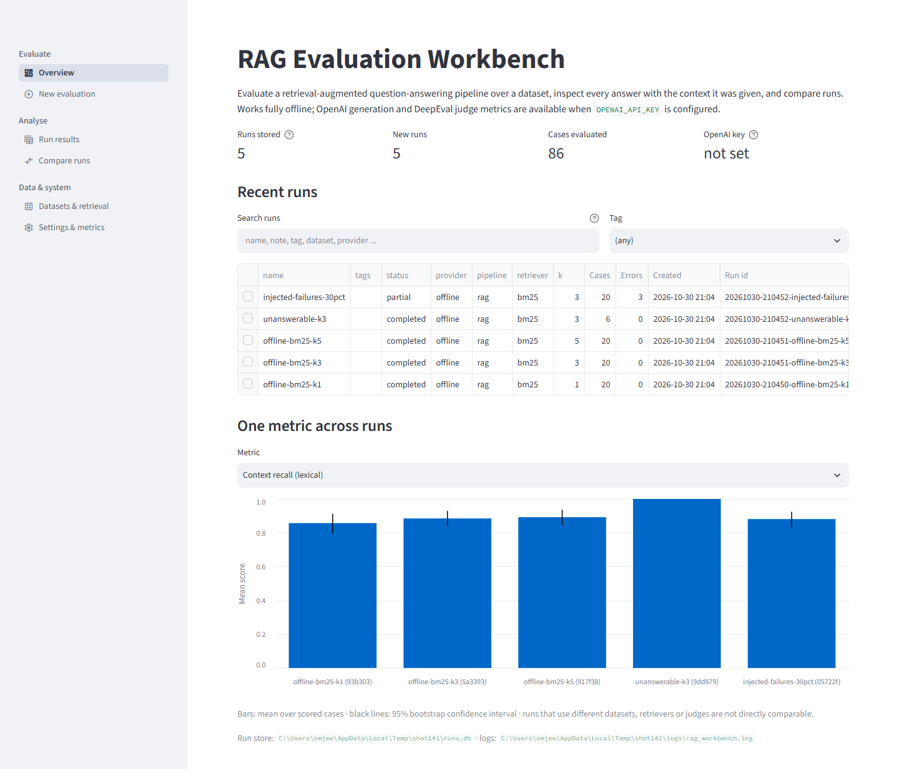

*Screenshot 01 — `/`.*

### 80.1 Purpose

The Overview is the landing page. It shows what is stored, what happened recently, and how runs
compare on one metric.

### 80.2 What the page shows

From top to bottom (`src/rag_workbench/ui/views/overview.py`):

1. **Title and introduction** (lines 14-17): the product name, and a sentence saying the app works
   fully offline and that OpenAI generation and DeepEval judge metrics need `OPENAI_API_KEY`.
2. **Four headline numbers** (lines 21-26):
   * *Runs stored*: all runs, including imported bundles, as the help tooltip says. Screenshot: 5.
   * *New runs*: runs whose status is not `imported`. Screenshot: 5.
   * *Cases evaluated*: the sum of `n_cases` over the new runs. Screenshot: 86 (20 + 6 + 20 + 20 + 20).
   * *OpenAI key*: "configured" or "not set". The tooltip explains that without a key only the
     offline provider, BM25 and lexical metrics are available. Screenshot: "not set".
3. **Empty state** (lines 28-33), shown only when there is no non-imported run: a bordered box
   recommending an offline run as a first step ("It takes a few seconds at most and needs no API
   key."), with a link "Configure a new evaluation". `start.py` creates the example runs on first
   launch, so a user normally sees this box only after deleting every run or after starting with
   `--no-examples`. It is not in screenshot 01.
4. If no run exists at all, the page stops here (lines 35-36).
5. **Recent runs** (lines 38-66), most recent first, under a level-2 heading. Since release 1.2 it begins with two
   filters (lines 39-49): a **Search runs** text box (every word must appear in the run's name, notes, tags, id, status,
   provider, retriever or dataset/document file name) and a **Tag** selector built from the tags that exist; if nothing
   matches, the page says "No run matches (N stored)." and stops. The table (lines 50-60) has the columns name, **tags**,
   status, provider, pipeline, retriever, k, Cases, Errors, Created and Run id. For imported runs, *Created* reads
   "imported" instead of the import timestamp (lines 54-55). The table supports **single-row
   selection** through its checkbox column. Selecting a row stores it as the selected run and shows
   "Selected **name** [badge]" with a link **Open run results** (lines 61-66).
6. **One metric across runs** (lines 68-84). A selectbox lists every metric that appears in any run
   summary, in alphabetical order of internal name. It defaults to *Correctness (judge)* if any run
   has it (line 71), and otherwise to the first name. The chart has one bar per run that has a mean
   for that metric, oldest run on the left (`reversed(runs)`, line 76), with CI rules. The caption
   reads "Bars: mean over scored cases · black lines: 95% bootstrap confidence interval · runs that
   use different datasets, retrievers or judges are not directly comparable." If no run has a score
   for the chosen metric, the page shows "No run has a score for this metric yet."
7. If any imported run carries provenance warnings, a caption says to read them before comparing
   (lines 86-87). Then come the paths of the run store and the log file (line 88).

### 80.3 Reading the screenshot

No run has a judge metric, so the chart in screenshot 01 shows the alphabetically first metric,
*Context recall (lexical)*, for all five runs. The bars are offline-bm25-k1 (0.857), -k3 (0.885),
-k5 (0.892), unanswerable-k3 (1.000) and injected-failures-30pct (0.881), as quoted in Part VI §74.
The unanswerable run's bar reaches 1.0 with no visible interval, because only two of its cases are
scored and both scored 1.0 (CI 1.000–1.000). The chart looks the same as the other runs' bars,
which is the misleading-small-denominator situation described in Part VI §70.3. The caption under
the chart warns that runs on different datasets are not directly comparable, and
`unanswerable-k3` uses a different dataset.

The screenshot also shows the two filters of release 1.2 above the table, the *Search runs* box and the *Tag* selector
("(any)"), and the new `tags` column, which is empty because none of the example runs has been tagged
(Part XIV §152). The section headings ("Recent runs", "One metric across runs") are the larger level-2 headings of §89.

In the Recent runs table, the *Run id* column is cut off at the right edge. The full id is
available by widening the column, or in the header of the Run results page.

---

## 81. New evaluation

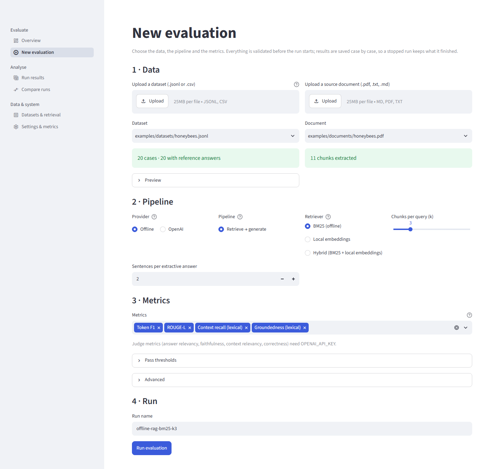

*Screenshot 02 — `/new-run`, no API key configured.*

### 81.1 Purpose

This page configures and launches one run. Everything is validated before anything runs, and
results are saved case by case (caption, `new_run.py:30-31`). Since release 1.3 an account with the `viewer` role sees, instead of the form, a warning that the account is read-only and the page stops (`new_run.py:27-29`); see §165 of Part XV for the role matrix.

### 81.2 Step 1 — Data

**Dataset upload** (`new_run.py:37-48`). The uploader accepts `.jsonl` and `.csv`. A new upload is
saved once per upload, tracked by the upload's file id so that a later manual choice is not
overridden on rerun, by `save_upload` (`src/rag_workbench/services.py:38-60`):

* The extension must be allowed, otherwise the error is "File type … not allowed; use …".
* The size must be within `RAGWB_MAX_DATASET_BYTES` (default 5,000,000 bytes), otherwise the error
  is "File is N bytes; the limit is M bytes".
* The file is stored under `data/uploads/` as
  `<first 12 hex characters of its SHA-256>-<sanitised name><ext>`. It therefore cannot escape the
  directory or overwrite a different file, and identical content is stored once.

The uploaded file then becomes the selected dataset. The widget's own text says "25MB per file"
(screenshot 02), which is Streamlit's upload ceiling from `.streamlit/config.toml`. The
application's limit for datasets is lower. The uploader's help tooltip (the "?" icon) states it:
"Size limit: 5 MB" with the default setting, computed from `RAGWB_MAX_DATASET_BYTES`
(`new_run.py:37-39`). The limit is enforced after upload with the error above.

**Dataset** selectbox (`new_run.py:49-55`). It lists the default dataset, then the bundled example
datasets, then uploads newest first, without duplicates (`services.py:63-82`), shown as paths
relative to the project root. If no dataset exists at all, the page shows "No dataset found. Upload
one above." and stops.

**Validation result** (`new_run.py:57-69`). The selected file is validated on every rerun:

* On success, a green box reads "N cases · M with reference answers". Screenshot 02 shows
  `examples/datasets/honeybees.jsonl` with "20 cases · 20 with reference answers".
* On failure, a red box reads "This dataset cannot be used:" and lists up to ten line-numbered
  errors.
* Warnings (duplicate questions, missing references, ignored fields) go in an expander titled
  "N warning(s)".
* A **Preview** expander shows the first 20 parsed cases as a table.

**Document upload and selector** (`new_run.py:72-93`). These follow the same pattern for `.pdf`,
`.txt` and `.md`, limited by `RAGWB_MAX_DOCUMENT_BYTES` (default 25 MB). The selected document is
chunked immediately, giving "N chunks extracted" or the document error in red. Screenshot 02 shows
`examples/documents/honeybees.pdf` with "11 chunks extracted".

### 81.3 Step 2 — Pipeline

| Control | Options | Behaviour |
|---|---|---|
| **Provider** (radio) | Offline, OpenAI | The help says the offline option is an extractive baseline, not an LLM. Choosing OpenAI without a key shows "OPENAI_API_KEY is not set. Add it to `.env` and restart to use OpenAI." (`new_run.py:98-102`) |
| **Pipeline** (radio) | Retrieve → generate; Tool-calling agent | The agent option is offered only with the OpenAI provider (`new_run.py:103-107`) |
| **Retriever** (radio) | BM25 (offline); API embeddings and API hybrid (key configured); Local embeddings and Hybrid (BM25 + local embeddings) (`fastembed` installed) | The API options are offered only when a key is configured and the local options only when `semantic_available()` is true (`new_run.py:108-115`). The committed screenshots were not recaptured for release 1.3 and show this page without the `semantic` extra, so they offer BM25 only |
| **Chunks per query (k)** (slider) | 1 to min(10, number of chunks) | Defaults to min(3, max) (`new_run.py:116-117`) |
| **Generator model** (text) | defaults to `RAGWB_GENERATOR_MODEL` | Shown only for OpenAI |
| **Sentences per extractive answer** (number) | 1–10, default 2 | Shown only for Offline (`new_run.py:119-126`) |

Screenshot 02 shows the no-key situation: only "Retrieve → generate" and "BM25 (offline)" are
available, with k = 3 and two sentences.

### 81.4 Step 3 — Metrics

* **Metrics** multiselect (`new_run.py:130-134`). Judge metrics are listed only when a key is
  configured, and the two semantic metrics only when the optional `fastembed` package is installed. The default selection is Token F1, ROUGE-L, Context recall (lexical) and Groundedness
  (lexical). Without the package, a caption says that the semantic metrics (local embedding model) are optional and
  `uv pip install fastembed` enables them; without a key, a caption says that the four judge metrics need
  `OPENAI_API_KEY` (both captions are in screenshot 02).
* **Judge model** (text), shown only when a judge metric is selected (`new_run.py:140-142`). It
  defaults to `RAGWB_JUDGE_MODEL`. If no judge metric is selected, the run records no judge model.
* **Pass thresholds** expander (`new_run.py:143-148`). It has one number input per selected metric,
  with range 0–1 and step 0.05, prefilled with the metric's default (Part VI §67). Thresholds change
  only pass/fail and pass rates, not scores.
* **Advanced** expander (`new_run.py:150-169`):
  * *Parallel cases*: 1–32 (default 1 for offline, `RAGWB_MAX_WORKERS` for OpenAI).
  * *Evaluate first N cases (0 = all)*: bounded by the dataset's case count.
  * *Seed*: 0–10,000.
  * *Inject failures (fraction of cases)*: 0–1 in steps of 0.05, offline only. This is a testing aid
    that makes the offline generator fail deterministically on some cases.
  * *Notes*: free text stored with the run.

When a user is signed in (accounts mode), the run's configuration also records who started it (`started_by`,
`new_run.py:208`; Part XIV §156.4).

### 81.5 Step 4 — Run

* **Run name** (`new_run.py:174-175`). It is prefilled as `provider-pipeline-retriever-k<k>`
  (screenshot: `offline-rag-bm25-k3`), up to 120 characters.
* **Pre-flight problems** (`new_run.py:177-189`). If any of the following holds, the button is
  disabled and a warning lists the problems, joined by semicolons:
  * the dataset has validation errors;
  * the document has no usable text;
  * no metric is selected;
  * OpenAI is selected but `OPENAI_API_KEY` is not set;
  * the run has no name.
* **Cost notice** (`new_run.py:191-194`). When the OpenAI provider or a judge model is in use, an
  info box says the run calls the OpenAI API and may incur cost. It gives the number of generation
  calls, plus "plus judge calls for each selected judge metric" when relevant. It estimates calls,
  not money.
* **Run evaluation** (primary button, `new_run.py:196`). On click it:
  1. Builds a `RunConfig` and calls `runner.prepare`, which validates the metric names, thresholds,
     dataset, document and pipeline construction without writing anything. Any rejection appears as
     "Configuration rejected: …" and the page stops (`new_run.py:197-213`).
  2. Shows a progress bar reading "k/N cases", and a code box with the last eight case outcomes:
     `✓ case-id`, or `✗ case-id — error message` (`new_run.py:216-224`).
  3. Runs under a spinner whose text says to use Streamlit's Stop button to cancel, and that
     finished cases are kept (`new_run.py:227-228`).
  4. On a storage failure, shows "Could not save results: …" (`new_run.py:229-231`).
  5. On completion, selects the new run and shows "Run **name** finished: [badge] · n_ok/n cases
     succeeded", in green if the run completed and amber otherwise. It adds a caption about failed
     cases if there are any, and one tile per metric with the mean and the tooltip "N scored,
     N skipped, N errors". It ends with a link **Inspect this run** (`new_run.py:232-248`).

### 81.6 Cancellation

Streamlit's Stop control interrupts the script while it is inside the progress callback. The runner
treats any exception raised there as cancellation: it marks the run `cancelled`, writes a summary of
the cases finished so far and re-raises (`src/rag_workbench/runner.py:132-137`). The cancelled run
then appears in the store with its partial results. If the server process dies instead, the run
stays `running` until the next start-up marks it `interrupted` (§79.3). The effect of other
interactions during a run, such as navigating to another page, was not tested for this book.

---

## 82. Run results

The Run results page has a run selector, a header, four headline numbers and five tabs.

### 82.1 Run selector and header

* **Run** selectbox (`results.py:31-36`). The initial choice is the run named by the `?run=` query
  parameter if it exists. Otherwise it is the session's selected run, and failing that the first
  (most recent) run. Choosing a run makes it the selected run.
* **Header** (`results.py:45-50`). It shows the run name with its status badge, then a muted line
  with provider, pipeline, retriever, k, generator, judge ("—" if none) and the full run id.
  Configuration values can come from imported bundles, so every value in this HTML line goes
  through `html.escape` before rendering. A bundle therefore cannot inject markup into the page.
* **Provenance box** for runs with warnings (`results.py:51`).
* For `cancelled` or `interrupted` runs, a warning: "This run was cancelled: N of M cases were
  evaluated." (`results.py:52-53`).
* The run's tags and notes, as captions (`results.py:54-57`). Screenshot 03 shows "Notes: Example: default
  retrieval depth".
* If the run has no summary yet: "This run has no summary yet (it may still be running)." and the
  page stops (`results.py:60-62`).

### 82.2 Headline numbers

| Tile | Value | Tooltip |
|---|---|---|
| Cases | succeeded / evaluated | "Succeeded / evaluated" |
| Errors | number of failed cases | — |
| Mean latency | mean over successful cases, in ms | p95 latency |
| Tokens | prompt + completion totals, "—" when not reported | cost in USD, or "—" with a hint to set `RAGWB_PRICE_*` |

(`results.py:64-70`.) Offline runs report no tokens, hence the "—" in screenshots 03–07 and 11.

### 82.3 Summary tab

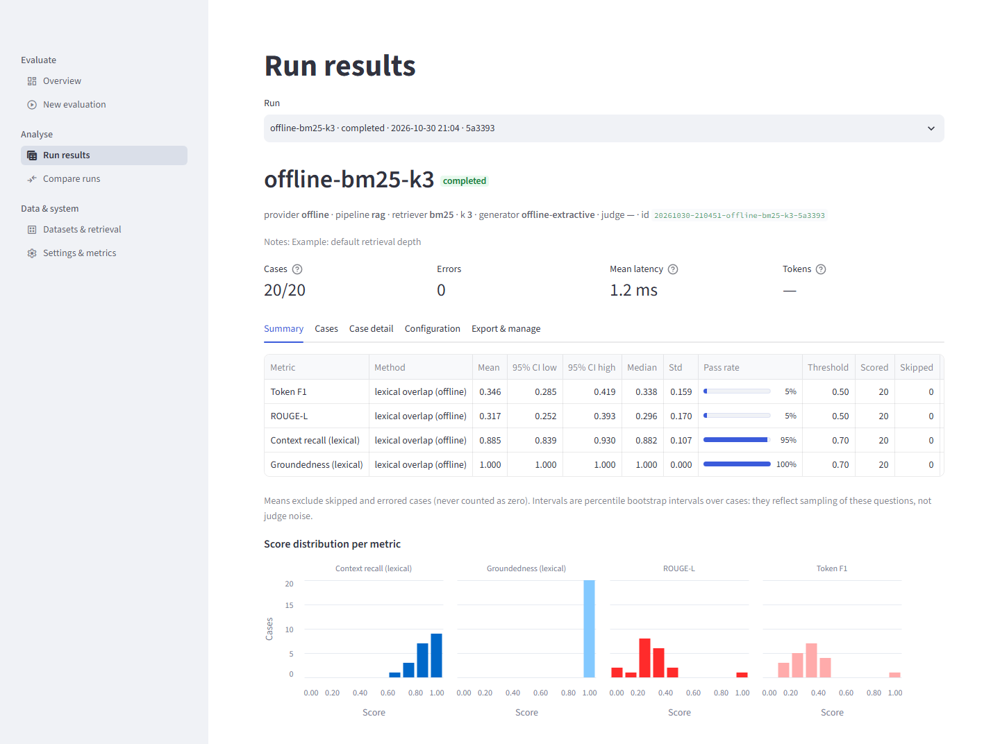

*Screenshot 03 — `/results?run=20261023-194808-offline-bm25-k3-2d53f3`.*

The tab shows one table row per metric (`results.py:78-90`). The columns are Metric, Method, Mean,
95% CI low, 95% CI high, Median, Std, Pass rate (drawn as a progress bar with a percentage),
Threshold, Scored, Skipped and Errors. The caption reads: "Means exclude skipped and errored cases
(never counted as zero). Intervals are percentile bootstrap intervals over cases: they reflect
sampling of these questions, not judge noise."

The values in screenshot 03 match Part VI §74.1. For example, Token F1 has mean 0.346, CI
0.285–0.419, median 0.338, std 0.159 and a pass rate of 5% at threshold 0.50, with 20 scored and 0
skipped. The table is wider than the content area: the *Errors* column is beyond the right edge and
needs horizontal scrolling inside the table.

Below the table is **Score distribution per metric** (`results.py:103-113`). It has one histogram per
metric, with bins 0.1 wide on [0, 1], the number of cases on the y axis, the metric name as the
facet title, and one colour per metric without a legend. Only scored values are plotted. In
screenshot 03:

* the groundedness facet is a single bar of 20 cases at 1.0;
* context recall is concentrated between 0.6 and 1.0;
* token F1 and ROUGE-L cluster between about 0 and 0.5, each with one case at 0.9 (q13).

### 82.4 Cases tab

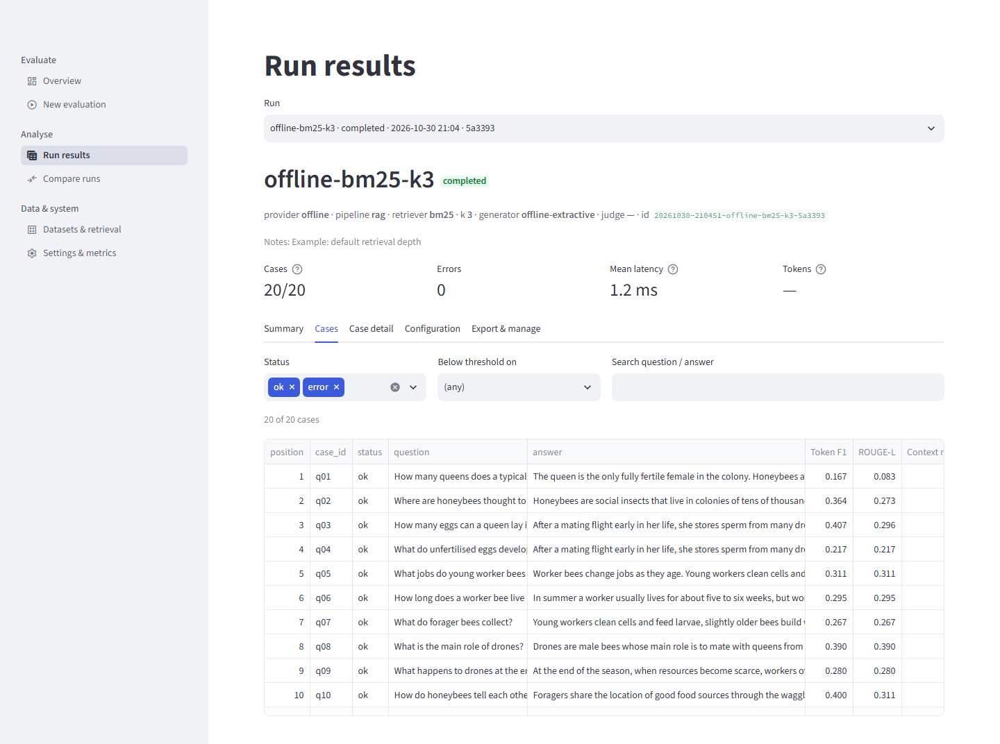

*Screenshot 04 — `/results?run=…offline-bm25-k3-2d53f3&tab=cases`.*

There are three filters (`results.py:115-129`):

* **Status**: a multiselect of "ok" and "error", both selected by default.
* **Below threshold on**: "(any)" or a metric. Choosing a metric keeps only cases where that metric
  was scored **and failed** (`passed == False`). Cases where the metric was skipped or errored are
  excluded, not shown as failures.
* **Search question / answer**: a case-insensitive plain substring search (no regular expressions)
  in the question or the answer.

A caption shows "N of M cases". The table shows position, case_id, status, question, answer, one
column per metric, latency (ms), attempts and error (`results.py:130-135`). Questions and answers are
truncated in their cells, and the table scrolls internally. Screenshot 04 shows the first ten rows
(q01–q10), and the context-recall column is cut at the right edge.

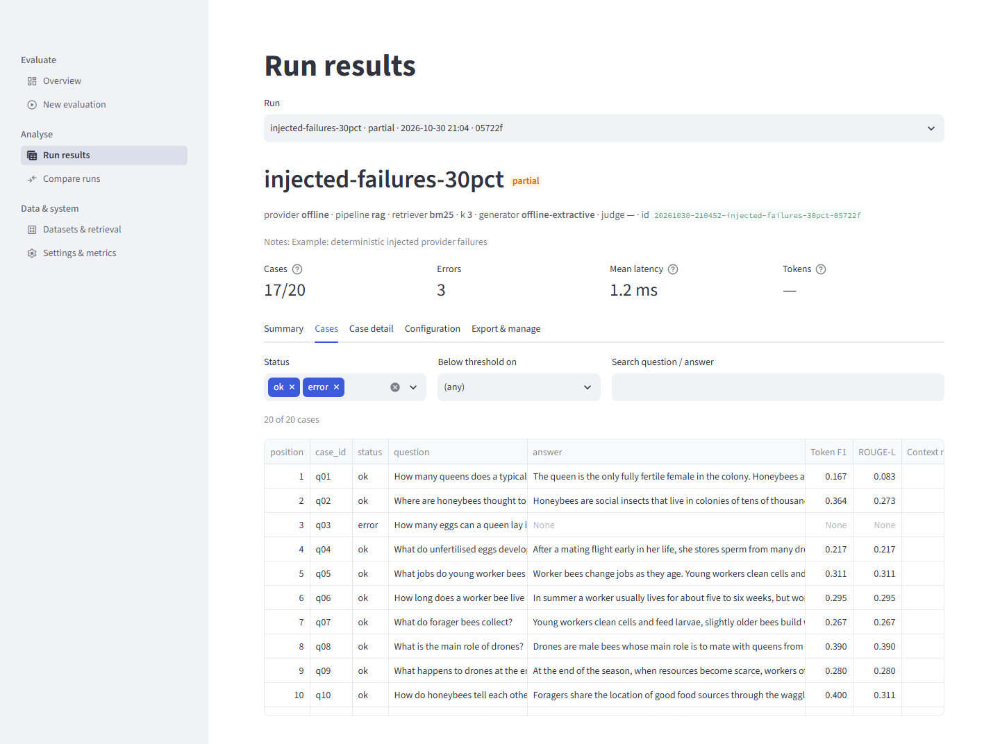

*Screenshot 07 — `injected-failures-30pct`, Cases tab.*

For a partial run, the failed cases appear with status `error`. Screenshot 07 shows "17/20" cases,
3 errors and the "partial" badge, with q03 visible among the first ten rows. The answer and metric
cells of a failed case display the text "None", which is how Streamlit renders a missing value in
these columns, rather than a blank or a dash. The error message is in the *error* column, beyond the
visible area in the screenshot. For these cases it reads "Injected offline failure
(offline_failure_rate > 0)" (Part VI §74.6).

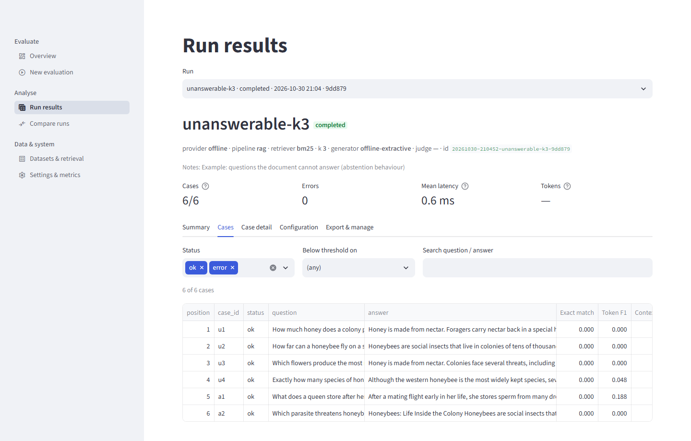

*Screenshot 11 — `unanswerable-k3`, Cases tab.*

When the dataset carries metadata, the Summary tab also offers "Break down by dataset metadata". For this run, splitting by the answerable/unanswerable field gives two slices: answerable, 2 cases, mean token F1 0.094; unanswerable, 4 cases, mean token F1 0.012, with context recall shown as None because it is skipped for questions with no reference answer.


*Screenshot 12 — `unanswerable-k3`, Summary tab, slices.*

Screenshot 11 shows all six cases, u1–u4 and a1–a2. Exact match is 0.000 on every row. Token F1 is
0.000, 0.000, 0.000, 0.048, 0.188 and 0.000. None of the visible answers is the abstention sentence:
u1 begins "Honey is made from nectar.", and a2 begins with the document title, "Honeybees: Life
Inside the Colony" (Part VI §74.2, §74.5).

### 82.5 Case detail tab

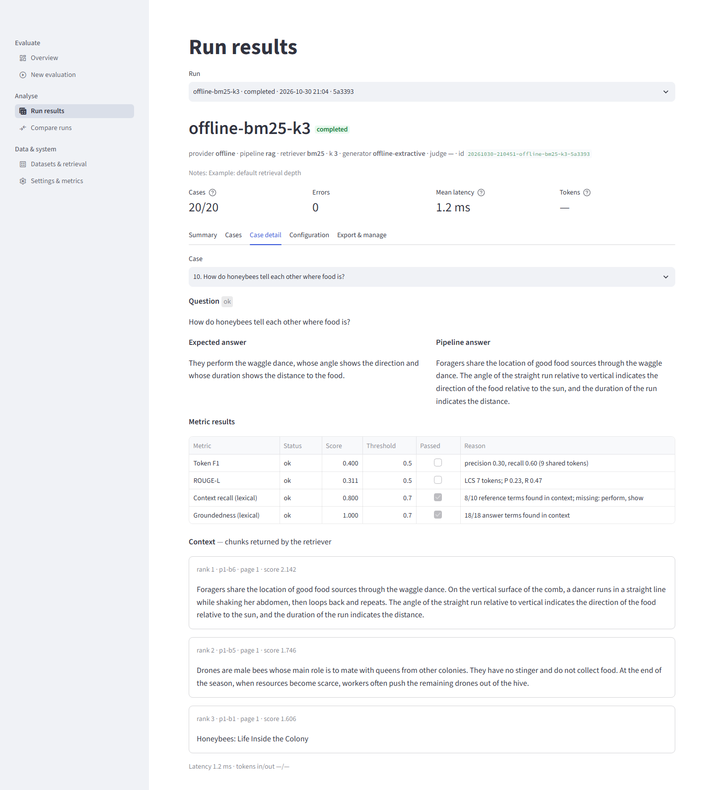

*Screenshot 05 — `/results?run=…offline-bm25-k3-2d53f3&tab=case&case=q10`.*

The **Case** selectbox lists "position. question", with questions cut at 90 characters. `?case=`
chooses the initial case (`results.py:137-146`). For the selected case the tab shows
(`results.py:144-169`):

* **Question**, with a status badge.
* **Expected answer** and **Pipeline answer** side by side, or "_(no reference answer)_" and
  "_(no answer)_" when either is missing.
* For failed cases, a red box: "Error after N attempt(s): …".
* **Metric results** table, with columns Metric, Status (ok / skipped / error), Score, Threshold,
  Passed (a read-only checkbox) and Reason. The reason is the most useful column: it shows the counts
  behind a lexical score, and the missing or unsupported terms.
* **Context**, labelled with its source: "chunks returned by the retriever" or "chunks returned to
  the agent's tool" (`results.py:163-164`).
* One bordered box per context chunk, captioned "rank · chunk id · page · score", followed by the
  chunk text. The text is rendered with `st.text`, i.e. literally, so document content cannot inject
  Markdown or HTML (`results.py:169`).
* A caption with latency and tokens in/out.

Screenshot 05 shows q10:

* **Expected answer:** "They perform the waggle dance, whose angle shows the direction and whose
  duration shows the distance to the food."
* **Pipeline answer:** two sentences from the waggle-dance paragraph.
* **Metric results:**
  * Token F1 0.400 and ROUGE-L 0.311, both unchecked at threshold 0.5.
  * Context recall 0.800, checked, with reason "8/10 reference terms found in context; missing:
    perform, show".
  * Groundedness 1.000.
* **Context:** three chunks. Rank 1 is `p1-b6` (score 2.142, the waggle-dance paragraph), rank 2
  `p1-b5` (1.746, the drones paragraph) and rank 3 `p1-b1` (1.606). The rank-3 chunk is the one-line
  title "Honeybees: Life Inside the Colony".

The page makes both lexical weaknesses from Part VI visible. The reference's "shows" is missing
because the document says "indicates", and a chunk with no content, the title, takes one of the
three context slots (Part VI §74.2).

### 82.6 Configuration tab

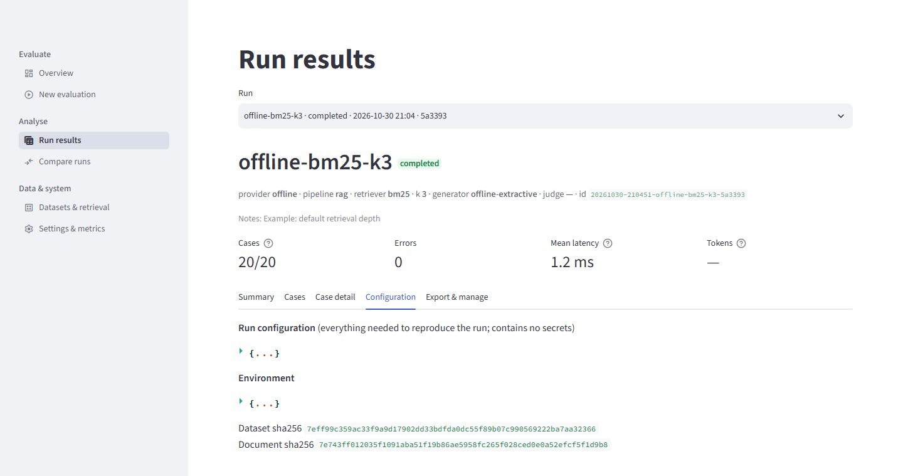

*Screenshot 06 — `/results?run=…offline-bm25-k3-2d53f3&tab=config`.*

This tab (`results.py:173-178`) shows the stored run configuration under the heading "Run
configuration (everything needed to reproduce the run; contains no secrets)", and the environment
under "Environment". Both are JSON trees, collapsed to `{...}` until clicked. Below them are the
dataset and document SHA-256 hashes. Screenshot 06 shows the collapsed trees, the dataset hash
beginning `7eff99c359ac` and the document hash beginning `7e743ff01203`. This tab is the place to
check which thresholds, models, seed and limits a run actually used.

### 82.7 Export & manage tab

* **Downloads** (`results.py:180-188`): three buttons, **CSV (one row per case)**, **JSON (full
  record)** and **Markdown report**. The browser saves each as `<run id>.<ext>` (§86.5).
* **Delete this run** expander (`results.py:208-220`):
  * A warning says deletion removes the run and all its case results and cannot be undone. For
    imported runs it adds that the run can be imported again from its bundle file.
  * A text field reads "Type the run id to confirm".
  * The **Delete run** button stays disabled until the field matches the run id exactly. Deleting
    clears the selected run, shows "Run deleted." and reruns the page.

* **Tags and notes** expander (`results.py:190-207`, release 1.2): a text input for comma- or space-separated tags, a
  text area for the note (limited to 2,000 characters) and a **Save tags and notes** button. Invalid tags are reported with
  an error box; a valid save shows "Saved." (Part XIV §152.4).

Since release 1.3 the *Tags and notes* inputs are disabled for a `viewer`, who sees "Your account is read-only (viewer): tags and notes cannot be changed." instead of the save button, and the *Delete this run* expander is available only to an `admin` (others see "Deleting runs needs an admin account.") (`results.py:190-198`, `:208-214`).

No screenshot of this tab was captured.

---

## 83. Compare runs


*Screenshot 08 — `/compare?runs=<k1 id>,<k3 id>,<k5 id>`.*

### 83.1 Run selection

* With fewer than two stored runs, the page shows "At least two runs are needed for a comparison."
  and a link to run another evaluation (`compare.py:15-18`).
* **Runs to compare** multiselect (`compare.py:20-23`). The initial selection comes from `?runs=` if
  at least two of its ids exist, and is otherwise the three most recently created runs. With fewer
  than two selected, the page shows "Select at least two runs." (`compare.py:24-26`).

### 83.2 Configuration

This is a table with one column per selected run (`compare.py:30-44`). Its rows are provider,
pipeline, retriever, k, generator_model, judge_model, metrics, the first 12 characters of the
dataset hash, cases and status. Rows whose values differ between runs get an amber background, and
the caption says "Highlighted rows differ between the selected runs." In screenshot 08 only the *k*
row (1, 3, 5) is highlighted, and all three runs share the dataset hash `7eff99c359ac`.

If the dataset hashes differ, a warning explains that cases are paired by question text and that
only shared questions are compared (`compare.py:45-47`). If any selected run is imported, an
expander "Provenance notes for imported runs" lists each imported run's warnings
(`compare.py:48-53`).

### 83.3 Metric means

This is a grouped bar chart (`compare.py:56-73`): metrics on the x axis, one colour per run, a fixed
[0, 1] y axis, and 95% CI rules. A run–metric pair without a CI (fewer than two scored cases) is
drawn with a zero-length rule at the mean (`compare.py:64-65`), which can look like a precise value.
The caption reads: "Black lines: 95% bootstrap confidence intervals. Overlapping intervals mean the
difference may be sampling noise; use the paired analysis below for a sharper test." If none of the
runs has scores, the page shows "The selected runs have no scores."

In screenshot 08:

* the k1 bar is the tallest for Token F1 and ROUGE-L, and the k3 and k5 bars are level;
* context recall rises slightly from k1 to k5, with overlapping intervals;
* groundedness is 1.0 for all three runs.

### 83.4 Best run per metric

This table lists metric, best run, mean and *tie* (`compare.py:75-83`). All runs within 10⁻⁹ of the
top mean are listed, joined with " = ", and the tie box is checked; ties are never broken
arbitrarily. Screenshot 08 shows:

* Token F1: won by k1 (0.404);
* ROUGE-L: won by k1 (0.373);
* context recall: won by k5 (0.892);
* groundedness: a three-way tie (1.000).

"Best" here means highest mean only. It ignores confidence intervals, the number of scored cases and
whether the runs used the same data, so the paired analysis below is the better guide.

### 83.5 Paired comparison

* **Baseline (A)** and **Candidate (B)** selectboxes, restricted to the chosen runs, default to the
  first and second run (`compare.py:89-91`). Choosing the same run for both shows "Choose two
  different runs." (`compare.py:92-94`).
* If the two runs share no metric, the page shows "These runs share no metric."
* The table (`compare.py:97-106`) has the columns label, paired_cases, mean_a, mean_b,
  diff_b_minus_a (signed), ci_low, ci_high, b_better, ties, b_worse and **verdict**. The verdict is:
  * "no paired cases" when no question was scored in both runs;
  * "B better" or "B worse" when the 95% interval of the paired difference excludes zero;
  * "inconclusive" otherwise (`compare.py:101-103`).
* The caption reads: "'B better/worse' only when the 95% interval of the paired difference excludes
  zero. With 20 cases, small differences are usually inconclusive."

Screenshot 08 compares k1 (A) with k3 (B):

| Metric | Difference (CI) | B better / ties / B worse | Verdict |
|---|---|---|---|
| Token F1 | −0.057 (−0.116 to −0.008) | 3 / 10 / 7 | "B worse" |
| ROUGE-L | −0.056 | 3 / 10 / 7 | "B worse" |
| Context recall | +0.028 (0.000 to 0.063) | 3 / 17 / 0 | inconclusive |
| Groundedness | +0.000 | 0 / 20 / 0 | inconclusive |

These match `ragwb compare` (Part VI §74.1), except for one rounding difference. The context-recall
upper bound is exactly 0.0625; the CLI prints it as 0.062, while this table shows 0.063 (Part VI
§71.4). The method and its caveats are in Part VI §72: pairing by normalised question text, and no
multiple-comparison correction.

### 83.6 Per-case differences

A **Per-case differences for** selectbox offers the shared metrics. Below it, a table lists question,
A, B, B − A, answer A and answer B, sorted by B − A ascending so the largest regressions come first
(`compare.py:110-126`). A closing caption repeats the counts: "N paired cases · B better on W, tied
on T, worse on L." If no case has the metric scored in both runs, the page shows "No case has this
metric scored in both runs."

In screenshot 08 (Token F1, k1 → k3):

* the first rows are "How does a honeybee colony reproduce?" (0.629 → 0.273, −0.356), "Why do bees
  build hexagonal cells?" (−0.349), "What temperature do bees keep the brood nest at?" (−0.212) and
  "How long does a worker bee live in summer?" (−0.191);
* the caption reads "20 paired cases · B better on 3, tied on 10, worse on 7.";
* the *answer B* column is beyond the right edge.

This table is the most direct way to see *why* an aggregate moved. Reading the two answers for the
worst row shows the title sentence displacing a real sentence at k = 3 (Part VI §74.2).

---

## 84. Datasets & retrieval

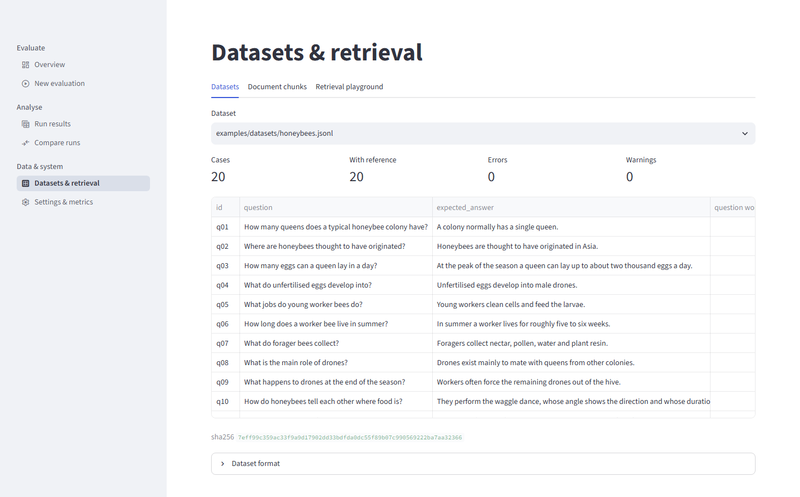

*Screenshot 09 — `/data`, Datasets tab.*

The page has three tabs (`data.py:19`).

**Datasets** (`data.py:26-56`). This tab has:

* a dataset selector, with the same list as on New evaluation;
* four numbers: Cases, With reference, Errors and Warnings;
* each error and warning as a red or amber message;
* a table of id, question, expected answer, question word count and reference word count;
* the file's full SHA-256;
* a **Dataset format** expander with a JSONL example and the CSV rules.

Screenshot 09 shows `examples/datasets/honeybees.jsonl`: 20 cases, 20 with a reference, 0 errors and
0 warnings. The ids q01–q10 are visible, and the hash begins `7eff99c359ac`. The word-count columns
are beyond the right edge of the table.

**Document chunks** (`data.py:58-69`). This tab has a document selector, a caption "N chunks · N
characters", and a table of chunk id, page, character count and text. Check here that a document was
split into sensible chunks before evaluating. For the example PDF, the table shows the 11 chunks,
including the one-line title chunk `p1-b1` that Part VI §74.2 discusses. Document errors are shown
in red.

**Retrieval playground** (`data.py:71-87`). This tab has a query box, which defaults to "How is
nectar turned into honey?", and a k slider. The page builds a BM25 index over the selected
document's chunks and shows the top k, each with "rank · chunk id · page · BM25 score" and the chunk
text. If every hit scores 0, i.e. no chunk shares a content word with the query, a warning says the
results are in document order. The caption explains that embedding retrieval is not offered here,
to avoid cost. Typing "Which parasite threatens honeybee colonies?" reproduces the ranking discussed
in Part VI §74.3: the title first, the threats paragraph third. No screenshot of this tab was
captured.

---

## 85. Settings & metrics

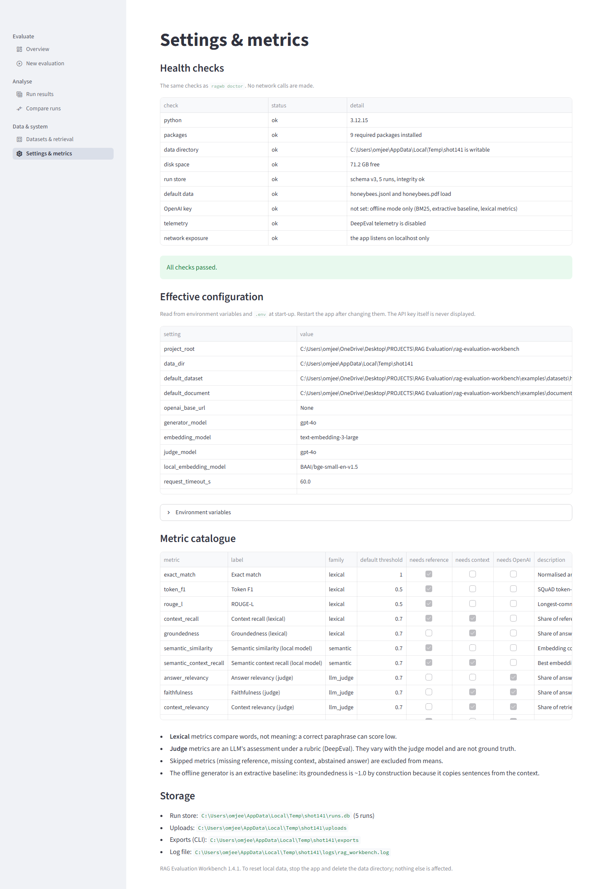

*Screenshot 10 — `/settings`.* The page now begins with a "Health checks" table (the same checks as `ragwb doctor`); in the captured state it lists 9 checks, all ok, including "run store: schema v3, 5 runs, integrity ok".

`settings.py` has five parts:

* **Effective configuration** (lines 18-19). Every setting from `Settings.public_dict()` (paths,
  models, timeouts, retries, limits, log level, and `openai_api_key_configured`), with the API key
  itself excluded. The caption says values are read at start-up and need a restart to change. The
  table scrolls internally: screenshot 10 shows rows down to `max_retries`, with long paths cut at
  the right edge.
* **Environment variables** expander (lines 21-23): each variable and the setting it maps to.
* **Metric catalogue** (lines 26-30). Its columns are name, label, family, default threshold, needs
  reference / context / OpenAI (read-only checkboxes) and description. Screenshot 10 shows the first ten rows of the eleven metrics (the five lexical metrics, the two
  semantic ones, then the judge metrics), with the semantic rows labelled "(local model)".
* **Four notes** (lines 31-37):
  * lexical metrics compare words, not meaning;
  * judge metrics are an LLM's assessment and not ground truth;
  * skipped metrics are excluded from means;
  * the offline generator's groundedness is about 1.0 by construction.
* **Storage** (lines 39-44). The paths of the run store (with the run count, "5 runs" in the
  screenshot), the uploads, the CLI exports and the log file. It also shows the application version
  and a note that local data is reset by stopping the app and deleting the
  data directory.

The page changes nothing; all configuration goes through environment variables or `.env`.

---

## 86. Workflows

### 86.1 First launch and first look

1. Run `python start.py`. On the first launch it creates the five example runs and opens the
   Overview in the browser.
2. On the **Overview**, select a run in **Recent runs** and follow **Open run results**.
3. Read the Summary tab, then the Cases and Case detail tabs.

### 86.2 A new offline evaluation

1. Open **New evaluation**. Without changes, it uses the bundled honeybee dataset and PDF, the
   offline provider, BM25, k = 3 and the four default lexical metrics.
2. Optionally edit the run name and add notes.
3. Click **Run evaluation**, and watch the progress bar and the case log.
4. Read the finish message and the metric tiles, then follow **Inspect this run**.

### 86.3 Investigating weak answers

1. On **Run results → Cases**, choose a metric in **Below threshold on**.
2. Note a case id, switch to **Case detail** and select the case, or open
   `/results?run=<id>&tab=case&case=<case id>`.
3. Read the metric reasons and the retrieved chunks, and decide where the problem lies:
   * **retrieval:** the needed paragraph is absent;
   * **generation:** it is present but not used;
   * **the metric:** a correct paraphrase scored low;
   * **the document:** a title or other non-content chunk was retrieved.
4. For retrieval questions, try the query in **Datasets & retrieval → Retrieval playground** with
   different values of k.

### 86.4 Comparing two configurations

1. Run both configurations on the same dataset.
2. On **Compare runs**, select both. Check the Configuration table for unintended differences
   (highlighted rows) and look out for the dataset-hash warning.
3. Set Baseline and Candidate, and read the verdict column, not only the means.
4. Use **Per-case differences** to inspect the largest regressions.

### 86.5 Using your own data and exporting

1. On **New evaluation**, upload a JSONL or CSV dataset and a PDF, TXT or MD document, and fix any
   line-numbered errors reported.
2. Inspect **Datasets & retrieval → Document chunks** for the uploaded document.
3. Run as in §86.2. Uploaded files remain in `data/uploads/`; the UI has no control to remove them.
4. Export from **Run results → Export & manage**:
   * **CSV.** One row per case: identity, status, question, expected answer, answer, error, latency,
     tokens, cost, attempts, number of contexts and context chunk ids, plus a score, `_passed` and
     `_status` column for each metric (`src/rag_workbench/reporting.py:30-49`). Text cells that start
     with `=`, `+`, `-`, `@`, a tab or a carriage return get a `'` prefix to neutralise spreadsheet
     formulas. The file starts with a UTF-8 byte-order mark for Excel (`reporting.py:85-100`).
   * **JSON.** A run bundle (`format: rag-workbench-run`, version 1) with the full run record and all
     case results. It can be re-imported with `ragwb import <file>` (`reporting.py:114-125`).
   * **Markdown.** A report (`reporting.py:140-185`) containing:
     * run identity, provider/pipeline/retriever, k and models;
     * dataset and document names with abbreviated hashes;
     * any provenance warnings;
     * the summary table and the failed cases;
     * the five lowest-scoring cases per metric, with reasons;
     * a footer saying judge scores are model assessments and lexical scores measure word overlap.

All three files are generated when the tab is rendered, and the browser saves them to its own
download location. `ragwb export` on the CLI writes the same formats to `data/exports/` instead.

---

## 87. Deep links

| Parameter | Page | Effect | Invalid value |
|---|---|---|---|
| `?run=<run id>` | `/results` | Initial run selection (`results.py:31-36`) | Ignored; falls back to the session's selected run, then to the most recent run |
| `?tab=summary\|cases\|case\|config\|export` | `/results` | Initial tab (`results.py:72-76`) | Summary |
| `?case=<case id>` | `/results` | Initial case in Case detail (`results.py:140-143`) | First case |
| `?runs=<id>,<id>[,…]` | `/compare` | Initial run selection; unknown ids dropped (`compare.py:20-21`) | The three most recent runs, if fewer than two ids are valid |

Parameters can be combined, as in the screenshot URLs:
`/results?run=20261023-194808-offline-bm25-k3-2d53f3&tab=case&case=q10`.

The links are **inbound only**. No code writes to `st.query_params`; a search of the source finds
only reads, in `results.py` and `compare.py`. The browser's address bar therefore does not change
when a user picks another run, tab or case. To share a view, build the URL by hand from the run id
shown in the header and the case id shown in the tables.

---

## 88. Error and empty states

| Situation | Where | What the user sees |
|---|---|---|
| Invalid environment configuration | every page | "Configuration problem: …", with advice to fix `.env` and restart |
| No runs | Run results | "No runs stored yet." and a link "Run an evaluation" |
| No new (non-imported) runs | Overview | Empty-state box with a link to New evaluation |
| No runs at all | Overview | The page ends after the headline numbers |
| Fewer than two runs, or fewer than two selected | Compare | "At least two runs are needed…" / "Select at least two runs." |
| Same run as A and B | Compare | "Choose two different runs." |
| No shared metric, or no paired cases | Compare | "These runs share no metric." / verdict "no paired cases" |
| No dataset files | New evaluation | "No dataset found. Upload one above." |
| Invalid dataset | New evaluation, Datasets | Line-numbered errors; Run button disabled |
| Upload too large or of the wrong type | New evaluation | Red error with the limit or the allowed types |
| Document without text | New evaluation, Document chunks | The document error; Run button disabled |
| OpenAI chosen without a key | New evaluation | Warning under Provider; Run button disabled |
| Configuration rejected at prepare | New evaluation | "Configuration rejected: …" |
| Storage failure during a run | New evaluation | "Could not save results: …" |
| Run with failed cases | New evaluation, Results | Amber finish message; `partial`/`failed` badge; error text per case |
| Cancelled or interrupted run | Results | Warning with the number of evaluated cases |
| Run without a summary | Results | "This run has no summary yet (it may still be running)." |
| Metric with no scores | Overview chart | "No run has a score for this metric yet." |
| Query matching no chunk | Retrieval playground | Warning that results are in document order |

---

## 89. Accessibility and usability

No formal accessibility audit by a person or against a full WCAG conformance procedure was performed for this application; release 1.4 added an automated axe-core run and keyboard walks (below). Release 1.2 added a
**scripted check**: a script run in the browser over five pages (Overview, New evaluation, Run results, Compare runs,
Settings & metrics) that looked at heading structure, accessible names of buttons, links and inputs, image alternatives and
text contrast. It found two defects in this project's code, both fixed (Part XIV §158):

* **Skipped heading levels.** The pages went from the level-1 title straight to level-3 section headings. Section headings
  are now `st.header` (level 2), with one CSS rule restoring their size (`ui/components.py:27-28`). The larger headings in the
  recaptured screenshots of this book are this change.
* **Muted text at 4.42:1.** The muted-text class now uses `opacity: 0.75` on the theme's own text colour
  (`ui/components.py:24-26`), which is about 5.7:1 on the light theme and 10:1 on the dark theme (computed, not measured in a
  rendering engine).

Streamlit draws data tables on a canvas, which was first reported here as unreadable to screen readers. Release 1.4 corrected that:
the tables are exposed to assistive technology through a **parallel grid structure** (`gridcell` elements), so they are readable in
principle, but **each cell is its own Tab stop** (on Run results, 23 of the 59 stops before focus returned to the start were on
zero-size grid cells), which makes a long table tedious by keyboard. Every table has a CSV download as an alternative. The built-in
JSON viewer uses syntax colours below 4.5:1; neither point is fixable inside this project. The release-1.2 script also flagged
white-on-blue slider values at 1.0:1; axe-core 4.10.2 (WCAG 2.0/2.1/2.2 A and AA plus best practices, run in release 1.4 against this
application's own local pages) did not flag them, which supports that having been a false positive of the script. axe-core found **no
violations** on the six page views of its record (Overview, Run results, Compare, Datasets and Settings) and **one minor issue** on
New evaluation, inside Streamlit's own file-uploader component (`role="presentation"` on an element with a tab stop) (Part XVI
§177). Release 1.3 added **one keyboard walk**: 40 Tab presses on the New evaluation page in a browser visited a skip
link first, then the sidebar links, then every form control in visual order (uploaders, selects, radio groups, slider, expanders,
run name, Run button), and then returned to the start, with no trap and no hidden stop (Part XV §166). Release 1.4 walked Run results
(104 focus events over 40 presses, back at the start after 59, no trap) and Settings (63 events over 40 presses), so three pages have
been walked. A script flagged 16 stops without an outline or shadow; Streamlit styles focus another way, and the two checked by eye
(a sidebar link and a radio button) show a visible indicator. The other 14 flagged stops, keyboard walks of Overview, Compare, Datasets
and Accounts, an axe-core audit of the Accounts page, and screen readers were not checked, and **screen-reader announcement order and
zoom/reflow were not tested.** The observations below come from reading the code and the screenshots.

* **Keyboard and screen readers.** All controls are standard Streamlit widgets, so keyboard focus,
  tab order and ARIA attributes are whatever Streamlit 1.66 provides. The app adds no custom keyboard
  shortcuts or custom widgets.
* **Colour.**
  * Status badges include the status word, so they do not rely on colour alone.
  * The Compare page's "differs" highlight is only a background tint. The caption explains it, but a
    user who cannot see the tint has no other cue per row.
  * Charts distinguish runs and metrics by colour, using the Streamlit/Altair defaults. The Compare
    chart has a legend; the Summary histograms use facet titles instead. Screenshot 08 uses dark
    blue, light blue and red for the three runs. Whether these are distinguishable for people with
    colour-vision deficiencies was not tested.
  * The muted text class (before release 1.2 a fixed grey measured at 4.42:1, just under the 4.5:1 commonly required for
    normal-size text) now dims the theme's text colour; see the scripted check above.
* **Charts without text alternatives.** Altair charts have tooltips but no text description. The
  same numbers are available in nearby tables (the Summary table and the Paired comparison table),
  so no information exists only in a chart.
* **Literal rendering of untrusted text.** Chunk texts are rendered with `st.text`, and the results
  header escapes configuration values, so neither documents nor imported bundles can change the
  page's markup.
* **Wide tables.** Several tables are wider than the 1,400-pixel content area and need horizontal
  scrolling inside the table (screenshots 01, 03, 04, 07, 08, 09 and 11). Long tables scroll
  vertically inside a fixed-height frame, with ten rows visible in the screenshots.
* **Missing values.** Summary tiles and formatted numbers show "—", but the raw case tables show
  "None" (screenshot 07). The two conventions coexist.
* **Theme.** The app follows the viewer's light/dark preference. The screenshots show only the light
  theme; the dark-theme contrast of the muted text is computed (about 10:1), not looked at.
* **Feedback during long runs.** A progress bar, a case log and a spinner are shown, but the page is
  occupied by the run until it ends or is stopped.

---

## 90. Known UI limitations

* **Local use, small teams at most.** By default there is no login and no isolation between users. The server
  is bound to `localhost` by default, which limits access to users of the same machine. An
  optional shared password (`RAGWB_APP_PASSWORD`, release 1.1) or named accounts (`ragwb user add`, release 1.2) put a login
  page in front of every page (`streamlit_app.py:20-21`, `ui/auth.py:132-140`) and `start.py --host` refuses a non-local address
  without one; `--ssl-cert`/`--ssl-key` serve HTTPS. There is still no e-mail password reset (an admin sets a new password, release 1.4) and, by default, no separation of one
  user's runs from another's (`RAGWB_RUN_VISIBILITY=own` filters the pages only, release 1.4), and, since release 1.3, only three coarse roles (viewer, editor, admin); removing an account ends its open session on the next page load (Part XIII §144, Part XIV §156, Part XV §165).
* **Settings require a restart**, because the application context is cached per server process.
* **Runs execute in the page's script.** A run occupies the browser session that started it. There
  is no background queue, and no way to start a second run from the same session while one is
  running.
* **Deep links are inbound only** (§87).
* **The upload size messages differ.** The widget itself advertises 25 MB per file, while datasets
  are limited to 5 MB by the application. The lower limit appears only in the help tooltip and in
  the error after an oversized upload (§81.2).
* **No upload management.** Uploaded files cannot be listed separately or deleted from the UI.
* **The retrieval playground is BM25-only**, even when an embedding retriever is available.
* **Exports are built on every render** of the Results page, for all three formats. For very large
  runs this adds work to each rerun.
* **"Best run per metric" uses means only**, without regard to intervals or case counts (§83.4).
* **Zero-length CI rules** are drawn for metrics with fewer than two scored cases (§83.3, and the
  unanswerable run's bar in screenshot 01).
* **CLI and UI round some values differently** in the third decimal (§83.5).
* **Thresholds are fixed at run time.** Changing a threshold requires a new run; the UI cannot
  recompute pass rates for a different threshold.
* **Empty states are not pictured.** The screenshots were taken with five stored runs, so the
  Overview's empty-state box (§80.2) does not appear in any of them.


# Part VIII — Setup and operation

This part is the operator's manual: how to install the RAG Evaluation Workbench, start it, configure it, run
evaluations from the browser and the command line, find outputs and logs, reset it, and fix the problems that
are known to occur. The primary way to install and run the product is one command, `python start.py`
(§81). The manual route with uv and the `ragwb` CLI remains available and is described alongside it.

Commands shown with output were run on 2026-10-24 on a Windows 11 machine (Git Bash and PowerShell). Everything
that writes data was pointed at a temporary directory with `RAGWB_DATA_DIR`, never at the project's own `data/`.

## 80. Supported Python versions and prerequisites

### 80.1 Python

`pyproject.toml:6` declares `requires-python = ">=3.12"`, and `.python-version` pins `3.12`. When uv creates the
environment it honours the pin and uses a uv-managed CPython 3.12 rather than whatever Python is on `PATH`: the
project's `.venv/pyvenv.cfg` records `home = C:\Users\omjee\AppData\Roaming\uv\python\cpython-3.12-windows-x86_64-none`
and `version_info = 3.12`, and the environment's interpreter reports:

```text
> .venv\Scripts\python.exe --version
Python 3.12.15
```

**Supported** therefore means CPython 3.12: it is the only version on which the code and the test suite were run.
The declared range allows 3.13 and later, but the application has not been run on them; treat them as untested.

The launcher `start.py` is a different case. It uses only the standard library (`start.py:15`), so any Python 3
can *run* it; on the development machine it was started with the system Python 3.13.3 and created the 3.12
environment through uv. Only when uv is missing does the launcher need Python 3.12+ itself, because it then builds
the environment with that interpreter (`start.py:54-57`).

### 80.2 uv (recommended)

The project is managed with [uv](https://docs.astral.sh/uv/) (version 0.13.1 on the development machine). uv
provides the Python interpreter, the virtual environment, the lock file `uv.lock` and the `uv run` launcher.
`start.py` uses uv when it finds it on `PATH` and falls back to the standard `venv` module otherwise (§81.3).

### 80.3 Optional: Chrome or Edge

Any modern browser can use the app. Google Chrome or Microsoft Edge specifically is needed only for the book
tooling: `docs/project-book/tools/capture_screenshots.py` drives a headless Chrome/Edge through the DevTools
protocol and looks for the executables at the standard Windows install paths or on `PATH`
(`capture_screenshots.py:29-33`, `50-54`). No other system software is required.

### 80.4 Network

Installing needs access to PyPI (and, the first time, to uv's Python download source). Running does not: the
default configuration — and the first-launch example runs — are fully offline. Only the OpenAI provider, the
embedding retriever and the four judge metrics contact the network (Part XI, §114.2).

## 81. Installing and starting: `python start.py`

### 81.1 The command

From the project root:

```bash
python start.py
```

(On systems where the Python 3 executable is called `python3`, use that.) The module docstring states the
contract (`start.py:1-16`): prepare the environment, create example runs on the first launch, start the app on
this machine only (or another host with a login, optionally over TLS), open it in the browser; Ctrl+C stops it. Nothing is installed outside the project folder.

### 81.2 What it does, step by step

1. **Prepare the environment** (`prepare_environment`, `start.py:47-63`). If `uv` is on `PATH`, it runs
   `uv sync --frozen --inexact` with `UV_HTTP_TIMEOUT` defaulting to 180 seconds (`start.py:48-53`).
   * `--frozen` installs exactly the versions in `uv.lock` and never rewrites the lock;
   * `--inexact` leaves extra packages already in `.venv` in place (for example the `docs` group, §82.2);
   * the sync creates `.venv/` if needed, installs the runtime dependencies of `pyproject.toml:7-18`, the default
     `dev` group (`[tool.uv] default-groups = ["dev"]`, `pyproject.toml:45-46`: pytest, pytest-cov, ruff, mypy and pip-audit), and the
     project itself in editable mode — the build backend is hatchling (`pyproject.toml:35-43`), and the editable
     install appears as `.venv/Lib/site-packages/_editable_impl_rag_evaluation_workbench.pth`.
   If the sync fails the launcher stops with "`uv sync` failed; see the messages above (a slow network may need a
   retry)." (`start.py:52`).
2. **Create the example runs on the first launch** (`store_is_empty`, `create_examples`; `start.py:66-81`, `203-204`).
   The launcher asks the application, through the environment's interpreter, how many runs the store holds. If
   the answer is 0 it calls `rag_workbench.demo.seed_demo_runs`, which performs five genuine offline evaluations of
   the bundled honeybee data (`src/rag_workbench/demo.py:24-47`; §83.2). If creating them fails, the app still
   starts without them (`start.py:80-81`). If the run store cannot even be opened, the launcher stops and prints the
   application's error (`start.py:70-71`).
3. **Pick a port** (`free_port`, `start.py:132-137`): the first port from 8501 (or `--port`) on which nothing accepts a
   connection on `127.0.0.1`, trying 50 ports.
4. **Start Streamlit** (`launch`, `start.py:157-189`) as
   `.venv/…/python -m streamlit run streamlit_app.py --server.port <port> --server.address <host>
   --server.headless true --browser.gatherUsageStats false` (plus `--server.sslCertFile`/`--server.sslKeyFile` with TLS), with `DEEPEVAL_TELEMETRY_OPT_OUT=1` in its environment.
   The address (`localhost` unless `--host` is given) and the statistics setting are passed on the command line, so they
   hold even if `.streamlit/config.toml` were not read.
5. **Wait until it is healthy** (`wait_until_ready`, `start.py:140-154`): poll `http://localhost:<port>/_stcore/health`
   for up to 90 s (`https://` with TLS, certificate not verified for this probe of the launcher's own server), then print `RAG Evaluation Workbench is running at http://localhost:<port>  (Ctrl+C to stop)` and
   open the browser.
6. **Stop on Ctrl+C**: terminate Streamlit, wait up to 10 s, then kill it (`start.py:182-188`).

### 81.3 Fallback without uv

If uv is not installed (`start.py:54-63`), the launcher requires the Python running it to be 3.12 or newer
(otherwise it exits with a message pointing to uv), creates `.venv` with `python -m venv` if it does not exist, and
runs `.venv/…/python -m pip install --quiet -e . pytest pytest-cov`. The result is the same editable install with
the test tools, but **not** pinned by `uv.lock`: pip resolves the version ranges in `pyproject.toml` afresh, so the
installed versions can differ from the ones the project was tested with. This path was not exercised for this
book (uv is installed on the development machine).

### 81.4 Flags

| Flag | Effect | Code |
|---|---|---|
| `--port N` | preferred port; the first free port from N is used (default 8501) | `start.py:194`, `208` |
| `--host H` | address to listen on (default `localhost`); any other address makes the launcher exit unless `RAGWB_APP_PASSWORD` is set in the environment or `.env`, or user accounts exist (`ragwb user add`) | `start.py:195-197`, `105-110`, `198-201` |
| `--ssl-cert F`, `--ssl-key F` | serve over HTTPS with a PEM certificate and key (both required; each file must exist); without TLS on a non-local host the launcher prints a warning that credentials cross the network unencrypted | `start.py:198-199`, `113-122`, `155-159` |
| `--no-browser` | do not open a browser window | `start.py:200` |
| `--no-examples` | skip the first-launch example runs even if the store is empty | `start.py:201`, `203` |
| `--setup-only` | prepare the environment and the examples, then exit without starting the app | `start.py:202`, `205-207` |

### 81.5 Observed first launch

Run with a fresh temporary data directory and a blank key:

```text
$ RAGWB_DATA_DIR=<temp>/start-data python start.py --setup-only
[start] $ C:\Users\omjee\.local\bin\uv.EXE sync --frozen --inexact
Checked 115 packages in 20ms
[start] $ ...\.venv\Scripts\python.exe -c from rag_workbench.services import open_context; print(len(open_context(console_logging=False).store.list_runs()))
[start] first launch: running the offline example evaluations (a few seconds)
[start] $ ...\.venv\Scripts\python.exe -c from rag_workbench.demo import seed_demo_runs; ...
  offline-bm25-k1: completed
  offline-bm25-k3: completed
  offline-bm25-k5: completed
  unanswerable-k3: completed
  injected-failures-30pct: partial
[start] setup complete
```

(the two long `-c` command lines are abridged). Exit code 0; wall-clock time 7.25 s, with the environment already
synchronised. The temporary directory then contained `runs.db` and `logs/rag_workbench.log`. Running the same
command again printed the sync and probe lines and `[start] setup complete` without the example step — the
store was no longer empty — and took 2.88 s. "Checked 115 packages" means the environment already matched the
lock; a first install on a new machine downloads and installs those packages instead, which takes minutes
on a slow network.

The interactive mode (`python start.py`, without `--setup-only`) was not run for this part, to avoid starting a
server against the project's data directory; the launcher's behaviour in that mode is described from the code above.

### 81.6 Manual alternative with uv

Everything `start.py` does can be done by hand:

```bash
uv sync                                   # .venv, locked dependencies, dev group, editable install
uv sync --group docs                      # optional: adds `markdown` for building the project book
uv run python scripts/seed_demo_runs.py   # optional: the five example runs (§89.3)
uv run streamlit run streamlit_app.py     # the app, on http://localhost:8501
```

`uv sync` without `--frozen` re-locks if `uv.lock` is out of date with `pyproject.toml`; use
`uv sync --frozen` to install exactly the lock. To check the lock without changing anything:
`uv lock --check --offline` (this is also step 2 of `scripts/verify.py`, `scripts/verify.py:66-72`).

## 82. Configuration

### 82.1 Where settings come from

All settings are read once, by `config.load_settings` (`src/rag_workbench/config.py:204-232`), from environment
variables. Before reading, it loads `.env` **from the project root** with `override=False`
(`config.py:211-213`): a variable already set in the process environment wins over `.env`. Blank values are
treated as unset (`config.py:179-180`). Settings are frozen (`config.py:37`), and the Streamlit app reads them when
its context is first created (`ui/state.py:17-20`), so **changes require a restart** — the Settings page says so
(`ui/views/settings.py:30-31`).

```bash
cp .env.example .env                 # Git Bash
Copy-Item .env.example .env          # PowerShell
```

`.env.example` is entirely optional content: "Everything is optional: without OPENAI_API_KEY the workbench runs
fully offline" (`.env.example:1-2`). `.env` is ignored by Git (`.gitignore:1-2`).

### 82.2 Variables

The authoritative list is the `ENV_VARS` mapping (`config.py:173-197`); the generated table
`docs/project-book/generated/env-vars.md` is produced from it and from the `Settings` field defaults and
constraints. In summary:

| Group | Variables | Defaults / constraints |
|---|---|---|
| OpenAI access | `OPENAI_API_KEY`, `OPENAI_BASE_URL` | unset |
| Models | `RAGWB_GENERATOR_MODEL`, `RAGWB_EMBEDDING_MODEL`, `RAGWB_JUDGE_MODEL` | `gpt-4o`, `text-embedding-3-large`, `gpt-4o` |
| Reliability | `RAGWB_REQUEST_TIMEOUT_S`, `RAGWB_CASE_TIMEOUT_S` (new in 1.1), `RAGWB_MAX_RETRIES`, `RAGWB_RETRY_BASE_DELAY_S`, `RAGWB_MAX_WORKERS` | 60 s (0–600], 600 s (0–3,600], 3 [0–10], 1 s [0–60], 4 [1–32] |
| Cost | `RAGWB_PRICE_INPUT_PER_MTOK`, `RAGWB_PRICE_OUTPUT_PER_MTOK` | unset → cost reported as unknown |
| Locations | `RAGWB_DATA_DIR`, `RAGWB_DATASET`, `RAGWB_DOCUMENT` | `data`, `examples/datasets/honeybees.jsonl`, `examples/documents/honeybees.pdf` (`config.py:60-62`) |
| Project root | `RAGWB_HOME` (new in 1.2; read at import time, from the environment only, not from `.env`) | unset → the checkout the package lives in, else the current directory (`config.py:21-34`); see §82.3 |
| Local embedding model | `RAGWB_LOCAL_EMBEDDING_MODEL` (new in 1.2) | `BAAI/bge-small-en-v1.5`; used by the optional semantic metrics and, since 1.3, by the `local` and `hybrid-local` retrievers (`config.py:72`, `:180`); the model is cached in `<data dir>/models` (`config.py:113-115`) |
| Request pacing | `RAGWB_MAX_REQUESTS_PER_MINUTE` (new in 1.3) | unset → no pacing; otherwise a number greater than 0 and at most 6000 (`config.py:79`, `:185`); see Part XV §161 |
| Input limits | `RAGWB_MAX_DATASET_BYTES`, `RAGWB_MAX_DOCUMENT_BYTES`, `RAGWB_MAX_CASES`, `RAGWB_MAX_FIELD_CHARS` | 5,000,000; 25,000,000; 5,000; 20,000 |
| Logging | `RAGWB_LOG_LEVEL`, `RAGWB_LOG_FORMAT` (new in 1.1) | `INFO`, one of DEBUG, INFO, WARNING, ERROR, CRITICAL (`config.py:92-103`); `text`, or `json` for one redacted JSON object per line (`config.py:93`) |
| Run visibility | `RAGWB_RUN_VISIBILITY` (new in 1.4) | `shared` (default): every signed-in user sees every run; `own`: with named accounts, non-admins see only runs they started plus runs with no owner, in the web pages only (`config.py:94`, `:198`; Part XVI §173.4) |
| Access | `RAGWB_APP_PASSWORD` (new in 1.1); user accounts in `<data dir>/users.json` (new in 1.2, managed with `ragwb user`) | neither → no login; the shared password → one password for everybody; accounts → named sign-ins (they take precedence), and `start.py --host` may then listen on a non-local address (`config.py:66`, `:119-128`, `ui/auth.py:132-140`) |

`OPENAI_API_KEY` keeps the name the OpenAI SDK and DeepEval expect; every other variable has the `RAGWB_` prefix
(`config.py:3-5`). `OPENAI_BASE_URL` is passed to every OpenAI client the workbench builds (`pipeline.py:139`,
`168-171`; `metrics/judge.py:113-114`), which allows an OpenAI-compatible endpoint. Release 1.3 exercised this against Groq's free tier (generation and the judge metrics, not embeddings); OpenAI itself was not exercised (Part XV §160).

All settings apply equally to `start.py`, which passes its environment on to every process it starts. In
particular `RAGWB_DATA_DIR` decides which run store the launcher probes and seeds.

### 82.3 Path resolution

The three path variables are resolved against the **project root**, not the current directory, when relative
(`config.py:221-223`); `~` is expanded. The project root is `RAGWB_HOME` when that is set; otherwise the directory two levels above `config.py` when it holds a
`pyproject.toml` (a checkout); otherwise, for an installed wheel, the current directory, so data is never written into
`site-packages` (`config.py:21-34`, Part XIV §157). So `RAGWB_DATA_DIR=data` always means `<project>/data`, wherever a command is run from, and an
absolute path is used as given (`tests/test_config.py:17-25` checks both).

### 82.4 Validation

Values are validated by pydantic; a bad value raises `ConfigError` naming the *variable* (`config.py:226-232`):

```text
$ RAGWB_MAX_WORKERS=99 python -m rag_workbench list
error: Invalid configuration: RAGWB_MAX_WORKERS: Input should be less than or equal to 32
```

(exit code 1). In the UI the same error appears as "Configuration problem: …" followed by "Fix the variable in
`.env` (see `.env.example`) and restart the app." (`ui/state.py:23-29`). Under `start.py` an invalid value already
stops the launcher at the store probe, which prints the application's error (`start.py:70-71`).

### 82.5 Seeing the effective configuration

The **Settings & metrics** page shows `Settings.public_dict()` — every setting, with the key replaced by the flag
`openai_api_key_configured` (`config.py:163-169`, `ui/views/settings.py:29-33`) — plus the variable-to-setting
mapping, the metric catalogue and the storage paths.

## 83. Example data and example runs

### 83.1 Files in `examples/`

All example data was written for this project. Release 1.2 added three more documents, each in Markdown and PDF form (a title and 14 paragraphs, so 15 chunks), with a 30-question dataset tagged by `type`, `difficulty` and `topic` (Part XIV §151): `volcanoes`, `coffee` and `lighthouses`. The honeybee assets, which the first-launch example runs use, are:

| Path | Content | `ragwb validate` output |
|---|---|---|
| `examples/documents/honeybees.md` | the source text: a title line and ten paragraphs about honeybee colonies | — |
| `examples/documents/honeybees.pdf` | the same text rendered to a 2-page PDF by `scripts/make_example_pdf.py`; yields **11 chunks**: the title `p1-b1` ("Honeybees: Life Inside the Colony"), paragraphs `p1-b2` … `p1-b10` and `p2-b1` | — |
| `examples/datasets/honeybees.jsonl` | the default dataset: 20 questions `q01`–`q20`, all with reference answers | `honeybees.jsonl: 20 cases, 20 with reference answers` / `valid` |
| `examples/datasets/honeybees_unanswerable.jsonl` | 6 questions: `u1`–`u4` not answerable from the document (reference = the abstention sentence), `a1`–`a2` answerable; `metadata.type` marks which | `honeybees_unanswerable.jsonl: 6 cases, 6 with reference answers` / `valid` |
| `examples/datasets/honeybees_paraphrased.csv` | 5 questions `p1`–`p5` in CSV form with an extra `topic` column (becomes metadata) | `honeybees_paraphrased.csv: 5 cases, 5 with reference answers` / `valid` |

The validation lines were produced on 2026-10-24; each command exited with code 0. The PDF exists so that the
PDF extraction path has a bundled example; `scripts/make_example_pdf.py` regenerates it deterministically from the
Markdown file, one text block per paragraph (`scripts/make_example_pdf.py:1-8`). The `test_real_pdf_chunks` test
pins the 11-chunk result (`tests/test_documents.py:7-14`).

### 83.2 The five example runs

`rag_workbench.demo.demo_configs` (`src/rag_workbench/demo.py:24-39`) defines the runs that `start.py` creates on
the first launch and `scripts/seed_demo_runs.py` creates on request:

| Key | Run name | Configuration | Observed result |
|---|---|---|---|
| `k1` | `offline-bm25-k1` | default data, the four default lexical metrics, k = 1 | completed; token F1 0.404, context recall 0.857 |
| `k3` | `offline-bm25-k3` | same, k = 3 | completed; token F1 0.346, context recall 0.885 |
| `k5` | `offline-bm25-k5` | same, k = 5 | completed; token F1 0.346, context recall 0.892 |
| `unanswerable` | `unanswerable-k3` | `honeybees_unanswerable.jsonl`, metrics exact match, token F1, context recall, groundedness | completed; exact match 0.000 on 6 scored; context recall skipped for the 4 unanswerable cases |
| `failures` | `injected-failures-30pct` | k = 3, `offline_failure_rate = 0.3` | partial: 17 ok, 3 errors (`q03`, `q16`, `q17`) |

Results are from `ragwb show` on the runs created by the launcher; they are deterministic and were reproduced by the
CLI runs in §85.4. Two observations worth knowing before reading them:

* **Deeper retrieval lowers the answer-overlap scores here.** Going from k = 1 to k = 3 *lowers* token F1 (paired
  difference −0.057, 95 % CI −0.116 to −0.008, which excludes zero) while context recall rises only slightly
  (0.857 → 0.885 → 0.892 for k = 1/3/5). The extractive baseline picks the best-matching sentences from all
  retrieved chunks, and extra chunks offer more off-target sentences. k = 5 produces the same answers as k = 3.
* **The baseline never abstains** on `u1`–`u4`: every question shares some content word with the document, so it
  always finds a sentence to return (exact match 0 of 6). Its answer to `a2` begins with the title chunk, because a
  title has no sentence punctuation and is treated as one sentence.

## 84. Running the application

### 84.1 Starting the Streamlit app

`python start.py` (§81) is the normal way. It prints the URL, by default <http://localhost:8501>, and opens it.
The manual equivalent is:

```bash
uv run streamlit run streamlit_app.py
```

`.streamlit/config.toml` is read from the directory Streamlit is started in, so start it from the project root:

| Setting | Value | Effect |
|---|---|---|
| `browser.gatherUsageStats` | `false` | no Streamlit usage statistics (`config.toml:3-5`) |
| `client.toolbarMode` | `"minimal"` | hides developer/deploy controls (`config.toml:7-9`) |
| `server.maxUploadSize` | `25` | 25 MB upload ceiling, matching the document limit (`config.toml:11-14`) |
| `server.headless` | `true` | Streamlit does not open a browser window itself (`config.toml:15`) |
| `server.address` | `"localhost"` | listen on this machine only; the config comment notes there are no accounts, and the optional shared password (Part XIII §144) is what allows another address (`config.toml:16-17`) |
| `theme.primaryColor` | `#3b5bdb` | accent colour; light/dark follows the viewer (`config.toml:19-21`) |

Without an explicit address, the installed Streamlit (1.66.1) binds all interfaces (Part XI, §114.4).
`start.py` always passes `--server.address localhost`; if you start Streamlit by hand from another directory, pass
it yourself. Do not pass `--server.address 0.0.0.0` (or another external address) unless the network is trusted:
anyone who can reach the port can read, start and delete runs.

The entry point sets `DEEPEVAL_TELEMETRY_OPT_OUT=1` before anything else (`streamlit_app.py:10`), configures the
page, and registers six pages in three groups (`streamlit_app.py:23-37`): **Evaluate** — Overview, New evaluation;
**Analyse** — Run results, Compare runs; **Data & system** — Datasets & retrieval, Settings & metrics; an admin of an installation with
accounts also sees **Admin** — Accounts (`streamlit_app.py:39-40`, release 1.4). On first use
the app opens the run store, creating `data/runs.db` and `data/logs/` if they do not exist (`services.py:27-35`,
`storage.py:64-83`).

### 84.2 First look after `start.py`

After a first launch the Overview lists the five example runs, so every page has real content: Run results for any
of them, Compare runs across `offline-bm25-k1`, `-k3` and `-k5`, the failed cases of `injected-failures-30pct`, and
the abstention behaviour in `unanswerable-k3`. With `--no-examples` (or after deleting all runs), the Overview
instead shows "No evaluations run yet." and a link to configure one (`ui/views/overview.py:28-33`).

### 84.3 A new evaluation in the UI

1. **New evaluation.** The defaults are valid: dataset `examples/datasets/honeybees.jsonl` ("20 cases · 20 with
   reference answers"), document `examples/documents/honeybees.pdf` ("11 chunks extracted"), provider Offline,
   pipeline Retrieve → generate, retriever BM25, k = 3, and the four default lexical metrics (token F1, ROUGE-L,
   context recall, groundedness). These strings are asserted by the UI test
   `test_new_run_journey_offline_then_results_and_compare` (`tests/test_ui.py:85-115`).
2. Press **Run evaluation**. A progress bar and the last eight case lines are shown while it runs
   (`new_run.py:210-224`); then "Run **<name>** finished: completed · 20/20 cases succeeded" and one tile per metric.
3. **Inspect this run** opens **Run results**: summary statistics with bootstrap intervals, the per-case table,
   case detail with the retrieved chunks, the stored configuration, and exports.

The evaluation itself is short: for a 20-case offline run the interval between the "started" and "finished" log
lines is a fraction of a second. The first run in a fresh server process also pays one-time initialisation
(imports, opening the PDF). No precise UI timing was measured for this part.

### 84.4 Running without credentials

Nothing needs to be configured. Without `OPENAI_API_KEY`:

* the Overview shows the key as `not set` (`overview.py:25-26`);
* the New evaluation page offers only the BM25 retriever (`new_run.py:108`; with the optional `semantic` extra installed it also offers the two local retrievers) and only the five lexical metrics
  (plus the two semantic metrics if `fastembed` is installed; `new_run.py:130-131`), and explains "Judge metrics (answer relevancy, faithfulness, context relevancy, correctness)
  need OPENAI_API_KEY." (`new_run.py:138-139`);
* selecting the OpenAI provider shows "OPENAI_API_KEY is not set. Add it to `.env` and restart to use OpenAI." and
  disables the Run button with "Cannot start yet: OpenAI is selected but OPENAI_API_KEY is not set."
  (`new_run.py:101-102`, `184-189`; asserted by `test_openai_option_explains_missing_key`, `tests/test_ui.py:129-135`);
* the CLI refuses OpenAI options with an explicit message (§88.3).

The first-launch examples and the whole test suite run in this mode.

### 84.5 Running with OpenAI

Set `OPENAI_API_KEY` in `.env` (or the environment) and restart. The provider `openai` (retrieve-then-generate or
tool-calling agent), the `embedding` retriever and the four judge metrics then become available:

```bash
uv run ragwb run --name gpt4o-k3 --provider openai -k 3 \
    --metrics token_f1,context_recall,answer_relevancy,faithfulness,context_relevancy,correctness
```

**Cost warning.** These runs make paid API calls: one generation call per case (more for the agent, which calls its
retrieval tool and then answers), embedding calls for every chunk and every query with the embedding retriever, and
judge calls for every case and judge metric. Before an OpenAI run the UI shows "This run calls the OpenAI API and
may incur cost." with the number of generation calls (`new_run.py:191-194`). The workbench does not cap spending.
Cost is computed only if both `RAGWB_PRICE_INPUT_PER_MTOK` and `RAGWB_PRICE_OUTPUT_PER_MTOK` are set
(`runner.py:258-262`); otherwise it is shown as unknown ("—"). Use `--limit N` (CLI) or "Evaluate first N cases"
(UI, Advanced) to try a configuration on a few cases first.

**Verification status.** No OpenAI or DeepEval call was made while building this Part. Release 1.3 later ran generation and
the four DeepEval judge metrics against Groq's free tier through its OpenAI-compatible endpoint, on small samples (Part XV §160);
release 1.4 ran the tool-calling agent pipeline live on three cases (Part XVI §176.3); OpenAI itself and API embeddings have not been run live (Part IX, §98).

### 84.6 Local embeddings and rate-limited providers (release 1.3)

```bash
uv sync --extra semantic                      # installs fastembed (the optional `semantic` extra in pyproject.toml)
uv run ragwb run --retriever hybrid-local     # BM25 fused with local dense retrieval; no key, no network after the model download
RAGWB_MAX_REQUESTS_PER_MINUTE=12              # in .env or the environment: pace answers and judge measurements
```

The first use downloads the embedding model (default `BAAI/bge-small-en-v1.5`) into `<data dir>/models`; after that
`HF_HUB_OFFLINE=1` works. On Windows keep the data directory path short: the model cache nests folders deeply and can exceed
the 260-character path limit (`docs/BUILD_AND_RUN.md`, `docs/KNOWN_LIMITATIONS.md`). One pacing *operation* is one answer or one
judge-metric measurement, and a measurement can make several API calls, so choose a value below the provider's request quota
divided by that fan-out. Pacing cannot create quota, and a provider's daily token budget is not waited out (Part XV §161).

## 85. Command-line usage

### 85.1 Invocation

```bash
uv run ragwb <command> ...
.venv\Scripts\ragwb.exe <command> ...          # Windows, environment already prepared
.venv\Scripts\python.exe -m rag_workbench <command> ...
```

`ragwb` is the console script declared at `pyproject.toml:20-21`; `python -m rag_workbench` runs `__main__.py`, which
calls `cli.main` (`src/rag_workbench/__main__.py:1-5`). The complete help text of every subcommand is captured from
argparse in `docs/project-book/generated/cli-reference.md`.

### 85.2 Commands

| Command | Purpose | Key options | Code |
|---|---|---|---|
| `run` | run an evaluation | `--name`, `--dataset`, `--document`, `--provider {offline,openai}`, `--pipeline {rag,agent}`, `--retriever {bm25,embedding,hybrid,local,hybrid-local}`, `-k`, `--metrics`, `--threshold METRIC=VALUE` (repeatable), `--model`, `--judge-model`, `--workers` and `--limit` (both must be 1 or more since 1.4.1, otherwise a usage error), `--answer-sentences`, `--inject-failures`, `--min-evidence`, `--skip-headings`, `--seed`, `--notes`, `--quiet` | `cli.py:69-79`, `416-439` |
| `list` | list stored runs, optionally filtered; shows a `tags` column | `--search WORD...`, `--tag`, `--status` | `cli.py:99-112`, `441-446` |
| `show RUN_ID` | configuration essentials and summary of one run | — | `cli.py:231-238`, `489-491` |
| `compare RUN_A RUN_B` | paired comparison of B against A on shared metrics | — | `cli.py:241-250`, `492-495` |
| `export RUN_ID` | write CSV, JSON bundle or Markdown | `--format {csv,json,md}`, `--out-dir` | `cli.py:253-258`, `496-500` |
| `validate FILE` | validate a dataset | — | `cli.py:261-271`, `501-503` |
| `delete RUN_ID` | delete a run | `--yes` (required) | `cli.py:274-282`, `504-507` |
| `metrics` | describe the metrics | — | `cli.py:285-292`, `508` |
| `import BUNDLE [BUNDLE ...]` | import one or more bundles written by `export --format json` | — | `cli.py:295-299`, `509-511` |
| `score` | score one answer, store nothing | `--question`, `--answer`, `--expected`, `--context` (repeatable), `--metrics`, `--judge-model` | `cli.py:476-487`, `512-519` |
| `labels-template RUN_ID` | write a CSV for human labelling | `--out` (required), `--force` | `cli.py:302-310`, `520-524` |
| `calibrate RUN_ID` | metric-versus-label agreement and Cohen's kappa; `--sweep` tabulates agreement at thresholds 0.10-0.95; `--rescore` computes an offline or local-model metric from stored answers | `--labels` (required), `--metric` (required), `--sweep`, `--rescore` | `cli.py:333-367`, `599-607` |
| `slices RUN_ID` | per-value summary of a metadata field | `--by` (required) | `cli.py:370-389`, `531-534` |
| `rerun RUN_ID` | repeat a stored run from its recorded configuration | `--name`, `--quiet` | `cli.py:392-409`, `535-539` |
| `backup` | verified copy of the run store | `--out-dir` | `cli.py:424-427`, `617-619` |
| `restore BACKUP` | replace the run store with a backup after validating it; writes a `pre-restore-*` safety copy; refuses a recently active run (release 1.4; stop the web app first) | `--yes` (required), `--force` | `cli.py:424-433`, `553-557` |
| `prune` | delete old runs by retention policy (dry run by default; runs tagged `keep` are never selected) | `--keep-last`, `--older-than-days`, `--yes` | `cli.py:430-443`, `543-547` |
| `doctor` | installation, configuration and store checks (no network) | — | `cli.py:465-474`, `548` |
| `tag RUN_ID` | add or remove tags on a run | `--add`, `--remove` (comma-separated) | `cli.py:115-121`, `447-451` |
| `note RUN_ID [TEXT]` | set or clear a run's note | `--clear` | `cli.py:221-228`, `452-456` |
| `regress BASELINE CANDIDATE` | fail when a candidate run is significantly worse than a baseline (exit 0 / 3 / 4) | `--max-drop`, `--min-pairs`, `--max-error-increase`, `--metrics` | `cli.py:138-147`, `457-465` |
| `tune-abstention` | choose `min_evidence` on a development half, report it on a held-out half | `--dataset`, `--document` (matching order) | `cli.py:124-135`, `484-488` |
| `user add\|remove\|set-role\|set-password\|list [NAME]` | manage web-app accounts and their roles (scrypt-hashed passwords in `<data dir>/users.json`; `viewer`, `editor` (the default) or `admin`) | `--role`, `--replace`, `--password-stdin`, `--force` (override the last-admin guard; release 1.4) | `cli.py:159-194`, `536-544` |
| `judge-noise RUN_ID` | re-score a run's stored answers several times and report judge jitter (makes API calls; release 1.3) | `--repeats` (default 3), `--metrics`, `--limit`, `--yes` | `cli.py:197-219`, `476-483` |

A global `--version` prints `ragwb 1.4.1` (`cli.py:525`). Part XIII explains the seven commands added in release 1.1, Part XIV the five added in 1.2 (`tag`, `note`, `regress`, `tune-abstention`, `user`), Part XV the one added in 1.3 (`judge-noise`; `user` also gained `set-role`) and Part XVI the one added in 1.4 (`restore`; `user` also gained `set-password` and `--force`, `calibrate` gained `--sweep` and `--rescore`), 24 commands in all.
Without `--metrics`, `run` uses the four lexical metrics for `--provider offline` and the lexical plus all four
judge metrics for `--provider openai` (`cli.py:41-42`). Workers default to 1 offline and `RAGWB_MAX_WORKERS` (4) for
OpenAI (`cli.py:60`). `import` requires at least one path (`nargs="+"`): without one, argparse prints
`ragwb import: error: the following arguments are required: bundles`.

### 85.3 Exit codes

| Code | Meaning | Code |
|---|---|---|
| 0 | success; for `run`, status `completed`; for `regress`, a judged comparison with no regression | `cli.py:79`, `129-138` |
| 1 | error before or outside a run (bad configuration, dataset, document, bundle, storage, unknown run id); `compare` with no shared metrics; `delete` without `--yes` or of a run that does not exist; `validate` of an invalid dataset | `cli.py:567-570`, `105-106`, `134-141`, `130` |
| 2 | `run` finished with any status other than `completed` (`partial`, `failed`, `cancelled`); also argparse usage errors | `cli.py:79` |
| 3 | `regress` found a significant regression or a rise in the error rate beyond the tolerance (release 1.2) | `regression.py:29`, `:53-59` |
| 4 | `regress` could not judge any metric (too few paired questions or no shared metrics): nothing was verified (release 1.2) | `regression.py:29`, `:57-58` |

Errors are printed as `error: <message>` on standard error (`cli.py:686`).

### 85.4 An evaluation from the CLI

With `RAGWB_DATA_DIR` pointing at a fresh temporary directory and a blank key:

```text
$ python -m rag_workbench run --name first-offline-run -k 3
[  1/20] ok  q01
[  2/20] ok  q02
...                                   (q03-q19 likewise)
[ 20/20] ok  q20

Run 20261023-195457-first-offline-run-0ffc69: completed
cases 20  ok 20  errors 0  mean latency 0.6 ms
metric                          mean           95% CI    pass  scored  skip  err
Token F1                       0.346      0.285-0.419      5%      20     0    0
ROUGE-L                        0.317      0.252-0.393      5%      20     0    0
Context recall (lexical)       0.885      0.839-0.930     95%      20     0    0
Groundedness (lexical)         1.000      1.000-1.000    100%      20     0    0
```

Exit code 0, and the scores are identical to the `offline-bm25-k3` example run, as expected of a deterministic
baseline. The run id is `<UTC timestamp>-<slug of the name>-<6 random hex digits>` (`runner.py:265-267`); the
timestamp is UTC, which is why it shows 19:54 at 01:24 local time. Groundedness is 1.000 by construction: the
extractive baseline copies sentences from the context (stated on the Settings page, `settings.py:50-51`). The
command's wall-clock time, including Python start-up and imports, was 7.13 s in this session, measured while the test
suite was running in parallel; the evaluation itself is a small fraction of that.

Continuing in the same data directory with a k = 1 run and a comparison:

```text
$ python -m rag_workbench run --name k1 -k 1 --quiet
Run 20261023-195510-k1-20b329: completed
...
$ python -m rag_workbench compare 20261023-195510-k1-20b329 20261023-195457-first-offline-run-0ffc69
A = k1 [20261023-195510-k1-20b329]
B = first-offline-run [20261023-195457-first-offline-run-0ffc69]

                   label  paired_cases  mean_a  mean_b  diff_b_minus_a  ci_low  ci_high  b_better  ties  b_worse  ci_excludes_zero
                Token F1            20   0.404   0.346          -0.057  -0.116   -0.008         3    10        7              True
                 ROUGE-L            20   0.373   0.317          -0.056  -0.108   -0.010         3    10        7              True
Context recall (lexical)            20   0.857   0.885           0.028   0.000    0.062         3    17        0             False
  Groundedness (lexical)            20   1.000   1.000           0.000   0.000    0.000         0    20        0             False
```

A failure-injected run demonstrates partial results and exit code 2:

```text
$ python -m rag_workbench run --name inj --inject-failures 0.3 --quiet
Run 20261023-195514-inj-a75112: partial
cases 20  ok 17  errors 3  mean latency 0.3 ms
...
```

The same three cases fail as in the example run: injected failures are deterministic per question and seed
(`providers.py:60-66`).

### 85.5 Scoring a single answer

```text
$ python -m rag_workbench score --question "Where does beeswax come from?" \
    --answer "Beeswax is produced by glands on the underside of worker bees." \
    --expected "Wax glands on the abdomen of young worker bees." \
    --context "Beeswax is secreted by wax glands on the underside of the abdomen of young worker bees."
Token F1                      0.556  pass    precision 0.50, recall 0.62 (5 shared tokens)
ROUGE-L                       0.556  pass    LCS 5 tokens; P 0.50, R 0.62
Context recall (lexical)      1.000  pass    6/6 reference terms found in context
Groundedness (lexical)        0.833  pass    5/6 answer terms found in context; unsupported: produced
```

Nothing is stored (`cli.py:344-372`). The groundedness reason shows the lexical nature of the metric: "produced"
does not occur in the context, although "secreted" means the same.

## 86. Generating reports

Every run can be exported in three formats (`reporting.EXPORT_FORMATS`, `reporting.py:17`):

| Format | Content | Producer |
|---|---|---|
| `csv` | one row per case: identity, question, reference, answer, error, latency, tokens, cost, attempts, context ids, and score / passed / status per metric; UTF-8 with BOM so Excel detects the encoding; formula-like cells prefixed with `'` | `reporting.export_csv`, `reporting.py:92-100` |
| `json` | a **run bundle**: `{"format": "rag-workbench-run", "version": 1, "run": …, "cases": [...]}`; re-importable with `ragwb import` | `reporting.export_json`, `reporting.py:114-125` |
| `md` | a Markdown report: run identity, configuration, dataset/document hashes, provenance warnings if any, summary table with CIs, failed cases, the five lowest-scoring cases per metric, and a closing caveat that judge scores are model assessments and lexical scores measure overlap | `reporting.export_markdown`, `reporting.py:140-185` |

From the CLI the file is written to `<data_dir>/exports/<run id>.<format>` unless `--out-dir` is given
(`cli.py:253-258`, `reporting.py:204-208`):

```text
$ python -m rag_workbench export 20261023-195457-first-offline-run-0ffc69 --format json
Wrote <temp>\cli-data\exports\20261023-195457-first-offline-run-0ffc69.json
```

In the UI the **Export & manage** tab of Run results offers the same three files as downloads, named after the run
id (`ui/views/results.py:180-188`).

A bundle exported on one machine can be imported on another. Paths in it are portable: the exported file above
contains `"dataset_path": "examples/datasets/honeybees.jsonl"` and `"document_path": "examples/documents/honeybees.pdf"`
— relative to the project root, or just the file name for files outside it (`reporting.portable_path`,
`reporting.py:103-111`). Imported runs get status `imported`, keep their original status in
`config["original_status"]`, and have their summary recomputed from the imported cases (`archive.py:65-72`).
Observed: importing the bundle into the store that already holds the run prints
`… .json: already present, skipped`; importing it into an empty data directory prints
`… .json: imported as 20261023-195457-first-offline-run-0ffc69`.

Cross-run views — the configuration diff, means with intervals, best run per metric and paired per-case
differences — are on the Compare runs page; the CLI equivalent is `ragwb compare`. A comparison cannot be exported
as a file.

## 87. Logs, stopping and resetting

### 87.1 Inspecting logs

The application logs to `<data_dir>/logs/rag_workbench.log` (`config.py:128-139`), i.e. `data/logs/rag_workbench.log`
by default:

* **Format**: `%(asctime)s %(levelname)-7s %(name)s: %(message)s` (`logging_setup.py:90`; with `RAGWB_LOG_FORMAT=json` the file holds one JSON object per line instead, `logging_setup.py:33-48`, `:87-88`). `asctime` is local time;
  run ids and stored timestamps are UTC (`models.py:18-19`), so the two differ by the local UTC offset.
* **Rotation**: `RotatingFileHandler` with `maxBytes=2_000_000` and `backupCount=3`, UTF-8 (`logging_setup.py:94`):
  at most four files of about 2 MB (`rag_workbench.log`, `.1`, `.2`, `.3`).
* **Redaction**: every handler has `RedactSecretsFilter` and a `RedactingFormatter`, which replace the configured
  key and any `sk-…` string in the message and in the fully formatted record, tracebacks included
  (`logging_setup.py:22-66`, `66-69`).
* **Level**: `RAGWB_LOG_LEVEL` (default `INFO`).
* **Console**: both front ends configure logging with `console=False` (`cli.py:681`, `ui/state.py:20`), so
  application log lines go only to the file; the CLI's own output is its `print` statements, and the terminal of
  `start.py` shows the launcher's `[start]` lines and Streamlit's own messages.
* **Unwritable location**: file logging is disabled with a warning and the application continues
  (`logging_setup.py:92-96`).

What is logged: bundle imports, chunk loading, run start and finish with status, transient-error retries,
interrupted-run recovery, metric failures and internal errors with stack traces (`archive.py:63`, `80`;
`documents.py:64`; `runner.py:118-119`, `136`, `142`, `186`, `219`; `services.py:34`; `metrics/base.py:87`).
Configuration errors reported by the CLI are printed, not logged.

```powershell
Get-Content data\logs\rag_workbench.log -Tail 20          # PowerShell
Get-Content data\logs\rag_workbench.log -Wait              # follow
```

```bash
tail -n 20 data/logs/rag_workbench.log                     # Git Bash
```

### 87.2 Stopping

* **The app started with `start.py`**: press Ctrl+C in its terminal; the launcher terminates Streamlit and waits up
  to 10 s before killing it (`start.py:182-188`). The same applies to a manually started Streamlit server.
* **A run in progress in the UI**: use Streamlit's Stop control. The runner treats any exception raised from the
  progress callback (which includes Streamlit's stop) as cancellation: finished cases are kept and the run is marked
  `cancelled` with a summary of what finished (`runner.py:130-137`; spinner text "use Streamlit's Stop button to
  cancel; finished cases are kept", `new_run.py:227`). With several workers, model calls already in flight finish
  before the run stops.
* **A CLI run**: Ctrl+C raises `KeyboardInterrupt`, handled the same way (`runner.py:132-137`).
* **A killed process** (closed window, power loss): the run stays `running` in the database. Every committed case
  refreshes a heartbeat; once a `running` run has had no committed case for 15 minutes, the next start of the UI or
  of any CLI command marks it `interrupted` (`services.py:31-34`, `storage.py:27-29`, `154-166`). A run whose process
  has just died is therefore shown as `running` for up to 15 minutes. Its completed cases remain visible;
  interrupted runs are not resumed.

### 87.2a Backup, restore and the runbook (release 1.4)

`ragwb backup` writes a consistent, verified copy of `runs.db` into `<data dir>/backups`; `ragwb restore BACKUP --yes` replaces the
run store with one. Restore validates the backup first (readable, `integrity_check` ok, has the run tables, not from a newer
schema), refuses while a run has committed a case in the last 15 minutes unless `--force`, writes a `pre-restore-*` safety copy of
the current store, replaces it atomically and migrates an older schema. **Stop the web app and any running evaluation first**: on
Windows a held-open store makes the replacement fail with "Access is denied", which the command reports without changing anything
(`maintenance.py:228-290`). A backup covers `runs.db` only; copy `users.json` separately. `restore` also works when the store cannot be opened at all: it is dispatched before the store is opened and keeps a raw
`pre-restore-damaged-*` copy of the unreadable file (Part XVI §171.6). Backup and safety-copy names carry microseconds. The complete runbook (install, configuration, monitoring, upgrades and rollback, access management, capacity, an incident
playbook) is `docs/OPERATIONS.md`; the security overview is `docs/SECURITY.md` (Part XVI §178).

### 87.3 Resetting disposable data

All runtime state lives in the data directory; code, examples and `.env` live elsewhere. The Settings page states
the procedure: "To reset local data, stop the app and delete the data directory; nothing else is affected."
(`ui/views/settings.py:57-58`).

```powershell
# PowerShell, from the project root, with the app stopped
Remove-Item -Recurse -Force data
python start.py
```

```bash
# Git Bash
rm -rf data
python start.py
```

Because the store is then empty, `start.py` re-creates the five example runs (§81.2, step 2), so the app opens in the
same state as after the very first launch. Use `python start.py --no-examples` for a genuinely empty start.

**What is lost**: every stored run and its case results (`runs.db`), files uploaded through the UI (`uploads/`),
CLI exports written to the default location (`exports/`), and the logs. Runs exported as JSON bundles elsewhere can
be imported again with `ragwb import`.

**What is not touched**: `examples/`, `src/`, `.env`, `.venv/`, the documentation, and any export written with
`--out-dir` outside `data/`.

Stop the app first: Streamlit keeps the run-store context cached for the life of the process (`ui/state.py:17-20`),
and on Windows an open SQLite file may refuse deletion.

To delete a single run instead, use **Run results → Export & manage → Delete this run** (type the run id to
confirm) or `ragwb delete <run-id> --yes`. For experiments, a throw-away data directory is safer than deleting the
real one:

```powershell
$env:RAGWB_DATA_DIR = "$env:TEMP\ragwb-scratch"; python start.py
```

## 88. Troubleshooting

### 88.1 Slow or failing downloads

`start.py` already raises uv's HTTP timeout to 180 s unless `UV_HTTP_TIMEOUT` is set (`start.py:50`). If
installation still fails with a network timeout, retry, or raise the timeout further:

```powershell
$env:UV_HTTP_TIMEOUT = "600"; python start.py
```

```bash
UV_HTTP_TIMEOUT=600 python start.py
```

The same variable applies to a manual `uv sync`. Re-locking (`uv lock`) resolves the whole dependency graph and can
take minutes on a slow network; that is not an error by itself.

### 88.2 Port already in use

`start.py` skips occupied ports: it uses the first port from 8501 (or `--port`) on which nothing accepts a
connection, so a second instance simply comes up on 8502 (`start.py:132-137`). It does, however, pass that port to
Streamlit explicitly, and with an explicitly set port the installed Streamlit does not search further: it logs
`Port <n> is not available` and exits with code 1
(`.venv/Lib/site-packages/streamlit/web/server/starlette/starlette_server.py:423-440`). That can only happen if
another process takes the port between the launcher's check and Streamlit's start; the launcher then reports
"the app exited during start-up" (`start.py:176-177`) — run it again. A manually started Streamlit without
`--server.port` tries the next port by itself.

To find the process holding a port on Windows: `Get-NetTCPConnection -LocalPort 8501 | Select-Object OwningProcess`
(PowerShell) or `netstat -ano | findstr :8501`.

### 88.3 Missing-key and invalid-combination errors

The exact messages, observed on 2026-10-24 with a blank key (exit code 1 each):

| Command | Message (on stderr) | Source |
|---|---|---|
| `ragwb run --provider openai` (default metrics include judge metrics, validated first) | `error: Metric(s) answer_relevancy, faithfulness, context_relevancy, correctness use an OpenAI judge model and need OPENAI_API_KEY.` | `metrics/__init__.py:23-26` |
| `ragwb run --provider openai --metrics token_f1` | `error: OPENAI_API_KEY is not set; it is required for the OpenAI provider. Add it to .env or use the offline provider with the BM25 retriever.` | `pipeline.py:175-178` |
| `ragwb run --retriever embedding` | `error: OPENAI_API_KEY is not set; it is required for the embedding retriever. Add it to .env or use the offline provider with the BM25 retriever.` | same |
| `ragwb run --pipeline agent` | `error: The agent pipeline needs a tool-calling LLM; choose provider 'openai' or pipeline 'rag'.` | `pipeline.py:155-157` |

In the UI the corresponding states are explained before the button is pressed (§84.4).

With a key that OpenAI rejects, the run is not refused up front — the key's validity is only known when a call is
made. Each case then fails with `OpenAI rejected the API key (AuthenticationError). Check OPENAI_API_KEY.`
(`errors.py:50-51`), a permanent error that is not retried, and the run ends `failed`. This path was tested with a
constructed exception, not against the real API.

If you edited `.env` and nothing changed: the app reads settings once per process; stop it (Ctrl+C) and start it
again. A key in the process environment also overrides one in `.env` (`override=False`, `config.py:212`).

### 88.4 Code changes not taking effect in a running app

A running Streamlit server re-executes the page scripts on each interaction but keeps the package modules they import
cached; after editing a helper module, a running server can show an `ImportError` or old behaviour. After editing
anything under `src/rag_workbench/` other than `ui/views/`, stop the server and start it again.

### 88.5 OneDrive-synchronised folders and SQLite

Sync clients (OneDrive, Dropbox and similar) can open or lock files while they are being written, which interferes
with SQLite's locking. The store uses SQLite's default rollback journal rather than WAL (which adds `-wal`/`-shm`
files) and short, one-operation connections with a 15-second lock wait (`storage.py:85-98`); a read-only query on the
project's `data/runs.db` returned `journal_mode = delete`. No locking error was observed while preparing this book,
but if you see `database is locked`, `Run store error (...)` or `Cannot open run store ...`, move the data directory out
of the synchronised tree:

```powershell
$env:RAGWB_DATA_DIR = "C:\ragwb-data"
```

or set `RAGWB_DATA_DIR` in `.env`.

### 88.6 Windows: very long paths

Keep the project in a short path, or enable Win32 long paths. In very deep folders, files inside `.venv` can exceed
the 260-character `MAX_PATH` limit, and imports of compiled modules fail. The symptom documented in
`docs/BUILD_AND_RUN.md` is `ImportError: cannot import name 'ArgsKwargs' from 'pydantic_core._pydantic_core'`. The
remedy is to move the project to a shorter path (or enable long paths) and run `python start.py` again. This was not
reproduced for this book.

### 88.7 Other messages

| Message | Meaning | Action |
|---|---|---|
| `[start] uv is not installed and this Python is 3.x; …` | no uv and the launching Python is older than 3.12 | install uv, or run `start.py` with Python 3.12+ (`start.py:53-57`) |
| `[start] the application could not open its run store: …` | settings or storage problem, details follow | fix the variable or the data directory named in the message |
| `Dataset '<name>' is invalid: line N: ...` | validation errors (first five shown) | `ragwb validate <file>` for the full list |
| `Document is N bytes; the limit is M bytes` / `No extractable text found in <file>` | document too large, or an image-only PDF | raise `RAGWB_MAX_DOCUMENT_BYTES`, or use a text-based PDF / `.txt` / `.md` |
| `<path> was created by a newer version (schema N)` | `runs.db` from a newer release | use that release, or another data directory (`storage.py:72-73`); an older store (schema 1 or 2) is migrated to 3 on first open (`storage.py:74-79`) |
| `File logging disabled: ...` | log directory not writable | check permissions of the data directory |
| `No run with id '<id>'. Use 'list' to see run ids.` / `No run with id '<id>'.` | wrong run id | `ragwb list` |
| `'<ref>' matches N runs (...); give more of the id.` | the prefix, suffix or name matches several runs (release 1.4.1) | give more of the id, or the full id from `ragwb list` |
| `Refusing to delete without --yes` | safety check | add `--yes` |
| Run shown as `running` long after its process died | the 15-minute stale threshold has not passed | wait, then restart the app or run any CLI command |
| Run shown as `interrupted` | its process died, or it committed no case for 15 minutes while another front end started (Part XI, §116.3) | completed cases are kept; start a new run |

## 89. Windows notes and reproducing the documented examples

### 89.1 PowerShell versus bash

Most shell examples in this book use POSIX syntax. Under Windows PowerShell 5.1:

| Task | Git Bash | PowerShell |
|---|---|---|
| Set a variable for one command | `RAGWB_DATA_DIR=/tmp/x python start.py` | `$env:RAGWB_DATA_DIR = "$env:TEMP\x"; python start.py` (persists for the session) |
| Copy the template | `cp .env.example .env` | `Copy-Item .env.example .env` |
| Delete the data directory | `rm -rf data` | `Remove-Item -Recurse -Force data` |
| Continue a long line | `\` | `` ` `` (backtick) |
| Run the venv interpreter | `.venv/Scripts/python.exe` | `.venv\Scripts\python.exe` |
| Chain only on success | `a && b` | `a; if ($?) { b }` |

### 89.2 Paths with spaces

The development path contains a space (`...\PROJECTS\RAG Evaluation\...`). Quote it whenever it is typed:
`cd "C:\Users\omjee\OneDrive\Desktop\PROJECTS\RAG Evaluation\rag-evaluation-workbench"`. The code is unaffected —
paths are handled as `pathlib.Path` objects throughout, `start.py` passes arguments as lists rather than a shell
string (`start.py:42-44`), and every command in this part was run from that directory. Upload names are reduced to
safe characters, so spaces in uploaded file names become `_` (`services.py:52`). Quote file arguments that contain
spaces: `ragwb validate "C:\My Data\questions.jsonl"`.

### 89.3 Reproducing the example runs

`start.py` creates the five example runs automatically on the first launch. To create them on demand:

```bash
uv run python scripts/seed_demo_runs.py
uv run python scripts/seed_demo_runs.py --pages docs/project-book/tools/screenshot_pages.json
```

The script calls the same `seed_demo_runs` as the launcher (`scripts/seed_demo_runs.py:16-26`) and writes to the
**configured** run store — `data/` unless `RAGWB_DATA_DIR` says otherwise — so set `RAGWB_DATA_DIR` first if you do
not want a second copy next to your own runs. Rerunning produces identical scores with new run ids
(`test_demo_runs_are_genuine_and_reproducible`, `tests/test_runner.py:165-174`). With `--pages` it also writes the page
list for the screenshot tool, including run-specific deep links such as `/results?run=<k3 id>&tab=cases`
(`scripts/seed_demo_runs.py:27-43`). The project's own `data/runs.db` currently holds exactly the five example runs
(read-only query, 2026-10-24).

To regenerate the example PDF from its Markdown source: `uv run python scripts/make_example_pdf.py`.

### 89.4 Screenshots and book tooling

`docs/project-book/tools/` contains:

| File | What it does | Writes |
|---|---|---|
| `capture_screenshots.py` | drives headless Chrome/Edge over the DevTools protocol, waits until Streamlit has finished and the page has been stable for 3 s, captures each page at width 1440 and trims the blank bottom with Pillow (`capture_screenshots.py:1-12`, `35-47`, `110`) | `docs/project-book/screenshots/*.png` |
| `screenshot_pages.json` | the `[name, path]` list produced by `seed_demo_runs.py --pages` | — |
| `generate_reference.py` | generates the reference appendices from the code with `ast` and argparse (`generate_reference.py:1-13`) | `docs/project-book/generated/*.md` |
| `diagrams.py` | generates the SVG figures; the module graph is derived from actual imports (`diagrams.py:1-8`) | `docs/project-book/figures/*.svg` |

Full screenshot procedure:

```bash
uv run python scripts/seed_demo_runs.py --pages docs/project-book/tools/screenshot_pages.json
python start.py --no-browser                              # in a second terminal
uv run python docs/project-book/tools/capture_screenshots.py \
    --pages docs/project-book/tools/screenshot_pages.json --out docs/project-book/screenshots
```

The capture script accepts `--base` (default `http://localhost:8501`), `--width` (1440) and `--port` (9333, the
DevTools port), and refuses any base URL that is not `http://localhost` or `http://127.0.0.1`
(`capture_screenshots.py:124-131`). It needs Pillow and `websockets`, both installed with Streamlit. Waiting for a
stable page matters because a plain `chrome --headless --screenshot` can capture Streamlit's loading skeleton. The
eleven screenshots `01-overview.png` … `11-unanswerable.png` (including `06-run-configuration.png`, the Configuration
tab) are present; the capture and generator scripts were not re-run for this part, because they overwrite files that
belong to other parts of the book.

### 89.5 The verification sequence

```bash
uv run python scripts/verify.py            # with coverage and UI tests
uv run python scripts/verify.py --quick    # without coverage and UI tests
uv run python scripts/verify.py --audit    # also pip-audit (contacts a vulnerability database)
uv run python scripts/verify.py --wheel    # also build the wheel and install it into a clean venv (downloads from PyPI; release 1.4)
```

The six steps (environment, lockfile, secrets, static analysis, tests, end-to-end) are described in Part IX, §97.4; `--audit`
adds a seventh, a `pip-audit` scan of the locked runtime requirements (the only step that uses the network). The
end-to-end step validates all example datasets, runs, shows, exports in three formats, re-imports the exported bundle,
runs and compares a second configuration, runs with injected failures, checks that an OpenAI run without a key is refused,
and exercises `slices`, `labels-template`, `backup` and `doctor` — all in a temporary directory that is deleted
afterwards (`scripts/verify.py:137-178`).


# Part IX — Testing and quality assurance

This part describes how the RAG Evaluation Workbench is tested, why the important tests exist, what the suite
actually reported when it was run for this book, and what it does not test. Test names and line numbers refer to
the files under `tests/`. Every result quoted here comes from a command given in §97, so a reader can reproduce
it.

## 90. Test strategy

The suite rests on four decisions.

1. **Everything runs offline, with no key.** An autouse fixture blanks `OPENAI_API_KEY` for every test
   (`tests/conftest.py:21-30`). Every path that would call OpenAI is tested through an injected fake: a scripted
   chat model, a deterministic fake embedding, fake DeepEval metric objects. A green run therefore proves nothing
   about the live API, and this part says so explicitly (§98).
2. **Real data where it is cheap, synthetic data where precision matters.** End-to-end tests use the bundled
   honeybee dataset and PDF (`conftest.py:17-18`), so a change that breaks the actual product breaks a test.
   Metric and retrieval tests use tiny hand-built inputs whose expected values are worked out by hand in comments
   (for example `tests/test_metrics.py:26-30`, `tests/test_retrieval.py:13-25`), so a formula error cannot hide
   behind a plausible-looking number.
3. **The real orchestration code runs; only the edges are replaced.** The runner accepts a `pipeline_factory`, a
   `metrics_factory` and a `sleep` function (`src/rag_workbench/runner.py:72-80`). Tests inject a `FakePipeline` and
   a recording `sleep`, but the retry loop, the thread pool, persistence and aggregation are the production code.
4. **Front ends are tested through their public entry points.** The CLI is tested by calling `cli.main([...])` and
   checking exit codes and output; the Streamlit app is tested headlessly with Streamlit's `AppTest`, which executes
   the real page scripts. There is no HTTP API to test (§93.3).

Where a test needs stored runs or bundles, it creates them by running real offline evaluations rather than loading
canned files (`tests/test_archive_reporting.py:24-41`, `tests/test_ui.py:38-65`), so every bundle a test imports was
produced by the current exporter.

## 91. Test architecture and fixtures

### 91.1 Tooling

* **pytest**, configured in `pyproject.toml` (`[tool.pytest.ini_options]`): `testpaths = ["tests"]`, `addopts = "-ra"`
  (summary of non-passing outcomes), and one marker, `ui`, for "Streamlit AppTest user-journey tests".
  `tests/test_ui.py` applies it module-wide (`pytestmark = pytest.mark.ui`, `tests/test_ui.py:10`), so
  `-m "not ui"` skips the journeys.
* **pytest-cov** for statement coverage (`[tool.coverage.run] source = ["rag_workbench"]`).
* **streamlit.testing.v1.AppTest** for the UI.
* Fakes from LangChain itself where available: `GenericFakeChatModel` (`tests/test_providers_pipeline.py:4`) and
  `DeterministicFakeEmbedding` (`tests/test_retrieval.py:51`).

Both `pytest` and `pytest-cov` are in the `dev` dependency group, which `uv sync` installs by default and which
`start.py` installs on both of its paths (Part VIII, §81.2–81.3).

### 91.2 Fixtures in `tests/conftest.py`

| Fixture / helper | Scope | What it provides | Why it matters |
|---|---|---|---|
| module top: `os.environ["DEEPEVAL_TELEMETRY_OPT_OUT"] = "1"` | session | set before any `rag_workbench` import (`conftest.py:11`) | no telemetry from test runs, however pytest is started |
| `isolated_env` | autouse, per test | blank `OPENAI_API_KEY`; `RAGWB_DATA_DIR` = `<tmp_path>/data`; `RAGWB_RETRY_BASE_DELAY_S` = 0; removes price, dataset, document and base-URL variables (`conftest.py:21-30`) | no test can read a developer's `.env` key (a blank value also blocks `.env`, because `load_dotenv` does not override existing variables), touch the project's `data/`, sleep through back-off, or pick up a custom default dataset |
| `settings` | per test | `load_settings()` under that environment (`conftest.py:33-35`) | the real settings loader |
| `store` | per test | a `RunStore` on the temporary data directory (`conftest.py:38-40`) | a real SQLite file per test |
| `chunks` | per test | four short honeybee passages as `Chunk` objects (`conftest.py:43-51`) | small enough to compute BM25 by hand |
| `small_dataset` | per test | a four-question JSONL file; `q4` has no reference answer (`conftest.py:59-66`) | exercises "skipped, not zero" on every run that uses it |
| `small_document` | per test | the four passages written as a `.txt` file (`conftest.py:69-73`) | the text-document path, independent of PyMuPDF |
| `offline_config` | per test | a factory for `RunConfig` over the two files above with the four default lexical metrics and `k = 2`, with keyword overrides (`conftest.py:76-83`) | one-line variations in runner tests |
| `FakePipeline` / `fake_pipeline_cls` | class / fixture | a pipeline double that returns scripted answers or raises scripted exceptions per question, optionally depending on the attempt number, and counts calls (`conftest.py:86-110`) | the basis of every failure, retry and cost test |
| `write_jsonl` | helper | writes rows as JSONL (`conftest.py:54-56`) | malformed datasets in one line |
| `REAL_DATASET`, `REAL_PDF` | constants | the bundled example files (`conftest.py:17-18`) | end-to-end tests use the real artefacts |

Module-level helpers outside `conftest.py`:

* `tests/test_ui.py`: the autouse `fresh_cache` clears `st.cache_resource` before and after each test
  (`tests/test_ui.py:14-18`) — otherwise the cached application context of one test, bound to that test's temporary
  data directory, would leak into the next; `seeded_run` stores one real five-case offline run
  (`tests/test_ui.py:38-47`); `bundle_from_run` exports such a run, lets the test edit the JSON payload, deletes the
  original and imports the edited bundle (`tests/test_ui.py:50-65`).
* `tests/test_archive_reporting.py`: `two_runs` performs real k = 1 and k = 3 runs over the example data, and `bundle`
  exports the second as a JSON bundle (`tests/test_archive_reporting.py:24-41`).
* `tests/test_runner.py`: `runner_with` builds a runner around a given pipeline and a recording `sleep`
  (`tests/test_runner.py:15-17`).

## 92. Directory map and test catalogue

### 92.1 Map

```text
tests/
  conftest.py                  shared fixtures and FakePipeline (no tests)
  test_text.py                 tokenisation, stemming, SQuAD normalisation, sentences, abstention
  test_config.py               settings loading, path resolution, validation, secret handling
  test_datasets.py             JSONL/CSV parsing and every validation rule
  test_documents.py            PDF and text chunking, error cases, hashing
  test_retrieval.py            BM25 against hand computation, ties, embedding retriever wiring
  test_providers_pipeline.py   extractive generator, failure injection, OpenAI adapters, agent pipeline
  test_metrics.py              lexical metrics, skip rules, score range, judge adapter
  test_aggregate.py            summaries, bootstrap, percentile, paired comparison
  test_storage.py              SQLite store, heartbeat recovery, schema migration
  test_runner.py               run orchestration, example runs
  test_archive_reporting.py    bundles, exports, comparison frames
  test_cli_services.py         CLI commands, uploads, log redaction
  test_ui.py                   Streamlit AppTest journeys
  test_maintenance.py          doctor, backup, prune, rerun, JSON logs (release 1.1)
  test_auth.py                 shared password, constant-time compare, lockout (release 1.1)
  test_start.py                launcher host/login/TLS rules, account detection, readiness polling (1.1, extended in 1.2)
  test_evaluation_options.py   hybrid fusion, min-evidence, heading skipping, slices (release 1.1)
  test_calibration.py          kappa by hand, label parsing, labelling sheet, CLI flow (release 1.1)
  test_live.py                 opt-in paid live test; guards of the smoke script (release 1.1)
  test_history.py              tag/note rules, search, storage round trip, bundles, CLI, Overview filter, Results editing (release 1.2)
  test_regression.py           every verdict, error-rate rule, exit codes (release 1.2)
  test_abstention.py           confusion arithmetic, deterministic split, held-out report, CLI (release 1.2)
  test_semantic.py             cosine, both metrics with a stand-in embedder, lazy load, refusal without the package (release 1.2)
  test_users.py                scrypt store, throttling, CLI, sign-in/lockout/sign-out/started_by journeys (release 1.2)
  test_packaging.py            project-root resolution, wheel bundles the examples (release 1.2)
  test_example_corpus.py       the three added documents and datasets are well-formed (release 1.2)
  test_local_retrieval.py      local retriever ranking and laziness, pipeline wiring, install hint, hybrid-local run (release 1.3)
  test_ratelimit.py            even spacing, no burst after idling, shared by threads, setting validation (release 1.3)
  test_retry_hints.py          Retry-After carried, tenacity unwrapping, transport-caused errors stay transient, back-off cap (release 1.3)
  test_judge_noise.py          within/between SD, flips, excluded failures, confirmation gate (release 1.3)
  test_roles.py                role storage and defaults, tampered roles, viewer/editor/admin journeys, removal at once (release 1.3)
  test_restore_concurrency.py  restore round trip and reversibility, refusals leave the store untouched, active-run guard, held-open store, four processes plus a reader (release 1.4)
  test_accounts_admin.py       last-admin guard, password change, admin Accounts page journeys, run visibility (release 1.4)
  test_calibration_sweep.py    threshold sweep table, best threshold and its tie rule, CLI sweep and rescore (release 1.4)
  test_bm25_equivalence.py     bit-for-bit equality of BM25 scores with the textbook definition (release 1.4)
```

`docs/project-book/generated/test-catalogue.md` lists every test function with its line number and its docstring
or first assertion; it is generated from the source by `docs/project-book/tools/generate_reference.py`. The rest of
this section explains the tests by area and, for the important ones, why they exist.

### 92.2 Text processing (`test_text.py`)

All lexical machinery — BM25, the extractive generator, context recall, groundedness — depends on `text.py`.
`test_tokenize_is_unicode_aware` checks that accented and non-Latin words survive tokenisation;
`test_content_tokens_drop_stopwords_and_stem` pins `"What do the workers build?"` → `["worker", "build"]`;
`test_squad_normalize_matches_reference_behaviour` pins the SQuAD answer normalisation that token F1 and exact match
rely on, and `test_squad_normalize_drops_unicode_punctuation` extends it to curly quotes, dashes and ellipses, which
Python's `string.punctuation` does not contain (`text.py:81-86`); `test_stem` (parametrised) pins the deliberately
light stemmer, including words it must leave alone (`grass`, `status`, `analysis`, per `text.py:59-64`);
`test_is_abstention` (parametrised) matters because abstention detection decides whether groundedness and context
recall are skipped.

### 92.3 Configuration (`test_config.py`)

`test_defaults_resolve_inside_project` pins the default dataset and document to the bundled honeybee files.
`test_relative_paths_are_resolved_against_project_root` and `test_absolute_path_kept` guarantee that behaviour does
not depend on the current directory. `test_invalid_values_raise_config_error_naming_the_variable` (parametrised)
ensures the user is told *which* variable is wrong. `test_secret_never_exposed` (`tests/test_config.py:48-55`) checks
that the key appears neither in `repr(settings)` nor in `public_dict()`; its deliberately fake key contains the marker
`not-a-real`, which the secret scan in `verify.py` ignores (§97.4).

### 92.4 Datasets and documents (`test_datasets.py`, `test_documents.py`)

`test_errors_are_reported_with_line_numbers` is parametrised over eight malformed inputs (invalid JSON, a non-object
line, missing or blank question, non-string reference, non-object metadata, bad id type, duplicate id) and asserts
both the message and the presence of a line number — validation never silently drops a row (`datasets.py:11-12`).
`test_limits` and `test_non_utf8_and_unsupported_type` cover the input limits; `test_non_ascii_round_trip` covers
non-English text; `test_real_dataset_is_valid` pins the bundled dataset (20 cases, first id `q01`). On the document
side, `test_real_pdf_chunks` (`tests/test_documents.py:7-14`) asserts that the bundled PDF yields 11 chunks, that the
first is the title "Honeybees: Life Inside the Colony", that no chunk contains a line break, and that ids are
unique; `test_errors` walks every `DocumentError` (not found, unsupported type, no text, over the limit, unopenable
PDF, non-UTF-8 text); `test_sha256_is_stable` pins the hash function against the known SHA-256 of `abc`, because
dataset and document hashes are the provenance record of every run.

### 92.5 Retrieval (`test_retrieval.py`)

`test_bm25_score_matches_hand_computation` recomputes the Okapi BM25 score of one chunk from the formula in the test
itself; `test_bm25_ranks_relevant_chunk_first` checks that "What do forager bees collect?" ranks the forager chunk
first; `test_bm25_is_deterministic_with_ties` checks that all-zero scores return document order;
`test_k_larger_than_corpus_and_invalid_k` covers the edges. `test_embedding_retriever_is_lazy_and_maps_ids`
(`tests/test_retrieval.py:50-67`) replaces `OpenAIEmbeddings` with a factory returning
`DeterministicFakeEmbedding(size=16)` and asserts that nothing is built at construction time, that the index is built
once on first query and reused, and that results map back to real chunk ids.
`test_embedding_errors_are_classified_for_retry` makes the fake embeddings raise a real `openai.RateLimitError` and
asserts that `retrieve` raises `TransientProviderError`, so the runner retries it like a generation error. These two
are the only tests of the embedding retriever; they test the wiring, not retrieval quality with real embeddings.

### 92.6 Providers and pipelines (`test_providers_pipeline.py`)

* `test_extractive_generator_selects_matching_sentences_in_order` and `..._abstains_without_overlap` pin the offline
  baseline, including that it reports no tokens ("not a language model").
* `test_failure_injection_is_deterministic` (`:30-47`) asserts identical failures over two passes, a strictly partial
  failure count at rate 0.5, and that the injected error is exactly `ProviderError` (`type(info.value) is
  ProviderError`), not its retryable subclass — see §96.1.
* `test_classify_openai_errors` (`:50-58`) constructs real `openai` exception objects and checks the mapping: rate
  limit and timeout → `TransientProviderError`; authentication → `ProviderError` whose message names `OPENAI_API_KEY`
  and does not contain the key-like string from the exception.
* `test_openai_generator_records_tokens_and_prompt` and `test_openai_generator_errors` replace the LangChain client
  with a scripted object and check token accounting, the numbered-passage prompt, the empty-answer error and timeout
  mapping.
* `test_rag_pipeline_evaluates_exactly_the_retrieved_chunks` (`:92-98`) guards the central measurement rule: the
  contexts recorded for scoring are exactly the retriever's output, because a model's description of its evidence
  is not evidence.
* `test_agent_pipeline_captures_real_tool_output_not_self_report` (`:126-144`) drives the real `AgentRAGPipeline` and
  LangChain's `create_agent` with a scripted tool-calling fake chat model. The fake first calls `collecting_info`
  with the query "forager collect nectar", then returns a structured answer whose `context` field is
  `"I invented this context."`. The test asserts that the recorded contexts are the chunk the tool actually returned
  (`p1-b2`), that the self-report is kept only as `model_context_claim`, and that tokens are summed across both model
  messages (250 in, 30 out). It is the most important test of the agent mode, and it runs without GPT.
* `test_build_pipeline_validation` and `test_build_openai_pipelines_with_key` cover the factory's refusals and
  construction with a test key (no call is made at construction).

### 92.7 Metrics (`test_metrics.py`)

The lexical tests use hand-computed expectations stated in comments: token F1 0.75 where SQuAD keeps the stop word
"and" (`:26-32`), multiset overlap 0.4 (`:35-38`), ROUGE-L from an LCS of 3 (`:41-46`), context recall 3/4 with the
missing term ("pollen") named in the reason (`:49-55`). `test_skips_are_not_zero` (`:58-67`) encodes the rule that
missing inputs and abstentions are *skipped*, never scored 0 — the rule that keeps means honest — including the case
of an unanswerable question whose reference is the abstention sentence. `test_custom_threshold_and_errors_are_captured`
checks that a metric that raises becomes an `error` result rather than aborting the case.
`test_out_of_range_scores_are_errors_but_float_noise_is_absorbed` (`:148`) checks the score-range rule of
`Metric.evaluate`: a score more than `SCORE_TOLERANCE` = 1e-9 outside [0, 1] is an `error` with no score, while
floating-point noise such as `1.0000000000000002` becomes exactly 1.0 (`src/rag_workbench/metrics/base.py:23`, `88-92`).

Judge metrics are tested at the adapter boundary. `test_judge_metric_uses_fresh_metric_and_threshold` and
`test_judge_metric_requirements_and_failures` use a `FakeDeepEvalMetric` with DeepEval's `measure`/`score`/`reason`
protocol: a fresh metric object per case (DeepEval metrics are stateful), thresholds passed through, retrieval context
passed as `retrieval_context`, a `RateLimitError` turned into an `error` result, and a `None` score treated as an
error. `test_build_judge_metric_constructs_deepeval_objects_without_network` (`:137-145`) builds the real DeepEval
objects (`GEval`, `AnswerRelevancyMetric`, `FaithfulnessMetric`, `ContextualRelevancyMetric`) with a test key, which
verifies that the adapter matches the installed DeepEval API without measuring anything.

### 92.8 Aggregation (`test_aggregate.py`)

`test_missing_values_are_excluded_not_zeroed` (`:23-32`) builds five cases — two scored, one skipped, one metric error,
one failed case — and asserts counts `(2, 1, 2)`, mean 0.5 and pass rate 0.5: the arithmetic core of every reported
number. `test_bootstrap_is_deterministic_and_brackets_mean` guarantees identical intervals for identical data (fixed
seed). `test_paired_comparison_matches_by_question_text` checks that pairing normalises case and whitespace and drops
questions present in only one run or skipped in one, which is what makes run comparisons paired.

### 92.9 Storage (`test_storage.py`)

Round trip with Unicode and position ordering, duplicate and missing-run errors, cascade delete, refusal of a newer
schema, and an unwritable location. `test_recover_interrupted_only_touches_stale_runs` back-dates one run's heartbeat
and checks that only that run becomes `interrupted` while a run with a fresh heartbeat — one another process may be
executing — stays `running`; `test_case_commits_refresh_the_heartbeat` checks that committing a case renews it;
`test_schema_v1_store_is_migrated` builds a version-1 database by hand and checks it is upgraded to version 2;
`test_sqlite_errors_become_storage_errors` drops a table underneath the store and checks the error is translated into
`StorageError`.

### 92.10 Runner (`test_runner.py`)

| Test | Why it matters |
|---|---|
| `test_offline_end_to_end_on_the_real_dataset` (`:19-31`) | the real product path on the real data: 20 cases, 3 contexts each from the retriever, thresholds and generator model recorded, dataset hash and package versions stored |
| `test_offline_runs_are_reproducible` (`:34-39`) | two runs give identical answers and scores with different ids |
| `test_missing_reference_skips_reference_metrics` | `q4` without a reference is skipped for token F1 and counted as skipped |
| `test_partial_and_failed_statuses` (`:50-60`) | one permanent error → `partial`, error text kept, no metrics; all errors → `failed` |
| `test_transient_errors_are_retried_with_backoff` (`:63-72`) | §96.3 |
| `test_retries_give_up` (`:75-80`) | after `max_retries` the case fails with "gave up after 3 attempts" and the pipeline was called exactly 3 times |
| `test_unexpected_exceptions_do_not_abort_the_run` | a `KeyError` in the pipeline becomes "Unexpected KeyError" on one case |
| `test_cancellation_event_stops_and_records_progress` (`:90-101`) | cancelling after two cases leaves a `cancelled` run with exactly two stored results and a summary of two |
| `test_exception_in_progress_callback_marks_run_cancelled` (`:104-114`) | a `BaseException` from the progress callback — how Streamlit's Stop reaches the runner — re-raises and leaves a `cancelled` run with its finished case |
| `test_parallel_execution_keeps_every_case` (`:117-125`) | four workers: 20 results in position order, answers identical to a serial run |
| `test_validation_happens_before_a_run_is_created` (`:128-138`) | missing key for a judge metric, bad threshold, missing dataset, missing document: all refused and **no run row exists** |
| `test_limit_and_cost` (`:141-149`) | `limit=2` evaluates two cases; cost computed from prices (7e-5 USD per case) and `None` when prices are unset |
| `test_run_ids_are_safe_and_unique` (`:152-155`) | 20 ids from a hostile name are unique and contain no `/` or `..` |
| `test_demo_runs_are_genuine_and_reproducible` (`:158-167`) | the five example runs that `start.py` creates: the expected keys, `k3` completed, `failures` partial, the unanswerable run has 6 cases, and a second seeding reproduces the `k3` token F1 mean exactly |

### 92.11 Bundles and reporting (`test_archive_reporting.py`)

All tests here work on bundles exported from real runs (the `two_runs` and `bundle` fixtures).
`test_export_import_round_trip` (`:33-42`) imports a bundle into a second store, compares the case results for
equality, checks the `imported` status and `original_status`, checks the recomputed context-recall mean, and checks
that a second import is skipped. `test_invalid_bundles_are_rejected` is parametrised over four malformed files plus
missing and oversized files; `test_duplicate_case_ids_rejected` edits a real bundle. `test_bundle_summary_is_recomputed_not_trusted`
(`:71-79`) tampers with the bundle's token F1 mean (0.999) and asserts that the imported run shows the mean recomputed
from its cases. `test_exported_bundles_contain_no_absolute_paths` (`:82-88`) and
`test_example_paths_become_project_relative` (`:91-94`) check that bundles never carry absolute local paths: files
outside the project are reduced to their name, the example files become `examples/datasets/honeybees.jsonl` and
`examples/documents/honeybees.pdf`. `test_csv_export_neutralises_formulas` is discussed in §95.1;
`test_json_and_markdown_exports` checks the bundle header, 20 cases, the Markdown title, a summary row, a "Lowest …"
section, rendering of a provenance warning, failed-case escaping (`P \| R`), and refusal of an unknown format;
`test_write_export_and_safe_filenames` checks `../../etc/passwd` → `etc_passwd`; `test_summary_and_comparison_frames`
checks the run table and a paired difference.

### 92.12 CLI and services (`test_cli_services.py`)

See §93.2 for the CLI tests. The service-level tests: `test_save_upload_sanitises_names` (`:64-76`, upload name
`../../evil name.jsonl` → `<hash>-evil_name.jsonl` inside `uploads/`; content addressing; suffix and size refusals);
`test_secret_redaction_filter` (`:91-96`, the configured secret and an `sk-…` string are both masked in the formatted
message); and `test_redacting_formatter_covers_tracebacks` (`:79-88`, a secret inside an exception's text is masked in
the formatted traceback).

### 92.13 Release 1.1 test files

| File | Tests | Notable cases (names as in the file) |
|---|---:|---|
| `test_maintenance.py` | 21 | `test_doctor_passes_on_a_healthy_installation`, `test_doctor_detects_a_corrupt_store`, `test_doctor_checks_network_exposure` (parametrised), `test_backup_is_a_consistent_verified_copy`, `test_prune_never_selects_a_run_that_may_still_be_executing`, `test_rerun_reproduces_an_offline_run_exactly`, `test_json_log_format_redacts_secrets` |
| `test_auth.py` | 8 | `test_password_comparison`, `test_throttle_locks_after_the_limit_and_recovers`, `test_settings_never_expose_the_password`, `test_protected_app_blocks_every_page_until_sign_in`, `test_repeated_failures_lock_out_even_the_right_password` |
| `test_start.py` | 11 | `test_exposed_hosts_are_refused_without_a_password_and_allowed_with_one`, `test_password_is_detected_in_the_environment_and_in_dotenv`, `test_wait_until_ready_sees_a_healthy_server_and_stops_when_the_process_died`, `test_the_launcher_refuses_an_exposed_host_without_a_password_before_touching_anything` |
| `test_evaluation_options.py` | 21 | `test_rrf_fusion_matches_the_formula_and_prefers_agreement` (the worked example of Part XIII §142.1), min-evidence and heading-skipping cases, slice breakdowns |
| `test_calibration.py` | 39 | `test_kappa_hand_computed` (20/5/10/15 gives 0.4), `test_kappa_is_undefined_when_a_rater_never_varies`, label parsing and error messages, the labelling-sheet round trip, the CLI flow |
| `test_live.py` | 7 | `test_live_smoke_script_passes` (skipped unless `RAGWB_LIVE_TESTS=1` and a key are set), `test_smoke_script_refuses_to_spend_without_the_flag`, `test_smoke_script_reports_failure_and_exits_nonzero_when_the_api_is_unreachable` |

Additions to existing files: `test_runner.py` gained `test_a_hung_case_is_abandoned_after_the_time_limit` and
`test_prices_are_stored_with_the_run`; `test_metrics.py` gained the judge retry and cost tests
(`test_judge_retries_transient_errors_with_backoff`, `test_judge_gives_up_after_the_retry_budget_and_does_not_retry_permanent_errors`,
`test_judge_cost_is_aggregated_per_run`); `test_ui.py` covers the settings health checks.

## 93. Unit, integration and interface tests

### 93.1 Unit versus integration

There is no directory split; the distinction is by what a test touches.

* **Unit tests** exercise one function or class with in-memory inputs: `test_text.py`, `test_config.py`, most of
  `test_datasets.py`, `test_metrics.py`, `test_aggregate.py`, `test_retrieval.py`, and the generator and error-mapping
  tests in `test_providers_pipeline.py`.
* **Integration tests** cross module boundaries and use real files and a real SQLite database: `test_storage.py`,
  `test_runner.py` (dataset loading → pipeline → metrics → store → aggregation), `test_archive_reporting.py` (runs →
  bundles → second store → exports), `test_documents.py` (PyMuPDF on the real PDF), and the agent pipeline test (real
  LangChain agent graph with a fake model).
* **Interface tests** drive the two front ends: `test_cli_services.py` and `test_ui.py`.

### 93.2 CLI-level tests

`test_cli_run_list_show_compare_export` (`tests/test_cli_services.py:14-27`) runs two short evaluations through
`main([...])`, then `list`, `show`, `compare` and `export --format json`, asserting exit codes, output fragments, the
exported file, and that neither offline run records a judge model (`:21`) — the configuration must never claim a
judge that did not run. `test_cli_errors_are_reported_not_raised` (`:30-47`) feeds a series of bad invocations —
OpenAI without a key, unknown metric, `-k 0`, unknown run id, malformed `--threshold`, an invalid dataset, `delete`
without `--yes`, a missing bundle — and asserts exit code 1 for each (and that the OpenAI message names
`OPENAI_API_KEY`), proving that user errors produce messages, not tracebacks.
`test_injected_failures_give_partial_run_exit_code` checks exit code 2. `test_module_entry_point_runs_in_a_subprocess`
(`:55-61`) runs `python -m rag_workbench metrics` in a separate process from a temporary working directory with a
minimal environment, which proves the editable install works outside the project root. `test_import_command`
(`:99-109`) runs, exports, imports (skipped: already present), deletes and imports again (imported).
`test_score_command` covers ad-hoc scoring and its refusal of a judge metric without a key.

### 93.3 API testing

The workbench has **no HTTP API**: the Streamlit pages call the package directly. Its programmatic interfaces are the
Python package, the CLI and the run-bundle file format; all three are tested above. There are therefore no HTTP,
contract or schema tests to be missing; the closest thing to a data contract — the bundle — is covered by the
round-trip, tampering, path and invalid-bundle tests.

`start.py` has no automated test. Its two observable behaviours — `--setup-only` seeding an empty store and leaving a
non-empty one alone — were checked by hand for Part VIII (§81.5); the seeding function it calls is covered by
`test_demo_runs_are_genuine_and_reproducible`.

## 94. UI testing with AppTest

### 94.1 How it works

`streamlit.testing.v1.AppTest.from_file` loads `streamlit_app.py` and runs the real page scripts in-process, without a
browser, exposing the rendered elements (titles, markdown, metrics, buttons, widgets) for inspection and interaction.
The helper `app(page)` (`tests/test_ui.py:21-28`) runs the entry point, switches to a page, reruns, and asserts that no
exception was rendered; `texts(at)` concatenates markdown, captions, titles and alert texts for substring assertions.
Each test runs against its own temporary data directory (`isolated_env` plus `fresh_cache`).

### 94.2 The journeys

| # | Test (`tests/test_ui.py`) | Journey | Key assertions |
|---|---|---|---|
| 1 | `test_overview_empty_state_then_runs` (`:68`) | open the app on an empty store | title; tiles "Runs stored 0", "New runs 0", "OpenAI key not set"; "No evaluations run yet"; no table |
| 2 | `test_overview_lists_stored_runs` (`:77`) | two stored runs | "Runs stored 2"; one table; the empty-state text is gone |
| 3 | `test_new_run_journey_offline_then_results_and_compare` (`:85`) | with one stored run, configure and start an offline run, inspect it, compare | "20 cases · 20 with reference answers", "11 chunks extracted"; judge metrics not offered without a key; "Run **ui-offline** finished"; results show "Cases 20/20" and five tabs; case detail of `q04` shows "chunks returned by the retriever" and a `rank 1 · p1-b…` caption; the compare page shows "Highlighted rows differ" and a paired-comparison caption |
| 4 | `test_new_run_blocks_invalid_inputs` (`:118`) | default dataset replaced (via `RAGWB_DATASET`) with a broken file | "This dataset cannot be used"; Run button disabled; clearing the metrics shows "no metric is selected" |
| 5 | `test_openai_option_explains_missing_key` (`:129`) | choose the OpenAI provider without a key | "OPENAI_API_KEY is not set"; Run button disabled |
| 6 | `test_failure_injection_shows_partial_run` (`:138`) | set injected failures to 0.5 and run | "partial" and "Failed cases are recorded" |
| 7 | `test_results_for_imported_run_show_provenance` (`:148`) | import a bundle that carries a provenance warning | the "Imported run" box and the warning text |
| 8 | `test_data_and_settings_pages` (`:158`) | Datasets & retrieval, then Settings & metrics | dataset tiles "Cases 20", "Errors 0"; a BM25 caption; "Metric catalogue" subheader; no `sk-` anywhere on the Settings page |
| 9 | `test_imported_config_values_are_html_escaped` (`:168`) | import a bundle whose `generator_model` is `` and open it | the header markup contains the escaped text and no `<img` tag |

Journey 3 is the closest thing to an end-to-end test of the product: it goes through every page a user visits for a
first evaluation, using the real dataset, PDF, BM25, generator, metrics, runner and SQLite store.

### 94.3 What AppTest does not cover

AppTest checks the element tree Streamlit produces, not what a browser draws: layout, CSS, charts as rendered images,
file downloads and JavaScript behaviour are outside it, and no test drives the two `st.file_uploader` widgets. These
were checked manually in a browser and through the screenshots in `docs/project-book/screenshots/` (Part VIII,
§89.4); that is evidence of appearance at one moment, not an automated test.

## 95. Regression tests

Several behaviours were each broken at some point while the product was built; each now has a test that fails if it
breaks again. They are listed by what they guard.

### 95.1 CSV formula-injection guard covers every text column

* **Behaviour.** `export_csv` prefixes cells starting with `=`, `+`, `-`, `@`, tab or carriage return with `'`
  (`reporting.py:18`, `83-87`), and applies this to every column that is not numeric and not boolean
  (`reporting.py:92-100`, with a comment).
* **Why the test is written the way it is.** Under pandas 3, text columns have a dedicated `str` dtype; a guard that
  only treated `dtype == object` columns would silently skip every column while the helper `_csv_safe` itself stayed
  correct. `test_csv_export_neutralises_formulas` (`tests/test_archive_reporting.py:119-123`) therefore exports a
  question `=HYPERLINK("http://evil")` and an answer `+1 cmd|' /C calc'!A0`, parses the **output file** back, and
  asserts that both start with `'`.

### 95.2 Metric scores outside [0, 1]

* **Behaviour.** Judge libraries can return floating-point noise just above 1 (for example `1.0000000000000002` from
  GEval). `Metric.evaluate` absorbs deviations up to `SCORE_TOLERANCE` = 1e-9 and turns anything further outside
  [0, 1] into an `error` result with the reason `score … outside [0, 1]` (`metrics/base.py:93-96`, `92-96`); the
  `MetricResult` validator rejects out-of-range scores when a bundle is imported (`models.py:81-86`).
* **Guard.** `test_out_of_range_scores_are_errors_but_float_noise_is_absorbed` (`tests/test_metrics.py:148`). Checked
  directly as well: a scorer returning 5.0 gives `error`, −0.1 gives `error`, `1.0000000000000002` gives `ok` with
  score 1.0 (§99.2).

### 95.3 Context recall skips unanswerable cases

* **Behaviour.** For an unanswerable question the reference answer is the abstention sentence; measuring whether its
  words occur in the retrieved chunks says nothing about retrieval, so context recall is skipped with a reason
  (`metrics/lexical.py:69-71`). In the `unanswerable-k3` example run this skips the four unanswerable cases and
  scores only `a1` and `a2`.
* **Guard.** `test_skips_are_not_zero` (`tests/test_metrics.py:58-67`) asserts `skipped` and the word "unanswerable"
  in the reason.

### 95.4 The module entry point works outside the project root

* **Behaviour.** The project is installed in editable mode (hatchling build backend), so `python -m rag_workbench`
  works from any directory.
* **Guard.** `test_module_entry_point_runs_in_a_subprocess` (`tests/test_cli_services.py:55-61`) runs the module with
  `cwd=tmp_path`.

### 95.5 Offline runs record no judge model

* **Behaviour.** The CLI records a judge model only when a judge metric is selected (`cli.py:57-58`, `39-40`).
* **Guard.** `test_cli_run_list_show_compare_export` asserts `config["judge_model"] is None` for both CLI runs
  (`tests/test_cli_services.py:21`); `ragwb show` of an offline run prints `judge_model: None`.

### 95.6 Injected failures are permanent

* **Behaviour.** Injected offline failures are deterministic per question, so they are raised as `ProviderError`,
  which is not retried; raising the retryable `TransientProviderError` would only add back-off delay to every failing
  case (`providers.py:63-66`, with a comment).
* **Guard.** `test_failure_injection_is_deterministic` (`tests/test_providers_pipeline.py:30-47`) asserts the exact
  type, `type(info.value) is ProviderError`. A plain `pytest.raises(ProviderError)` would not be enough, because
  `TransientProviderError` is a subclass of `ProviderError` (`errors.py:13`). The exact type suffices because only
  `TransientProviderError` is retried (`runner.py:241-249`).

### 95.7 Other guarded behaviours

| Behaviour | Code | Guard |
|---|---|---|
| Run results header escapes values from imported bundles before inserting them into HTML | `ui/views/results.py:3`, `45-50` | `test_imported_config_values_are_html_escaped` |
| Start-up recovery marks only stale `running` runs as interrupted (heartbeat, 15-minute threshold); schema 1 → 2 migration | `storage.py:26-29`, `73-76`, `117`, `135-147` | `test_recover_interrupted_only_touches_stale_runs`, `test_case_commits_refresh_the_heartbeat`, `test_schema_v1_store_is_migrated` |
| SQLite errors surface as `StorageError` | `storage.py:85-98` | `test_sqlite_errors_become_storage_errors` |
| Secrets inside tracebacks are redacted in log output | `logging_setup.py:22-30` | `test_redacting_formatter_covers_tracebacks` |
| Embedding-API errors join the retry hierarchy | `retrieval.py:165-172` | `test_embedding_errors_are_classified_for_retry` |
| SQuAD normalisation removes Unicode punctuation | `text.py:81-86` | `test_squad_normalize_drops_unicode_punctuation` |
| Imported bundle summaries are recomputed, not trusted | `archive.py:67-72` | `test_bundle_summary_is_recomputed_not_trusted` |
| Bundles carry no absolute paths | `reporting.py:103-111` | `test_exported_bundles_contain_no_absolute_paths`, `test_example_paths_become_project_relative` |
| Scored contexts are the retriever's / tool's output, never the model's self-report | `pipeline.py:52-59`, `74-124` | `test_rag_pipeline_evaluates_exactly_the_retrieved_chunks`, `test_agent_pipeline_captures_real_tool_output_not_self_report` |
| "Best run per metric" shows ties instead of breaking them arbitrarily | `ui/views/compare.py:78` | none specific; journey 3 opens the Compare page but does not construct a tie |

## 96. Failure injection

The runner's error handling is tested at three levels.

### 96.1 Offline failure injection (product feature)

`RunConfig.offline_failure_rate` (`models.py:139`; CLI `--inject-failures`; UI "Inject failures" slider) makes the
extractive generator raise `ProviderError("Injected offline failure (offline_failure_rate > 0)")` for a deterministic
subset of questions: the decision is `random.Random(f"{seed}:{question}").random() < rate` (`providers.py:60-66`).
Determinism makes it testable: `test_failure_injection_is_deterministic` asserts identical outcomes over two passes
and a strictly partial failure count at rate 0.5. It is exercised end to end by the CLI
(`test_injected_failures_give_partial_run_exit_code`, rate 1.0 → exit 2), by the UI (journey 6, rate 0.5 →
"partial"), by `verify.py`'s end-to-end step (rate 1.0, `--limit 2`, expected exit 2), and by the example run
`injected-failures-30pct`, in which rate 0.3 on the 20 honeybee questions fails exactly `q03`, `q16` and `q17`
(17 ok, 3 errors — reproduced by a separate CLI run in Part VIII, §85.4).

### 96.2 Scripted pipeline failures (`FakePipeline`)

`FakePipeline` maps questions to behaviours: a fixed answer, an exception instance, or a callable of the attempt
number (`conftest.py:91-105`). That is enough to script every failure mode the runner distinguishes: a permanent
`ProviderError` (`test_partial_and_failed_statuses`), a `TransientProviderError` that clears after some attempts
(`test_transient_errors_are_retried_with_backoff`) or never clears (`test_retries_give_up`), and an arbitrary exception
(`test_unexpected_exceptions_do_not_abort_the_run`). At the adapter level, real `openai` exception objects are
constructed with `httpx` responses (`tests/test_providers_pipeline.py:50-58`, `82-89`; `tests/test_metrics.py:126-134`).

### 96.3 Retry back-off with a stubbed sleep

The runner takes its `sleep` function as a constructor argument (`runner.py:72-80`), and `runner_with`
(`tests/test_runner.py:15-17`) passes `sleeps.append`. `test_transient_errors_are_retried_with_backoff` (`:67-79`) sets a
base delay of 1 s, makes the first two attempts fail with `TransientProviderError("429")`, and asserts that the case
succeeds on attempt 3 and that exactly two delays were requested, in `[1, 2]` and `[2, 3]` — `base × 2^(attempt−1)`
plus up to one base delay of jitter (`runner.py:244-245`). No real time passes; the test documents the back-off
schedule as precisely as a specification would.

### 96.4 Cancellation and crashes

Cancellation is injected two ways: setting the `threading.Event` from the progress callback after two cases, and raising
a `BaseException` subclass from the callback (`tests/test_runner.py:97-121`). Process death is simulated at the storage
level by back-dating a run's heartbeat and calling `recover_interrupted`
(`test_recover_interrupted_only_touches_stale_runs`). No test kills a real process.

## 97. Commands and actual results

### 97.1 Commands

```bash
uv run pytest                                   # everything
uv run pytest -m "not ui"                       # without the AppTest journeys
uv run pytest --cov --cov-report=term           # with coverage
uv run pytest tests/test_runner.py -k retries   # one area
uv run python scripts/verify.py [--quick]
```

On Windows the same can be run with the environment's interpreter directly, which is how the results below were
produced: `.venv\Scripts\python.exe -m pytest -q -p no:cacheprovider`. The option `-p no:cacheprovider` stops pytest
from writing `.pytest_cache/`; for the coverage run, `COVERAGE_FILE` pointed at a scratch directory so that the
project's `.coverage` file was not overwritten.

### 97.2 Results observed for this book

The runs below were made on 2026-10-28 against the release 1.2 tree. `pytest --collect-only` reported 331 tests in 26
files; the per-file counts agreed with `docs/TESTING.md` (the release 1.3 state follows the table).

| File | Collected cases |
|---|---:|
| `test_abstention.py` | 6 |
| `test_aggregate.py` | 6 |
| `test_archive_reporting.py` | 13 |
| `test_auth.py` | 8 |
| `test_calibration.py` | 39 |
| `test_cli_services.py` | 9 |
| `test_config.py` | 9 |
| `test_datasets.py` | 19 |
| `test_documents.py` | 5 |
| `test_evaluation_options.py` | 21 |
| `test_example_corpus.py` | 9 |
| `test_history.py` | 14 |
| `test_live.py` | 7 |
| `test_maintenance.py` | 21 |
| `test_metrics.py` | 15 |
| `test_packaging.py` | 5 |
| `test_providers_pipeline.py` | 10 |
| `test_regression.py` | 10 |
| `test_retrieval.py` | 7 |
| `test_runner.py` | 16 |
| `test_semantic.py` | 10 |
| `test_start.py` | 14 |
| `test_storage.py` | 9 |
| `test_text.py` | 19 |
| `test_ui.py` | 9 |
| `test_users.py` | 21 |
| **Total** | **331** |

(Case counts come from `pytest --collect-only -q`; several files expand through parametrisation, so they exceed the
number of test functions. Release 1.2 added seven files and 78 tests: `test_history.py`, `test_regression.py`,
`test_abstention.py`, `test_semantic.py`, `test_users.py`, `test_packaging.py` and `test_example_corpus.py`, plus additions
to `test_start.py`, `test_storage.py`, `test_metrics.py`, `test_maintenance.py` and `test_ui.py`.)

**Release 1.3.** The table above is the release 1.2 state. Release 1.3 added five files, `test_local_retrieval.py` (9),
`test_ratelimit.py` (8), `test_retry_hints.py` (8), `test_judge_noise.py` (8) and `test_roles.py` (10), and 43 tests in all;
`pytest --collect-only -q` on the final tree reports **375 tests** in 31 test files. The per-file counts in `docs/TESTING.md`
add up to 374, so one collected case is not attributed to a row there (the same one-test gap as in release 1.2, 332 collected
against 331 in the table). The final run recorded in `docs/TESTING.md` is **373 passed, 0 failed, 2 skipped** (the opt-in live
test and the opt-in real-model test), with statement coverage of **97 %** (3,375 statements, 118 missed); `ruff` and `mypy`
are clean over 46 source files. The per-module coverage listing and the `verify.py --quick` output below are the release 1.2
runs and were not regenerated.

**Release 1.4.** Four files were added: `test_restore_concurrency.py` (11), `test_accounts_admin.py` (12), `test_calibration_sweep.py` (8) and
`test_bm25_equivalence.py` (12), 43 tests in all. `pytest --collect-only -q` reports **418 tests** in 35 test files, and the per-file counts in
`docs/TESTING.md` now add up to 418, so the one-test gap of releases 1.2 and 1.3 is gone. The recorded run is **416 passed, 0 failed, 2 skipped**
(the same two opt-in tests), statement coverage **96 %** (3,567 statements, 125 missed), `ruff` and `mypy` clean over 47 source files. The four new
files hold 43 tests and all passed in the final full run (2 min 36 s for the whole suite). `test_restore_concurrency.py` starts real processes (four evaluations and a
reader against one store); `test_bm25_equivalence.py` uses exact `==` on float lists, never `approx` (Part XVI §172, §175.3).

**With coverage** - `.venv\Scripts\python.exe -m pytest -q -p no:cacheprovider --cov --cov-report=term`, with
`COVERAGE_FILE` pointing at a scratch directory so the project's own `.coverage` file was not overwritten:

```text
Name                                    Stmts   Miss  Cover
-----------------------------------------------------------
src\rag_workbench\__init__.py               4      0   100%
src\rag_workbench\__main__.py               3      3     0%
src\rag_workbench\abstention.py           112      0   100%
src\rag_workbench\aggregate.py             99      0   100%
src\rag_workbench\archive.py               55      3    95%
src\rag_workbench\calibration.py          148      1    99%
src\rag_workbench\cli.py                  412     20    95%
src\rag_workbench\config.py               124      3    98%
src\rag_workbench\datasets.py             150      4    97%
src\rag_workbench\demo.py                  15      0   100%
src\rag_workbench\documents.py             90      2    98%
src\rag_workbench\errors.py                17      1    94%
src\rag_workbench\history.py               49      0   100%
src\rag_workbench\logging_setup.py         68      9    87%
src\rag_workbench\maintenance.py          167     16    90%
src\rag_workbench\metrics\__init__.py      33      0   100%
src\rag_workbench\metrics\base.py          59      1    98%
src\rag_workbench\metrics\judge.py         67      2    97%
src\rag_workbench\metrics\lexical.py       64      2    97%
src\rag_workbench\metrics\semantic.py      59      6    90%
src\rag_workbench\models.py               147      5    97%
src\rag_workbench\pipeline.py             104      8    92%
src\rag_workbench\prompts.py                7      0   100%
src\rag_workbench\providers.py             74      2    97%
src\rag_workbench\regression.py            63      0   100%
src\rag_workbench\reporting.py            129      2    98%
src\rag_workbench\retrieval.py            109      3    97%
src\rag_workbench\runner.py               191      8    96%
src\rag_workbench\services.py              56      2    96%
src\rag_workbench\storage.py               97      0   100%
src\rag_workbench\text.py                  39      0   100%
src\rag_workbench\ui\__init__.py            0      0   100%
src\rag_workbench\ui\auth.py              139      3    98%
src\rag_workbench\ui\components.py         54      3    94%
src\rag_workbench\ui\state.py              28      4    86%
src\rag_workbench\users.py                 89      3    97%
-----------------------------------------------------------
-----------------------------------------------------------
TOTAL                                    3121    116    96%
330 passed, 1 skipped in 72.21s
```

This re-run was made before two late tests were added; it reports 116 missed statements out of 3,121. The final tree
(`docs/TESTING.md`) records 331 passed and 116 missed out of 3,124. Both give 96 %.

The one skipped test is `tests/test_live.py:26`, the opt-in paid live test ("set RAGWB_LIVE_TESTS=1 and OPENAI_API_KEY
to run paid live tests"). There were no failures or errors. `-ra` printed only the skip.

**`scripts/verify.py --quick`** (`--quick` skips the AppTest journeys and coverage):

```text
[PASS] environment - Python 3.12.15
[PASS] lockfile - Resolved 141 packages in 1ms
[PASS] secrets - no key-shaped strings found
[PASS] static - clean (ruff, mypy)
[PASS] tests - 321 passed, 1 skipped, 9 deselected in 47.07s
[PASS] end-to-end - CLI workflow completed offline

6/6 checks passed
```

Exit code 0. The 9 deselected tests are the `ui`-marked AppTest journeys; 321 + 1 + 9 = 331.

The commands ran one after another; durations in pytest's summary line are not a performance measurement.

**Statement coverage only.** `--cov` measures statements, not branches (`branch = true` is not set), so 100 % for a
module does not mean that every condition was exercised both ways.

### 97.3 Why `ui/views/*` is not in the coverage figure

`pyproject.toml` configures `[tool.coverage.run] omit = ["*/ui/views/*"]` with the comment "page scripts are exercised
by AppTest in-process, which coverage cannot attribute reliably". The six page scripts are not imported as modules:
Streamlit (and AppTest) compiles and executes each file as a script on every rerun, so their line counts would depend on
how coverage's tracer interacts with Streamlit's script runner rather than on what the tests exercise. Rather than
report a misleading number, the project excludes them and relies on the AppTest journeys (§94). The consequence must
be stated plainly: the six files in `src/rag_workbench/ui/views/` (`compare.py`, `data.py`, `new_run.py`,
`overview.py`, `results.py`, `settings.py`) have **no measured coverage**, and the 96 % figure describes the package
without them. The shared UI modules `ui/components.py` and `ui/state.py`, which are imported normally, *are* measured.
`start.py` lies outside the package and is not measured either.

The single 0 % file, `__main__.py`, is executed only by `test_module_entry_point_runs_in_a_subprocess`, in a child
process that coverage is not configured to trace.

### 97.4 `scripts/verify.py`

`verify.py` (`scripts/verify.py:1-22`) runs six checks (plus an optional seventh) and exits non-zero if any fails:

1. **environment** - Python >= 3.12 and the core packages importable;
2. **lockfile** - `uv lock --check --offline` (skipped if uv is not on `PATH`);
3. **secrets** - no `.env` file and no key-shaped string (`sk-...`, including prefixed forms such as `sk-proj-...`) in the
   tree outside `.venv`, caches, `data`, `build` and `.git`, ignoring deliberately fake keys that contain `not-a-real`
   (`scripts/verify.py:38-39`; Part XI, §111.5);
4. **static** - `ruff check .` and `mypy` (`scripts/verify.py:90-101`); skipped with a note if the tools are not
   installed (release 1.1);
5. **tests** - pytest; with `--quick`, `-m "not ui"` and no coverage;
6. **end-to-end** - in a temporary data directory: `validate` every example dataset; an offline run; `show`; `export`
   as CSV, JSON and Markdown; `import` of the exported bundle (skipped as already present); a second run and a
   `compare`; a failure-injected run (expected exit 2); `run --provider openai` without a key (expected exit 1); and,
   new in 1.1, a run over the unanswerable dataset followed by `slices --by type`, `labels-template`, `backup` and
   `doctor`, and, new in 1.2, `tag`, a filtered `list`, a `regress` of a run against itself, `tune-abstention` and `user list`
   (`scripts/verify.py:137-178`).
7. **audit** (only with `--audit`) - `pip-audit` over the locked runtime requirements (`scripts/verify.py:104-119`);
   the only step that contacts a remote service.

Its output is quoted in §97.2.

## 98. Known untested areas and environmental limitations

### 98.1 What is not tested

* **Real OpenAI and DeepEval calls are never executed by the test suite.** The OpenAI generator, the agent pipeline, the embedding
  retriever and the four judge metrics are tested only through fakes and by constructing real client and metric
  objects without calling them. Release 1.3 ran generation and the four judge metrics once, by hand, against Groq's free tier
  (`docs/LIVE_VERIFICATION.md`, Part XV §160), which found two defects the fakes had not; that run is a record, not a test.
  Still unverified: OpenAI itself, the agent pipeline and API embeddings against a live service, the agent's structured-output
  reliability with GPT, judge-score stability beyond the one noise measurement, and anything under real load.
* **The embedding retriever** is tested with `DeterministicFakeEmbedding` and a fake that raises: wiring, laziness, id
  mapping and error classification, not retrieval quality. The local retriever is tested with a stand-in embedder and, in one
  opt-in test, with the real model; its retrieval quality was compared with BM25 once, by hand (Part XV §162).
* **`start.py`**: since release 1.1 its host and password rules and readiness polling are tested (`tests/test_start.py`);
  the environment preparation, the pip fallback without uv and the interactive server mode are not covered by automated
  tests and were not exercised for this book.
* **Load testing is limited to one offline benchmark.** The largest automated workload in the test suite is the 20-case
  dataset; `scripts/benchmark.py` measured 200 to 5,000 offline cases on one machine (Part XIII §146) but is not a test and
  asserts nothing. Runs against a live provider were never measured.
* **No browser-level end-to-end tests** beyond AppTest and manual checks with screenshots. File uploads through the
  browser widget are not covered (the sanitisation function behind them is).
* **No formal accessibility testing.** Release 1.2 added a scripted browser check of five pages (not part of the test suite; Part XIV §158) and release 1.3 one keyboard Tab walk of the New evaluation page (Part XV §166). Release 1.4 added an axe-core 4.10.2 audit (no violations on six page views, one minor issue in Streamlit's file uploader) and keyboard walks of Run results and Settings (Part XVI §177); keyboard walks of Overview, Compare, Datasets and Accounts, screen readers and zoom were not checked.
* **Concurrency is lightly tested**: one four-worker run compared with a serial run; heartbeat-based recovery tested at
  the storage level. No test runs two processes or two Streamlit sessions against one store.
* **Markdown rendering of untrusted text** in the UI (questions and answers are rendered with `st.write`) is not
  tested; only the HTML-escaped header is (journey 9).
* **`ui/views/*` coverage** is not measured (§97.3).
* **Dependency scan:** `pip-audit` over the locked runtime requirements found no known vulnerabilities at one point in
  time (Part XIII §145.4); it is a point-in-time result and is not part of the default test run (`verify.py --audit`).
* **The live path:** `scripts/live_smoke.py` has been run against Groq's free tier (2 cases, 12 of 12 checks, Part XV §160) but never
  against OpenAI itself; its guards and failure path are tested (Part XIII §147).

### 98.2 Environmental limitations

* All runs were made on one machine: Windows 11, CPython 3.12.15, the package versions in `uv.lock`. No Linux, macOS or
  Python 3.13+ run of the application was made (`start.py` itself was launched with Python 3.13.3).
* The project folder is synchronised by OneDrive; tests use pytest's temporary directories outside it, so the suite does
  not exercise SQLite inside a synchronised folder.
* Timings vary with machine load; the durations above were measured with other work running.

## 99. Reproducing the checks

Every check below writes nothing to `data/`.

### 99.1 Secret-scan pattern

```bash
.venv/Scripts/python.exe -c "import re; old=re.compile(rb'sk-[A-Za-z0-9]{20,}'); new=re.compile(rb'sk-(?:[A-Za-z0-9]+-)?[A-Za-z0-9_\-]{20,}'); k=b'sk-proj-'+b'A'*40; print(bool(old.search(k)), bool(new.search(k)))"
```

Observed: `False True`. A simple `sk-` + 20 alphanumerics pattern misses the `sk-proj-` form; the pattern in
`scripts/verify.py:38` matches it (it also matched `sk-svcacct-` + 40 characters and `sk-` + 40 characters). Do not test
the scan by planting a key-shaped string in the tree.

### 99.2 Out-of-range scores

```python
from rag_workbench.metrics.base import Metric, MetricSpec, MetricInput
for v in (5.0, 1.0000000000000002, -0.1):
    m = Metric(MetricSpec("x", "X", "lexical", "", 0.5), lambda inp, v=v: (v, "bogus"))
    r = m.evaluate(MetricInput("q", "a", None, []))
    print(v, r.status, r.score, r.reason)
```

Observed: `5.0 error None score 5.0 outside [0, 1]`; `1.0000000000000002 ok 1.0 bogus`;
`-0.1 error None score -0.1 outside [0, 1]`.

### 99.3 Injected failures: permanent, not transient

```python
from rag_workbench.errors import ProviderError, TransientProviderError
print(issubclass(TransientProviderError, ProviderError))   # True
```

This is why `pytest.raises(ProviderError)` alone could not tell the two apart, and why the test checks
`type(info.value) is ProviderError`.

### 99.4 Seeing a guard work

To see a regression test catch a regression, revert the guarded behaviour locally and run the named test. For example,
changing the column test in `reporting.export_csv` to `if df[column].dtype == object:` makes
`test_csv_export_neutralises_formulas` fail under pandas 3. (Not re-done for this book.)

### 99.5 Example-run results

```bash
RAGWB_DATA_DIR=<temp> python start.py --setup-only
RAGWB_DATA_DIR=<temp> uv run ragwb list
RAGWB_DATA_DIR=<temp> uv run ragwb compare <k1 id> <k3 id>
```

reproduces the example results quoted in Part VIII (§83.2, §85.4), for example the paired token-F1 difference of
−0.057 (95 % CI −0.116 to −0.008) between k = 1 and k = 3.


# Part X — Development history and engineering decisions

A condensed, truthful account of how the workbench was built. All work took place on 2026-10-23 and 2026-10-24;
the order below is the actual sequence, but times are not recorded. Measurements quoted here can be repeated with
the commands given.

## 100. Requirements and plan

Work started from a product brief: evaluate a retrieval-augmented QA pipeline over a question dataset with the
four standard judge metrics, compare runs, provide a Python-native UI, run without paid services, be thoroughly
tested and documented. The requirements were written down as R1–R22 (Part I, Chapter 10) and the design analysis
of Part II was carried out before any code was written.

## 101. Build order

The package was written in dependency order, each layer tested before the next:

1. configuration (`config.py`) and data contracts (`models.py`);
2. text utilities, document chunking and dataset validation;
3. BM25 and embedding retrieval; the error hierarchy; prompts; the extractive and OpenAI generators;
4. the two pipelines (retrieve-then-generate and tool-calling agent);
5. metrics (lexical and DeepEval judge adapters) and aggregation;
6. SQLite storage, the runner, reporting and exports, logging, application wiring, the CLI;
7. the Streamlit pages; run bundles; the example runs module and the `start.py` launcher;
8. the example document and datasets, the verification script, the documentation tooling and this book.

## 102. Architectural decisions

| Decision | Alternatives considered | Reason for the choice |
|---|---|---|
| One importable package with thin CLI/UI front ends | a chain of scripts; FastAPI between UI and logic | scripts drift apart and duplicate parameters; an HTTP layer had no requirement and would add a process to run |
| Capture context from the retriever/tool, never from the model | trust the model's structured "context" field | only the retrieved text is evidence; the self-report is kept for audit only |
| Default pipeline = retrieve-then-generate; agent mode available | agent only | with a fixed retrieve step, the evaluated context is by construction what the generator saw |
| Offline BM25 + extractive baseline + lexical metrics | mocks that return canned answers | a real (weak) system produces meaningful, inspectable numbers and exercises every code path |
| SQLite, one connection per operation | JSON files; an ORM | transactional, zero setup, safe under Streamlit reruns |
| In-memory embedding index | FAISS, Chroma | one document; no requirement justified a vector database |
| Validation before any run row exists | validate lazily per case | an invalid configuration must not leave a misleading partial run |
| Skipped/errored metrics excluded and counted | impute zero | imputation biases means and hides failures |
| Percentile bootstrap with fixed seed; paired comparison by question text | t-intervals; unpaired comparison | scores are bounded and skewed; pairing removes question difficulty from the comparison |
| Retries only in the runner; client retries off | rely on SDK retries | one observable attempt counter; no multiplied retries |
| Example data written for the project | public QA datasets | free to use, small enough to inspect by hand, properties known (paraphrased references, unanswerable set) |
| A standard-library launcher (`start.py`) | shell scripts per platform; a Makefile | one file that works on Windows, macOS and Linux before any dependency is installed |

## 103. Test milestones

56 unit tests after the first modules; 116 after the runner, storage and CLI; 123 with the first UI journeys; 140
after the review rounds, the run-bundle tests and the example-runs test. The suite has stayed fully offline
throughout (`tests/conftest.py` sets an empty API key and a temporary data directory for every test).

## 104. Documentation milestones

Supporting documents and the generated appendices were produced after the code stabilised; the book's Parts were
drafted from the code under an evidence rule (every claim checked against the source or a command's output),
then revised after each round of code changes, with line references re-verified.

## 105. Defects encountered, root causes and fixes

| # | Symptom | Root cause | Fix | Regression check |
|---|---|---|---|---|
| 1 | CSV export did not neutralise `=`/`+` cells | pandas 3 stores strings with a `str` dtype; the guard checked `dtype == object` | apply the guard to every non-numeric, non-boolean column | `test_csv_export_neutralises_formulas` |
| 2 | `python -m rag_workbench` failed outside the project root | the package was not installed in the environment | hatchling build; `uv sync` installs it editable | `test_module_entry_point_runs_in_a_subprocess` |
| 3 | demo runs with injected failures were slow | deterministic injected failures were raised as *transient*, so the runner backed off and retried pointlessly | injected failures raised as permanent errors | `test_failure_injection_is_deterministic` |
| 4 | UI test failed selecting a case | AppTest's `set_value` takes the underlying value, not the label (test bug) | test corrected | the test itself |
| 5 | screenshots showed an `ImportError` after a code change | the running Streamlit server kept an old version of an imported module | restart the app after editing package code (documented) | — |
| 6 | offline CLI runs recorded a judge model | the CLI always filled `judge_model` | recorded only when a judge metric is selected | `test_cli_run_list_show_compare_export` |
| 7 | "best run per metric" named one of several tied runs | `groupby().head(1)` breaks ties arbitrarily | ties are shown | manual check on the Compare page |
| 8 | unanswerable cases got a context-recall score | the metric scored the words of the abstention reference | skipped when the reference is an abstention | `test_skips_are_not_zero` |
| 9 | screenshots showed loading skeletons or a clipped sidebar | headless Chrome captured before Streamlit rendered; resizing re-triggered the sidebar animation | DevTools-protocol capture that waits for a stable page; fixed tall viewport; crop | inspection of every screenshot |
| 10 | stored config values reached `unsafe_allow_html` markup unescaped | header built with an f-string | values HTML-escaped | `test_imported_config_values_are_html_escaped` |
| 11 | opening the store from any process marked live runs `interrupted` | recovery relabelled every `running` row | heartbeat column (schema 2); only runs silent for 15 min are recovered; v1 stores migrated | `test_recover_interrupted_only_touches_stale_runs`, `test_schema_v1_store_is_migrated` |
| 12 | some store methods leaked raw `sqlite3` errors | translation only in a few methods | central translation in `_connect` | `test_sqlite_errors_become_storage_errors` |
| 13 | embedding-API rate limits were not retried | errors not classified in the embedding retriever | classified via `classify_openai_error` | `test_embedding_errors_are_classified_for_retry` |
| 14 | `ragwb delete` of an unknown id exited 0 | missing error branch | exit 1 with a message | `test_cli_errors_are_reported_not_raised` |
| 15 | traceback text could contain an unredacted key | the filter redacted only the message | `RedactingFormatter` redacts the formatted record | `test_redacting_formatter_covers_tracebacks` |
| 16 | curly quotes and dashes survived answer normalisation; then curly and straight apostrophes normalised differently | ASCII-only punctuation table; then deletion vs. space replacement | Unicode punctuation removed; all apostrophe styles deleted | `test_squad_normalize_drops_unicode_punctuation` |
| 17 | the secret scan missed `sk-proj-…` keys | pattern too narrow | broader pattern; deliberately fake test keys carry a `not-a-real` marker | `scripts/verify.py` |
| 18 | imported bundle summaries were trusted as stored | summary copied from the file | recomputed from the cases on import | `test_bundle_summary_is_recomputed_not_trusted` |
| 19 | out-of-range metric scores were silently clamped | clamp applied to every score | out-of-range → metric error; only float noise (≤ 1e-9) clamped | `test_out_of_range_scores_are_errors_but_float_noise_is_absorbed` |
| 20 | Streamlit listened on all network interfaces | no `server.address` set | `localhost` in `.streamlit/config.toml` and in `start.py` | configuration |
| 21 | exported bundles embedded absolute paths including the user name | paths copied verbatim | `portable_path`: project-relative, else file name only | `test_exported_bundles_contain_no_absolute_paths` |
| 22 | a fresh install in a very deep folder failed with `ImportError: cannot import name 'ArgsKwargs' from 'pydantic_core._pydantic_core'` | the compiled module's path reached Windows' 260-character limit | documented (short paths or long-path support) | troubleshooting entry |
| 23 | a rate-limited judge call was recorded as an error with the message `RetryError[<Future ...>]` and was not retried (release 1.3, found by the first live judge run) | DeepEval wraps the provider error in tenacity's `RetryError`; the classifier did not look inside | wrapped SDK errors are found and classified; retries wait for `Retry-After` | `tests/test_retry_hints.py` |
| 24 | connection drops during a live run were recorded as unexpected case errors instead of being retried (release 1.3, run 6, cases v16 and v17) | the first fix walked the cause chain to its end, past the OpenAI error to the `httpx` transport error, which is not an OpenAI error | the search stops at the first OpenAI SDK error | a regression test reproduces the chain (`tests/test_retry_hints.py`) |
| 25 | in a wheel installed into an empty environment, `tune-abstention`, the first-launch demo runs and the dataset picker could not find the bundled examples (release 1.4, found by `scripts/wheel_check.py`) | three call sites built the path from `PROJECT_ROOT / "examples"` instead of using the `EXAMPLES_DIR` rule that the default dataset already followed | they use `EXAMPLES_DIR` | `scripts/wheel_check.py` check 9 (not a pytest test: it downloads packages) |

Defects 10–21 were found while writing Parts III–XI (defects 23 and 24 were found by live runs in release 1.3, Part XV §160; defect 25 by a clean wheel install in release 1.4, Part XVI §176.2): documenting each function closely exposed behaviour that was
weaker than intended, and each was fixed before the documentation was finalised.

## 106. Failed approaches

* Plain headless-Chrome screenshots (defect 9).
* A first version of the verification script compared two runs that share no metric and treated the resulting
  "no shared metrics" exit as a failure; the product was right and the script's expectation was wrong.

## 107. The single launcher

`start.py` was added so that a fresh checkout needs one command. It uses only the standard library, prefers uv
(`uv sync --frozen --inexact`, which keeps optional documentation packages installed) and falls back to
`python -m venv` + `pip install -e .`. On the first launch it runs the five example evaluations so the app opens
with real results, then starts Streamlit on localhost and opens the browser. Verified from an empty data directory:
the environment synced, the five example runs were created (four `completed`, one `partial` by design), and a second
start served the app without re-creating them.

## 108. Dependency decisions

| Decision | Reason |
|---|---|
| explicit `pydantic` | used directly for contracts and settings |
| `python-dotenv` | optional `.env` loading |
| dev group `pytest`, `pytest-cov`; docs group `markdown` | testing and book build only |
| hatchling build backend | editable install of the `src/` package and the `ragwb` script |
| `pymupdf>=1.28.2,<2` | PyMuPDF 2.0 brings `onnxruntime` and layout models loaded at import that block extraction does not use (Chapter 109) |

## 109. Performance investigation

While checking a documentation claim that an offline run "takes about a second", measurement showed it was false:
a cold `ragwb run` took 5.6–6.2 s. Profiling with `cProfile` and `python -X importtime` located the cost: the
lock had resolved PyMuPDF 2.0, which depends on `onnxruntime`, `pymupdf-layout` and `pymupdf4llm` and loads
layout-analysis models when imported (`import pymupdf` alone: 3.3 s). The workbench needs only plain text blocks,
so the dependency was constrained to `pymupdf>=1.28.2,<2`, which removed eight packages. Measured afterwards:
`import pymupdf` 1.4 s; cold `ragwb run` 2.9–3.1 s over three runs; a warm in-process 20-case run about 0.3 s. The
README and UI wording were corrected to match. No other optimisation was attempted, because no other problem was
measured.

### Remaining technical debt

See Part XI and `docs/KNOWN_LIMITATIONS.md`: the live paths are verified only narrowly (release 1.3 ran one free-tier provider, Part XV; release 1.4 added a live agent run and a clean wheel install, Part XVI), and the UI's cancellation depends on
Streamlit's Stop button. (As of release 1.0 this list also named a single v1 → v2 storage migration and the package
locating its example data relative to its source; release 1.2 replaced both, Part XIV §152.2 and §157.)

### Release 1.1

The work done after the history above - the per-case time limit, judge retry and cost capture, hybrid retrieval, evidence-based
abstention, slices, calibration, `doctor`/`backup`/`prune`/`rerun`, the optional password, JSON logs, the static-analysis
gates, the scale benchmark and the guarded live smoke script - is the subject of Part XIII. The same rule applies: only what
was actually run is reported as verified.

### Release 1.2

The follow-up work - three more example documents with tagged datasets, tags, notes and search for runs, the
`ragwb regress` gate, the held-out abstention tuner (whose result was negative), the optional semantic metrics, named
accounts and TLS, `RAGWB_HOME` and wheel packaging, and a scripted accessibility check - is the subject of Part XIV. The
same rule applies: only what was actually run is reported as verified, and Part XIV §159.3 lists what was not.

### Release 1.3

The release that closed the gap between "implemented" and "verified" as far as a free-tier key and one small local model
allowed - a live run against a real OpenAI-compatible service that found and fixed two defects, request pacing and `Retry-After`,
local embeddings and a hybrid-local retriever, judge-noise measurement, three roles with immediate effect, and one keyboard
walk - is the subject of Part XV. The same rule applies: only what was actually run is reported as verified, and Part XV §167
lists what was not.

### Release 1.4

The release that took every remaining item that needed neither a human labeller, an OpenAI key nor Docker - `ragwb restore` with a
safety copy and an active-run guard, a multi-process store test, an admin Accounts page with a last-admin guard, password change and a
UI-level run filter, threshold sweeps (`calibrate --sweep` and `--rescore`) run on labels written by an AI rater, an inverted-index
BM25 with bit-identical scores, a clean wheel install that found one defect, an axe-core audit with more keyboard walks, a live
agent-pipeline run, and an operations runbook and security overview - is the subject of Part XVI. Four things it found were recorded and
then fixed or corrected (`restore` could not repair an unreadable store; the Settings page leaked a run count; both benchmark scripts timed code under `tracemalloc`, which invalidated their first figures and the offline "four workers are slower" conclusion of Part XIII §146). A full
four-judge live run (run 17) was cut short by a provider token cap. Part XVI §178.2 lists what remains unverified.


# Part XI — Security, reliability, and limitations

This part describes what the RAG Evaluation Workbench protects against, what it does not, and where its guarantees
end. Every statement about behaviour is taken from the code at the cited `file:line` or from a command run while
this part was written (2026-10-24). Where something was established by reading code but not exercised, the text
says so.

## 110. Scope and threat model

### 110.1 What kind of system this is

The workbench is a **local tool for one person or a small trusted team**. One person runs it on their own machine, as a Streamlit app started
by `start.py` or by hand, or as the command-line program `ragwb` (`src/rag_workbench/cli.py`). There is no separate
backend, no HTTP API of its own, no required login (named accounts and a shared password are optional, Part XIV §156) and no remote storage: the Streamlit pages import the
`rag_workbench` package directly (`streamlit_app.py:1-4`), and everything the program keeps is written below one data
directory (`Settings.data_dir`, `src/rag_workbench/config.py:60`, overridable with `RAGWB_DATA_DIR`).

The threat model is sized to that. The assets worth protecting are:

| Asset | Where it lives | Why it matters |
|---|---|---|
| The OpenAI API key | process environment or `.env` in the project root (`config.py:172-174`) | spending money; account abuse if leaked |
| Evaluation inputs (datasets, documents) | `examples/`, `data/uploads/`, or any path given to the CLI | may be confidential to the user |
| Run history | `data/runs.db` (SQLite) | reproducibility record; may contain answers derived from confidential documents |
| Exports and bundles | `data/exports/` or `--out-dir`; browser downloads | leave the tool; may be shared |
| The user's spreadsheet application | opens exported CSV files | formula-injection target |

### 110.2 Adversaries and entry points considered

1. **Untrusted input files.** A dataset, a source document or a run bundle may come from someone else. All three
   are treated as data: parsed and validated, never executed (§112).
2. **Accidental secret disclosure.** The most realistic leak is the user's own key ending up in a log, a stored run
   configuration, an export, a screenshot or a shared repository (§111).
3. **Spreadsheet formula injection** through exported CSV cells whose text came from a dataset, a document or a model
   answer (§113.1).
4. **Unintended network traffic**: telemetry from third-party libraries and paid API calls the user did not intend
   (§114).

### 110.3 Out of scope

The following are explicitly *not* defended against, and the tool should not be deployed in a way that makes them
relevant:

* **Other users of the same machine.** By default there is no authentication. The app listens on localhost only
  (§114.4), which keeps other hosts out but not other users or processes on the same machine; if that binding is
  bypassed and no password is set, anyone who can reach the port can read every stored run, start runs (which, with a
  key configured, spend the owner's OpenAI credit) and delete runs. Release 1.1 adds an *optional* shared password
  (`RAGWB_APP_PASSWORD`) with a constant-time comparison and a lockout, and the launcher refuses a non-local `--host`
  without it (Part XIII §144). Release 1.2 adds optional **named accounts** (scrypt-hashed passwords in `users.json`,
  per-username and global lockout, sign-ins logged by username, `started_by` on runs) and HTTPS through
  `start.py --ssl-cert/--ssl-key` (Part XIV §156). Neither is an identity platform: there is no e-mail password reset and, by default, no separation of one user's runs from another's, and the HTTPS path was
  checked only with a self-signed certificate. (Release 1.3 added three coarse roles and ends a removed user's session on its next page load, Part XV §165. Release 1.4 added an admin Accounts page, password change, a last-admin guard and `RAGWB_RUN_VISIBILITY=own`, which hides other users' runs in the web pages only; the command line and anyone with file access to `data/` are not filtered, Part XVI §173. `docs/SECURITY.md` summarises the controls and gaps.) One defect is known: after the *last* account is removed the launcher still
  believes accounts exist (Part XIV §156.7).
* **A malicious local user or process** with access to the project directory: it can read `.env`, the SQLite file and
  the logs directly.
* **Hostile model output beyond text.** Model answers are stored and displayed as text; nothing in the code executes
  or follows them. Prompt injection inside a source document can change what the *model* answers in an OpenAI run,
  which affects scores, not the integrity of the tool. This was not tested (no prompt-injection document was run, live or offline).
* **Supply-chain compromise** of PyPI packages (§115).

## 111. Secret management

The only secret the application handles is `OPENAI_API_KEY`. Its handling has five layers.

### 111.1 Held as a `SecretStr`

`Settings.openai_api_key` is a `pydantic.SecretStr | None` (`config.py:64`); the secret `app_password` is held the same way (`config.py:66`). Pydantic renders a `SecretStr` as
`'**********'` in `repr` and `str`, so printing or logging a `Settings` object does not reveal the value; the code
calls `get_secret_value()` only where a client is constructed (`pipeline.py:139`, `pipeline.py:165`,
`metrics/__init__.py:46`) and where the log redactor is configured (`Settings.secret_values`, `config.py:152-155`, used at `logging_setup.py:85`). Blank values are treated
as unset (`config.py:218-219`), and `has_openai_key` requires a non-blank value after stripping (`config.py:144-146`).
`test_secret_never_exposed` (`tests/test_config.py:48-55`) checks that the key appears neither in `repr(settings)` nor
in `public_dict()`.

### 111.2 Never persisted

* `Settings.public_dict()` (`config.py:163-169`) excludes `openai_api_key` and `app_password` and substitutes the booleans
  `openai_api_key_configured`, `app_password_configured` and `user_accounts_configured`. It is what the Settings page displays (`ui/views/settings.py:32-33`).
* What is persisted per run is a `RunConfig` (`models.py:114-147`), whose docstring states "Contains no secrets" and
  whose fields indeed contain none: model names, paths, `k`, metric names, thresholds, worker and retry counts, seed.
  The runner stores `config.model_dump(mode="json")` plus thresholds and the generator model (`runner.py:111-116`).
  The key is passed to client constructors as an argument and never placed in the config.

### 111.3 Redacted in logs

Two cooperating pieces in `logging_setup.py` do this. `RedactSecretsFilter` (`logging_setup.py:51-66`) replaces the
configured key (when at least 8 characters long) with `***` and anything matching `sk-[A-Za-z0-9_\-]{8,}` with
`sk-***` (`logging_setup.py:18`, `56-59`) in the record's message, after `%s` arguments have been interpolated.
`RedactingFormatter` (`logging_setup.py:22-30`) applies the same redaction to the *fully formatted* record, which also
covers exception tracebacks and stack information — text the message filter alone would miss, and which the runner's
`log.exception` calls do produce. Every handler the application creates gets both, and the JSON log format (`RAGWB_LOG_FORMAT=json`) is redacted the same way, on the serialised line (`logging_setup.py:33-48`, `:85-90`, `:99-101`).
`test_secret_redaction_filter` checks the message path and `test_redacting_formatter_covers_tracebacks` raises an
exception whose text contains the secret and checks that the formatted record shows `***` instead. The module
docstring calls this "a second line of defence": the code itself never logs credentials. Two boundaries:

* It is attached only to the `rag_workbench` logger, which does not propagate (`logging_setup.py:103`). Log output of
  third-party libraries (Streamlit, LangChain, OpenAI SDK, DeepEval) does not pass through it.
* Error *messages* produced from OpenAI exceptions avoid the key by construction: `classify_openai_error`
  (`errors.py:37-54`) uses a fixed message for `AuthenticationError` and otherwise the exception text truncated to
  300 characters; `test_classify_openai_errors` (`tests/test_providers_pipeline.py:50-58`) checks that a key-like
  string in an authentication error does not survive.

### 111.4 Kept out of version control

`.gitignore` lists `.env` first (`.gitignore:1-2`) and also ignores `data/` (`.gitignore:4-5`), so neither the key file
nor the run store, uploads, exports and logs are committed; it also ignores DeepEval's cache folder `.deepeval/`
(`.gitignore:14-15`). `.env.example` (`.env.example:5`) contains `OPENAI_API_KEY=` with an empty value and comments for
every optional variable. `.gitignore` takes effect only once the project is put under Git.

### 111.5 The secret scan in `scripts/verify.py`

`check_secrets` (`scripts/verify.py:75-87`) walks the project tree, skipping `.venv`, `__pycache__`, `.pytest_cache`,
`data`, `build` and `.git` (`verify.py:37`). It fails if any `.env` file is present, or if any file under 5 MB contains a
match of `KEY_PATTERN` = `sk-(?:[A-Za-z0-9]+-)?[A-Za-z0-9_\-]{20,}` that does not contain the marker `not-a-real`
(`verify.py:38-39`, `84`). The optional `word-` group covers prefixed key formats such as `sk-proj-…` and
`sk-svcacct-…`, which a plain `sk-` + 20 alphanumerics pattern would miss (checked directly: the plain pattern does
not match `sk-proj-` + 40 characters, the current one does; Part IX, §99.1). The marker lets the test suite keep a
deliberately fake key (`sk-not-a-real-key-for-tests-123456`, `tests/test_config.py:49`) without failing the scan. On
2026-10-24 it reported `[PASS] secrets - no key-shaped strings found`.

Boundaries: the scan is a pattern heuristic — a key in an unusual format, split across lines or encoded would pass —
and any match containing `not-a-real` is exempt by design. A developer who keeps a real `.env` in the project will
always see this step fail; that is intended as a reminder before sharing the tree, not a statement that the key leaked.

## 112. Input validation and file-handling safeguards

### 112.1 Datasets

Dataset parsing (`src/rag_workbench/datasets.py`) never silently drops a row; every problem is an error or a warning
with a line number (`datasets.py:11-12`):

| Check | Code | Outcome |
|---|---|---|
| Suffix is `.jsonl` or `.csv` | `datasets.py:72-75` | error |
| File size ≤ `max_dataset_bytes` (default 5,000,000) — checked on the file size before reading, and again on the bytes | `datasets.py:130-134`, `76-78` | error |
| UTF-8 (BOM accepted) | `datasets.py:79-83` | error naming the byte offset |
| JSONL line is valid JSON and an object | `datasets.py:138-152` | error per line |
| CSV header has a `question` column | `datasets.py:155-159` | error |
| Case count ≤ `max_cases` (default 5,000) | `datasets.py:89-92` | error, parsing stops |
| `question` present, non-empty string; `expected_answer` string or absent | `datasets.py:173-182` | error |
| Field length ≤ `max_field_chars` (default 20,000) | `datasets.py:183-187` | error |
| `id` string or integer, unique | `datasets.py:188-195`, `96-98` | error |
| `metadata` is an object | `datasets.py:196-199` | error |
| Duplicate question text, unknown fields, missing reference answers | `datasets.py:100-102`, `198-200`, `108-111` | warning |

A dataset with any error cannot be run: `load_dataset` raises `DatasetError` (`datasets.py:116-121`); the runner calls it
during *preparation*, before a run row exists (`runner.py:83-99`; `test_validation_happens_before_a_run_is_created`,
`tests/test_runner.py:135-145`); and the New evaluation page disables the Run button (`ui/views/new_run.py:177-194`).
The limits are configurable through `RAGWB_MAX_DATASET_BYTES`, `RAGWB_MAX_CASES` and `RAGWB_MAX_FIELD_CHARS`
(`config.py:152-155`), validated as positive integers (`config.py:87-90`).

### 112.2 Documents

`documents.load_chunks` (`documents.py:38-65`) accepts `.pdf`, `.txt` and `.md` (`documents.py:22`), rejects files larger
than `max_document_bytes` (default 25,000,000; `documents.py:47-49`), requires UTF-8 for text files (`documents.py:108-114`)
and raises `DocumentError` if no text could be extracted (`documents.py:62-63`). PDFs are opened with PyMuPDF; any
exception from opening becomes a `DocumentError` (`documents.py:90-93`). Extraction uses `page.get_text("blocks")` only
(`documents.py:99`) — no rendering, no JavaScript, no embedded files. Chunks are capped at 2,000 characters by sentence
splitting (`documents.py:23`, `94-110`).

The size limit bounds the *file*, not the work PyMuPDF does on it: a small but pathological PDF could still be slow to
parse, and no timeout wraps PDF parsing. This was not tested.

### 112.3 Run bundles

`archive.load_bundle` (`archive.py:34-56`) is the only way external run data enters the store. It:

1. requires the file to exist and be at most `MAX_BUNDLE_BYTES` = 50,000,000 bytes (`archive.py:27`, `36-39`);
2. parses it with `json.loads` — "Importing never executes anything" (`archive.py:3-5`);
3. requires `"format": "rag-workbench-run"` and `"version": 1` (`archive.py:44-47`);
4. validates the run and every case against the pydantic models `RunRecord` and `CaseResult` (`archive.py:48-52`),
   which among other things bounds every metric score to [0, 1] (`models.py:81-86`);
5. rejects duplicate case ids (`archive.py:53-55`).

`import_bundle` (`archive.py:59-81`) then skips an id that already exists rather than overwriting it (`archive.py:62-64`),
**recomputes the summary** from the imported cases, metric names and thresholds instead of trusting the summary in the
file (`archive.py:67-72`), and imports all-or-nothing: if writing a case fails, the half-imported run is deleted
(`archive.py:74-79`). Tests: `test_export_import_round_trip`, `test_invalid_bundles_are_rejected`,
`test_duplicate_case_ids_rejected` and `test_bundle_summary_is_recomputed_not_trusted`, which tampers with a bundle's
token-F1 mean and checks that the imported run shows the recomputed value (`tests/test_archive_reporting.py:44-90`).

What validation does **not** establish:

* **Scores are only as honest as the file.** Validation checks types and ranges, not provenance: a bundle can carry any
  per-case scores within [0, 1]. Only the summary is guaranteed to agree with the cases.
* **Free-form fields are not constrained.** `RunRecord.config` is `dict[str, Any]` (`models.py:190`) and `RunRecord.id`
  is any string (`models.py:185`). Their values reach the UI; §113.2 explains where that matters.

### 112.4 Uploads from the browser

The New evaluation page accepts a dataset and a document upload (`ui/views/new_run.py:37-48`, `70-79`). Streamlit caps
uploads at 25 MB (`.streamlit/config.toml:14`), and both widgets restrict the offered file types. Files are then stored
by `services.save_upload` (`services.py:38-60`), which is the security boundary because a browser-supplied file name is
attacker-controllable:

* the suffix must be in the allowed set (`services.py:46-48`);
* the size must be within the per-type limit — 5 MB for datasets, 25 MB for documents (`services.py:49-50`);
* the stored name is `<first 12 hex chars of SHA-256 of the content>-<sanitised stem><suffix>` (`services.py:51-55`).
  The stem is passed through `reporting.safe_filename` (`reporting.py:198-201`), which replaces every run of characters
  outside `[A-Za-z0-9._-]` with `_`, strips leading and trailing dots and underscores, and caps the length;
  `save_upload` further caps the stem at 60 characters;
* as defence in depth, the resolved target must sit directly in the uploads directory (`services.py:56-57`);
* an existing file with the same name is not rewritten (`services.py:58-59`).

`test_save_upload_sanitises_names` (`tests/test_cli_services.py:64-76`) uploads `../../evil name.jsonl` and checks that
it lands in `uploads/` as `<hash>-evil_name.jsonl`, that identical content yields the same hash prefix, and that a
wrong suffix and an oversized file are refused.

Because names are content-addressed, two different files would collide only if their SHA-256 digests agreed in the
first 48 bits *and* their sanitised stems were equal; the second upload would then resolve to the first file. This is
a theoretical limit of the naming scheme, not an observed problem.

### 112.5 Paths chosen by the user

The browser UI only lets the user pick datasets and documents from a list built by `services.list_files` (bundled
defaults plus files in `uploads/`, `services.py:63-82`), so a browser user cannot point the app at an arbitrary file
path. The CLI, by contrast, accepts any path for `--dataset`, `--document` and `--out-dir` (`cli.py:523-524`, `235`):
the CLI user is the machine's user. Export file names are derived from the run id through `safe_filename`
(`reporting.py:204-208`), so a hostile run id from an imported bundle cannot write outside the chosen directory
(`test_write_export_and_safe_filenames`, `tests/test_archive_reporting.py:143-149`, checks `../../etc/passwd` →
`etc_passwd`). Generated run ids are themselves slugs (`runner.py:265-267`; `test_run_ids_are_safe_and_unique`,
`tests/test_runner.py:159-162`).

### 112.6 SQL

Every statement in `storage.py` that carries data uses `?` placeholders (`storage.py:99-107`, `114-117`, `124-127`,
`133`, `144-147`, `152`, `162-163`, `168`). The single f-string SQL statement interpolates the module constant
`SCHEMA_VERSION` (`storage.py:81`), not user input.

## 113. Exports and rendering of untrusted text

### 113.1 CSV formula injection

A CSV cell that begins with `=`, `+`, `-`, `@`, a tab or a carriage return can be interpreted as a formula by spreadsheet
applications. Dataset questions, reference answers, model answers and error messages all end up in CSV cells, so
`reporting.export_csv` prefixes such values with an apostrophe (`reporting.py:18`, `83-87`, `90-98`).

The guard is applied to every column that is "not numeric and not bool" (`reporting.py:94-97`, with a comment). The
reason is a pandas detail: pandas 3 stores text in a dedicated `str` dtype, so a guard restricted to `dtype == object`
columns would skip every column while looking correct. `test_csv_export_neutralises_formulas`
(`tests/test_archive_reporting.py:119-123`) exports a question `=HYPERLINK("http://evil")` and an answer
`+1 cmd|' /C calc'!A0`, parses the output file, and asserts that both start with `'`.

Limits: the mitigation covers the CSV export only. The Markdown report escapes `|` and newlines in table cells
(`reporting.py:136-137`) but is not otherwise sanitised, and the JSON bundle carries values verbatim — both are data
formats, not spreadsheets. The apostrophe prefix changes the cell's text, the usual trade-off of this defence.

### 113.2 Rendering in the Streamlit UI

Streamlit renders `st.markdown` and `st.write(str)` as Markdown; raw HTML in them is not rendered unless
`unsafe_allow_html=True` is passed. There are two such uses:

1. `ui/components.py:33-34` — `apply_style()` injects the constant `CSS` string (`components.py:20-26`). No external
   data is involved.
2. `ui/views/results.py:45-49` — the header line of the Run results page, an HTML `<span>` listing provider, pipeline,
   retriever, `k`, generator model, judge model and run id.

The second use matters because `generator_model` and `judge_model` are free text typed on the New evaluation page
(`new_run.py:120`, `132`) or passed with `--model` / `--judge-model`, and for **imported bundles every one of these
values, and the run id, comes from the JSON file** (§112.3). Every value is therefore passed through `html.escape`
before it enters the markup (`results.py:3`, comment at `results.py:45`). The UI journey
`test_imported_config_values_are_html_escaped` imports a bundle whose `generator_model` is
`` and asserts that the rendered header contains the escaped text and no `<img` tag.

Elsewhere, untrusted text is rendered as follows:

| Text | Rendering | Effect |
|---|---|---|
| Retrieved chunk text (document content) | `st.text` (`results.py:169`, `data.py:87`) | shown literally; the comment at `results.py:169` states the intent |
| Question, reference answer, pipeline answer in Case detail | `st.write` (`results.py:147-154`) | rendered as Markdown (no raw HTML) |
| Run name | `st.markdown` (`results.py:45`, `compare.py:52`) | Markdown |
| Provenance warnings of imported runs | `st.markdown` (`components.py:68-74`) | Markdown |
| Dataset warnings | `st.markdown` (`new_run.py:65-66`) | Markdown |
| Error messages, metric reasons, tables | `st.error`, `st.dataframe` | text / table cells |
| Run configuration and environment | `st.json` (`results.py:173-177`) | JSON viewer |

Markdown rendering of questions and answers means that Markdown syntax in a dataset or a model answer — headings,
emphasis, links, image syntax — is interpreted rather than shown literally. Whether a Markdown image pointing at a remote
URL makes the viewer's browser fetch it was not tested; if it does, a dataset or bundle could trigger a request to a
third-party host when a case is opened. Chunk text, the largest body of untrusted text, is not affected because it uses
`st.text`.

### 113.3 Destructive actions

Deleting a run from the UI requires typing the run id (`results.py:208-220`); the CLI requires `--yes` (`cli.py:148-165`;
observed: `Refusing to delete without --yes`, exit 1). Deletion cascades to case results through a foreign key with
`ON DELETE CASCADE` and `PRAGMA foreign_keys = ON` (`storage.py:49`, `84`). There is no undo.

## 114. Network boundaries

### 114.1 Offline by default

The default provider is `offline`, the default retriever `bm25`, and without `--metrics` an offline run uses the four
lexical metrics (`cli.py:489-491`, `metrics/__init__.py:12`). The example runs that `start.py` creates on the first launch
are offline too (`src/rag_workbench/demo.py:1-4`). Importing the package does not contact a network service
(`src/rag_workbench/__init__.py:1-5`): OpenAI and LangChain clients are imported inside the functions that construct them
(`providers.py:95`, `pipeline.py:66`, `retrieval.py:149-150`, `metrics/judge.py:83`), and the embedding index is built
lazily on the first query (`retrieval.py:146-160`; `test_embedding_retriever_is_lazy_and_maps_ids`,
`tests/test_retrieval.py:50-67`). The test suite runs with a blank key (`tests/conftest.py:24`), so a passing suite is
evidence that the offline paths need no network.

`start.py` itself contacts the network only through `uv sync` (or `pip install`) while preparing the environment. With
`--frozen` and an already synchronised environment, uv reported `Checked 115 packages in 20ms` and downloaded nothing.

### 114.2 Code paths that call OpenAI

Exactly four constructions send data to OpenAI (or to `OPENAI_BASE_URL` if set), and all of them first require a key
(`pipeline._require_key`, `pipeline.py:175-178`; `metrics.validate_metric_names`, `metrics/__init__.py:25-31`):

| Path | Code | Data sent |
|---|---|---|
| OpenAI generator (`--provider openai --pipeline rag`) | `providers.OpenAIChatGenerator.generate`, `providers.py:103-104` | system prompt, question, top-k chunk texts |
| Agent pipeline (`--pipeline agent`) | `pipeline.AgentRAGPipeline.answer`, `pipeline.py:74-121` | question, tool calls, retrieved chunk texts |
| Embedding retriever (`--retriever embedding`) | `retrieval.EmbeddingRetriever._ensure_index` / `retrieve`, `retrieval.py:146-178` | **every chunk of the document** (indexing) and every query |
| Judge metrics (`answer_relevancy`, `faithfulness`, `context_relevancy`, `correctness`) | `metrics/judge.py:109-115`, via DeepEval's `OpenAIModel` | question, answer, reference answer, retrieved contexts |

The UI states that a run calls the OpenAI API and may incur cost before it starts (`new_run.py:191-194`). The privacy
consequence: with any of these options, the content of the user's dataset and document leaves the machine.

### 114.3 Telemetry

DeepEval sends anonymous telemetry unless `DEEPEVAL_TELEMETRY_OPT_OUT` is set (its own docstring,
`.venv/Lib/site-packages/deepeval/telemetry/__init__.py:8`). The workbench sets it with `os.environ.setdefault` before
DeepEval can be imported, in the package `__init__` (`src/rag_workbench/__init__.py:9-11`) and in the Streamlit entry point
(`streamlit_app.py:10`); `start.py` sets it explicitly in the environment of the Streamlit process (`start.py:158`). The
test suite sets it unconditionally (`tests/conftest.py:11`), and `scripts/verify.py` sets it for its subprocesses
(`verify.py:139`).

Because `setdefault` is used, a value already present in the *process environment* wins; the comment at
`__init__.py:10` documents that a user may opt in with `0`. A value in `.env` cannot re-enable telemetry: the package sets
the variable on import, before `load_settings` calls `load_dotenv(..., override=False)` (`config.py:212`). Under
`start.py` the variable is forced to `1` for the app.

Streamlit's own usage statistics are disabled twice: by `gatherUsageStats = false` in `.streamlit/config.toml:3-5`, and
by `--browser.gatherUsageStats false` on the command line that `start.py` builds (`start.py:159-160`).

DeepEval creates an empty `.deepeval/` folder in the working directory when imported (its `HIDDEN_DIR`,
`.venv/Lib/site-packages/deepeval/constants.py:6`); it is ignored by Git (§111.4).

### 114.4 The Streamlit listening address

`.streamlit/config.toml` sets `address = "localhost"` in its `[server]` section, with the comment "Local tool without
authentication: listen on this machine only." (`.streamlit/config.toml:16-17`), and `start.py` passes
`--server.address` explicitly, `localhost` unless `--host` is given (`start.py:158-159`). Since release 1.1 the launcher
refuses any other host unless `RAGWB_APP_PASSWORD` is set, and since 1.2 unless user accounts exist (`start.py:112-117`, `:198-201`), and `ragwb doctor` reports the
configured address and whether a password protects it (`maintenance.py:148-164`). Without an explicit address, the installed Streamlit
(1.66.1) binds the IPv6 dual-stack wildcard `"::"` — all interfaces
(`.venv/Lib/site-packages/streamlit/web/server/starlette/starlette_server.py:89-103`). Boundaries: a manually started
server reads the setting from the directory Streamlit is started in, so starting it elsewhere, or passing another
`--server.address`, gives whatever binding that implies; and the behaviour was established by reading Streamlit's code
and the configuration, not by a connection attempt from another host.

## 115. Dependency risks

The direct runtime dependencies are declared in `pyproject.toml:7-18`:

| Package | Constraint | Purpose (comment in `pyproject.toml`) |
|---|---|---|
| `deepeval` | `>=4.2.6` | LLM-as-a-judge metrics |
| `langchain` | `>=1.4.2` | tool-calling agent pipeline |
| `langchain-openai` | `>=1.6.6` | OpenAI chat model and embeddings |
| `pandas` | `>=3.0.6` | tabular views and CSV export |
| `pydantic` | `>=2.13` | data contracts and settings validation |
| `pymupdf` | `>=1.28.2,<2` | PDF text extraction; the upper bound avoids PyMuPDF 2.0, which loads onnxruntime and layout models at import |
| `python-dotenv` | `>=1.0` | optional `.env` loading |
| `streamlit` | `>=1.64.0` | user interface |

Development groups add `pytest` and `pytest-cov` (`dev`) and `markdown` (`docs`). Exact versions are pinned by `uv.lock`;
`uv lock --check --offline` inside `verify.py --quick` reported `Resolved 117 packages` on 2026-10-24 for release 1.0 and `Resolved 141 packages` for release 1.1 (the dev group gained ruff, mypy and pip-audit); `uv.lock` has 152 `[[package]]` entries in release 1.3 (the optional `semantic` extra, `fastembed`, and its dependencies). Installed versions
included deepeval 4.3.1, langchain 1.4.7, langchain-openai 1.7.2, openai 3.37.0, pandas 3.1.0, pydantic 2.14.1,
pymupdf 1.28.2, python-dotenv 1.2.4 and streamlit 1.66.1.

Risks worth naming:

* **Vulnerability scan: a point-in-time result.** `pip-audit` over the locked runtime requirements reported no known
  vulnerabilities at the time of the scan (`scripts/verify.py --audit`; `docs/KNOWN_LIMITATIONS.md` and Part XIII §145.4).
  The result is only as current as the advisory database at that moment, covers known issues in the locked runtime
  packages only, and must be repeated before each release; it says nothing about the unlocked pip fallback.
* **Large transitive surface.** DeepEval and LangChain pull in many packages (HTTP clients, tokenisers, telemetry
  clients). Most of that code is imported only on the OpenAI paths, but it is installed in every environment.
* **The pip fallback is not locked.** When `start.py` finds no uv, it installs with pip from the version ranges in
  `pyproject.toml` (`start.py:60`), so the resolved versions can differ from `uv.lock` and from what was tested.
* **Licensing.** PyMuPDF is distributed under the AGPL or a commercial licence. That is a distribution concern rather
  than a runtime risk, but anyone redistributing the tool should check it.
* **Lower-bound-only constraints.** Apart from PyMuPDF, constraints have no upper bound; a fresh `uv lock` can move to
  new major versions. The lock file is the reproducibility mechanism; regenerate it deliberately.
* **Version drift in provenance.** Each run records the installed versions of seven key packages (`runner.py:45`,
  `239-247`), so a later reader can see which library versions produced a run.

## 116. Failure modes, resource limits and reliability guarantees

### 116.1 What happens when things fail

| Failure | Behaviour | Code / test |
|---|---|---|
| Invalid configuration value | `ConfigError` naming the variable, e.g. `error: Invalid configuration: RAGWB_MAX_WORKERS: Input should be less than or equal to 32`; the UI shows "Configuration problem" and stops; `start.py` stops at its store probe with the error | `config.py:226-232`, `ui/state.py:23-29`, `start.py:70-71`; `test_invalid_values_raise_config_error_naming_the_variable` |
| Invalid dataset, document, metric, threshold, missing key | refused during preparation; no run row created | `runner.py:83-99`; `test_validation_happens_before_a_run_is_created` |
| Transient provider error (rate limit, timeout, connection, 5xx) | retried up to `max_retries` with exponential back-off plus jitter; then the case is an error with "gave up after N attempts"; embedding-API errors are mapped the same way | `errors.py:47-49`, `runner.py:234-252`, `retrieval.py:165-172`; `test_transient_errors_are_retried_with_backoff`, `test_retries_give_up`, `test_embedding_errors_are_classified_for_retry` |
| Permanent provider error (bad key, bad request, empty answer) | case recorded as error, run continues | `errors.py:50-53`, `providers.py:116-117`, `runner.py:248-249` |
| Unexpected exception in a pipeline or case | case recorded as error with the exception type, run continues | `runner.py:184-215`, `223-225`; `test_unexpected_exceptions_do_not_abort_the_run` |
| A metric raises, or returns a score outside [0, 1] by more than 1e-9 | that metric is `error` for that case; other metrics and cases continue; errors excluded from means | `metrics/base.py:84-95`; `test_custom_threshold_and_errors_are_captured`, `test_out_of_range_scores_are_errors_but_float_noise_is_absorbed` |
| User stops the run (Streamlit Stop, Ctrl+C, exception in the progress callback) | finished cases kept; run marked `cancelled` with a summary of what finished | `runner.py:130-137`; `test_cancellation_event_stops_and_records_progress`, `test_exception_in_progress_callback_marks_run_cancelled` |
| Process dies mid-run | run left `running`; once no case has been committed for 15 minutes, it is marked `interrupted` the next time any front end opens the store | `services.py:31-34`, `storage.py:27-29`, `135-147`; `test_recover_interrupted_only_touches_stale_runs` |
| Database created by a newer schema | refused with `StorageError` | `storage.py:72-73`; `test_newer_schema_is_refused` |
| Database at schema version 1 or 2 | migrated in place to version 3 (adds `heartbeat_at` and `tags_json` if missing) | `storage.py:74-79`; `test_schema_v1_store_is_migrated` |
| Any other SQLite error | translated to `StorageError` ("Run store error (...)"), reported by the CLI as `error: ...` | `storage.py:85-98`; `test_sqlite_errors_become_storage_errors` |
| Log directory not writable | file logging disabled with a warning; the app continues | `logging_setup.py:92-96` |
| Example runs fail on first launch | `start.py` reports it and starts the app without them | `start.py:80-81` |
| Streamlit exits during start-up | `start.py` exits with the process's code | `start.py:176-177` |

Run statuses are derived mechanically: `completed` with no case errors, `partial` with some, `failed` when every case
errored, `cancelled` when stopped (`runner.py:138-141`). The CLI maps `completed` to exit code 0 and anything else to 2
(`cli.py:79`); errors before a run exists give exit code 1 (`cli.py:639-643`).

### 116.2 Resource limits

| Resource | Limit | Where |
|---|---|---|
| Dataset file | 5,000,000 bytes (configurable) | `config.py:87` |
| Cases per dataset | 5,000 (configurable) | `config.py:89` |
| Question / reference length | 20,000 characters (configurable) | `config.py:90` |
| Document file | 25,000,000 bytes (configurable) | `config.py:88` |
| Browser upload | 25 MB | `.streamlit/config.toml:14` |
| Run bundle | 50,000,000 bytes | `archive.py:27` |
| Chunk size | 2,000 characters | `documents.py:23` |
| `k` | 1–50 (`RunConfig`); UI slider up to 10 | `models.py:125`, `new_run.py:116-117` |
| Parallel cases | 1–32 | `config.py:80`, `models.py:131` |
| Retries | 0–10 | `config.py:76` |
| HTTP request timeout | (0, 600] s, default 60 | `config.py:74` |
| Case time limit | (0, 3,600] s, default 600 | `config.py:75`, `runner.py:191-205` |
| Login attempts | shared password: 5 failures per 60 s, process-wide; accounts: 5 per 60 s per username plus 30 per 60 s across all usernames | `ui/auth.py:31-32`, `:41` |
| Log file | 2,000,000 bytes × (1 + 3 backups) | `logging_setup.py:94` |
| In-flight futures | `2 × workers` | `runner.py:162-178` |
| SQLite lock wait | 15 s | `storage.py:87` |
| Stale-run threshold | 15 minutes without a committed case | `storage.py:27-29` |
| `start.py` health wait | 90 s | `start.py:140` |

There is no limit on the number of stored runs, the size of `runs.db`, or the number of uploaded files (`ragwb prune` removes
old runs on request, `ragwb backup` copies the store and, since release 1.4, `ragwb restore` puts one back, Part XVI §171). Since release 1.1 a per-case wall-clock limit exists
(`RAGWB_CASE_TIMEOUT_S`; the abandoned call keeps running in the background until its HTTP timeout, Part XIII §141.1), but
there is still no budget limit on OpenAI spending: the only cost controls are
the notice in the UI and, if `RAGWB_PRICE_*` is set, cost reporting after the fact (`runner.py:258-262`). Everything a
run loads — dataset, chunks, results for aggregation — is held in memory; the limits above keep that bounded.

### 116.3 Guarantees and their boundaries

**Per-case durability.** Each case result is committed in its own transaction as soon as it is produced
(`runner.py:124-126`, `storage.py:117-125`, `storage.py:5-6`). A crash loses at most the cases in flight.

**Validation before side effects.** A run row is created only after the whole configuration, dataset and document have
been validated and the pipeline and metrics built (`runner.py:1-14`, `102-117`).

**Interrupted-run recovery.** Every committed case refreshes the run's `heartbeat_at` (`storage.py:123`). At start-up,
runs still `running` whose heartbeat (or, for rows without one, creation time) is older than `STALE_AFTER_S` = 15 minutes
are relabelled `interrupted` (`services.py:31-34`, `storage.py:154-166`). Their completed cases remain readable; they are
not resumed. Two consequences of the threshold: a run whose process has just died is still shown as `running` for up to
15 minutes; and a live run that commits no case for 15 minutes — possible with several timeouts and back-off on one slow
case, as the comment at `storage.py:27-28` notes — can be marked `interrupted` by another process starting, after which
its own `finish_run` still writes the final status (`storage.py:121-129`, docstring at `138-139`).

**Deterministic offline results.** BM25 ties break by document order (`retrieval.py:85-86`), the extractive generator is
deterministic, injected failures are seeded per question (`providers.py:60-66`), and bootstrap intervals use a fixed seed
(`aggregate.py:5`, `22-27`). `test_offline_runs_are_reproducible`, `test_parallel_execution_keeps_every_case` and
`test_demo_runs_are_genuine_and_reproducible` check this (`tests/test_runner.py:35-43`, `117-125`, `158-167`). In this
session a CLI run with k = 3 reproduced the `offline-bm25-k3` example run's means exactly, and a CLI run with injected
failures failed the same three cases (`q03`, `q16`, `q17`) as the example run. Judge metrics and OpenAI generation carry
no such guarantee even at temperature 0.

**Concurrency boundary.** Each storage operation opens a short-lived connection (`storage.py:85-98`); SQLite serialises
writers, and a writer waits up to 15 s for a lock. Apart from the heartbeat there is no cross-process coordination. A run
row created as `running` in a temporary store kept status `running` after `ragwb list` opened the same store (checked
directly), so starting a second front end does not relabel live runs. The UI runs one evaluation at a time per browser
session, in the script thread; two browser tabs can start two runs concurrently, which SQLite serialises but which was
not tested.

**Journal mode.** The store uses SQLite's default rollback journal: `PRAGMA journal_mode` on the project's `data/runs.db`
returned `delete` (read-only query, 2026-10-24); the code sets no journal mode. A rollback journal and short
transactions are the conservative choice for folders synchronised by tools such as OneDrive, which this project's folder
is. No locking failures were observed, but the commands for this book used temporary directories outside the
synchronised folder; Part VIII (§88.5) recommends keeping `RAGWB_DATA_DIR` outside synchronised folders.

## 117. Data retention and privacy

### 117.1 What is kept, where, for how long

Everything is local and below the data directory (`config.py:105-142`):

| Path | Content | Retention |
|---|---|---|
| `runs.db` | runs, configurations, summaries, every case's question, reference, answer, retrieved chunk texts, metric reasons, errors | until deleted by the user |
| `uploads/` | every dataset and document uploaded through the UI | forever; deleting a run does not delete them; no UI to remove them |
| `exports/` | files written by `ragwb export` without `--out-dir` | until deleted |
| `logs/rag_workbench.log` (+ `.1`–`.3`) | run start/finish lines, import lines, warnings, stack traces of internal errors | rotated at 2 MB, 3 backups |

There is **no deletion or retention policy**: nothing expires. Deleting a run removes its rows; SQLite does not shrink the
file without `VACUUM`, which the application never runs, so deleted text may persist in free pages of `runs.db` until
overwritten. Resetting all data means deleting the data directory; `start.py` then re-creates the five example runs
(Part VIII, §87.3).

### 117.2 What could be personal or sensitive

* **Document and dataset content** is copied into `runs.db` (chunk texts per case, `models.py:99`) and into exports. If
  the inputs are confidential, so is the run store.
* **Absolute paths in the run store.** The CLI and the UI store `dataset_path` and `document_path` as absolute paths
  (`cli.py:48-49`; observed in `ragwb show`: `C:\Users\omjee\OneDrive\Desktop\PROJECTS\...`), so `runs.db` reveals the user
  name and directory layout.
* **Exports do not carry absolute paths.** `export_json` passes both paths through `portable_path`, which keeps a path
  relative to the project root, or else only the file name (`reporting.py:103-111`, `118-120`); an exported example run
  contained `"dataset_path": "examples/datasets/honeybees.jsonl"`. Tests: `test_exported_bundles_contain_no_absolute_paths`
  and `test_example_paths_become_project_relative`. The Markdown and CSV exports include only the file name
  (`reporting.py:148-149`). Other free-text fields — run names, notes, and the `environment` block with
  `platform.platform()` — are exported as recorded.
* **Environment details.** Each run records `platform.platform()`, the Python version and package versions
  (`runner.py:270-278`).
* **Logs** record run ids, names, case counts and configuration choices (`runner.py:118-119`, `142`), not questions or
  answers. Internal errors are logged with stack traces (`runner.py:212`), and metric failures with the exception message
  (`metrics/base.py:87-88`), which could include fragments of input text.
* **OpenAI paths** send dataset and document content to OpenAI (§114.2), under OpenAI's terms, not this tool's.

All bundled example data — the honeybee document, its PDF rendering and the three datasets — was written for this
project.

## 118. Known issues and unimplemented requirements

### 118.1 Issues found in review

A security and reliability review of the code while this book was written found the issues below; all were fixed, each
fix was re-read in the code for this part, and the test run reported in Part IX §97.2 includes the tests that guard them.

| # | Issue | Current behaviour and guard |
|---|---|---|
| 1 | Run results header could interpolate bundle-supplied values into `unsafe_allow_html` markup | every value `html.escape`d (§113.2); `test_imported_config_values_are_html_escaped` |
| 2 | Start-up recovery could relabel runs live in another process | heartbeat plus 15-minute stale threshold (§116.3); three storage tests |
| 3 | Secrets inside exception tracebacks were not covered by log redaction | `RedactingFormatter` (§111.3); `test_redacting_formatter_covers_tracebacks` |
| 4 | Secret scan did not match prefixed keys such as `sk-proj-…` | prefixed-key pattern with a fake-key marker (§111.5; `scripts/verify.py:38-39`) |
| 5 | Imported summaries were taken from the bundle | recomputed from the cases (§112.3); `test_bundle_summary_is_recomputed_not_trusted` |
| 6 | Out-of-range metric scores were clamped silently | beyond `SCORE_TOLERANCE` = 1e-9 they are `error` results; noise within it is absorbed (`metrics/base.py:23`, `88-92`); `test_out_of_range_scores_are_errors_but_float_noise_is_absorbed` |
| 7 | JSON bundles contained absolute local paths | `portable_path` (§117.2); `test_exported_bundles_contain_no_absolute_paths` |
| 8 | Streamlit listened on all interfaces | `address = "localhost"` and `start.py --server.address localhost` (§114.4) |
| 9 | DeepEval's `.deepeval/` cache folder was not ignored by Git | added to `.gitignore` (§111.4) |

What remains open are limitations of the design rather than defects in the code as written:

* the secret scan is a pattern heuristic (§111.5);
* bundle *scores* are trusted within their valid range; only the summary is recomputed (§112.3);
* Markdown in questions and answers is rendered, and its effect with remote image references was not tested (§113.2);
* the run store keeps absolute paths (§117.2);
* a live run that commits no case for 15 minutes can be relabelled `interrupted` while it runs (§116.3);
* `start.py`'s pip fallback installs unlocked versions (§115).

Methodological limitations — lexical metrics measure word overlap, the extractive baseline never abstains on the bundled
unanswerable questions, BM25 has no synonym handling, twenty questions is a small sample — are documented in
`docs/KNOWN_LIMITATIONS.md` and in the metric chapter. The example runs show two of them concretely: deeper retrieval
lowers token F1 (k = 1 → 3: −0.057, 95 % CI −0.116 to −0.008) because the extractive baseline picks sentences from
off-target chunks, and exact match is 0 of 6 on the unanswerable set (Part VIII, §83.2).

### 118.2 Unimplemented or unverified requirements

Measured against the requirement list and traceability matrix in `docs/REQUIREMENTS_TRACEABILITY.md`:

* **Implemented but only narrowly live-verified:** the OpenAI-compatible generator and the four DeepEval judge metrics were run
  against Groq's free tier in release 1.3 on small samples, including retry behaviour on real rate limits (R1, R3, R10; Part XV §160).
  Release 1.4 ran the agent pipeline live on 3 cases (Part XVI §176.3) and a 20-question four-judge run whose faithfulness and context-relevancy scores were mostly lost to the provider's output-token cap (6 and 1 of 20 scored; §176.4). Not run live: OpenAI itself, API embeddings and hybrid retrieval with API embeddings. Judge scores were never
  compared with human labels (only with labels written by an AI rater). The rest is tested with fakes only (Part IX, §98).
* **Not implemented (and not claimed):** e-mail password reset or database-level separation of runs (named accounts exist, Part XIV §156, three coarse roles since release 1.3, Part XV §165, and password change, an Accounts page and a UI-level run filter since release 1.4, Part XVI §173); an HTTP API; resuming an interrupted
  run; a general migration framework (a column-based migration for schema versions 1 and 2 exists at `storage.py:74-81`); a retention
  policy or upload clean-up; a spending limit; a cancel control other than Streamlit's Stop button; a per-case watchdog.

## 119. Operational risks and explicit limitations

### 119.1 Operational risks

1. **Paid API usage.** With a key configured, a single UI click or CLI command can make several hundred API calls (for 20
   cases with four judge metrics, at least 20 generation calls plus the judge calls DeepEval makes per metric). The UI
   warns (`new_run.py:186-189`) but does not estimate cost unless prices are configured, and even then only afterwards.
2. **Exposed server if the binding is bypassed.** By default the app has no authentication; it is bound to localhost
   through `start.py` and `.streamlit/config.toml` (§114.4). A manual start from another directory or with a different
   `--server.address` removes that protection unless a login is configured (`RAGWB_APP_PASSWORD` or user accounts; either gates the UI, not the CLI or
   the files), and without TLS a login's credentials cross the network in clear text.
3. **Shared bundles carry content.** They carry no absolute paths, but they contain every question, answer and retrieved
   chunk, plus run names and notes (§117.2).
4. **Synchronised data directory.** OneDrive and similar tools can interfere with SQLite file locking (§116.3).
5. **Stale code in a running server.** A running Streamlit server keeps imported modules cached; after editing package
   code, restart it (Part VIII, §88.4).
6. **Install location.** Since release 1.2 `PROJECT_ROOT` comes from `RAGWB_HOME`, else from the checkout (recognised by its
   `pyproject.toml`), else from the current directory, so an installed wheel no longer writes into `site-packages`
   (`config.py:21-34`, Part XIV §157). The unpacked wheel was run from a neutral folder in release 1.2; in release 1.4 the wheel was installed with its dependencies into a clean
   environment and checked 10 of 10 (command-line tool only, Part XVI §176.1). The Dockerfile was not tested.

### 119.2 Explicit limitations

* The tool is designed for one trusted user on one machine, or a small trusted team sharing one instance behind a login. It is not a service.
* Its security controls address accidental leaks and untrusted *files*; they do not address untrusted *users*.
* Its reliability guarantees are per case and per process; across processes it relies only on SQLite and the heartbeat.
* Offline results are deterministic; OpenAI and judge results are not, and were exercised live only narrowly (Groq's free tier, small samples; Part XV §160).
* A dependency scan (`pip-audit`) found no known vulnerabilities in the locked runtime requirements at one point in
  time (§115, Part XIII §145.4); no penetration test and no formal accessibility review have been performed (release 1.2 added a scripted accessibility check, Part XIV §158, release 1.3 one keyboard walk of one page, Part XV §166, and release 1.4 an axe-core audit and two more keyboard walks, Part XVI §177), and the
  only load measurement is the offline scale benchmark (Part XIII §146) — nothing was measured under load against a live provider.


# Part XII — Reference material

Sections marked *generated* are produced from the code by `docs/project-book/tools/generate_reference.py` and
included verbatim when the book is built, so they always match the source tree the book was built from.

## 120. Complete final directory tree *(generated)*

### Directory tree

Runtime folders (`.venv/`, `data/`, caches) are omitted.

```
rag-evaluation-workbench/
├── .mypy_cache/
│   ├── 3.12/
│   │   ├── cache.0.db
│   │   ├── cache.1.db
│   │   ├── cache.10.db
│   │   ├── cache.11.db
│   │   ├── cache.12.db
│   │   ├── cache.13.db
│   │   ├── cache.14.db
│   │   ├── cache.15.db
│   │   ├── cache.2.db
│   │   ├── cache.3.db
│   │   ├── cache.4.db
│   │   ├── cache.5.db
│   │   ├── cache.6.db
│   │   ├── cache.7.db
│   │   ├── cache.8.db
│   │   └── cache.9.db
│   ├── .gitignore
│   └── CACHEDIR.TAG
├── .ruff_cache/
│   ├── 0.17.3/
│   │   ├── 12350172689393983174
│   │   ├── 12533282978854471601
│   │   ├── 13795396297412139559
│   │   ├── 14018751826410839746
│   │   ├── 14381248014947943083
│   │   ├── 15282512453272718803
│   │   ├── 3578763274885469515
│   │   ├── 4892629194590192896
│   │   ├── 536245276354066127
│   │   ├── 5434682907550506004
│   │   ├── 5723898431750845727
│   │   └── 6719932726367954467
│   ├── .gitignore
│   └── CACHEDIR.TAG
├── .streamlit/
│   └── config.toml
├── calibration/
│   ├── 20261028-035657-qwen-volcanoes-30-b-7d604e.json
│   ├── README.md
│   ├── volcanoes-labelling-sheet.csv
│   └── volcanoes-labels-by-claude.csv
├── docs/
│   ├── project-book/
│   │   ├── chapters/
│   │   │   ├── 00-front-matter.md
│   │   │   ├── 01-foundation.md
│   │   │   ├── 02-design-analysis.md
│   │   │   ├── 03-architecture.md
│   │   │   ├── 04-core-implementation.md
│   │   │   ├── 05-file-reference.md
│   │   │   ├── 06-evaluation-methodology.md
│   │   │   ├── 07-user-interface.md
│   │   │   ├── 08-setup-and-operation.md
│   │   │   ├── 09-testing-and-qa.md
│   │   │   ├── 10-development-history.md
│   │   │   ├── 11-security-reliability-limitations.md
│   │   │   ├── 12-reference-material.md
│   │   │   ├── 13-release-1-1.md
│   │   │   ├── 14-release-1-2.md
│   │   │   ├── 15-release-1-3.md
│   │   │   └── 16-release-1-4.md
│   │   ├── figures/
│   │   │   ├── architecture.svg
│   │   │   ├── data-flow.svg
│   │   │   ├── module-graph.svg
│   │   │   ├── run-lifecycle.svg
│   │   │   ├── sequence-agent.svg
│   │   │   └── sequence-run.svg
│   │   ├── tools/
│   │   │   ├── build_book.py
│   │   │   ├── capture_screenshots.py
│   │   │   ├── diagrams.py
│   │   │   ├── generate_reference.py
│   │   │   └── screenshot_pages.json
│   │   ├── PROJECT_BOOK.md
│   │   ├── RAG_Evaluation_Workbench_Project_Book.pdf
│   │   └── README.md
│   ├── user-guide/
│   │   ├── chapters/
│   │   │   ├── 00-front-matter.md
│   │   │   ├── 01-orientation.md
│   │   │   ├── 02-inputs.md
│   │   │   ├── 03-choosing-configuration.md
│   │   │   ├── 04-running-evaluations.md
│   │   │   ├── 05-reading-results.md
│   │   │   ├── 06-playbooks-quality.md
│   │   │   ├── 07-playbooks-operations.md
│   │   │   ├── 08-troubleshooting-faq.md
│   │   │   └── 09-reference-cards.md
│   │   ├── tools/
│   │   │   └── build_guide.py
│   │   ├── RAG_Evaluation_Workbench_Practitioners_Guide.pdf
│   │   └── USER_GUIDE.md
│   ├── API_REFERENCE.md
│   ├── ARCHITECTURE.md
│   ├── BUILD_AND_RUN.md
│   ├── KNOWN_LIMITATIONS.md
│   ├── LIVE_VERIFICATION.md
│   ├── OPERATIONS.md
│   ├── REQUIREMENTS_TRACEABILITY.md
│   ├── SECURITY.md
│   └── TESTING.md
├── examples/
│   ├── datasets/
│   │   ├── coffee.jsonl
│   │   ├── honeybees.jsonl
│   │   ├── honeybees_paraphrased.csv
│   │   ├── honeybees_unanswerable.jsonl
│   │   ├── lighthouses.jsonl
│   │   └── volcanoes.jsonl
│   └── documents/
│       ├── coffee.md
│       ├── coffee.pdf
│       ├── honeybees.md
│       ├── honeybees.pdf
│       ├── lighthouses.md
│       ├── lighthouses.pdf
│       ├── volcanoes.md
│       └── volcanoes.pdf
├── scripts/
│   ├── benchmark.py
│   ├── benchmark_documents.py
│   ├── live_smoke.py
│   ├── make_example_pdf.py
│   ├── seed_demo_runs.py
│   ├── set_api_key.py
│   ├── verify.py
│   └── wheel_check.py
├── src/
│   └── rag_workbench/
│       ├── metrics/
│       │   ├── __init__.py
│       │   ├── base.py
│       │   ├── judge.py
│       │   ├── lexical.py
│       │   └── semantic.py
│       ├── ui/
│       │   ├── views/
│       │   │   ├── __init__.py
│       │   │   ├── compare.py
│       │   │   ├── data.py
│       │   │   ├── new_run.py
│       │   │   ├── overview.py
│       │   │   ├── results.py
│       │   │   ├── settings.py
│       │   │   └── users.py
│       │   ├── __init__.py
│       │   ├── auth.py
│       │   ├── components.py
│       │   └── state.py
│       ├── __init__.py
│       ├── __main__.py
│       ├── abstention.py
│       ├── aggregate.py
│       ├── archive.py
│       ├── calibration.py
│       ├── cli.py
│       ├── config.py
│       ├── datasets.py
│       ├── demo.py
│       ├── documents.py
│       ├── errors.py
│       ├── history.py
│       ├── judge_noise.py
│       ├── logging_setup.py
│       ├── maintenance.py
│       ├── models.py
│       ├── pipeline.py
│       ├── prompts.py
│       ├── providers.py
│       ├── ratelimit.py
│       ├── regression.py
│       ├── reporting.py
│       ├── retrieval.py
│       ├── runner.py
│       ├── services.py
│       ├── storage.py
│       ├── text.py
│       └── users.py
├── tests/
│   ├── conftest.py
│   ├── test_abstention.py
│   ├── test_accounts_admin.py
│   ├── test_aggregate.py
│   ├── test_archive_reporting.py
│   ├── test_auth.py
│   ├── test_bm25_equivalence.py
│   ├── test_calibration.py
│   ├── test_calibration_sweep.py
│   ├── test_cli_polish.py
│   ├── test_cli_services.py
│   ├── test_config.py
│   ├── test_datasets.py
│   ├── test_documents.py
│   ├── test_dotenv_switch.py
│   ├── test_evaluation_options.py
│   ├── test_example_corpus.py
│   ├── test_history.py
│   ├── test_judge_noise.py
│   ├── test_live.py
│   ├── test_local_retrieval.py
│   ├── test_maintenance.py
│   ├── test_metrics.py
│   ├── test_packaging.py
│   ├── test_providers_pipeline.py
│   ├── test_ratelimit.py
│   ├── test_regression.py
│   ├── test_restore_concurrency.py
│   ├── test_retrieval.py
│   ├── test_retry_hints.py
│   ├── test_roles.py
│   ├── test_runner.py
│   ├── test_semantic.py
│   ├── test_set_api_key.py
│   ├── test_start.py
│   ├── test_storage.py
│   ├── test_text.py
│   ├── test_ui.py
│   └── test_users.py
├── .coverage
├── .dockerignore
├── .env
├── .env.example
├── .gitignore
├── .python-version
├── CHANGELOG.md
├── Dockerfile
├── pyproject.toml
├── README.md
├── start.py
├── streamlit_app.py
└── uv.lock
```

## 121. Dependency reference

Declared in `pyproject.toml` (minimum versions); exact versions are pinned in `uv.lock`.

| Package | Constraint | Installed | Used for | Where |
|---|---|---|---|---|
| deepeval | ≥ 4.2.6 | 4.3.1 | judge metrics (only with an API key) | `metrics/judge.py` (imported lazily) |
| langchain | ≥ 1.4.2 | 1.4.7 | `create_agent`, `tool` | `pipeline.AgentRAGPipeline` |
| langchain-openai | ≥ 1.6.6 | 1.7.2 | `ChatOpenAI`, `OpenAIEmbeddings` | `providers.py`, `pipeline.py`, `retrieval.py` |
| pandas | ≥ 3.0.6 | 3.1.0 | tables, CSV export | `reporting.py`, UI |
| pydantic | ≥ 2.13 | 2.14.1 | data contracts, settings validation | `models.py`, `config.py`, `archive.py` |
| pymupdf | ≥ 1.28.2, < 2 | 1.28.2 | PDF text blocks | `documents.py` (imported lazily) |
| python-dotenv | ≥ 1.0 | 1.2.4 | optional `.env` loading | `config.load_settings` |
| streamlit | ≥ 1.64.0 | 1.66.1 | user interface (brings altair, used for charts) | `streamlit_app.py`, `ui/` |
| *extra `semantic`:* fastembed | ≥ 0.4 | 0.9.1 (`uv.lock`) | local embedding model: semantic metrics and the `local` / `hybrid-local` retrievers (release 1.3 made it an optional extra; install with `uv sync --extra semantic`) | `metrics/semantic.py`, `pipeline.py` (imported lazily) |
| *dev:* pytest, pytest-cov | ≥ 8.3, ≥ 6.0 | 9.1.1, 7.1.0 | tests, coverage | `tests/` |
| *dev:* ruff, mypy, pip-audit | ≥ 0.8, ≥ 1.13, ≥ 2.7 | see `uv.lock` | lint, type check, dependency audit (release 1.1) | `scripts/verify.py` |
| *docs:* markdown | ≥ 3.7 | 3.11.2 | book Markdown → HTML | `docs/project-book/tools/build_book.py` |
| *build:* hatchling | ≥ 1.25 | (build-time) | editable install | `[build-system]` |

Transitively installed packages that the code imports directly: `openai` (error classes, `errors.py`),
`langchain_core` (messages, vector store, fake models in tests), `altair` (charts), `httpx` (tests only),
`websockets` and `PIL` (documentation tooling only).

## 122. Environment-variable reference *(generated)*

### Environment variables

From `rag_workbench.config.ENV_VARS` and the `Settings` model.

| Variable | Setting | Default | Constraint |
|---|---|---|---|
| `OPENAI_API_KEY` | `openai_api_key` | `None` | — |
| `OPENAI_BASE_URL` | `openai_base_url` | `None` | — |
| `RAGWB_DATA_DIR` | `data_dir` | `data` | — |
| `RAGWB_DATASET` | `default_dataset` | `examples/datasets/honeybees.jsonl` | — |
| `RAGWB_DOCUMENT` | `default_document` | `examples/documents/honeybees.pdf` | — |
| `RAGWB_GENERATOR_MODEL` | `generator_model` | `gpt-4o` | — |
| `RAGWB_EMBEDDING_MODEL` | `embedding_model` | `text-embedding-3-large` | — |
| `RAGWB_JUDGE_MODEL` | `judge_model` | `gpt-4o` | — |
| `RAGWB_LOCAL_EMBEDDING_MODEL` | `local_embedding_model` | `BAAI/bge-small-en-v1.5` | — |
| `RAGWB_REQUEST_TIMEOUT_S` | `request_timeout_s` | `60.0` | Gt(gt=0), Le(le=600) |
| `RAGWB_CASE_TIMEOUT_S` | `case_timeout_s` | `600.0` | Gt(gt=0), Le(le=3600) |
| `RAGWB_MAX_RETRIES` | `max_retries` | `3` | Ge(ge=0), Le(le=10) |
| `RAGWB_RETRY_BASE_DELAY_S` | `retry_base_delay_s` | `1.0` | Ge(ge=0), Le(le=60) |
| `RAGWB_MAX_REQUESTS_PER_MINUTE` | `max_requests_per_minute` | `None` | Gt(gt=0), Le(le=6000) |
| `RAGWB_MAX_WORKERS` | `max_workers` | `4` | Ge(ge=1), Le(le=32) |
| `RAGWB_PRICE_INPUT_PER_MTOK` | `price_input_per_mtok` | `None` | Ge(ge=0) |
| `RAGWB_PRICE_OUTPUT_PER_MTOK` | `price_output_per_mtok` | `None` | Ge(ge=0) |
| `RAGWB_MAX_DATASET_BYTES` | `max_dataset_bytes` | `5000000` | Gt(gt=0) |
| `RAGWB_MAX_DOCUMENT_BYTES` | `max_document_bytes` | `25000000` | Gt(gt=0) |
| `RAGWB_MAX_CASES` | `max_cases` | `5000` | Gt(gt=0) |
| `RAGWB_MAX_FIELD_CHARS` | `max_field_chars` | `20000` | Gt(gt=0) |
| `RAGWB_LOG_LEVEL` | `log_level` | `INFO` | — |
| `RAGWB_LOG_FORMAT` | `log_format` | `text` | — |
| `RAGWB_APP_PASSWORD` | `app_password` | `None` | — |
| `RAGWB_RUN_VISIBILITY` | `run_visibility` | `shared` | — |

Blank values are treated as unset. Relative paths are resolved against the project root. Invalid values stop
start-up with `ConfigError: Invalid configuration: <VARIABLE>: <reason>`.

## 123. Configuration reference

| File | Purpose |
|---|---|
| `.env` (not committed) | secrets and overrides; template `.env.example` |
| `.streamlit/config.toml` | `gatherUsageStats = false`, `toolbarMode = "minimal"`, `maxUploadSize = 25` (MB), `headless = true`, primary colour |
| `pyproject.toml` | dependencies, `ragwb` script, pytest markers, coverage scope |
| `.python-version` | `3.12` for uv |
| Per run: `RunConfig` | name, dataset/document paths, provider, pipeline, retriever (`bm25`, `embedding`, `hybrid`, `local` or `hybrid-local`), k (1–50), metrics, thresholds, models, workers (1–32), retries (0–10), request timeout, case timeout, answer sentences, limit, notes, failure rate, `min_evidence`, `skip_headings`, seed |

## 124. API reference

There is no HTTP API. The CLI and the Python entry points are documented in `docs/API_REFERENCE.md`; every
public function and class with its line number is in the source inventory (Appendix A).

## 125. CLI reference *(generated)*

### CLI reference

Captured from the argparse definitions in `src/rag_workbench/cli.py`.

```text
usage: ragwb [-h] [--version]
             {run,list,tag,note,regress,user,judge-noise,restore,tune-abstention,show,compare,export,validate,delete,metrics,import,score,labels-template,calibrate,slices,rerun,backup,prune,doctor}
             ...

RAG Evaluation Workbench: evaluate a retrieval-augmented QA pipeline over a
dataset.

positional arguments:
  {run,list,tag,note,regress,user,judge-noise,restore,tune-abstention,show,compare,export,validate,delete,metrics,import,score,labels-template,calibrate,slices,rerun,backup,prune,doctor}
    run                 run an evaluation
    list                list stored runs (optionally filtered)
    tag                 add or remove tags on a run
    note                set or clear a run's note
    regress             fail when a candidate run is significantly worse than
                        a baseline run
    user                manage named accounts for the web app (add, remove,
                        set-role, list)
    judge-noise         re-score a run's answers several times to measure
                        judge jitter (makes API calls)
    restore             replace the run store with a backup (writes a safety
                        copy first)
    tune-abstention     pick the offline abstention threshold on a development
                        half and report it on a held-out half
    show                show one run
    compare             paired comparison of run B against run A
    export              export a run
    validate            validate a dataset file (exit code 1 if it is invalid)
    delete              delete a stored run
    metrics             describe available metrics
    import              import run bundles written by 'export --format json'
    score               score a single answer with selected metrics (nothing
                        is stored)
    labels-template     write a CSV for human labelling of a run's cases
    calibrate           compare a metric's pass/fail with labels (agreement,
                        kappa)
    slices              summarise a run per value of a dataset metadata field
    rerun               repeat a stored run from its recorded configuration
    backup              write a verified copy of the run store
    prune               delete old runs by retention policy (dry run unless
                        --yes)
    doctor              check the installation, configuration and run store
                        (no network calls)

options:
  -h, --help            show this help message and exit
  --version             show program's version number and exit
```

#### `ragwb run`

```text
usage: ragwb run [-h] [--name NAME] [--dataset DATASET] [--document DOCUMENT]
                 [--provider {offline,openai}] [--pipeline {rag,agent}]
                 [--retriever {bm25,embedding,hybrid,local,hybrid-local}]
                 [-k K] [--metrics METRICS] [--threshold METRIC=VALUE]
                 [--model MODEL] [--judge-model JUDGE_MODEL]
                 [--workers WORKERS] [--limit LIMIT]
                 [--answer-sentences ANSWER_SENTENCES]
                 [--inject-failures INJECT_FAILURES]
                 [--min-evidence MIN_EVIDENCE] [--skip-headings] [--seed SEED]
                 [--notes NOTES] [--quiet]

options:
  -h, --help            show this help message and exit
  --name NAME           human-readable run name
  --dataset DATASET     dataset .jsonl/.csv (default:
                        examples/datasets/honeybees.jsonl)
  --document DOCUMENT   source .pdf/.txt/.md (default:
                        examples/documents/honeybees.pdf)
  --provider {offline,openai}
  --pipeline {rag,agent}
  --retriever {bm25,embedding,hybrid,local,hybrid-local}
                        embedding/hybrid use an embeddings API (needs
                        OPENAI_API_KEY); local/hybrid-local use a local model
                        (needs the optional fastembed package, no key); hybrid
                        = BM25 + dense fused by reciprocal rank
  -k K                  chunks retrieved per query
  --metrics METRICS     comma-separated; available: exact_match,token_f1,rouge
                        _l,context_recall,groundedness,semantic_similarity,sem
                        antic_context_recall,answer_relevancy,faithfulness,con
                        text_relevancy,correctness
  --threshold METRIC=VALUE
                        override a pass threshold
  --model MODEL         generator model (openai provider)
  --judge-model JUDGE_MODEL
                        DeepEval judge model
  --workers WORKERS     parallel cases (default: 1 offline; RAGWB_MAX_WORKERS
                        with a provider)
  --limit LIMIT         evaluate only the first N cases (default: all)
  --answer-sentences ANSWER_SENTENCES
                        offline generator: sentences per answer
  --inject-failures INJECT_FAILURES
                        offline: fraction of cases that fail
  --min-evidence MIN_EVIDENCE
                        offline: abstain unless the answer covers this share
                        (0-1) of the question's terms
  --skip-headings       drop heading-like blocks from the chunks
  --seed SEED
  --notes NOTES
  --quiet
```

#### `ragwb list`

```text
usage: ragwb list [-h] [--search WORD [WORD ...]] [--tag TAG]
                  [--status STATUS]

options:
  -h, --help            show this help message and exit
  --search WORD [WORD ...]
                        words that must all appear in the run's id, name,
                        notes, tags, status, provider, retriever or file names
  --tag TAG             only runs with this tag
  --status STATUS       only runs with this status
```

#### `ragwb tag`

```text
usage: ragwb tag [-h] [--add ADD] [--remove REMOVE] run_id

positional arguments:
  run_id

options:
  -h, --help       show this help message and exit
  --add ADD        comma-separated tags to add
  --remove REMOVE  comma-separated tags to remove
```

#### `ragwb note`

```text
usage: ragwb note [-h] [--clear] run_id [text]

positional arguments:
  run_id
  text

options:
  -h, --help  show this help message and exit
  --clear
```

#### `ragwb regress`

```text
usage: ragwb regress [-h] [--max-drop MAX_DROP] [--min-pairs MIN_PAIRS]
                     [--max-error-increase MAX_ERROR_INCREASE]
                     [--metrics METRICS]
                     baseline candidate

positional arguments:
  baseline
  candidate

options:
  -h, --help            show this help message and exit
  --max-drop MAX_DROP   largest tolerated drop in a metric mean (0.02)
  --min-pairs MIN_PAIRS
                        paired questions needed to judge a metric (10)
  --max-error-increase MAX_ERROR_INCREASE
                        largest tolerated rise in the share of failed cases
                        (0.05)
  --metrics METRICS     comma-separated metrics to gate (default: all shared)
```

#### `ragwb user`

```text
usage: ragwb user [-h] [--role {viewer,editor,admin}] [--replace]
                  [--password-stdin] [--force]
                  {add,remove,set-role,set-password,list} [name]

positional arguments:
  {add,remove,set-role,set-password,list}
  name

options:
  -h, --help            show this help message and exit
  --role {viewer,editor,admin}
                        with add or set-role: viewer (read-only), editor
                        (default: run, tag), admin (also delete runs)
  --replace             with add: change an existing user's password
  --password-stdin      read the password from standard input
  --force               remove/demote even the last admin
```

#### `ragwb judge-noise`

```text
usage: ragwb judge-noise [-h] [--repeats REPEATS] [--metrics METRICS]
                         [--limit LIMIT] [--yes]
                         run_id

positional arguments:
  run_id

options:
  -h, --help         show this help message and exit
  --repeats REPEATS  scorings per case and metric (2 or more, default 3)
  --metrics METRICS  comma-separated judge metrics (default: the run's judge
                     metrics)
  --limit LIMIT      only the first N cases
  --yes              confirm a large number of judge calls
```

#### `ragwb restore`

```text
usage: ragwb restore [-h] [--yes] [--force] backup

positional arguments:
  backup      a file made by `ragwb backup`

options:
  -h, --help  show this help message and exit
  --yes       confirm the replacement
  --force     replace even if a run looks active
```

#### `ragwb tune-abstention`

```text
usage: ragwb tune-abstention [-h] [--dataset DATASET [DATASET ...]]
                             [--document DOCUMENT [DOCUMENT ...]]

options:
  -h, --help            show this help message and exit
  --dataset DATASET [DATASET ...]
                        datasets (default: the bundled examples with
                        unanswerable rows)
  --document DOCUMENT [DOCUMENT ...]
                        documents, in the same order as --dataset
```

#### `ragwb show`

```text
usage: ragwb show [-h] run_id

positional arguments:
  run_id

options:
  -h, --help  show this help message and exit
```

#### `ragwb compare`

```text
usage: ragwb compare [-h] run_a run_b

positional arguments:
  run_a
  run_b

options:
  -h, --help  show this help message and exit
```

#### `ragwb export`

```text
usage: ragwb export [-h] [--format {csv,json,md}] [--out-dir OUT_DIR] run_id

positional arguments:
  run_id

options:
  -h, --help            show this help message and exit
  --format {csv,json,md}
  --out-dir OUT_DIR
```

#### `ragwb validate`

```text
usage: ragwb validate [-h] dataset

positional arguments:
  dataset

options:
  -h, --help  show this help message and exit
```

#### `ragwb delete`

```text
usage: ragwb delete [-h] [--yes] run_id

positional arguments:
  run_id

options:
  -h, --help  show this help message and exit
  --yes       confirm deletion
```

#### `ragwb metrics`

```text
usage: ragwb metrics [-h]

options:
  -h, --help  show this help message and exit
```

#### `ragwb import`

```text
usage: ragwb import [-h] bundles [bundles ...]

positional arguments:
  bundles     bundle .json files

options:
  -h, --help  show this help message and exit
```

#### `ragwb score`

```text
usage: ragwb score [-h] --question QUESTION --answer ANSWER
                   [--expected EXPECTED] [--context CONTEXT]
                   [--metrics METRICS] [--judge-model JUDGE_MODEL]

options:
  -h, --help            show this help message and exit
  --question QUESTION
  --answer ANSWER
  --expected EXPECTED   reference answer
  --context CONTEXT     a context passage (repeatable)
  --metrics METRICS
  --judge-model JUDGE_MODEL
```

#### `ragwb labels-template`

```text
usage: ragwb labels-template [-h] --out OUT [--force] run_id

positional arguments:
  run_id

options:
  -h, --help  show this help message and exit
  --out OUT
  --force
```

#### `ragwb calibrate`

```text
usage: ragwb calibrate [-h] --labels LABELS --metric METRIC [--sweep]
                       [--rescore]
                       run_id

positional arguments:
  run_id

options:
  -h, --help       show this help message and exit
  --labels LABELS  .csv (case_id,human_pass) or .jsonl
  --metric METRIC
  --sweep          also show agreement at each pass threshold (0.10-0.95)
  --rescore        compute an offline or local-model metric the run does not
                   have from its stored answers (no API calls)
```

#### `ragwb slices`

```text
usage: ragwb slices [-h] --by BY run_id

positional arguments:
  run_id

options:
  -h, --help  show this help message and exit
  --by BY     metadata field, e.g. type
```

#### `ragwb rerun`

```text
usage: ragwb rerun [-h] [--name NAME] [--quiet] run_id

positional arguments:
  run_id

options:
  -h, --help   show this help message and exit
  --name NAME  name for the new run (default: <old name>-rerun)
  --quiet
```

#### `ragwb backup`

```text
usage: ragwb backup [-h] [--out-dir OUT_DIR]

options:
  -h, --help         show this help message and exit
  --out-dir OUT_DIR  default: <data dir>/backups
```

#### `ragwb prune`

```text
usage: ragwb prune [-h] [--keep-last KEEP_LAST]
                   [--older-than-days OLDER_THAN_DAYS] [--yes]

options:
  -h, --help            show this help message and exit
  --keep-last KEEP_LAST
                        always keep the newest N runs
  --older-than-days OLDER_THAN_DAYS
                        select runs created more than D days ago
  --yes                 actually delete
```

#### `ragwb doctor`

```text
usage: ragwb doctor [-h]

options:
  -h, --help  show this help message and exit
```

## 126. Data schemas

### Dataset (JSONL)

One JSON object per line: `question` (string, required, non-empty), `expected_answer` (string, optional),
`id` (string or integer, optional; default `case-NNN` by position), `metadata` (object, optional). CSV: header with
`question`; optional `expected_answer`, `id`; other columns become metadata.

### SQLite (`data/runs.db`, `PRAGMA user_version = 2`)

```sql
CREATE TABLE runs (
    id TEXT PRIMARY KEY, name TEXT NOT NULL, status TEXT NOT NULL,
    created_at TEXT NOT NULL, finished_at TEXT, config_json TEXT NOT NULL,
    dataset_sha256 TEXT, document_sha256 TEXT, n_cases INTEGER NOT NULL DEFAULT 0,
    summary_json TEXT, environment_json TEXT NOT NULL DEFAULT '{}', notes TEXT,
    heartbeat_at TEXT);   -- added in schema 2; refreshed on every committed case
CREATE TABLE case_results (
    run_id TEXT NOT NULL REFERENCES runs(id) ON DELETE CASCADE, case_id TEXT NOT NULL,
    position INTEGER NOT NULL, status TEXT NOT NULL, data_json TEXT NOT NULL,
    PRIMARY KEY (run_id, case_id));
CREATE INDEX idx_runs_created ON runs(created_at);
```

(from `src/rag_workbench/storage.py`). A version-1 store is migrated in place by adding `heartbeat_at`. `config_json`, `summary_json` and `data_json` hold the pydantic models
`RunConfig`-derived dict, `RunSummary` and `CaseResult` as JSON.

### Run bundle

`{"format": "rag-workbench-run", "version": 1, "run": RunRecord, "cases": [CaseResult, …]}` — see
`docs/API_REFERENCE.md`.

## 127. Example inputs and outputs

**Input** — first line of `examples/datasets/honeybees.jsonl`:

```json
{"id": "q01", "question": "How many queens does a typical honeybee colony have?", "expected_answer": "A colony normally has a single queen."}
```

**Output** — the summary printed by `ragwb show` for the example run `offline-bm25-k3` (k = 3, BM25, extractive
generator; real output):

```text
metric                          mean           95% CI    pass  scored  skip  err
Token F1                       0.346      0.285-0.419      5%      20     0    0
ROUGE-L                        0.317      0.252-0.393      5%      20     0    0
Context recall (lexical)       0.885      0.839-0.930     95%      20     0    0
Groundedness (lexical)         1.000      1.000-1.000    100%      20     0    0
```

**Output** — `ragwb compare` of k = 1 (A) against k = 3 (B), abridged columns (real output):

```text
                   label  paired_cases  mean_a  mean_b  diff_b_minus_a  ci_low  ci_high  ci_excludes_zero
                Token F1            20   0.404   0.346          -0.057  -0.116   -0.008              True
Context recall (lexical)            20   0.857   0.885           0.028   0.000    0.062             False
```

Retrieving more passages helped context recall slightly but *lowered* token F1 significantly: the extractive
baseline then picks some sentences from less relevant passages (Part VI).

More worked examples, including single-answer scoring with `ragwb score`, are in Part VI.

## 128. Error catalogue

Messages are quoted from the source (placeholders in angle brackets). The CLI prints them as `error: …`; the UI
shows them in an error box.

| Message | Raised by | Meaning / action |
|---|---|---|
| `Invalid configuration: <VAR>: <reason>` | `config.load_settings` | fix the environment variable |
| `OPENAI_API_KEY is not set; it is required for <the OpenAI provider / the embedding retriever> …` | `pipeline._require_key` | set the key or use offline + BM25 |
| `Metric(s) <names> use an OpenAI judge model and need OPENAI_API_KEY.` | `metrics.validate_metric_names` | as above, or drop judge metrics |
| `Unknown metric(s): <names>. Available: …` / `Select at least one metric` | same | choose valid metrics |
| `The agent pipeline needs a tool-calling LLM; choose provider 'openai' or pipeline 'rag'.` | `pipeline.build_pipeline` | offline mode has no agent |
| `Invalid threshold(s): {…}; thresholds must be in [0, 1] for known metrics` | `runner.prepare` | fix `--threshold` |
| `Bad --threshold <item>; expected metric=value` | `cli.build_config` | syntax |
| `Dataset '<name>' is invalid: line N: <problem>; …` | `datasets.load_dataset` | see dataset issues below |
| dataset issues: `invalid JSON (…)`, `expected a JSON object`, `missing or empty 'question'`, `'expected_answer' must be a string`, `duplicate id '<id>' (first seen on line N)`, `'<field>' is N characters; the limit is M`, `dataset exceeds the limit of N cases`, `file is not valid UTF-8`, `unsupported file type`, `CSV header must include a 'question' column`, `dataset contains no cases` | `datasets.parse_dataset` | fix the file at the given line |
| warnings: `duplicate question`, `N case(s) have no expected_answer; reference-based metrics will be skipped`, `ignored unknown field(s)` | same | informational |
| `Document not found` / `Unsupported document type` / `Document is N bytes; the limit is M bytes` / `No extractable text found` / `Could not open PDF` / `<name> is not valid UTF-8 text` | `documents.load_chunks` | supply a readable .pdf/.txt/.md |
| `Bundle not found` / `… is larger than N bytes` / `… is not valid UTF-8 JSON` / `… is not a 'rag-workbench-run' bundle` / `… unsupported bundle version` / `… failed validation` / `… contains duplicate case ids` | `archive.load_bundle` | use a bundle written by `export --format json` |
| `No run with id '<id>'. Use 'list' to see run ids.` | `cli._get_run` | |
| `'<ref>' matches N runs (...); give more of the id.` | `cli._get_run` (release 1.4.1: unique prefix, suffix of 4 or more characters, or exact name; several matches are an error) | |
| `A run with id '<id>' already exists` / `Case '<id>' already recorded …` / `Run '<id>' not found` / `Cannot open run store …` / `… was created by a newer version (schema N)` | `storage.RunStore` | storage problems; the last means the database is from a newer release |
| `File type <ext> not allowed; …` / `File is N bytes; the limit is M bytes` / `Invalid upload filename` | `services.save_upload` | upload restrictions |
| per-case `OpenAI <ErrorType>: … (gave up after N attempts)` | `errors.classify_openai_error`, `runner` | transient error persisted through retries; case recorded as error |
| per-case `OpenAI rejected the API key (AuthenticationError). Check OPENAI_API_KEY.` | same | not retried |
| per-case `Model returned an empty answer` / `Agent returned no structured answer` | `providers`, `pipeline` | case recorded as error |
| per-case `Injected offline failure (offline_failure_rate > 0)` | `providers.ExtractiveGenerator` | testing aid working as intended |
| per-case `Unexpected <Type>: …` / `Internal <Type>: …` | `runner` | a bug or unforeseen input; the run continues and the log has the traceback |
| metric skip reasons: `no expected_answer for this case`, `no retrieved context for this case`, `answer abstained; nothing to ground`, `reference answer is an abstention (unanswerable case)`, `reference answer has no content terms`, `answer has no content terms` | `metrics` | score excluded from means and counted as skipped |

## 129. Troubleshooting guide

See Part VIII for the full guide. Most common: slow package downloads (`UV_HTTP_TIMEOUT`); a changed package not
taking effect in the UI (restart Streamlit); "OPENAI_API_KEY is not set" (expected offline); port 8501 in use
(`--server.port`).

## 130. Reproducibility checklist

1. `uv sync` from the committed `uv.lock` (same package versions).
2. Same dataset and document: compare the SHA-256 values shown on the run's Configuration tab
   (`honeybees.jsonl` → `7eff99c3…`, `honeybees.pdf` → `7e743ff0…`).
3. Same `RunConfig` (exported in every JSON bundle and Markdown report).
4. Offline runs are deterministic: rerunning a configuration reproduces every answer and score
   (`tests/test_runner.py::test_offline_runs_are_reproducible`); only run ids and timestamps differ.
5. Bootstrap intervals use a fixed seed (12345) and 2,000 resamples, so equal scores give equal intervals.
6. Judge metrics are not deterministic: record the judge model and expect small differences between reruns.
7. The example runs are created by `python start.py` on first launch (or again with
   `uv run python scripts/seed_demo_runs.py`); `honeybees.pdf` is regenerated from its Markdown source with
   `uv run python scripts/make_example_pdf.py` (identical text blocks; PDF metadata timestamps differ).
8. `ragwb rerun RUN_ID` repeats a stored run from its recorded configuration and warns if the dataset or document hash has
   changed since (release 1.1, Part XIII §143.4).

## 131. Requirements traceability matrix

### Requirements Traceability Matrix

Each requirement of the product brief is mapped to its implementation and to the evidence that it works.
Status values: **Done** (implemented and verified by the listed evidence), **Done — not live-verified**
(implemented and tested with fakes; the real external service was not called).

Test results refer to `uv run pytest` (140 passed, 0 failed) and `uv run python scripts/verify.py` (5/5 checks).

| ID | Requirement | Implementation | Verification | Status | Limitations |
|---|---|---|---|---|---|
| R1 | Answer questions about a document with a retrieval-augmented pipeline | `pipeline.py` (`RAGPipeline`, `AgentRAGPipeline`), `retrieval.py`, `providers.py`, `documents.py` | `test_providers_pipeline.py`, `test_runner.py::test_offline_end_to_end_on_the_real_dataset` | Done (offline); Done — not live-verified (OpenAI paths) | Agent mode tested with a scripted fake chat model |
| R2 | Evaluate answers over a dataset of questions with optional reference answers | `datasets.py`, `runner.py` | `test_datasets.py` (19), `test_runner.py` (14) | Done | — |
| R3 | LLM-judge metrics: answer relevancy, faithfulness, contextual relevancy, correctness (threshold 0.7) | `metrics/judge.py`, `metrics/__init__.py` | `test_metrics.py::test_judge_metric_*`, `test_build_judge_metric_constructs_deepeval_objects_without_network` | Done — not live-verified | No judge call was made in this environment |
| R4 | Per-metric summary: mean, pass/fail counts, pass rate, uncertainty | `aggregate.summarize_metric`, `bootstrap_ci` | `test_aggregate.py` | Done | — |
| R5 | Compare runs; best run per metric | `aggregate.paired_comparison`, `reporting.comparison_dataframe`, `ui/views/compare.py`, `ragwb compare` | `test_aggregate.py::test_paired_comparison_*`, `test_archive_reporting.py::test_summary_and_comparison_frames`, `test_ui.py::test_new_run_journey_offline_then_results_and_compare` | Done | Pairs by question text |
| R6 | Every parameter (k, retriever, models, metrics, thresholds) configurable without code changes | `RunConfig`, CLI flags, UI form | `test_cli_services.py::test_cli_run_list_show_compare_export` | Done | — |
| R7 | Python-native user interface | `streamlit_app.py`, `ui/` | `test_ui.py` (9 journeys); real-browser check; screenshots | Done | No browser-automation suite beyond AppTest |
| R8 | One command starts the whole application | `start.py`, `demo.py` | `python start.py --setup-only` on an empty data directory (5 example runs created); `python start.py --no-browser` served the app; `test_runner.py::test_demo_runs_are_genuine_and_reproducible` | Done | uv recommended; pip fallback needs Python 3.12+ |
| R9 | Run end-to-end without network or API keys | offline provider, `BM25Retriever`, `ExtractiveGenerator`, lexical metrics | whole suite runs with `OPENAI_API_KEY=""`; `verify.py` end-to-end | Done | Offline answers are an extractive baseline |
| R10 | Provider adapters with explicit variables, timeouts, retries | `config.py`, `errors.classify_openai_error`, `runner._generate_with_retries`, `providers.OpenAIChatGenerator`, `retrieval.EmbeddingRetriever` | `test_runner.py::test_transient_errors_are_retried_with_backoff`, `test_retries_give_up`, `test_retrieval.py::test_embedding_errors_are_classified_for_retry` | Done — not live-verified | Per-case time limit abandons (cannot kill) a stuck call; see R23 |
| R11 | Record the real retrieved context, latency, tokens, errors per case | `models.CaseResult`, `pipeline.py` | `test_rag_pipeline_evaluates_exactly_the_retrieved_chunks`, `test_agent_pipeline_captures_real_tool_output_not_self_report` | Done | Tokens only when the provider reports usage |
| R12 | Partial failures recorded; interrupted runs keep progress | `runner.evaluate_case`, per-case commits, heartbeat recovery | `test_runner.py::test_partial_and_failed_statuses`, `test_cancellation_event_stops_and_records_progress`, `test_storage.py::test_recover_interrupted_only_touches_stale_runs` | Done | — |
| R13 | Persist runs with reproducibility metadata | `storage.py` (schema 2), `RunRecord` | `test_storage.py` (9), `test_runner.py::test_offline_runs_are_reproducible` | Done | — |
| R14 | Export CSV, JSON, Markdown; re-import JSON | `reporting.py`, `archive.py`, UI Export tab, `ragwb export/import` | `test_archive_reporting.py` (13) | Done | — |
| R15 | Dataset validation with actionable errors | `datasets.parse_dataset` | `test_datasets.py` | Done | — |
| R16 | UI workflow: configure → run with progress → inspect → compare → export → history | `ui/views/*` | `test_ui.py`; screenshots in `docs/project-book/screenshots/` | Done | Cancellation via Streamlit's Stop button |
| R17 | Automated offline test suite | `tests/` | 453 passed, 2 skipped (opt-in live and real-model tests; 455 collected); coverage 97 % (views excluded) | Done | Real OpenAI/DeepEval calls untested |
| R18 | No secrets in logs or UI; no telemetry | `SecretStr`, `public_dict`, `RedactSecretsFilter`, `RedactingFormatter`, telemetry opt-outs | `test_config.py::test_secret_never_exposed`, `test_cli_services.py::test_secret_redaction_filter`, `test_redacting_formatter_covers_tracebacks`, `verify.py` secret scan | Done | — |
| R19 | Documentation set and technical book (Markdown + PDF) | `README.md`, `docs/*.md`, `docs/project-book/` | PDF built and checked by `build_book.py` | Done | — |
| R20 | Local verification script | `scripts/verify.py` | executed: 6/6 (environment, lockfile, secrets, static, tests, end-to-end) | Done | — |
| R21 | Score a single answer ad hoc | `ragwb score` | `test_cli_services.py::test_score_command` | Done | Judge metrics need a key |
| R22 | Example data owned by the project | `examples/documents/honeybees.md` (+ generated PDF), `examples/datasets/honeybees*.{jsonl,csv}` | `validate` on each file; `test_documents.py`, `test_datasets.py` | Done | — |
| R23 | Stuck or failing cases cannot stall or corrupt a run | `runner.py` (time limit), `metrics/judge.py` (retry) | `test_runner.py` watchdog, `test_metrics.py` judge retry | Done | Abandoned thread keeps running until its HTTP timeout |
| R24 | Operators can check health, back up, prune and repeat runs | `maintenance.py`, `cli.py` | `test_maintenance.py` (21) | Done | — |
| R25 | Access control when exposed beyond localhost | `ui/auth.py`, `start.py --host` | `test_auth.py` (8), `test_start.py` | Done | Shared password, no TLS |
| R26 | Per-slice results and human calibration of metrics | `aggregate.py`, `calibration.py` | `test_evaluation_options.py`, `test_calibration.py` (39) | Done | Calibration tested on synthetic labels only |
| R27 | Hybrid retrieval and offline abstention options | `retrieval.py`, `providers.py` | `test_retrieval.py`, `test_evaluation_options.py` (21) | Done | Hybrid evaluated with fake embeddings only |
| R28 | Quality gates: lint, types, dependency audit | `pyproject.toml`, `scripts/verify.py` | verify.py `static` step; pip-audit: no known vulnerabilities | Done | Audit is a point-in-time result |
| R29 | Scale behaviour measured | `scripts/benchmark.py` | 5,000 cases in 47 s (about 100 cases/s), 54 MB peak, completed (re-measured in 1.4; the first figures were inflated by a tracer) | Done | Offline path, one machine |
| R30 | Guarded live smoke test of OpenAI/DeepEval paths | `scripts/live_smoke.py`, `tests/test_live.py` | guard and failure paths tested | Done — not run live | Needs a key and spends money |
| R31 | Larger, tagged example corpus | `examples/documents/*`, `examples/datasets/*` | `test_example_corpus.py` | Done | Original text; small (30 questions each) |
| R32 | Organise run history: tags, notes, search | `history.py`, `storage.py` (schema 3), `cli.py`, UI | `test_history.py` (14), `test_storage.py` | Done | Search is a substring match |
| R33 | Regression gate for changes | `regression.py`, `ragwb regress` | `test_regression.py` (10) | Done | Needs enough paired questions |
| R34 | Abstention threshold tuned on held-out data | `abstention.py`, `ragwb tune-abstention` | `test_abstention.py` | Done - result negative | Few unanswerable questions; default stays off |
| R35 | Offline semantic metrics | `metrics/semantic.py` | `test_semantic.py` (10, stand-in embedder) | Done - not run with a real model | Optional `fastembed` |
| R36 | Named accounts and TLS | `users.py`, `ui/auth.py`, `start.py` | `test_users.py`, `test_start.py`; TLS probed with a self-signed certificate | Done | No roles, no data separation |
| R37 | Packaging | `config.py`, `pyproject.toml`, `Dockerfile` | `test_packaging.py`; wheel contents run from a neutral folder | Done - wheel CLI only; Docker not built | No Docker in the environment |
| R38 | Accessibility basics | `ui/components.py`, UI headings | scripted WCAG-style check of five pages | Partly | Canvas tables and third-party widgets are not accessible |
| R39 | Dense retrieval without an API key | `retrieval.py` (`LocalEmbeddingRetriever`), `pipeline.py`, `config.py` | `test_local_retrieval.py`; real-model comparison in `docs/LIVE_VERIFICATION.md` | Done - verified with a real model | Mixed gains; model download needed |
| R40 | Stay within provider quotas | `ratelimit.py`, `errors.py` (Retry-After), `metrics/judge.py` | `test_ratelimit.py`, `test_retry_hints.py`; live Groq runs | Done | Judge calls fan out; token quotas are separate |
| R41 | Quantify judge noise | `judge_noise.py`, `ragwb judge-noise` | `test_judge_noise.py`; live measurement in `docs/LIVE_VERIFICATION.md` | Done | Needs API calls |
| R42 | Roles and immediate revocation | `users.py`, `ui/auth.py`, UI views | `test_roles.py` | Done | No per-user data separation |
| R43 | Real-service verification of generation and judge metrics | `scripts/live_smoke.py` | live runs against Groq (12/12 checks), 30-case run | Done - one provider, small samples | Free-tier quotas |
| R44 | Keyboard accessibility | UI (Streamlit widgets) | scripted Tab walk over the New evaluation page + visual check of two focus indicators | Partly | axe-core (6 views clean) and 3 pages walked; no screen reader |
| R45 | Recover the run store from a backup | `maintenance.py` (`restore_store`), `ragwb restore` | `test_restore_concurrency.py` | Done | Stop the app first (Windows file lock is reported) |
| R46 | Manage accounts without the CLI; no lock-out | `ui/views/users.py`, `users.py`, `ui/auth.py` | `test_accounts_admin.py` | Done | No self-service reset by e-mail |
| R47 | Per-user run visibility | `ui/auth.py` (`visible_runs`), `RAGWB_RUN_VISIBILITY` | `test_accounts_admin.py` | Done | UI-level only; file access bypasses it |
| R48 | Choose a metric's pass threshold from labels | `calibration.py` (`sweep_thresholds`), `calibrate --sweep/--rescore` | `test_calibration_sweep.py`; live sweep in `docs/LIVE_VERIFICATION.md` | Done | Small samples; AI-written labels |
| R49 | Safe concurrent use of one run store | `storage.py` (short connections, 15 s busy timeout) | `test_restore_concurrency.py` (4 processes + a reader) | Done | Single machine |
| R50 | Clean-install proof | `scripts/wheel_check.py`, `verify.py --wheel` | 10/10 checks in a fresh venv | Done | CLI only (web app needs the project folder); Docker still unbuilt |
| R51 | Large-document scale | `retrieval.py` (inverted index), `scripts/benchmark_documents.py` | `test_bm25_equivalence.py`; benchmark table in `docs/OPERATIONS.md` | Done | 5,000 chunks: ~3 ms/query |
| R52 | Operations and security documentation | `docs/OPERATIONS.md`, `docs/SECURITY.md` | reviewed against the code | Done | No third-party penetration test |
| R53 | Live agent pipeline verification | `pipeline.py` (`AgentRAGPipeline`) | live Groq run, 3/3 cases, context from tool calls | Done - one provider, 3 cases | OpenAI itself not run |

#### Acceptance-test matrix

| Acceptance criterion | How to check | Observed |
|---|---|---|
| One command sets up and starts the app | `python start.py` | environment synced, 5 example runs on first launch, app served at http://localhost:8501 |
| An offline evaluation completes from the UI | New evaluation → Run evaluation | 20/20 cases, completed (`test_ui.py`) |
| Results show answers with the retrieved chunks | Run results → Case detail | screenshot 05 |
| Two runs can be compared with uncertainty | Compare runs | screenshot 08; paired CI table |
| Failures are recorded, not fatal | example run with injected failures | status `partial`, 3/20 errors (screenshot 07) |
| Invalid dataset is rejected before running | upload a malformed file | start button disabled, errors listed (`test_new_run_blocks_invalid_inputs`) |
| OpenAI without a key is refused clearly | provider = OpenAI | message naming `OPENAI_API_KEY` (`test_openai_option_explains_missing_key`) |
| Exports re-import | export JSON → `ragwb import` | round trip equal (`test_export_import_round_trip`) |
| Tests pass offline | `uv run pytest` | 453 passed, 2 skipped |

## 132. Glossary

See Chapter 14.

## 133. Further reading and references

These describe the methods implemented; they were not consulted for any number reported in this book.

* S. Robertson and H. Zaragoza, "The Probabilistic Relevance Framework: BM25 and Beyond", *Foundations and Trends
  in Information Retrieval* 3(4), 2009 — the BM25 ranking function (`retrieval.BM25Retriever`).
* P. Rajpurkar, J. Zhang, K. Lopyrev and P. Liang, "SQuAD: 100,000+ Questions for Machine Comprehension of Text",
  EMNLP 2016 — exact match and token F1, and the answer normalisation used by `text.squad_normalize`.
* C.-Y. Lin, "ROUGE: A Package for Automatic Evaluation of Summaries", ACL Workshop on Text Summarization Branches
  Out, 2004 — ROUGE-L (`metrics.lexical.rouge_l`).
* B. Efron and R. Tibshirani, *An Introduction to the Bootstrap*, Chapman & Hall, 1993 — percentile bootstrap
  intervals (`aggregate.bootstrap_ci`).
* Y. Liu et al., "G-Eval: NLG Evaluation using GPT-4 with Better Human Alignment", EMNLP 2023 — the idea behind
  DeepEval's `GEval` metric.
* P. Lewis et al., "Retrieval-Augmented Generation for Knowledge-Intensive NLP Tasks", NeurIPS 2020 — RAG.
* Documentation of DeepEval, LangChain, Streamlit, PyMuPDF and uv for the APIs used (versions in Chapter 121).

## 134. Final completion checklist

| Item | State |
|---|---|
| Source code, tests, configuration, example data | complete |
| Offline end-to-end operation | verified |
| OpenAI / DeepEval live operation | verified **narrowly** in release 1.3: generation and the four judge metrics on Groq's free tier, small samples; release 1.4 added the agent pipeline (3 of 3 cases) and a 20-question four-judge run in which faithfulness (6 of 20 scored) and context relevancy (1 of 20) were mostly lost to the provider's token cap; OpenAI itself and API embeddings **not run live** |
| UI journeys | verified (AppTest + browser) |
| Documentation set and this book | complete; PDF built and inspected |
| One-command start (`python start.py`) | verified from an empty data directory |
| Static analysis (ruff, mypy) | clean (release 1.1; re-run for 1.4 over 47 source files) |
| Dependency audit | no known vulnerabilities at one point in time (release 1.1, point-in-time) |
| Scale benchmark (offline) | measured, 200 to 5,000 cases (release 1.1) |
| Live smoke script | guarded; run against Groq's free tier (2 cases, 12 of 12 checks, release 1.3); **never run against OpenAI** |
| Semantic metrics (release 1.2) | run with a real model (`BAAI/bge-small-en-v1.5`) in release 1.3; scores sit between 0.63 and 0.76 for extractive answers and the 0.7 thresholds are **uncalibrated** |
| Wheel and Dockerfile (releases 1.2, 1.4) | wheel installed with its dependencies into an empty environment and checked 10 of 10 in release 1.4 (command-line tool only); **Docker build not tested** |
| Accessibility (releases 1.2-1.4) | scripted check of five pages, two defects fixed; axe-core 4.10.2: no violations on six page views, one minor third-party issue; keyboard walks of three pages (no trap); the other pages, screen readers and zoom **not tested** |
| Judge versus human labels (releases 1.3, 1.4) | a 30-case labelling sheet exists in `calibration/`; **no human labels have been entered**, so no human calibration result exists; threshold sweeps were run against labels written by an AI rater (release 1.4) and no default was changed |
| Restore, concurrency, accounts, BM25 index (release 1.4) | tested (39 new tests); the restore of an unreadable store needs a manual step (Part XVI §171.6) |
| TLS (release 1.2) | checked with a self-signed certificate only |
| Git / remote operations | none performed (no repository exists) |

## 135. Future roadmap

See `docs/KNOWN_LIMITATIONS.md` § Future work: labelling the supplied sheet and running `ragwb calibrate` for the `correctness` judge metric, live
checks against OpenAI itself (agent pipeline, API embeddings, hybrid with API embeddings), calibrating or replacing the semantic metrics'
thresholds, database-level separation of runs and an e-mail password reset (accounts, TLS, three roles, an Accounts page and a UI-level run filter exist since 1.4), building the Docker image
(the wheel now installs cleanly), and a fuller accessibility audit with a screen reader and keyboard-only use of every page.

## Appendix A — Source inventory *(generated)*

### Source inventory

Generated from the source with `ast` by `docs/project-book/tools/generate_reference.py`. Line numbers refer to the files as they were when the book was built.

| File | Lines | Classes | Functions/methods |
|---|---:|---:|---:|
| `src/rag_workbench/__init__.py` | 19 | 0 | 0 |
| `src/rag_workbench/__main__.py` | 5 | 0 | 0 |
| `src/rag_workbench/abstention.py` | 177 | 3 | 15 |
| `src/rag_workbench/aggregate.py` | 179 | 2 | 10 |
| `src/rag_workbench/archive.py` | 82 | 1 | 2 |
| `src/rag_workbench/calibration.py` | 260 | 2 | 17 |
| `src/rag_workbench/cli.py` | 691 | 0 | 35 |
| `src/rag_workbench/config.py` | 241 | 2 | 18 |
| `src/rag_workbench/datasets.py` | 204 | 3 | 10 |
| `src/rag_workbench/demo.py` | 47 | 0 | 3 |
| `src/rag_workbench/documents.py` | 140 | 1 | 7 |
| `src/rag_workbench/errors.py` | 91 | 2 | 6 |
| `src/rag_workbench/history.py` | 80 | 1 | 5 |
| `src/rag_workbench/judge_noise.py` | 116 | 1 | 6 |
| `src/rag_workbench/logging_setup.py` | 105 | 3 | 9 |
| `src/rag_workbench/maintenance.py` | 308 | 1 | 15 |
| `src/rag_workbench/metrics/__init__.py` | 57 | 0 | 2 |
| `src/rag_workbench/metrics/base.py` | 98 | 4 | 4 |
| `src/rag_workbench/metrics/judge.py` | 135 | 1 | 6 |
| `src/rag_workbench/metrics/lexical.py` | 121 | 0 | 6 |
| `src/rag_workbench/metrics/semantic.py` | 143 | 3 | 11 |
| `src/rag_workbench/models.py` | 197 | 10 | 5 |
| `src/rag_workbench/pipeline.py` | 184 | 3 | 10 |
| `src/rag_workbench/prompts.py` | 34 | 0 | 2 |
| `src/rag_workbench/providers.py` | 119 | 4 | 6 |
| `src/rag_workbench/ratelimit.py` | 55 | 1 | 3 |
| `src/rag_workbench/regression.py` | 107 | 2 | 5 |
| `src/rag_workbench/reporting.py` | 208 | 0 | 15 |
| `src/rag_workbench/retrieval.py` | 216 | 5 | 12 |
| `src/rag_workbench/runner.py` | 278 | 3 | 15 |
| `src/rag_workbench/services.py` | 82 | 1 | 5 |
| `src/rag_workbench/storage.py` | 205 | 2 | 15 |
| `src/rag_workbench/text.py` | 100 | 0 | 7 |
| `src/rag_workbench/ui/__init__.py` | 1 | 0 | 0 |
| `src/rag_workbench/ui/auth.py` | 261 | 2 | 22 |
| `src/rag_workbench/ui/components.py` | 99 | 0 | 8 |
| `src/rag_workbench/ui/state.py` | 48 | 0 | 6 |
| `src/rag_workbench/ui/views/__init__.py` | 0 | 0 | 0 |
| `src/rag_workbench/ui/views/compare.py` | 129 | 0 | 0 |
| `src/rag_workbench/ui/views/data.py` | 87 | 0 | 1 |
| `src/rag_workbench/ui/views/new_run.py` | 248 | 0 | 1 |
| `src/rag_workbench/ui/views/overview.py` | 89 | 0 | 0 |
| `src/rag_workbench/ui/views/results.py` | 220 | 0 | 0 |
| `src/rag_workbench/ui/views/settings.py` | 58 | 0 | 0 |
| `src/rag_workbench/ui/views/users.py` | 72 | 0 | 1 |
| `src/rag_workbench/users.py` | 200 | 2 | 16 |
| `start.py` | 221 | 0 | 13 |
| `streamlit_app.py` | 42 | 0 | 0 |
| `scripts/benchmark.py` | 100 | 0 | 4 |
| `scripts/benchmark_documents.py` | 107 | 0 | 5 |
| `scripts/live_smoke.py` | 107 | 0 | 2 |
| `scripts/make_example_pdf.py` | 50 | 0 | 1 |
| `scripts/seed_demo_runs.py` | 47 | 0 | 1 |
| `scripts/set_api_key.py` | 131 | 0 | 6 |
| `scripts/verify.py` | 221 | 0 | 12 |
| `scripts/wheel_check.py` | 86 | 0 | 3 |

Total: 56 files, 389 functions and methods.

#### `src/rag_workbench/__init__.py`

RAG Evaluation Workbench: evaluate a retrieval-augmented QA pipeline over a dataset.

*(no top-level definitions; page script or package marker)*

#### `src/rag_workbench/__main__.py`

*(no top-level definitions; page script or package marker)*

#### `src/rag_workbench/abstention.py`

Choosing the offline generator's abstention threshold on data it was not tuned on.

* **class `Setting`** (line 38) — —
    * `label(self)` (line 42) — —
* **class `Confusion`** (line 47) — Abstention decisions against what should have happened (positive = abstained).
    * `n_unanswerable(self)` (line 56) — —
    * `n_answerable(self)` (line 60) — —
    * `abstain_recall(self)` (line 64) — —
    * `answer_rate(self)` (line 68) — —
    * `balanced_accuracy(self)` (line 72) — —
    * `__add__(self, other)` (line 76) — —
* **class `TuningReport`** (line 81) — —
* `should_abstain(case)` (line 92) — —
* `split_cases(cases, salt)` (line 96) — Deterministic 50/50 split by hash parity of ``salt + id`` (stable across runs and platforms).
* `_decisions(settings, document, cases, setting)` (line 106) — —
* `tune(settings, pairs, *, thresholds)` (line 121) — Tune on the development halves of every (dataset, document) pair; report on the test halves.
* `_fmt(value)` (line 156) — —
* `format_report(report)` (line 160) — —

#### `src/rag_workbench/aggregate.py`

Aggregation of per-case results into run summaries, and paired comparison of two runs.

* `bootstrap_ci(values, *, resamples, confidence, seed)` (line 23) — Percentile bootstrap CI of the mean. Needs at least two values.
* `percentile(values, q)` (line 37) — Linear-interpolation percentile (q in [0, 100]).
* `summarize_metric(name, results, threshold)` (line 47) — —
* `summarize_run(results, metric_names, thresholds)` (line 75) — —
* **class `SliceRow`** (line 99) — Summary of one metadata value (a "slice") of a run: how the system does on, say, ``type = unanswerable``.
* `metadata_keys(results)` (line 108) — Metadata keys present on at least one case, sorted.
* `slice_results(results, key, metric_names, thresholds)` (line 113) — Group cases by ``metadata[key]`` and summarise each group like a run.
* **class `PairedComparison`** (line 131) — Per-metric comparison of run B against run A on the cases both runs scored.
    * `significant(self)` (line 146) — True when the bootstrap CI of the paired difference excludes zero.
* `_case_key(case)` (line 151) — —
* `_scores_by_question(results, metric)` (line 155) — —
* `paired_comparison(results_a, results_b, metric, *, tie_tolerance)` (line 164) — Pair cases by normalised question text (robust to differing case ids across datasets).

#### `src/rag_workbench/archive.py`

Run bundles: a single JSON file holding one run and all its case results.

* **class `BundleError`** (line 30) — The file is not a valid run bundle.
* `load_bundle(path, *, max_bytes)` (line 34) — —
* `import_bundle(store, path)` (line 59) — Import one bundle. Returns the run id, or ``None`` if a run with that id already exists.

#### `src/rag_workbench/calibration.py`

Calibrating a metric against human judgement.

* **class `LabelsError`** (line 36) — The labels file is missing, unreadable or malformed.
* `parse_label(value)` (line 40) — True/False for recognised pass/fail spellings, None for blank. Raises ValueError for anything else.
* `load_labels(path)` (line 54) — Read human labels from CSV (``case_id,human_pass``) or JSONL (``{"case_id":..., "human_pass":...}``).
* `_csv_rows(text, name)` (line 91) — —
* `_jsonl_rows(text, name)` (line 98) — —
* **class `Agreement`** (line 114) — —
    * `accuracy(self)` (line 126) — —
    * `human_pass_rate(self)` (line 130) — —
    * `metric_pass_rate(self)` (line 134) — —
    * `precision(self)` (line 138) — Of the cases the metric passed, the share humans also passed.
    * `recall(self)` (line 143) — Of the cases humans passed, the share the metric also passed.
    * `kappa(self)` (line 148) — —
    * `small_sample(self)` (line 152) — —
* `cohen_kappa(tp, fp, fn, tn)` (line 156) — Cohen's kappa for two binary raters; ``None`` when undefined (no cases, or both raters constant).
* `interpret_kappa(kappa)` (line 168) — Landis & Koch (1977) verbal bands. Conventional labels, not a validity test.
* `calibrate(results, labels, metric)` (line 179) — Compare ``metric``'s pass/fail verdicts with ``labels`` over the cases of a run.
* `sweep_thresholds(results, labels, metric, thresholds)` (line 206) — Agreement with ``labels`` at each candidate pass threshold, using the stored scores of ``metric``.
* `best_threshold(rows)` (line 238) — The threshold with the highest kappa (ties: higher accuracy, then the lower threshold). ``None`` if undefined.
* `labelling_sheet(run, results)` (line 248) — A CSV for human labelling: the evidence for each case plus an empty ``human_pass`` column.

#### `src/rag_workbench/cli.py`

Command-line interface: ``uv run ragwb <command>`` (equivalently ``python -m rag_workbench <command>``).

* `build_config(args, settings)` (line 40) — —
* `cmd_run(args, ctx)` (line 69) — —
* `_print_summary(run)` (line 82) — —
* `cmd_list(args, ctx)` (line 99) — —
* `cmd_tag(args, ctx)` (line 115) — —
* `cmd_tune_abstention(args, ctx)` (line 124) — —
* `cmd_regress(args, ctx)` (line 138) — —
* `_read_password(args)` (line 155) — —
* `cmd_user(args, ctx)` (line 164) — —
* `cmd_judge_noise(args, ctx)` (line 202) — —
* `cmd_note(args, ctx)` (line 226) — —
* `cmd_show(args, ctx)` (line 236) — —
* `cmd_compare(args, ctx)` (line 250) — —
* `cmd_export(args, ctx)` (line 262) — —
* `cmd_validate(args, ctx)` (line 270) — —
* `cmd_delete(args, ctx)` (line 283) — —
* `cmd_metrics(args, ctx)` (line 294) — —
* `cmd_import(args, ctx)` (line 304) — —
* `cmd_labels_template(args, ctx)` (line 311) — —
* `_rescored(ctx, metric, cases)` (line 322) — Copies of ``cases`` with ``metric`` computed from the stored answers and contexts (no API calls).
* `cmd_calibrate(args, ctx)` (line 348) — —
* `cmd_slices(args, ctx)` (line 385) — —
* `cmd_rerun(args, ctx)` (line 407) — Repeat a stored run from its recorded configuration (same dataset, document, pipeline and metrics).
* `cmd_backup(args, ctx)` (line 427) — —
* `cmd_restore(args, ctx)` (line 433) — —
* `cmd_prune(args, ctx)` (line 445) — —
* `cmd_doctor(settings)` (line 465) — —
* `cmd_score(args, ctx)` (line 476) — Score one answer with the chosen metrics, without running a pipeline or storing anything.
* `_positive_int(text)` (line 493) — —
* `_get_run(ctx, run_id)` (line 503) — The run with this exact id, or the single run matching it as an id prefix, an id suffix (the short id the web app shows) or an exact name. Ambiguous or unknown references are errors that say what matched.
* `build_parser()` (line 521) — —
* `main(argv)` (line 674) — —

#### `src/rag_workbench/config.py`

Centralised configuration.

* `_find_project_root()` (line 21) — The folder that holds ``data/``, ``.env`` and ``examples/``.
* **class `ConfigError`** (line 50) — Raised when configuration values are missing or invalid.
* **class `Settings`** (line 54) — Runtime settings. Construct with :func:`load_settings` rather than directly.
    * `_valid_level(cls, value)` (line 99) — —
    * `db_path(self)` (line 106) — —
    * `uploads_dir(self)` (line 110) — —
    * `local_model_dir(self)` (line 114) — —
    * `users_path(self)` (line 118) — —
    * `has_users(self)` (line 122) — True when named accounts exist (a damaged users file counts: it must lock the app, not open it).
    * `login_required(self)` (line 129) — —
    * `backups_dir(self)` (line 133) — —
    * `exports_dir(self)` (line 137) — —
    * `log_path(self)` (line 141) — —
    * `has_openai_key(self)` (line 145) — —
    * `has_app_password(self)` (line 149) — —
    * `secret_values(self)` (line 152) — Every configured secret value, for log redaction.
    * `require_openai_key(self)` (line 157) — The API key's value, for handing to a client. Raises :class:`ConfigError` if none is configured.
    * `public_dict(self)` (line 163) — Settings safe to display or persist: secrets replaced by a presence flag.
* `load_settings(env, *, dotenv)` (line 204) — Build :class:`Settings` from ``env`` (defaults to ``os.environ``).
* `_env_name(field)` (line 237) — —

#### `src/rag_workbench/datasets.py`

Evaluation dataset parsing and validation.

* **class `DatasetIssue`** (line 31) — —
    * `__str__(self)` (line 35) — —
* **class `DatasetReport`** (line 40) — Result of parsing a dataset: the cases plus any errors and warnings.
    * `ok(self)` (line 50) — —
    * `n_with_reference(self)` (line 54) — —
* **class `DatasetError`** (line 58) — Raised by :func:`load_dataset` when the dataset has validation errors.
    * `__init__(self, report)` (line 61) — —
* `parse_dataset(data, name, *, max_bytes, max_cases, max_field_chars)` (line 68) — Parse raw dataset bytes. ``name`` (a filename) selects the format by its suffix.
* `load_dataset(path, **limits)` (line 116) — Load and validate a dataset file, raising :class:`DatasetError` on any error.
* `validate_file(path, **limits)` (line 124) — —
* `_jsonl_rows(text, report)` (line 138) — —
* `_csv_rows(text, report)` (line 155) — —
* `_row_to_case(row, line, position, report, max_field_chars)` (line 171) — —

#### `src/rag_workbench/demo.py`

Example runs over the bundled honeybee data (offline: no network, no API key).

* `_config(name, *, dataset, document, notes, k, metrics, failure_rate)` (line 18) — —
* `demo_configs(project_root, dataset, document)` (line 24) — —
* `seed_demo_runs(ctx)` (line 42) — Run every example configuration and return the stored runs by key.

#### `src/rag_workbench/documents.py`

Source-document loading and chunking.

* **class `DocumentError`** (line 27) — Raised when a document cannot be read or contains no extractable text.
* `file_sha256(path)` (line 31) — —
* `load_chunks(path, *, max_chars, max_bytes)` (line 39) — Read ``path`` and return its chunks in reading order, with stable ids ``p{page}-b{n}``.
* `is_heading(text)` (line 73) — Heuristic: a short block that does not end like a sentence (``"Life Inside the Colony"``).
* `drop_headings(chunks)` (line 82) — Chunks without heading-like blocks (all chunks are kept if every one looks like a heading).
* `_pdf_blocks(path)` (line 88) — —
* `_text_blocks(path)` (line 112) — —
* `_split_long(text, max_chars)` (line 123) — —

#### `src/rag_workbench/errors.py`

Exception hierarchy for model/provider calls and the mapping from OpenAI SDK errors.

* **class `ProviderError`** (line 9) — A model call failed in a way that retrying will not fix (bad key, invalid request...).
* **class `TransientProviderError`** (line 13) — A model call failed in a way that may succeed on retry (rate limit, timeout, 5xx).
    * `__init__(self, message, retry_after_s)` (line 19) — —
* `backoff_delay(base_s, attempt, exc, *, jitter)` (line 27) — Exponential back-off with jitter, stretched to the provider's ``Retry-After`` hint (capped at a minute).
* `classify_openai_error(exc)` (line 37) — Translate an OpenAI SDK exception into our hierarchy; ``None`` if it is not an OpenAI error.
* `_unwrap(exc)` (line 58) — The first OpenAI SDK error in ``exc``'s chain, or ``exc`` itself if there is none.
* `_retry_after(exc)` (line 79) — Seconds from a ``Retry-After`` response header, if the SDK error carries one.
* `_short(exc, limit)` (line 89) — —

#### `src/rag_workbench/history.py`

Organising run history: tags, notes and search.

* **class `TagError`** (line 21) — A tag or note is not acceptable.
* `normalise_tags(tags)` (line 25) — Lowercase, strip, de-duplicate (keeping first-seen order) and validate. Raises :class:`TagError`.
* `parse_tag_list(text)` (line 41) — ``"a, b"`` -> ``["a", "b"]`` (commas or whitespace separate tags).
* `validate_notes(notes)` (line 46) — —
* `_haystack(run)` (line 54) — —
* `search_runs(runs, query, *, tag, status)` (line 63) — Filter ``runs`` (order preserved). ``query`` words must all appear in the run's id, name, notes, tags, status, provider, pipeline, retriever or dataset/document file names.

#### `src/rag_workbench/judge_noise.py`

How much does a judge metric disagree with itself?

* **class `NoiseRow`** (line 30) — —
    * `noise_to_signal(self)` (line 41) — —
    * `small_sample(self)` (line 47) — —
* `estimate_operations(cases, n_metrics, repeats)` (line 51) — —
* `measure_noise(cases, metrics, thresholds, repeats, *, progress)` (line 55) — —
* `format_noise(rows)` (line 95) — —

#### `src/rag_workbench/logging_setup.py`

Logging configuration with secret redaction.

* **class `RedactingFormatter`** (line 22) — Redacts the fully formatted record, including exception tracebacks and stack info.
    * `__init__(self, fmt, redactor)` (line 25) — —
    * `format(self, record)` (line 29) — —
* **class `RedactingJsonFormatter`** (line 33) — One JSON object per line (``ts``, ``level``, ``logger``, ``message``, optional ``exc``), redacted.
    * `__init__(self, redactor)` (line 39) — —
    * `format(self, record)` (line 43) — —
* **class `RedactSecretsFilter`** (line 51) — —
    * `__init__(self, secrets)` (line 52) — —
    * `redact(self, text)` (line 56) — —
    * `filter(self, record)` (line 61) — —
* `close_logging()` (line 69) — Close and detach the package's log handlers (releases the log file; needed before deleting a data directory on Windows, and lets :func:`configure_logging` reconfigure with new settings).
* `configure_logging(settings, *, console)` (line 79) — Idempotently configure the ``rag_workbench`` logger.

#### `src/rag_workbench/maintenance.py`

Operations tooling: health checks (``ragwb doctor``), store backup, retention pruning and re-running a stored run.

* **class `Check`** (line 36) — —
* `run_doctor(settings, *, config_file)` (line 43) — Run every health check and return the results (never raises).
* `_check_python()` (line 59) — —
* `_check_packages()` (line 65) — —
* `_check_data_dir(settings)` (line 77) — —
* `_check_disk(settings)` (line 87) — —
* `_check_store(settings)` (line 95) — —
* `_is_stale(run)` (line 117) — —
* `_check_examples(settings)` (line 121) — —
* `_check_key(settings)` (line 135) — —
* `_check_telemetry()` (line 141) — —
* `_check_exposure(settings, config_file)` (line 148) — —
* `backup_store(store_path, dest_dir)` (line 168) — Copy the run store with SQLite's online backup API (consistent even while the app is writing).
* `select_prunable(runs, *, keep_last, older_than_days)` (line 203) — Runs eligible for deletion under a retention policy. Runs that may still be executing are never selected.
* `restore_store(backup_path, store_path, safety_dir, *, force)` (line 229) — Replace the run store with a backup made by :func:`backup_store`.
* `rerun_config(run, *, name, project_root)` (line 294) — Rebuild a :class:`RunConfig` from a stored run so the same experiment can be repeated.

#### `src/rag_workbench/metrics/__init__.py`

Metric registry: lexical (offline) and LLM-judge (DeepEval, OpenAI) metrics.

* `validate_metric_names(names, settings)` (line 18) — Raise :class:`ConfigError` for unknown metrics, or judge metrics without an API key.
* `build_metrics(names, settings, *, judge_model, timeout_s, max_retries)` (line 34) — —

#### `src/rag_workbench/metrics/base.py`

Metric contract and the shared evaluation wrapper.

* **class `MetricInput`** (line 29) — —
* **class `MetricSpec`** (line 37) — —
* **class `MetricSkipped`** (line 49) — Raised inside a metric function to report a 'skipped' result with a reason.
* **class `Metric`** (line 58) — A named scorer plus its requirements. Subclasses or plain scorers both fit.
    * `__init__(self, spec, scorer)` (line 61) — —
    * `name(self)` (line 66) — —
    * `score(self, inp, threshold)` (line 69) — Compute ``(score, reason)`` or ``(score, reason, cost_usd)``. Subclasses without a plain scorer override.
    * `evaluate(self, inp, threshold)` (line 75) — —

#### `src/rag_workbench/metrics/judge.py`

LLM-as-a-judge metrics backed by DeepEval: answer relevancy, faithfulness, context relevancy, correctness.

* **class `JudgeMetric`** (line 48) — A DeepEval metric; ``factory(threshold)`` returns a fresh DeepEval metric object.
    * `__init__(self, spec, factory, *, max_retries, retry_base_delay_s, sleep, limiter)` (line 56) — —
    * `score(self, inp, threshold)` (line 66) — —
    * `_measure(self, inp, threshold)` (line 82) — —
* `build_judge_metric(name, *, model, api_key, base_url, timeout_s, max_retries, retry_base_delay_s, max_requests_per_minute)` (line 102) — Create a judge metric. The DeepEval model object is created per measurement.

#### `src/rag_workbench/metrics/lexical.py`

Offline, deterministic lexical metrics.

* `exact_match(inp)` (line 17) — 1.0 when the SQuAD-normalised answer equals the normalised reference.
* `token_f1(inp)` (line 23) — SQuAD token-level F1 between answer and reference (multiset overlap of normalised tokens).
* `_lcs_length(a, b)` (line 39) — —
* `rouge_l(inp)` (line 52) — ROUGE-L F1 (Lin, 2004): longest common subsequence of normalised tokens.
* `context_recall(inp)` (line 63) — Share of the reference answer's distinct content terms that appear in the retrieved context.
* `groundedness(inp)` (line 84) — Share of the answer's distinct content terms that appear in the retrieved context.

#### `src/rag_workbench/metrics/semantic.py`

Optional offline semantic metrics, computed with a local sentence-embedding model.

* **class `Embedder`** (line 39) — —
    * `embed(self, texts)` (line 40) — —
* `semantic_available()` (line 43) — —
* `cosine(a, b)` (line 47) — Cosine similarity in [-1, 1]; 0.0 when either vector is all zeros.
* **class `FastEmbedEmbedder`** (line 56) — The real embedder: a local ONNX model through ``fastembed`` (imported lazily).
    * `__init__(self, model_name, cache_dir)` (line 59) — —
    * `embed(self, texts)` (line 68) — —
* `local_embedder(model_name, cache_dir)` (line 74) — —
* **class `SemanticMetric`** (line 78) — A metric that scores with embeddings. ``embedder_factory`` is called once, on first use.
    * `__init__(self, spec, kind, embedder_factory)` (line 81) — —
    * `_get_embedder(self)` (line 88) — —
    * `score(self, inp, threshold)` (line 94) — —
* `local_model_error(model_name, cache_dir, exc)` (line 120) — One clear message for a model that cannot be loaded (usually: not downloaded yet and no network).
* `build_semantic_metric(name, *, model_name, embedder_factory, cache_dir)` (line 131) — —

#### `src/rag_workbench/models.py`

Data contracts shared by every layer (pipeline, metrics, storage, UI).

* `utcnow()` (line 18) — —
* **class `EvalCase`** (line 22) — One dataset row: a question, an optional reference answer and free-form metadata.
* **class `Chunk`** (line 31) — A unit of the source document that can be retrieved.
* **class `RetrievedChunk`** (line 40) — A chunk returned by a retriever for one query, with its score and 1-based rank.
* **class `Generation`** (line 50) — What a pipeline produced for one question.
    * `total_tokens(self)` (line 64) — —
* **class `MetricResult`** (line 70) — Outcome of one metric on one case. ``score`` is None unless ``status == 'ok'``.
    * `_bounded(cls, value)` (line 83) — —
* **class `CaseResult`** (line 89) — Everything recorded for one dataset case within a run.
    * `score(self, metric)` (line 109) — —
* **class `RunConfig`** (line 114) — Everything needed to reproduce a run. Contains no secrets.
    * `_unique_metrics(cls, value)` (line 146) — —
* **class `MetricSummary`** (line 152) — Aggregate of one metric across a run's cases.
* **class `RunSummary`** (line 171) — —
* **class `RunRecord`** (line 184) — —

#### `src/rag_workbench/pipeline.py`

RAG pipelines and the factory that assembles one from a :class:`RunConfig`.

* **class `Pipeline`** (line 35) — —
    * `model(self)` (line 37) — —
    * `answer(self, question)` (line 39) — —
* **class `RAGPipeline`** (line 43) — —
    * `model(self)` (line 49) — —
    * `answer(self, question)` (line 52) — —
* **class `AgentRAGPipeline`** (line 61) — Tool-calling agent pipeline with the real retrieved context captured per question.
    * `__init__(self, retriever, *, k, model, api_key, base_url, timeout_s)` (line 64) — —
    * `answer(self, question)` (line 74) — —
* `build_retriever(config, chunks, settings)` (line 127) — —
* `build_pipeline(config, settings, chunks)` (line 152) — Assemble the pipeline a run config describes. Raises :class:`ConfigError` for invalid combinations.
* `_require_key(settings, what)` (line 181) — —

#### `src/rag_workbench/prompts.py`

Prompts used by the OpenAI-backed pipelines.

* `format_context(passages)` (line 29) — —
* `rag_user_prompt(question, passages)` (line 33) — —

#### `src/rag_workbench/providers.py`

Answer generators: turn a question plus retrieved passages into an answer.

* **class `GeneratorOutput`** (line 25) — —
* **class `Generator`** (line 31) — —
    * `generate(self, question, passages)` (line 34) — —
* **class `ExtractiveGenerator`** (line 37) — Selects up to ``max_sentences`` best-matching sentences, kept in their original order.
    * `__init__(self, idf, *, max_sentences, failure_rate, seed, min_evidence)` (line 47) — —
    * `_maybe_fail(self, question)` (line 60) — —
    * `generate(self, question, passages)` (line 68) — —
* **class `OpenAIChatGenerator`** (line 91) — Retrieve-then-generate answering with an OpenAI chat model.
    * `__init__(self, *, model, api_key, base_url, timeout_s)` (line 94) — —
    * `generate(self, question, passages)` (line 103) — —

#### `src/rag_workbench/ratelimit.py`

Client-side pacing for providers with request-rate limits (free tiers, shared keys).

* **class `RateLimiter`** (line 19) — Evenly spaces :meth:`acquire` calls so that at most ``max_per_minute`` happen per minute.
    * `__init__(self, max_per_minute, *, clock, sleep)` (line 22) — —
    * `acquire(self)` (line 32) — Block until this caller's slot; return how long it waited (seconds).
* `limiter_for(max_per_minute)` (line 50) — The process-wide limiter for this setting (generation and judge metrics share it).

#### `src/rag_workbench/regression.py`

A regression gate: is a candidate run measurably worse than a baseline run?

* **class `Finding`** (line 33) — —
* **class `RegressionReport`** (line 45) — —
    * `exit_code(self)` (line 54) — —
* `_error_rate(results)` (line 62) — —
* `check_regression(baseline, baseline_cases, candidate, candidate_cases, *, max_drop, min_pairs, max_error_increase, metrics)` (line 66) — —
* `format_regression(report)` (line 88) — —

#### `src/rag_workbench/reporting.py`

Tabular views and exports (CSV, JSON, Markdown) of runs and comparisons.

* `metric_label(name)` (line 21) — —
* `run_metrics(run)` (line 26) — —
* `cases_dataframe(run, results)` (line 30) — One row per case with per-metric score/pass columns.
* `summary_dataframe(runs)` (line 53) — One row per run: identity, configuration essentials and metric means.
* `comparison_dataframe(run_a, results_a, run_b, results_b)` (line 72) — —
* `_csv_safe(value)` (line 85) — Neutralise spreadsheet formula injection in exported text cells.
* `export_csv(run, results)` (line 92) — —
* `portable_path(path)` (line 103) — Path relative to the project root when inside it, otherwise just the file name.
* `export_json(run, results)` (line 114) — A run bundle: re-importable with ``ragwb import`` (see :mod:`rag_workbench.archive`).
* `_fmt(value, digits)` (line 128) — —
* `_md_cell(text)` (line 136) — —
* `export_markdown(run, results, *, worst)` (line 140) — —
* `export_run(run, results, fmt)` (line 188) — —
* `safe_filename(text)` (line 198) — Filesystem-safe name: no path separators, no traversal, bounded length.
* `write_export(run, results, fmt, out_dir)` (line 204) — —

#### `src/rag_workbench/retrieval.py`

Retrievers: map a query to the top-k document chunks.

* **class `Retriever`** (line 34) — —
    * `retrieve(self, query, k)` (line 37) — —
* **class `BM25Retriever`** (line 40) — Okapi BM25 with the non-negative IDF variant ``ln(1 + (N - n + 0.5) / (n + 0.5))``.
    * `__init__(self, chunks, *, k1, b)` (line 45) — —
    * `score(self, query)` (line 65) — BM25 score of every chunk for ``query`` (0.0 for chunks sharing no term with it).
    * `retrieve(self, query, k)` (line 81) — —
* **class `HybridRetriever`** (line 94) — Fuses a lexical and a dense retriever with reciprocal rank fusion (RRF).
    * `__init__(self, lexical, dense, *, rrf_k, pool_factor)` (line 104) — —
    * `retrieve(self, query, k)` (line 110) — —
* **class `EmbeddingRetriever`** (line 127) — Dense retrieval with OpenAI embeddings. Requires ``OPENAI_API_KEY``.
    * `__init__(self, chunks, *, model, api_key, base_url, timeout_s, max_retries)` (line 132) — —
    * `_ensure_index(self)` (line 146) — —
    * `retrieve(self, query, k)` (line 162) — —
* **class `LocalEmbeddingRetriever`** (line 181) — Dense retrieval with a local embedding model: cosine similarity between the query and every chunk.
    * `__init__(self, chunks, *, model, embedder_factory)` (line 190) — —
    * `_index(self)` (line 200) — —
    * `retrieve(self, query, k)` (line 208) — —

#### `src/rag_workbench/runner.py`

Evaluation orchestration: dataset → pipeline → metrics → persisted run.

* **class `Progress`** (line 49) — —
* **class `PreparedRun`** (line 61) — —
* **class `EvaluationRunner`** (line 71) — —
    * `__init__(self, settings, store, *, pipeline_factory, metrics_factory, sleep)` (line 72) — —
    * `prepare(self, config)` (line 83) — —
    * `run(self, config, progress, cancel)` (line 102) — —
    * `execute(self, prepared, progress, cancel)` (line 107) — —
    * `_finish(self, run_id, status, results, prepared)` (line 148) — —
    * `_iter_results(self, prepared, cancel)` (line 152) — —
    * `evaluate_case(self, prepared, case, position)` (line 184) — Evaluate one case within ``config.case_timeout_s``; never raises.
    * `_evaluate_case_guarded(self, prepared, case, position)` (line 208) — —
    * `_evaluate_case(self, prepared, case, position)` (line 217) — —
    * `_generate_with_retries(self, pipeline, question, max_retries)` (line 234) — —
    * `_prices(self)` (line 254) — Token prices in effect for this run, stored with it so cost figures stay interpretable later.
    * `_cost(self, generation)` (line 258) — —
* `new_run_id(name)` (line 265) — —
* `environment_info()` (line 270) — —

#### `src/rag_workbench/services.py`

Application wiring shared by the CLI and the Streamlit app.

* **class `AppContext`** (line 19) — —
    * `runner(self)` (line 23) — —
* `open_context(settings, *, console_logging)` (line 27) — Load settings, configure logging, open the store and mark runs left ``running`` as interrupted.
* `save_upload(settings, filename, data, *, allowed_suffixes, max_bytes)` (line 38) — Store an uploaded file under ``uploads/`` with a sanitised, content-addressed name.
* `bundled_datasets(settings)` (line 63) — The default dataset followed by the example datasets shipped in ``examples/datasets/``.
* `list_files(settings, suffixes, extra)` (line 70) — Known files of the given types: bundled defaults first, then uploads (newest first).

#### `src/rag_workbench/storage.py`

SQLite persistence for runs and per-case results.

* **class `StorageError`** (line 60) — Raised when the run store cannot be read or written.
* **class `RunStore`** (line 64) — —
    * `__init__(self, path)` (line 65) — —
    * `_connect(self)` (line 86) — —
    * `create_run(self, record)` (line 101) — —
    * `add_case_result(self, run_id, result)` (line 117) — —
    * `finish_run(self, run_id, status, summary, finished_at)` (line 127) — —
    * `set_tags(self, run_id, tags)` (line 137) — —
    * `set_notes(self, run_id, notes)` (line 144) — —
    * `delete_run(self, run_id)` (line 150) — —
    * `recover_interrupted(self, stale_after_s)` (line 154) — Mark ``running`` runs with no heartbeat for ``stale_after_s`` seconds as ``interrupted``.
    * `heartbeat(self, run_id)` (line 169) — When a case of this run was last committed (or the run was created), or ``None`` if unknown.
    * `get_run(self, run_id)` (line 175) — —
    * `list_runs(self)` (line 180) — —
    * `get_case_results(self, run_id)` (line 185) — —
    * `count_case_results(self, run_id)` (line 191) — —
* `_row_to_run(row)` (line 196) — —

#### `src/rag_workbench/text.py`

Text normalisation shared by BM25 retrieval, the extractive generator and lexical metrics.

* `normalize_whitespace(text)` (line 44) — Collapse all runs of whitespace (including line breaks) into single spaces.
* `tokenize(text)` (line 49) — Lower-cased word tokens after Unicode NFKC normalisation; apostrophes inside words are dropped.
* `stem(token)` (line 58) — Very light, conservative suffix stripping so plural/singular forms match.
* `content_tokens(text)` (line 76) — Stemmed tokens with stop words removed.
* `squad_normalize(text)` (line 81) — SQuAD v1.1 answer normalisation (punctuation extended to Unicode): lower-case, drop punctuation and articles.
* `split_sentences(text)` (line 90) — Split prose into sentences on terminal punctuation followed by a capital/digit.
* `is_abstention(answer)` (line 98) — True when the answer declines to answer (the pipeline's 'not enough information' reply).

#### `src/rag_workbench/ui/__init__.py`

Streamlit user interface.

*(no top-level definitions; page script or package marker)*

#### `src/rag_workbench/ui/auth.py`

Optional access control for the web app.

* **class `LoginThrottle`** (line 45) — Sliding-window limiter for failed logins (thread-safe, injectable clock for tests).
    * `__init__(self, max_failures, window_s, clock)` (line 48) — —
    * `_trim(self, now)` (line 56) — —
    * `retry_after(self)` (line 60) — Seconds until another attempt is allowed (0 when attempts are allowed now).
    * `record_failure(self)` (line 69) — —
    * `reset(self)` (line 75) — —
* `password_matches(supplied, expected)` (line 80) — —
* **class `ThrottleSet`** (line 84) — Per-username limiters plus one loose global limiter. Unknown usernames are tracked too, so the lockout behaves identically for names that exist and names that do not.
    * `__init__(self, max_failures, window_s, global_max, clock)` (line 88) — —
    * `_for(self, key)` (line 96) — —
    * `retry_after(self, key)` (line 102) — —
    * `record_failure(self, key)` (line 105) — —
    * `reset(self, key)` (line 109) — —
* `_throttle()` (line 114) — —
* `_throttles()` (line 119) — —
* `current_user()` (line 123) — The signed-in username, or ``None`` (no login configured, or shared-password mode).
* `_short(name)` (line 128) — —
* `require_login(settings)` (line 132) — Block the page with a login form until valid credentials are entered. No-op when no login is configured.
* `_login_with_accounts(users)` (line 151) — —
* `_login_with_shared_password(settings)` (line 182) — —
* `current_role(settings)` (line 203) — The signed-in user's role, read from the users file on every call so changes apply immediately.
* `can(settings, action)` (line 214) — Whether the current user may ``run``, ``tag`` or ``delete``.
* `visible_runs(settings, runs)` (line 219) — The runs the current user may see. Everything unless ``RAGWB_RUN_VISIBILITY=own`` with named accounts.
* `render_account(settings)` (line 231) — Sidebar: who is signed in, and a way to sign out. Nothing is shown when no login is configured.

#### `src/rag_workbench/ui/components.py`

Presentation helpers shared by the pages.

* `apply_style()` (line 33) — —
* `short_path(path, root)` (line 37) — Path relative to the project root (forward slashes); absolute for files elsewhere, e.g. custom upload dirs.
* `status_badge(status)` (line 48) — —
* `fmt(value, digits, suffix)` (line 52) — —
* `family_caption(metric)` (line 60) — —
* `provenance_warnings(run)` (line 68) — —
* `score_chart(df, *, x, y, color, ci, height, y_title)` (line 77) — Bar chart on a fixed [0, 1] scale (so differences are not visually exaggerated) with optional CI bars.
* `metric_columns_config(metrics)` (line 97) — —

#### `src/rag_workbench/ui/state.py`

Cached application context and small session-state helpers.

* `get_context()` (line 18) — One context per server process: settings and the SQLite run store.
* `context_or_stop()` (line 23) — —
* `select_run(run_id)` (line 32) — —
* `selected_run_id()` (line 36) — —
* `short_id(run)` (line 40) — Distinguishing part of a run id: the random suffix of generated ids, or the whole id otherwise.
* `run_label(run)` (line 45) — —

#### `src/rag_workbench/ui/views/__init__.py`

*(no top-level definitions; page script or package marker)*

#### `src/rag_workbench/ui/views/compare.py`

Compare runs: configuration differences, metric means with CIs, best run per metric, paired analysis.

*(no top-level definitions; page script or package marker)*

#### `src/rag_workbench/ui/views/data.py`

Browse datasets and documents, and try retrieval interactively (offline BM25).

* `short(path)` (line 22) — —

#### `src/rag_workbench/ui/views/new_run.py`

Configure and launch an evaluation run, with validation before anything executes.

*(no top-level definitions; page script or package marker)*

#### `src/rag_workbench/ui/views/overview.py`

Overview: what exists, what happened recently, how runs compare on one metric.

*(no top-level definitions; page script or package marker)*

#### `src/rag_workbench/ui/views/results.py`

Inspect one run: summary statistics, per-case table, case detail with retrieved context, exports.

*(no top-level definitions; page script or package marker)*

#### `src/rag_workbench/ui/views/settings.py`

Effective configuration (no secrets), metric catalogue, environment variables and limitations.

*(no top-level definitions; page script or package marker)*

#### `src/rag_workbench/ui/views/users.py`

Accounts (admin only): list users, add one, change a role, reset a password, remove an account.

* `flash(action, *args, **kwargs)` (line 26) — Run a UserStore action and show its outcome; never lets a validation error crash the page.

#### `src/rag_workbench/users.py`

Named user accounts for the web app (optional).

* **class `UserError`** (line 40) — The username, password or users file is not acceptable.
* `normalise_username(name)` (line 44) — —
* `_hash(password, salt)` (line 52) — —
* **class `UserStore`** (line 56) — —
    * `__init__(self, path)` (line 57) — —
    * `_load(self)` (line 61) — —
    * `names(self)` (line 74) — —
    * `has_users(self)` (line 77) — —
    * `_save(self, users)` (line 84) — —
    * `add(self, name, password, *, replace, role)` (line 92) — —
    * `role_of(self, name)` (line 108) — The user's role, or ``None`` if there is no such user (a removed user must lose access at once).
    * `entries(self)` (line 119) — ``[{"user", "role", "created"}]`` sorted by name, without any secret material.
    * `admins(self)` (line 125) — —
    * `_guard_last_admin(self, users, username, action, force)` (line 129) — Refuse to remove or demote the only admin while other accounts remain: nobody could manage accounts then.
    * `set_password(self, name, new_password, *, current_password)` (line 139) — Change a user's password, keeping role and creation date. ``current_password`` (when given) must be right.
    * `set_role(self, name, role, *, force)` (line 155) — —
    * `remove(self, name, *, force)` (line 168) — —
    * `verify(self, name, password)` (line 182) — The normalised username if the credentials are right, else ``None``. Same cost either way.

#### `start.py`

Start RAG Evaluation Workbench — one command does everything:

* `say(message)` (line 38) — —
* `run(cmd, **kwargs)` (line 42) — —
* `prepare_environment()` (line 47) — —
* `store_is_empty()` (line 66) — —
* `create_examples()` (line 75) — —
* `password_configured(env, env_file)` (line 84) — True if RAGWB_APP_PASSWORD is set (in the environment or in .env) to a non-blank value.
* `accounts_configured(env)` (line 100) — True if named user accounts exist (``<data dir>/users.json`` lists at least one user, or cannot be parsed).
* `host_problem(host, password_set)` (line 114) — Why this host must not be used, or None. Exposing the app needs a login: the shared password or accounts.
* `tls_problem(cert, key)` (line 122) — Why the TLS options are unusable, or None.
* `free_port(preferred)` (line 134) — —
* `wait_until_ready(port, process, timeout, host, https)` (line 142) — —
* `launch(port, open_browser, host, ssl_cert, ssl_key)` (line 159) — —
* `main()` (line 194) — —

#### `streamlit_app.py`

RAG Evaluation Workbench — Streamlit entry point:  uv run streamlit run streamlit_app.py

*(no top-level definitions; page script or package marker)*

#### `scripts/benchmark.py`

Scale benchmark for the offline path: how long do runs, reads and exports take as the dataset grows?

* `make_dataset(path, size, document)` (line 32) — —
* `one_run(size, workers, *, measure_memory)` (line 43) — —
* `bench(size, workers)` (line 75) — Timings from a run with no tracer; peak memory from a second run under ``tracemalloc`` (which slows Python code several-fold, so its timings are discarded).
* `main(argv)` (line 83) — —

#### `scripts/benchmark_documents.py`

Scale benchmark for large source documents: loading, chunking, BM25 indexing and query latency.

* `vocabulary()` (line 33) — —
* `write_text(path, paragraphs, vocab, rng)` (line 38) — —
* `write_pdf(path, pages, vocab, rng)` (line 46) — —
* `bench(path, vocab, rng)` (line 58) — —
* `main(argv)` (line 83) — —

#### `scripts/live_smoke.py`

Live smoke test of the OpenAI and DeepEval paths. THIS MAKES PAID API CALLS.

* `main(argv)` (line 30) — —

#### `scripts/make_example_pdf.py`

Render the example Markdown document to PDF (so the PDF extraction path has a bundled example).

* `main()` (line 22) — —

#### `scripts/seed_demo_runs.py`

Create the five offline example runs used in the documentation (no network, no API key).

* `main()` (line 20) — —

#### `scripts/set_api_key.py`

Replace (or remove) the provider API key in the project's ``.env`` without the key ever appearing on screen or in a log.

* `validate_key(key)` (line 37) — The stripped key, or raises ``ValueError`` with a message that does not contain the key.
* `update_env_text(text, key)` (line 47) — ``text`` with the ``OPENAI_API_KEY`` line set to ``key`` (added if there is none); all other lines untouched.
* `write_env(path, key, example)` (line 63) — —
* `read_setting(path, name)` (line 78) — —
* `check_key(path)` (line 88) — One authenticated request to ``<base url>/models``; returns ``(status, message)`` and never the key.
* `main(argv, env_file)` (line 104) — —

#### `scripts/verify.py`

Local verification sequence for RAG Evaluation Workbench.

* `step(name, ok, detail)` (line 44) — —
* `run(cmd, env, cwd)` (line 49) — —
* `check_environment()` (line 54) — —
* `check_lockfile()` (line 67) — —
* `check_secrets()` (line 76) — —
* `check_static()` (line 97) — —
* `check_audit()` (line 111) — —
* `check_wheel()` (line 129) — —
* `check_tests(quick)` (line 137) — —
* `check_end_to_end()` (line 152) — —
* `main()` (line 197) — —

#### `scripts/wheel_check.py`

Clean-install check: build the wheel, install it into a throwaway virtual environment, and use it from a neutral folder.

* `check(name, ok, detail)` (line 26) — —
* `run(cmd, cwd, env)` (line 31) — —
* `main()` (line 36) — —

## Appendix B — Metric catalogue *(generated)*

### Metric catalogue

From `rag_workbench.metrics.METRIC_SPECS`.

| Name | Label | Family | Default threshold | Needs reference | Needs context | Needs OpenAI | Description |
|---|---|---|---:|---|---|---|---|
| `exact_match` | Exact match | lexical | 1.0 | yes | no | no | Normalised answer string equals the reference |
| `token_f1` | Token F1 | lexical | 0.5 | yes | no | no | SQuAD token-overlap F1 between answer and reference |
| `rouge_l` | ROUGE-L | lexical | 0.5 | yes | no | no | Longest-common-subsequence F1 between answer and reference |
| `context_recall` | Context recall (lexical) | lexical | 0.7 | yes | yes | no | Share of reference terms present in the retrieved context |
| `groundedness` | Groundedness (lexical) | lexical | 0.7 | no | yes | no | Share of answer terms present in the retrieved context |
| `semantic_similarity` | Semantic similarity (local model) | semantic | 0.7 | yes | no | no | Embedding cosine similarity between answer and reference (optional, needs fastembed) |
| `semantic_context_recall` | Semantic context recall (local model) | semantic | 0.7 | yes | yes | no | Best embedding similarity between the reference and any retrieved chunk (optional, needs fastembed) |
| `answer_relevancy` | Answer relevancy (judge) | llm_judge | 0.7 | no | no | yes | Share of answer statements the judge considers relevant to the question (DeepEval AnswerRelevancyMetric) |
| `faithfulness` | Faithfulness (judge) | llm_judge | 0.7 | no | yes | yes | Share of answer claims the judge finds supported by the retrieved context (DeepEval FaithfulnessMetric) |
| `context_relevancy` | Context relevancy (judge) | llm_judge | 0.7 | no | yes | yes | Share of retrieved-context statements the judge considers relevant to the question (DeepEval ContextualRelevancyMetric) |
| `correctness` | Correctness (judge) | llm_judge | 0.7 | yes | no | yes | GEval rubric score of factual agreement between answer and reference |

## Appendix C — Test catalogue *(generated)*

### Test catalogue

359 test functions (parametrised tests expand to more test cases at run time).
Every test function, with its docstring or, failing that, its first assertion.

#### `tests/test_abstention.py` (6)

| Test | Line | What it checks |
|---|---:|---|
| `test_confusion_arithmetic_and_balanced_accuracy` | 25 | `assert c.n_unanswerable == 4 and c.n_answerable == 8` |
| `test_should_abstain_follows_the_reference_answer` | 35 | `assert should_abstain(case("a", ABSTAIN_ANSWER))` |
| `test_split_is_deterministic_disjoint_and_roughly_even` | 41 | `assert (dev, test) == split_cases(cases, salt="doc")` |
| `test_tuning_reports_a_held_out_half_and_is_reproducible` | 50 | `assert first.chosen == again.chosen and first.test_chosen == again.test_chosen` |
| `test_default_grid_covers_zero_to_point_nine` | 63 | `assert THRESHOLDS[0] == 0.0 and THRESHOLDS[-1] == 0.9 and len(THRESHOLDS) == 10` |
| `test_cli_tune_abstention` | 67 | `assert main(["tune-abstention", "--dataset", str(UNANSWERABLE), "--document", str(REAL_PDF)]) == 0` |

#### `tests/test_accounts_admin.py` (12)

| Test | Line | What it checks |
|---|---:|---|
| `test_the_last_admin_cannot_be_removed_or_demoted_while_others_exist` | 31 | `assert team.role_of("ada") == "admin" and "ada" in team.names()` |
| `test_force_overrides_the_last_admin_guard_and_a_single_account_is_always_removable` | 41 | `assert users.remove("a", force=True)` |
| `test_set_password_keeps_role_and_checks_the_current_password` | 51 | `assert team.set_password("ada", NEW_PW, current_password=PW)` |
| `test_entries_never_contain_secret_material` | 63 | `assert [e["user"] for e in entries] == ["ada", "eddie", "vera"]` |
| `test_cli_set_password_and_force` | 69 | `assert main(["user", "set-password", "vera", "--password-stdin"]) == 0` |
| `test_a_non_admin_cannot_even_route_to_the_accounts_page` | 79 | — |
| `test_an_admin_can_add_change_reset_and_remove_accounts` | 90 | `assert not at.exception, [e.value for e in at.exception]` |
| `test_the_page_shows_validation_errors_instead_of_crashing` | 124 | `assert not at.exception and any("Usernames" in e.value for e in at.error)` |
| `test_a_user_can_change_their_own_password` | 139 | `assert team.verify("vera", NEW_PW) == "vera" and team.verify("vera", PW) is None` |
| `test_own_mode_hides_other_users_runs_but_not_shared_ones` | 163 | `assert names == {"shared-example", "mine"}` |
| `test_own_mode_shows_everything_to_admins_and_is_off_by_default` | 178 | `assert len(at.dataframe[0].value) == 2` |
| `test_own_mode_does_not_leak_other_users_runs_through_the_settings_run_count` | 192 | `assert not at.exception, [e.value for e in at.exception]` |

#### `tests/test_aggregate.py` (6)

| Test | Line | What it checks |
|---|---:|---|
| `test_missing_values_are_excluded_not_zeroed` | 23 | `assert (m.n_scored, m.n_skipped, m.n_error) == (2, 1, 2)` |
| `test_empty_summary` | 35 | `assert s.metrics["m"].mean is None and s.metrics["m"].pass_rate is None` |
| `test_bootstrap_is_deterministic_and_brackets_mean` | 41 | `assert bootstrap_ci(values) == bootstrap_ci(values)` |
| `test_percentile` | 50 | `assert percentile([], 95) is None` |
| `test_paired_comparison_matches_by_question_text` | 56 | `assert c.n_pairs == 2` |
| `test_paired_comparison_significance_flag` | 67 | `assert paired_comparison(a, b, "m").significant` |

#### `tests/test_archive_reporting.py` (10)

| Test | Line | What it checks |
|---|---:|---|
| `test_export_import_round_trip` | 44 | `assert import_bundle(other, bundle) == run_id` |
| `test_invalid_bundles_are_rejected` | 62 | — *(parametrised)* |
| `test_duplicate_case_ids_rejected` | 73 | — |
| `test_bundle_summary_is_recomputed_not_trusted` | 82 | `assert other.get_run(two_runs[1].id).summary.metrics["token_f1"].mean == pytest.approx(` |
| `test_exported_bundles_contain_no_absolute_paths` | 93 | `assert payload["run"]["config"]["dataset_path"] == "small.jsonl"` |
| `test_example_paths_become_project_relative` | 102 | `assert config["dataset_path"] == "examples/datasets/honeybees.jsonl"` |
| `test_csv_export_neutralises_formulas` | 119 | `assert rows[0]["question"].startswith("'=") and rows[0]["answer"].startswith("'+")` |
| `test_json_and_markdown_exports` | 126 | `assert payload["format"] == "rag-workbench-run" and payload["run"]["id"] == run.id` |
| `test_write_export_and_safe_filenames` | 143 | `assert path.parent == tmp_path / "out" and path.name == f"{run.id}.md" and path.stat().st_size > 0` |
| `test_summary_and_comparison_frames` | 152 | `assert set(df["run_id"]) == {a.id, b.id}` |

#### `tests/test_auth.py` (8)

| Test | Line | What it checks |
|---|---:|---|
| `test_password_comparison` | 13 | `assert password_matches(PASSWORD, PASSWORD)` |
| `test_throttle_locks_after_the_limit_and_recovers` | 28 | `assert throttle.retry_after() == pytest.approx(60)` |
| `test_throttle_reset_clears_failures` | 44 | `assert throttle.retry_after() > 0` |
| `test_settings_never_expose_the_password` | 52 | `assert settings.has_app_password` |
| `test_without_a_password_the_app_opens_directly` | 90 | `assert "password protected" not in shown(at)` |
| `test_protected_app_blocks_every_page_until_sign_in` | 97 | `assert "password protected" in shown(at)` |
| `test_wrong_then_right_password` | 105 | `assert "Incorrect password." in shown(at) and not at.metric` |
| `test_repeated_failures_lock_out_even_the_right_password` | 115 | `assert "Too many failed attempts" in shown(at) and not at.metric` |

#### `tests/test_bm25_equivalence.py` (5)

| Test | Line | What it checks |
|---|---:|---|
| `test_scores_are_bit_for_bit_identical_to_the_reference_definition` | 49 | `assert retriever.score(query) == reference_scores(chunks, query)  # exact float equality, not approx` *(parametrised)* |
| `test_repeated_query_terms_count_each_time_as_in_the_reference` | 58 | `assert retriever.score("queen queen queen") == reference_scores(chunks, "queen queen queen")` |
| `test_custom_parameters_are_respected` | 65 | `assert retriever.score("queen honey wax") == reference_scores(chunks, "queen honey wax", k1=2.2, b=0.4)` |
| `test_query_with_no_known_terms_scores_zero_everywhere` | 72 | `assert retriever.score("zzzz qqqq") == [0.0] * 10 and retriever.score("") == [0.0] * 10` |
| `test_ranking_and_ties_are_unchanged` | 77 | `assert [h.chunk_id for h in hits] == ["c0", "c1", "c2"]  # ties break by document order` |

#### `tests/test_calibration.py` (13)

| Test | Line | What it checks |
|---|---:|---|
| `test_kappa_hand_computed` | 30 | `assert cohen_kappa(20, 5, 10, 15) == pytest.approx(0.4)` |
| `test_kappa_is_undefined_when_a_rater_never_varies` | 39 | `assert cohen_kappa(0, 0, 0, 0) is None` |
| `test_kappa_bands` | 48 | `assert interpret_kappa(value) == label` *(parametrised)* |
| `test_agreement_properties` | 52 | `assert a.accuracy == pytest.approx(0.7) and a.precision == pytest.approx(0.8) and a.recall == pytest.approx(2 ` |
| `test_calibrate_counts_each_cell_and_reports_what_could_not_be_compared` | 62 | `assert (a.tp, a.fp, a.fn, a.tn) == (1, 1, 1, 1)` |
| `test_parse_label` | 79 | `assert parse_label(raw) is expected` *(parametrised)* |
| `test_parse_label_rejects_unknown_values` | 83 | — |
| `test_load_labels_csv_jsonl_and_blanks` | 88 | `assert load_labels(tmp_path / "l.csv") == {"q1": True, "q2": False}  # blank = unlabelled` |
| `test_load_labels_errors_name_the_line` | 105 | — *(parametrised)* |
| `test_load_labels_file_level_errors` | 112 | — |
| `test_labelling_sheet_round_trips_through_calibration` | 121 | `assert [r["case_id"] for r in rows] == [c.case_id for c in cases]` |
| `test_labelling_sheet_neutralises_spreadsheet_formulas` | 139 | `assert "'=SUM(A1)" in text and "'+1" in text and "'@x" in text` |
| `test_cli_labels_template_and_calibrate` | 148 | `assert main(["run", "--name", "cal", "--metrics", "token_f1,context_recall", "--quiet"]) == 0` |

#### `tests/test_calibration_sweep.py` (8)

| Test | Line | What it checks |
|---|---:|---|
| `test_sweep_has_one_row_per_threshold_and_is_perfect_between_the_classes` | 22 | `assert [t for t, _ in rows] == list(DEFAULT_SWEEP) and DEFAULT_SWEEP[0] == 0.1 and DEFAULT_SWEEP[-1] == 0.95` |
| `test_the_row_at_the_stored_threshold_matches_calibrate` | 32 | `assert (row.tp, row.fp, row.fn, row.tn) == (plain.tp, plain.fp, plain.fn, plain.tn)` |
| `test_best_threshold_prefers_the_highest_kappa_then_the_lowest_threshold` | 38 | `assert best is not None and dict(rows)[best].kappa == pytest.approx(1.0)` |
| `test_best_threshold_is_none_when_there_is_nothing_to_compare` | 46 | `assert best_threshold([]) is None` |
| `test_unscored_and_unknown_cases_are_excluded_not_zeroed` | 52 | `assert a.n_compared == 2 and a.n_unscored == 1 and a.n_unknown == 1` |
| `test_cli_sweep_prints_the_table_and_the_warning` | 71 | `assert main(["calibrate", run.id, "--labels", str(labels), "--metric", "token_f1", "--sweep"]) == 0` |
| `test_cli_rescore_computes_an_offline_metric_from_stored_answers` | 78 | `assert main(["calibrate", run.id, "--labels", str(labels), "--metric", "rouge_l"]) == 1  # not in the run` |
| `test_cli_rescore_refuses_judge_metrics_and_unknown_metrics` | 86 | `assert main(["calibrate", run.id, "--labels", str(labels), "--metric", "faithfulness", "--rescore"]) == 1` |

#### `tests/test_cli_polish.py` (14)

| Test | Line | What it checks |
|---|---:|---|
| `test_markdown_heading_markup_is_dropped_but_the_words_are_kept` | 11 | `assert texts[0] == "Title Here" and texts[1] == "A subsection"` |
| `test_plain_text_files_keep_a_leading_hash` | 21 | `assert load_chunks(doc)[0].text.startswith("# not markup")` |
| `test_the_bundled_markdown_source_no_longer_leaks_markup_into_the_title_chunk` | 27 | `assert first == "Honeybees: Life Inside the Colony"` |
| `test_runs_can_be_referenced_by_full_id_prefix_short_suffix_or_exact_name` | 45 | `assert main(["show", ref]) == 0, ref` |
| `test_ambiguous_and_unknown_references_are_refused_with_a_useful_message` | 52 | `assert main(["show", common]) == 1` |
| `test_show_prints_tags_and_notes` | 63 | `assert main(["tag", alpha.id, "--add", "baseline,v1"]) == 0` |
| `test_calibrate_wording_does_not_claim_the_labels_are_human` | 74 | `assert main(["calibrate", alpha.id, "--labels", str(labels), "--metric", "token_f1"]) == 0` |
| `test_rescoring_a_metric_that_cannot_be_computed_says_why_instead_of_printing_zeros` | 83 | `assert main(["calibrate", alpha.id, "--labels", str(labels), "--metric", "semantic_similarity", "--rescore"]) ` |
| `test_prune_never_deletes_a_run_tagged_keep` | 103 | `assert main(["tag", alpha.id, "--add", "keep"]) == 0` |
| `test_regress_with_a_metric_neither_run_has_is_an_error_not_a_silent_not_judged` | 119 | `assert main(["regress", alpha.id, beta.id, "--metrics", "nope"]) == 1` |
| `test_workers_and_limit_must_be_positive_whole_numbers` | 128 | `assert exc.value.code == 2 and flag in capsys.readouterr().err` *(parametrised)* |
| `test_start_py_honours_the_no_dotenv_switch` | 134 | `assert start.password_configured(env={}, env_file=env_file)` |
| `test_a_local_model_that_cannot_load_stops_the_run_before_any_case` | 149 | — |
| `test_a_semantic_metric_whose_model_cannot_load_fails_at_build_time` | 165 | — |

#### `tests/test_cli_services.py` (9)

| Test | Line | What it checks |
|---|---:|---|
| `test_cli_run_list_show_compare_export` | 14 | `assert main(["run", "--name", "cli-a", "-k", "2", "--limit", "5", "--quiet"]) == 0` |
| `test_cli_errors_are_reported_not_raised` | 30 | `assert main(["run", "--provider", "openai"]) == 1` |
| `test_injected_failures_give_partial_run_exit_code` | 50 | `assert main(["run", "--inject-failures", "1.0", "--limit", "2", "--quiet"]) == 2` |
| `test_module_entry_point_runs_in_a_subprocess` | 55 | `assert proc.returncode == 0, proc.stderr` |
| `test_save_upload_sanitises_names` | 64 | `assert path.parent == settings.uploads_dir.resolve()` |
| `test_redacting_formatter_covers_tracebacks` | 79 | `assert "my-secret-value-123" not in text and "boom with ***" in text` |
| `test_secret_redaction_filter` | 91 | `assert record.getMessage() == "key=*** other=sk-***"` |
| `test_import_command` | 99 | `assert main(["run", "--name", "bundle-me", "--limit", "2", "--quiet"]) == 0` |
| `test_score_command` | 112 | `assert main(["score", "--question", "What do forager bees collect?", "--answer", "Bees collect nectar and poll` |

#### `tests/test_config.py` (6)

| Test | Line | What it checks |
|---|---:|---|
| `test_defaults_resolve_inside_project` | 8 | `assert s.default_dataset == PROJECT_ROOT / "examples" / "datasets" / "honeybees.jsonl"` |
| `test_relative_paths_are_resolved_against_project_root` | 17 | `assert s.data_dir == PROJECT_ROOT / "tmpdata"` |
| `test_absolute_path_kept` | 23 | `assert s.data_dir == Path(tmp_path)` |
| `test_numeric_parsing_and_blank_values_ignored` | 28 | `assert s.max_retries == 5` |
| `test_invalid_values_raise_config_error_naming_the_variable` | 42 | `assert next(iter(env)) in str(info.value)` *(parametrised)* |
| `test_secret_never_exposed` | 48 | `assert s.has_openai_key` |

#### `tests/test_datasets.py` (12)

| Test | Line | What it checks |
|---|---:|---|
| `test_real_dataset_is_valid` | 13 | `assert report.ok` |
| `test_ids_metadata_and_optional_reference` | 22 | `assert report.ok` |
| `test_blank_lines_ignored_and_bom_accepted` | 32 | `assert report.ok and len(report.cases) == 1` |
| `test_errors_are_reported_with_line_numbers` | 48 | `assert not report.ok` *(parametrised)* |
| `test_duplicate_questions_are_warnings_not_errors` | 55 | `assert report.ok` |
| `test_empty_dataset_is_an_error` | 61 | `assert not report.ok` |
| `test_limits` | 67 | `assert "limit" in str(parse_dataset(b"x" * 101, "d.jsonl", max_bytes=100).errors[0])` |
| `test_non_utf8_and_unsupported_type` | 75 | `assert "not valid UTF-8" in str(parse_dataset(b"\xff\xfe\x00", "d.jsonl").errors[0])` |
| `test_non_ascii_round_trip` | 80 | `assert report.cases[0].question == "Où vivent les abeilles ?"` |
| `test_csv_format_with_extra_columns_as_metadata` | 86 | `assert report.ok` |
| `test_csv_requires_question_column` | 94 | `assert "must include a 'question' column" in str(report.errors[0])` |
| `test_load_dataset_raises_with_summary` | 99 | — |

#### `tests/test_documents.py` (5)

| Test | Line | What it checks |
|---|---:|---|
| `test_real_pdf_chunks` | 7 | `assert len(chunks) == 11  # title + one block per paragraph` |
| `test_text_document_split_on_blank_lines` | 17 | `assert [c.text for c in chunks] == ["First para wraps.", "Second para.", "Third."]` |
| `test_long_blocks_are_split_on_sentences` | 25 | `assert len(chunks) > 1` |
| `test_errors` | 34 | — |
| `test_sha256_is_stable` | 54 | `assert file_sha256(path) == "ba7816bf8f01cfea414140de5dae2223b00361a396177a9cb410ff61f20015ad"` |

#### `tests/test_dotenv_switch.py` (5)

| Test | Line | What it checks |
|---|---:|---|
| `test_the_project_dotenv_is_loaded_by_default` | 14 | `assert config.load_settings().generator_model == "from-dotenv"` |
| `test_ragwb_no_dotenv_skips_it` | 19 | `assert config.load_settings().generator_model == "gpt-4o"  # the default, not the .env value` |
| `test_the_suite_itself_runs_with_the_switch_on` | 24 | `assert os.environ.get("RAGWB_NO_DOTENV") == "1"` |
| `test_importing_the_package_tells_deepeval_not_to_load_dotenv_files_itself` | 30 | Found when a real .env slowed the whole suite: DeepEval auto-loads a .env from the working directory on import. |
| `test_the_test_process_environment_is_not_polluted_by_the_real_project_dotenv` | 50 | A real .env must never leak into the suite (it once paced every test at 10 operations a minute). |

#### `tests/test_evaluation_options.py` (14)

| Test | Line | What it checks |
|---|---:|---|
| `test_apostrophes_inside_words_do_not_leave_stray_tokens` | 24 | `assert tokenize("The queen's cells can't wait") == ["the", "queens", "cells", "cant", "wait"]` |
| `test_heading_heuristic` | 38 | `assert is_heading(text) is expected` *(parametrised)* |
| `test_drop_headings_keeps_everything_if_all_blocks_look_like_headings` | 42 | `assert [c.id for c in drop_headings(chunks)] == ["c2"]` |
| `test_example_document_title_is_dropped_but_content_is_kept` | 50 | `assert chunks[0].text.startswith("Honeybees: Life") and len(kept) == len(chunks) - 1` |
| `test_min_evidence_zero_always_answers_when_a_term_matches` | 64 | `assert not is_abstention(generator.generate("Why do bees sing in winter?", passages).answer)` |
| `test_min_evidence_abstains_when_too_little_of_the_question_is_covered` | 69 | `assert any(p.search(answer) for p in ABSTENTION_PATTERNS)` |
| `test_min_evidence_is_validated` | 77 | — *(parametrised)* |
| `test_the_options_reach_the_pipeline_and_change_the_run` | 84 | `assert abstentions(run()) == set()` |
| `test_rrf_fusion_matches_the_formula_and_prefers_agreement` | 115 | `assert scores["b"] == pytest.approx(1 / 62 + 1 / 62, abs=1e-6)` |
| `test_hybrid_validation` | 127 | — |
| `test_hybrid_pipeline_needs_a_key_and_works_with_a_fake_embedding_model` | 134 | `assert len(generation.contexts) == 2 and generation.context_source == "retriever"` |
| `test_slices_group_by_metadata_and_keep_missing_last` | 156 | `assert metadata_keys(results) == ["n", "type"]` |
| `test_metadata_flows_from_the_dataset_to_results_exports_and_the_cli` | 170 | `assert {c.metadata["type"] for c in results} == {"answerable", "unanswerable"}` |
| `test_cli_options_are_passed_through` | 192 | `assert main(["run", "--name", "opt", "--dataset", UNANSWERABLE, "--min-evidence", "0.7", "--skip-headings",` |

#### `tests/test_example_corpus.py` (3)

| Test | Line | What it checks |
|---|---:|---|
| `test_dataset_validates` | 19 | `assert report.ok, report.errors` *(parametrised)* |
| `test_document_yields_one_chunk_per_paragraph` | 25 | `assert expected - 1 >= 10` *(parametrised)* |
| `test_dataset_rows` | 34 | `assert len(cases) == 30` *(parametrised)* |

#### `tests/test_history.py` (11)

| Test | Line | What it checks |
|---|---:|---|
| `test_normalise_tags_lowercases_dedupes_and_hyphenates_spaces` | 34 | `assert normalise_tags(["Baseline", " baseline ", "Prompt V2", "", "v1.0_rc"]) == ["baseline", "prompt-v2", "v1` |
| `test_invalid_tags_are_rejected` | 39 | — *(parametrised)* |
| `test_too_many_tags_are_rejected` | 44 | — |
| `test_parse_tag_list_accepts_commas_and_spaces` | 49 | `assert parse_tag_list("a, b  c,,d") == ["a", "b", "c", "d"]` |
| `test_notes_are_trimmed_cleared_and_limited` | 54 | `assert validate_notes("  hi  ") == "hi"` |
| `test_search_requires_every_word_and_ignores_case` | 62 | `assert ids(search_runs(runs, "honeybee BASELINE")) == ["r1"]` |
| `test_store_round_trips_tags_and_notes` | 77 | `assert store.get_run("r1").tags == ["a", "b"]` |
| `test_tags_travel_with_an_exported_bundle` | 94 | `assert payload["run"]["tags"] == ["keep-me"]` |
| `test_cli_tag_note_and_filtered_list` | 108 | `assert main(["run", "--name", "alpha-run", "--limit", "2", "--quiet"]) == 0` |
| `test_overview_search_and_tag_filter` | 143 | `assert len(at.dataframe[0].value) == 2` |
| `test_results_page_saves_tags_and_notes_and_rejects_bad_tags` | 162 | `assert not at.exception, [e.value for e in at.exception]` |

#### `tests/test_judge_noise.py` (8)

| Test | Line | What it checks |
|---|---:|---|
| `test_steady_judge_has_zero_within_sd_and_flips` | 42 | `assert row.within_sd == pytest.approx(0.0) and row.verdict_flips == 0 and row.n_cases == 12` |
| `test_noisy_judge_is_measured_and_flips_are_counted` | 50 | `assert row.verdict_flips == 1  # only case a crosses the 0.5 threshold between repeats` |
| `test_failed_measurements_are_excluded_not_zeroed` | 59 | `assert row.n_errors == 4 and row.n_cases == 1  # a: 2 usable repeats; b: none` |
| `test_skipped_and_failed_cases_are_not_judged` | 67 | `assert estimate_operations(cases, n_metrics=2, repeats=3) == 6  # only case a counts` |
| `test_repeats_must_be_at_least_two` | 74 | — |
| `test_report_explains_what_the_numbers_mean` | 79 | `assert "within SD" in text and "noise/signal" in text` |
| `test_cli_requires_confirmation_for_many_calls_and_runs_with_a_stand_in_judge` | 95 | `assert main(["judge-noise", judged_run.id, "--metrics", "faithfulness,correctness", "--repeats", "3"]) == 1` |
| `test_cli_without_judge_metrics_explains_what_to_do` | 105 | `assert main(["judge-noise", judged_run.id]) == 1` |

#### `tests/test_live.py` (5)

| Test | Line | What it checks |
|---|---:|---|
| `test_live_smoke_script_passes` | 28 | `assert result.returncode == 0, result.stdout[-3000:] + result.stderr[-2000:]` |
| `test_smoke_script_refuses_to_spend_without_the_flag` | 43 | `assert result.returncode == 2 and "--yes-spend" in result.stderr` |
| `test_smoke_script_refuses_without_a_key` | 48 | `assert result.returncode == 2 and "OPENAI_API_KEY is not set" in result.stderr` |
| `test_smoke_script_caps_the_number_of_cases` | 54 | `assert result.returncode == 2 and "between 1 and 5" in result.stderr` *(parametrised)* |
| `test_smoke_script_reports_failure_and_exits_nonzero_when_the_api_is_unreachable` | 59 | Whole flow with a fake key and a closed local port (no external traffic): it must fail loudly, not vacuously. |

#### `tests/test_local_retrieval.py` (9)

| Test | Line | What it checks |
|---|---:|---|
| `test_local_retriever_ranks_by_similarity_and_is_deterministic` | 41 | `assert [r.rank for r in first] == [1, 2, 3]` |
| `test_the_index_is_built_once_and_lazily` | 50 | `assert built == [] and embedder.batches == 0  # constructing loads nothing` |
| `test_local_retriever_validates_its_inputs` | 61 | — |
| `test_pipeline_builds_local_and_hybrid_local_without_any_key` | 68 | `assert not settings.has_openai_key` |
| `test_local_retrievers_are_refused_with_an_install_hint_when_the_package_is_missing` | 82 | — |
| `test_full_offline_run_with_hybrid_local_retrieval` | 90 | `assert run.status == "completed" and run.summary.n_error == 0` |
| `test_model_cache_lives_under_the_data_dir` | 100 | `assert settings.local_model_dir == settings.data_dir / "models"` |
| `test_real_model_ranks_a_paraphrase_above_an_unrelated_sentence` | 107 | `assert sem.cosine(a, b) > sem.cosine(a, c) + 0.2 and len(a) == 384` |
| `test_metrics_package_exports_still_resolve` | 113 | `assert callable(metrics_pkg.build_metrics)` |

#### `tests/test_maintenance.py` (18)

| Test | Line | What it checks |
|---|---:|---|
| `test_doctor_passes_on_a_healthy_installation` | 26 | `assert {c.status for c in checks.values()} == {"ok"}` |
| `test_doctor_reports_an_unwritable_data_directory` | 33 | `assert checks["data directory"].status == "fail"` |
| `test_doctor_detects_a_corrupt_store` | 40 | `assert by_name(run_doctor(settings))["run store"].status == "fail"` |
| `test_doctor_warns_about_abandoned_runs` | 45 | `assert check.status == "warn" and "abandoned" in check.detail` |
| `test_doctor_checks_network_exposure` | 55 | `assert check.status == expected` *(parametrised)* |
| `test_doctor_fails_when_no_address_is_set_and_there_is_no_password` | 63 | `assert check.status == "fail" and "all interfaces" in check.detail` |
| `test_the_projects_own_streamlit_config_is_localhost_only` | 71 | `assert by_name(run_doctor(settings))["network exposure"].status == "ok"` |
| `test_doctor_never_prints_secrets` | 75 | `assert "sk-not-a-real" not in text and "pw-secret-value" not in text and "configured" in text` |
| `test_backup_is_a_consistent_verified_copy` | 83 | `assert target.parent == tmp_path / "backups" and target.name.startswith("runs-")` |
| `test_backup_without_a_store_and_with_a_corrupt_store_fails_cleanly` | 92 | `assert not list((tmp_path / "b").glob("*.db"))  # no half-written backup left behind` |
| `test_prune_policies` | 103 | `assert [r.id for r in select_prunable(runs, keep_last=2)] == ["old", "older"]` |
| `test_prune_never_selects_a_run_that_may_still_be_executing` | 114 | `assert {r.id for r in select_prunable(runs, older_than_days=0)} == {"dead", "done"}` |
| `test_rerun_reproduces_an_offline_run_exactly` | 121 | `assert config.name == "orig-rerun" and config.k == 2 and config.notes == f"Re-run of {original.id}. first try"` |
| `test_rerun_resolves_relative_paths_from_bundles` | 135 | `assert payload["run"]["config"]["dataset_path"] == "examples/datasets/honeybees.jsonl"` |
| `test_cli_doctor_exit_codes` | 149 | `assert main(["doctor"]) == 0` |
| `test_cli_doctor_survives_invalid_configuration` | 159 | `assert main(["doctor"]) == 1  # reported as an error, not a traceback` |
| `test_cli_backup_prune_rerun_and_version` | 165 | `assert exit_info.value.code == 0 and capsys.readouterr().out.startswith("ragwb ")` |
| `test_json_log_format_redacts_secrets` | 190 | `assert payload["level"] == "ERROR" and payload["logger"] == "rag_workbench.x"` |

#### `tests/test_metrics.py` (15)

| Test | Line | What it checks |
|---|---:|---|
| `test_exact_match` | 21 | `assert score("exact_match", answer="The Nectar!", expected="nectar").score == 1.0` |
| `test_token_f1_hand_computed` | 27 | `assert r.score == pytest.approx(0.75)` |
| `test_token_f1_counts_multiset_overlap` | 36 | `assert r.score == pytest.approx(0.4)` |
| `test_rouge_l_hand_computed` | 42 | `assert r.score == pytest.approx(2 * p * rec / (p + rec))` |
| `test_context_recall_and_groundedness` | 50 | `assert r.score == pytest.approx(3 / 4)  # bee, collect, nectar found; pollen missing` |
| `test_skips_are_not_zero` | 59 | `assert score("token_f1", answer="x", expected=None).status == "skipped"` |
| `test_custom_threshold_and_errors_are_captured` | 71 | `assert r.threshold == 0.9 and r.passed is False` |
| `test_registry_and_validation` | 83 | `assert set(METRIC_SPECS) == set(LEXICAL_METRICS) \| set(SEMANTIC_SPECS) \| set(JUDGE_SPECS)` |
| `test_judge_metric_uses_fresh_metric_and_threshold` | 112 | `assert (result.status, result.score, result.passed, result.reason) == ("ok", 0.82, False, "supported")` |
| `test_judge_metric_requirements_and_failures` | 127 | `assert metric.evaluate(inp(answer="a", expected=None)).status == "skipped"` |
| `test_build_judge_metric_constructs_deepeval_objects_without_network` | 138 | `assert deepeval_metric.threshold == 0.6` |
| `test_out_of_range_scores_are_errors_but_float_noise_is_absorbed` | 149 | `assert result.status == "error" and result.score is None and "outside [0, 1]" in result.reason` |
| `test_judge_retries_transient_errors_with_backoff` | 178 | `assert result.status == "ok" and result.score == 0.9 and result.cost_usd == 0.002` |
| `test_judge_gives_up_after_the_retry_budget_and_does_not_retry_permanent_errors` | 189 | `assert failed.status == "error" and "RateLimitError" in failed.reason and always.calls == 3` |
| `test_judge_cost_is_aggregated_per_run` | 205 | `assert summarize_run([case(1, 0.01), case(2, 0.02)], ["faithfulness"], {}).total_judge_cost_usd == pytest.appr` |

#### `tests/test_packaging.py` (5)

| Test | Line | What it checks |
|---|---:|---|
| `test_checkout_is_recognised_by_its_pyproject` | 7 | `assert (root / "pyproject.toml").is_file() and (root / "src" / "rag_workbench").is_dir()` |
| `test_ragwb_home_overrides_everything` | 13 | `assert config._find_project_root() == (tmp_path / "home").resolve()` |
| `test_without_a_checkout_the_current_directory_is_used` | 18 | Simulates a wheel install: config.py lives somewhere with no pyproject.toml two levels up. |
| `test_wheel_bundles_the_examples_and_they_exist` | 28 | `assert include == {"examples": "rag_workbench/_examples"}` |
| `test_default_example_paths_resolve_to_real_files` | 36 | `assert Path(s.default_dataset).is_file() and Path(s.default_document).is_file()` |

#### `tests/test_providers_pipeline.py` (10)

| Test | Line | What it checks |
|---|---:|---|
| `test_extractive_generator_selects_matching_sentences_in_order` | 17 | `assert out.answer.startswith("Forager bees collect nectar, pollen and water.")` |
| `test_extractive_generator_abstains_without_overlap` | 24 | `assert gen.generate("Quantum chromodynamics?", [chunks[0].text]).answer == ABSTAIN_ANSWER` |
| `test_failure_injection_is_deterministic` | 30 | `assert type(info.value) is ProviderError  # permanent: retrying a deterministic failure only adds delay` |
| `test_classify_openai_errors` | 50 | `assert isinstance(classify_openai_error(rate), TransientProviderError)` |
| `test_openai_generator_records_tokens_and_prompt` | 73 | `assert (out.answer, out.prompt_tokens, out.completion_tokens) == ("Nectar.", 50, 3)` |
| `test_openai_generator_errors` | 82 | — |
| `test_rag_pipeline_evaluates_exactly_the_retrieved_chunks` | 92 | `assert [c.chunk_id for c in gen.contexts] == [c.chunk_id for c in retriever.retrieve("What do forager bees col` |
| `test_build_pipeline_validation` | 101 | `assert isinstance(build_pipeline(offline_config(), settings, chunks), RAGPipeline)` |
| `test_build_openai_pipelines_with_key` | 111 | `assert isinstance(rag, RAGPipeline) and rag.model == "gpt-x"` |
| `test_agent_pipeline_captures_real_tool_output_not_self_report` | 126 | `assert gen.answer == "Nectar, pollen and water."` |

#### `tests/test_ratelimit.py` (8)

| Test | Line | What it checks |
|---|---:|---|
| `test_no_limit_never_waits` | 31 | `assert [lim.acquire() for _ in range(5)] == [0.0] * 5 and clock.sleeps == []` |
| `test_calls_are_spaced_evenly` | 36 | `assert waits == [0.0, 2.0, 2.0, 2.0] and clock.sleeps == [2.0, 2.0, 2.0]` |
| `test_idle_time_does_not_bank_a_burst` | 42 | `assert lim.acquire() == 0.0  # the first call after idling is free...` |
| `test_invalid_limits_are_rejected` | 50 | — |
| `test_threads_share_one_budget` | 57 | `assert len(stamps) == 40 and elapsed >= 0.035  # 40 operations cannot finish faster than ~39 intervals` |
| `test_limiter_for_returns_one_shared_instance_per_setting` | 78 | `assert limiter_for(12.5) is limiter_for(12.5)` |
| `test_setting_is_read_from_the_environment_and_validated` | 84 | `assert load_settings({"RAGWB_MAX_REQUESTS_PER_MINUTE": "20"}, dotenv=False).max_requests_per_minute == 20` |
| `test_judge_metric_waits_for_its_slot_before_each_measurement` | 93 | `assert [round(b - a, 1) for a, b in itertools.pairwise(calls)] == [2.0, 2.0]` |

#### `tests/test_regression.py` (10)

| Test | Line | What it checks |
|---|---:|---|
| `test_clear_drop_is_a_regression` | 36 | `assert v == "regression" and report.exit_code == EXIT_REGRESSION` |
| `test_identical_runs_pass` | 42 | `assert v == "ok" and report.exit_code == EXIT_OK and "PASS" in format_regression(report)` |
| `test_clear_gain_is_reported_as_improved_and_passes` | 47 | `assert v == "improved" and report.exit_code == EXIT_OK` |
| `test_noisy_drop_is_possible_not_a_failure` | 52 | `assert v == "possible" and report.exit_code == EXIT_OK` |
| `test_drop_inside_the_tolerance_is_ok` | 60 | `assert v == "ok"` |
| `test_too_few_pairs_means_not_judged_and_does_not_pass` | 65 | `assert v == "insufficient" and report.exit_code == EXIT_UNJUDGED` |
| `test_no_shared_metrics_is_not_judged` | 71 | `assert report.findings == [] and report.exit_code == EXIT_UNJUDGED` |
| `test_more_failures_is_a_regression_even_if_scores_match` | 76 | `assert report.error_regression and report.exit_code == EXIT_REGRESSION` |
| `test_metric_filter_limits_what_is_gated` | 85 | `assert [f.metric for f in report.findings] == ["n"]` |
| `test_cli_regress_exit_codes` | 93 | `assert main(["run", "--name", "wide", "-k", "3", "--quiet"]) == 0` |

#### `tests/test_restore_concurrency.py` (11)

| Test | Line | What it checks |
|---|---:|---|
| `test_restore_round_trip_with_a_safety_copy` | 26 | `assert {r.id for r in store.list_runs()} == {first.id, second.id}` |
| `test_restore_refuses_bad_backups_and_changes_nothing` | 42 | `assert settings.db_path.read_bytes() == before  # every refusal left the live store untouched` |
| `test_restore_refuses_while_a_run_is_active_unless_forced` | 66 | `assert [r.name for r in RunStore(settings.db_path).list_runs()] == ["done"]` |
| `test_a_run_that_stopped_heartbeating_does_not_block_a_restore` | 76 | — |
| `test_restore_migrates_an_older_schema` | 85 | `assert run is not None and run.tags == []` |
| `test_cli_restore_requires_confirmation` | 103 | `assert main(["backup", "--out-dir", str(tmp_path / "bk")]) == 0` |
| `test_several_processes_can_use_one_store_at_the_same_time` | 117 | Four CLI processes run evaluations against the same data directory while a fifth keeps reading it. |
| `test_restore_repairs_an_unreadable_store_and_keeps_a_raw_copy` | 140 | The case the runbook sends operators to: the live runs.db is damaged, so no command that opens it can work. |
| `test_two_backups_in_the_same_second_do_not_collide` | 156 | `assert len(paths) == 5` |
| `test_restore_reports_a_store_held_open_by_another_process` | 162 | `assert settings.db_path.read_bytes() == before and not settings.db_path.with_suffix(".restoring").exists()` |
| `test_backup_names_stay_unique_even_when_the_clock_does_not_move` | 176 | Found by the final verification run: a coarse clock gave two quick backups the same timestamp. |

#### `tests/test_retrieval.py` (7)

| Test | Line | What it checks |
|---|---:|---|
| `test_bm25_score_matches_hand_computation` | 13 | `assert scores[0] == pytest.approx(expected)` |
| `test_bm25_ranks_relevant_chunk_first` | 27 | `assert hits[0].chunk_id == "p1-b2"` |
| `test_bm25_is_deterministic_with_ties` | 35 | `assert [h.chunk_id for h in hits] == ["c1", "c2", "c3"]  # all zero: document order` |
| `test_k_larger_than_corpus_and_invalid_k` | 41 | `assert len(r.retrieve("bees", 50)) == len(chunks)` |
| `test_embedding_retriever_is_lazy_and_maps_ids` | 50 | `assert created == []  # nothing built at construction time` |
| `test_embedding_errors_are_classified_for_retry` | 70 | — |
| `test_real_client_classes_accept_the_parameters_we_pass` | 89 | Construct the real LangChain OpenAI clients (no request is made) to catch parameter-name drift. |

#### `tests/test_retry_hints.py` (8)

| Test | Line | What it checks |
|---|---:|---|
| `test_retry_after_header_is_carried_on_the_classified_error` | 29 | `assert isinstance(mapped, TransientProviderError) and mapped.retry_after_s == 12.0` |
| `test_a_rate_limit_hidden_inside_a_tenacity_retry_error_is_recognised_as_transient` | 37 | `assert isinstance(mapped, TransientProviderError)` |
| `test_a_raise_from_chain_is_unwrapped_too` | 43 | `assert isinstance(classify_openai_error(outer), TransientProviderError)` |
| `test_a_connection_error_caused_by_a_transport_error_is_still_transient` | 53 | Found in a live run: the SDK error's own __cause__ (an httpx error) must not be unwrapped past the SDK error. |
| `test_unrelated_wrapped_errors_are_not_classified` | 67 | `assert classify_openai_error(wrapped_in_retry_error(ValueError("bad json"))) is None` |
| `test_permanent_errors_stay_permanent_when_wrapped` | 72 | `assert isinstance(mapped, ProviderError) and not isinstance(mapped, TransientProviderError)` |
| `test_backoff_follows_the_hint_but_is_capped` | 79 | `assert backoff_delay(1.0, 1, None, jitter=no_jitter) == 1.0` |
| `test_judge_waits_for_the_providers_retry_after_before_retrying` | 88 | `assert result.status == "ok" and len(calls) == 2` |

#### `tests/test_roles.py` (10)

| Test | Line | What it checks |
|---|---:|---|
| `test_roles_are_stored_and_default_to_editor` | 29 | `assert users.role_of("a") == DEFAULT_ROLE == "editor" and users.role_of("b") == "admin"` |
| `test_unknown_roles_are_rejected_and_unrecognised_stored_roles_get_least_access` | 38 | `assert users.role_of("a") == "viewer"  # a tampered or future role never grants more access` |
| `test_set_role` | 54 | `assert users.set_role("A", "admin") and users.role_of("a") == "admin"` |
| `test_cli_roles` | 63 | `assert main(["user", "add", "carol", "--role", "viewer", "--password-stdin"]) == 0` |
| `test_a_viewer_can_browse_but_not_start_runs_edit_or_delete` | 78 | `assert "Signed in as **vera** (viewer)" in shown(at)` |
| `test_an_editor_can_run_and_tag_but_not_delete` | 95 | `assert store.get_run(run.id).tags == ["reviewed"]` |
| `test_an_admin_can_delete` | 111 | `assert store.get_run(run.id) is None` |
| `test_removing_a_user_ends_their_open_session_on_the_next_page_load` | 124 | `assert at.metric  # signed in` |
| `test_a_role_change_applies_to_an_open_session_without_signing_in_again` | 133 | `assert not at.text_input(key=f"tags_{run.id}").disabled` |
| `test_without_accounts_everyone_keeps_full_access` | 145 | `assert not at.text_input(key=f"tags_{run.id}").disabled` |

#### `tests/test_runner.py` (16)

| Test | Line | What it checks |
|---|---:|---|
| `test_offline_end_to_end_on_the_real_dataset` | 20 | `assert run.status == "completed" and run.n_cases == 20` |
| `test_offline_runs_are_reproducible` | 35 | `assert a.id != b.id` |
| `test_missing_reference_skips_reference_metrics` | 46 | `assert q4.metrics["token_f1"].status == "skipped"` |
| `test_partial_and_failed_statuses` | 54 | `assert run.status == "partial" and run.summary.n_error == 1` |
| `test_transient_errors_are_retried_with_backoff` | 67 | `assert case.status == "ok" and case.attempts == 3` |
| `test_retries_give_up` | 82 | `assert case.status == "error" and case.attempts == 3 and "gave up after 3 attempts" in case.error` |
| `test_unexpected_exceptions_do_not_abort_the_run` | 90 | `assert run.status == "partial"` |
| `test_cancellation_event_stops_and_records_progress` | 97 | `assert run.status == "cancelled"` |
| `test_exception_in_progress_callback_marks_run_cancelled` | 111 | `assert run.status == "cancelled" and store.count_case_results(run.id) == 1` |
| `test_parallel_execution_keeps_every_case` | 124 | `assert run.status == "completed" and len(results) == 20` |
| `test_validation_happens_before_a_run_is_created` | 135 | `assert store.list_runs() == []` |
| `test_limit_and_cost` | 148 | `assert run.n_cases == 2` |
| `test_run_ids_are_safe_and_unique` | 159 | `assert len(ids) == 20` |
| `test_demo_runs_are_genuine_and_reproducible` | 165 | `assert set(runs) == {"k1", "k3", "k5", "unanswerable", "failures"}` |
| `test_a_hung_case_is_abandoned_after_the_time_limit` | 178 | `assert case.status == "error" and "time limit" in case.error` |
| `test_prices_are_stored_with_the_run` | 203 | `assert run.config["prices_usd_per_mtok"] == {"input": 2.0, "output": 10.0}` |

#### `tests/test_semantic.py` (10)

| Test | Line | What it checks |
|---|---:|---|
| `test_cosine_basics` | 38 | `assert sem.cosine([1, 0], [1, 0]) == pytest.approx(1.0)` |
| `test_similarity_is_high_for_shared_words_and_low_for_unrelated` | 48 | `assert same.status == "ok" and same.score == pytest.approx(1.0) and same.passed is True` |
| `test_context_recall_uses_the_best_chunk` | 57 | `assert result.status == "ok" and result.score > 0.8 and "chunk 2 of 2" in result.reason` |
| `test_requirements_are_enforced_by_the_shared_wrapper` | 64 | `assert sim.evaluate(MetricInput("q", "a", None, [])).status == "skipped"  # no reference` |
| `test_embedder_failure_is_an_error_result_not_a_crash` | 71 | `assert result.status == "error" and "model file corrupt" in (result.reason or "")` |
| `test_the_embedder_is_created_once_and_lazily` | 81 | `assert created == []  # nothing loaded at construction` |
| `test_selecting_a_semantic_metric_without_fastembed_is_refused` | 92 | — |
| `test_full_run_with_semantic_metrics_through_the_runner` | 98 | `assert run.status == "completed"` |
| `test_real_loader_refuses_without_the_package` | 112 | — |
| `test_build_metrics_wires_the_configured_model` | 118 | `assert seen == ["my/model"]` |

#### `tests/test_set_api_key.py` (9)

| Test | Line | What it checks |
|---|---:|---|
| `test_only_the_key_line_changes` | 28 | `assert env_file.read_text(encoding="utf-8") == (` |
| `test_a_missing_key_line_is_added_and_a_missing_file_is_created_from_the_example` | 34 | `assert target.read_text(encoding="utf-8") == f"# template\nOPENAI_API_KEY={NEW}\n# RAGWB_MAX_RETRIES=3\n"` |
| `test_implausible_keys_are_refused_without_echoing_them` | 47 | `assert bad.strip() == "" or bad not in str(exc.value)` *(parametrised)* |
| `test_main_reads_stdin_updates_the_file_and_never_prints_the_key` | 53 | `assert tool.main(["--stdin"], env_file=env_file) == 0` |
| `test_main_refuses_a_bad_key_and_leaves_the_file_alone` | 62 | `assert tool.main(["--stdin"], env_file=env_file) == 1` |
| `test_remove_blanks_the_key_and_keeps_everything_else` | 69 | `assert tool.main(["--remove"], env_file=env_file) == 0` |
| `test_read_setting_ignores_comments_and_quotes` | 75 | `assert tool.read_setting(path, "OPENAI_API_KEY") is None` |
| `test_check_reports_a_refused_key_without_leaking_it` | 82 | `assert (status, message) == (401, "rejected") and OLD not in message  # ...but never reports it` |
| `test_check_without_a_key_makes_no_request` | 94 | `assert tool.check_key(path) == (None, "no key is set in .env")` |

#### `tests/test_start.py` (10)

| Test | Line | What it checks |
|---|---:|---|
| `test_local_hosts_never_need_a_password` | 26 | `assert start.host_problem(host, password_set=False) is None` *(parametrised)* |
| `test_exposed_hosts_are_refused_without_a_password_and_allowed_with_one` | 31 | `assert problem and "RAGWB_APP_PASSWORD" in problem and host in problem` *(parametrised)* |
| `test_password_is_detected_in_the_environment_and_in_dotenv` | 37 | `assert not start.password_configured(env={}, env_file=env_file)` |
| `test_accounts_are_detected_from_the_users_file` | 50 | `assert not start.accounts_configured(env=env)` |
| `test_tls_options_must_come_as_a_valid_pair` | 63 | `assert start.tls_problem(None, None) is None` |
| `test_exposed_host_message_mentions_accounts` | 73 | `assert "ragwb user add" in start.host_problem("0.0.0.0", password_set=False)` |
| `test_free_port_skips_a_port_that_is_in_use` | 77 | `assert start.free_port(taken) != taken` |
| `test_wait_until_ready_sees_a_healthy_server_and_stops_when_the_process_died` | 95 | `assert start.wait_until_ready(1, Dead(), timeout=5) is False` |
| `test_the_launcher_refuses_an_exposed_host_without_a_password_before_touching_anything` | 117 | `assert result.returncode != 0 and "refusing to listen" in result.stderr` |
| `test_help_lists_every_option` | 126 | `assert result.returncode == 0` |

#### `tests/test_storage.py` (9)

| Test | Line | What it checks |
|---|---:|---|
| `test_round_trip_preserves_unicode_and_order` | 20 | `assert run.name == "Run ü" and run.config["note"] == "蜂蜜"` |
| `test_duplicates_and_missing_runs_are_errors` | 31 | — |
| `test_finish_list_delete_cascade` | 44 | `assert store.get_run("a").status == "completed" and store.get_run("a").finished_at is not None` |
| `test_recover_interrupted_only_touches_stale_runs` | 57 | `assert store.recover_interrupted() == 1` |
| `test_case_commits_refresh_the_heartbeat` | 69 | `assert store.recover_interrupted() == 0` |
| `test_schema_v1_store_is_migrated` | 77 | `assert store.get_run("old").tags == []` |
| `test_sqlite_errors_become_storage_errors` | 97 | — |
| `test_newer_schema_is_refused` | 104 | — |
| `test_unwritable_location_reports_storage_error` | 113 | — |

#### `tests/test_text.py` (8)

| Test | Line | What it checks |
|---|---:|---|
| `test_stem` | 18 | `assert stem(word) == expected` *(parametrised)* |
| `test_tokenize_is_unicode_aware` | 22 | `assert tokenize("Abejas RÉINE 蜜蜂!") == ["abejas", "réine", "蜜蜂"]` |
| `test_content_tokens_drop_stopwords_and_stem` | 26 | `assert content_tokens("What do the workers build?") == ["worker", "build"]` |
| `test_squad_normalize_matches_reference_behaviour` | 30 | `assert squad_normalize("The  Queen's diet: ROYAL, jelly!") == "queens diet royal jelly"` |
| `test_normalize_whitespace_collapses_newlines` | 34 | `assert normalize_whitespace(" a\nb\r\n\tc  ") == "a b c"` |
| `test_split_sentences` | 38 | `assert split_sentences("Bees fly. They make honey! Do they sleep? Yes.") == [` |
| `test_is_abstention` | 51 | `assert is_abstention(answer) is expected` *(parametrised)* |
| `test_squad_normalize_drops_unicode_punctuation` | 55 | `assert squad_normalize("The queen’s diet — “jelly”…") == "queens diet jelly"` |

#### `tests/test_ui.py` (9)

| Test | Line | What it checks |
|---|---:|---|
| `test_overview_empty_state_then_runs` | 68 | `assert at.title[0].value == "RAG Evaluation Workbench"` |
| `test_overview_lists_stored_runs` | 77 | `assert {m.label: m.value for m in at.metric}["Runs stored"] == "2"` |
| `test_new_run_journey_offline_then_results_and_compare` | 85 | `assert "20 cases · 20 with reference answers" in texts(at)` |
| `test_new_run_blocks_invalid_inputs` | 118 | `assert "This dataset cannot be used" in texts(at)` |
| `test_openai_option_explains_missing_key` | 129 | `assert not at.exception` |
| `test_failure_injection_shows_partial_run` | 138 | `assert not at.exception, [e.value for e in at.exception]` |
| `test_results_for_imported_run_show_provenance` | 148 | `assert "Imported run" in texts(at)` |
| `test_data_and_settings_pages` | 158 | `assert labels["Cases"] == "20" and labels["Errors"] == "0"` |
| `test_imported_config_values_are_html_escaped` | 169 | `assert "&lt;img src=x onerror=alert(1)&gt;" in html and " 0` |
| `test_settings_report_accounts_without_exposing_anything` | 128 | `assert not settings.has_users and not settings.login_required` |
| `test_cli_user_commands` | 137 | `assert main(["user", "list"]) == 0` |
| `test_accounts_block_the_app_until_a_valid_sign_in` | 187 | `assert "Sign in with your account" in shown(at) and not at.metric` |
| `test_account_login_wins_over_the_shared_password` | 203 | `assert "Sign in with your account" in shown(new_app())` |
| `test_repeated_failures_lock_that_username` | 209 | `assert "Too many failed attempts" in shown(at) and not at.metric` |
| `test_sign_out_returns_to_the_login_form` | 217 | `assert "Sign in with your account" in shown(at) and not at.metric` |
| `test_runs_started_in_the_app_record_who_started_them` | 225 | `assert not at.exception, [e.value for e in at.exception]` |


# Part XIII — Release 1.1: from working tool to production-grade tool

Release 1.0 answered the question "can a retrieval-augmented pipeline be evaluated, stored and compared on one
machine, offline?" Release 1.1 (version `1.1.0`, `src/rag_workbench/__init__.py:13`) asks a harder one: *would you
trust this tool with a real evaluation, a real budget and a real team?* This Part explains what changed, why, how the
new pieces work, how to use them, and — as in the rest of the book — where they stop being reliable. Line
references point at the source as of release 1.1 and have been re-checked against the current tree, so a few describe code that release 1.2 later extended (Part XIV); every number is either quoted from `docs/TESTING.md`, `CHANGELOG.md` or
`docs/KNOWN_LIMITATIONS.md`, or comes from a command whose output is shown here.

**What did not change.** The default behaviour of the product is the same. The changelog records that the five
example runs (86 cases in total) score identically under 1.0.0 and 1.1.0; the storage schema is still version 2
(it became 3 in release 1.2, Part XIV §152.2); the new `RunConfig` fields all have defaults (`models.py:134-137`), so a run stored by 1.0 still
loads. Everything below is opt-in or additive, with two exceptions that are deliberate bug-fixes and are listed in
§149.

## 140. Motivation: what "production-grade" means for an evaluation tool

An evaluation tool is not a web service with customers, so "production-grade" does not mean horizontal scaling or
five-nines availability. It means the tool can be *relied on to be right, to be recoverable, and to be safe to leave
running*. Five properties follow, and each one is a section of this Part.

| Property | The failure it prevents | Release 1.1 answer | Section |
|---|---|---|---|
| **Reliability** | One stuck network call freezes a 500-case run; a rate-limited judge call throws away an answer that was already paid for; nobody knows what a run cost | Per-case time limit, judge retry with jitter, judge cost capture, prices stored with the run | §141 |
| **Trust in the metrics** | A metric looks precise but nobody has checked that it agrees with a person; a refused answer and a wrong answer score the same; a headline average hides a failing sub-population | Hybrid retrieval, evidence-based abstention, heading skipping, slice breakdowns, human-label calibration with Cohen's kappa | §142 |
| **Operations** | The run store is corrupt and nobody notices; there is no copy before a risky cleanup; an old experiment cannot be repeated | `doctor`, `backup`, `prune`, `rerun`, `--version` | §143 |
| **Security** | The app is started on `0.0.0.0` with a paid API key behind it and no password | Optional shared password with constant-time comparison and a lockout; the launcher refuses to expose the app without one; JSON logs that stay redacted | §144 |
| **Verification** | "It works on my machine" — with no lint, no type check, no vulnerability scan, no idea how it behaves at 5,000 cases | Static analysis gates, an optional dependency audit, a scale benchmark, a guarded live smoke script | §145, §146 |

Two design rules run through all of it, and they are the same rules that shaped release 1.0:

1. **Never hide missing data.** A timed-out case is an `error`, not a zero; an unknown cost is `None`, not `0.0`; a
   correlation that cannot be computed (`kappa` with a constant rater) is `undefined`, not `1.0`.
2. **Say what was and was not verified.** The OpenAI, embedding, agent and DeepEval paths are still tested with fakes
   only; no live call had been made from this project when this Part was written (release 1.3 later made a narrow one, Part XV §160). §147 collects what remained unverified at release 1.1.

## 141. Reliability

### 141.1 The per-case time limit

**Problem.** Release 1.0 bounded each *HTTP request* (`request_timeout_s`, default 60 s) and retried transient
failures, but nothing bounded a *case*. A case is several requests: one or more generation attempts, then up to
four judge metrics, each with their own requests and retries. A library that blocks inside a socket read, a deadlock
in a dependency, or simply a very slow provider could hold a run indefinitely; in a pooled run one stuck worker
silently lowers throughput, and in a sequential run it stops everything.

**Design.** `RAGWB_CASE_TIMEOUT_S` (default 600 s, allowed range greater than 0 and at most 3,600; `config.py:75`)
is a wall-clock limit for one case, generation plus scoring. It is copied into every run configuration
(`models.py:134`, the CLI at `cli.py:62`, the UI at `new_run.py:205`), so it is stored with the run and a rerun uses
the same limit.

The implementation is `EvaluationRunner.evaluate_case` (`runner.py:184-206`):

```python
        limit = prepared.config.case_timeout_s
        outcome: list[CaseResult] = []

        def work() -> None:
            outcome.append(self._evaluate_case_guarded(prepared, case, position))

        worker = threading.Thread(target=work, name=f"case-{case.id}", daemon=True)
        worker.start()
        worker.join(limit)
        if worker.is_alive():
            log.error("Case %s exceeded the %.0f s time limit and was abandoned", case.id, limit)
            return CaseResult(case_id=case.id, position=position, question=case.question, metadata=case.metadata,
                              expected_answer=case.expected_answer, status="error",
                              error=f"Case exceeded the {limit:g} s time limit and was abandoned "
                                    "(raise RAGWB_CASE_TIMEOUT_S if your provider is slow)")
        return outcome[0]
```

(`runner.py:191-206`.) The case body runs in a *daemon* thread; the caller waits for it with `join(limit)`. If the
thread is still alive afterwards, the runner records an `error` result that names the limit and the variable to raise,
and moves on. The error message is what the user sees in the Cases tab.

**Rationale for a thread.** Alternatives considered: `signal.alarm` (Unix only, main thread only — useless on Windows
and inside Streamlit), `concurrent.futures` with a timeout (the executor's context manager still waits for the stuck
task on exit), and a subprocess per case (it would isolate the hang but would need to serialise the pipeline, the
metrics and the retriever into the child; too heavy). A daemon thread is the smallest mechanism that works on every
platform and lets the *caller* regain control.

**The caveat, stated plainly.** Python cannot kill a thread. The docstring says so (`runner.py:187-189`): "an
abandoned call may still finish in the background; its result is discarded." Consequences, all real:

* The abandoned call keeps running until its own HTTP timeout. It may still consume rate-limit budget and, with a paid
  provider, may still be billed.
* The thread holds whatever it holds (a connection, memory) until it ends. A pathological provider that hangs every
  request could accumulate abandoned daemon threads during a long run.
* Because the thread is a daemon, it cannot keep the interpreter alive at exit.
* The limit measures wall-clock time and does not know about retries: with defaults (`max_retries` 3, 60 s request
  timeout) one generation can legitimately take about four minutes before the judge starts, so 600 s is generous but
  not infinite. If your provider is slow, raise the limit; if it is fast and you want a tight failure bound, lower
  it.
* The default (600 s) is deliberately below the 15-minute window after which a silent `running` run is considered
  dead (`storage.py:27-29`), so a single abandoned case cannot, by itself, make a live run look interrupted.

**How it is tested.** `test_a_hung_case_is_abandoned_after_the_time_limit` (`tests/test_runner.py:178`) installs a
pipeline whose `answer` blocks on a `threading.Event` for the first question, runs with `case_timeout_s=0.3`, and
asserts that the case is an `error` mentioning the time limit, that the run is `partial`, that the other three cases
are `ok`, and that the whole run took under ten seconds although the hung call was still blocked. It proves the run
*moves on*; it cannot prove anything about what the abandoned provider call does afterwards.

**Using it.** `RAGWB_CASE_TIMEOUT_S=120 ragwb run ...` or the `case_timeout_s` field in the stored configuration.
The Configuration tab of a finished run shows it.

### 141.2 Judge retry with exponential back-off and jitter

**Problem.** The generator path already retried transient provider errors (`runner.py:234-252`, Chapter 57), but the
four DeepEval judge metrics did not: a single 429 from the judge model turned a perfectly good answer's metric into
an `error` result for that case. On a rate-limited account a judged run could lose many metric values to a problem
that a two-second wait would have solved.

**Design.** `JudgeMetric` (`metrics/judge.py:48-54`) now wraps its measurement in a retry loop
(`metrics/judge.py:66-78`):

```python
    def score(self, inp: MetricInput, threshold: float) -> ScoreOutcome:
        attempt = 0
        while True:
            try:
                return self._measure(inp, threshold)
            except TransientProviderError as exc:
                attempt += 1
                if attempt > self.max_retries:
                    raise
                delay = self.retry_base_delay_s * 2 ** (attempt - 1) + random.uniform(0, self.retry_base_delay_s)
                log.info("Judge %s: transient error (%s); retry %d/%d in %.1fs", self.name, exc, attempt,
                         self.max_retries, delay)
                self._sleep(delay)
```

* `_measure` (`metrics/judge.py:82-99`) builds a fresh DeepEval metric, calls it, and maps any OpenAI exception through
  `classify_openai_error` (`metrics/judge.py:90-94`), so the same classification that governs generation also governs
  judging: rate limits, timeouts, connection errors and 5xx are `TransientProviderError`; authentication and other
  errors are permanent.
* Only transient errors are retried. A permanent error — a rejected key, a malformed request — propagates immediately
  to `Metric.evaluate`, which records it as a metric `error` (`metrics/base.py:86-89`).
* The delay is `base × 2^(attempt−1)` plus a uniform random amount in `[0, base]`. With `retry_base_delay_s = 1`, the
  waits are 1–2 s, 2–3 s, 4–5 s.
* The attempt budget is the run's `max_retries` (`runner.py:95-96` passes it to the metric factory; default 3).

**Why jitter.** With several workers and a shared rate limit, a burst of 429s makes every worker sleep the same
deterministic interval and then retry *simultaneously*, producing another burst — the "thundering herd". Adding a
random component spreads the retries out. It costs nothing in the average case. The same jitter is applied to the
generator retry (`runner.py:244-245`).

**Why the sleep is injectable.** `JudgeMetric.__init__` takes a `sleep` callable (`metrics/judge.py:56-62`) so tests
record delays instead of waiting: `test_judge_retries_transient_errors_with_backoff` (`tests/test_metrics.py:177`)
and `test_judge_gives_up_after_the_retry_budget_and_does_not_retry_permanent_errors` (`tests/test_metrics.py:188`).

**Honest limits.** DeepEval and the OpenAI client may apply their own retry policy underneath (the class docstring
says so, `metrics/judge.py:51-53`), so the worst-case number of HTTP requests per metric can be larger than
`max_retries + 1`. We had not observed this against a live provider when this Part was written because no live call had been made (release 1.3 saw it against Groq's free tier, Part XV §160). And a
retry repeats a whole measurement: a DeepEval metric makes several model calls, so a transient failure in the last of
them repeats all of them — a cost, not a correctness problem.

### 141.3 Judge cost capture and stored prices

**Problem.** Release 1.0 recorded generator tokens and, when prices were configured, generator cost, but it ignored
the cost of the judge. For a judged run the judge is usually the larger share of the spend, so the reported number
understated the truth (the old limitation in Chapter 49).

**Design.**

* DeepEval metric objects expose an `evaluation_cost` attribute after `measure`. `_measure` reads it defensively
  (`metrics/judge.py:97-99`): `float(cost) if isinstance(cost, int | float) else None`. A missing or non-numeric value
  stays `None`.
* The score tuple may now carry a third element, the cost (`ScoreOutcome`, `metrics/base.py:54`); `Metric.evaluate`
  stores it on the result as `MetricResult.cost_usd` (`metrics/base.py:92`, `:97-98`; `models.py:79`).
* `summarize_run` sums the per-metric costs of successful cases into `RunSummary.total_judge_cost_usd`
  (`aggregate.py:82`, `:91`; `models.py:181`). If no case has a cost, the total is `None`, not `0.0`.
* The prices used for generator cost are now stored *with the run*: `RunRecord.config["prices_usd_per_mtok"]`
  (`runner.py:114`, `:254-256`), holding `{"input": ..., "output": ...}` in USD per million tokens. Prices change; a
  cost figure is only interpretable together with the price that produced it. `test_prices_are_stored_with_the_run`
  (`tests/test_runner.py:203`) checks both the priced and the unpriced case (`None`).
* `test_judge_cost_is_aggregated_per_run` (`tests/test_metrics.py:204`) checks the aggregation with a fake metric.

**Limits.** The judge figure is "whatever DeepEval reports as `evaluation_cost`" (`docs/KNOWN_LIMITATIONS.md`). It is
unverified against a live call, and judge *token counts* are not available at all. Generator cost still needs the
prices to be configured (`RAGWB_PRICE_INPUT_PER_MTOK`, `RAGWB_PRICE_OUTPUT_PER_MTOK`); the default is unset so that
cost is reported as unknown rather than guessed (`config.py:82-83`). Treat every cost in this tool as an estimate to
be reconciled with the provider's invoice.

## 142. Evaluation quality

### 142.1 Hybrid retrieval by reciprocal-rank fusion

**Problem.** BM25 matches words; embeddings match meaning. Each fails where the other succeeds ("parasite" versus
"varroa mite" is a vocabulary gap that BM25 cannot cross; an exact part number is something an embedding may blur).
Combining them usually beats either, but their scores are on incompatible scales: a BM25 score is an unbounded sum of
IDF-weighted terms, a cosine similarity lies in [-1, 1]. Normalising and weighting the two is a tuning problem.

**Design.** `HybridRetriever` (`retrieval.py:94-124`) side-steps scale entirely by fusing *ranks*, using reciprocal
rank fusion (Cormack, Clarke and Buettcher, 2009). Each retriever contributes `1 / (rrf_k + rank)` for every chunk in
its top `pool` results, and a chunk's fused score is the sum:

```python
        pool = max(k * self.pool_factor, 10)
        fused: dict[str, float] = {}
        ...
        for retriever in (self.lexical, self.dense):
            for hit in retriever.retrieve(query, pool):
                fused[hit.chunk_id] = fused.get(hit.chunk_id, 0.0) + 1.0 / (self.rrf_k + hit.rank)
                best.setdefault(hit.chunk_id, hit)
                first_seen.setdefault(hit.chunk_id, len(first_seen))
        order = sorted(fused, key=lambda cid: (-fused[cid], first_seen[cid]))[:k]
```

(`retrieval.py:113-122`.) Parameters: `rrf_k = 60` (the constant from the original paper; it damps the advantage of
being first) and `pool_factor = 3`, so each retriever is asked for `max(3k, 10)` candidates (`retrieval.py:104-113`).
Ties break by first appearance, so results are deterministic. The retriever is a drop-in for the `Retriever` protocol
(`retrieval.py:34-37`), and `build_retriever` constructs it when `config.retriever == "hybrid"`
(`pipeline.py:141-142`), after the same API-key check as the embedding retriever (`pipeline.py:137`).

**Worked example** (this is the stub in `test_rrf_fusion_matches_the_formula_and_prefers_agreement`,
`tests/test_evaluation_options.py:115`). Let the lexical retriever rank `a, b, c` and the dense retriever rank
`c, b, d`, with `rrf_k = 60`:

| Chunk | Lexical rank | Dense rank | Fused score | Result |
|---|---:|---:|---|---:|
| `c` | 3 | 1 | 1/63 + 1/61 = 0.015873 + 0.016393 = 0.032266 | 1 |
| `b` | 2 | 2 | 1/62 + 1/62 = 0.032258 | 2 |
| `a` | 1 | — | 1/61 = 0.016393 | 3 |
| `d` | — | 3 | 1/63 = 0.015873 | 4 |

`c` and `b` are the chunks both retrievers like, so they outrank `a` and `d`, each of which has a single vote — even
though `a` was the lexical retriever's first choice. Note how small the gap between `c` and `b` is: RRF is a
consensus mechanism, not a calibrated probability.

**Using it.** `ragwb run --retriever hybrid` (it needs `OPENAI_API_KEY`; without one the run is refused during
preparation with a message naming the retriever, `pipeline.py:175-178`), or the *Hybrid (BM25 + embeddings)* option on
the New evaluation page (`new_run.py:108-112`), which is offered only when a key is configured.

**Honest limits.** Hybrid retrieval has been evaluated only with `DeterministicFakeEmbedding` in tests
(`docs/KNOWN_LIMITATIONS.md`, future work item 3): the fusion arithmetic is verified, the *quality* benefit on real
embeddings is not. RRF ignores the magnitude of the scores, so a very confident BM25 match and a barely-ranked one
count the same. And the cost is that hybrid runs make embedding calls like the embedding retriever does.

### 142.2 Evidence-based abstention (`min_evidence`) and heading skipping

**Problem.** The offline generator is an extractive baseline (`providers.py:37-88`). In 1.0 it abstained only when no
retrieved sentence shared a content word with the question, and on the bundled unanswerable questions *every* question
shares some content word with the document ("honey", "colony"), so it never abstained. A baseline that never says "I
do not know" cannot be used to test whether the metrics reward abstention, and it makes the "unanswerable" run look
like pure failure.

**Design.** `ExtractiveGenerator` takes `min_evidence` in [0, 1] (`providers.py:47-48`, validated at `:51-52`).
When it is above 0, after choosing its best sentences the generator computes (`providers.py:82-86`):

```python
            wanted = sum(self.idf.get(t, self.default_idf) for t in q_terms)
            covered = sum(self.idf.get(t, self.default_idf) for t in set().union(*(c[3] for c in best)))
            if wanted <= 0 or covered / wanted < self.min_evidence:
                return GeneratorOutput(answer=ABSTAIN_ANSWER)
```

That is: the IDF-weighted share of the question's content terms that the chosen sentences actually contain. A
rare term the question asks about and the passage lacks ("flowers", "species") counts heavily against the answer; a
common word counts little. Below the threshold the generator returns the standard abstention sentence
(`prompts.py`), which `text.is_abstention` recognises, so the abstention-aware metrics (`context_recall` and
`groundedness` skip abstained answers) treat it as a refusal, not as a wrong answer.

The field is part of `RunConfig` (`models.py:136`), the CLI (`--min-evidence`, `cli.py:547-548`) and the New
evaluation page's *Advanced* expander (`new_run.py:156-160`, offline provider only); `build_pipeline` passes it to the
generator (`pipeline.py:159-161`).

**Skipping headings.** Why a second option? The PDF's title ("Honeybee Colonies") is a one-line chunk with no sentence
punctuation. It is retrievable, it matches a question like "Which parasite threatens honeybee colonies?" on the word
*colonies*, and the extractive generator can then quote it. `--skip-headings` removes such chunks *before indexing*
(`pipeline.py:150-151`). The heuristic (`documents.py:68-84`): a block is a heading if it has 1–12 words
(`HEADING_MAX_WORDS`) and does not end in `. ! ? : ; " ” )`. `drop_headings` keeps all chunks if every chunk would
be dropped, so a document of short unpunctuated lines does not become empty.

**The measured trade-off.** The following was run for this book on 2026-10-28 against
`examples/datasets/honeybees_unanswerable.jsonl` (four unanswerable questions `u1`–`u4`, two answerable controls `a1`
and `a2`), using a temporary data directory (`RAGWB_DATA_DIR`) so the real `data/` was untouched, with the default
`k = 3` and BM25 retrieval:

| `--skip-headings` | `--min-evidence` | Abstained on | Token F1 (mean of 6) |
|---|---:|---|---:|
| off | 0 | nothing | 0.039 |
| off | 0.3 | `u1`, `u2`, **`a2`** | 0.373 |
| off | 0.5 | `u1`, `u2`, **`a2`** | 0.373 |
| off | 0.7 | `u1`, `u2`, `u3`, `u4`, **`a2`** | 0.698 |
| off | 0.9 | all six, including **`a1`** | 0.667 |
| on | 0 | nothing | 0.039 |
| on | 0.3 | `u1`, `u2` | 0.373 |
| on | 0.5 | `u1`, `u2`, **`a2`** | 0.373 |
| on | **0.7** | `u1`, `u2`, `u3`, `u4`, **`a2`** | 0.698 |
| on | 0.9 | all six, including **`a1`** | 0.667 |

(Bold marks a wrong abstention on an answerable control.) The row to remember is *skip-headings on, min-evidence
0.7*: the generator abstains on **all four** unanswerable questions — and also on the answerable control question
`a2` ("Which parasite threatens honeybee colonies?", reference "The varroa mite."), while still answering `a1`. At
0.9 it abstains on `a1` too. The token-F1 jump from 0.039 to 0.698 is real arithmetic but must be read carefully: for
the unanswerable cases the *reference answer is the abstention sentence*, so abstaining is an exact match; the metric
is rewarding the behaviour the dataset asks for, not "better answers". The cost of that behaviour is visible in the
bold entries.

The second lesson is that the heading switch is not free either: at 0.3 it changes which questions abstain, because
removing the title chunk removes a chunk that happened to contain the question's own words and therefore inflated the
evidence share.

**Reading the result.** `min_evidence` is a crude proxy for "the retrieved passages answer this question". It cannot
distinguish a question the document answers in different words (`a2` — "parasite" versus "varroa mite") from one it
does not answer at all, because both look like "the question's words are missing from the passage". That is why
`docs/KNOWN_LIMITATIONS.md` says it "trades missed answers for fewer wrong ones and must be tuned on your own data".
It is shipped *off* (`0.0`) so results stay comparable with 1.0.

### 142.3 Slice breakdowns

**Problem.** A run-level mean of 0.35 can hide a split: 0.9 on the cases the document answers and 0.0 on the ones it
cannot, or the reverse. Aggregates answer "how good overall?"; engineers need "good *where*?".

**Design.** Dataset rows may carry a `metadata` object (already supported in 1.0, `datasets.py`). `slice_results`
(`aggregate.py:113-127`) groups a run's cases by `metadata[key]` and summarises each group with the same function that
summarises a whole run (`summarize_metric`, `aggregate.py:47`):

* values are compared as text, so `1` and `"1"` share a slice;
* cases without the key form a `(missing)` slice that is listed last (`aggregate.py:95`, `:124`);
* `metadata_keys` (`aggregate.py:108-110`) lists the keys present on at least one case.

Two front ends use it. `ragwb slices RUN_ID --by FIELD` (`cli.py:370-389`) prints a table; the Run results page
shows *Break down by dataset metadata* under the Summary tab whenever the run has metadata
(`ui/views/results.py:91-102`). On the bundled unanswerable dataset the field is `type`:

```text
$ ragwb slices 20261027-193739-slices-demo-3e6b4c --by type
slices-demo [20261027-193739-slices-demo-3e6b4c] by type
slice                    cases   ok            Token F1             ROUGE-L  Context recall (le  Groundedness (lexi
answerable                   2    2     0.094       (2)     0.094       (2)     1.000       (2)     1.000       (2)
unanswerable                 4    4     0.012       (4)     0.012       (4)         -       (0)     1.000       (4)
(n scored in brackets; small slices have wide uncertainty)
```

(Output of the command above, run for this book against a temporary data directory.) The dash in the unanswerable
row's *Context recall* column is not a zero: the metric is skipped when the reference answer is an abstention, so
`n scored` is 0 and no mean exists — the "missing is not zero" rule applied to a slice. The same view in the UI:


*Screenshot 12 — `unanswerable-k3`, Summary tab, "Break down by dataset metadata".*

**Limits.** Slices of two cases (the answerable slice here) have enormous uncertainty; the table prints the scored
count in brackets for exactly that reason, and the UI caption repeats the warning (`results.py:102`). Slices do not
carry confidence intervals in the CLI table. A slice is a descriptive tool, not a significance test.

### 142.4 Calibration against human labels

**Problem.** A judge metric is a model's opinion under a rubric. Before basing a decision on `faithfulness >= 0.7` one
should know how often that verdict agrees with a person. Release 1.0 said "judge scores are opinions" but offered no way
to measure *how good* an opinion.

**Design.** `calibration.py` compares one metric's pass/fail verdicts on one run with human pass/fail labels for the
same cases and reports agreement. The workflow is two commands and one human step:

```text
ragwb labels-template RUN_ID --out sheet.csv          # one row per case, blank human_pass column
(a person fills human_pass with pass/fail)
ragwb calibrate RUN_ID --labels sheet.csv --metric correctness
```

* `labelling_sheet` (`calibration.py:248-260`) writes a CSV with the evidence a labeller needs — question, reference
  answer, the system's answer (or its error) and every metric's score — and an empty `human_pass` column. Cells that
  start with a spreadsheet formula character are prefixed with an apostrophe (`calibration.py:33`, `:213`), the same
  protection the CSV export has.
* `load_labels` (`calibration.py:54-88`) reads `.csv` (`case_id,human_pass`) or `.jsonl`, accepts `pass/fail`,
  `true/false`, `yes/no`, `1/0` (`calibration.py:31-32`, `:40-51`), skips blank labels (the case is unlabelled), and
  rejects duplicate ids, missing columns, unknown spellings and files over 5 MB with the offending line number.
* `calibrate` (`calibration.py:179-200`) builds the 2×2 table against the metric's *own* `passed` flag (threshold
  included). A labelled case the metric did not score (skipped, errored, or a failed case) is counted separately as
  `n_unscored`, not as a disagreement; labels for ids that are not in the run are counted as `n_unknown`.

**Cohen's kappa.** Raw agreement is misleading when one verdict dominates: if humans pass 95 % of cases, a metric that
passes everything agrees 95 % of the time and knows nothing. Kappa corrects for the agreement expected by chance
(`calibration.py:156-165`):

> κ = (p_observed − p_expected) / (1 − p_expected)

where `p_observed` is the share of cases on which metric and human agree and `p_expected` is the agreement two
independent raters with the same pass rates would have by luck.

**Worked example, by hand** (the numbers of `test_kappa_hand_computed`, `tests/test_calibration.py:30-33`). Fifty
cases are labelled. The confusion table, with the human label as the reference:

| | Human: pass | Human: fail | Row total |
|---|---:|---:|---:|
| **Metric: pass** | 20 (tp) | 5 (fp) | 25 |
| **Metric: fail** | 10 (fn) | 15 (tn) | 25 |
| **Column total** | 30 | 20 | 50 |

1. Observed agreement: (20 + 15) / 50 = **0.7**.
2. The metric passes 25 of 50 (0.5) and fails 25 (0.5); the human passes 30 (0.6) and fails 20 (0.4). The chance that
   both say "pass" is 0.5 × 0.6 = 0.30; that both say "fail" is 0.5 × 0.4 = 0.20. Expected agreement = **0.5**
   (the code computes `((tp+fp)(tp+fn) + (fn+tn)(fp+tn)) / n²` = (25·30 + 25·20) / 2,500 = 0.5).
3. κ = (0.7 − 0.5) / (1 − 0.5) = **0.4**.

The verbal bands of `interpret_kappa` (`calibration.py:168-176`, after Landis and Koch, 1977) are: up to 0 poor, below
0.2 slight, below 0.4 fair, below 0.6 moderate, below 0.8 substantial, otherwise almost perfect. A kappa of exactly
0.4 sits on the boundary between "fair" and "moderate"; floating-point arithmetic yields 0.3999999999999999, so the
code prints "fair". That boundary case is a good reminder that the bands are a convention, not a test of validity. Other quantities from the same table: accuracy 0.7, precision 20/25 = 0.8 (of what the metric passes, humans also
pass 80 %), recall 20/30 ≈ 0.667 (of what humans pass, the metric catches two thirds). Here 50 labelled cases exceed
`MIN_RELIABLE_N = 30` (`calibration.py:29`), so no small-sample warning is printed.

I ran `cohen_kappa(20, 5, 10, 15)` for this book: it returns 0.3999999999999999 and `interpret_kappa` returns `fair`.

**When kappa is undefined.** If either rater is constant (everything passes), `p_expected` is 1 and the formula
divides by zero; the code returns `None`, and the CLI prints `n/a` (`calibration.py:163-164`;
`tests/test_calibration.py:39-41`). Perfect agreement gives 1, perfect disagreement −1, chance level 0.

**Limits, all printed or documented.** Kappa depends on the pass rate, so a skewed sample gives a low kappa even for
good agreement; below 30 compared cases the CLI says "treat kappa as indicative only" (`cli.py:348-349`); one run, one
dataset and one judge model say nothing about other settings (module docstring, `calibration.py:14-16`). And the
hardest limit: **no judge-versus-human calibration has been run on real labels** — there are no real judge scores in
this project when this Part was written, because no live judge call had been made (release 1.3 ran the judge live but still has no human labels, Part XV §163). The tooling is tested with synthetic labels only
(`tests/test_calibration.py`, 39 tests per `docs/TESTING.md`).

### 142.5 Apostrophes in the tokenizer

A smaller quality fix with a large effect on one class of text: 1.0 split `queen's` into `queen` and `s`, and the stray
`s` became a spurious "fact" that context recall looked for. `tokenize` now keeps a word with apostrophes between
letters whole and then deletes the apostrophes (`text.py:29-31`, `:49-55`): `queen's`, `queen’s` (typographic) and
`queens` all become `queens`. SQuAD-style normalisation deletes apostrophes of any style (`text.py:34`). The bundled
data contains only one apostrophe ("workers'"), so the five example runs did not change; this matters for real
documents. Part VI §63.3 describes the old behaviour and its replacement.

## 143. Operations

### 143.1 `ragwb doctor`

**Problem.** When something is wrong ("the app will not start", "my runs vanished"), the first ten minutes go on
establishing the basics. `doctor` runs those basics in one command and — importantly — works when the configuration or
the run store is broken, because `main` handles it before opening the application context (`cli.py:669-670`; `doctor`
reads settings only). It is also shown on the Settings page as a *Health checks* table (`ui/views/settings.py:17-27`).

`run_doctor` (`maintenance.py:43-56`) runs nine probes, each guarded so that one crashing probe becomes a failed
`diagnostics` check rather than taking the diagnosis down (`maintenance.py:51-55`):

| Check | What it verifies | Status rules |
|---|---|---|
| `python` | version ≥ 3.12 | fail below |
| `packages` | the nine required distributions are installed | fail if any missing, naming them |
| `data directory` | creates and removes a temporary file | fail if not writable |
| `disk space` | free bytes where the data lives | warn under 500 MB |
| `run store` | opens the store, `PRAGMA integrity_check`, schema version, run count, abandoned runs | fail on a failed integrity check or unreadable file; warn on abandoned `running` runs |
| `default data` | the default dataset validates and the default document loads | warn on problems |
| `OpenAI key` | whether a key is *configured* | always ok; never calls the API |
| `telemetry` | `DEEPEVAL_TELEMETRY_OPT_OUT` is set | warn if not |
| `network exposure` | `.streamlit/config.toml` `server.address` and whether a password is set | ok for local addresses; warn if exposed *with* a password; fail if exposed or unset *without* one |

Real output on this machine, with the data directory pointing at an empty temporary folder:

```text
$ RAGWB_DATA_DIR=<temp> python -m rag_workbench doctor
[ok  ] python            3.12.15
[ok  ] packages          9 required packages installed
[ok  ] data directory    <temp>\book13-data3 is writable
[ok  ] disk space        68.9 GB free
[ok  ] run store         not created yet (created on first use)
[ok  ] default data      honeybees.jsonl and honeybees.pdf load
[ok  ] OpenAI key        not set: offline mode only (BM25, extractive baseline, lexical metrics)
[ok  ] telemetry         DeepEval telemetry is disabled
[ok  ] network exposure  the app listens on localhost only

9 ok, 0 warning(s), 0 failure(s)
```

Exit status is 1 if any check fails, 0 otherwise (`cli.py:446-454`). The check names and statuses are covered by
`tests/test_maintenance.py:26-80`, including a corrupt store, an unwritable directory, abandoned runs and that
`doctor` never prints a secret.

**Limit worth knowing.** `network exposure` reads the *file* `.streamlit/config.toml` (`maintenance.py:148-164`).
It cannot see a `--host` flag given to `start.py` or a `--server.address` given to a manually started Streamlit; the
launcher's own check (§144.3) covers the first, nothing covers the second.

### 143.2 `ragwb backup`

SQLite files are easy to lose and hard to copy safely while a writer is active: a plain file copy can capture a
half-written page. `backup_store` (`maintenance.py:168-195`) uses SQLite's *online backup API* (`source.backup`,
`maintenance.py:187`), which produces a consistent snapshot even while the app writes, then runs
`PRAGMA integrity_check` on the copy and deletes it if the verdict is not `ok` (`maintenance.py:188`, `:192-194`). The
source is opened read-only (`mode=ro`, `maintenance.py:183`), the target name carries a UTC timestamp
(`runs-YYYYMMDD-HHMMSS.db` in release 1.1; since release 1.4 the name also carries microseconds, `maintenance.py:176-178`) and an existing file is never overwritten (since 1.4 a `-N` counter is added instead of failing, `:179-182`). Output:

```text
$ ragwb backup
Backup written and verified: <data dir>\backups\runs-20261027-193743.db (49,152 bytes)
```

Restoring was deliberately manual in release 1.1 (stop the app, replace `data/runs.db`), because an automated restore that silently
overwrites the live store is a more dangerous feature than the one it protects against. (Release 1.4 added `ragwb restore`, which validates the backup, refuses recently active runs and writes a safety copy first: Part XVI §171.) Backups cover the run store
only; uploaded files (`data/uploads/`) and logs are not included.

### 143.3 `ragwb prune`

Runs accumulate. `select_prunable` (`maintenance.py:203-224`) implements a retention policy with two knobs,
`--keep-last N` (always protect the newest N) and `--older-than-days D` (select runs older than the cutoff). Given
both, a run must be older than the cutoff *and* outside the newest N. Safety properties:

* **Dry run by default.** Without `--yes` the command lists what would be deleted and says so
  (`cli.py:430-443`). With `--yes` it deletes.
* **Refuses to select everything.** Giving neither knob raises `ValueError` (`maintenance.py:210-211`).
* **Never selects a run tagged `keep`** (release 1.4.1; the command prints how many such runs it protected, and `keep` outranks both knobs).
* **Never selects a run that may still be executing**: a `running` run is skipped unless it is stale
  (`maintenance.py:219-220`, with the same 15-minute window as interruption recovery).

```text
$ ragwb prune --keep-last 0
  20261027-193739-slices-demo-3e6b4c  completed   2026-10-27  slices-demo
1 run(s) would be deleted. Re-run with --yes to delete them (consider `ragwb backup`).
```

Deletion cascades to the run's case results (`storage.py:49`, foreign key with `ON DELETE CASCADE`) and is not
undoable, which is why the message points at `backup`. Tests: `test_prune_policies`,
`test_prune_never_selects_a_run_that_may_still_be_executing` (`tests/test_maintenance.py:103-118`).

### 143.4 `ragwb rerun`

Repeating an experiment should not mean re-typing a dozen flags. `rerun_config` (`maintenance.py:293-307`) rebuilds a
`RunConfig` from the stored run: relative dataset and document paths (as written into exported bundles) are resolved
against the project root, the name defaults to `<old name>-rerun`, and the notes record "Re-run of <old id>". The CLI
command (`cli.py:392-409`) then **compares hashes**: if the dataset or document's SHA-256 differs from the one stored
with the original run, it prints a warning that the results are not like-for-like. It runs the new run and prints
`(re-run of <old id>)`.

```text
$ ragwb rerun 20261027-193739-slices-demo-3e6b4c --quiet
Run 20261027-193745-slices-demo-rerun-d4316d: completed (re-run of 20261027-193739-slices-demo-3e6b4c)
```

For an offline run the rerun reproduces the scores exactly (`test_rerun_reproduces_an_offline_run_exactly`,
`tests/test_maintenance.py:121`). For an OpenAI run it repeats the *configuration*, not the answers: model outputs vary,
and a rerun after a provider-side model update is a different experiment. The stored configuration is validated again;
if a field has since become invalid, `rerun` fails with the validation message instead of guessing (`ValueError`,
reported as `error: ...`).

### 143.5 `--version` and JSON logs

`ragwb --version` printed `ragwb 1.1.0` in this release (`cli.py:525`). Logs gain a second format: `RAGWB_LOG_FORMAT=json` switches
the file and console handlers to `RedactingJsonFormatter` (`logging_setup.py:33-48`, selected at `:87-88`), one JSON
object per line with `ts` (UTC, millisecond precision), `level`, `logger`, `message` and, for exceptions, `exc`. That
shape suits `jq`, a log shipper or a SIEM. The security properties are covered in §144.5.

## 144. Security

The threat model of Part XI is unchanged — a single-user local tool — but 1.1 acknowledges that people will, sooner
or later, run it on a shared host. The additions are all opt-in, and the default remains "listens on localhost
only".

### 144.1 The optional shared password

Setting `RAGWB_APP_PASSWORD` turns on a login page in front of the whole app. The setting is a `SecretStr`
(`config.py:66`), excluded from `public_dict` (which reports only `app_password_configured`, `config.py:163-169`)
and included in the log redactor's secret list (`config.py:152-155`).

`streamlit_app.py` calls `require_login(context_or_stop().settings)` before building the page navigation
(`streamlit_app.py:20`); with no password it is a no-op. `require_login` (`ui/auth.py:132-148`; the code below is
as of release 1.1, and 1.2 split the form into a shared-password and an accounts variant, Part XIV §156):

1. returns immediately if no login is configured or the Streamlit *session* is already authenticated
   (`st.session_state["_authenticated"]`, `auth.py:33`, `:136`);
2. otherwise shows a form and **stops the script** (`st.stop()`, `auth.py:148`), so nothing below it — no page, no
   data — is rendered or executed;
3. on submit (the shared-password form, `_login_with_shared_password`, `auth.py:182-200`), first asks the throttle
   whether attempts are allowed (`auth.py:191`), then compares passwords (`auth.py:194`), then either marks the session
   authenticated and reruns (`auth.py:195-197`) or records a failure (`auth.py:198-200`).

### 144.2 Constant-time comparison and the lockout

*Constant-time comparison.* `password_matches` (`auth.py:80-81`) uses `hmac.compare_digest` on the UTF-8 bytes. An
ordinary `==` on strings returns as soon as it finds the first differing character, so response time leaks how many
leading characters were right; `compare_digest` takes time independent of where the strings differ, closing that
timing side channel. (Over a real network the noise usually swamps such differences, but the correct primitive costs
nothing.)

*The lockout.* `LoginThrottle` (`auth.py:45-77`) is a sliding-window limiter: after `MAX_FAILURES = 5` failed attempts
within `WINDOW_S = 60` seconds (`auth.py:31-32`) every further attempt — including one with the right password — is
refused until the oldest failure leaves the window (`retry_after`, `auth.py:60-67`). The clock is injectable
(`auth.py:48-52`) so the tests do not sleep: `test_throttle_locks_after_the_limit_and_recovers`,
`test_repeated_failures_lock_out_even_the_right_password` (`tests/test_auth.py:28`, `:115`). At that rate an attacker
gets five guesses a minute; a 12-character random password is not guessable that way in a lifetime.

*Honest limits.*

* The throttle is **process-wide** (`@st.cache_resource`, `auth.py:113-115`), not per client address. That blocks
  brute force but also means anyone who can reach the login page can lock out every legitimate user for a minute at a
  time — a denial of service. Per-IP throttling would need the client address, which Streamlit does not expose
  reliably.
* The failure counter lives in memory: restarting the server resets it.
* It is **one shared secret**, not user management: there are no accounts, no roles, no audit trail of who did what. (Release 1.2 adds named accounts for exactly this reason, Part XIV §156.)
* Traffic is not encrypted. The password travels in clear text unless a TLS-terminating reverse proxy sits in front
  (the module docstring and `docs/KNOWN_LIMITATIONS.md` both say so).
* The session flag is per browser session; reloading the page starts a new session and asks again.

### 144.3 `start.py --host`

Exposing the app is a deliberate act, so the launcher makes it a checked one. `python start.py --host 0.0.0.0` passes
the address to Streamlit (`start.py:215`), but first `main` calls `host_problem(args.host, password_configured())`
(`start.py:205-208`; release 1.2 also accepts user accounts there, so the code below is as of release 1.1):

```python
def host_problem(host, password_set):
    """Why this host must not be used, or None. The app has no accounts: exposing it needs the shared password."""
    if host in LOCAL_HOSTS or password_set:
        return None
    return (f"refusing to listen on {host!r} without a password. Set RAGWB_APP_PASSWORD (environment or .env) "
            "first, or use the default localhost.")
```

(as of 1.1, now `start.py:112-117`; `LOCAL_HOSTS = {"localhost", "127.0.0.1", "::1"}`, `start.py:35`.) The launcher uses only the standard
library and cannot import the package, so `password_configured` (`start.py:84-95`) reads the environment and then
parses `.env` by hand for a non-blank `RAGWB_APP_PASSWORD`. The check happens *before* anything is installed or
started: `test_the_launcher_refuses_an_exposed_host_without_a_password_before_touching_anything`
(`tests/test_start.py:113`). For wildcard addresses (`0.0.0.0`, `::`) the readiness probe uses `localhost`
(`start.py:167`).

The limit is the obvious one: the check is only in the launcher. Someone who runs `streamlit run` by hand with
`--server.address 0.0.0.0` bypasses it, and `doctor` cannot see a command-line flag (§143.1). The password gate itself
(§144.1) still applies, because it lives in `streamlit_app.py`.

### 144.4 What the password does not protect

Worth saying out loud because it is easy to over-trust this feature: the password gate protects the *UI*. It does not
protect the CLI (which runs as the file owner by design), the files on disk, the SQLite database, or the logs. Anyone
who can read `data/` or `.env` on the host has everything the app has.

### 144.5 JSON logs stay redacted

The redaction guarantee of Chapter 54 had to survive the new format, or the feature would have been a leak.
`RedactingJsonFormatter.format` (`logging_setup.py:43-48`) builds the payload (`ts`, `level`, `logger`, `message`,
`exc`), serialises it with `json.dumps(..., ensure_ascii=False)` and **then** runs the redactor over the serialised
text (`logging_setup.py:48`). Redacting after serialisation means a secret cannot escape through any field —
including the traceback — and cannot be hidden by JSON escaping of its neighbours. The redactor masks every configured
secret of 8 or more characters (now including the app password, `config.py:152-155`) and anything shaped like
`sk-...` (`logging_setup.py:54-59`). `test_json_log_format_redacts_secrets` (`tests/test_maintenance.py:190`) checks it.
As before, redaction is a second line of defence; the code does not log credentials in the first place.

## 145. Verification

### 145.1 The six steps of `scripts/verify.py`

`verify.py` grew from five to six steps (docstring, `scripts/verify.py:1-22`); each prints PASS or FAIL and the exit
status is non-zero if any fails:

| # | Step | What it does | Network |
|---|---|---|---|
| 1 | environment | Python ≥ 3.12 and the required packages import | no |
| 2 | lockfile | `uv lock --check --offline` (skipped if uv is absent) | no |
| 3 | secrets | no API-key-shaped strings or `.env` files anywhere in the tree | no |
| 4 | **static** | `ruff check .` and `mypy`; skipped with a note if the dev tools are not installed | no |
| 5 | tests | `pytest`, with coverage unless `--quick` | no |
| 6 | end-to-end | CLI `run` → `show` → `export` (csv/json/md) → `import` → `compare` → `slices` → labels → `doctor` → `backup` in a temporary data directory | no |
| (opt) | **audit** | `--audit`: `pip-audit` over the locked runtime requirements | yes |

The optional audit is the only step that touches a remote service; it sends package names and versions, never code or
data, to a public vulnerability database (`scripts/verify.py:17-18`, `:104-119`).

### 145.2 Static analysis gates

The 1.0 tree had no linter and no type checker; the "Fixed" column of Part X lists bugs that either would have
caught. Both are now gates configured in `pyproject.toml`:

* **ruff** (`pyproject.toml:57-77`): line length 120, target Python 3.12, rule families `E W F I UP B C4 SIM RUF PLW`
  (pycodestyle, pyflakes, import order, pyupgrade, bugbear, comprehensions, simplify, ruff-specific, pylint warnings).
  A few rules are switched off with a reason beside each (`RUF001-3`: the UI deliberately uses typographic
  characters; `SIM108`: ternaries are not always clearer), and the page scripts may import after `st.*` setup
  (`E402`).
* **mypy** (`pyproject.toml:85-92`): over `src` and `start.py`, with `check_untyped_defs`, `warn_unused_ignores`,
  `warn_redundant_casts` and `no_implicit_optional`. Third-party stubs are not required (`ignore_missing_imports`).

Run for this book, with the project virtual environment:

```text
$ python -m ruff check .
All checks passed!
$ python -m mypy
Success: no issues found in 39 source files
```

What this does and does not buy. It catches whole classes of mistakes (unused names, wrong `None` handling, a changed
signature not followed through) for free on every change. It does not find logic errors, and `# type: ignore`
comments exist (the logging module sets a private attribute on a `Logger`, `logging_setup.py:76`, `:104`) — `warn_unused_ignores`
keeps them honest.

### 145.3 Tests

`docs/TESTING.md` records 253 tests across 19 files, run offline in about two minutes; the 113 added in 1.1 are the
new files `test_maintenance.py` (21), `test_auth.py` (8), `test_start.py` (11), `test_evaluation_options.py` (21),
`test_calibration.py` (39) and `test_live.py` (7), plus additions to the existing files. Results from
`uv run pytest --cov` (`docs/TESTING.md`): **252 passed, 0 failed, 1 skipped** (the opt-in live test), statement
coverage **96 %** (2,532 statements, 100 missed), with the Streamlit page scripts excluded from the measurement
(`pyproject.toml:53-55`) and exercised by the nine AppTest journeys instead.

### 145.4 Dependency audit — a point-in-time result

`pip-audit` was run over the locked *runtime* requirements (exported with `uv export --frozen --no-dev
--no-hashes --no-emit-project`, `scripts/verify.py:108-115`). Result, quoted from the changelog and
`docs/KNOWN_LIMITATIONS.md`: **no known vulnerabilities at the time of the scan**. Two caveats belong next to that
sentence. First, it is a statement about one moment: `pip-audit` queries an advisory database, so the answer can change
the next day without any change to the code — re-run `scripts/verify.py --audit` before each release. Second, it covers
*known* vulnerabilities in the *locked runtime* packages; it says nothing about the dev tools, transitive packages
outside the lock, unknown flaws, or the pip-fallback install path of the launcher, which resolves versions afresh
(Part XI §115). This run of the book's authoring did not repeat the audit (no network was used).

## 146. Scale and the benchmark

### 146.1 What the benchmark measures

`scripts/benchmark.py` answers "how long do runs, reads and exports take as the dataset grows, offline?". It
generates its own dataset from the example document — one question per sentence, cycling, with a `bucket` metadata
field (`benchmark.py:32-40`) — so no external data is used, runs each size in a fresh temporary data directory, and
reports per size: run time and cases per second, time to read all case results back, time to build the CSV export,
the SQLite file size, and Python-level peak memory via `tracemalloc` in a separate pass from the timing (`benchmark.py:43-68`; see the erratum in §146.2). The four lexical metrics
are used (`token_f1`, `rouge_l`, `context_recall`, `groundedness`). It exits non-zero if a run does not complete or a
case is lost on read-back (`benchmark.py:84-86`).

```text
uv run python scripts/benchmark.py                 # 200, 1000 and 5000 cases, 1 worker
uv run python scripts/benchmark.py --sizes 1000 --workers 4
```

### 146.2 Measured results (corrected in release 1.4)

> **Erratum (release 1.4).** The numbers first printed in this section were wrong, and the conclusion drawn from them in §146.3 is
> withdrawn. `scripts/benchmark.py` started `tracemalloc` before timing the runs, and tracing every allocation slows Python code that
> allocates a lot by a large factor. The script now times with no tracer and measures memory in a separate pass. The original figures,
> kept here only so the error can be seen: 200 cases 3.11 s (64.4 cases/s); 1,000 cases 19.46 s (51.4 cases/s); 5,000 cases 108.97 s
> (45.9 cases/s); read-back of 5,000 cases 0.56 s; CSV export 0.32 s; 1,000 cases with four workers 28.33 s (35.3 cases/s), against 19.46 s with
> one. Throughput was understated by roughly a factor of two, and the "four workers are slower" result was an artefact of the tracer.
> Memory and database sizes were not affected.

Corrected measurements: one laptop (the development machine), offline path, one worker unless stated:

| Cases | Run time | Throughput | Peak Python memory | SQLite file |
|---:|---:|---:|---:|---:|
| 200 | 1.85 s | 107.9 cases/s | 2.3 MB | 0.9 MB |
| 1,000 | 9.98 s | 100.2 cases/s | 10.9 MB | 4.2 MB |
| 5,000 | 46.82 s | 106.8 cases/s | 53.9 MB | 20.8 MB |

| Operation at 5,000 cases | Time |
|---|---:|
| Read all 5,000 case results back from SQLite | 0.31 s |
| Build the CSV export | 0.15 s |

| Setting | Run time | Throughput |
|---|---:|---:|
| 1,000 cases, 1 worker | 9.98 s | 100.2 cases/s |
| 1,000 cases, **4 workers** | 8.65 s | 115.6 cases/s |

Reading: throughput is flat, at about 100 to 108 cases per second from 200 to 5,000 cases; memory and database size grow roughly
linearly (about 11 KB of Python memory and 4 KB of database per case); and reading and exporting are fast compared with running. The
storage layer and the bootstrap intervals are not the bottleneck. The `RAGWB_MAX_CASES` default of 5,000 (`config.py:89`) is exactly
the largest size measured; larger datasets are refused rather than benchmarked.

### 146.3 Workers offline (rewritten in release 1.4)

The first version of this section reported that four workers were about 45 % *slower* than one and explained it with the global
interpreter lock. That result came from the tracer (§146.2) and is withdrawn. Under the corrected harness four workers took 8.65 s
against 9.98 s for one at 1,000 cases: **about 15 % faster**, a small gain, and a single measurement on one machine.

The general point behind the old explanation still stands, and it is why the gain is small. The offline work is CPU-bound Python
(tokenising, scoring with BM25, extractive selection, lexical metrics), and CPython's global interpreter lock allows only one thread
to execute Python bytecode at a time, so threads that are not waiting on anything cannot add up to a multiple of one thread's speed.
They contend, and the pooled path has extra work of its own (futures, the per-case daemon thread of §141.1 that is created for *every*
case regardless of worker count, ordering results by position). Threads pay off much more when cases *wait*: an OpenAI call spends nearly
all its time blocked on the network, during which the GIL is released. That is why the default is 1 worker offline and
`RAGWB_MAX_WORKERS` (4) for OpenAI (`cli.py:61`). The benchmark does **not** tell us how the pooled path scales with real network
latency, because no network call was involved.

**What the benchmark cannot show.** One machine; one document of eleven chunks (retrieval time per query is unrepresentatively small);
no network; no judge metrics; sequential reads; a single run of each setting. It is a regression guard for the storage/aggregation
path and an honest scale statement for the offline workflow (about 100 cases per second from 200 to 5,000 cases), not a capacity plan
for judged runs, which will be limited by the provider.

## 147. The live smoke script, and what is still unverified

### 147.1 `scripts/live_smoke.py`

Every OpenAI and DeepEval code path in this project is exercised only with fakes: a scripted chat model, deterministic
fake embeddings, fake DeepEval metric objects, and real DeepEval objects constructed without a network. That leaves a
gap that no amount of unit testing closes: *do the real clients accept the parameters we pass, and do answers,
embeddings and judge scores come back in the shape the code expects?* `scripts/live_smoke.py` exists to close it, in
the cheapest way that can:

* It **makes paid API calls**, and is guarded accordingly. It refuses to run without `--yes-spend`
  (`live_smoke.py:53-56`), without a configured `OPENAI_API_KEY` (`:54-56`), and with more than five cases
  (`MAX_CASES = 5`, `:27`, `:43-45`). It never prints the key.
* It runs a tiny evaluation (default three cases) in a *temporary* data directory, so the real run store is untouched
  (`:57-59`), and then applies a list of checks that a fake cannot satisfy: at least one case succeeded, every case
  produced a non-empty answer, retrieved context was recorded, token usage was reported, and every selected metric
  scored every successful case (`:83-97`). It prints the judge cost DeepEval reported (`:98-99`) and exits 0 only if
  every check passed (`:100-102`).
* Its refusal paths and its failure path are tested without spending anything: `tests/test_live.py:43-62` verifies
  the missing-flag, missing-key and case-cap guards, and that pointing the script at an unreachable local port makes
  it report failure and exit non-zero. The one test that would really call the API (`test_live_smoke_script_passes`,
  `tests/test_live.py:28`) is skipped unless `RAGWB_LIVE_TESTS=1` and a key are set (`pyproject.toml:55-58`).

**It has not been run.** There was no API key in the environment where this release was prepared, so the script's
success path has never executed. What has been verified is the guard logic and the failure path. Until someone runs
`uv run python scripts/live_smoke.py --yes-spend` with a small budget, the statement "the OpenAI path works" is a
statement about code review and fakes, not about the live service. Nothing in this book claims otherwise.

### 147.2 What remains unverified or unimplemented

Consolidated from `docs/KNOWN_LIMITATIONS.md`:

| Area | State |
|---|---|
| Real OpenAI generator, agent pipeline, embeddings, judge metrics | Implemented and tested with fakes; **no live call had been made** from this project at release 1.1 (release 1.3 ran generation and the judge metrics against Groq's free tier; the agent pipeline, API embeddings and OpenAI itself are still not run live, Part XV §167) |
| Judge cost (`evaluation_cost`) and judge token counts | Cost passed through unverified; tokens unavailable |
| Judge-versus-human calibration | Tooling exists and is tested on synthetic labels; no real labels, no real judge scores |
| Hybrid retrieval quality | Fusion arithmetic verified; quality only against fake embeddings |
| Dependency vulnerabilities | No known issues at one point in time; re-run before every release |
| Accessibility | No formal audit of the UI |
| Concurrency | No multi-process testing; runs longer than a few minutes not measured |
| Timeout thread | Abandoned calls keep running until their own HTTP timeout |
| Access control | One shared password, process-wide lockout, no TLS, no accounts |
| Data growth | Larger than `RAGWB_MAX_CASES` is refused, not scaled |
| Store paths | The local run store keeps absolute paths (exported bundles do not) |

## 148. Reference: new settings, commands and files

### 148.1 New environment variables

| Variable | Setting | Default | Valid values | Effect | Code |
|---|---|---|---|---|---|
| `RAGWB_CASE_TIMEOUT_S` | `case_timeout_s` | 600 | number > 0 and ≤ 3,600 | Wall-clock limit for one case (generation plus scoring); a case over the limit is recorded as an `error` and the run continues | `config.py:75`, `:182`; `runner.py:184-206` |
| `RAGWB_LOG_FORMAT` | `log_format` | `text` | `text`, `json` | Log line format; `json` writes one redacted JSON object per line | `config.py:47`, `:93`, `:194`; `logging_setup.py:87-90` |
| `RAGWB_APP_PASSWORD` | `app_password` | unset | any non-blank string | Enables the login page for the web app; required by `start.py` for any non-local `--host`; masked in logs and settings views | `config.py:66`, `:195`; `ui/auth.py:132-140`, `:182-200`; `start.py:112-117` |

Blank values are treated as unset (`config.py:218-219`), and an invalid value stops start-up with a message naming the
variable (`config.py:226-232`).

### 148.2 New and changed CLI commands

| Command | Purpose | Options | Exit status | Section |
|---|---|---|---|---|
| `ragwb --version` | print the version | — | 0 | §143.5 |
| `ragwb doctor` | health checks, no network | — | 0, or 1 if any check fails | §143.1 |
| `ragwb backup` | verified consistent copy of the run store | `--out-dir` (default `<data>/backups`) | 0, 1 | §143.2 |
| `ragwb prune` | retention clean-up, dry run unless `--yes` | `--keep-last N`, `--older-than-days D`, `--yes` | 0, 1 | §143.3 |
| `ragwb rerun RUN_ID` | repeat a stored run from its configuration | `--name`, `--quiet` | like `run` | §143.4 |
| `ragwb slices RUN_ID` | per-value summary of a metadata field | `--by FIELD` (required) | 0, 1 | §142.3 |
| `ragwb labels-template RUN_ID` | write a CSV for human labelling | `--out FILE` (required), `--force` | 0, 1 | §142.4 |
| `ragwb calibrate RUN_ID` | agreement and kappa of a metric versus human labels | `--labels FILE`, `--metric NAME` (both required) | 0, or 1 if nothing could be compared | §142.4 |
| `ragwb run` (changed) | new options | `--retriever hybrid`, `--min-evidence X`, `--skip-headings` | as before | §142.1, §142.2 |
| `python start.py` (changed) | new option | `--host H` | as before | §144.3 |

In release 1.1 the CLI had 17 commands (the ten of release 1.0 plus the seven above); release 1.2 raised the count to 22 (Part XIV §159.1).

### 148.3 New files

| File | Lines | Role |
|---|---:|---|
| `src/rag_workbench/maintenance.py` | 237 | `run_doctor`, `backup_store`, `select_prunable`, `rerun_config` |
| `src/rag_workbench/calibration.py` | 215 | label parsing, `cohen_kappa`, `calibrate`, `labelling_sheet` |
| `src/rag_workbench/ui/auth.py` | 96 | `LoginThrottle`, `password_matches`, `require_login` |
| `scripts/benchmark.py` | 90 | offline scale benchmark |
| `scripts/live_smoke.py` | 106 | guarded paid smoke test (not run at release 1.1; run against Groq's free tier in release 1.3, Part XV §160) |
| `tests/test_maintenance.py`, `test_auth.py`, `test_start.py`, `test_evaluation_options.py`, `test_calibration.py`, `test_live.py` | — | 107 tests of the above |

## 149. Other changes, and how to read a 1.1 run

* **Scores outside [0, 1]** (beyond a 1e-9 tolerance) are recorded as metric errors rather than silently clamped
  (`metrics/base.py:92-96`); tiny floating-point noise is still absorbed. This is a bug-fix, not an option.
* **Apostrophes** are tokenised consistently (§142.5) — the second deliberate behaviour change. For ordinary English
  text it can shift lexical scores slightly; for the bundled data it did not (the changelog's "identical scores").
* **PyMuPDF is pinned below 2.0** (`pyproject.toml:13-15`): version 2.0 loads ONNX models at import time and added
  about three seconds to every process start, for a feature (layout analysis) that plain block extraction does not use.
* **Tool versions** recorded in a run's environment block now include the 1.1.0 workbench version
  (`runner.py:277`).

**A checklist for trusting a 1.1 result.**

1. `ragwb doctor` is clean, and a recent `ragwb backup` exists.
2. The run's Configuration tab shows the time limit, retriever, `min_evidence`, `skip_headings`, and the stored prices.
3. Skipped and errored counts are read next to every mean; timed-out cases show as `error`, not as low scores.
4. Slices are checked for any metadata field the dataset offers, and slice sizes are read before the means.
5. Before any decision rests on a *judge* score, a calibration against human labels has been run on enough cases
   (30 or more, ideally many more) — or the decision is understood to rest on an unvalidated opinion.
6. Costs are treated as estimates and reconciled with the invoice.
7. Anything that touches the live OpenAI path is understood to be unverified until `scripts/live_smoke.py` has been
   run once with a real key.


# Part XIV — Release 1.2: history, gates, accounts and packaging

Release 1.1 made the tool *trustworthy to run*. Release 1.2 (version `1.2.0`, `src/rag_workbench/__init__.py:13`) makes
it *comfortable to live with*: runs can be labelled and found again, a change can be checked against a baseline
automatically, more than one document and one dataset ship with the product, several people can use one instance under
their own names, and the package can be installed somewhere other than a checkout. It also contains one experiment that
did **not** work, and this Part reports it as plainly as the ones that did. Every line reference points at the final
source; every number is quoted from `CHANGELOG.md`, `docs/KNOWN_LIMITATIONS.md` or `docs/TESTING.md`, or comes from a
command whose output is shown here.

The changelog describes the release as the follow-up work that "can be built and verified without a live API key". That
sentence is also the boundary of this Part as written for release 1.2: nothing here was checked against OpenAI, Grok or DeepEval (release 1.3 closed part of that gap, Part XV), and §159.3
lists exactly what that leaves open.

**What did not change.** The default behaviour of the product is the same. The five example runs (86 cases in total)
score identically under 1.0.0 and 1.2.0 — a comparison of every stored score found 0 differences. The default
metrics, retriever, generator and thresholds are untouched. Every new `RunConfig` field has a default
(`models.py:117`), the run store migrates in place (§152.2), and the bundle format (version 1) is unchanged, so a bundle exported by 1.1 loads with `tags` defaulting to empty (by construction; not exercised by a test). Everything
below is opt-in or additive, with two exceptions that are cosmetic and listed in §159.4: the section headings of the web
pages are now level-2 headings, and the Overview table gained a `tags` column.

## 150. Motivation: what a second release is for

A first release is judged by whether it works; a second is judged by whether it survives use. Using release 1.1 for a
while exposes eight frictions, and each is a section of this Part.

| Friction | What it costs | Release 1.2 answer | Section |
|---|---|---|---|
| One document, one dataset | Every example experiment is over the same 20 honeybee questions; conclusions drawn from it do not transfer, and there is little unanswerable material to exercise abstention | Three more original documents with 30 tagged questions each | §151 |
| A growing run list nobody can search | After a few dozen runs "which one was the prompt-v2 baseline?" needs the run id | Tags, notes, search, filters, schema 3 | §152 |
| Comparing two runs by eye | Whether a change made things worse is a judgement made again each time, and an empty or underpowered comparison looks like a clean one | `ragwb regress`, with an exit code that never lets "nothing was checked" look like "passed" | §153 |
| An option that is off by default for no measured reason | `min_evidence` was introduced in 1.1 with a warning that it "must be tuned on your own data" — and no way to do that honestly | `ragwb tune-abstention`: tune on one half, report on the other | §154 |
| Lexical metrics punish paraphrase | A correct answer in different words scores low | Optional local-embedding metrics | §155 |
| One shared password | Nobody is accountable for a run, and access cannot be revoked per person; credentials cross the network in clear text | Named accounts, attributable sign-ins, `started_by`, TLS | §156 |
| It only works from a checkout | The package derived its data folder from its own source location | `RAGWB_HOME`, a checkout check, bundled examples, a Dockerfile | §157 |
| "No accessibility audit" | A stated gap with no measurement behind it | A scripted check of five pages; two defects fixed; the rest listed | §158 |

The two design rules of release 1.1 still govern everything:

1. **Never hide missing data.** A gate that could not judge any metric exits with its own status (4), not 0; an unknown
   judge cost stays `None`; an unavailable metric is refused with an install hint, not scored as zero.
2. **Say what was and was not verified.** Every new feature below is tested offline. Three of them — semantic metrics,
   the Docker image, and a true wheel install — could not be exercised against the real thing in the environment where
   the project was built, and each section says so where it matters.

## 151. Data: three more documents and a richer dataset format

### 151.1 Why more data came first

Every later feature in this Part needs something to run on. Tuning an abstention threshold (§154) on a dataset that
contains four unanswerable questions would be meaningless; a regression gate (§153) needs enough paired questions to
judge a metric; slices (§142.3) need metadata that varies. The bundled data before 1.2 was
one 20-question honeybee dataset, a six-row unanswerable set and a five-row paraphrase CSV. Release 1.2 adds three
documents — **volcanoes**, **coffee** and **lighthouses** — each with its own 30-question dataset, so the bundled
collection is now four documents and 110 questions (20 + 3 × 30).

All three documents are original text written for the project, one title and fourteen paragraphs each. That matters
for two reasons: there is no licensing question to answer before shipping them inside a wheel (§157), and nobody can
accuse an evaluation of "the model memorised this" when the text did not exist before the project did.

### 151.2 How a document becomes chunks

Each document exists twice, as Markdown (`examples/documents/<name>.md`) and as a PDF
(`examples/documents/<name>.pdf`), because the PDF extraction path is part of what the product claims to support.
The PDFs are generated, not drawn: `scripts/make_example_pdf.py` takes an optional document name (default `honeybees`)
and renders `examples/documents/<name>.md` onto an A4 page, one text block per paragraph, with a bold title
(`scripts/make_example_pdf.py:22-46`). The module docstring states the contract: "a `# Title` line followed by
blank-line separated paragraphs", so `documents.load_chunks` yields one chunk per paragraph. Each new document loads as
**15 chunks** — the title and 14 paragraphs — and `test_document_yields_one_chunk_per_paragraph`
(`tests/test_example_corpus.py:25`) asserts that both the Markdown and the PDF form give exactly the number of
blank-line-separated blocks.

The title is a chunk of its own. That is the known "headings become chunks" behaviour of §142.2,
and it is deliberately left in: `--skip-headings` exists to deal with it, and shipping documents on which the problem
is visible keeps that option testable.

### 151.3 The dataset format: metadata that carries meaning

Each new dataset row has the shape

```json
{"id": "v01", "question": "What is molten rock called once it has reached the surface in an eruption?",
 "expected_answer": "Once erupted it is known as lava.",
 "metadata": {"type": "factual", "difficulty": "easy", "topic": "definition"}}
```

— the fields the dataset loader already supported (`datasets.py` accepts a `metadata` object of scalar values), used
systematically. Three keys appear on every row:

| Key | Values | Purpose |
|---|---|---|
| `type` | `factual`, `numeric`, `list`, `why`, `unanswerable` | Slice by kind of question; `unanswerable` rows carry the standard abstention sentence as their reference, which is how `text.is_abstention` and the tuner (§154) recognise them |
| `difficulty` | `easy`, `medium`, `hard` | Slice by how hard the question is meant to be |
| `topic` | free text, for example `definition` | Slice by sub-topic |

Three rows in each dataset also carry `style: paraphrase`, marking questions worded away from the document's own
vocabulary — the case where BM25 and lexical metrics are expected to struggle.

The counts, taken from the files, are:

| Dataset | Questions | factual | numeric | list | why | unanswerable |
|---|---:|---:|---:|---:|---:|---:|
| `volcanoes.jsonl` | 30 | 14 | 2 | 4 | 5 | 5 |
| `coffee.jsonl` | 30 | 13 | 2 | 6 | 4 | 5 |
| `lighthouses.jsonl` | 30 | 10 | 2 | 4 | 9 | 5 |

Together with `honeybees_unanswerable.jsonl` (four unanswerable and two answerable questions) the bundle therefore holds
19 unanswerable questions: the pool that §154 splits. `test_dataset_rows` (`tests/test_example_corpus.py:34`) asserts
30 unique ids per dataset, the three metadata keys on every row, the allowed values of `type` and `difficulty`, at least
five unanswerable rows each with the abstention sentence, and a non-empty reference on every other row. The tests are
*static* checks of well-formedness — they run no evaluation — so they say the data is usable, not that it is good.

### 151.4 What the new data scores

Measured baselines, offline, BM25, `k = 3`, all 30 cases each, as produced by running the default metrics:

| Dataset | token F1 | context recall | ROUGE-L | groundedness |
|---|---:|---:|---:|---:|
| volcanoes | 0.199 | 0.660 | 0.179 | 1.000 |
| coffee | 0.257 | 0.765 | 0.229 | 1.000 |
| lighthouses | 0.212 | 0.819 | 0.197 | 1.000 |

Read these as the book has always asked: groundedness is 1.0 *by construction* because the offline generator only quotes
retrieved text (§63); token F1 and ROUGE-L are low because the extractive baseline quotes whole sentences while
the references are short paraphrases; and the datasets include five unanswerable questions each, on which a
reference-based metric has nothing to measure. The honeybee dataset scores higher on token F1 (0.346 at `k = 3`) — a
reminder that these three figures are properties of *these documents and these questions*, not of the tool.

**Honest limits.** The questions and references were written alongside the documents, so retrieval is easier
than on found text, and nothing in the repository records an independent review or second labeller; difficulty and topic are the author's judgement; thirty
questions per document is still a small sample (the bootstrap intervals in the UI will say so). The data exists to
exercise the tool, not to rank retrievers.

## 152. Run history: tags, notes and search

### 152.1 The model

A run now has two organising fields next to its name: **tags** and **notes**. `RunRecord.notes` already existed (a free
text field set when a run started); `RunRecord.tags` is new (`models.py:197`), a list of short strings that defaults to
empty, so nothing that builds a run record has to change.

The rules live in one small module, `src/rag_workbench/history.py`, used identically by the CLI and the UI:

* A tag is lowercase, at most 30 characters, made of letters, digits, `.`, `_` and `-`, starting with a letter or digit
  (`history.py:16`, `:18`); a run has at most 10 (`history.py:15`). `normalise_tags` (`history.py:25-38`) lowercases,
  strips, turns inner spaces into hyphens, drops blanks and duplicates (keeping first-seen order) and raises
  `TagError` for anything else.
* `parse_tag_list` (`history.py:41-43`) accepts commas **or whitespace** as separators. That is convenient in the UI
  text box, and it has a consequence worth knowing: `--add "prompt v2"` is *two* tags, `prompt` and `v2`. Run against a
  real run, `ragwb tag RUN --add baseline,"prompt v2"` printed `tags = baseline, prompt, v2`. A tag with a space in it
  has to be typed with the hyphen (`prompt-v2`).
* Notes are trimmed; empty or blank means "no note" (stored as `None`); more than 2,000 characters is refused
  (`history.py:17`, `:46-51`).

Search (`history.py:63-79`) is deliberately plain: split the query into words, and require **every** word to appear,
case-insensitively, in a single string built from the run's id, name, notes, tags, status, provider, pipeline,
retriever and the *file names* of its dataset and document (`_haystack`, `history.py:54-60`; backslashes in Windows
paths are normalised first, so `honeybees.jsonl` matches on every platform). It is a substring match, not a ranking:
`aggr` finds `aggregate`. An optional `tag` filter and an optional `status` filter are exact. Order is preserved.

**Why no full-text index.** A run history is dozens or hundreds of rows read from one SQLite file; scanning them is
instant, and an index would add a second structure that can disagree with the first. The design target is "find the run
I half remember", not "search a corpus".

### 152.2 Schema version 3, and a migration that checks columns

Tags needed a column, so the storage schema moved from version 2 to **3** (`storage.py:26`). The new column is
`tags_json TEXT NOT NULL DEFAULT '[]'` (`storage.py:46`), a JSON list in the same style as the other JSON columns.
What is worth reading is how the migration decides what to do (`storage.py:74-81`):

```python
                # Migrations add whatever a store created by an older version lacks (v1: heartbeat, v2: tags).
                columns = {row["name"] for row in conn.execute("PRAGMA table_info(runs)")}
                if "heartbeat_at" not in columns:
                    conn.execute("ALTER TABLE runs ADD COLUMN heartbeat_at TEXT")
                if "tags_json" not in columns:
                    conn.execute("ALTER TABLE runs ADD COLUMN tags_json TEXT NOT NULL DEFAULT '[]'")
                if version < SCHEMA_VERSION:
                    conn.execute(f"PRAGMA user_version = {SCHEMA_VERSION}")
```

Release 1.1 migrated by comparing `PRAGMA user_version` with the target; 1.2 asks the table which columns it has and adds
the missing ones. The reason is that *a version number can lie and a column list cannot*: a store whose
`user_version` was bumped by a crashed earlier attempt, or copied from another machine, or created at 1 and touched by
a 1.1 build, is handled the same way. `ADD COLUMN` with a constant default is a metadata-only change in SQLite, so the
migration is instantaneous and the old rows read back with `[]`. A store from a *newer* version is still refused
(`storage.py:72-73`), so an old binary never writes to a schema it does not understand. The user-visible statement in the
changelog — "storage schema 3 (migrates in place)" — is exercised by `test_schema_v1_store_is_migrated` (`tests/test_storage.py:77`); `ragwb doctor` reports the result as `run store  schema v3`.

Two small writers were added, `set_tags` and `set_notes` (`storage.py:137-148`). Both are single `UPDATE` statements and
both raise `StorageError` when the id does not exist (`rowcount == 0`), so a stale page cannot silently tag nothing.
`create_run` and `_row_to_run` carry the new column (`storage.py:106`, `:198`). Because tags are part of
`RunRecord`, they are inside exported bundles with no change to the bundle format
(`test_tags_travel_with_an_exported_bundle`, `tests/test_history.py:94`).

### 152.3 On the command line

| Command | Effect |
|---|---|
| `ragwb tag RUN [--add a,b] [--remove c]` | Edit the tags; prints the resulting list (`cli.py:115-121`) |
| `ragwb note RUN "text"` / `ragwb note RUN --clear` | Set or clear the note; exactly one of the two must be given (`cli.py:221-228`) |
| `ragwb list [--search WORD...] [--tag T] [--status S]` | Filtered list; the table has a `tags` column (`cli.py:99-112`) |

Removal happens before addition in `cmd_tag` (`cli.py:116-118`), so `--remove x --add x` leaves the tag in place. A
filtered list that matches nothing says so and gives the total ("No run matches (of 2 stored)") rather than printing
an empty table. Run against a real two-run store:

```
$ ragwb list --tag baseline --search first
                        run_id    name    status provider pipeline retriever  k  n_cases  n_errors               tags
20261027-212430-base-k3-5d3ae8 base-k3 completed  offline      rag      bm25  3       20         0 baseline,prompt,v2
```

### 152.4 In the web app

* **Overview** gained a *Search runs* box and a *Tag* selector above the runs table, and the table gained a `tags`
  column (`ui/views/overview.py:38-53`); the tag selector is built from the tags that exist. The screenshot in
  §80.3 shows both controls; the `tags` column is empty there because the example runs are untagged.
* **Run results** shows tags and notes under the title (`ui/views/results.py:54-57`), and the *Export & manage* tab has a
  *Tags and notes* expander with a text input, a text area and a *Save tags and notes* button
  (`ui/views/results.py:190-207`). Invalid input is reported with `st.error`, not an exception.

`test_overview_search_and_tag_filter` and `test_results_page_saves_tags_and_notes_and_rejects_bad_tags`
(`tests/test_history.py:143`, `:162`) drive both pages with Streamlit's AppTest.

**Honest limits.** Tags are per run, not per case. Editing tags or notes is not logged or versioned: the last save wins,
and anyone who can use the app can edit anyone's run (the same no-roles caveat as §156). Notes are plain text; they are
HTML-escaped where displayed, like every user-supplied value in the app.

## 153. The regression gate: `ragwb regress`

### 153.1 The question

After changing a prompt, a retriever setting or a model, the question is not "did the mean go down?" — it nearly always
moves a little — but "did it go down by more than noise, on something I care about?" §71 and §72 already provide the
statistics (a paired bootstrap interval of the per-question difference); release 1.2 turns them into a *decision that a
script can act on*:

```
ragwb rerun BASELINE_ID --name candidate     # same configuration, today's code
ragwb regress BASELINE_ID CANDIDATE_ID       # exit 0 pass, 3 regression, 4 nothing could be judged
```

### 153.2 The verdict for one metric

`check_regression` (`regression.py:66-85`) pairs the two runs question by question (`paired_comparison`, which matches
cases by normalised question text, so run ids and dataset file names may differ: `aggregate.py:151-152`, `:164`) and gives
each shared metric one of five verdicts (`regression.py:28`, `:74-81`):

| Verdict | Condition | Fails the gate? |
|---|---|---|
| `insufficient` | fewer than `min_pairs` paired questions (default 10), or no difference could be computed | no — but see exit 4 |
| `regression` | mean difference below `−max_drop` (default 0.02) **and** the bootstrap interval of the difference excludes zero | **yes** |
| `possible` | mean difference below `−max_drop`, but the interval still contains zero | no, with a printed note |
| `improved` | interval excludes zero and the mean difference is positive | no |
| `ok` | everything else | no |

"Excludes zero" is `PairedComparison.significant` (`aggregate.py:145-148`): the low end above 0 or the high end below 0.
The two thresholds are doing different jobs. `max_drop` says how large a drop *matters to you*; the interval says whether
the drop is *distinguishable from sampling noise*. A drop must be both. A large drop whose interval straddles zero is
called `possible` rather than a failure, because with a 20-question dataset that is the honest reading — and failing a
build on it would teach people to ignore the gate.

The **error rate is gated separately** (`regression.py:62-63`, `:83-85`): if the candidate's share of `error` cases
exceeds the baseline's by more than `max_error_increase` (default 0.05), the gate fails even though the cases that
*did* score look identical. Without that, a candidate that crashes on a third of the questions could pass because the
survivors scored the same — the "missing data hides inside the mean" failure that §70.3 argues against.

### 153.3 The exit code: three outcomes, not two

```python
    @property
    def exit_code(self) -> int:
        if self.error_regression or any(f.verdict == "regression" for f in self.findings):
            return EXIT_REGRESSION
        if not any(f.verdict != "insufficient" for f in self.findings):
            return EXIT_UNJUDGED
        return EXIT_OK
```

(`regression.py:53-59`, constants at `:29`.) The second branch is the point of the design. If *every* metric is
`insufficient` — too few paired questions, no metrics in common, a `--metrics` filter that matched nothing — the gate
returns **4**, "NOT JUDGED", and prints that "nothing was verified". A gate that returned 0 in that situation would be
worse than no gate, because it turns a missing check into a green tick. Exit 4 is a different number from 3 so a pipeline
can decide separately whether an unjudged comparison blocks a release.

### 153.4 Measured behaviour on real runs

All of this was run for this chapter (offline, bm25, the honeybee dataset, 20 questions): a baseline at `k = 3` and a
candidate at `k = 1`, created with `ragwb run` and compared with `ragwb regress`:

```
metric                verdict        pairs  baseline  candidate     diff  95% CI of diff
token_f1              improved          20     0.346      0.404   +0.057  [+0.008, +0.116]
rouge_l               improved          20     0.317      0.373   +0.056  [+0.010, +0.108]
context_recall        possible          20     0.885      0.857   -0.028  [-0.062, +0.000]
groundedness          ok                20     1.000      1.000   +0.000  [+0.000, +0.000]
error rate: baseline 0.0%, candidate 0.0%
PASS: no significant regression.
Note: a 'possible' drop is larger than 0.02 but its interval includes zero; gather more questions before trusting either reading.
```

Four things in this output are worth reading slowly.

1. The candidate retrieves fewer chunks, so token F1 and ROUGE-L rise — the extractive baseline quotes fewer irrelevant
   sentences — while context recall falls, because fewer chunks give less coverage of the reference. That is exactly the
   trade-off of the limitation noted since release 1.0 (token F1 lower at `k = 3` than at `k = 1`).
2. `context_recall` shows a drop of 0.028, larger than the 0.02 tolerance. Its interval's upper end prints as `+0.000`;
   the test is a strict inequality on the unrounded value, and the gate classified it `possible`, not `regression`. It
   passes — and the note under the table says why you should not rest on that.
3. `groundedness` is `ok` with a zero-width interval: both runs score 1.0 on every question, as they must (§151.4).
4. The verdict is about **this metric set**. The gate has no opinion on a metric you did not run.

The other outcomes, also run:

| Command | Output (last line) | Exit |
|---|---|---|
| `ragwb regress BASE BASE` (a run against itself) | `PASS: no significant regression.` | 0 |
| `ragwb regress BASE CAND --min-pairs 50` | `NOT JUDGED: no metric had at least 50 paired questions; nothing was verified.` | 4 |
| `ragwb regress BASE INJ`, where `INJ` was run with `--inject-failures 0.3` (3 of 20 cases failed) | `error rate: baseline 0.0%, candidate 15.0%  -> REGRESSION`, then `FAIL: regression detected.` | 3 |

In the third row every metric is `ok` on the 17 surviving pairs, yet the gate fails — the error-rate rule working as
designed. Self-comparison passing is a sanity check of the plumbing, not evidence about anything.

The unit tests (`tests/test_regression.py:36-93`) cover each branch with constructed runs: a clear drop, identical runs,
a clear gain, a noisy drop (`possible`), a drop inside the tolerance, too few pairs, no shared metrics, more failures
with matching scores, a `--metrics` filter, and the exit codes through the real CLI (`test_cli_regress_exit_codes`,
`tests/test_regression.py:93`). The command itself is `cmd_regress` (`cli.py:138-147`), with options at `cli.py:573-580`.

### 153.5 Honest limits

* **Several metrics, no correction.** The gate looks at each metric separately at 95 % and does not adjust for looking at
  four of them. With four independent metrics the chance that *some* interval excludes zero by luck is higher than 5 %.
  The `possible` class is the partial answer; it is not a multiple-comparison procedure.
* **One tolerance for every metric.** `max_drop = 0.02` is an absolute difference on a 0–1 scale. A 0.02 drop in
  groundedness and a 0.02 drop in token F1 are not equally important, and the CLI offers one number for all of them
  (`--metrics` narrows which metrics are gated; it does not give them separate tolerances).
* **Sample size sets what is detectable.** With 20 pairs, the intervals in §153.4 are about ±0.05 wide; a true drop
  smaller than that will usually be `ok` or `possible`. A passing gate means "no *detectable* regression", and the
  detection limit is printed in the interval, not in the verdict.
* **Judge noise is not in the interval.** For LLM-judge metrics the bootstrap captures question sampling only
  (`docs/KNOWN_LIMITATIONS.md`); the same run scored twice by a judge would differ, and the gate would not know.
* **Pairing is by question text.** Two runs over different datasets with few questions in common give few pairs and end
  in `NOT JUDGED` — which is the correct outcome, and also a possible surprise.

## 154. Abstention tuning, and an experiment that failed

### 154.1 The setup

§142.2 introduced `min_evidence`: the offline generator declines to answer when the sentences it chose cover too
small an IDF-weighted share of the question's content terms. It was off by default, with a warning that it traded missed
answers for fewer wrong ones and "must be tuned on your own data". Release 1.2 supplies the tuning — and then reports
what the tuning found.

`ragwb tune-abstention` (`cli.py:124-135`, parser at `cli.py:603-606`) is built around the one rule that makes a tuning
result worth reading: **a threshold must be reported on questions it was not chosen on.** A threshold picked by looking at
the same questions it is then scored on flatters itself, and with a few dozen questions the flattery is large. So
`src/rag_workbench/abstention.py`:

1. **Splits** the questions into a development half and a test half, deterministically, by the parity of the first
   byte of `SHA-256("<document file name>:<case id>")` (`abstention.py:96-103`). Nothing is random, so the same data
   splits the same way on every machine; the document name is the salt, so documents split independently.
2. **Labels** each question with what *should* happen: a question should be declined when its reference answer is
   itself an abstention (`should_abstain`, `abstention.py:92-93`, using `text.is_abstention`, `text.py:98-100`);
   every other question should be answered.
3. **Searches** 20 settings on the development half — `min_evidence` from 0.0 to 0.9 in steps of 0.1
   (`THRESHOLDS`, `abstention.py:33`) with and without `--skip-headings`
   (`abstention.py:128`) — building a real BM25 offline pipeline for each (`_decisions`, `abstention.py:106-118`).
4. **Chooses** by *balanced accuracy*: the mean of the share of unanswerable questions declined and the share of
   answerable questions answered (`Confusion.balanced_accuracy`, `abstention.py:71-74`). Plain accuracy would reward
   never abstaining when almost every question is answerable; balanced accuracy weights the two kinds of error equally.
   Ties go to the lowest threshold and to *not* skipping headings (`abstention.py:136-139`), so the least intrusive setting
   that does as well wins.
5. **Reports** the chosen setting and the untuned baseline (`min_evidence = 0.0`) on the held-out half
   (`abstention.py:141-144`), plus a warning when the held-out half has fewer than 30 unanswerable questions
   (`MIN_RELIABLE_UNANSWERABLE`, `abstention.py:34`, `:146-148`).

By default the tuner uses the four bundled document/dataset pairs (`cli.py:124-135`): `honeybees_unanswerable` with
`honeybees`, then `volcanoes`, `coffee` and `lighthouses` — 96 questions, of which 19 are unanswerable. Other data can be
supplied with `--dataset` and `--document`, in matching order.

### 154.2 The result

```
Development questions: 51 | test questions: 45
Chosen on the development half: min_evidence=0.8

setting                             declined unanswerable  answered answerable  balanced acc.
Held-out test half:
  min_evidence=0.0 (default)                 0/12 (0.000)        33/33 (1.000)          0.500
  min_evidence=0.8 (tuned)                  10/12 (0.833)         9/33 (0.273)          0.553

Development half, every setting (best five):
  min_evidence=0.8                            7/7 (1.000)        19/44 (0.432)          0.716
  ...
Only 12 unanswerable test questions (fewer than 30): treat the test figures as rough.
```

(abridged; the full output also lists the next four development settings. This is the actual output of the command on
the bundled data, re-run for this chapter.)

Read it in four steps.

* **The default declines nothing.** On the held-out half, `min_evidence = 0` declined 0 of 12 unanswerable questions and
  answered all 33 answerable ones: balanced accuracy 0.500, the value of a classifier that ignores its input.
* **The tuned setting declines almost every unanswerable question — and most answerable ones.** At `min_evidence = 0.8`
  it declined 10 of 12 unanswerable questions, but it also declined 24 of the 33 answerable ones (it answered only 9).
  Balanced accuracy 0.553.
* **The gain is small against the noise.** Each unanswerable question moves balanced accuracy by 1/12 × 1/2 ≈ 0.042, so
  the whole improvement of 0.053 is worth about one and a quarter unanswerable questions in a 12-question sample. The
  tool prints exactly that caution (the last line).
* **The development score overstates the test score.** The chosen setting scored 0.716 on the half it was chosen on and
  0.553 on the other — the optimism that selection always carries, visible because the halves were kept apart.

**Conclusion: this is a poor trade, and the default stays off.** A setting that throws away 73 % of answerable questions
to catch 83 % of unanswerable ones is not a better assistant; it is a different failure. The reason is structural: the
extractive baseline sees word overlap, and an unanswerable question that shares vocabulary with the document (the bundled honeybee question "Which
flowers produce the most nectar?" is one) looks no different, by overlap, from a hard answerable
question. Deciding whether the retrieved text *answers* the question needs something that reads for meaning — a judge
model — and the known limitation says so (`docs/KNOWN_LIMITATIONS.md`, *Abstention tuning result*).

### 154.3 Why report a negative result

Three reasons that apply beyond this tool. First, the work *was* the right work: a tuner that cannot say "no setting
helps" is not a tuner (`abstention.py:149-150` adds the note "the baseline is the right default" when no setting beats
never abstaining on the development half). Second, an option that stays off for a *measured* reason is worth more than one
that stays off by convention — a reader no longer has to wonder whether it would have helped. Third, the result is
reproducible: the split is a hash, the search is a grid, and `test_tuning_reports_a_held_out_half_and_is_reproducible`
(`tests/test_abstention.py:50`) checks that two runs of the tuner give identical reports.

### 154.4 Honest limits

* The test half has **12** unanswerable questions; the figures are wide-interval estimates (the tool says so).
* One grid, one retriever (BM25), one generator (the extractive baseline), four short documents written for the project.
  A threshold tuned here says little about another corpus; the command exists so it can be re-tuned on one.
* Balanced accuracy weights the two kinds of mistake equally. If wrongly answering an unanswerable question is much
  worse than missing an answer (or the reverse), a different objective would choose differently.
* The tuner does not apply anything. It prints a recommendation; setting `--min-evidence` remains a deliberate act.

## 155. Optional semantic metrics

### 155.1 Why they exist

Token F1 and ROUGE-L reward shared words, so a correct answer in different words scores low (§63). Embedding
similarity compares *meaning* instead. Release 1.2 adds two metrics, offline in the sense that no API is called, using a
small sentence-embedding model that runs on the local machine:

| Metric | Computes | Needs |
|---|---|---|
| `semantic_similarity` | cosine similarity between the answer and the reference answer | reference |
| `semantic_context_recall` | the **best** cosine similarity between the reference and any single retrieved chunk | reference, context |

Both default to a pass threshold of 0.7 (`metrics/semantic.py:107-116`), and their family is the new `semantic`
(`metrics/base.py:25`).

### 155.2 Design: optional, lazy, refused with a hint

The metrics are **optional** because the base install must stay small and installable offline: they need the
`fastembed` package, which is not a dependency (`pyproject.toml:7-18` lists the runtime set). Several decisions follow
from that:

* `MetricSpec` gained `requires_local_model` (`metrics/base.py:46`), next to `requires_openai`. The registry uses it in
  `validate_metric_names` (`metrics/__init__.py:25-27`): selecting a semantic metric without the package raises
  `ConfigError` carrying `INSTALL_HINT` ("run `uv pip install fastembed`"), *before* any case is evaluated. Run for this
  chapter, in an environment without the package:
  `ragwb run --metrics semantic_similarity` → `error: Metric(s) semantic_similarity are unavailable. The semantic metrics
  need the optional 'fastembed' package: ...`, exit 1. `ragwb metrics` still lists both metrics, with `fastembed` as a
  requirement.
* The web app only offers them when `semantic_available()` is true (`ui/views/new_run.py:131`) and otherwise shows a
  one-line caption saying how to enable them (`ui/views/new_run.py:136-137`).
* The model is chosen by `RAGWB_LOCAL_EMBEDDING_MODEL` (`config.py:72`, `:180`), default `BAAI/bge-small-en-v1.5`. The
  first use downloads that model from its public hub; the module docstring is explicit that only the model is fetched
  and no project data leaves the machine (`metrics/semantic.py:10-13`).
* **Lazy and shared.** `SemanticMetric` builds its embedder on first use, under a lock (`metrics/semantic.py:87-91`), so
  a run that never scores a semantic metric never loads a model, and `local_embedder` is memoised
  (`metrics/semantic.py:72-74`); the ONNX session itself is guarded by another lock because several worker threads
  share it (`metrics/semantic.py:64-69`). `test_the_embedder_is_created_once_and_lazily` (`tests/test_semantic.py:81`)
  checks the once-and-lazy part.
* The wrapper that handles skipping and errors for every metric is reused unchanged: a missing reference gives
  `skipped`, an embedder exception gives an `error` result, not a crashed run (`tests/test_semantic.py:64`, `:71`).

### 155.3 The scoring

```python
        if self._kind == "similarity":
            answer_vec, reference_vec = embedder.embed([inp.answer, reference])
            cos = cosine(answer_vec, reference_vec)
            return max(0.0, min(1.0, cos)), f"cosine similarity {cos:.3f} between answer and reference"
        vectors = embedder.embed([reference, *inp.contexts])
        sims = [cosine(vectors[0], v) for v in vectors[1:]]
        best = max(range(len(sims)), key=sims.__getitem__)
```

(`metrics/semantic.py:94-102`.) Cosine similarity lies in [−1, 1]; the score is clipped into [0, 1], and a negative
cosine therefore becomes 0 (the *reason* text keeps the raw value, so nothing is hidden). Context recall takes the maximum
over chunks, which answers "did retrieval bring back text that says what the reference says?" — and is lenient by design:
one good chunk among five is a pass.

### 155.4 What is and is not verified

This is the most important paragraph of the section. **The semantic metrics have been run only against a deterministic
bag-of-words stand-in embedder** (the tests in `tests/test_semantic.py:38-118`: cosine arithmetic, high similarity for
shared words, low for unrelated text, best-chunk selection, the refusal path, a full run through the runner with the
stand-in, and the wiring of the configured model name). **No real model has been downloaded or run in this project, and
`fastembed` is not installed in the development environment.** Consequently:

* The code path that calls `fastembed.TextEmbedding` (`metrics/semantic.py:55-69`) has never executed.
* The 0.7 thresholds are unvalidated starting points. Cosine scales differ between models; a sentence on the right topic
  with the wrong number scores high. The module docstring says as much and points to `ragwb calibrate` against human
  labels as the way to set a threshold.
* No semantic score appears anywhere in this book's measured results, deliberately.

## 156. Accounts and TLS

### 156.1 From one password to named accounts

Release 1.1 offered an optional shared password. It kept strangers out and could not answer two questions that a shared
instance raises immediately: *who started this run?* and *how do I take access away from one person?* Release 1.2 adds
named accounts. It is, in the words of the module docstring, "a small local mechanism, not an identity platform: there
are no roles, no password reset flow, and every signed-in user sees every run" (`rag_workbench/users.py:1-8`; release 1.3 added roles, and release 1.4 updated the docstring to mention them).

Accounts live in one JSON file, `<data dir>/users.json` (`config.py:117-119`). Each entry holds a random 16-byte salt, a
base64 scrypt hash and a creation time; **passwords are never stored**
(`rag_workbench/users.py:91-103`; `test_passwords_are_never_stored`, `tests/test_users.py:34`). The file after `ragwb user add alice`, listing only the
*keys* of each entry, is `{"version": 1, "users": {"alice": ["created", "hash", "salt"]}}`.

| Decision | Choice | Why |
|---|---|---|
| Hash function | `hashlib.scrypt`, `n = 2**14`, `r = 8`, `p = 1`, 32-byte output (`rag_workbench/users.py:30`, `:51-52`) | Memory-hard, in the standard library (no new dependency); 16 MiB of memory per hash (128 × n × r bytes) and, measured on the development machine, about 0.2 s per hash (five hashes timed), which is cheap for a person signing in and expensive for a guessing script |
| Salt | fresh 16 random bytes per password, including on `--replace` (`rag_workbench/users.py:100`) | The same password gets a different hash for every user; `test_same_password_gets_a_different_salt_and_hash` (`tests/test_users.py:41`) |
| Username | 1-32 characters, lowercase letters, digits, `.`, `_`, `-`, starting with a letter or digit (`rag_workbench/users.py:35`, `:43-48`) | Case-insensitive by normalisation; safe to put in a log line and a filename |
| Password length | 10 to 200 characters (`rag_workbench/users.py:33-34`) | A floor against trivial passwords; a ceiling so an attacker cannot make the server hash megabytes |
| Writes | temp file, `chmod 0600` where the platform honours it, `os.replace` (`rag_workbench/users.py:83-89`) | Atomic; a crash cannot leave half a file. On Windows most mode bits are ignored, and the code says so |

### 156.2 Verification that does not leak which users exist

`UserStore.verify` (`rag_workbench/users.py:180-199`) has two properties that are easy to get wrong:

* **Constant-time comparison.** The candidate hash is compared with `hmac.compare_digest`, not `==`.
* **Unknown users cost the same.** If the username does not exist, the function still derives a scrypt hash — against a
  dummy salt (`rag_workbench/users.py:36`) — and compares it with a dummy value, then returns `None`. A password check that
  returned early for unknown names would let an attacker time the responses to learn which usernames are valid.
  `test_oversize_password_is_refused_and_unknown_users_still_pay_for_hashing` (`tests/test_users.py:85`) asserts the
  hashing happens for unknown names.

**A damaged file fails closed.** `has_users` returns `True` when the users file cannot be parsed (`rag_workbench/users.py:76-80`):
a corrupted file must lock the app, not silently open it. `Settings.has_users` and `login_required`
(`config.py:122-130`) build on that, and `test_a_damaged_users_file_locks_rather_than_opens` (`tests/test_users.py:77`)
checks it.

### 156.3 Lockout and sign-in logging

Failed attempts are throttled twice (`ui/auth.py:84-112`): **per username** (5 failures per 60 seconds,
`ui/auth.py:31-32`) and **globally** across all usernames (30 per 60 seconds, `ui/auth.py:41`). The per-name limit
stops one account being guessed at; the loose global limit stops a script that rotates through many names. Two details:

* Names that do not exist get a limiter too, and malformed names share one bucket (`ui/auth.py:162-165`), so a lockout
  looks the same whether or not the account is real — the lockout would otherwise be a second way to enumerate users.
* The table of limiters is bounded (1,000 entries, `ui/auth.py:42`, `:98-99`), so a flood of random usernames cannot grow
  server memory without limit.

The log records what happened, never the secret: `sign-in ok user='alice'`, `sign-in failed user='x'`,
`sign-in refused (throttled)` and `sign-out` (`ui/auth.py:168`, `:175`, `:178`, `:228`). The username is truncated to
40 characters and written with `%r`, which escapes control characters, so a crafted username cannot forge a log line
(`ui/auth.py:128-129`). The password is never passed to a logger.

### 156.4 Who started this run

When someone is signed in, the New evaluation page stamps `started_by` into the run configuration
(`ui/views/new_run.py:208`, from `current_user()`, `ui/auth.py:123-125`); the field is a new optional string on
`RunConfig`, at most 64 characters (`models.py:117`). It therefore appears in the run's Configuration tab and travels in
bundles. The sidebar shows *Signed in as …* and a *Sign out* button (`ui/auth.py:231-243`), and `streamlit_app.py`
calls `require_login` then `render_account` on every page (`streamlit_app.py:20-21`).

**Precedence.** When both accounts and `RAGWB_APP_PASSWORD` are configured, accounts win
(`ui/auth.py:136-139`; `test_account_login_wins_over_the_shared_password`, `tests/test_users.py:191`). Shared-password mode
keeps working exactly as in 1.1 when no account exists, and records no `started_by`.

### 156.5 The CLI

`ragwb user add NAME`, `ragwb user remove NAME` and `ragwb user list` (`cli.py:159-193`; parser `cli.py:549-556`). `add`
prompts for the password twice with `getpass` unless `--password-stdin` is given (which reads one line, for scripts);
`--replace` changes an existing user's password. Run for this chapter: adding `alice` with a 14-character password
succeeded; adding `bob` with a 5-character password was refused with `Passwords must be 10-200 characters`; `list`
printed only `alice`.

### 156.6 TLS: `start.py --ssl-cert/--ssl-key`

Accounts do nothing for a password sent in clear text. `python start.py --ssl-cert cert.pem --ssl-key key.pem` passes
both files to Streamlit's own TLS options (`start.py:162-163`) and serves HTTPS. Three rules in the launcher are worth
reading:

* **Both or neither**, and both must exist: `tls_problem` (`start.py:120-129`) refuses a lone flag or a missing file with a
  message naming the option, before anything is installed or started (`start.py:205-208`;
  `test_tls_options_must_come_as_a_valid_pair`, `tests/test_start.py:59`).
* **No warning is hidden.** On a non-local host without TLS the launcher prints a warning that "sign-in credentials cross
  the network unencrypted" (`start.py:164-166`).
* **The readiness probe skips certificate verification** for its own local server (`start.py:142-143`): a self-signed
  certificate must not make a healthy server look dead. This is safe *only* because the probe talks to the process the
  launcher itself just started, on `localhost`; the comment next to the code says so, and the code that opens a browser
  prints the `https://` URL (`start.py:172-173`).

Exposure rules from 1.1 are unchanged, with one extension: `host_problem` now accepts either the shared password **or**
accounts as "a login" (`start.py:112-118`), and the refusal message mentions `ragwb user add`
(`test_exposed_host_message_mentions_accounts`, `tests/test_start.py:69`). `accounts_configured` reads the users file in
the data directory (`start.py:98-109`).

**Measured.** TLS was checked end to end: a throwaway self-signed certificate was generated with `openssl`, and
`python start.py --ssl-cert ... --ssl-key ... --no-browser --no-examples` was started. The HTTPS health endpoint answered
200, a plain-HTTP request to the same port was refused, and the launcher printed the `https://` URL. The certificate was
self-signed and discarded; a certificate from a real authority, a proxy in front, or any cipher or protocol-version
policy were not examined.

### 156.7 A gap found while writing this chapter, and its fix

The first version of `start.py:accounts_configured` decided that accounts exist from the *size* of the users file:
present and larger than two bytes. After the **last** user was removed, `ragwb user remove` rewrote the file as
`{"version": 1, "users": {}}`, which is larger than two bytes. Checked against a data directory in exactly that state, the
launcher said accounts existed (`accounts_configured` returned True and `host_problem('0.0.0.0', ...)` returned None)
while the app itself had no login (`settings.login_required` was False). So after creating and then removing every
account, with no shared password set, `python start.py --host 0.0.0.0` was accepted with **no login at all**. The unit test
covered an empty object (`{}`) and a one-user file, not an empty `users` mapping.

The review that found it was the book-writing pass, not a test. It was fixed in two places, each with a test:

* `start.accounts_configured` now parses the file and returns true only if the `users` mapping is non-empty; a file it cannot
  parse counts as "accounts exist", so a damaged file locks the app rather than opening it (`tests/test_start.py`,
  `test_accounts_are_detected_from_the_users_file`, which now covers an empty mapping and a broken file).
* `UserStore.remove` deletes the file when the last account is removed, so nothing is left half-configured
  (`tests/test_users.py`, `test_remove_and_list`).

### 156.8 Honest limits

* **No roles (added in release 1.3, Part XV §165), no reset, no per-user separation of runs.** Every signed-in user sees and can delete every run
  (`docs/KNOWN_LIMITATIONS.md`).
* **Removing a user does not end an existing session** (true at release 1.2; release 1.3 ends it on the next page load, Part XV §165.3). `ragwb user remove` said so in its output; the session lived in
  Streamlit's server-side state until sign-out or restart.
* **Attribution is not inherited by re-runs.** `maintenance.rerun_config` clears `started_by`, so a run repeated from the
  command line is not stamped with the original starter's name (`tests/test_users.py`, `test_rerun_does_not_inherit_the_original_starter`).
* **The Docker `CMD` accepts either login.** It refuses to start unless `RAGWB_APP_PASSWORD` is set or `/app/data/users.json`
  exists (`Dockerfile:29`); the image itself was never built.
* **Brute-force protection is in-process memory.** Throttle state lives in the Streamlit server and resets on restart;
  there is no rate limiting at the network layer.
* TLS protects the connection, not the data at rest: `runs.db` and `users.json` are ordinary files.

## 157. Packaging: running from somewhere other than a checkout

### 157.1 The problem

Until 1.2 the data folder was derived from the source location (`src/rag_workbench/config.py` → two levels up). From a
checkout that is exactly right; from an installed wheel it would have meant writing `data/` *inside `site-packages`*.
`docs/KNOWN_LIMITATIONS.md` in release 1.1 said as much ("meant to be used from this project, not installed as a
standalone wheel").

### 157.2 Where the project root comes from now

`_find_project_root` (`config.py:21-34`) tries three things in order:

1. `RAGWB_HOME`, if set (`config.py:30-32`): an explicit choice always wins.
2. The checkout this file lives in — two directories up, **recognised by its `pyproject.toml`** (`config.py:33-34`). The
   marker is the point: a directory two levels up from a file in `site-packages` has no `pyproject.toml`.
3. Otherwise the current working directory.

`PROJECT_ROOT` is computed once at import (`config.py:37`) and everything that used to be relative to the source tree —
`data/`, `.env`, the default dataset and document — follows it. The example files are located by a second rule
(`config.py:38-40`): `examples/` under the root if it exists (or if no packaged copy does), otherwise the copy bundled in
the package, `rag_workbench/_examples`.

The tests (`tests/test_packaging.py:7-36`) cover each rule: a checkout is recognised by its `pyproject.toml`; `RAGWB_HOME`
overrides it; with no checkout the current directory is used (the test fakes a `config.py` location with no
`pyproject.toml` two levels up); the wheel's `force-include` table maps `examples` to `rag_workbench/_examples`; and the
default example paths resolve to real files.

### 157.3 The wheel

`pyproject.toml:42-43` adds `[tool.hatch.build.targets.wheel.force-include]` mapping `examples` to
`rag_workbench/_examples`, so a wheel carries the bundled documents and datasets and `ragwb run` works with no arguments
after installation. Built for this release with `uv build --wheel --offline`, the artefact is
`rag_evaluation_workbench-1.2.0-py3-none-any.whl`, 60 files, with the examples under `rag_workbench/_examples`.

**What was actually tested.** The wheel was *unpacked* and run from a neutral folder with the project's own virtual
environment (which already has the dependencies). It reported the project root as that neutral folder, the examples as
the *packaged* copy, and `ragwb run` completed and wrote `./data` there — so the logic that matters (no write into the
package, examples found) holds. **A true `pip install` into a fresh environment was not tested**, because the dependencies
could not be fetched offline. Treat the wheel as "unpacked-and-run verified", not "install verified".

### 157.4 The Dockerfile

A `Dockerfile` and `.dockerignore` were added at the repository root. The image is `python:3.12-slim` with `uv`;
it copies the project files, runs `uv sync --frozen --no-dev` (`Dockerfile:10-22`), declares `/app/data` a volume and
exposes 8501 (`Dockerfile:24-25`). Its start command refuses to run unless `RAGWB_APP_PASSWORD` is set or a users file exists, because inside a
container the app listens on every interface (`Dockerfile:26-29`); keys are passed at run time with `-e`, never baked
into the image. `.dockerignore` keeps the virtual environment, data, `.env`, caches and tests out of the build context.

**The image has not been built or run.** No Docker was available in the environment; the file's own first comment says
so, and `docs/KNOWN_LIMITATIONS.md` repeats it. It also has no TLS (put a TLS-terminating proxy in front), and it does
not pre-create the example runs.

### 157.5 Using it

```bash
RAGWB_HOME=/srv/ragwb ragwb run --name first        # data under /srv/ragwb/data, examples from the package
ragwb doctor                                        # lists the data directory it resolved and the store schema
```

**Limits.** `RAGWB_HOME` is read at import time, so it must be set in the environment (or a shell) before the process
starts — a `.env` file cannot change it, because the `.env` file is itself located *relative to* the root.

## 158. Accessibility: a scripted check, two fixes, and what is left

### 158.1 What was measured

Until now the books said "no formal accessibility audit". Release 1.2 replaces that with something narrower and real: a
script was run in the browser pane over **five pages** (Overview, New evaluation, Run results, Compare runs, Settings
& metrics). It checked heading structure, accessible names of buttons, links and inputs, image alternatives, and text
contrast. It found two defects in this project's own code and some issues that belong to Streamlit.

| Finding | Status |
|---|---|
| **Heading levels skipped** (an `h1` page title followed directly by `h3` section titles, because the pages used `st.subheader`) | Fixed |
| **Muted text at 4.42:1** (below the 4.5:1 WCAG AA minimum for normal text) | Fixed |
| Streamlit draws data tables on a `<canvas>`, which screen readers cannot read | Not fixable here; every table has a CSV download as an alternative |
| The built-in JSON viewer uses syntax colours below 4.5:1 | Not fixable here |
| White-on-blue slider values flagged at 1.0:1 | Probably a false positive of the script (the text sits above the thumb, not on it); **not confirmed** |

### 158.2 The two fixes

**Headings.** Every section heading in the page scripts is now `st.header` (Streamlit renders it as an `h2`) instead of
`st.subheader` (`h3`) — for example `ui/views/overview.py:38`, `:68`, `ui/views/new_run.py:36`, `:98`, `:129`, `:173`,
`ui/views/compare.py:30`, `:56`, `:86`, `ui/views/settings.py:17`, `:29`, `:39`, `:53`. The page title stays the single `h1`,
so the outline has no skipped level. That would have made the headings visibly larger, so one CSS rule restores the old
size: `div[data-testid="stHeading"] h2 {font-size: 1.6rem; padding-top: 0.6rem;}`
(`ui/components.py:27-28`). This is the "section headings are bigger h2 headings" change visible in the recaptured
screenshots of this book. `test_data_and_settings_pages` was changed to look for the headings in `at.header` rather than
`at.subheader` (`tests/test_ui.py:164`).

**Contrast.** The muted-text class used a fixed grey that measured 4.42:1. A single fixed grey cannot pass in both
themes, so `.eval-muted` now uses `opacity: 0.75` on the **theme's own text colour** (`ui/components.py:24-26`): it
inherits whatever the theme calls text and dims it. The computed contrast is about 5.7:1 on the light theme and 10:1 on
the dark one. These are computed ratios, not measurements from a rendering engine.

### 158.3 What the check does not cover

Say it plainly: **keyboard-only operation, screen-reader announcement order, and zoom/reflow were not tested.** An
automated script finds a class of defects (structure, names, contrast); it cannot tell whether the page is *usable* by
someone who relies on a keyboard or a screen reader. A fuller audit with real assistive technology is item 8 of the
future-work list (`docs/KNOWN_LIMITATIONS.md`). Until it is done, do not describe the interface as "accessible"; describe
it as "checked for a defined set of automated issues, two of which were fixed".

## 159. Reference, verification, and what is still unverified

### 159.1 New commands, options, variables and files

| Item | Purpose | Where |
|---|---|---|
| `ragwb tag RUN [--add] [--remove]` | edit run tags | `cli.py:115-121`, §152.3 |
| `ragwb note RUN [TEXT] [--clear]` | set or clear the run note | `cli.py:221-228`, §152.3 |
| `ragwb list [--search WORD...] [--tag T] [--status S]` (changed) | filtered list with a `tags` column | `cli.py:99-112`, `:442-446` |
| `ragwb regress BASE CAND [--max-drop 0.02] [--min-pairs 10] [--max-error-increase 0.05] [--metrics A,B]` | regression gate; exit 0 / 3 / 4 | `cli.py:138-147`, `:458-465`, §153 |
| `ragwb tune-abstention [--dataset ...] [--document ...]` | held-out tuning of `min_evidence` | `cli.py:124-135`, `:485-488`, §154 |
| `ragwb user add\|remove\|list NAME [--replace] [--password-stdin]` | named accounts | `cli.py:159-193`, `:469-476`, §156 |
| `python start.py --ssl-cert F --ssl-key F` | serve over HTTPS | `start.py:198-199`, §156.6 |
| `RAGWB_HOME` | explicit project root (data, `.env`) | `config.py:30-32`, §157.2 |
| `RAGWB_LOCAL_EMBEDDING_MODEL` | local model for the semantic metrics (default `BAAI/bge-small-en-v1.5`) | `config.py:72`, `:180`, §155 |
| Metrics `semantic_similarity`, `semantic_context_recall` | optional, need `fastembed` | `metrics/semantic.py:107-116`, §155 |
| `<data dir>/users.json` | account store (salt, scrypt hash, creation time) | `config.py:117-119`, §156.1 |
| Run field `started_by`; run field `tags`; DB column `tags_json`; schema 3 | attribution; organisation | `models.py:117`, `:197`; `storage.py:26`, `:46` |

The CLI now has **22 commands**: the 17 of release 1.1 plus `tag`, `note`, `regress`, `tune-abstention` and `user`
(parser definitions `cli.py:478-617`). The new source files are:

| File | Lines | Role |
|---|---:|---|
| `src/rag_workbench/history.py` | 80 | tag and note rules, run search |
| `src/rag_workbench/regression.py` | 107 | regression gate |
| `src/rag_workbench/abstention.py` | 177 | held-out threshold tuning |
| `src/rag_workbench/users.py` | 128 | account store |
| `src/rag_workbench/metrics/semantic.py` | 121 | semantic metrics |
| `Dockerfile`, `.dockerignore` | — | container recipe (never built) |
| `examples/documents/{volcanoes,coffee,lighthouses}.{md,pdf}`, `examples/datasets/{volcanoes,coffee,lighthouses}.jsonl` | — | the added corpus |
| `tests/test_history.py`, `test_regression.py`, `test_abstention.py`, `test_semantic.py`, `test_users.py`, `test_packaging.py`, `test_example_corpus.py` | — | 78 new tests across all new test files |

### 159.2 Verification

`docs/TESTING.md` records the verified state of the final tree: **332 tests collected, 331 passed, 1 skipped** (the
opt-in live test); statement coverage **96 %** (3,124 statements, 116 missed; §97.2 of Part IX shows an earlier run of the same suite); `ruff` and `mypy` clean over 44 source
files. The six steps of `scripts/verify.py` are unchanged. The default-behaviour claim in the introduction was checked by
re-scoring the five example runs under both versions: 86 cases, 0 differences.

### 159.3 What is still unverified

These are the items that no amount of offline testing closed at release 1.2 (Part XV §167 gives the list after release 1.3). They are the same list as `CHANGELOG.md` ("Not verified")
and `docs/KNOWN_LIMITATIONS.md`.

1. **Any live OpenAI, Grok or DeepEval call.** The generator, agent, embedding retriever, hybrid retriever and four judge
   metrics were tested with fakes only at release 1.2. `scripts/live_smoke.py` existed and had never been run with a key (release 1.3 ran it against Groq's free tier; OpenAI itself is still untested, Part XV §160, §167).
2. **The semantic metrics with a real model.** At release 1.2: tested with a stand-in embedder only (run with a real model in release 1.3, Part XV §162.6, where the 0.7 default is found uncalibrated); `fastembed` was not installed; the 0.7
   thresholds are unvalidated (§155.4).
3. **The Dockerfile.** Not built (no Docker here).
4. **A true wheel install.** The unpacked wheel was run; `pip install` into a clean environment was not (§157.3).
5. **Judge-versus-human calibration on real labels.** The tooling is tested on synthetic labels only.
6. **Accessibility beyond the scripted check:** keyboard-only use, screen-reader announcements, zoom and reflow
   (§158.3), and the slider-contrast flag.
7. **TLS beyond a self-signed local certificate** (§156.6).

### 159.4 Other changes, and how to read a 1.2 result

* **Section headings are level-2** and the Overview table has a `tags` column (cosmetic; §152.4, §158.2). The UI helper
  `st.subheader` is no longer used by the page scripts.
* **The version** recorded in a run's environment block is now `1.2.0` (`src/rag_workbench/__init__.py:13`).
* **`ragwb list` output** gained the `tags` column; a script that parses the old table by position needs updating.

**A checklist for trusting a 1.2 result.**

1. Everything in the 1.1 checklist (Part XIII §149) still applies.
2. A claim that a change "did not make things worse" rests on a `ragwb regress` result that was **judged** (exit 0 with at
   least one non-`insufficient` metric) — not on exit 0 alone, and not on exit 4.
3. A `possible` verdict is read as "not settled", and the pair count and interval width are read before the verdict.
4. A threshold chosen on data is reported on data it was not chosen on, and the size of that second sample is stated.
5. Semantic scores are not trusted until a threshold has been calibrated against human labels for *that* model.
6. In a multi-user instance, `started_by` is attribution, not security: see §156.8 for who can still do what.
7. TLS is on whenever a login is used across a network, and the launcher's refusal messages are heeded rather than
   worked around.


# Part XV — Release 1.3: live verification, pacing, local embeddings, judge noise and roles

Release 1.2 ended with a list of things that no amount of offline testing could close (Part XIV §159.3). Release 1.3
(version `1.3.0`, `src/rag_workbench/__init__.py:13`) takes every item on that list that *could* be closed with the
resources at hand, which were a free-tier key for an OpenAI-compatible service (Groq) and one small local embedding model,
and then builds the features those runs showed to be missing. It is therefore a release about the distance between
"implemented and tested with fakes" and "run against the real thing", and this Part is organised around that distance:
what was run, what it found, what had to change, and, as plainly as possible, what is still not run. Every number
in it comes from `docs/LIVE_VERIFICATION.md`, `docs/TESTING.md`, `CHANGELOG.md`, a file that is cited, or a command whose
output is shown here; nothing is projected or estimated.

**What did not change.** Default behaviour is the same: the default retriever is BM25, the default provider is `offline`,
no variable is required, no scoring formula changed and the storage schema is still 3.
Everything below is opt-in or additive, with two exceptions that are visible to every user: transient-error messages now
say "OpenAI-compatible API" instead of naming OpenAI (`errors.py:50`), and accounts created before roles existed are
now treated as `editor` (`rag_workbench/users.py:32`, `:115`).

## 160. Motivation, and the live verification

### 160.1 Closing the loop between "implemented" and "verified"

Through release 1.2 the project could say of its OpenAI-backed paths only that they were implemented and tested with fakes.
That is a real statement, and the fakes were good enough to catch many defects (Part X §105), but it leaves a particular kind
of defect uncatchable: the one that lives in the *contract between this code and a real service*. A fake raises the exception
the author expects; a real provider raises the exception it raises. Release 1.3 was an attempt to find out how large that gap
was, and the answer is in §160.4: two defects, both in error classification, both invisible to every offline test.

The design rule that came out of it is the same as in releases 1.1 and 1.2 — say what was and was not verified — but now
applied in two directions. A path that was run says exactly what ran (§160.2) and how small the sample was; a path that was
not run is listed by name (§160.6, §167), and no sentence in this book claims a live result for OpenAI itself.

### 160.2 What was run

The provider was Groq Cloud's free tier, reached through its OpenAI-compatible endpoint
(`https://api.groq.com/openai/v1`) with `OPENAI_API_KEY` and `OPENAI_BASE_URL`. The models available to that key for chat were
`openai/gpt-oss-20b`, `openai/gpt-oss-120b` and `qwen/qwen3.8-27b`. The provider has no embedding models, so API embeddings
(and hybrid retrieval with API embeddings) were not exercised at all. Every live run used BM25 retrieval, k = 3 and one worker.
All runs were made on 2026-10-28. The complete record is `docs/LIVE_VERIFICATION.md`; this table is its summary.

| # | Run | Result |
|---|---|---|
| 1 | `scripts/live_smoke.py`, 2 cases, no judge, generator `gpt-oss-20b` | 8/8 checks: answers, retrieved context, token usage (658 in / 179 out) and lexical metrics |
| 2 | the same script, 2 cases, four judge metrics (`gpt-oss-120b` judge) | first attempt **8/12**: one case per judge metric hit the free-tier rate limit and was recorded as an *error* (a `RetryError` whose cause the retry logic did not recognise) |
| 3 | the same, after wrapped rate limits were recognised and `Retry-After` was honoured | **12/12** checks; all four judge metrics scored both cases |
| 4 | 10 honeybee questions, four judge metrics | all 10 answered; 3 of 40 judge scores lost to the rate limit (excluded from means, counted as errors) |
| 5 | 20 honeybee questions, four judge metrics | **not completed**: the judge model's daily token budget was already used (199,638 of 200,000 tokens), so the run was stopped |
| 6 | 30 volcano questions, `qwen/qwen3.8-27b` as generator and judge, `correctness` only | finished `partial`: 28 ok, 2 case errors caused by a bug (§160.4) during a network drop |
| 7 | the same run repeated with the bug fixed | 30/30 cases ok |
| 8 | `ragwb judge-noise` on run 7, 10 cases x 3 repeats, `correctness` | §164 |
| 9 | local embeddings (`BAAI/bge-small-en-v1.5`, real model, `HF_HUB_OFFLINE=1`) on five datasets x three retrievers | §162 |
| 10 | keyboard Tab walk of the New evaluation page in a browser | §166 |

Runs 1–7 are the live-service runs; runs 8 and 10 are a re-scoring against the service and a browser check; run 9 needed no
service at all and used a real model on the local machine. Run 5 is in the table on purpose: a record that listed only the
runs that finished would overstate what was verified.

### 160.3 What the live runs showed

Run 4 is the first time the four judge metrics produced numbers from a real judge in this project.

| Metric | Mean | 95% CI | Scored | Failed |
|---|---:|---|---:|---:|
| Token F1 | 0.680 | 0.554–0.804 | 10 | 0 |
| Context recall (lexical) | 0.891 | 0.817–0.961 | 10 | 0 |
| Groundedness (lexical) | 0.967 | 0.922–0.996 | 10 | 0 |
| Answer relevancy (judge) | 1.000 | 1.000–1.000 | 10 | 0 |
| Faithfulness (judge) | 1.000 | 1.000–1.000 | 10 | 0 |
| Context relevancy (judge) | 0.173 | 0.140–0.211 | 8 | 2 |
| Correctness (judge) | 0.522 | 0.233–0.822 | 9 | 1 |

These are the first 10 of 20 questions, so they are not comparable with the offline numbers over all 20 (Part VI §74).
Generation used 3,375 input and 1,105 output tokens; DeepEval reported no judge cost for this provider. The two failures in
context relevancy and the one in correctness are the lost judge scores of the run-4 row above: they are shown in the *Failed*
column and excluded from the means, never counted as zero, which is the rule the whole product is built on.

Run 7 repeats the volcano questions with `qwen/qwen3.8-27b` as generator and judge, scoring `correctness` only:

| Metric | Mean | 95% CI | Scored | Skipped |
|---|---:|---|---:|---:|
| Token F1 | 0.489 | 0.381–0.600 | 30 | 0 |
| Context recall (lexical) | 0.660 | 0.539–0.774 | 25 | 5 |
| Groundedness (lexical) | 0.884 | 0.819–0.940 | 22 | 8 |
| Correctness (judge) | 0.803 | 0.663–0.920 | 30 | 0 |

The skips are the 5 unanswerable questions (no reference to recall) and abstained answers (nothing to ground). Two things
are worth taking from these tables and one thing is not. *Taken:* the pipeline, the context capture, the token accounting,
the lexical metrics and the judge adapter all work end to end against a real service; and an interval over 10 or 30 questions
is wide (the correctness interval in run 4 spans 0.233 to 0.822). *Not taken:* any statement about which model is better.
The two runs use different generators, different judges and different documents; the sample is tiny; and a judge scoring
its own family's output is exactly the situation §164 warns about.

### 160.4 Two defects found only by running live

Both defects are in `errors.py`, the module that turns SDK exceptions into this project's hierarchy
(`ProviderError`, `TransientProviderError`; `errors.py:9-21`). Both were invisible to the offline suite because the suite's
fakes raised the exceptions the author had in mind.

**Defect 1: rate limits recorded as opaque errors.** DeepEval wraps a provider error in tenacity's `RetryError`. The
classifier looked only at the exception it was given, so a 429 arriving as `RetryError[<Future ...>]` was not recognised as an
OpenAI error, was not retried, and was recorded as an error with the unhelpful message `RetryError[<Future ...>]` (run 2,
first attempt: 8 of 12 checks). The fix is `_unwrap` (`errors.py:58-76`): it follows tenacity's `RetryError.last_attempt` and
`__cause__` links, for at most 8 hops, to the first exception that is an OpenAI SDK error, and `classify_openai_error` classifies
that (`errors.py:46`). Wrapped SDK errors are now found, retried, and given the provider's `Retry-After` (§161).

**Defect 2: the walk that went too far.** The first version of the fix walked an exception's cause chain *to its end*. For
a connection drop that is the wrong place to stop: an `openai.APIConnectionError` is raised `from` the underlying `httpx`
transport error, so walking to the end of the chain returned the `httpx` error, which is not an OpenAI error, and the
case was recorded as an *unexpected* error instead of being retried. It happened in run 6 when the network dropped
(cases `v16` and `v17`, which is why that run finished `partial`: 28 ok, 2 errors). The fix is the early return at
`errors.py:71-72`: the search stops at the **first** SDK error, and the docstring says why (`errors.py:61-63`). The regression
test builds exactly that chain, a transport error as the cause of an `APIConnectionError`, and asserts that the classified
result is transient, also when the whole thing is wrapped in a `RetryError`
(`tests/test_retry_hints.py:53`, `:37`).

Defect 2 is the more instructive. It was introduced by the fix for defect 1, passed every offline test that existed at that
point, and was caught only because the network happened to fail during a live run. A one-line change in how a chain is walked
decided whether a dropped connection was retried or recorded as a bug, and nothing but a real network could have told the two
apart. This is the concrete argument for the live runs, and the reason the regression test now exists.

Both defects are listed with the other defects of the project in Part X §105 (items 23 and 24).

### 160.5 Quotas, and the sleeping machine

Two further problems were not defects in the code, and the record keeps them apart from the ones that were.

* **Quota.** Runs 5 and the earlier part of run 6 stalled on daily token budgets (about 200,000 tokens per model on this tier;
  run 5 was stopped with 199,638 of 200,000 used). A 10-case run with four judge metrics used most of one model's
  budget (`docs/KNOWN_LIMITATIONS.md`). Pacing (§161) spaces requests but cannot create quota, and retries wait at most 60 s
  per attempt, so a quota that resets in minutes or hours is not waited out.
* **The environment.** The development machine slept between steps and stalled long runs. That is unrelated to the code, and
  it is recorded because a reader looking at the wall-clock times of the stored run would otherwise wonder: the re-importable
  bundle of run 7 (`calibration/20261028-035657-qwen-volcanoes-30-b-7d604e.json`) records a start of 03:56:57 and a finish of
  04:40:54 UTC for 30 cases. The record attributes slow progress to quotas and to the sleeping machine; the bundle itself does
  not say how much of those 44 minutes was which.

### 160.6 What the live runs do not show

`docs/LIVE_VERIFICATION.md` ends with a "Not covered" list, repeated here because it is the boundary of every claim above.

* No run against OpenAI itself. Groq's service speaks the OpenAI protocol; that is not the same service, and differences in
  rate-limit headers, error bodies and model behaviour are exactly what the live runs were looking for.
* No tool-calling agent pipeline was run live.
* No API-embedding or API-hybrid retrieval was run live (the provider has no embedding models).
* Judge metrics other than `correctness` were measured on at most 10 cases, and there is only one judge-noise measurement.
* Judge scores were never compared with human labels (§163).
* Accessibility was checked by script and by one keyboard walk, not with a screen reader (§166).

## 161. Request pacing and `Retry-After`

### 161.1 Two ways to meet a rate limit

Release 1.1 taught the runner to retry a rate-limited call with exponential back-off (Part XIII). That recovers *after* the
limit is hit. A free tier or a shared key makes the limit easy to hit and slow to recover from, so release 1.3 adds two
mechanisms that work together:

| Mechanism | Acts | Where |
|---|---|---|
| **Pacing**: space operations evenly so the limit is not reached | before a call | `ratelimit.py` |
| **`Retry-After`**: when the limit is reached anyway, wait as long as the provider says | after a rejected call | `errors.py:27-34`, `:79-86` |

### 161.2 Pacing: `RateLimiter`

`RAGWB_MAX_REQUESTS_PER_MINUTE` (`config.py:79`; a number greater than 0 and at most 6,000, unset by default, meaning no pacing)
sets the budget. One *operation* is one answer generation or one judge-metric measurement, not one HTTP request: a judge
measurement can itself make several API calls (DeepEval's faithfulness metric extracts claims and then verifies them), so the
module docstring tells the user to set the limit below the provider's request quota divided by that fan-out
(`ratelimit.py:1-10`).

The mechanism is deliberately the simplest one that cannot burst. `RateLimiter(max_per_minute)` computes a fixed
`interval = 60 / max_per_minute` (`ratelimit.py:26`) and hands out slots one `interval` apart:

```python
with self._lock:
    now = self._clock()
    slot = max(now, self._next_slot)      # never earlier than the previous slot + interval
    self._next_slot = slot + self.interval
wait = slot - now                          # sleep outside the lock
```

(`ratelimit.py:36-43`). Three properties follow from those four lines, and each has a test.

1. **Even spacing.** Callers are served `interval` seconds apart (`tests/test_ratelimit.py:36`).
2. **No banked burst.** `slot` is never earlier than `now`, so time spent idle does not accumulate credit: after a long pause
   the first caller goes at once and the second waits one interval (`tests/test_ratelimit.py:42`).
3. **One budget for all threads.** The slot is claimed under a lock and the sleep happens outside it, so several workers
   share one budget without serialising their sleeping (`tests/test_ratelimit.py:57`).

The behaviour, run on a fake clock with a limit of 12 per minute (so `interval` is 5 s):

```text
interval 5.0
4 back-to-back callers wait: [0.0, 5.0, 5.0, 5.0]
after 100 s idle, next two wait: [0.0, 5.0]
```

The clock and the sleep function are injectable, so the tests never sleep for real. A limit of zero or less raises
`ValueError` (`ratelimit.py:24-25`), and the setting itself is validated when settings are loaded
(`tests/test_ratelimit.py:84`).

`limiter_for(max_per_minute)` keeps one limiter per distinct setting in a process-wide registry (`ratelimit.py:46-55`). That is
how answer generation and the judge metrics, which are constructed in different places, end up sharing one budget: both call
`limiter_for(settings.max_requests_per_minute)`. `tests/test_ratelimit.py:78` asserts it returns the same instance for the same
setting.

### 161.3 Where pacing is applied

| Operation | Acquires a slot | Code |
|---|---|---|
| Answer generation | before **every attempt**, retries included | `runner.py:240` |
| A judge-metric measurement | before every attempt in `JudgeMetric.score` | `metrics/judge.py:70-71`; the limiter is passed in by `build_judge_metric` (`metrics/judge.py:135`) and `build_metrics` (`metrics/__init__.py:45-50`) |
| `ragwb judge-noise` measurements | the same judge metrics, so the same limiter | §164 |
| API embeddings (`EmbeddingRetriever`) | **not paced** | `retrieval.py:127-179` has no limiter |

`tests/test_ratelimit.py:93` checks that a judge metric waits for its slot before each measurement. Taking a slot on every
*attempt* means a retry is also paced, so a burst of failures cannot turn into a burst of requests. API embedding calls are the
exception: they are made when the index is built and when a query is embedded, outside the runner's loop, and they are not
counted. On a provider whose embedding quota is the one that binds, pacing as it stands would not help.

### 161.4 `Retry-After` and the back-off formula

When a call is rejected with a transient error, the runner and the judge compute the wait with `backoff_delay`
(`errors.py:27-34`):

```text
delay = base * 2**(attempt - 1) + jitter(0, base)          # release 1.1 behaviour
if the provider sent Retry-After:  delay = max(delay, min(retry_after, 60))
```

where `base` is `RAGWB_RETRY_BASE_DELAY_S` (default 1.0), `attempt` counts from 1, and `jitter` is `random.uniform` by default so
that workers retrying together do not move in lockstep. `MAX_RETRY_AFTER_S = 60.0` (`errors.py:24`) caps the provider's hint:
a header asking for an hour is not allowed to hang a run for an hour.

The hint travels on the exception. `TransientProviderError` gained an optional `retry_after_s` (`errors.py:19-21`), filled by
`_retry_after`, which reads the `retry-after` response header of the SDK error, converts it to a float, and returns `None` for
a missing, non-numeric or non-positive value (`errors.py:79-86`). Computed with a deterministic jitter (the lower and upper
bound shown), for `base = 1.0`:

```text
attempt 1 no hint: 1.0 - 2.0
attempt 2 no hint: 2.0 - 3.0
attempt 3 no hint: 4.0 - 5.0
hint 5 attempt 1: 5.0
hint 30 attempt 1: 30.0
hint 120 attempt 1: 60.0
```

The hint only ever *lengthens* the wait: a hint shorter than the back-off is ignored, and one longer is honoured up to the cap.
`tests/test_retry_hints.py:79` asserts exactly this, and `:88` asserts that a judge waits for the provider's hint before
retrying. Header carriage and the unwrapping from §160.4 are tested at `:29`, `:37`, `:43`, `:53`, `:67` and `:72`: a header is
carried on the classified error; a rate limit hidden in a `RetryError` or a `raise ... from` chain is transient; a
transport-caused connection error is still transient; and unrelated or permanent errors stay what they were.

### 161.5 Honest limits

* **One limiter per process.** The registry is an in-memory dictionary. Two processes (a CLI run and the web app, or two CLI
  runs) each have their own budget and together can exceed the provider's.
* **Fan-out.** One operation is not one request. The user has to know how many API calls a judge metric makes and divide by it;
  nothing in the product measures that.
* **Request quotas versus token quotas.** Pacing counts operations. A provider that limits *tokens* per minute or per day is
  not protected by a requests-per-minute number; the module docstring says to tune the setting down until runs stop hitting
  429s (`ratelimit.py:7`), which is an experiment, not a calculation. The daily budget of run 5 is the clearest case: pacing
  could not have helped.
* **`Retry-After` as seconds only.** The HTTP date form of the header is not parsed (`float()` fails and the hint is dropped,
  `errors.py:83-85`), and the 60 s cap means a provider that asks for longer is retried sooner than it asked.
* **DeepEval's own retries** run underneath a judge measurement and are invisible to the limiter; the module docstring for
  `JudgeMetric` says so (`metrics/judge.py:51-53`).
* **API embeddings are not paced** (§161.3).

## 162. Local embeddings and `hybrid-local`

### 162.1 What was added

Two retrievers join `bm25`, `embedding` and `hybrid`:

| `--retriever` | What it does | Needs |
|---|---|---|
| `local` | cosine similarity between a query vector and chunk vectors from a **local** model | the optional `semantic` extra |
| `hybrid-local` | BM25 and `local` fused with reciprocal-rank fusion | the same |

`RetrieverName` is now `Literal["bm25", "embedding", "hybrid", "local", "hybrid-local"]` (`config.py:46`). The choices appear
in the CLI (`cli.py:491`), and in the New evaluation page when the package is installed (`ui/views/new_run.py:108-115`). The
extra is declared in `pyproject.toml:20-23` as `semantic = ["fastembed>=0.4"]` and install is `uv sync --extra semantic`;
the locked version is fastembed 0.9.1 (`uv.lock:694-695`). The base install does not change: without the package the retrievers
are refused with the install hint, before any run row is written (`pipeline.py:130-132`;
`tests/test_local_retrieval.py:82`).

### 162.2 One embedder interface, shared with the semantic metrics

Release 1.2 had already defined the interface for the two semantic metrics, and release 1.3 reuses it rather than inventing a
second one:

```python
class Embedder(Protocol):
    def embed(self, texts: Sequence[str]) -> list[list[float]]: ...
```

(`metrics/semantic.py:38-39`). `FastEmbedEmbedder` implements it with a `fastembed.TextEmbedding` behind a lock, because one
ONNX session is shared by worker threads (`metrics/semantic.py:55-70`); `local_embedder(model_name, cache_dir)` returns one
per (model, cache directory) through `lru_cache(maxsize=2)` (`metrics/semantic.py:72-74`). Both consumers go through it:

* `LocalEmbeddingRetriever` takes an `embedder_factory` and calls it lazily (`retrieval.py:181-216`);
* `build_semantic_metric` takes the same kind of factory (`metrics/semantic.py:127-131`), and `build_metrics` passes
  `cache_dir=str(settings.local_model_dir)` (`metrics/__init__.py:42-43`).

The consequence is practical: one model download serves both the retriever and the metrics, tests substitute one stand-in
embedder for both, and a run that uses `hybrid-local` retrieval *and* the semantic metrics loads the model once. This is a
design choice, not a measured saving: no timing of the load is claimed here.

`LocalEmbeddingRetriever` is small. Construction loads nothing (`retrieval.py:190-198`); the first `retrieve` builds the
chunk vectors once, under a lock (`retrieval.py:200-206`); each query is embedded and every chunk scored with `cosine`, sorted
by `(-score, index)` so ties go to the earlier chunk and results are deterministic for a given model
(`retrieval.py:208-216`). `build_retriever` wires it in (`pipeline.py:130-136`): the model is
`config.embedding_model or settings.local_embedding_model`, the cache is `str(settings.local_model_dir)`, and `hybrid-local` is
`HybridRetriever(BM25Retriever(chunks), local)` with the defaults of release 1.1 (`rrf_k = 60`, a pool of `max(3k, 10)`
candidates per retriever; `retrieval.py:104-113`). The run configuration records `embedding_model` as the local model name for
these two retrievers (`cli.py:59-60`, `ui/views/new_run.py:203-204`), so a stored run says which model produced it.

### 162.3 The model cache, and a Windows path-length caveat

The first use downloads the model (default `BAAI/bge-small-en-v1.5`, set by `RAGWB_LOCAL_EMBEDDING_MODEL`, `config.py:72`) into
`<data dir>/models` (`config.py:113-115`) instead of a system temporary folder, so it sits with the rest of the project's
data; `test_model_cache_lives_under_the_data_dir` checks the wiring (`tests/test_local_retrieval.py:100`). After that the
model works with `HF_HUB_OFFLINE=1`, and nothing leaves the machine. `docs/BUILD_AND_RUN.md` puts the size of the download at
about 70 MB quantised.

The caveat is a Windows one and is recorded in `docs/KNOWN_LIMITATIONS.md`: the cache nests folders deeply and can exceed
Windows' 260-character path limit under a long data directory. It is the same failure family as defect 22 of Part X (a deep
install path breaking a compiled module). The practical advice is to keep `RAGWB_DATA_DIR` short. The live comparison itself ran with
`HF_HUB_OFFLINE=1`, that is, from the cache after the download.

### 162.4 The measured comparison

Run 9 compared the three retrievers that need no key, on all five bundled datasets, with the real local model, offline
provider and k = 3. Means over every case of each dataset; the semantic columns use the same local model. From
`docs/LIVE_VERIFICATION.md`:

| dataset | retriever | token F1 | context recall | semantic similarity | semantic context recall |
|---|---|---:|---:|---:|---:|
| honeybees | bm25 | 0.346 | 0.885 | 0.757 | 0.734 |
| honeybees | local | 0.340 | 0.792 | 0.725 | 0.714 |
| honeybees | hybrid-local | 0.376 | 0.870 | 0.758 | 0.734 |
| honeybees-paraphrased | bm25 | 0.225 | 0.664 | 0.715 | 0.733 |
| honeybees-paraphrased | local | 0.242 | 0.786 | 0.751 | 0.765 |
| honeybees-paraphrased | hybrid-local | 0.244 | 0.697 | 0.748 | 0.733 |
| volcanoes | bm25 | 0.199 | 0.660 | 0.648 | 0.638 |
| volcanoes | local | 0.203 | 0.738 | 0.652 | 0.650 |
| volcanoes | hybrid-local | 0.199 | 0.666 | 0.644 | 0.640 |
| coffee | bm25 | 0.257 | 0.765 | 0.659 | 0.636 |
| coffee | local | 0.271 | 0.801 | 0.663 | 0.644 |
| coffee | hybrid-local | 0.259 | 0.801 | 0.655 | 0.646 |
| lighthouses | bm25 | 0.212 | 0.819 | 0.630 | 0.634 |
| lighthouses | local | 0.230 | 0.835 | 0.634 | 0.639 |
| lighthouses | hybrid-local | 0.216 | 0.824 | 0.633 | 0.636 |

The differences from BM25 are easier to read than the table, so here they are, computed from it (local minus BM25, then
hybrid-local minus BM25; a positive number means the local retrievers scored higher):

| dataset | context recall: local | context recall: hybrid-local | token F1: local | token F1: hybrid-local |
|---|---:|---:|---:|---:|
| honeybees | −0.093 | −0.015 | −0.006 | +0.030 |
| honeybees-paraphrased | +0.122 | +0.033 | +0.017 | +0.019 |
| volcanoes | +0.078 | +0.006 | +0.004 | +0.000 |
| coffee | +0.036 | +0.036 | +0.014 | +0.002 |
| lighthouses | +0.016 | +0.005 | +0.018 | +0.004 |

### 162.5 The honest reading

The source record states the reading, and this section keeps to it: **there is no consistent winner.**

* `local` raised lexical context recall on four of five datasets: most on the paraphrased questions (0.664 to 0.786) and
  on volcanoes, coffee and lighthouses, and *lowered* it on the main honeybee set (0.885 to 0.792). The paraphrased set is
  the one where a word-overlap retriever is expected to struggle, so a gain there is the result one would hope for; the loss
  on the main set is the price.
* `hybrid-local` sat close to BM25 (within 0.04 of its context recall on every dataset) and gave the best token F1 on honeybees,
  0.376.
* Averaged over the five datasets with equal weight, `local` is +0.032 on context recall and +0.009 on token F1, and
  `hybrid-local` +0.013 and +0.011. Those means are arithmetic on the table, not a statistic: there are no confidence
  intervals, each dataset has 20 to 30 questions, and the paired comparison the product offers elsewhere (Part VI) was not
  applied to these runs.
* **The answers do not depend on the retriever.** The offline generator is the extractive baseline and answers the same way
  whichever chunks it is handed, so these tables describe *retrieval*, not answer quality. No claim about end-to-end quality
  follows from them.

What the experiment did establish is narrower and still useful: the local retrievers work with a real model on all bundled
datasets, with no key and no network after the download; and the choice between them and BM25 depends on the questions.

### 162.6 The high cosine floor, and the 0.7 default

The semantic metrics (`semantic_similarity`, `semantic_context_recall`) were run with a real model for the first time in the same
experiment, and the result is not flattering. Across the 15 rows above, semantic similarity lies between 0.630 and 0.758 and
semantic context recall between 0.634 and 0.765 (the record's summary: "between 0.63 and 0.76"), for answers that are
extractive quotations of the document. The reason is a property of the model: in a direct check, a paraphrase scored **0.847**
against **0.501** for an unrelated sentence. bge cosines have a high floor: unrelated text sits near 0.5, so the usable
spread between a poor and a good answer is compressed into the upper half of the scale.

The default pass threshold for both semantic metrics is 0.7 (`metrics/semantic.py:107-115`). With these numbers, a threshold of
0.7 sits inside the range occupied by ordinary extractive answers on these datasets, so it says almost nothing until it is
calibrated against human labels for *this* model. The semantic metrics are therefore now run-with-a-real-model but their
thresholds are **uncalibrated**, and `docs/KNOWN_LIMITATIONS.md` says the same. The direct check (0.847 versus 0.501) is
two sentences, not a distribution.

## 163. The labelling sheet and the calibration workflow

Judge scores are model opinions (Part VI §69.6), and the standing recommendation since release 1.1 has been to compare a judge
with a person (`ragwb labels-template`, `ragwb calibrate`, Part XIII §142.4). That comparison needs a person's labels, and release
1.3 did not have any. What it did was to make the comparison cheap to start and impossible to start by accident with invented data.

`calibration/` holds three files (`calibration/README.md`):

* `20261028-035657-qwen-volcanoes-30-b-7d604e.json`, run 7 as a re-importable bundle (30 cases, `qwen/qwen3.8-27b` generating and
  judging, `correctness` among the metrics; it contains no key: a search for key-shaped strings found none);
* `volcanoes-labelling-sheet.csv`, 30 rows with the columns `case_id, question, expected_answer, answer, token_f1_score,
  context_recall_score, groundedness_score, correctness_score, human_pass, note`;
* `README.md`, the instructions.

**No labels were fabricated.** The `human_pass` column is empty in all 30 rows (checked by reading the file for this book:
0 of 30 non-empty), and the README says in its first paragraph that "Nothing in it is a label". At the time of release there was therefore no
judge-versus-human result anywhere in this project (a comparison with an AI rater was added afterwards, §163.1), and the only calibration of the label-reading code is on synthetic labels in
the tests (`tests/test_calibration.py`).

The workflow the README prescribes is three steps, from the project folder:

1. Import the run into the local store: `uv run ragwb import calibration/20261028-035657-qwen-volcanoes-30-b-7d604e.json`.
2. Open the CSV (UTF-8) and, for each row, read the question, the reference answer and the model's answer, then enter `pass` or
   `fail` in `human_pass`; leave the row blank if you cannot decide. **Do not look at `correctness_score` first**, or the judge is
   being calibrated against itself. (The score columns are in the sheet for the analysis, not for the labeller.)
3. Compare: `uv run ragwb calibrate 20261028-035657-qwen-volcanoes-30-b-7d604e --labels calibration/volcanoes-labelling-sheet.csv --metric correctness`.

The report gives agreement, Cohen's kappa and a confusion matrix against the labels. With about 30 labelled cases it is a rough
estimate, and it describes this judge model, this rubric and this document only. A reader who wants a trustworthy figure needs
more cases, a second labeller and a stronger judge; that is future work item 1 in `docs/KNOWN_LIMITATIONS.md`.

### 163.1 A comparison with an AI rater, added after the release

At the owner's request Claude then labelled the 30 answers (`calibration/volcanoes-labels-by-claude.csv`), judging each answer
against its reference **before** looking at any metric score; a correct abstention counted as a pass. The result is 26 pass and
4 fail (v08 answered a different question; v20, v23 and v26 abstained although the text answers them). These are **not human
labels**: one rater, an AI model, who saw the reference answers. The calibration report, run with `ragwb calibrate`, gave:

| Metric | Cases compared | Agreement with the labels | Cohen's kappa | Metric pass rate | Label pass rate |
|---|---:|---:|---|---:|---:|
| Correctness (judge) | 30 | 0.967 | 0.870 (almost perfect) | 0.833 | 0.867 |
| Token F1 (lexical) | 30 | 0.600 | 0.237 (fair) | 0.467 | 0.867 |
| Groundedness (lexical) | 22 | 0.909 | 0.463 (moderate) | 0.864 | 0.955 |

The `correctness` judge agreed on 29 of 30 and caught all 4 of the labeller's fails; its single miss was v05, where it failed a
terse answer that the labeller passed. Token F1 passed only 14 of the 26 answers the labeller passed, which fits Part VI's account
of lexical metrics under-crediting paraphrase. The limits are the point: 30 cases, 4 failures, mostly easy cases and no
borderline answers, so the kappa is unstable and the comparison cannot show how the judge treats subtle errors. It supports "the
judge is not obviously unreliable on easy cases" and nothing stronger; the human sheet remains unfilled, and the full account is
`docs/LIVE_VERIFICATION.md` run 11.

## 164. Judge noise: how much does the judge disagree with itself?

### 164.1 Why the intervals are not enough

The bootstrap intervals in a run summary reflect *which questions were sampled*. They say nothing about call-to-call noise: the
same judge, given the same answer twice, can score it differently. A difference between two runs can therefore be smaller than
the judge's own jitter without the interval showing it (Part VI §71.3). `ragwb judge-noise RUN_ID` measures the jitter. It
re-uses the stored answers and contexts of a run, so neither retrieval nor generation is repeated; only the judge is called
(`judge_noise.py:1-15`).

### 164.2 Definitions

For each judge metric, over the cases that were answered (`status == "ok"` and a non-empty answer), the metric is evaluated
`repeats` times per case (default 3, at least 2, `cli.py:593`, `judge_noise.py:57`). Then:

| Quantity | Definition |
|---|---|
| **within SD** | the average, over cases, of the standard deviation of the repeated scores for the same case |
| **between SD** | the standard deviation, over cases, of the per-case mean scores: how much cases genuinely differ |
| **noise / signal** | within SD divided by between SD; above about 0.5 the judge's jitter is comparable to real differences between cases |
| **verdict flips** | the number of cases whose pass/fail verdict changed between repeats |

(`judge_noise.py:1-15`, `NoiseRow` at `:30-48`.) A measurement that fails is counted in an `errors` column and excluded; it is
never scored as zero (`judge_noise.py:55-93`, `tests/test_judge_noise.py:59`). A case needs at least two successful repeats to
count (`n_cases`); skipped cases are counted separately. `noise_to_signal` is `None` when the between SD is 0 or missing, and
`small_sample` is true below 10 usable cases (`MIN_RELIABLE_CASES = 10`, `judge_noise.py:26`).

**A worked example (illustrative; the numbers are made up and computed offline).** Four cases scored three times each, with a
pass threshold of 0.5:

```text
case  scores           mean    SD (within)
c1    0.9  0.7  0.8    0.800   0.100
c2    0.2  0.2  0.3    0.233   0.058
c3    0.5  0.4  0.6    0.500   0.100
c4    1.0  1.0  1.0    1.000   0.000
within SD  = mean of the four SDs      = 0.064
between SD = SD of the four means      = 0.337
noise/signal = 0.064 / 0.337           = 0.191
verdict flips at 0.5: c3 only (0.5 and 0.6 pass, 0.4 fails) = 1
```

Here the judge's jitter is about a fifth of the real spread between cases, so a mean difference between two runs of, say, 0.1
would not be explained by jitter alone, but the verdict on `c3` is unstable. Both facts matter, and the table reports both.

### 164.3 The command and its brake

`cmd_judge_noise` (`cli.py:197-219`) takes the run's judge metrics by default, or `--metrics`; refuses a run with none
("name some with --metrics"); prints how many judge measurements it is about to make (`repeats x metrics x cases`, "each of which
can make several API calls"); and, above `MAX_UNCONFIRMED_OPERATIONS = 30` (`cli.py:223`), refuses unless `--yes` is given
(`cli.py:207-210`). `--limit N` takes the first N cases. The measurements pass through the same limiter and retry logic as any
judge call (§161). `tests/test_judge_noise.py` covers a steady judge with zero within SD (`:42`), a noisy judge with flips (`:50`),
excluded failures (`:59`), skipped and failed cases (`:67`), the minimum of two repeats (`:74`), the explanatory report (`:79`),
the confirmation gate and a run with a stand-in judge (`:95`), and the no-judge-metrics message (`:105`). The report prints
notes for a small sample, for noise/signal above 0.5, for excluded failures and for a between SD of 0 (`judge_noise.py:95-116`).

### 164.4 The one measurement

Run 8 re-scored 10 cases of run 7 three times each for `correctness`: **within-case SD 0.023, between-case SD 0.371,
noise/signal 0.062, and 1 of 10 cases changed its pass/fail verdict between repeats.** For this judge, this model and this
rubric, the call-to-call jitter is small next to the real differences between cases.

### 164.5 What it does not show

* **Ten cases.** The tool itself flags fewer than ten usable cases as rough; ten is the minimum, not a comfortable sample.
* **One metric.** `faithfulness` and `context_relevancy` were not measured; faithfulness in particular makes several judge calls
  per measurement (it extracts claims and then verifies them), which is more room for variation than a single rubric score.
  A small noise figure for `correctness` is no evidence about them.
* **One judge, one rubric, one document.** The judge was a 27B model scoring its own output on volcano questions.
* **Noise is not validity.** A judge can be perfectly consistent and consistently wrong. Low jitter says nothing about
  whether the scores agree with a person; that is §163, and the labels do not exist yet.
* **The one flipped case** is the more actionable number for anyone using a pass/fail threshold: one case in ten changed its
  verdict from call to call, which is a reminder that a pass rate over a few cases is not stable.

## 165. Roles and session revocation

### 165.1 The permission matrix

Release 1.2 gave every signed-in user the same powers. Release 1.3 adds three roles, held in the users file
(`rag_workbench/users.py:31-32`: `ROLES = ("viewer", "editor", "admin")`, `DEFAULT_ROLE = "editor"`) and enforced in the page scripts through
one table (`ui/auth.py:34-39`):

| Action | viewer | editor | admin |
|---|:-:|:-:|:-:|
| Browse Overview, Run results, Compare runs, Data, Settings; see exports and downloads | yes | yes | yes |
| Start an evaluation (New evaluation page) | no | yes | yes |
| Edit a run's tags and notes | no | yes | yes |
| Delete a run | no | no | yes |

The code's own comment is the first line of the rule: viewing results, comparing and exporting are open to every signed-in user
(`ui/auth.py:34`); `PERMISSIONS` maps `viewer` to the empty set, `editor` to `{run, tag}` and `admin` to `{run, tag, delete}`.
Account management is not in the matrix at all: it is the CLI (`ragwb user ...`, §168), which anyone with a shell on the machine
can run, and there is no admin screen.

How the pages use the table:

* `ui/views/new_run.py:27-29`: for an account without `run` the page shows "Your account is read-only (viewer): it can browse
  results but not start evaluations." and calls `st.stop()` before any form is built.
* `ui/views/results.py:190`: `can_tag` and `can_delete` are computed once; the tags and notes inputs are disabled for a viewer
  and the save button is replaced by "Your account is read-only (viewer): tags and notes cannot be changed." (`:192-198`); the
  *Delete this run* expander shows "Deleting runs needs an admin account." for anyone but an admin (`:208-210`).
* The sidebar shows the role next to the name: "Signed in as **name** (role)" (`ui/auth.py:238`).

### 165.2 Defaults and the safe direction

Three rules decide what a role *is* when the data is unusual, and each fails toward less access:

1. **Accounts without a stored role count as `editor`.** Accounts created before release 1.3 have no `role` key; `role_of`
   returns `entry.get("role", DEFAULT_ROLE)` (`rag_workbench/users.py:115`). That keeps every existing account able to do what it could do
   before, which is the compatibility choice; an operator who wants stricter defaults has to run `ragwb user set-role`.
2. **An unrecognised role gets the least access, not the most.** A stored role that is not in `ROLES` (a typo, a hand-edited
   file) is returned as `viewer` (`rag_workbench/users.py:116`; `tests/test_roles.py:38`).
3. **A user who is not in the file has no role.** `role_of` returns `None` for an unknown or removed name, and for an unreadable
   file (`rag_workbench/users.py:107-114`). `current_role` turns that into `viewer` if it is reached (`ui/auth.py:211`), and `require_login`
   treats it as a removed account (below).

Without named accounts (no login at all, or the shared password) there are no roles: `current_role` returns `admin`, so everyone
has the full access they had before roles existed (`ui/auth.py:208-210`; `tests/test_roles.py:145`). Roles are a property of
named accounts only.

### 165.3 Read on every page load

The role is not cached in the session. `current_role` reads the users file on every call (`ui/auth.py:203-211`), and `can` is
called each time a page script renders (`ui/auth.py:214-216`). Two behaviours follow, both with a test:

* **A role change applies to an open session.** After `set_role("eddie", "viewer")`, the next rerun of the Results page shows the
  tags input disabled without signing in again (`tests/test_roles.py:133`).
* **Removing a user ends their open session.** Release 1.2 documented the opposite, as a limit (Part XIV §156.8): a removed
  user's session stayed valid until sign-out or restart. `require_login` now checks, for a session that is already signed in,
  that the account still exists, and if `role_of` returns `None` it logs "session ended: user ... no longer exists", clears the
  session keys and falls through to the login form (`ui/auth.py:136-148`). The next page load shows "Sign in with your account"
  (`tests/test_roles.py:124`). `ragwb user remove` now says "Any open session for this user ends on its next page load"
  (`cli.py:182`), and `ragwb user set-role` says that the change applies on the next page load (`cli.py:176`).

"Next page load" means the next Streamlit rerun, which is any interaction in the open page, not a wall-clock deadline.

### 165.4 Why UI-level enforcement is sufficient here

The roles are enforced in the page scripts, not in the storage layer, and not in the CLI. That would be inadequate in a design
where the client decides what to call. It is adequate in Streamlit's server-driven model for a reason worth spelling out,
because it is the whole argument.

In Streamlit, each page is a Python script that runs **on the server** on every interaction. The browser sends widget values;
it does not choose which Python code runs. A button exists only if the script, running for this session, executed the line that
creates it, and the code that acts on a click sits under that same line. For a viewer, the New evaluation script stops before
creating any form (`new_run.py:27-29`), and the Results script does not execute the branch that contains the save and delete
buttons (`results.py:197-198`, `:209-210`). The session's username is held in server-side session state (`USER_KEY`,
`ui/auth.py:40`), so a client cannot rewrite it. There is no HTTP endpoint through which a viewer could invoke a write, because
the application has no HTTP API (Part I §8). `tests/test_roles.py:78` asserts the visible half of this: for a viewer there is no
`start_run`, `save_meta` or `delete_run` button on the pages.

This is a reasoned argument about the framework's execution model, backed by AppTest journeys. It has **not** been attacked: there
was no penetration test, and anything that bypasses the page scripts bypasses the roles. The CLI is the obvious example. A person
with a shell and the data folder can run, tag, delete and change roles regardless of the table, which is consistent with the
product's stated model of one trusted team on one machine (Part XI).

### 165.5 What is still missing

* **No password reset.** A forgotten password is replaced by an operator with `ragwb user add NAME --replace`. (Release 1.4 added `ragwb user set-password`, an admin reset and a self-service change: Part XVI §173.3.)
* **No per-user separation of data.** Every signed-in user sees every run. (Release 1.4 added an optional, UI-level filter, `RAGWB_RUN_VISIBILITY=own`: Part XVI §173.4.) `started_by` on a run is attribution, not access
  control (Part XIV §156.4).
* **No admin screen for accounts.** Creating, removing and changing roles is CLI only. (Release 1.4 added an admin-only Accounts page and a last-admin guard: Part XVI §173.1-173.2.)
* **No audit trail of destructive actions.** Sign-ins and sign-outs are logged by username (Part XIV §156.3); the Results page
  writes no log line when a run is deleted (`results.py` has no logger call).
* **Role granularity.** Three coarse roles on a small action set (`run`, `tag`, `delete`). There is no "may export" or "may
  upload" role, and exporting is open to viewers by design.
* **Immediacy is per page load**, not per websocket message: a removed user's open page keeps showing what it already shows until
  the next rerun.

The tests that carry the claims of this section are `tests/test_roles.py` (10 tests): role storage and defaults (`:29`), unknown
roles (`:38`), `set_role` (`:54`), the CLI (`:63`), the three journeys (`:78`, `:95`, `:111`), removal and role change on open
sessions (`:124`, `:133`) and the no-accounts case (`:145`).

## 166. A keyboard accessibility walk

Release 1.2's accessibility check was a script over five pages and said so: keyboard use was "not tested" (Part XIV §158.3).
Release 1.3 closes one slice of that, and only one: a keyboard Tab walk of the **New evaluation** page in a browser
(run 10 in §160.2).

**What was done.** 40 Tab presses on the page. The order of focus was: a skip link first, then the sidebar links, then every form
control in visual order (the uploaders, the selects, the radio groups, the slider, the expanders, the run name field and the Run
button), and then back to the start. There was no trap and no hidden stop: every control was reachable from the keyboard.

**What a script flagged, and what was checked.** A script flagged 16 stops without an outline or box shadow. Streamlit styles
focus another way, so the flag is not a finding by itself; two of the 16, a sidebar link and a radio button, were checked
visually and show a visible focus indicator. The other 14 flagged stops were **not** checked. The honest summary is that 2 of
16 flagged stops were confirmed fine and 14 are unknown, not that all 16 are fine.

**What was not done.** The other pages were not walked. Screen readers were not used: announcement order, labels read aloud and
the behaviour of Streamlit's canvas-drawn tables are untested, and the canvas tables remain unreadable to a screen reader
by Streamlit's design (each has a CSV download as an alternative, Part XIV §158.3). **Corrected in release 1.4:** the tables are exposed through a parallel grid of `gridcell` elements, so they are not unreadable, but each cell is a Tab stop (Part XVI §177.2). Zoom and reflow were not tested. The
script's earlier flag that white-on-blue slider values measure 1.0:1 (Part XIV §158.3) was not resolved either.

The release therefore changes one word in the accessibility statement, from "keyboard not tested" to "keyboard walked on one
page", and no more. `docs/KNOWN_LIMITATIONS.md` words it the same way.

## 167. What is still unverified

These items remain open after release 1.3. They are the union of `CHANGELOG.md` ("Not verified"),
`docs/KNOWN_LIMITATIONS.md` and `docs/LIVE_VERIFICATION.md` ("Not covered"), and they replace the list of Part XIV §159.3 (which
is why several of its items are gone: the live-service calls and the real-model run of the semantic metrics are no longer on it).

1. **OpenAI itself.** Groq's service speaks the same protocol, and that is the extent of what was verified. Rate-limit headers,
   error bodies and model behaviour on OpenAI may differ. `scripts/live_smoke.py` has passed 12/12 against Groq (2 cases) and has
   never been run against OpenAI.
2. **The tool-calling agent pipeline**, live. It is tested with fakes only. (Release 1.4 ran it live on 3 cases: Part XVI §176.3.)
3. **API embeddings and hybrid retrieval with API embeddings.** The provider used had no embedding models. Other
   OpenAI-compatible providers (for example xAI Grok through `OPENAI_BASE_URL`) are supported by configuration only; DeepEval
   accepts a Grok model name at construction (checked offline), but nothing was sent to any provider.
4. **Judge-versus-human agreement.** Needs a person's labels; the sheet is waiting (§163). Until then the judge's scores are
   opinions with a measured jitter (§164) and no measured validity.
5. **The semantic metrics' thresholds.** Run with a real model; the 0.7 default is uncalibrated and the model's cosine floor makes
   it nearly uninformative (§162.6).
6. **Judge noise beyond one measurement:** one metric (`correctness`), ten cases, one judge.
7. **The Docker image** has never been built or run (no Docker was available). **A true wheel install** into a clean environment
   was not done in 1.3 (the unpacked wheel was run from a neutral folder, Part XIV §157.3); release 1.4 did it, Part XVI §176.1.
8. **Accessibility beyond the one keyboard walk**: the other pages, screen readers, zoom and reflow (§166).
9. **Judge cost** is whatever DeepEval reports as `evaluation_cost`; for the Groq endpoint it reported none, so the field has
   still never been compared with a real invoice. Judge token counts are not available.
10. **TLS** beyond a self-signed local certificate (Part XIV §156.6) and the HTTPS path under any real certificate.

**A checklist for trusting a 1.3 result.**

1. Everything in the 1.2 checklist (Part XIV §159.4) still applies.
2. A live result is trusted for the provider, models and sample that produced it, and is not carried to another provider.
3. A judge score is read with the judge's noise in mind: if `judge-noise` has not been run for that metric on that judge, the
   jitter is unknown, and a small difference between two runs is not evidence.
4. A semantic score is not compared with the 0.7 threshold until that threshold has been calibrated for that model.
5. A comparison between retrievers states the dataset and the number of questions, and does not infer an overall winner from
   a table like §162.4.
6. A free-tier run that hit quotas is read with the *Failed* column first: lost judge scores are excluded from the means, so a
   mean over fewer cases is wider than it looks.
7. A role is a convenience for a trusted team, not a security boundary against anyone with shell access.

## 168. Reference: commands, variables and files

### 168.1 New and changed commands, options, variables and files

| Item | Purpose | Where |
|---|---|---|
| `ragwb judge-noise RUN_ID [--repeats 3] [--metrics a,b] [--limit N] [--yes]` | re-score a run's stored answers to measure judge jitter; makes API calls | `cli.py:197-219`, parser `:477-484`, §164 |
| `ragwb user add NAME [--role viewer\|editor\|admin] [--replace] [--password-stdin]` | create an account with a role (default `editor`) | `cli.py:159-192`, parser `:469-476`, §165 |
| `ragwb user set-role NAME --role R` | change a role; applies on the next page load | `cli.py:170-177`, §165 |
| `ragwb user remove NAME` | remove an account; an open session ends on its next page load | `cli.py:178-183`, §165 |
| `ragwb user list` | list accounts with their roles | `cli.py:161-167` |
| `ragwb run --retriever local\|hybrid-local` | local dense retrieval, alone or fused with BM25 | `cli.py:523`, `pipeline.py:130-136`, §162 |
| `RAGWB_MAX_REQUESTS_PER_MINUTE` | pace answers and judge measurements; unset = no pacing; 0 < x ≤ 6000 | `config.py:79`, `:185`, `.env.example:60`, §161 |
| `RAGWB_LOCAL_EMBEDDING_MODEL` | local model for the semantic metrics and the local retrievers (default `BAAI/bge-small-en-v1.5`) | `config.py:72`, `:180`, `.env.example:56`, §162 |
| `<data dir>/models` | local model cache | `config.py:113-115`, §162.3 |
| `<data dir>/users.json` | account store; entries now carry `role` | `rag_workbench/users.py:91-105`, §165 |
| optional extra `semantic = [fastembed]` | install with `uv sync --extra semantic` | `pyproject.toml:20-23`, `uv.lock:694-695`, §162 |
| `HF_HUB_OFFLINE=1` | works after the one-time model download; not a project setting | `docs/BUILD_AND_RUN.md` |
| `calibration/` | labelling sheet, run bundle, instructions | §163 |
| `docs/LIVE_VERIFICATION.md` | the record of what was run live | §160 |

The CLI now has **23 commands**: the 22 of release 1.2 plus `judge-noise` (parser definitions `cli.py:485-618`); `user` gained
`set-role`. The Python surface that is new is `ratelimit.RateLimiter` and `ratelimit.limiter_for`, `errors.backoff_delay`, the
`retry_after_s` attribute of `TransientProviderError`, `retrieval.LocalEmbeddingRetriever`, `judge_noise.measure_noise`,
`format_noise` and `estimate_operations`, and `users.UserStore.role_of` and `set_role` with `ui.auth.can` and `current_role`.

### 168.2 New source files and tests

| File | Lines | Role |
|---|---:|---|
| `src/rag_workbench/ratelimit.py` | 55 | request pacing |
| `src/rag_workbench/judge_noise.py` | 116 | judge-noise measurement |
| `tests/test_local_retrieval.py` | — | 9 tests: ranking, laziness, pipeline wiring, install hint, a full `hybrid-local` run, model cache location, one opt-in real-model check |
| `tests/test_ratelimit.py` | — | 8 tests |
| `tests/test_retry_hints.py` | — | 8 tests |
| `tests/test_judge_noise.py` | — | 8 tests |
| `tests/test_roles.py` | — | 10 tests |
| `calibration/*` | — | labelling sheet, bundle, README |
| `docs/LIVE_VERIFICATION.md` | 116 | the live record |

Changed files: `config.py`, `retrieval.py`, `pipeline.py`, `errors.py`, `metrics/judge.py`, `metrics/semantic.py`,
`metrics/__init__.py`, `runner.py`, `cli.py`, `users.py`, `ui/auth.py`, `ui/views/new_run.py`, `ui/views/results.py`,
`pyproject.toml`, `uv.lock` and `.env.example` (Part V §V.55).

## 169. Verification, other changes, and how to read a 1.3 result

### 169.1 Verification

`docs/TESTING.md` records the final tree: **375 tests collected, 373 passed, 0 failed, 2 skipped** (the opt-in live test and the
opt-in real-model test, `tests/test_local_retrieval.py:107`); statement coverage **97 %** (3,375 statements, 118 missed;
`ui/views/*` is excluded from the measurement, Part IX §97.3); `ruff` and `mypy` clean over 46 source files. The 43 new tests
are the five files of §168.2. `pytest --collect-only -q` was re-run for this Part and reports 375 tests. The six steps of
`scripts/verify.py` are unchanged.

### 169.2 Other changes, and text that lags the code

* **The version** recorded in a run's environment block is now `1.3.0` (`src/rag_workbench/__init__.py:13`).
* **Transient-error messages** read "OpenAI-compatible API ..." (`errors.py:50`); a script that matched on "OpenAI RateLimitError"
  needs updating. The authentication message still names OpenAI (`errors.py:52`).
* **The New evaluation screenshots were not recaptured for release 1.3.** The page can now show the two local retrievers when
  the extra is installed (`ui/views/new_run.py:108-115`); the committed screenshots were taken without the extra and show BM25
  only. They are accurate for what they show, and this note is the only change to them.
* **Text in the source that still describes the previous state.** The module docstring of `users.py` still said "there are no
  roles" (`rag_workbench/users.py:5`), and Part XIV §156 quotes it as it was; the README's access paragraph still says there are no roles;
  `INSTALL_HINT` still suggests `uv pip install fastembed` (`metrics/semantic.py:34`) although the extra is the documented route.
  These are wording lags, not behaviour. (Release 1.4 updated the `users.py` docstring to mention roles; it is now "roles are coarse".)

### 169.3 How to read a 1.3 result

A 1.3 run is the same record as a 1.2 run, with `embedding_model` set to the local model for the two local retrievers. A
result with judge metrics should be read together with its failed counts and, where it matters, a `judge-noise` figure. A
result produced by a free-tier provider should be read together with the quota and the sleeping-machine notes of §160.5: a
slow or partial run says as much about the service tier as about the code.


# Part XVI — Release 1.4: recovery, account management, calibration sweeps, an indexed BM25 and a clean install

Release 1.3 ended with a list of what no further work could close without something the project did not have (Part XV §167).
Release 1.4 (version `1.4.0`, `src/rag_workbench/__init__.py:13`) starts from that list and asks a narrower question: what on
it, and what around it, can be built and *verified* without a human labeller, an OpenAI key or Docker? The answer is a
release of unglamorous but consequential work: a way to restore the run store, an admin page for accounts, a safe way to
choose a metric's pass threshold, an inverted index for BM25, a wheel that installs into an empty environment, an accessibility
audit with a real tool, a live run of the one pipeline that had only ever run against a fake, and two documents (an operations
runbook and a security overview) for whoever runs the workbench for other people. This Part is organised around what each
piece does, how it was checked, what that check found, and, as plainly as possible, what remains unchecked. Every number in it
comes from `docs/LIVE_VERIFICATION.md`, `docs/TESTING.md`, `CHANGELOG.md`, a file that is cited, or a command run for this
Part whose output is shown or summarised here; nothing is projected or estimated.

**What did not change.** Default behaviour is the same. The five example runs (86 cases) score identically under 1.0.0 and
1.4.0 (§175.4), the default retriever is still BM25, the default provider is still `offline`, no variable is required, no
scoring formula or pass threshold changed, and the storage schema is still 3 (`src/rag_workbench/storage.py:26`). Everything
below is additive, with three exceptions that a user can notice: a new `restore` command and a longer `user` command
(the CLI now has **24 commands**, §179.1); a seventh page, *Accounts*, in the sidebar of an admin; and wheel installs
(not checkouts) now find the bundled example data (§176.2).

## 170. Motivation: what "complete" means when three things are missing

### 170.1 The inventory

Part XV §167 listed ten open items. Release 1.4 went through them one by one, and the honest summary is that it closed one, closed half of a
second, narrowed two more and left six exactly where they were.

| # | Open item after 1.3 | State after 1.4 | Where |
|---|---|---|---|
| 1 | OpenAI itself | **Open.** No key; nothing was sent to OpenAI. | §178.2 |
| 2 | The tool-calling agent pipeline, live | **Closed for the path:** 3 of 3 cases, context captured from the agent's tool calls. Not a quality measurement. | §176.3 |
| 3 | API embeddings and hybrid with API embeddings | **Open.** The provider used has no embedding models. | §178.2 |
| 4 | Judge-versus-human agreement | **Open.** The sheet still waits for a person. New: the tooling to choose a threshold from labels (`--sweep`), exercised on AI-written labels. | §174 |
| 5 | The semantic metrics' thresholds | **Narrowed.** Swept against the AI-written labels: 0.55-0.65 fits better than the 0.70 default. Default **not** changed. | §174.4 |
| 6 | Judge noise beyond one measurement | **Open.** A full four-judge run (run 17) was attempted and was cut short by a token cap. | §176.4, §178.2 |
| 7 | Docker image; a true wheel install | **Wheel closed** (CLI only, 10 of 10 checks); **Docker open**. | §176.1 |
| 8 | Accessibility beyond one keyboard walk | **Narrowed.** axe-core on seven page views, two more pages walked by keyboard; no screen reader. | §177 |
| 9 | Judge cost never compared with an invoice | **Open.** | §178.2 |
| 10 | TLS under a real certificate | **Open.** | §178.2 |

Around that list, release 1.3 had also left four statements of the form "this does not exist": there was no way to restore a
backup (Part XIII §143.2 had made it deliberately manual), no screen for accounts (Part XV §165.5), no way for a user to change
their own password, and every signed-in user saw every run. All four are now features (§171, §173); the limits that remain on
each are stated where the feature is described.

### 170.2 The rule for incomplete work

A project can be "finished" in two ways. One is to stop when the list runs out of items. The other is to stop when the list
runs out of items *that can be done with what is at hand*, and to write down, by name, the ones that cannot. This release takes
the second view, and the reason is concrete: three resources were unavailable (a person to label cases, a key for OpenAI itself,
a Docker engine), and each one blocks a specific, nameable claim. So the work was arranged to avoid pretending in either
direction: build and verify everything that does not need them, and keep the blocked claims out of every document, including
this one. Where a check *substitutes* for a blocked one (labels written by an AI rater standing in for a human's; Groq standing
in for OpenAI), the substitution is named every time it is used, and its result is never described in the blocked check's
words.

One fact deserves repeating because it is easy to lose across a long book. `calibration/volcanoes-labels-by-claude.csv` holds
pass/fail labels written by Claude, an AI model, for the 30 answers of one run (`docs/LIVE_VERIFICATION.md`, run 11). They are
**not human labels**. The word "human" appears in the tool's output (`human_pass`, "human pass") only because the tool's column
is called that; the sweeps in §174 are sweeps against an AI rater and say nothing about what a person would decide.

## 171. Restoring the run store

### 171.1 Why it was manual, and why that stopped being enough

Release 1.1 added `ragwb backup` and chose not to add its inverse: an automated restore that silently overwrites the live
store is a more dangerous feature than the one it protects against (Part XIII §143.2). That reasoning was sound and it left
a real gap. The backup was verified and consistent, and the way back was "stop the app, replace `data/runs.db` by hand". A
person recovering from a bad day is the worst person to improvise an operation on the only copy of their data. Release 1.4
adds `ragwb restore BACKUP --yes [--force]` (`src/rag_workbench/cli.py:424-433`, parser `:554-558`) and keeps the old
caution by making the operation refuse early, refuse often and undo itself.

### 171.2 The order of operations

`restore_store` (`src/rag_workbench/maintenance.py:228-290`) does its work in a fixed order, and the order is the design.

1. **Validate the backup before touching anything** (`maintenance.py:239-256`). The file must exist; it is opened read-only
   (`mode=ro`) and must pass `PRAGMA integrity_check`; it must contain both the `runs` and `case_results` tables; and its
   `user_version` must not be newer than this version's `SCHEMA_VERSION`. Each failure raises a `StorageError` with a message
   that names the backup. A test feeds it, in turn, a missing file, a file of garbage bytes, a valid SQLite file with the wrong
   tables and a copy of a real backup stamped with a future schema, and asserts that after all four refusals the live store is
   byte-for-byte what it was (`tests/test_restore_concurrency.py:42`, assertion `:63`).
2. **Refuse if a run looks active** (`maintenance.py:259-267`, skipped by `--force`). The live store is opened and any run with
   `status == "running"` whose last heartbeat is less than `STALE_AFTER_S` (15 minutes, `storage.py:29`) old makes the restore
   fail with "Run ... is still active; stop it first or pass --force". §171.3 explains the heartbeat.
3. **Write a safety copy** of the live store (`maintenance.py:268-269`): `backup_store` into `<data dir>/backups`, renamed with a
   `pre-restore-` prefix. A restore is therefore reversible: restoring the `pre-restore-*` file puts back what was there, and
   a test does exactly that, restoring a run made *after* the backup back from the safety copy
   (`tests/test_restore_concurrency.py:26`, `:38-39`). If the live store is so damaged that it cannot even be opened or snapshotted
   (which is exactly when a restore is needed), the same step falls back to a **raw byte copy** of the file, named
   `pre-restore-damaged-<timestamp>.db` (`maintenance.py:270-277`), so nothing is lost before the replacement. The only failure that
   still stops the restore here is the "still active" refusal of step 2 (§171.6).
4. **Stage, then replace** (`maintenance.py:278-284`). The backup is copied to `runs.restoring` beside the store, any `-wal`,
   `-shm` and `-journal` sidecar of the old store is deleted, and `os.replace` swaps the staged file in. `os.replace` is atomic
   where the platform provides it, so there is no moment at which `runs.db` is a half-copied file. The sidecars are deleted
   because a sidecar that belongs to the *old* database, applied to the *new* one, is corruption. (The store does not use WAL
   mode, so `-wal` and `-shm` are normally absent; a `-journal` can be left by a crashed writer, and is exactly what must not
   survive.)
5. **Open the result** (`maintenance.py:289`): constructing `RunStore` runs the same migration code as a normal start, so a
   backup from an older schema is upgraded in place. A test builds a schema-1 database by hand and checks that the restored run
   comes out with `tags == []` (`tests/test_restore_concurrency.py:85-100`).

The command line adds one more layer. Without `--yes`, `cmd_restore` prints what it would replace and that a safety copy is
written first, then exits 1 with "re-run with --yes to proceed (stop the web app first)" (`cli.py:418-423`;
`tests/test_restore_concurrency.py:103`). A real run of the command, in a scratch data directory for this Part:

```text
$ ragwb restore <data dir>\backups\runs-20261029-102039.db --yes
This replaces the run store <data dir>\runs.db with <data dir>\backups\runs-20261029-102039.db.
A safety copy of the current store is written first, so the restore can be undone.
Restored <data dir>\runs.db. Previous store saved as <data dir>\backups\pre-restore-runs-20261029-102057.db.
```

### 171.3 The heartbeat, and what the guard can and cannot know

The refusal in step 2 needs an answer to "is a run executing right now?" that does not require asking the process. The run
store already held one. Since release 1.0 every committed case refreshes the run's `heartbeat_at` column (`storage.py:123`, in
`add_case_result`), and `create_run` seeds it at creation; start-up marks runs whose heartbeat is older than 15 minutes as
`interrupted` (`RunStore.recover_interrupted`, `storage.py:154-166`, called from `open_context`, `services.py:32`). What was
missing was a way to read it: release 1.4 adds `RunStore.heartbeat(run_id)` (`storage.py:169-173`), which returns the time a case
was last committed, or `None` if unknown, and `restore_store` falls back to the run's `created_at` when it is `None`
(`maintenance.py:265`).

The guard is a statement about *evidence of life*, not about processes, and it has the usual limits of such a statement.

* **It errs towards refusing.** A process that died four minutes ago still has a fresh heartbeat, so a restore is refused for
  up to fifteen minutes after a crash unless `--force` is given. That is the safe direction.
* **It cannot see a run that has not committed a case for fifteen minutes** (a single case can take several timeouts plus
  back-off, `storage.py:27-28`); the opposite test, that a run which stopped heartbeating three hours ago does not block, is
  `tests/test_restore_concurrency.py:76`.
* **It cannot see the web app itself.** Nothing about an idle Streamlit server marks the store as in use, and §171.4 explains
  why no operating system would either. "Stop the app first" is therefore not advice; it is the actual safeguard, and the
  command line says it twice.
* **It is a check followed by an action**, with a gap between them. A run started in that gap is not seen. The window is
  milliseconds on a laptop; it is stated here because "refuses while a run is active" would otherwise read as a guarantee.

### 171.4 The Windows file lock, and what a held-open store does elsewhere

The last branch of `restore_store` handles `PermissionError` from `os.replace` (`maintenance.py:281-288`): the staged file is
removed and a `StorageError` is raised that says the store is in use by another process, to stop the web app and any running
evaluation, and that "Nothing was changed". The behaviour is a Windows property. A file that a process holds open cannot be
replaced; the call fails with "Access is denied". The test that covers the branch cannot rely on a second process holding a
lock at the right moment, so it patches `os.replace` to raise the error and checks that the live store is unchanged and no
`.restoring` file is left behind (`tests/test_restore_concurrency.py:162-173`).

For this Part the real condition was reproduced as well, in the Windows development environment: a connection was opened to
the run store, one query was run on it, the connection was *kept open*, and `restore_store` was called with `force=True`.

```text
StorageError: The run store is in use by another process (Access is denied); stop the web app and any running evaluation,
then try again. Nothing was changed.
store unchanged: True | leftover .restoring: False
```

Two corollaries are worth stating, because the first is a limit on the feature and the second is a limit on what was tested.

1. **The lock protects less than it seems to.** The run store opens a short-lived connection for each operation and closes it
   (`storage.py:85-98`); between operations the web app holds no handle on the database file. The Windows error therefore appears only
   if a query happens to be in flight, and an idle app does not prevent the replacement. After such a restore the app keeps
   running and its next operation opens the new file, which is usually what was wanted, but it also means the operating system
   gave no warning. Note too that the failed attempt above had already written its safety copy, which is harmless.
2. **On a platform where replacing an open file succeeds, a process holding a connection keeps writing to the old, now
   unnamed, file.** That is how POSIX file replacement works and it is reasoning, not a test: the development machine is
   Windows and no other platform was exercised. The runbook's instruction to stop the app first is what covers it.

### 171.5 What a backup does and does not cover

`ragwb backup` (`maintenance.py:168-199`; names carry microseconds and, if needed, a `-N` counter, `runs-%Y%m%d-%H%M%S-%f.db`, so two backups or safety copies in one second do not collide, `tests/test_restore_concurrency.py:156`) copies `runs.db` with SQLite's online backup API, so it is consistent while the app is
running, and verifies the copy. That is all it covers. It does **not** include `users.json` (account hashes and roles),
`uploads/` (files a user uploaded), `exports/`, `logs/` or `models/`, and the runbook says so and tells the operator to copy
`users.json` separately and never to put `.env` in a backup location they do not control (`docs/OPERATIONS.md` §4). The
restored store is also only as portable as the run records it holds: runs keep the absolute paths of the files they were made
from (`docs/KNOWN_LIMITATIONS.md`), so a restore onto another machine brings the results but not necessarily the inputs.

### 171.6 The unreadable store: a defect found, then fixed

While writing this Part, the incident table of the runbook was tried against its own commands. Its row for "Cannot open run store /
integrity failure" says to `ragwb restore` the latest backup (`docs/OPERATIONS.md` §8). In the first version of release 1.4 that
failed: `main` opened the store for every command except `doctor`, and opening a damaged file raises, so `restore` could not run on the
one store it was meant to repair. Reproduced at the time with a `runs.db` replaced by random bytes:

```text
$ ragwb list
error: Run store error (runs.db): file is not a database
$ ragwb restore <backup> --yes        # first version of 1.4
error: Run store error (runs.db): file is not a database
$ ragwb doctor        # worked by design: "8 ok, 0 warning(s), 1 failure(s)"
```

A manual workaround was found (move the unreadable file aside, then restore into the empty store that the command opens) and the
defect was then fixed in two places. `main` now dispatches `restore` before opening the store, next to `doctor`, passing only the
settings (`cli.py:674-685`, the `restore` branch at `:679-680`), and `restore_store` keeps a raw copy of a damaged store instead of
failing (`maintenance.py:270-277`, §171.2 step 3). The regression test builds a real backup, overwrites the live store file with
junk, confirms that `ragwb list` exits 1, then restores, and asserts that the output names a `pre-restore-damaged-*` file whose bytes
equal the junk and that the restored store lists the original run
(`tests/test_restore_concurrency.py:140-153`, `test_restore_repairs_an_unreadable_store_and_keeps_a_raw_copy`). The manual
workaround is obsolete. The episode is kept here because it is the argument for trying a runbook's commands against its own incident
table.

## 172. Several processes on one store

Part III §35.7 and Part IV §40.6 describe the run store as safe for a CLI run and a Streamlit session to share, on the strength of
a design argument: every operation opens its own connection with a 15-second busy timeout (`storage.py:86-87`), commits on
success and closes (`storage.py:88-98`), so no process holds a lock across the time a case spends waiting on a model. What was
missing was a test. `tests/test_restore_concurrency.py:117` is that test.

It starts **four CLI processes** (`python -m rag_workbench run --name p0..p3 --limit 8 --quiet`) against one data directory
and, while any of them is still running, repeatedly runs `ragwb list` as a **fifth, reading process**. The assertions are that
every process exits 0; that no reader call failed; that the store holds exactly the four runs, each `completed` with 8 case
results; and that `PRAGMA integrity_check` returns `ok` (`tests/test_restore_concurrency.py:130-137`). It passed.

What that does and does not show:

* It shows that short connections with a busy timeout suffice for *this* workload: four writers inserting a case at a time and a
  reader scanning the run list. SQLite's default rollback journal serialises writers; with a timeout of 15 s a writer waits for
  its turn instead of failing, and a reader sees a committed state, never a half-written one.
* It does not show behaviour under heavy contention, with long transactions, on a network file system or in a folder that a
  synchronisation tool rewrites. The runbook's incident table says not to keep `data/` in such a folder while the app runs
  (`docs/OPERATIONS.md` §8), and that advice is a hypothesis from how such tools behave, not a measurement from this project.
* It is one machine. Requirement R49 is marked "Done" with the limit "single machine"
  (`docs/REQUIREMENTS_TRACEABILITY.md`).

The test is slow, because it starts five Python interpreters and keeps starting the reader (the four new test files, 39 tests
together, ran in 59 s in this session). That is the price of a test that exercises real processes rather than threads in one
interpreter, which would have shared one set of Python-level locks and proved nothing.

## 173. Accounts, passwords and who can see which run

### 173.1 The Accounts page

Release 1.3 made roles real and left them administrable only from the command line (Part XV §165.5). Release 1.4 adds an
admin-only page, `src/rag_workbench/ui/views/users.py` (72 lines), reachable as *Accounts* in a new *Admin* group of the sidebar.

Two independent mechanisms keep it away from everyone else, and the redundancy is deliberate.

1. **It is not registered.** `streamlit_app.py` adds the page to the navigation only when named accounts exist and the current
   role is `admin` (`streamlit_app.py:39-40`). For a viewer or editor the page is simply not in the sidebar, and an attempt to
   route to it by name fails (`tests/test_accounts_admin.py:79`).
2. **It checks itself.** If it is reached anyway, the page shows "Managing accounts needs an admin account." and stops before
   rendering any control (`ui/views/users.py:13-15`).

On the page (`ui/views/users.py`): a table of accounts with columns `user`, `role` and `created` (`:22-23`), produced by
`UserStore.entries()` (`rag_workbench/users.py:119-123`), which returns exactly those three keys and nothing derived from the salt or hash
(`tests/test_accounts_admin.py:63`); a form to add an account with a role (`:39-47`); a form to change an account's role and a
form to reset its password (`:49-62`); and a *Remove this account* expander that requires typing the username before the button
is enabled, and that explains instead of offering the button when the target is the signed-in admin themself (`:64-72`). One
helper, `flash` (`:26-36`), runs each store action and turns a `UserError` into an on-page message, so a bad password length
or a duplicate name shows an error instead of a traceback (`tests/test_accounts_admin.py:124`).

### 173.2 The last-admin guard

A system where accounts are managed by admins has an obvious way to lock itself: remove or demote the only admin. The CLI and
the page both go through `UserStore`, so the rule lives there. `_guard_last_admin` (`rag_workbench/users.py:129-137`) refuses `remove` and a
`set_role` to anything but `admin` (`rag_workbench/users.py:162-163`, `:173`) when the target is an admin, no *other* admin exists, and
other accounts would remain. The message names the way out: make another user an admin first, or use `--force`.

Three details of the rule, each with a test (`tests/test_accounts_admin.py:31`, `:41`):

* **The rule only protects against locking out other people.** When the store has a single account (`len(users) < 2`,
  `rag_workbench/users.py:131`), nobody else can be locked out, and removing the sole account is allowed. When the last account is removed
  the file itself is deleted (`rag_workbench/users.py:175-178`), so nothing looks half-configured, and the app falls back to the shared
  password or to no login.
* **`--force` overrides** (`cli.py:588`), and is the documented route when the guard is in the way on purpose.
* **A second admin makes the first replaceable.** The test promotes `eddie` and then demotes and removes `ada`.

The guard is a convenience for a careless click, not a security control: anyone with a shell can edit `users.json`, and the
runbook records how to recover from a lock-out (`docs/OPERATIONS.md` §8: add an admin from the command line, or delete the
file to fall back to no accounts and set `RAGWB_APP_PASSWORD` before exposing the host).

### 173.3 Changing a password

There are now three ways, with different authority.

| Who | How | Check on the old password |
|---|---|---|
| The signed-in user | sidebar expander *Change password* (`ui/auth.py:239-256`) | yes: `set_password(..., current_password=current)` raises "The current password is not correct" when wrong |
| An admin, for anyone | *Reset password* on the Accounts page (`ui/views/users.py:59-62`) | no |
| An operator | `ragwb user set-password NAME [--password-stdin]` (`cli.py:178-184`) | no |

All three go through one method, `UserStore.set_password` (`rag_workbench/users.py:139-153`), which validates the length (10 to 200
characters), optionally verifies the current password with the same constant-time `verify` used at sign-in, and then replaces
**only** the salt and the hash: the role and the creation date are kept (`tests/test_accounts_admin.py:51`). A fresh 16-byte
salt is drawn every time, so changing a password to itself still changes the stored bytes. The self-service path logs
`password changed user=...` and never the password (`ui/auth.py:255`); passwords are not logged anywhere (`docs/SECURITY.md`).
The command line reads the password from a no-echo prompt asked twice, or from standard input with `--password-stdin`
(`cli.py:150-156`), so it need not appear in a shell history or process list.

Two things the feature does not do, and the CLI says one of them out loud. **It does not end other sessions**: the message of
`set-password` reads "Open sessions stay signed in until they end" (`cli.py:183-184`), because a session is a flag in server
memory and the password is not consulted again after sign-in. **It is not a reset flow.** There is no e-mail, no token and no
question; a forgotten password is replaced by an admin. `docs/SECURITY.md` lists "no password reset flow, no MFA, no SSO" among
its known gaps.

### 173.4 Run visibility, and its honest limit

Until now every signed-in user saw every run; `started_by` on a run was attribution, not access control (Part XIV §156.4).
`RAGWB_RUN_VISIBILITY` (`config.py:94`, mapped at `:198`) takes `shared` (the default, unchanged) or `own`. In `own` mode,
`visible_runs` (`ui/auth.py:219-228`) returns, for a non-admin with named accounts, the runs whose `started_by` is that user's
name **plus runs with no owner**; admins see everything; and with `shared`, or with no named accounts, nothing is filtered.

The "no owner" half is a decision, not an oversight. Runs created by the first-launch example seeding, by the command line and
by `ragwb import` have no `started_by`, and filtering them away would empty a new user's Overview page. They stay visible to
everyone. The consequence is that `own` is a statement about runs started *in the web app*; anything created elsewhere is
shared. `started_by` is set in one place (`ui/views/new_run.py:209`).

The filter is applied in the three pages that list runs, at the point where the list is read: Overview (`ui/views/overview.py:13`),
Run results (`results.py:24`) and Compare (`compare.py:13`). Because Run results builds its selector from the filtered list, a
`?run=<id>` deep link to someone else's run falls back to the first visible one (`results.py:32-35`) instead of opening it.
`tests/test_accounts_admin.py:163` signs in as an editor in `own` mode and checks that the Overview table and the Run results
selector contain the shared example and the editor's own run but not another user's; `:178` checks that admins see all and that
`shared` is the default.

**The limit is the point.** Visibility is enforced in the page scripts, and nowhere else.

* The command line lists, shows, exports and deletes any run (`ragwb list`, `export`, `delete`); it has no notion of a user.
* Anyone who can read `data/runs.db` can read every run, and `users.json` as well; the permission tightening on `users.json`
  is best effort (Windows ignores most mode bits, `rag_workbench/users.py:88-89`).
* One page leaked a count: the Settings page printed the number of runs in the store from an unfiltered list, so a non-admin in
  `own` mode could learn how many runs exist in total, though not what they were. It was found while writing this Part and fixed: the
  count now goes through `visible_runs` (`ui/views/settings.py:54`, imported at `:10`), with a test
  (`tests/test_accounts_admin.py:192`, `test_own_mode_does_not_leak_other_users_runs_through_the_settings_run_count`). It is the kind
  of thing a UI-level filter produces: every page that touches the run list has to remember to use it.
* Nothing is encrypted.

`docs/SECURITY.md` says the same in a sentence ("UI level"), the requirements table records R47 as "UI-level only; file access
bypasses it", and the hardening checklist makes disk encryption and operating-system permissions the operator's job. The
argument of Part XV §165.4 (a server-driven framework gives the client no way to call a page's code it was not shown) is why
UI-level enforcement is *adequate for the stated model*, a trusted team on one machine; it has not been attacked, and no
penetration test was done.

## 174. Choosing a pass threshold from labels: `--sweep` and `--rescore`

### 174.1 The problem

`ragwb calibrate` (added in release 1.1, Part XIII §142.4) measures how well a metric's pass/fail verdict
agrees with labels, at the metric's *stored* threshold. That answers "how good is this threshold?" but not the question a
person actually has: "what threshold should I use?". Doing it by hand means re-running the evaluation with `--threshold
metric=value` once per candidate, which for a judge metric costs API calls for a question whose answer is already in the stored
scores. Release 1.4 adds two options that remove that cost.

### 174.2 `--sweep`

`sweep_thresholds` (`src/rag_workbench/calibration.py:206-235`) takes the stored scores of one metric, the labels and a tuple of
candidate thresholds (`DEFAULT_SWEEP`, 0.10 to 0.95 in steps of 0.05, `calibration.py:203`), and returns one `Agreement` per
threshold. A case passes at threshold `t` when its score is at least `t` (with a 1e-9 tolerance so that 0.7 is not lost to
float representation, `:226-229`); cases the metric did not score, and labels for unknown case ids, are *excluded*, never
counted as failures, exactly as the single-threshold comparison does (`tests/test_calibration_sweep.py:52-56`, `n_unscored` and `n_unknown`). The row at the metric's own threshold
matches what `calibrate` prints (`:32`).

`best_threshold` (`calibration.py:238-245`) picks the row with the highest kappa, breaking ties by higher accuracy and then by
the *lower* threshold (`:243`; `tests/test_calibration_sweep.py:38`). The docstring and the command's closing line both state
the caveat that governs the whole feature: the row is chosen on the same labels it is measured on, so its agreement is
optimistic, and with a few dozen labels several thresholds tie. The table is the output; "best" is a mark on it, printed as
`<- best`, not a recommendation (`cli.py:365-374`).

### 174.3 `--rescore`

A run only has the metrics it was run with. To calibrate `semantic_similarity` against a run that was scored with the judge,
the old route was to re-run. `--rescore` (`cli.py:313-330`, used at `:336-340`) computes the missing metric from the run's
**stored answers and stored contexts**, for any offline or local-model metric, with no API call: it builds the metric, and for
each case with `status == "ok"` and an answer constructs the `MetricInput` and adds the result. A judge metric is refused with
an explanatory `ConfigError` ("it makes API calls, so it cannot be recomputed here", `cli.py:326-328`) and an unknown metric
with an "Unknown metric" error (`tests/test_calibration_sweep.py:86-91`). The option only matters when the run lacks the metric; if the run
has it, the stored scores are used.

### 174.4 The two sweeps that were run

Both use the 30 answers of run 7 (volcanoes, `qwen/qwen3.8-27b` as generator and judge) and the 30 labels written by an AI
rater (§170.2). The numbers are `docs/LIVE_VERIFICATION.md`, run 13.

| Metric | At the default 0.70 (agreement / kappa) | Best plateau |
|---|---|---|
| `correctness` (judge) | 0.967 / 0.870 | agreement is flat at 0.967 for every threshold from 0.25 to 0.70; 1.000 only at 0.10-0.20, which is one borderline case (v05 scored 0.20) |
| `semantic_similarity` (local model, via `--rescore`) | 0.867 / 0.595 | 0.967 / 0.839 for thresholds 0.55-0.65; 0.933 at 0.40-0.50; falls to 0.767 at 0.75 and 0.433 at 0.90 |

The `correctness` sweep needs no model and was re-run offline for this Part from the committed run bundle
(`calibration/20261028-035657-qwen-volcanoes-30-b-7d604e.json`, imported into a scratch data directory) and the committed
labels. It reproduced the record, including the plateau; the middle of the table reads:

```text
 threshold  agreement   kappa  metric pass rate
      0.10      1.000   1.000             0.867   <- best
      0.20      1.000   1.000             0.867
      0.25      0.967   0.870             0.833
      0.70      0.967   0.870             0.833
      0.75      0.900   0.672             0.767
      0.95      0.767   0.420             0.633
```

Reading these:

* **The judge's default sits in the middle of a wide plateau.** Anything from 0.25 to 0.70 gives the same verdicts on these 30
  answers, so nothing needs changing, and the plateau is also the reason not to trust the single "best" row: 0.10 is marked best
  only because one borderline case (v05, scored 0.20 and failed by the judge at the default) flips, and a rule that picks that
  row picks the threshold fitted to one case.
* **The semantic metric's default is stricter than this data supports.** At 0.70 it fails four answers the labeller passed.
  The sweep puts its best agreement at 0.55-0.65. That sharpens the Part XV §162.6 finding (cosines from this model have a high
  floor): in run 9 the extractive baseline's answers were so similar to their references that no threshold separated them, whereas
  these LLM answers *do* separate from wrong ones by embedding similarity, in the range 0.55-0.65.
* **A caution from the same tool.** Running the identical sweep for lexical `token_f1` on these labels marks 0.10 as best, with
  agreement 1.000 and a pass rate of 0.867, the labels' own (an offline re-run for this Part, not in the live record). On these 30
  answers the four the labeller failed all score below 0.10 and the rest at or above it. It would be easy to read that as "F1 at
  0.10 is a perfect judge". It is not: the same metric at its default 0.5 agrees on only 18 of 30 (0.600, kappa 0.237), 0.10 is a
  threshold so low that it asks for almost no overlap with the reference, and this is the "optimistic best row" the closing
  line warns about, fitted to 30 cases and 4 failures. It is the clearest demonstration in the project of why a sweep is a
  table to read, not a value to adopt.

### 174.5 Why the defaults were not changed

The defaults are 0.70 for `semantic_similarity` and for the judge metrics, and 0.5 for token F1 (Part VI §67). The sweep found a better value
for exactly one metric, and the decision is to leave it. One document, 30 cases, 4 failures and one AI rater are not enough to
move a threshold that other users' data will meet; the best row is optimistic by construction; and changing a default
silently changes the pass/fail of every future run, which would break the project's property that earlier runs stay
comparable. The tooling to redo this with real labels exists, `docs/KNOWN_LIMITATIONS.md` lists it first among future work, and
until a person fills `calibration/volcanoes-labelling-sheet.csv` the entry in §178.1 stays open. A user who wants a different
threshold for their own data can pass it per run (`--threshold semantic_similarity=0.60`, `cli.py:44-50`).

## 175. BM25 with an inverted index

### 175.1 The old algorithm and its cost

Through release 1.3 `BM25Retriever.score` walked every chunk for every query term, looking each term up in that chunk's term
counts: O(chunks x query terms) dictionary lookups per query, with no index (Part IV §58.2 recorded it in its table of hot paths:
"Scores every chunk for every query; no inverted index"). On the 11-chunk example document that costs nothing. It stops being free as documents
grow, and an upload of up to 25 MB is allowed (`RAGWB_MAX_DOCUMENT_BYTES`, `docs/OPERATIONS.md` §2).

### 175.2 The new structure

The constructor now builds an **inverted index** (`src/rag_workbench/retrieval.py:51-63`).

```python
self._postings: dict[str, list[tuple[int, int]]] = {}      # term -> [(chunk index, term frequency)]
for index, tokens in enumerate(doc_tokens):
    for term, tf in tokens.items():
        self._postings.setdefault(term, []).append((index, tf))
self._len_norm = [k1 * (1 - b + b * length / self._avg_len) for length in self._doc_len]
self.idf = {term: math.log(1 + (n - len(postings) + 0.5) / (len(postings) + 0.5)) for term, postings in self._postings.items()}
```

(`retrieval.py:56-63`, abridged). Three things follow. A term's document frequency is the length of its postings list, so the IDF
is computed from the index with no extra pass. The part of the BM25 denominator that depends only on the chunk (`k1 * (1 - b +
b * len / avg_len)`) is computed once per chunk, not once per chunk per term. And `score` (`retrieval.py:65-79`) now touches
only the chunks that contain a query term:

```python
scores = [0.0] * len(self.chunks)
for term in content_tokens(query):
    postings = self._postings.get(term)
    if not postings:
        continue
    idf = self.idf[term]
    for index, tf in postings:
        scores[index] += idf * (tf * (self.k1 + 1) / (tf + self._len_norm[index]))
return scores
```

### 175.3 Why the scores are *bit-for-bit* identical

It is easy to make a retriever faster and subtly different. A search engine does not care about the last bit of a score. This
project does, for a stricter reason than purity: scores break ties (`retrieval.py:86`), ties decide which chunk is rank 1, rank
1 decides what the extractive generator quotes, and what it quotes decides every lexical metric. A change in the 16th decimal
of a score could in principle reorder two near-equal chunks and change an answer, which would break the rule that earlier runs
stay comparable.

Floating-point addition is not associative, so `(a + b) + c` and `a + (b + c)` can differ in the last bit. The old code,
for each chunk, added the contributions of the query terms **in query order**, starting from `0.0`. The new code loops over the
query terms in the same order on the outside and over each term's postings on the inside, so each chunk's accumulator receives
the same contributions in the same order, starting from the same `0.0`. The arithmetic for one contribution is the same
expression with `k1 * (1 - b + b * length / avg_len)` hoisted out as a value that evaluates identically. A term repeated in the
query is looked up once per occurrence and contributes once per occurrence, as before. The loop order is what preserves
equality, and the docstring says so (`retrieval.py:66-70`).

An argument like that is worth exactly as much as the test that can falsify it.
`tests/test_bm25_equivalence.py` contains a literal transcription of the textbook definition, written the obvious way and with
no index (`reference_scores`, `:20-38`), and compares it with the retriever using exact equality, `==` on lists of floats, never
`approx`:

* eight random corpora (seeds 0-7), 1 to 60 chunks, some with empty chunks, each queried 25 times with queries of 1 to 9
  terms drawn from the corpus vocabulary plus two words that never occur (`:48-55`);
* a query with a repeated term, and a check that repeating it changes the score (`:58-62`);
* non-default `k1` and `b` (`:65-69`);
* a query with no known term, which must score exactly `0.0` everywhere, and an empty query (`:72-74`);
* five identical chunks, whose retrieval order must follow document order (`:77-80`).

That is 12 tests; they passed when the four new files were run for this Part. The same equality was also observed in a larger,
independent way: over the five example runs, 86 cases, 1.0.0 and 1.4.0 produce **0 differences** in any case's metrics
(`CHANGELOG.md`, 1.4.0).

### 175.4 Measured speed, an erratum, and an honest reading

`scripts/benchmark_documents.py` generates synthetic documents (random words drawn from the bundled example text, so term
statistics are realistic), and reports load time, chunks, index time, the median and 95th-percentile latency of a top-3 query over 50
queries, and Python-level peak memory. **Erratum.** The first measurements recorded for this release (for example a 5,000-chunk query
p50 of 40.14 ms, and 64.79 ms before the index) were timed while `tracemalloc` was running, because the script started the tracer
before the queries; tracing every allocation slows Python code that allocates a lot by several times. The same fault affected
`scripts/benchmark.py`. Both scripts now time with no tracer and measure memory in a separate pass. The corrected measurements, offline,
on the same laptop:

| Document | Chunks | Load | Index build | Query p50 | Query p95 | Peak memory |
|---|---:|---:|---:|---:|---:|---:|
| 100 paragraphs | 101 | 0.01 s | 0.006 s | 0.05 ms | 0.06 ms | 0.5 MB |
| 1,000 paragraphs | 1,001 | 0.01 s | 0.071 s | 0.39 ms | 0.45 ms | 4.7 MB |
| 5,000 paragraphs | 5,001 | 0.03 s | 0.298 s | 2.79 ms | 3.80 ms | 23.7 MB |
| 200-page PDF | 1,600 | 0.21 s | 0.108 s | 0.67 ms | 0.80 ms | 7.9 MB |

What the erratum withdraws: the earlier latencies (40.14 ms, 47.44 ms, 10.43 ms), the earlier load and index times, and the changelog
sentence that queries are "about 1.6x faster at 5,000 chunks" *as measured by that harness*. The 1.6x came from comparing 64.79 ms
with 40.14 ms, both under the tracer; it was not a measurement of the index. A query now costs milliseconds even at 5,000 chunks,
loading takes hundredths of a second to a fifth of a second, and indexing 5,000 chunks takes about 0.3 s.

**What was and was not re-measured about the index itself.** The corrected harness was *not* run against the old per-chunk scan, and
no copy of the old code is kept, so there is **no corrected before-and-after figure** for the speed-up. The only direct comparison
available is a spot check made for this Part (a single run, same laptop, 5,001 synthetic chunks, 50 queries; these are the author's
own numbers, not output of the benchmark script). A re-creation of the pre-1.4 scan, written from its description and verified to
return identical scores on those 50 queries, measured a median `retrieve` of 14.58 ms against 6.45 ms for the index with no tracer
(2.3x), and 51.01 ms against 35.00 ms with the tracer on (1.5x). A separate run of the new retriever alone gave 4.91 ms with no tracer
and 26.92 ms with it on. These timings vary from run to run (the index alone read 6.45 ms in one run and 4.91 ms in another), so the
reading is "the index is faster by a factor of about two on this synthetic corpus, not a precise ratio".

**Why the speed-up is modest.** The synthetic vocabulary is the honeybee text's, a few hundred distinct words (288 in the vocabulary
of the generator, 228 of them in the 5,000-chunk index); each indexed term appears in about 600 of the 5,001 chunks on average. A query
of six such words therefore touches a large fraction of the corpus anyway, and an inverted index pays off when terms are rare, as
real vocabularies make them and this one does not. Latency also includes the part of `retrieve` that is *not* indexed: it sorts all N
scores for the top 3 (`retrieval.py:86`), an O(N log N) step the index does not touch.

Correctness did not depend on any of this: the equality of scores (§175.3) and the 86-case comparison between 1.0.0 and 1.4.0 (0 differences)
are unaffected by the benchmark error. Operationally, the corrected figures say that retrieval is not a bottleneck at the document
sizes the limits allow; the cost of a run is dominated by generation and judging, and for the offline path by per-case work.

The same correction changed the offline case benchmark of Part XIII §146 (see its erratum): 5,000 cases take about 47 s, not 109 s, and
four workers are slightly faster than one, not slower.

## 176. Verification by running

### 176.1 A clean wheel install

Part XIV §157.3 ran an *unpacked* wheel from a neutral folder and said plainly that this was not an installation. Release 1.4 does
the installation. `scripts/wheel_check.py` (86 lines; `verify.py --wheel`, `scripts/verify.py:123-126`, runs it) builds the wheel
with `uv build --wheel`, creates a throwaway virtual environment, installs the wheel into it **with all its dependencies from
PyPI**, and uses it from an empty working folder. It makes ten checks:

| # | Check |
|---|---|
| 1 | the wheel builds (`wheel_check.py:46`) |
| 2 | it installs into a fresh venv (`:52`) |
| 3 | the package imports from `site-packages`, not from the checkout (`:61`) |
| 4 | `--version` prints `ragwb 1.4.0` (`:64`) |
| 5 | an offline evaluation completes (`:66`) |
| 6 | data is written to the current directory (`:68`) |
| 7 | nothing was written into `site-packages` (`:70`) |
| 8 | `doctor` reports no failure: 9 ok, 0 failures (`:73`) |
| 9 | the bundled examples are found by `tune-abstention` (`:76`) |
| 10 | the run store reads back (`:79`) |

It ran 10 of 10 (`docs/LIVE_VERIFICATION.md`, run 14; the install took 25 s on a warm cache). The script needs the network (the
dependencies come from PyPI, several hundred MB on a cold cache) and says so in its docstring; nothing of the project is uploaded.
It was **not** re-run for this Part, because it downloads packages; the record is run 14's.

What the check does not prove: that the *web app* works from a wheel. The Streamlit entry script and the page files are in the
project folder, not the wheel, so the wheel is the command-line tool only (`docs/REQUIREMENTS_TRACEABILITY.md`, R50). The
Dockerfile, which does copy the project, is still unbuilt (§178.2).

### 176.2 The defect the install found

The first attempt did not pass: the install worked, and a command that needed the example data did not. The cause was ordinary
and instructive. Release 1.2 had made the package usable outside a checkout by choosing the data folder from the current directory
when no `pyproject.toml` is found (`config.py:21-34`, Part XIV §157.2), by bundling the examples into the wheel
(`pyproject.toml:47-48`, a `force-include` of `examples` as `rag_workbench/_examples`), and by defining one rule for where the
examples are: `EXAMPLES_DIR` (`config.py:37-40`), the project's `examples/` when it exists or when no packaged copy exists, and
otherwise the copy bundled in the wheel. The default dataset and document already followed that rule (`config.py:61-62`). But
three places still built the path from `PROJECT_ROOT / "examples"` directly: `tune-abstention`, the first-launch demo runs and
the dataset picker. In a wheel install `PROJECT_ROOT` is the current directory, which has no `examples/`, so those three failed.

Release 1.2's own wheel test could not see this. It unpacked the wheel and ran `ragwb run` from a neutral folder (Part XIV
§157.3), and `run` uses the default dataset, which followed the rule. The three call sites that did not were never run from a
wheel. The fix is to make them use the rule (`cli.py:24` and `:125`, `demo.py:12` and `:25`, `services.py:10` and `:65`), and the
new benchmark script uses it too (`scripts/benchmark_documents.py:25`, `:33`). `scripts/wheel_check.py` now runs
`tune-abstention` as one of its ten checks to guard the case. One edge of the rule is worth knowing: a wheel install run from a
folder that happens to contain its own `examples/` directory uses *that* one, because the test is whether the folder exists, not
what is in it.

The general lesson is the same as Part XV §160.4's, one level down. A test is exact about the paths its author exercised, and a
rule defined in one place and bypassed in three others is invisible to a test of the one that follows it. A real
installation into an empty environment, with the whole command set run from an empty folder, found in 25 seconds what a
release of reasoning had not.

### 176.3 The agent pipeline, live

`--pipeline agent` has existed since release 1.0: a LangChain tool-calling agent decides when and with what query to call a
retrieval tool, and every chunk the tool returns is captured per call, so the context scored by the metrics is what the tool
actually returned and not what the model says it read (`src/rag_workbench/pipeline.py:61-120`; the capture sets
`context_source="agent_tool"`, `:120`). Until release 1.4 it had run only against a scripted fake model
(`tests/test_providers_pipeline.py:126`).

Run 12 (`docs/LIVE_VERIFICATION.md`) ran it on Groq with `qwen/qwen3.8-27b` as the tool-calling model, BM25 as the tool, and 3
honeybee questions. All three were answered (the first, "A typical honeybee colony has one queen.", and similar), each with 3
chunks captured from the agent's own tool calls, 1 attempt each, 1,104-1,166 prompt tokens and 153-283 completion tokens per
case. Lexical means over the three cases: token F1 0.811, context recall 0.917, groundedness 0.933.

What those numbers are for: they prove the *path*. The model called the search tool, the retrieved text was recorded and scored,
and tokens were counted. Three cases are far too few for the means to say anything about agent quality (compare the interval
widths in Part XV §160.3 at ten cases), the run used one provider and one model, and it makes no statement about OpenAI. What it
removes is a specific risk: that a real model would not use the tool in the shape the code expects. It did.

### 176.4 A full four-judge run that did not complete

Run 17 (`docs/LIVE_VERIFICATION.md`) was the attempt to finish what run 5 of release 1.3 could not: all 20 honeybee questions with
all four judge metrics, `qwen/qwen3.8-27b` as generator and judge, paced at 10 operations per minute. All 20 answers were produced
(5,688 prompt and 613 completion tokens). The evaluation is only partly complete, and the record says so.

| Metric | Mean | Scored | Failed (rate limit) |
|---|---:|---:|---:|
| Token F1 | 0.629 | 20 | 0 |
| Context recall (lexical) | 0.885 | 20 | 0 |
| Groundedness (lexical) | 0.920 | 20 | 0 |
| Answer relevancy (judge) | 0.925 | 20 | 0 |
| Faithfulness (judge) | 1.000 | 6 | 14 |
| Context relevancy (judge) | 0.429 | 1 | 19 |
| Correctness (judge) | 0.958 | 19 | 1 |

The model's free tier allows 1,000 output tokens per minute; the faithfulness and context-relevancy judges write long outputs, and
34 of the 80 judge measurements kept hitting the limit until the retry budget (4 retries, at most 60 s each) ran out. They were
recorded as errors and left out of the means, never counted as zero, exactly as designed. The faithfulness mean therefore rests on
6 cases and the context-relevancy mean on 1 case: both are **missing, not results**. Pacing cannot create a token quota (Part XV
§161). The run took hours. A paid tier, a provider without this cap or a longer retry budget would complete it; none was available.

## 177. Accessibility: an audit tool, and two corrections to earlier text

### 177.1 What was done

Release 1.3's accessibility evidence was a script over five pages and one keyboard walk. Release 1.4 adds two things
(`docs/LIVE_VERIFICATION.md`, runs 15 and 16).

* **axe-core 4.10.2**, run with WCAG 2.0, 2.1 and 2.2 level A and AA rules plus best practices. The library was downloaded from the
  jsDelivr CDN, served to the browser from a local port, and run against this application's own local pages only. Result: **no
  violations** on the views listed in the record (Overview, Run results with its summary, cases and case-detail parts, Compare,
  Datasets and Settings), with 38-43 rules passing per view and one "needs review" item on two of them; and **one minor
  violation** on New evaluation, `presentation-role-conflict` on Streamlit's own file-uploader dropzone (2 nodes), inside a
  component this project cannot change. axe-core cannot see inside a canvas, which is why tables were handled separately.
* **Keyboard walks** of Run results and Settings. Run results: 104 focus events over 40 Tab presses, returning to its first stop
  after 59, with no trap. Settings: 63 events over 40 presses, still inside its tables when stopped. With the New evaluation
  walk of release 1.3, three pages (New evaluation, Run results and Settings) have now been walked by keyboard. Overview, Compare,
  Datasets and the new Accounts page have not, and the Accounts page was not audited by axe-core.

### 177.2 Two corrections

**The early false positive.** Release 1.2's script reported white-on-blue slider values at a contrast of 1.0:1, and Part XIV
§158.3 recorded that as a probable false positive that had not been confirmed. axe-core did not flag the sliders at all on the
page that has them, which supports the reading that the script mis-measured. It is evidence, not proof: it shows that a second,
independent tool does not reproduce the finding.

**What the tables really are.** Parts VII, XIV and XV said that Streamlit draws data tables on a canvas that a screen reader cannot
read, with a CSV download as the alternative. The keyboard walk showed that is not the whole picture. The tables are exposed to
assistive technology through a **parallel grid structure** of `gridcell` elements, so they are not unreadable canvases. But
**each cell is its own Tab stop**, and on Run results 23 of the 59 stops before the focus returned to the start were on
zero-size elements. A table is therefore reachable and readable in principle, and tedious by keyboard in practice. That moves the
problem from "inaccessible" to "inconvenient", which is a different problem with a different remedy (a table with fewer Tab
stops, for example paged HTML tables, if keyboard use is a requirement; `docs/KNOWN_LIMITATIONS.md`, future work item 4). The CSV
download stays. The wording in the chapters that described tables as unreadable has been corrected.

Streamlit's built-in JSON viewer uses syntax colours below 4.5:1; like the uploader, that is not fixable inside this project.

### 177.3 What is still not known

No screen reader was used. Announcement order, the text a reader says for a labelled control, and whether the grid structure is
read in a sensible order are all untested. Zoom and reflow were not tested. Of the 16 focus stops that release 1.3's script
flagged as lacking an outline or shadow, two were checked visually and 14 are still unchecked (Part XV §166); axe-core's focus
rules found nothing on the pages it covered, which is consistent with those being false flags but does not check them one by one.
The requirement table therefore records R44 as "Partly" with a note: axe-core (six views clean), three pages walked, no screen
reader.

## 178. Operations, security, and what is still unverified

### 178.1 The two new documents

`docs/OPERATIONS.md` (94 lines) is a runbook for whoever runs the workbench for others. It uses only commands that exist in this
release and says where each step has a limit.

| Section | Content |
|---|---|
| 1. Installing and starting | the commands for the four ways to run it, the data folder layout, the Windows short-path warning |
| 2. Configuration that matters in production | login, `RAGWB_RUN_VISIBILITY`, pacing, retry and time limits, JSON logs, input ceilings |
| 3. Health and monitoring | `doctor` exit code for a scheduler, the heartbeat, log location, the `/_stcore/health` endpoint |
| 4. Backup and restore | `backup`, `restore`, what a backup covers, "stop the web app first" |
| 5. Upgrades and rollback | back up, replace the code, `uv sync`, migrate in place; rollback needs a restore because an older version refuses a newer schema |
| 6. Access management | the `user` subcommands, roles, the last-admin rule, no self-service reset by e-mail |
| 7. Capacity | measured offline figures (corrected, §175.4 and Part XIII §146): 5,000 cases in about 47 s, 54 MB peak, 21 MB database; documents as in §175.4 |
| 8. Incident playbook | symptom, likely cause, action, for crashes, rate limits, connection drops, store corruption, lock-out, exposed keys, full disks |
| 9. Release checklist | `verify.py --audit`, `wheel_check.py`, the benchmark, the book rebuild, a read of the limitations |

`docs/SECURITY.md` (49 lines) is the summary a person deciding whether to expose the workbench needs: the assets (an API key, the
optional shared password, password hashes, the data), a table of controls with the test that covers each (secrets handling and
log redaction, scrypt hashing, lockout, roles, run visibility, TLS, input limits, telemetry off, locked dependencies, validated
bundles), a list of known gaps, and a seven-step hardening checklist. Its gaps section is the part to read twice: no TLS by
default, roles and visibility enforced in the application only, no password reset, MFA or SSO, no audit trail beyond a log file
and none for changes to runs, sessions in server memory, provider data flow, a point-in-time dependency audit, and "not
verified: the Docker image, behaviour behind a TLS proxy, penetration testing by a third party". The full threat model remains
in Part XI.

Writing the runbook against the code, rather than from memory of it, found the two problems described in §171.6 and §175.4 (an unrepairable-store restore and a measurement error in the benchmarks), both since fixed or corrected. That
is the argument for writing such a document last, with every command at hand, and for having it say "this was tried" only where
it was.

### 178.2 What is still unverified

These items remain open after release 1.4. They are the union of `CHANGELOG.md` ("Not verified"), `docs/KNOWN_LIMITATIONS.md` and
`docs/LIVE_VERIFICATION.md` ("Not covered"), and they replace the list of Part XV §167.

1. **Judge calibration against human labels.** Needs a person. The 30-case sheet (`calibration/volcanoes-labelling-sheet.csv`)
   is still empty. What exists is a comparison with an AI rater's labels (§170.2, §174), which supports "the judge is not
   obviously unreliable on easy cases" and nothing stronger. Every threshold in the project is still uncalibrated against a
   person.
2. **OpenAI itself.** The live evidence is one OpenAI-compatible service (Groq's free tier). Rate-limit headers, error bodies,
   token accounting and model behaviour on OpenAI may differ. `scripts/live_smoke.py` has passed against Groq and never against
   OpenAI.
3. **API embeddings** and hybrid retrieval with them. The provider used has no embedding models. Local embeddings were verified
   (Part XV §162); the API path is tested with fakes only.
4. **The Docker image** has never been built or run (no Docker was available). The wheel is closed (§176.1), for the command-line
   tool only.
5. **Screen readers**, zoom and reflow, and keyboard walks of Overview, Compare, Datasets and Accounts; axe-core on the Accounts
   page (§177.3).
6. **Complete live runs of the other judge metrics.** Only `correctness` and answer relevancy have a complete live run. Run 17 (§176.4) scored faithfulness on 6 of 20 cases and context relevancy on 1 of 20 before the provider's output-token cap stopped it, so those two metrics still lack a complete live result.
7. **Judge noise** beyond one measurement (one metric, ten cases, one judge); **judge cost**, which has never been compared with
   a real invoice; the agent pipeline beyond three cases and one model.
8. **TLS** beyond a self-signed local certificate, and the app behind a TLS-terminating proxy.
9. **Concurrency** beyond one machine and a four-process workload (§172); behaviour on a network or synchronised folder.
10. **Third-party security review.** None was done. Roles and run visibility have not been attacked.
11. **Behaviour on non-Windows platforms.** Everything was run on Windows with Python 3.12. The POSIX file-replacement
    reasoning in §171.4 is untested.

**A checklist for trusting a 1.4 result.**

1. Everything in the 1.3 checklist (Part XV §167) still applies.
2. A threshold chosen by `--sweep` is a candidate, not a calibration: it was fitted to the labels it is measured on.
3. A claim that a judge "agrees with human labels" requires human labels. The sweeps in this book are against an AI rater's.
4. Run visibility `own` hides runs in the web pages only; treat the data directory as readable by everyone with file access.
5. A restore replaces the whole run store; take a fresh `ragwb backup` first if the current store is worth keeping, even though
   `restore` also writes a safety copy.
6. Benchmark figures are single-machine, single-run timings on synthetic data, and the first ones recorded for this release were wrong (§175.4): quote the corrected figures with that caveat.
7. "Wheel verified" means the command-line tool installs and works on Windows with Python 3.12, not the web app and not Docker.

## 179. Reference: commands, variables, files and verification

### 179.1 New and changed commands, options, variables and files

| Item | Purpose | Where |
|---|---|---|
| `ragwb restore BACKUP --yes [--force]` | replace the run store with a backup; validates it, refuses newer schemas and recently active runs, writes a `pre-restore-*` safety copy (a raw `pre-restore-damaged-*` copy if the store is unreadable; works without opening the store) | `cli.py:424-433`, parser `:554-558`, `maintenance.py:228-290`, §171 |
| `ragwb user set-password NAME [--password-stdin]` | change a password without the old one; keeps role and creation date | `cli.py:178-184`, `:150-156`, §173.3 |
| `ragwb user remove\|set-role ... --force` | override the last-admin guard | `cli.py:170-191`, parser `:537-545`, §173.2 |
| `ragwb calibrate RUN --labels F --metric M --sweep` | agreement and kappa at every pass threshold 0.10-0.95 | `cli.py:357-366`, parser `:600-608`, `calibration.py:203-245`, §174 |
| `ragwb calibrate ... --rescore` | compute an offline or local-model metric from a run's stored answers (no API calls) | `cli.py:313-330`, `:336-340`, §174.3 |
| `RAGWB_RUN_VISIBILITY=shared\|own` | with accounts, hide other users' runs from non-admins (UI level only) | `config.py:94`, `:198`, `ui/auth.py:219-228`, §173.4 |
| Accounts page (admins only) | add, change role, reset password, remove | `ui/views/users.py`, `streamlit_app.py:39-40`, §173.1 |
| *Change password* (sidebar) | self-service password change | `ui/auth.py:239-256`, §173.3 |
| `<data dir>/backups/pre-restore-runs-*.db` | the safety copy a restore writes | `maintenance.py:268-269`, §171.2 |
| `scripts/wheel_check.py`, `verify.py --wheel` | clean-install check, 10 checks | §176.1 |
| `scripts/benchmark_documents.py` | large-document scale benchmark | §175.4 |
| `docs/OPERATIONS.md`, `docs/SECURITY.md` | runbook and security overview | §178.1 |
| `rag_workbench/_examples` (inside the wheel) | the bundled examples; `config.EXAMPLES_DIR` chooses between it and `examples/` | `config.py:37-40`, `pyproject.toml:47-48`, §176.2 |

The CLI now has **24 commands**: the 23 of release 1.3 plus `restore` (parser definitions `cli.py:478-628`, 24 `add_parser` calls);
`user` gained `set-password` and `--force`, and `calibrate` gained `--sweep` and `--rescore`. The Python surface that is new is
`maintenance.restore_store`, `storage.RunStore.heartbeat`, `users.UserStore.set_password`, `entries`, `admins` and
`_guard_last_admin` (with a `force` argument on `remove` and `set_role`), `calibration.sweep_thresholds`, `best_threshold` and
`DEFAULT_SWEEP`, `ui.auth.visible_runs`, and `config.EXAMPLES_DIR`.

### 179.2 New source files and tests

| File | Lines | Role |
|---|---:|---|
| `src/rag_workbench/ui/views/users.py` | 72 | admin Accounts page |
| `scripts/wheel_check.py` | 86 | clean-install check |
| `scripts/benchmark_documents.py` | 107 | large-document benchmark |
| `docs/OPERATIONS.md` | 94 | runbook |
| `docs/SECURITY.md` | 49 | security overview |
| `tests/test_restore_concurrency.py` | - | 10 tests: restore round trip and reversibility, refusals leave the store untouched, active-run guard, a dead run does not block, older-schema migration, CLI confirmation, four processes plus a reader, an unreadable store repaired with a raw copy kept, two backups in one second, held-open store |
| `tests/test_accounts_admin.py` | - | 12 tests: last-admin guard, `--force`, password change, entries without secrets, CLI, routing, admin journey, validation errors, self-service change, run visibility (three, one for the Settings run count) |
| `tests/test_calibration_sweep.py` | - | 8 tests: sweep table, row at the stored threshold, best-threshold tie rule, no-comparison case, excluded cases, CLI sweep, CLI rescore, CLI refusals |
| `tests/test_bm25_equivalence.py` | - | 12 tests: exact equality on eight random corpora, repeated terms, custom parameters, unknown terms, ties |

Changed files: `maintenance.py`, `storage.py`, `cli.py`, `calibration.py`, `users.py`, `ui/auth.py`, `config.py`, `retrieval.py`,
`demo.py`, `services.py`, `streamlit_app.py`, `ui/views/overview.py`, `results.py`, `compare.py`, `scripts/verify.py`,
`pyproject.toml` and `uv.lock` (version 1.4.0).

### 179.3 Verification

`docs/TESTING.md` records **418 tests collected, 416 passed, 0 failed, 2 skipped** (the opt-in live test and the opt-in real-model
test); statement coverage **96 %** (3,567 statements, 125 missed; `ui/views/*` is excluded from the measurement, Part IX §97.3);
`ruff` and `mypy` clean over 47 source files. That is the full suite run after the three tests that accompany the fixes of §171.6,
§171.5 and §173.4 (the unreadable-store test, the same-second backup test and the Settings-count test) were added; the four new test
files hold 43 tests in all (11, 12, 8 and 12). The release adds one verification step beyond the six of
`scripts/verify.py`: `--wheel`, optional because it downloads packages. The commands re-run offline for this Part (a scratch data
directory, no key, no network): the correctness sweep of §174.4, the restore and corrupt-store cases of §171, the held-open store of
§171.4 and the spot-check timings of §175.4.

### 179.4 Defects and text that lags the code

These were found while writing this Part. Those that were fixed afterwards say so; the rest are facts about the release as shipped.

* **Fixed: `restore` could not repair an unreadable store** (§171.6). `main` now dispatches it before opening the store, and a damaged
  store is kept as a raw copy.
* **Corrected: benchmark timings were taken under `tracemalloc`** and were several times too slow; both scripts were fixed and the
  figures re-measured (§175.4, Part XIII §146). The speed-up of the inverted index has no corrected before-and-after measurement.
* **Fixed: the Settings page leaked the total run count** in `own` mode (§173.4).
* **Fixed: two backups or safety copies in the same second collided on their file name**; names now carry microseconds (§171.5).
* **Fixed: stale lines in `docs/KNOWN_LIMITATIONS.md` and the `users.py` module docstring.**
* **The audit record's view count is ambiguous**: `docs/LIVE_VERIFICATION.md` run 15 says seven page views (six clean, one with
  a minor issue) but its list (Overview; Run results as summary, cases and case detail; Compare; Datasets; Settings) names more
  than six clean views if the three parts of Run results are counted separately. §177.1 quotes the list as written.
* **The Accounts page has no screenshot** in the book. The page was added after the screenshots of Part VII were taken, and this
  release did not recapture them; the page is exercised by AppTest journeys (`tests/test_accounts_admin.py:90`).

### 179.5 How to read a 1.4 result

A 1.4 run is the same record as a 1.3 run: the same fields, the same scores for the same inputs, schema 3, and a recorded
environment version of `1.4.0` (`src/rag_workbench/__init__.py:13`). Nothing about an old run needs to be re-interpreted, and
that was the constraint the whole release was built to keep: restore, accounts, visibility, the sweep and the index all change
how a run is *managed or found*, and none changes what it *says*.


## 180. Release 1.4.1: the provider key in the project, and its helper

Release 1.4.1 changed no evaluation behaviour. It put the owner's provider key where the project already expects it and made that
safe to do. Four facts, each checked by running the code.

**The key lives in `.env`, and only there.** `load_settings` reads `<project>/.env` (`src/rag_workbench/config.py`, the `load_dotenv`
call inside `load_settings`) unless the environment variable `RAGWB_NO_DOTENV` is `1`. The file holds the key, the endpoint (Groq's
OpenAI-compatible URL), the model names and the pacing settings of Part XV §161. It is excluded from git (`.gitignore`), from Docker
builds (`.dockerignore`) and from wheels (the wheel packages only `src/rag_workbench` and the examples). A live smoke test run with no
environment variables set, only the file, passed 8 of 8 checks on 2 cases, which proves the loader path end to end.

**A real `.env` must never reach a test.** Before 1.4.1 the test fixture blanked only `OPENAI_API_KEY` and *deleted* a few other
variables, which does not stop `.env` from supplying them again. The suite now sets `RAGWB_NO_DOTENV=1` at import time in
`tests/conftest.py`, so child processes inherit it, and the two helpers that build an explicit environment for a subprocess
(`tests/test_live.py`, `tests/test_cli_services.py`) pass it too. `tests/test_dotenv_switch.py` proves both directions with a temporary
project root: the file is loaded by default and ignored with the switch.

**The secret scan changed its mind about `.env`.** `scripts/verify.py` used to fail whenever a `.env` existed. That was right while the
file was a hazard and wrong once it is the documented home of the key, so a `.env` that is listed in `.gitignore` and `.dockerignore`
now passes with a note, and the scan still fails on a key-shaped string anywhere else, or on a `.env` that is not ignored.

**Rotating a key is done in the provider's console, and the project makes the swap trivial.** `scripts/set_api_key.py` replaces only the
`OPENAI_API_KEY` line of `.env`, reads the new key without echo (or from standard input), never prints it (it reports only its length),
writes through a temporary file so an interruption cannot corrupt the file, and can blank the key (`--remove`). With `--check` it sends
one `GET <base url>/models` request and prints only the HTTP status. `tests/test_set_api_key.py` (13 tests) checks that only the key
line changes, that implausible keys are refused without being echoed, that the key never appears in output, and that `--check` sends the
stored key but reports nothing but a status.

**One exposure the code cannot fix.** The project folder sat inside a cloud-sync client (OneDrive) when the key was added, so the file
was exposed to that service until sync was stopped; the key had also been pasted into a chat. Both are operational matters: the
documents `docs/SECURITY.md` and `docs/OPERATIONS.md` now say to exclude `.env` from sync, to treat a pasted key as exposed, and to
rotate it. The honest status at the end of this book is therefore: the project is complete; the key in `.env` should be rotated by its
owner, with `scripts/set_api_key.py` to install the replacement.

### 180.1 Polish fixes found by using the tools

Release 1.4.1 also collected a set of small defects found by running the commands as a user would. Each has a test.

* **`.md` headings.** For `.md` documents only, `documents._ATX_MARKER` removes a leading `#` to `######` marker from each paragraph, so
  a title chunk no longer begins with `# `. `.txt` files are unchanged.
* **Run references.** `cli._get_run` accepts the exact id, otherwise a unique id prefix, a unique id suffix (the short id the web app
  shows) or an exact run name, each of at least 4 characters. A reference matching several runs is an error that lists up to five ids.
* **`show`** prints the run's tags and notes. **`calibrate`** prints `vs labels from <file>` in its header, and `calibrate --rescore`
  fails with a `ConfigError` if the metric can be computed for no case, instead of reporting an empty comparison.
* **`prune`** never selects a run tagged `keep`, whichever of `--keep-last` and `--older-than-days` is given.
* **`--workers` and `--limit`** reject values below 1 (a usage error). **`regress --metrics`** with a name that is not shared by both runs
  is an error with exit 1 that lists the shared metrics, rather than a silently empty gate.
* **Local embedding model.** `metrics/semantic.py` loads the local model when the run is prepared, and a model that cannot be loaded
  becomes one `ConfigError` (`local_model_error`) before any case runs, instead of one failure per case.
* **Backups and restore.** Backup names are `runs-%Y%m%d-%H%M%S-%f.db`, and restoring from a backup file that cannot be read as a run
  store reports that plainly (§171.5, §171.6).
* **`start.py`** honours `RAGWB_NO_DOTENV` like the rest of the program. **`scripts/set_api_key.py`** is the helper described above.
* The tests for these fixes are in `tests/test_cli_polish.py` (19 tests).

### 180.2 Finding: DeepEval loaded a real `.env` by itself

While timing the test suite, a run was slower than the offline suite should be. The cause was DeepEval: when it is imported, and again
through the pytest plugin it registers, it loads a `.env` file from the working directory. With a real key in the project `.env`, that
meant the suite could read the key and its settings without going through `load_settings`, and the extra start-up work slowed every run.
`RAGWB_NO_DOTENV` could not help, because it is checked by the workbench's own loader, not by DeepEval. The fix has two parts: the
package sets `DEEPEVAL_DISABLE_DOTENV=1` with `setdefault` on import (`src/rag_workbench/__init__.py`; set it to `0` to restore DeepEval's
own behaviour), and `pyproject.toml` passes `-p no:deepeval` in pytest's `addopts`, so the plugin never starts. `tests/conftest.py`
sets the variable too, and `tests/test_dotenv_switch.py` is the leak guard: it checks that the switch is on in the suite and that a
fresh interpreter importing the package has the variable set.

### 180.3 Final verification of 1.4.1

`pytest --collect-only -q` reports 455 tests; the full run is 453 passed, 2 skipped (the same two opt-in tests), statement coverage 97 % (3,624 statements, 125 missed),
and `scripts/verify.py --audit --wheel` passes 8 of 8 steps. No human-labelled data and no live OpenAI run were added in 1.4.1; the
limits of §178.2 stand.
