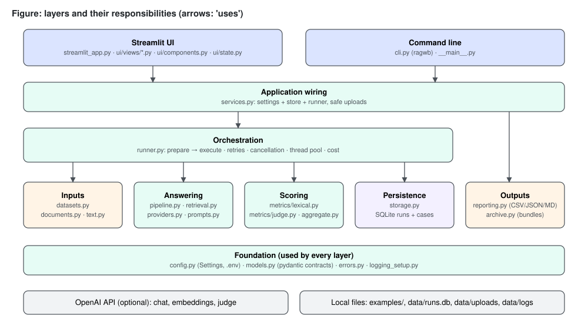
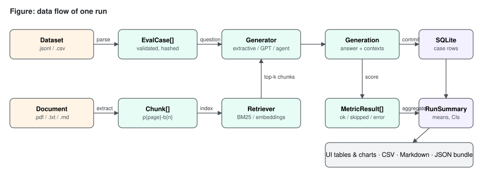
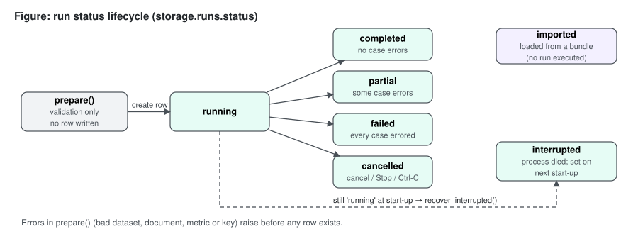
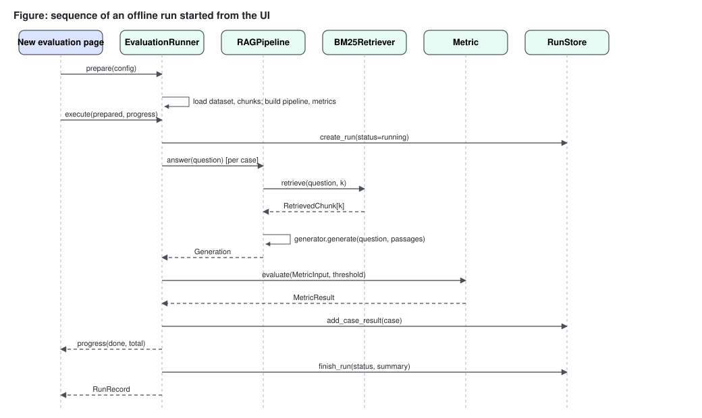
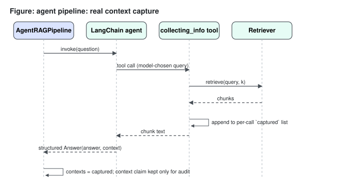
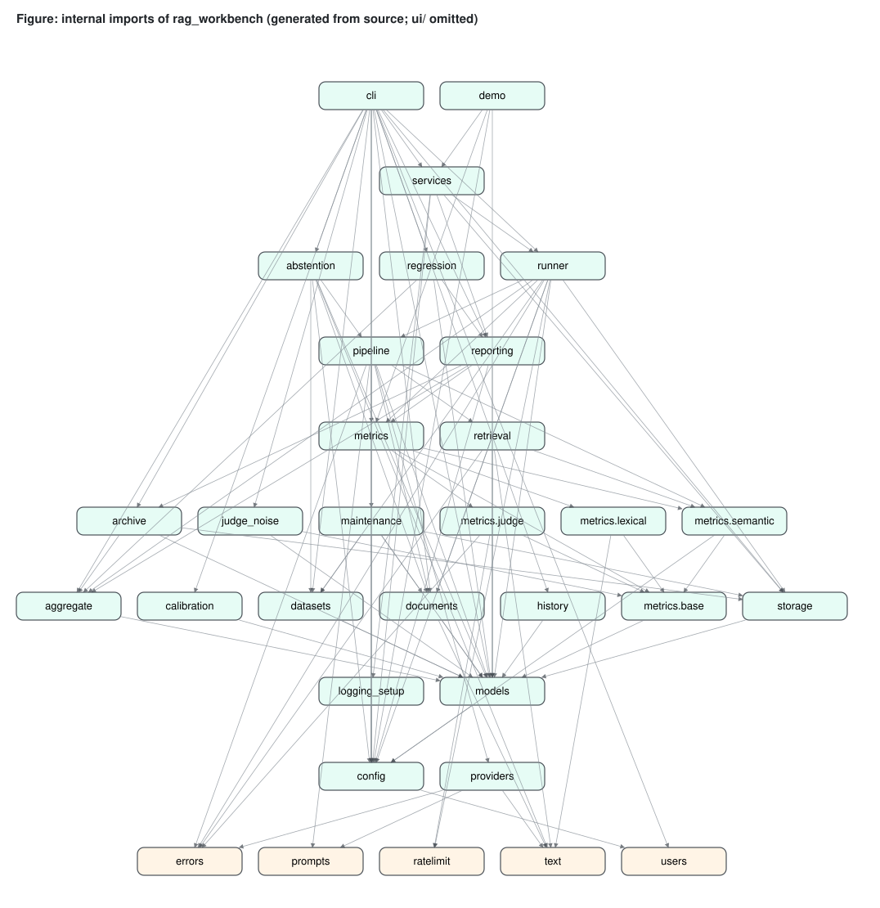

# Part III — System architecture

This part describes how the RAG Evaluation Workbench is put together: which modules exist, what each one owns, how data and control move between them, how the program runs on a machine, and why the structure looks the way it does. Every statement about behaviour is taken from the current source; locations are given as `file:line`. Where a reason is my reading of the code rather than something the code or its comments state, it is marked **rationale:**. Limitations are named as such.

## 27. Final architecture overview

### 27.1 The system in one paragraph

The workbench is started with one command, `python start.py`. That launcher prepares the environment, creates example runs on first launch and opens the app (§35.2). Behind it sits a single Python package, `rag_workbench` (`src/rag_workbench/`), with two thin front ends: a Streamlit multi-page application (`streamlit_app.py` plus `src/rag_workbench/ui/`) and a command-line interface (`ragwb`, declared in `pyproject.toml:20-21` and implemented in `src/rag_workbench/cli.py`). Both front ends obtain the same `AppContext` (settings plus a SQLite run store) from `services.open_context` (`src/rag_workbench/services.py:27`) and drive the same `EvaluationRunner` (`src/rag_workbench/runner.py:71`). A run takes a validated dataset of questions and a source document, builds a retrieval-augmented answering pipeline, answers every question, scores every answer with a chosen set of metrics, commits each case to SQLite as soon as it finishes, and finally stores an aggregate summary with bootstrap confidence intervals. Stored runs can be compared case by case, exported to CSV, JSON or Markdown, and re-imported from JSON bundles. There is no separate server process, message queue, or HTTP API.



The figure shows the layers (front ends, wiring, orchestration, inputs, answering, scoring, persistence, outputs) above a foundation of configuration, data contracts, errors and logging; arrows mean "uses". The launcher `start.py`, which starts the Streamlit layer, is outside the figure.

### 27.2 Layers

| Layer | Modules | Owns |
|---|---|---|
| Launcher | `start.py` (project root, standard library only) | Environment setup, first-launch examples, starting Streamlit on `localhost` (or another host with a login, optionally over TLS) |
| Front ends | `streamlit_app.py`, `ui/views/*.py`, `ui/components.py`, `ui/state.py`, `cli.py`, `__main__.py` | Input collection, presentation, exit codes |
| Wiring | `services.py`, `demo.py` | Building settings + store + runner; safe upload storage; listing known files; the five offline example runs |
| Orchestration | `runner.py` | Preparing and executing runs: retries, cancellation, thread pool, cost |
| Inputs | `datasets.py`, `documents.py`, `text.py` | Dataset parsing and validation; document chunking; tokenisation |
| Answering | `pipeline.py`, `retrieval.py`, `providers.py`, `prompts.py` | Retrieval, answer generation, agent tool capture |
| Scoring | `metrics/` (`base.py`, `lexical.py`, `semantic.py`, `judge.py`, `__init__.py`), `aggregate.py` | Per-case metric results; run summaries; paired comparison |
| Persistence | `storage.py` | SQLite schema and all reads/writes |
| Outputs | `reporting.py`, `archive.py` | Data frames, CSV/JSON/Markdown exports, bundle import |
| Run management and checks | `history.py`, `regression.py`, `abstention.py`, `calibration.py`, `maintenance.py`, `users.py`, `ratelimit.py`, `judge_noise.py` | Tags, notes and search; the regression gate; held-out abstention tuning; label calibration with threshold sweeps; doctor, backup, restore, prune, rerun; named accounts with roles, password change and a last-admin guard; request pacing; judge-noise measurement (added in releases 1.1 to 1.4; Parts XIII to XVI) |
| Foundation | `config.py`, `models.py`, `errors.py`, `logging_setup.py` | Settings, pydantic contracts, exception hierarchy, redacting logger |

### 27.3 Two execution profiles

The same code paths serve two profiles that differ only in which components the factories construct:

| Profile | Retriever | Generator | Metrics | Network |
|---|---|---|---|---|
| Offline (default) | `BM25Retriever` (`retrieval.py:40`) | `ExtractiveGenerator` (`providers.py:37`) | Lexical (`metrics/lexical.py`) | None |
| OpenAI-compatible API | `BM25Retriever`, `EmbeddingRetriever` (`retrieval.py:127`) or `HybridRetriever` (`retrieval.py:94`, reciprocal-rank fusion of the two) | `OpenAIChatGenerator` (`providers.py:91`) or `AgentRAGPipeline` (`pipeline.py:61`) | Lexical and/or DeepEval judge (`metrics/judge.py`) | OpenAI-compatible API |
| Offline with local embeddings (release 1.3, optional `semantic` extra) | `LocalEmbeddingRetriever` (`retrieval.py:181`) or a `HybridRetriever` of BM25 and it | `ExtractiveGenerator` | Lexical, plus the two semantic metrics | None after the one-time model download |

Selecting a component that needs a key without `OPENAI_API_KEY` raises `ConfigError` before any run row is written (`pipeline.py:180-183`, `metrics/__init__.py:28-30`). The two optional semantic metrics and the `local` and `hybrid-local` retrievers are a third kind of requirement: they need no key but a local embedding model through the `fastembed` package, and are refused with an install hint when it is absent (`metrics/__init__.py:25-27`, `pipeline.py:130-132`, Parts XIV §155 and XV §162).

### 27.4 What the architecture guarantees

These are properties the structure enforces, each traceable to code:

1. **Import safety.** Importing the package never reads a key, builds an index or touches the network (`__init__.py:1-5`). Heavy third-party modules are imported inside the functions that need them: PyMuPDF in `documents._pdf_blocks` (`documents.py:88`), LangChain/OpenAI in the generator, agent and embedding constructors (`providers.py:95`, `pipeline.py:66`, `retrieval.py:149-150`), DeepEval inside `JudgeMetric.score` and the judge factory (`metrics/judge.py:83`, `:110`, `:118`). I checked this by importing `rag_workbench.cli` and `rag_workbench.runner` and listing loaded top-level modules: of DeepEval, LangChain, OpenAI, PyMuPDF, pandas and Streamlit, only pandas was loaded (it is imported at module level by `reporting.py:10`).
2. **The evaluated context is the context the generator received.** In `rag` mode the same `contexts` list is passed to the generator and stored (`pipeline.py:54-56`); in `agent` mode the chunks returned by the tool are captured per call (`pipeline.py:83-90`). The model's own description of its evidence is kept only as `model_context_claim` (`models.py:61`) and is never scored, because a model's description of its evidence is not evidence (`pipeline.py:12-15`). Context metrics therefore judge exactly the text the answer was produced from.
3. **Validation before side effects.** `EvaluationRunner.prepare` (`runner.py:83-99`) validates metrics, thresholds, dataset, document, pipeline and metric construction; only `execute` writes a row (`runner.py:117`).
4. **Progress survives failure.** Each case is committed in its own transaction as soon as it is produced, and the same transaction refreshes the run's heartbeat (`runner.py:124-125`, `storage.py:117-125`).
5. **Missing is not zero.** Skipped and errored metrics are counted, never averaged in as zero (`metrics/base.py:9`, `aggregate.py:47-72`).

## 28. Architectural principles

The principles below are visible in the code. For each, the table names where it is applied and what it costs.

| Principle | Where applied | Cost accepted |
|---|---|---|
| One core, thin front ends | CLI and UI both call `services.open_context` and `EvaluationRunner`; neither contains evaluation logic | Front-end conveniences (e.g. default run names) are duplicated in small ways between `cli.build_config` and `new_run.py` |
| Explicit data contracts | Every boundary passes pydantic models from `models.py` (`EvalCase`, `Chunk`, `RetrievedChunk`, `Generation`, `MetricResult`, `CaseResult`, `RunConfig`, `RunSummary`, `RunRecord`) | Some duplication between `CaseResult` and `Generation` fields |
| Deterministic by default | BM25 tie-break by document order (`retrieval.py:85-86`); extractive generator sorting (`providers.py:79-82`); fixed bootstrap seed (`aggregate.py:20`); failure injection seeded per question (`providers.py:65`) | Confidence intervals do not vary between recomputations, so they never reflect judge noise (stated in the UI caption at `ui/views/results.py:89-90`) |
| Fail per case, not per run | `EvaluationRunner.evaluate_case` never raises (`runner.py:184-215`); `Metric.evaluate` converts exceptions into `error` results (`metrics/base.py:83-90`) | A systematically broken configuration can produce a run full of error rows instead of stopping at the first case; the `failed` status makes this visible |
| Validate early, with locations | Dataset issues carry line numbers (`datasets.py:30-36`); configuration errors name the environment variable (`config.py:226-232`) | More code in the input modules than a "parse and hope" approach |
| Secrets never leave the process | `SecretStr` (`config.py:64`), `public_dict` (`config.py:163-169`), `RunConfig` has no key field (`models.py:114-115`), log redaction (`logging_setup.py:22-66`) | The key cannot be shown in the UI even for debugging |
| Lazy construction | Embedding index built on first query (`retrieval.py:146-160`); DeepEval objects created per measurement (`metrics/judge.py:118-132`) | First case of an embedding run is slower; per-case judge object creation overhead |
| Local-first | SQLite file under `data/` (`config.py:60`, `:103-105`); no service dependencies for offline use | No separation of runs below the page level (by default every signed-in user sees every run; `RAGWB_RUN_VISIBILITY=own` filters the pages only, Part XVI §173.4) and no e-mail password reset; the only access control is an optional shared password or named accounts with three roles (`ui/auth.py`, Part XIV §156, Part XV §165 and Part XVI §173) |

**Rationale:** an evaluation tool is used to compare configurations repeatedly, often without network access or budget. It should be importable and testable without a key. It should produce a usable result offline. It should not lose an hour of judged cases because case 41 hit a rate limit. Each principle above serves one of those three needs.

## 29. Module and package organization

### 29.1 Repository layout

```text
rag-evaluation-workbench/
├── pyproject.toml            project metadata, dependencies, ragwb script, pytest/coverage config
├── uv.lock, .python-version  locked environment (Python 3.12)
├── .env.example              every supported variable, all optional
├── .streamlit/config.toml    local-only Streamlit settings
├── start.py                  one-command launcher (standard library only)
├── streamlit_app.py          Streamlit entry point (page navigation only)
├── src/rag_workbench/        the package (src layout, installed editable by uv)
│   ├── __init__.py           version; DeepEval telemetry opt-out
│   ├── __main__.py           python -m rag_workbench
│   ├── config.py  models.py  errors.py  logging_setup.py
│   ├── maintenance.py        doctor, backup, restore, prune, rerun
│   ├── calibration.py        human-label agreement (Cohen's kappa)
│   ├── history.py  regression.py  abstention.py  users.py   tags/notes/search, regression gate, abstention tuning, accounts (1.2; roles 1.3; management 1.4)
│   ├── ratelimit.py  judge_noise.py   request pacing, judge-noise measurement (1.3)
│   ├── text.py  datasets.py  documents.py
│   ├── retrieval.py  providers.py  prompts.py  pipeline.py
│   ├── metrics/              base.py  lexical.py  semantic.py  judge.py  __init__.py (registry)
│   ├── aggregate.py  runner.py  storage.py
│   ├── reporting.py  archive.py  services.py  demo.py  cli.py
│   └── ui/                   auth.py  state.py  components.py  views/{overview,new_run,results,compare,data,settings,users}.py
├── tests/                    pytest suite (418 collected; offline; AppTest for the UI)
├── Dockerfile, .dockerignore container recipe (never built, Part XIV §157.4)
├── examples/                 datasets/honeybees{.jsonl,_unanswerable.jsonl,_paraphrased.csv}, volcanoes/coffee/lighthouses.jsonl,
│                             documents/{honeybees,volcanoes,coffee,lighthouses}.{md,pdf}
├── scripts/                  verify.py, benchmark.py, live_smoke.py, seed_demo_runs.py, make_example_pdf.py
└── data/                     runtime: runs.db, users.json (if accounts exist), uploads/, exports/, logs/ (git-ignored)
```

The package is built with hatchling from `src/rag_workbench` (`pyproject.toml:19-24`). `uv sync` (or `pip install -e .` in the launcher's fallback) installs it in editable mode, so `python -m rag_workbench` and the `ragwb` script work from any working directory. The example PDF is generated from the Markdown source by `scripts/make_example_pdf.py`, which writes one text block per paragraph (`scripts/make_example_pdf.py:1-7`). The product therefore ships both a PDF and a Markdown version of the same text, one for each extraction path.

### 29.2 Size of the modules

The package is small; the largest modules are the runner and the CLI. Line counts (from `wc -l`):

| Module | Lines | Module | Lines |
|---|---:|---|---:|
| `cli.py` | 644 | `metrics/judge.py` | 135 |
| `runner.py` | 278 | `logging_setup.py` | 105 |
| `maintenance.py` | 294 | `text.py` | 100 |
| `calibration.py` | 260 | `ui/auth.py` | 261 |
| `reporting.py` | 208 | `metrics/base.py` | 98 |
| `datasets.py` | 204 | `ui/components.py` | 99 |
| `models.py` | 197 | `archive.py` | 82 |
| `config.py` | 239 | `services.py` | 82 |
| `aggregate.py` | 179 | `ui/state.py` | 48 |
| `storage.py` | 205 | `demo.py` | 47 |
| `pipeline.py` | 178 | `metrics/__init__.py` | 57 |
| `retrieval.py` | 216 | `errors.py`, `prompts.py` | 91, 34 |
| `documents.py` | 134 | `metrics/lexical.py` | 121 |
| `providers.py` | 119 | `ui/views/*.py` | 902 in total |

Release 1.2 added `abstention.py` (177), `users.py` (now 160), `metrics/semantic.py` (now 123), `regression.py` (107) and `history.py` (80); release 1.3 added `ratelimit.py` (55) and `judge_noise.py` (116); `users.py` is now 200 lines, and release 1.4 added one source file, the admin page `ui/views/users.py` (72 lines). Outside the package, `start.py` has 219 lines and `streamlit_app.py` 42.

### 29.3 Organising rules

- **One concern per module.** `text.py` holds every tokenisation rule so that BM25, the extractive generator and lexical metrics agree on what a "term" is (`text.py:1-3`).
- **Metrics are a sub-package** because they have their own contract (`metrics/base.py`), two families and a registry (`metrics/__init__.py:11-12`).
- **UI views are page scripts, not modules with functions.** Each file under `ui/views/` runs top to bottom on every Streamlit rerun; shared helpers live in `ui/components.py` and `ui/state.py`. The coverage configuration omits the views (`pyproject.toml:58`) because they are exercised by Streamlit's AppTest in-process.
- **No module in the core imports the UI.** The `ui` package imports the core; nothing in the core imports `streamlit`.

## 30. Component responsibilities

The table lists each component's single responsibility, its main public surface and what it explicitly does not do.

| Component | Responsibility | Public surface | Does not |
|---|---|---|---|
| `config.Settings` / `load_settings` | Read and validate `RAGWB_*` and `OPENAI_*` variables; resolve relative paths against the project root | `Settings` (frozen), `load_settings(env, dotenv)`, `ENV_VARS`, `ConfigError` | Persist the key; read config files other than `.env` |
| `models` | Data contracts shared by every layer | Nine pydantic models, status literals | Contain behaviour beyond small helpers (`total_tokens`, `score`) |
| `errors` | Separate retryable from permanent provider failures; translate OpenAI SDK exceptions | `ProviderError`, `TransientProviderError`, `classify_openai_error` | Retry anything |
| `text` | Tokenise, stem, normalise, split sentences, detect abstentions | `tokenize`, `content_tokens`, `squad_normalize`, `split_sentences`, `is_abstention` | Language-specific stemming beyond English plurals |
| `datasets` | Parse JSONL/CSV into `EvalCase` with line-numbered errors and warnings | `parse_dataset`, `validate_file`, `load_dataset`, `DatasetReport`, `DatasetError` | Drop invalid rows silently |
| `documents` | Turn a PDF/TXT/MD file into ordered `Chunk`s with stable ids; hash files | `load_chunks`, `file_sha256`, `DocumentError` | OCR, table extraction |
| `retrieval` | Map a query to top-k chunks | `Retriever` protocol, `BM25Retriever`, `EmbeddingRetriever` | Re-rank, filter by metadata |
| `providers` | Turn question + passages into an answer | `Generator` protocol, `ExtractiveGenerator`, `OpenAIChatGenerator`, `GeneratorOutput` | Retrieve; retry |
| `pipeline` | Compose retriever + generator (or agent) and record context provenance | `Pipeline` protocol, `RAGPipeline`, `AgentRAGPipeline`, `build_pipeline`, `build_retriever` | Score |
| `metrics` | Score one case with one metric, with skip/error semantics | `Metric`, `MetricSpec`, `MetricInput`, `METRIC_SPECS`, `build_metrics`, `validate_metric_names` | Aggregate |
| `aggregate` | Summarise a run; compare two runs per case | `summarize_run`, `summarize_metric`, `bootstrap_ci`, `percentile`, `paired_comparison` | Read storage |
| `runner` | Orchestrate a run end to end | `EvaluationRunner.prepare/execute/run/evaluate_case`, `Progress`, `PreparedRun`, `new_run_id`, `environment_info` | Present anything |
| `storage` | SQLite schema, transactions, reads and writes | `RunStore`, `StorageError` | Business rules (apart from interrupted-run recovery) |
| `reporting` | Data frames and exports | `cases_dataframe`, `summary_dataframe`, `comparison_dataframe`, `export_run`, `write_export`, `safe_filename` | Import |
| `archive` | Validate and import run bundles | `load_bundle`, `import_bundle`, `BundleError` | Execute anything from a bundle |
| `services` | Composition root; safe uploads; file discovery | `AppContext`, `open_context`, `save_upload`, `bundled_datasets`, `list_files` | Evaluate |
| `demo` | Define and run the five offline example evaluations over the bundled honeybee data | `demo_configs`, `seed_demo_runs` (`demo.py:24-47`) | Use the network; fake results (every example is a real run) |
| `start.py` (root) | Prepare the environment, seed examples into an empty store, launch Streamlit on `localhost` (or, with a login, another `--host`, optionally over TLS) | `main` with `--port`, `--host`, `--ssl-cert`, `--ssl-key`, `--no-browser`, `--no-examples`, `--setup-only` (`start.py:192-215`) | Import the package itself — it runs the package in the project's virtual environment through subprocesses |
| `logging_setup` | Configure the `rag_workbench` logger once, with redaction | `configure_logging`, `RedactSecretsFilter`, `RedactingFormatter` | Configure third-party loggers |
| `cli` | Parse arguments, call the core, print, set exit codes | `main`, `build_parser`, `build_config` | Hold state between invocations |
| `ui.*` | Render pages; cache the context; keep the selected run | `get_context`, `context_or_stop`, `select_run`, chart/format helpers | Run evaluations outside the session script thread |

### 30.1 Extension points

The responsibilities above translate into a small number of places where the system can be extended without touching the runner:

| To add | Change | Constraint the code imposes |
|---|---|---|
| A lexical metric | A scorer `(MetricInput) -> (score, reason)` and a `Metric(MetricSpec(...), scorer)` entry in `LEXICAL_METRICS` (`metrics/lexical.py:103-121`) | Score in [0, 1]; raise `MetricSkipped` for "not applicable", never return 0 for it |
| A judge metric | A spec in `JUDGE_SPECS` and a branch in the judge factory (`metrics/judge.py:27-45`, `:118-132`) | Fresh metric object per measurement; `requires_openai=True` so validation demands a key |
| A retriever | A class with `name` and `retrieve(query, k)`, plus a branch in `build_retriever` (`pipeline.py:127-130`) and the `RetrieverName` literal (`config.py:44`) | Return `RetrievedChunk`s with 1-based ranks; build expensive state lazily; translate SDK errors as `EmbeddingRetriever.retrieve` does (`retrieval.py:165-172`) so the runner can retry them |
| A generator or provider | A class with `model` and `generate(question, passages)`, a branch in `build_pipeline`, the `ProviderName` literal (`config.py:42`) | Translate SDK errors into `ProviderError` / `TransientProviderError`; disable SDK retries |
| An export format | A branch in `export_run` and an entry in `EXPORT_FORMATS` (`reporting.py:17`, `:188-195`) | Neutralise untrusted text for the target format |

The literals in `config.py` drive `RunConfig` validation, but the CLI `choices` (`cli.py:530-532`) and the UI option lists (`ui/views/new_run.py:98`, `:103`, `:108`) are separate hard-coded lists, so a new provider or retriever has to be added in three places (literal, factory, front-end options); the code has no plug-in discovery.

## 31. Data flow



The figure follows one run from the two input files to the persisted rows, the aggregate summary and the outputs (UI tables, CSV, Markdown, JSON bundle).

### 31.1 Inputs to cases and chunks

- A dataset file is read as bytes, hashed with SHA-256 (`datasets.py:71`), size-checked, decoded as UTF-8 with optional BOM (`datasets.py:80`) and parsed row by row into `EvalCase(id, question, expected_answer, metadata)` (`models.py:22-28`). Missing ids become `case-001`, `case-002`, … (`datasets.py:189-190`).
- A document is split into raw blocks (PyMuPDF text blocks sorted top-to-bottom then left-to-right, `documents.py:99-100`; or blank-line paragraphs for text files, `documents.py:113`), whitespace-normalised, split further if longer than 2,000 characters (`documents.py:23`, `:117-134`), and given ids `p{page}-b{n}` (`documents.py:61`). The file's SHA-256 is computed separately by `file_sha256` (`documents.py:30-35`).

### 31.2 Cases to generations

For each case, `Pipeline.answer(question)` returns a `Generation` (`models.py:50-67`): the answer string, the list of `RetrievedChunk(chunk_id, text, page, score, rank)` the answer was produced from, `context_source` (`retriever` or `agent_tool`), the model name, latency in milliseconds, token counts when the provider reports them, the queries sent to the retriever and, for the agent, the model's context claim.

### 31.3 Generations to metric results

The runner builds a frozen `MetricInput(question, answer, expected_answer, contexts)` where `contexts` are the texts of the retrieved chunks (`runner.py:223-224`). Each metric returns a `MetricResult(name, status, score, threshold, passed, reason)` (`models.py:70-86`). Scores are validated to lie in [0, 1] (`models.py:81-86`). Before that, `Metric.evaluate` turns a score more than `SCORE_TOLERANCE = 1e-9` outside the range into a metric `error`, and clamps only floating-point noise inside the tolerance (`metrics/base.py:23`, `:92-96`).

### 31.4 Results to storage and summary

A `CaseResult` (`models.py:89-111`) gathers the case, the generation fields, cost, the attempt count, any error and the metric results. It is serialised whole into `case_results.data_json` (`storage.py:117-125`). When the run ends, `summarize_run` (`aggregate.py:75-92`) produces a `RunSummary` with one `MetricSummary` per metric (count scored/skipped/error, mean, median, standard deviation, min, max, bootstrap CI, pass count and rate) plus latency mean and p95, token totals and cost total; it is stored in `runs.summary_json` (`storage.py:127-135`).

### 31.5 Storage to outputs

Reads reconstruct pydantic models from JSON (`storage.py:175-189`, `:190-199`). `reporting.py` flattens them into pandas data frames for the UI and the CSV export (`reporting.py:30-50`), writes a Markdown report (`reporting.py:140-185`) or a JSON bundle that `archive.py` can re-import (`reporting.py:114-125`, `archive.py:59-81`). A bundle carries the dataset and document paths in portable form — relative to the project root, or the bare file name for files elsewhere — so no absolute local path leaves the machine (`reporting.py:103-111`, `:118-122`). On import the summary is recomputed from the bundle's cases rather than read from the file (`archive.py:67-72`).

### 31.6 Data flow of a comparison

Comparison reads only stored data; nothing is re-evaluated:

```text
RunStore.get_run(A), get_run(B)            → RunRecord (config["metrics"] decides the shared metrics)
RunStore.get_case_results(A), (B)          → list[CaseResult], ordered by position
reporting.run_metrics(run)                 → metrics in configuration order (reporting.py:26-27)
for metric in shared metrics:
    aggregate.paired_comparison(resA, resB, metric)
        key = normalised question text      → {key: score} per run, scored cases only
        keys = intersection                 → diffs = B − A
        bootstrap_ci(diffs), wins/ties/losses
reporting.comparison_dataframe             → one row per metric (CLI table, UI table)
```

Because pairing uses the question text, the UI warns when the selected runs have different dataset hashes: only questions present in both runs are compared (`ui/views/compare.py:45-47`).

### 31.7 What each persisted artefact contains

| Artefact | Contains | Does not contain |
|---|---|---|
| `runs.config_json` | Full `RunConfig`, effective thresholds, the pipeline's actual model name (`runner.py:113-114`); dataset and document paths as given (absolute for CLI runs, `cli.py:48-49`) | API key, base URL |
| `runs.heartbeat_at` | Time of the last committed case (or of creation) (`storage.py:112`, `:123`); read by `RunStore.heartbeat` (`storage.py:169-173`), which the restore guard uses (Part XVI §171.3) | — |
| `runs.environment_json` | Package version, Python version, platform, versions of seven tracked packages (`runner.py:45`, `:270-278`) | Environment variables |
| `runs.dataset_sha256` / `document_sha256` | Content hashes of the inputs (`runner.py:99`) | The input files themselves |
| `case_results.data_json` | Everything in `CaseResult`, including chunk texts | — |

## 32. Control flow

### 32.1 Run status lifecycle



The figure shows the seven values of `RunStatus` (`models.py:12`): no row exists during `prepare()`; a row is created as `running`; it ends as `completed`, `partial`, `failed` or `cancelled`; a row left `running` by a dead process becomes `interrupted` at a later start-up, once its heartbeat is older than 15 minutes (`storage.py:29`, `:135-147`); bundles enter as `imported`.

The final status is decided in `execute` (`runner.py:138-140`): `failed` when results exist and all of them are errors, `partial` when some are, `completed` otherwise; `cancelled` when the cancel event was set (`runner.py:130-131`) or any exception escaped the loop (`runner.py:132-137`).

### 32.2 CLI control flow

```text
ragwb <command> [options]
  └─ cli.main(argv)                                   cli.py:490
       ├─ build_parser().parse_args(argv)             argparse exits 2 on bad usage
       ├─ open_context(load_settings(), console_logging=False)
       │     ├─ configure_logging()                   file log under data/logs
       │     ├─ RunStore(db_path)                     creates schema / migrates v1 → v2
       │     └─ store.recover_interrupted()           stale running → interrupted
       ├─ args.func(args, ctx)                        cmd_run / cmd_list / ...
       └─ except (BundleError, ConfigError, DatasetError, DocumentError,
                  StorageError, LookupError, ValueError)
                → "error: ..." on stderr, exit 1      cli.py:639-643
```

`cmd_run` returns 0 only for a `completed` run and 2 otherwise (`cli.py:79`), so scripts can distinguish "the tool failed" (1) from "the run finished with case errors or was cancelled" (2). `KeyboardInterrupt` is not in the caught tuple, so Ctrl-C ends the process with a traceback; before it propagates, the runner has already marked the run `cancelled` (`runner.py:132-137`).

### 32.3 Streamlit control flow

Streamlit re-executes the current page script from the top on every interaction. `streamlit_app.py` registers six pages in three groups, adds a seventh, *Accounts*, to an admin's sidebar only, and calls `st.navigation(pages).run()` (`streamlit_app.py:23-42`). Every page begins with `ctx = context_or_stop()` (for example `ui/views/overview.py:11`), which returns the process-wide cached `AppContext` or renders a configuration error and calls `st.stop()` (`ui/state.py:23-29`). Pages stop early with `st.stop()` when a precondition fails (no runs, fewer than two runs, invalid selection).

On the New evaluation page, pressing *Run evaluation* calls `runner.prepare(config)` inside a `try` that turns `ConfigError`, `DatasetError`, `DocumentError` and `ValueError` into an error box (`ui/views/new_run.py:197-213`), then `runner.execute(prepared, progress=on_progress)` (`ui/views/new_run.py:226-231`). The progress callback updates a progress bar and the last eight case lines (`ui/views/new_run.py:216-224`). When the user presses Streamlit's Stop button, Streamlit raises an exception inside the script thread; it surfaces from the callback inside the runner's loop and is handled by the `except BaseException` branch, which records the run as `cancelled` and re-raises (`runner.py:132-137`, comment at line 133).

### 32.4 Per-case control flow

```text
evaluate_case(prepared, case, position)               runner.py:184
  try _evaluate_case:
     _generate_with_retries(pipeline, question, max_retries)
        loop: pipeline.answer(question)
              TransientProviderError → sleep(base·2^(attempt-1) + jitter), retry
                                       until attempt > max_retries → error
              ProviderError          → error (no retry)
              other Exception        → error "Unexpected <Type>: ..."
     generation is None → CaseResult(status="error", attempts, error)
     else for each metric: metric.evaluate(MetricInput, threshold)
          → CaseResult(status="ok", ..., metrics={...}, cost_usd)
  except Exception → CaseResult(status="error", error="Internal <Type>: ...")
```

## 33. Sequence diagrams

### 33.1 An offline run started from the UI



The figure shows the New evaluation page calling `prepare`, then `execute`; the runner creating the run row, asking the pipeline for an answer per case (retriever, then generator), scoring each metric, committing the case, reporting progress, and finally writing the summary.

Points worth noting in that sequence:

- `create_run` happens only after `prepare` has returned, which is why a misconfigured run leaves no trace in the store (tested by `tests/test_runner.py:135`, `test_validation_happens_before_a_run_is_created`).
- `add_case_result` and `progress` are called by the thread that called `execute` — the Streamlit script thread or the CLI's main thread — even when cases are evaluated on worker threads, because the worker results are consumed through the `_iter_results` generator (`runner.py:124-129`, `:152-181`).

### 33.2 The agent pipeline



The figure shows `AgentRAGPipeline` invoking a LangChain agent, the agent choosing to call the `collecting_info` tool with its own query, the tool calling the retriever and appending the returned chunks to a per-call list, and the structured `Answer(answer, context)` coming back; the captured chunks become the evaluated context and the context claim is kept only for audit.

The `captured` and `queries` lists are local variables of `answer()` (`pipeline.py:80-81`); the tool is defined as a closure over them (`pipeline.py:80-90`). A new tool and a new agent are created per question (`pipeline.py:96-97`). **Rationale:** closure-local capture is what makes the agent safe to run on several threads at once. A module-level "last retrieved context" variable would be overwritten by concurrent questions and would attribute one question's chunks to another.

### 33.3 Paired comparison from the CLI

```text
user            cli.cmd_compare        RunStore            reporting                 aggregate
 │ compare A B        │                    │                    │                         │
 │──────────────────▶ │ get_run(A), get_run(B)                  │                         │
 │                    │──────────────────▶ │                    │                         │
 │                    │ get_case_results(A), (B)                │                         │
 │                    │──────────────────▶ │                    │                         │
 │                    │ comparison_dataframe(runA, resA, runB, resB)                      │
 │                    │───────────────────────────────────────▶ │ for each shared metric: │
 │                    │                    │                    │ paired_comparison(...)  │
 │                    │                    │                    │───────────────────────▶ │
 │                    │                    │                    │ ◀── n_pairs, means, CI, │
 │                    │ ◀──────────────── DataFrame ─────────── │     wins/ties/losses    │
 │ ◀── table ──────── │                    │                    │                         │
```

(`cli.py:115-124`, `reporting.py:72-82`, `aggregate.py:164-179`.)

### 33.4 Importing a bundle

```text
archive.import_bundle(store, path)                        archive.py:59
  load_bundle(path)                                       archive.py:34
     size ≤ 50 MB? → json.loads → format == "rag-workbench-run"? version == 1?
     RunRecord.model_validate(payload["run"]); CaseResult.model_validate(each case)
     duplicate case ids? → BundleError
  store.get_run(run.id) exists? → return None             (idempotent)
  summary = summarize_run(cases, metrics, thresholds)     (never trusted from the file)
  record = run with status="imported", summary, config += {original_status, imported_from}
  store.create_run(record)
  for case: store.add_case_result(...)
     StorageError → store.delete_run(run.id); raise        (all or nothing, archive.py:77-79)
```

## 34. Component interaction diagrams

### 34.1 Who calls whom during a run

```text
            ┌──────────────┐        ┌───────────────┐
            │ CLI / UI page│───────▶│ services       │ open_context → AppContext(settings, store)
            └──────┬───────┘        └───────────────┘
                   │ ctx.runner()
                   ▼
            ┌──────────────┐ prepare ┌─────────────┐  ┌─────────────┐
            │EvaluationRunner│──────▶│ datasets     │  │ documents    │
            │               │───────▶│ load_dataset │  │ load_chunks  │
            │               │        └─────────────┘  └─────────────┘
            │               │ pipeline_factory ─▶ pipeline.build_pipeline ─▶ retrieval / providers
            │               │ metrics_factory  ─▶ metrics.build_metrics   ─▶ lexical / judge
            │               │ execute
            │               │───▶ RunStore.create_run
            │               │───▶ Pipeline.answer ───▶ Retriever.retrieve, Generator.generate
            │               │───▶ Metric.evaluate
            │               │───▶ RunStore.add_case_result   (per case)
            │               │───▶ aggregate.summarize_run ──▶ RunStore.finish_run
            └──────────────┘
```

### 34.2 Interaction rules

| From | May call | Never calls |
|---|---|---|
| Front ends | `services`, `runner`, `storage` (reads, delete), `reporting`, `archive`, `datasets.validate_file`, `documents.load_chunks`, `retrieval.BM25Retriever` (playground) | Providers or metrics directly — except `ragwb score`, which builds metrics to score one answer (`cli.py:344-372`) |
| `runner` | `datasets`, `documents`, `pipeline` (via factory), `metrics` (via factory), `aggregate`, `storage` | `reporting`, UI |
| `pipeline` | `retrieval`, `providers`, `documents`, `prompts`, `errors` | `storage`, `metrics` |
| `metrics` | `text`, `errors`, DeepEval | `pipeline`, `storage` |
| `aggregate` | `models` only | Anything with I/O |
| `storage` | `models` only | Any evaluation code |

The interaction rules mean the scoring and aggregation layers are pure functions of their inputs (apart from the judge's network calls), which is what lets the test suite check them against hand-computed values (`tests/test_metrics.py`, `tests/test_aggregate.py`).

## 35. Deployment and runtime architecture

### 35.1 Deployment model

The workbench is a local, single-user application. The project requires Python `>=3.12` (`pyproject.toml:6`), `.python-version` pins 3.12, and the project's virtual environment runs Python 3.12.15 (`.venv\Scripts\python.exe --version`). Dependencies are locked in `uv.lock`. There is no container image, no service definition and no remote deployment in the repository. The `.streamlit/config.toml` comment states that the project "is not deployed from the UI" (`.streamlit/config.toml:8`).

### 35.2 The launcher: `start.py`

`python start.py` is the supported way to start the product. The file uses only the standard library, "so it runs before any dependency is installed" (`start.py:15`). `main` (`start.py:192-215`) runs four steps:

```text
python start.py [--port N] [--host H] [--ssl-cert F --ssl-key F] [--no-browser] [--no-examples] [--setup-only]
  0 host_problem(--host, password_configured() or accounts_configured())   start.py:84-117, 198-201
      a non-local host without RAGWB_APP_PASSWORD or user accounts → exit before anything is installed
      tls_problem(--ssl-cert, --ssl-key)                  start.py:120-129
      a lone or missing certificate/key file → exit before anything is installed
  1 prepare_environment()                                start.py:47-63
      uv on PATH → uv sync --frozen --inexact   (UV_HTTP_TIMEOUT defaults to 180 s)
      no uv      → require Python ≥ 3.12; python -m venv .venv (if missing);
                   .venv python -m pip install -e . pytest pytest-cov
  2 unless --no-examples: store_is_empty()?              start.py:66-72
      runs `open_context().store.list_runs()` inside .venv in a subprocess
      empty → create_examples(): demo.seed_demo_runs()   start.py:75-81
  3 --setup-only → print "setup complete", exit 0
  4 launch(free_port(--port), open_browser, --host, ssl_cert, ssl_key)   start.py:132-189, 208
      first free TCP port from 8501 (50 candidates, probed on 127.0.0.1)
      .venv python -m streamlit run streamlit_app.py --server.port P
            --server.address H --server.headless true --browser.gatherUsageStats false
            [--server.sslCertFile C --server.sslKeyFile K]   (HTTPS; a warning is printed for a non-local host without TLS)
      (H is localhost unless --host says otherwise; 0.0.0.0 and :: are probed as localhost)
      poll http(s)://H:P/_stcore/health until "ok" (90 s; certificate not verified for this local probe) → open the browser
      Ctrl+C → terminate, wait 10 s, then kill
```

Design points visible in the code:

- **Nothing outside the project folder is changed.** Packages go into `.venv` (`start.py:5-6`, `:31-32`).
- **The launcher never imports `rag_workbench`.** The store probe and the example runs execute in the virtual environment's interpreter through `subprocess` (`start.py:66-81`). **Rationale:** the launcher's own interpreter may be a system Python without the dependencies.
- **Examples are created only into an empty store.** A second launch does not re-seed (`start.py:210-211`). If seeding fails, the app still starts (`start.py:80-81`).
- **The server is local and private by default.** The address and the statistics flag are passed on the command line as well as set in `.streamlit/config.toml`, and `DEEPEVAL_TELEMETRY_OPT_OUT=1` is set in the child environment (`start.py:158-160`). Listening on any other address is refused unless a login (the shared password or named accounts) is configured (`start.py:117-122`, `:198-201`); Parts XIII and XIV explain the logins, and `--ssl-cert`/`--ssl-key` add HTTPS (`start.py:162-163`).
- **Failure messages are specific.** They cover a failed `uv sync` (with a hint about slow networks), a missing Python 3.12, a failed `pip install`, a store that cannot be opened (with the last 2,000 characters of its stderr), and an app that exits during start-up (`start.py:52-63`, `:69-70`, `:169-170`).

### 35.3 Processes

| Process | Started by | Lifetime | Holds |
|---|---|---|---|
| Launcher | `python start.py` | Until Ctrl+C or the server exits | Only the server's process handle (`start.py:169`) |
| Streamlit server | `start.py` (or `uv run streamlit run streamlit_app.py`); listens on `localhost` unless `--host` and a login say otherwise (`start.py:160`, `.streamlit/config.toml:16-17`) | Until stopped | One cached `AppContext` per server process (`ui/state.py:17-20`); one script thread per browser session |
| CLI | `ragwb <command>` or `python -m rag_workbench` | One command | A fresh `AppContext` per invocation (`cli.py:681`) |
| Worker threads | `ThreadPoolExecutor` inside a run with `max_workers > 1` (`runner.py:161`) | One run | Nothing persistent; return `CaseResult`s |

### 35.4 Start-up sequence of the app and the CLI

What happens when each application process starts, in order. For the Streamlit server this follows the launcher's step 4 in §35.2.

| Step | Streamlit server (first page view) | CLI command |
|---|---|---|
| 1 | `streamlit_app.py` sets `DEEPEVAL_TELEMETRY_OPT_OUT`, page config, CSS, navigation | `cli.main` parses arguments (argparse rejects bad usage before anything else) |
| 2 | The page calls `context_or_stop()` → cached `get_context()` | `open_context(load_settings(), console_logging=False)` |
| 3 | `load_settings` reads `.env` (no override) and the environment; invalid values → error box and `st.stop()` | Invalid values → `error: Invalid configuration: …`, exit 1 |
| 4 | `configure_logging` attaches the redacting file handler once | Same, per process |
| 5 | `RunStore(db_path)` creates `data/`, the schema and the version stamp (schema 3) if needed, and migrates an older store by adding whichever of `heartbeat_at` and `tags_json` it lacks (`storage.py:74-81`) | Same |
| 6 | `recover_interrupted()` relabels `running` rows whose heartbeat is older than 15 minutes | Same |
| 7 | The page reads the store and renders | The command handler runs |

Steps 2–6 run once per Streamlit server process because the context is a cached resource; a new browser session reuses it. The CLI repeats them for every command.

### 35.5 Files at run time

All mutable state lives under the data directory (`RAGWB_DATA_DIR`, default `<project>/data`, `config.py:60`):

| Path | Written by | Notes |
|---|---|---|
| `data/runs.db` | `RunStore` | SQLite; one connection per operation (`storage.py:85-98`) |
| `data/users.json` | `UserStore` (`ragwb user add`) | Only when named accounts exist: salts and scrypt hashes, never passwords (`rag_workbench/users.py:83-89`) |
| `data/uploads/` | `services.save_upload` | Content-addressed names (`services.py:51-55`) |
| `data/exports/` | `ragwb export` (`cli.py:257-262`) | UI downloads are streamed, not written here |
| `data/logs/rag_workbench.log` | `RotatingFileHandler`, 2,000,000 bytes × 3 backups (`logging_setup.py:94`) | Falls back to console-only if the directory is not writable (`logging_setup.py:95-96`) |

The data directory is git-ignored (`.gitignore`). Read-only inputs ship in `examples/`.

### 35.6 Network

The offline profile makes no network calls. The OpenAI profile calls the OpenAI API (or `OPENAI_BASE_URL`) for chat completions, embeddings and DeepEval judge calls. Two telemetry channels are disabled: DeepEval telemetry by `DEEPEVAL_TELEMETRY_OPT_OUT=1` set with `setdefault` both in the package (`__init__.py:11`) and in the Streamlit entry point (`streamlit_app.py:10`), and explicitly in the launcher's child environment (`start.py:157`); Streamlit usage statistics by `gatherUsageStats = false` (`.streamlit/config.toml:5`). The Streamlit server binds to `localhost` (`server.address`, `.streamlit/config.toml:16-17`, commented "Local tool without authentication: listen on this machine only"), so it is not reachable from other machines unless the user overrides that setting.

### 35.7 Concurrent processes on one store

Because every process opens its own connections with a 15-second busy timeout (`storage.py:87`), a CLI run and a Streamlit session can share `runs.db` (release 1.4 tests this with four CLI processes and a reading fifth, Part XVI §172). Recovery of dead runs is designed for this. `open_context` calls `recover_interrupted()` every time it runs (`services.py:32`), but the statement only touches runs that look dead:

```text
UPDATE runs SET status = 'interrupted', finished_at = ?
WHERE status = 'running' AND COALESCE(heartbeat_at, created_at) < now − STALE_AFTER_S
```

(`storage.py:154-166`; `STALE_AFTER_S = 15 * 60`, `storage.py:29`.) `create_run` stamps `heartbeat_at` and every `add_case_result` refreshes it in the same transaction as the case insert (`storage.py:107`, `:117`), so a run that another process is still executing keeps a fresh heartbeat and is left alone. The window is generous on purpose: the comment at `storage.py:27-28` estimates that one slow case with default settings (four attempts of up to 60 s plus back-off) takes about five minutes. If a live run is ever marked wrongly — no case finished within 15 minutes — its own `finish_run` still writes the real final status (`storage.py:127-135`).

**Rationale:** a simpler rule — relabel every `running` row at start-up — would be wrong as soon as two processes share a store. Starting any CLI command (even `ragwb list`) during a run in the app would mark that live run `interrupted`. The heartbeat turns "is this run still alive?" into a question the database can answer without lock files or process ids. **Limitation:** a run whose process died within the last 15 minutes keeps showing `running` until a later start-up.

## 36. Configuration architecture

### 36.1 Sources and precedence

Configuration has three layers, all funnelled through `load_settings` (`config.py:204-232`):

1. Defaults declared on `Settings` (`config.py:39-70`).
2. `.env` in the project root, loaded with `override=False` (`config.py:212`) — so real environment variables win over `.env`.
3. Process environment variables, mapped through the explicit `ENV_VARS` table (`config.py:173-197`).

Blank values are treated as unset (`config.py:218-219`); the test fixture relies on this to neutralise a developer's `.env` key by setting `OPENAI_API_KEY` to the empty string (`tests/conftest.py:25`). Relative paths are resolved against the project root, not the working directory (`config.py:221-223`). Validation failures are re-raised as one `ConfigError` that names the environment variable rather than the field (`config.py:226-232`).

### 36.2 Settings versus run configuration

There are two configuration objects with different lifetimes:

| | `Settings` (`config.py:54`) | `RunConfig` (`models.py:114`) |
|---|---|---|
| Scope | Process | One run |
| Source | Environment / `.env` | CLI arguments or New evaluation form |
| Mutable | No (`frozen`, `config.py:57`) | Not mutated after creation |
| Contains secrets | Yes (`SecretStr`) | No — by design ("Contains no secrets", `models.py:115`) |
| Persisted | Only as `public_dict()` on the Settings page | Yes, whole, in `runs.config_json` |

Some settings act as defaults for run fields: `generator_model`, `judge_model`, `embedding_model`, `max_retries`, `request_timeout_s` and `max_workers` are copied into the `RunConfig` by the front ends (`cli.py:60-62`, `ui/views/new_run.py:199-208`). Input limits (`max_dataset_bytes`, `max_document_bytes`, `max_cases`, `max_field_chars`) and pricing stay in `Settings` and are read by the runner at execution time (`runner.py:89-93`, `:258-262`). Cost is computed from the prices in effect when the run executes, and since release 1.1 those prices are copied into the run configuration as `prices_usd_per_mtok` (`runner.py:114`, `:254-256`), so a stored `cost_usd` can be traced back to the price that produced it. **Limitation:** the prices are whatever the operator configured; nothing checks them against the provider's price list.

### 36.3 Environment variables

| Variable | Setting | Default | Constraint |
|---|---|---|---|
| `OPENAI_API_KEY` | `openai_api_key` | unset | `SecretStr` |
| `OPENAI_BASE_URL` | `openai_base_url` | unset | — |
| `RAGWB_DATA_DIR` | `data_dir` | `<project>/data` | path |
| `RAGWB_DATASET` | `default_dataset` | `examples/datasets/honeybees.jsonl` | path |
| `RAGWB_DOCUMENT` | `default_document` | `examples/documents/honeybees.pdf` | path |
| `RAGWB_GENERATOR_MODEL` | `generator_model` | `gpt-4o` | — |
| `RAGWB_EMBEDDING_MODEL` | `embedding_model` | `text-embedding-3-large` | — |
| `RAGWB_JUDGE_MODEL` | `judge_model` | `gpt-4o` | — |
| `RAGWB_REQUEST_TIMEOUT_S` | `request_timeout_s` | 60 | 0 < x ≤ 600 |
| `RAGWB_MAX_RETRIES` | `max_retries` | 3 | 0–10 |
| `RAGWB_RETRY_BASE_DELAY_S` | `retry_base_delay_s` | 1.0 | 0–60 |
| `RAGWB_MAX_REQUESTS_PER_MINUTE` | `max_requests_per_minute` | unset (no pacing) | 0 < x ≤ 6000 (release 1.3, `config.py:79`) |
| `RAGWB_LOCAL_EMBEDDING_MODEL` | `local_embedding_model` | `BAAI/bge-small-en-v1.5` | — (`config.py:72`; the model cache is `<data dir>/models`, `config.py:113-115`) |
| `RAGWB_MAX_WORKERS` | `max_workers` | 4 | 1–32 |
| `RAGWB_PRICE_INPUT_PER_MTOK` | `price_input_per_mtok` | unset | ≥ 0 |
| `RAGWB_PRICE_OUTPUT_PER_MTOK` | `price_output_per_mtok` | unset | ≥ 0 |
| `RAGWB_MAX_DATASET_BYTES` | `max_dataset_bytes` | 5,000,000 | > 0 |
| `RAGWB_MAX_DOCUMENT_BYTES` | `max_document_bytes` | 25,000,000 | > 0 |
| `RAGWB_MAX_CASES` | `max_cases` | 5,000 | > 0 |
| `RAGWB_MAX_FIELD_CHARS` | `max_field_chars` | 20,000 | > 0 |
| `RAGWB_LOG_LEVEL` | `log_level` | `INFO` | DEBUG…CRITICAL (`config.py:92`, `:95-101`) |
| `RAGWB_RUN_VISIBILITY` | `run_visibility` | `shared` | `shared` or `own`; with accounts, `own` hides other users' runs from non-admins in the web pages only (release 1.4, `config.py:94`, `:198`; Part XVI §173.4) |

The Streamlit upload ceiling (`maxUploadSize = 25` MB, `.streamlit/config.toml:14`) is set to match the default document limit; it is a separate setting, so raising `RAGWB_MAX_DOCUMENT_BYTES` alone does not raise the browser upload ceiling.

### 36.4 Configuration changes at run time

The UI caches the context with `st.cache_resource` (`ui/state.py:17`), so settings are read once per server process. The Settings page says so ("Restart the app after changing them", `ui/views/settings.py:30-31`). The CLI reads settings on every invocation.

## 37. Dependency relationships

### 37.1 Internal dependencies



The figure is generated from the source and shows which modules import which (the `ui` package is omitted); `config`, `models`, `errors`, `prompts` and `text` sit at the bottom, `runner`, `services`, `cli` and `demo` at the top. `start.py` is not part of the package and imports none of it.

The import graph is acyclic. Verified edges from the `import` statements:

| Module | Imports (internal) |
|---|---|
| `models` | `config` |
| `text`, `errors`, `prompts`, `config` | — |
| `datasets` | `models` |
| `documents` | `models`, `text` |
| `retrieval` | `errors`, `models`, `text` |
| `providers` | `errors`, `prompts`, `text` |
| `pipeline` | `config`, `documents`, `errors`, `models`, `prompts`, `providers`, `retrieval` |
| `metrics.base` | `models` |
| `metrics.lexical` | `text`, `metrics.base` |
| `metrics.judge` | `errors`, `metrics.base` |
| `metrics` (package) | `config`, `metrics.base`, `metrics.judge`, `metrics.lexical` |
| `aggregate` | `models` |
| `storage` | `models` |
| `archive` | `aggregate`, `models`, `storage` |
| `reporting` | `aggregate`, `config`, `metrics`, `models`; `archive` lazily inside `export_json` (`reporting.py:116`) |
| `runner` | `aggregate`, `config`, `datasets`, `documents`, `errors`, `metrics`, `models`, `pipeline`, `storage` |
| `logging_setup` | `config` |
| `services` | `config`, `logging_setup`, `reporting`, `runner`, `storage` |
| `demo` | `metrics`, `models`, `services` |
| `cli` | `archive`, `config`, `datasets`, `documents`, `metrics`, `models`, `reporting`, `runner`, `services`, `storage` |

### 37.2 Third-party dependencies

| Package (`pyproject.toml:7-18`) | Used by | Loaded |
|---|---|---|
| `pydantic>=2.13` | `config`, `models`, `archive` | At import |
| `python-dotenv>=1.0` | `config.load_settings` | At import |
| `pandas>=3.0.6` | `reporting`, UI | At import of `reporting` |
| `pymupdf>=1.28.2,<2` | `documents._pdf_blocks` | Lazily, on first PDF |
| `langchain-openai>=1.6.6` | `OpenAIChatGenerator`, `AgentRAGPipeline`, `EmbeddingRetriever` | Lazily, when constructed |
| `langchain>=1.4.2` | `AgentRAGPipeline.answer` (`create_agent`, `tool`) | Lazily, per question |
| `deepeval>=4.2.6` | `metrics/judge.py` | Lazily, per measurement |
| `streamlit>=1.64.0` | `streamlit_app.py`, `ui/` | Only by the UI |
| `altair` (via Streamlit) | `ui/components.py`, `ui/views/results.py` | Only by the UI |

PyMuPDF is capped below 2.0. The comment in the manifest gives the reason: "PyMuPDF 2.0 adds onnxruntime + layout models loaded at import … that plain block extraction does not need" (`pyproject.toml:13-15`). Development groups add `pytest`, `pytest-cov`, `ruff`, `mypy` and `pip-audit` (`pyproject.toml:23-30`) and `markdown` for the book build (`pyproject.toml:31-33`). The `openai` SDK is not listed directly; it is installed through `langchain-openai` and DeepEval, and `errors.classify_openai_error` imports it lazily and tolerates its absence (`errors.py:42-45`).

## 38. Design patterns and why they were selected

| Pattern | Instance | Why (documented or **rationale**) |
|---|---|---|
| Structural interfaces (Protocol) | `Retriever` (`retrieval.py:34-37`), `Generator` (`providers.py:31-34`), `Pipeline` (`pipeline.py:35-36`) | **Rationale:** lets tests pass plain fake objects (`fake_pipeline_cls` in `tests/conftest.py`) without inheritance, and keeps LangChain types out of the interfaces |
| Factory | `build_pipeline` (`pipeline.py:152`), `build_retriever` (`:127`), `build_metrics` (`metrics/__init__.py:34`), `build_judge_metric` (`metrics/judge.py:102`) | Invalid combinations are rejected in one place with a `ConfigError` (`pipeline.py:152`) |
| Registry | `METRIC_SPECS`, `LEXICAL_METRICS`, `JUDGE_SPECS` (`metrics/__init__.py:11-12`, `lexical.py:103`, `judge.py:27`) | One catalogue feeds validation, the CLI `metrics` command, the UI metric picker and labels |
| Template method | `Metric.evaluate` performs requirement checks, exception capture, the score range check and pass/fail; `score` is the variable step; `JudgeMetric` overrides `score` (`metrics/base.py:75-98`, `judge.py:66-99`) | Every metric gets identical skip/error semantics |
| Dependency injection | `EvaluationRunner(settings, store, pipeline_factory=, metrics_factory=, sleep=)` (`runner.py:72-80`) | Retry back-off and failure paths are tested without real sleeps or providers (`tests/test_runner.py:67-80`) |
| Result objects instead of exceptions | `MetricResult.status`, `CaseResult.status/error`, `DatasetReport.errors/warnings` | A run must continue past a bad case, so that one failed call never costs the results already computed; a dataset must report all problems, not the first |
| Exception translation | `classify_openai_error` (`errors.py:37-54`) | The runner retries by type, independent of the SDK; messages never include request headers |
| Composition root / facade | `services.open_context` and `AppContext` (`services.py:18-35`) | CLI and UI are wired identically |
| Repository | `RunStore` (`storage.py:64`) | SQL is confined to one module |
| Observer callback | `progress: Callable[[Progress], None]` (`runner.py:48-57`) | The runner has no UI dependency; CLI prints, UI updates widgets |
| Cancellation token | `threading.Event` (`runner.py:102-109`) | Cooperative stop that works for both sequential and pooled execution |
| Bounded producer/consumer | `_iter_results` generator keeping at most `2 × workers` futures (`runner.py:161-178`) | Memory stays bounded and cancellation takes effect quickly |
| Lazy initialisation | `EmbeddingRetriever._ensure_index` with a lock (`retrieval.py:146-160`) | Constructing the object never calls the API (`retrieval.py:5-6`) |
| Immutable value objects | `Settings` frozen; `MetricInput`, `MetricSpec` frozen dataclasses | Shared safely across threads |
| Versioned interchange format | Bundle `format`/`version` (`archive.py:25-26`); `PRAGMA user_version` with an in-place, column-based migration (v1 and v2 → v3, `storage.py:74-81`) | Future changes can be detected instead of misread, and old stores are upgraded |
| Heartbeat liveness | `runs.heartbeat_at` refreshed per committed case; recovery only after `STALE_AFTER_S` (`storage.py:29`, `:117`, `:135-147`) | Processes sharing a store need no lock file or PID bookkeeping (**rationale**) |

## 39. Alternatives considered

Each row names a design choice visible in the code, the alternative it excludes and the reason. A reason quoted from a code comment is cited; one that is my reading is marked rationale.

| Decision | Alternative | Outcome and reason |
|---|---|---|
| Streamlit calls the package in-process | FastAPI (or other HTTP) backend | **Rationale:** no client other than the bundled UI and CLI needs the core, and an HTTP layer would add authentication, a job model for long runs and a network-exposed service able to spend the API key (Chapter 55) |
| LangChain `InMemoryVectorStore` | FAISS / Chroma | **Rationale:** the example document has 11 chunks and local documents are limited to 25 MB; an in-memory store that is already a dependency rebuilds in one pass per run, and a persistent vector database would add a service and an index to keep in sync |
| One runner driven by `RunConfig` | A script per experiment | **Rationale:** every experiment is a configuration, so it is validated, stored and comparable; copies of scripts drift apart |
| Retrieve-then-generate as default | Agent as default | The agent is offered with the OpenAI provider. `rag` is the default because its evaluated context is, by construction, exactly what the generator saw (`pipeline.py:5-7`) |
| Extractive offline generator | A mock that returns fixed answers, or a local LLM | **Rationale:** fixed answers would make offline scores meaningless. A local LLM would add a large dependency and make offline results non-deterministic. The extractive baseline is a real, reproducible lower bound (`providers.py:3-7`) |
| Light suffix stemmer | Porter stemmer | "Deliberately minimal (no Porter stemmer) to keep behaviour predictable" (`text.py:61`) |
| Runner-level retries | SDK-level retries | The OpenAI client's retry loop is disabled (`max_retries=0`) so retries happen "in one place, observable attempt counts" (`providers.py:98-101`) |
| Synchronous DeepEval measurement | DeepEval `async_mode` | Measured synchronously "so failures are attributable to a single case" (`metrics/judge.py:3-5`) |
| SQLite with JSON columns | ORM; fully normalised metric tables | **Rationale:** standard library only, one file, transactional; JSON columns keep the schema stable while the models evolve. Short per-operation transactions in the default journal mode keep the store a single file, which matters when the project folder is synced by a cloud-drive client |
| Threads | `asyncio` | **Rationale:** the generators and DeepEval are called through synchronous APIs (`invoke`, `measure`), and the provider work is I/O-bound, so a thread pool parallelises without rewriting call paths |
| Explicit, validated bundle import | Importing result files automatically at start-up | **Rationale:** an import that runs on every start couples every command to the validity of external files. One malformed score would break `ragwb list`. Importing is therefore an explicit command (`ragwb import <bundle.json>…`, `cli.py:301-305`) with full validation and an all-or-nothing write |
| Heartbeat-based recovery | Mark every `running` row interrupted at start-up; lock files | See §35.7: start-up recovery must not relabel a run that another process is still executing |
| Stdlib-only launcher (`start.py`) | Shell scripts per platform; asking users to run `uv sync` and `streamlit run` themselves | **Rationale:** one Python file runs on every platform before any dependency exists, and it can fall back from `uv` to `venv` + `pip` (`start.py:45-58`) |

## 40. Architectural trade-offs

### 40.1 In-process evaluation in the UI

*Gained:* no second process, no API to secure, no serialisation layer; the UI can show live progress with a callback. *Given up:* a run occupies the session's script thread until it ends. The user can stop it, but the page cannot be used for other work during the run, and closing the browser tab does not hand the run to a background worker. For runs of a few dozen offline cases this is invisible (Chapter 58 quotes a warm 20-case in-process run taking about 0.3 s); for long OpenAI runs the CLI is the better tool.

### 40.2 JSON documents in SQLite

*Gained:* one `INSERT` per case, schema stability, exact round trips of pydantic models (`tests/test_storage.py:20`). *Given up:* SQL cannot query metric scores directly; every read parses JSON, and `list_runs` parses every run's configuration and summary (`storage.py:180-183`). At the scale of a local workbench (hundreds of runs) this is acceptable; a large shared history would want indexed metric columns.

### 40.3 Determinism versus realism

*Gained:* the offline pipeline and lexical metrics give identical scores on reruns (`tests/test_runner.py:35`, `test_offline_runs_are_reproducible`), which makes them dependable regression signals. *Given up:* the offline baseline is not a language model. It copies sentences, so its lexical groundedness is 1.0 by construction (stated on the Settings page, `ui/views/settings.py:50-51`, and visible in every example run: `ragwb show` reports groundedness 1.000 for all five). Lexical metrics measure word overlap, not meaning (`metrics/lexical.py:3-6`).

### 40.4 Fixed-seed bootstrap

*Gained:* the same results always give the same interval (`aggregate.py:4-5`). *Given up:* the interval reflects sampling of questions only, not the variance of a judge model across repeated calls — the UI says this explicitly (`ui/views/results.py:89-90`).

### 40.5 Pairing by question text

*Gained:* runs over different dataset files that contain the same questions can be compared, even when ids differ (`aggregate.py:151-166`). *Given up:* two differently worded versions of a question are treated as different cases, and if one dataset contains the same normalised question twice, the dictionary keeps only one score per question (`aggregate.py:167-167`). The dataset validator warns about duplicate questions (`datasets.py:100-102`).

### 40.6 Per-operation connections

*Gained:* no connection objects shared between threads or Streamlit reruns; each operation commits or rolls back on its own (`storage.py:85-98`). *Given up:* the cost of opening a connection per case result. Measured runs show this is not a bottleneck at the sample's scale.

### 40.7 Local by default, with an optional login

*Gained:* nothing to configure, nothing to leak to other users. *Given up:* by default the Streamlit app has no login, and anyone who can reach its port can run evaluations (spending the configured OpenAI key) and delete runs. The shipped configuration limits this to the local machine by binding to `localhost` (`.streamlit/config.toml:16-17`); other local users and processes on that machine can still reach it. Releases 1.1 and 1.2 added two optional logins in front of the pages, a shared password and named accounts (`ui/auth.py:132-140`; Parts XIII §144 and XIV §156), and `start.py --ssl-cert/--ssl-key` serves HTTPS. Release 1.3 added three coarse roles (viewer, editor, admin) enforced in the page scripts (`ui/auth.py:34-39`, Part XV §165). Even then every signed-in user sees every run unless `RAGWB_RUN_VISIBILITY=own` is set, which filters the web pages only (Part XVI §173.4), and there is no e-mail password reset (an admin sets a new password).

### 40.8 Summary

| Decision | Optimises for | Pays with |
|---|---|---|
| In-process runs, no API | Simplicity, live progress | Blocking session; no remote clients |
| JSON documents in SQLite | Schema stability, exact round trips | No SQL over metrics; parse cost on reads |
| Offline extractive baseline + lexical metrics | Reproducibility, zero cost | Surface-level quality signal |
| Fixed-seed bootstrap | Recomputable intervals | No judge-noise estimate in the interval itself (`ragwb judge-noise` measures it separately, Part XV §164) |
| Pairing by question text | Cross-dataset comparisons | Sensitive to rewording and duplicates |
| Per-case commits, per-operation connections | Durability, thread/rerun safety | Throughput at very large scale |
| Fail per case | Runs that finish and explain themselves | Misconfiguration can show up as many error rows instead of one crash |
| Lazy third-party imports | Fast, key-free import; offline tests | First use of a provider pays the import cost |
| Local, no login by default, bound to `localhost` | Zero setup | Must not be re-bound to a shared network without a login (and TLS) |
| Heartbeat-based recovery | Safe sharing of one store by several processes | A dead run stays `running` for up to 15 minutes |
