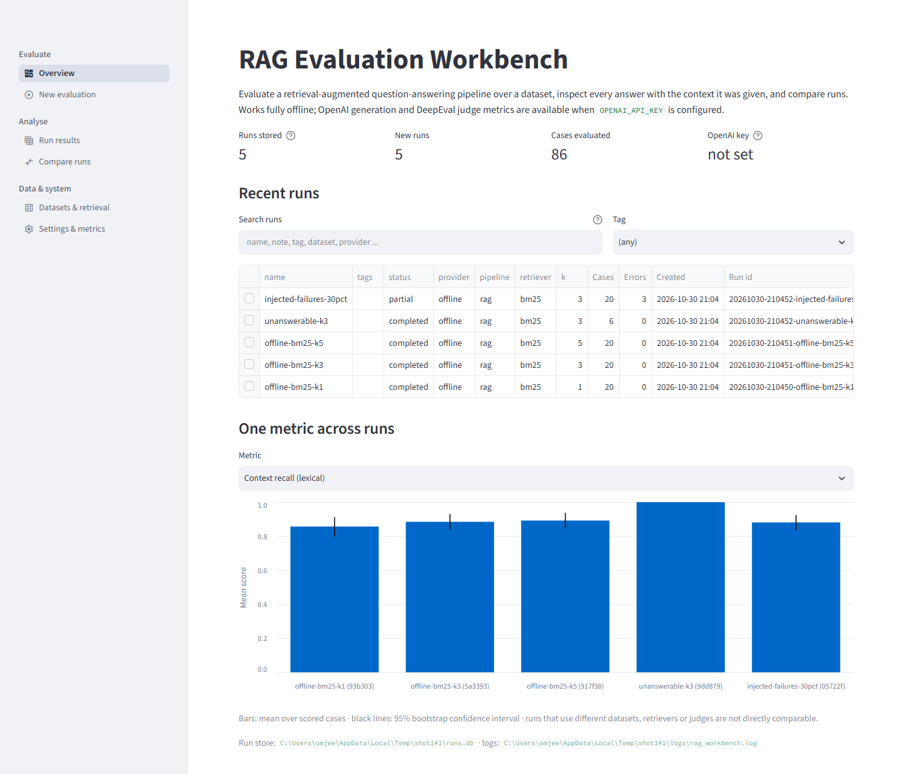
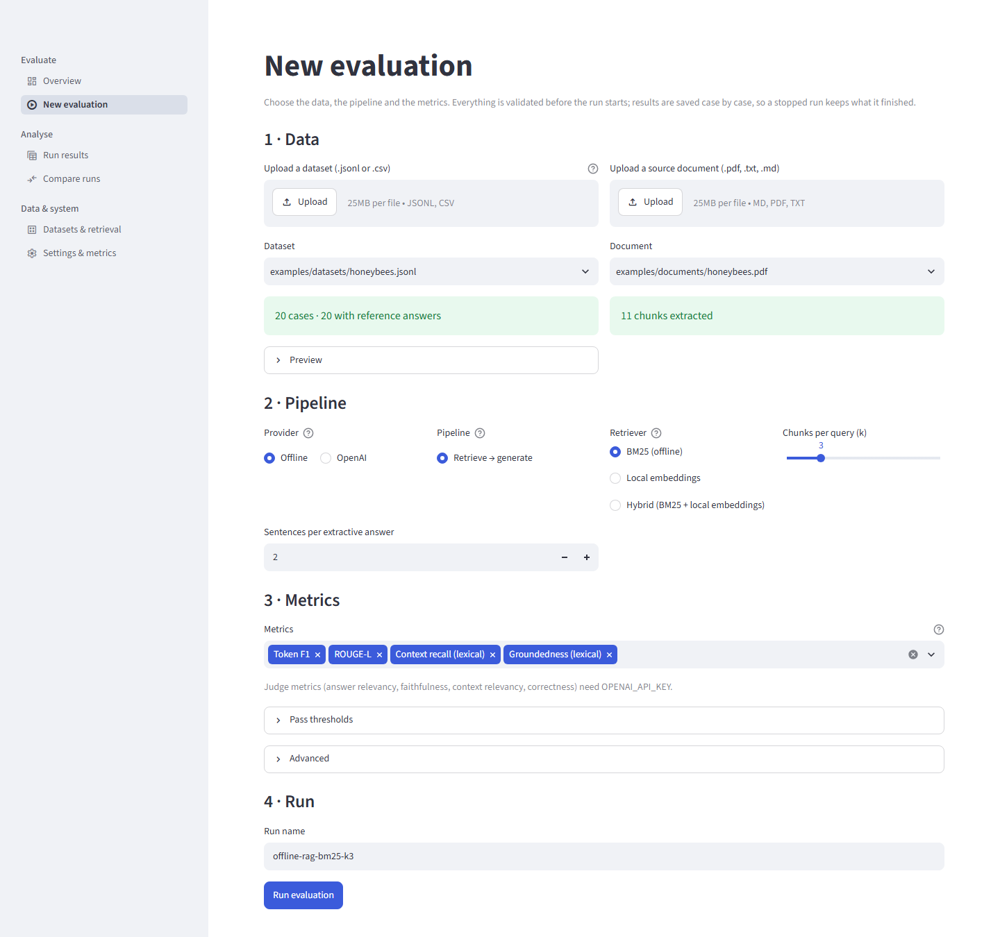
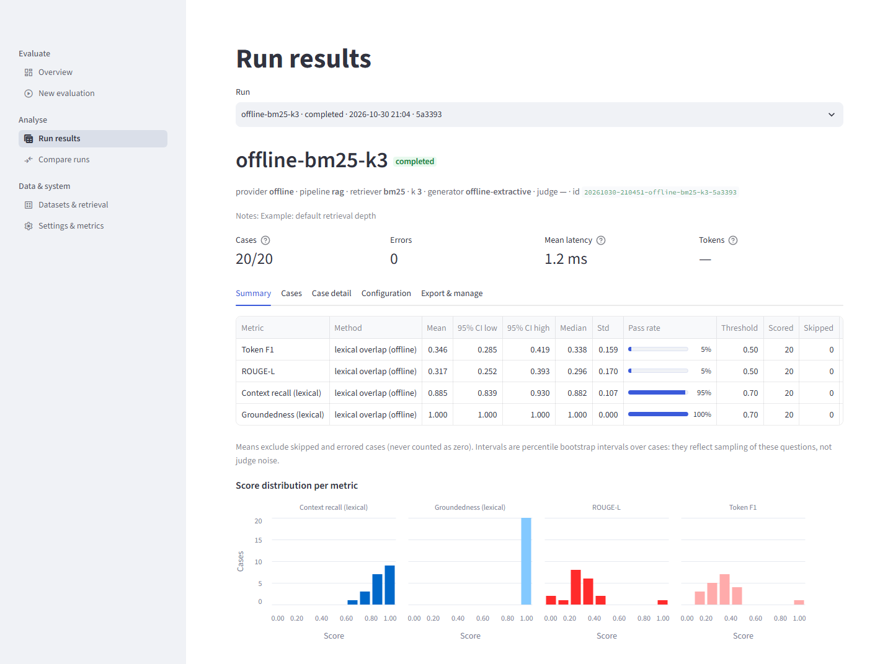
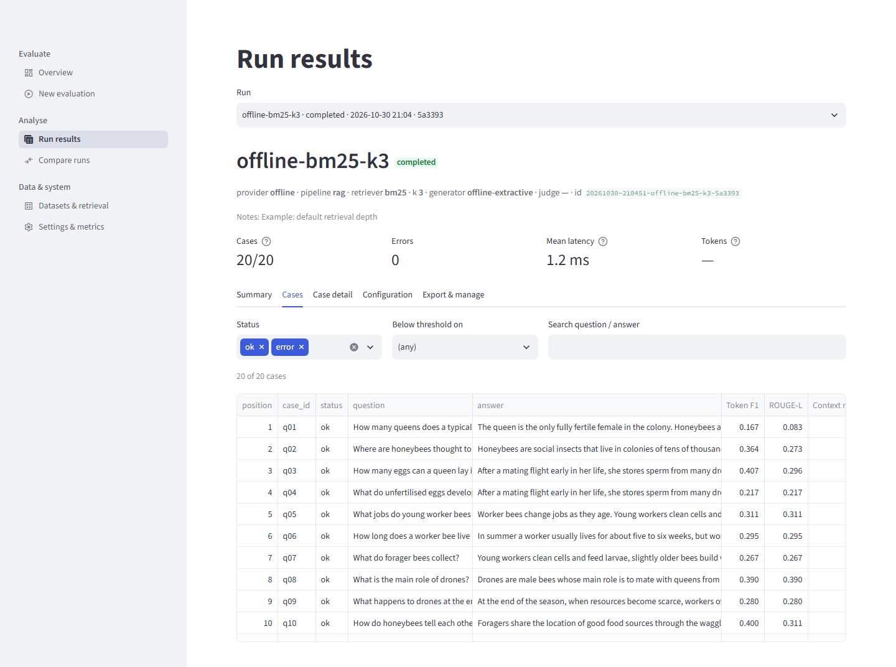
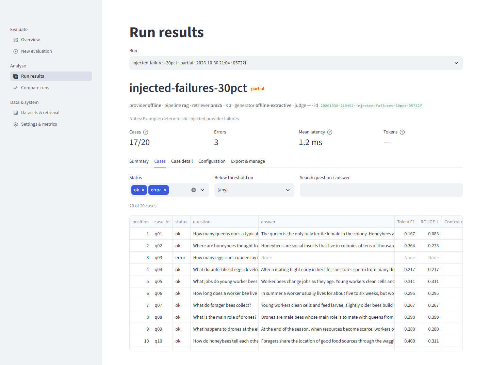
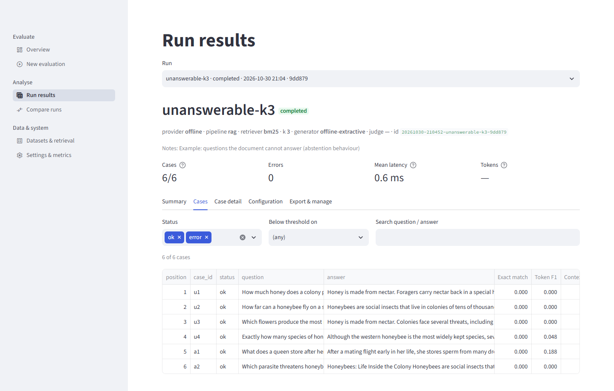
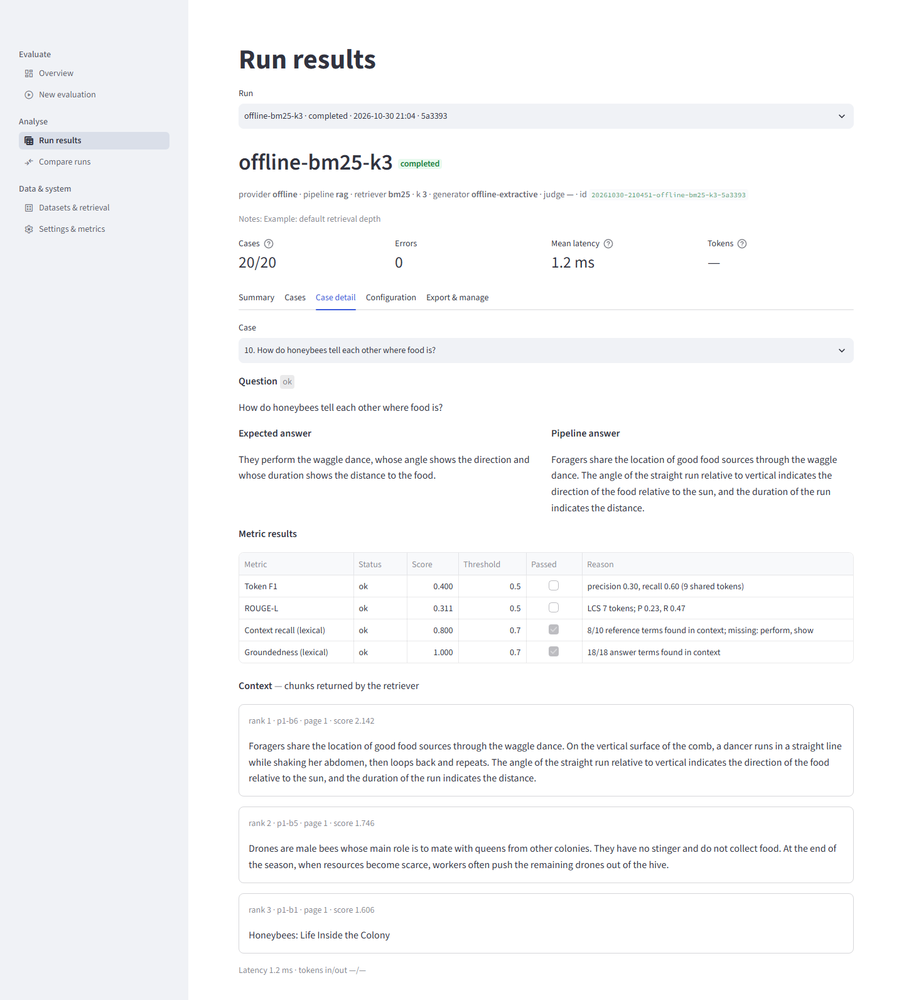
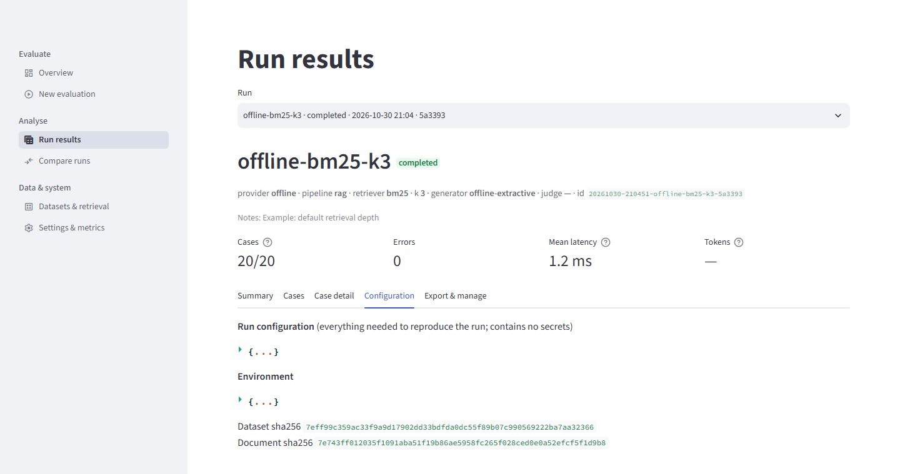
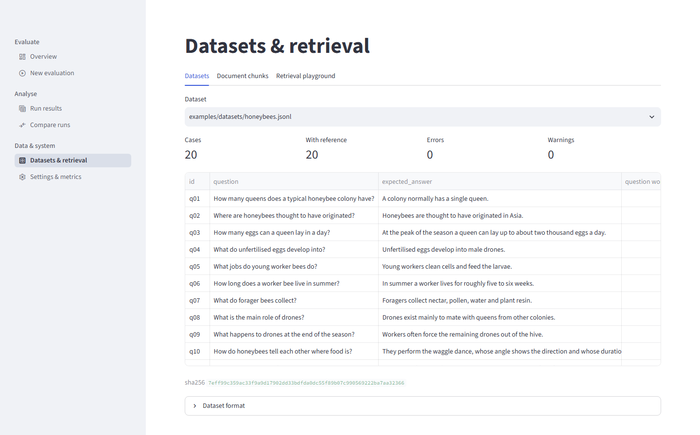
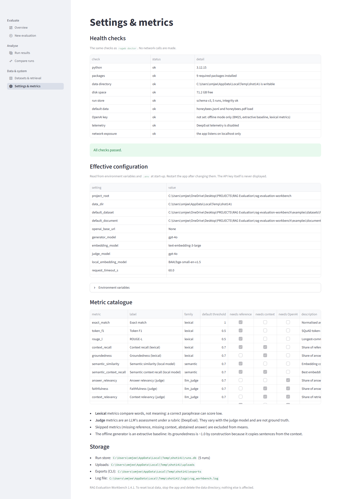

# Part VII — User interface and workflows

This Part documents the Streamlit application page by page: what each page is for, what every
control does, what the numbers in its tables and charts mean, and how each page fails. Source
references are relative to the project root. The application targets Streamlit 1.64 or later
(`pyproject.toml`), and 1.66.1 is installed in the project environment.

The screenshots were captured from the running application with headless Chrome by
`docs/project-book/tools/capture_screenshots.py`. The URLs come from
`docs/project-book/tools/screenshot_pages.json`, and the data is the five example runs described in
Part VI §74. The screenshots show the light theme at a fixed desktop width.

---

## 79. Application structure

### 79.1 Starting the app

The supported way to start the application is `python start.py` from the project root:

1. It prepares the environment.
2. On the first launch, when the run store is empty, it creates the five offline example runs.
3. It starts Streamlit on `localhost` (or the `--host` address, which requires a login: the shared password or user accounts), on the first free port from 8501, over HTTPS when `--ssl-cert` and `--ssl-key` are given.
4. It opens the browser.

Ctrl+C stops it. The flags are `--port`, `--host`, `--ssl-cert`, `--ssl-key`, `--no-browser`, `--no-examples` and `--setup-only`
(`start.py:194-202`). Installation and operation are covered in Part VIII.

`streamlit_app.py` is the Streamlit entry point that `start.py` runs (`start.py:159`). It:

1. Sets `DEEPEVAL_TELEMETRY_OPT_OUT=1` unless it is already set, before any DeepEval import
   (`streamlit_app.py:10`).
2. Configures the page title "RAG Evaluation Workbench", a material icon and the wide layout
   (`streamlit_app.py:18`).
3. Injects a small stylesheet (`src/rag_workbench/ui/components.py:20-30`): top padding, a
   1,400-pixel maximum content width, a slightly smaller metric value font, a muted-text class and, since release 1.2, a rule that sizes the section headings (see §89).
4. Blocks every page behind the login form when a shared password or user accounts are configured (`require_login`), and adds a sidebar "Signed in as … (role) / Sign out" block when someone is signed in (the role was added in release 1.3, Part XV §165) (`render_account`) (`streamlit_app.py:20-21`; Part XIV §156).
5. Declares six pages in three sidebar groups, adds the *Accounts* page for an admin (release 1.4), and runs the navigation (`streamlit_app.py:23-42`).

`.streamlit/config.toml` does five things:

* disables Streamlit usage statistics;
* sets the toolbar to "minimal";
* limits uploads to 25 MB;
* runs headless and binds the server to `localhost` (`server.address`), so the app is reachable from
  this machine only;
* sets a primary colour (`#3b5bdb`) without fixing a base theme, so the app follows the viewer's
  light/dark preference.

`start.py` passes the same address, headless and statistics settings on the command line. Section headings on every page are `st.header` (level-2) under the single level-1 page title, since release 1.2.

### 79.2 Navigation

| Sidebar group | Page | URL path | Source |
|---|---|---|---|
| Evaluate | Overview (default) | `/` | `src/rag_workbench/ui/views/overview.py` |
| Evaluate | New evaluation | `/new-run` | `src/rag_workbench/ui/views/new_run.py` |
| Analyse | Run results | `/results` | `src/rag_workbench/ui/views/results.py` |
| Analyse | Compare runs | `/compare` | `src/rag_workbench/ui/views/compare.py` |
| Data & system | Datasets & retrieval | `/data` | `src/rag_workbench/ui/views/data.py` |
| Data & system | Settings & metrics | `/settings` | `src/rag_workbench/ui/views/settings.py` |
| Admin (admins only) | Accounts | `/accounts` | `src/rag_workbench/ui/views/users.py` |

The *Accounts* page (release 1.4) is registered only when named accounts exist and the signed-in role is `admin` (`streamlit_app.py:39-40`). It lists accounts (user, role, created), adds an account with a role, changes a role, resets a password, and removes an account after the username is typed to confirm; removing or demoting the last admin is refused, and the signed-in admin cannot remove themself (`ui/views/users.py`; Part XVI §173).

Every signed-in user also has a *Change password* expander in the sidebar (`ui/auth.py:239-256`).

In own-visibility mode the Overview, Run results and Compare pages list only the runs a non-admin started plus runs with no owner (`ui/auth.py:219-228`).

Every page calls the `rag_workbench` package directly; there is no separate backend process.

### 79.3 Shared state and behaviour (`ui/state.py`)

* **One context per server process.** `get_context` is decorated with `st.cache_resource`
  (`src/rag_workbench/ui/state.py:17-20`). Settings are read and the SQLite store opened once, when
  the first page is rendered after start-up, with the spinner text "Opening the run store…". Opening
  the context also marks as `interrupted` any run left in status `running` by a crashed process
  (`src/rag_workbench/services.py:27-35`). For users this means **changes to `.env` take effect only
  after restarting the app**, which the Settings page says.
* **Configuration errors stop the page.** If the settings are invalid, every page shows only
  "Configuration problem: …" and "Fix the variable in `.env` (see `.env.example`) and restart the
  app." (`src/rag_workbench/ui/state.py:23-29`).
* **Selected run.** All pages share one session value, `selected_run_id`
  (`src/rag_workbench/ui/state.py:13`, `32-37`). Selecting a row on the Overview, finishing a run on
  New evaluation and choosing a run on Run results all set it, and Run results reads it.
* **Run labels.** Wherever a run is chosen from a list, its label is `name · status · date · short
  id`. The short id is the six-character random suffix of a generated id
  (`src/rag_workbench/ui/state.py:40-48`), for example "offline-bm25-k3 · completed · 2026-10-23
  19:48 · 2d53f3" in screenshot 03. Imported runs omit the date and show `name · status · id`.

### 79.4 Shared presentation helpers (`ui/components.py`)

* **Status badges** (`components.py:15-18`, `48-49`): coloured badges with the status word inside.
  Completed is green, partial orange, failed red, cancelled and interrupted grey, running blue, and
  imported violet. The word is always shown, so colour is never the only cue.
* **Number formatting** (`components.py:52-57`): floats to three decimals by default, and missing
  values as an em dash "—".
* **Method captions** (`components.py:60-65`): "lexical overlap (offline)" or "LLM judge
  (DeepEval)".
* **Provenance box** (`components.py:68-74`): for imported runs whose configuration carries
  `provenance_warnings`, a bordered box headed "Imported run — read the provenance notes before
  comparing", with one bullet per warning. None of the example runs has such warnings, so the box
  appears in no screenshot.
* **Score charts** (`components.py:77-94`): Altair bar charts with the y axis **fixed to [0, 1]**
  (`components.py:79`), so small differences are not visually exaggerated. They optionally group by
  run with colour, and show 95% confidence intervals as black vertical rules. Tooltips show every
  column of the underlying data to three decimals.
* **Metric columns** (`components.py:97-99`): table columns for metrics are labelled with the
  metric's display name and formatted to three decimals, and the column header has the metric
  description as a help tooltip.

---

## 80. Overview

*Screenshot 01 — `/`.*

### 80.1 Purpose

The Overview is the landing page. It shows what is stored, what happened recently, and how runs
compare on one metric.

### 80.2 What the page shows

From top to bottom (`src/rag_workbench/ui/views/overview.py`):

1. **Title and introduction** (lines 14-17): the product name, and a sentence saying the app works
   fully offline and that OpenAI generation and DeepEval judge metrics need `OPENAI_API_KEY`.
2. **Four headline numbers** (lines 21-26):
   * *Runs stored*: all runs, including imported bundles, as the help tooltip says. Screenshot: 5.
   * *New runs*: runs whose status is not `imported`. Screenshot: 5.
   * *Cases evaluated*: the sum of `n_cases` over the new runs. Screenshot: 86 (20 + 6 + 20 + 20 + 20).
   * *OpenAI key*: "configured" or "not set". The tooltip explains that without a key only the
     offline provider, BM25 and lexical metrics are available. Screenshot: "not set".
3. **Empty state** (lines 28-33), shown only when there is no non-imported run: a bordered box
   recommending an offline run as a first step ("It takes a few seconds at most and needs no API
   key."), with a link "Configure a new evaluation". `start.py` creates the example runs on first
   launch, so a user normally sees this box only after deleting every run or after starting with
   `--no-examples`. It is not in screenshot 01.
4. If no run exists at all, the page stops here (lines 35-36).
5. **Recent runs** (lines 38-66), most recent first, under a level-2 heading. Since release 1.2 it begins with two
   filters (lines 39-49): a **Search runs** text box (every word must appear in the run's name, notes, tags, id, status,
   provider, retriever or dataset/document file name) and a **Tag** selector built from the tags that exist; if nothing
   matches, the page says "No run matches (N stored)." and stops. The table (lines 50-60) has the columns name, **tags**,
   status, provider, pipeline, retriever, k, Cases, Errors, Created and Run id. For imported runs, *Created* reads
   "imported" instead of the import timestamp (lines 54-55). The table supports **single-row
   selection** through its checkbox column. Selecting a row stores it as the selected run and shows
   "Selected **name** [badge]" with a link **Open run results** (lines 61-66).
6. **One metric across runs** (lines 68-84). A selectbox lists every metric that appears in any run
   summary, in alphabetical order of internal name. It defaults to *Correctness (judge)* if any run
   has it (line 71), and otherwise to the first name. The chart has one bar per run that has a mean
   for that metric, oldest run on the left (`reversed(runs)`, line 76), with CI rules. The caption
   reads "Bars: mean over scored cases · black lines: 95% bootstrap confidence interval · runs that
   use different datasets, retrievers or judges are not directly comparable." If no run has a score
   for the chosen metric, the page shows "No run has a score for this metric yet."
7. If any imported run carries provenance warnings, a caption says to read them before comparing
   (lines 86-87). Then come the paths of the run store and the log file (line 88).

### 80.3 Reading the screenshot

No run has a judge metric, so the chart in screenshot 01 shows the alphabetically first metric,
*Context recall (lexical)*, for all five runs. The bars are offline-bm25-k1 (0.857), -k3 (0.885),
-k5 (0.892), unanswerable-k3 (1.000) and injected-failures-30pct (0.881), as quoted in Part VI §74.
The unanswerable run's bar reaches 1.0 with no visible interval, because only two of its cases are
scored and both scored 1.0 (CI 1.000–1.000). The chart looks the same as the other runs' bars,
which is the misleading-small-denominator situation described in Part VI §70.3. The caption under
the chart warns that runs on different datasets are not directly comparable, and
`unanswerable-k3` uses a different dataset.

The screenshot also shows the two filters of release 1.2 above the table, the *Search runs* box and the *Tag* selector
("(any)"), and the new `tags` column, which is empty because none of the example runs has been tagged
(Part XIV §152). The section headings ("Recent runs", "One metric across runs") are the larger level-2 headings of §89.

In the Recent runs table, the *Run id* column is cut off at the right edge. The full id is
available by widening the column, or in the header of the Run results page.

---

## 81. New evaluation

*Screenshot 02 — `/new-run`, no API key configured.*

### 81.1 Purpose

This page configures and launches one run. Everything is validated before anything runs, and
results are saved case by case (caption, `new_run.py:30-31`). Since release 1.3 an account with the `viewer` role sees, instead of the form, a warning that the account is read-only and the page stops (`new_run.py:27-29`); see §165 of Part XV for the role matrix.

### 81.2 Step 1 — Data

**Dataset upload** (`new_run.py:37-48`). The uploader accepts `.jsonl` and `.csv`. A new upload is
saved once per upload, tracked by the upload's file id so that a later manual choice is not
overridden on rerun, by `save_upload` (`src/rag_workbench/services.py:38-60`):

* The extension must be allowed, otherwise the error is "File type … not allowed; use …".
* The size must be within `RAGWB_MAX_DATASET_BYTES` (default 5,000,000 bytes), otherwise the error
  is "File is N bytes; the limit is M bytes".
* The file is stored under `data/uploads/` as
  `<first 12 hex characters of its SHA-256>-<sanitised name><ext>`. It therefore cannot escape the
  directory or overwrite a different file, and identical content is stored once.

The uploaded file then becomes the selected dataset. The widget's own text says "25MB per file"
(screenshot 02), which is Streamlit's upload ceiling from `.streamlit/config.toml`. The
application's limit for datasets is lower. The uploader's help tooltip (the "?" icon) states it:
"Size limit: 5 MB" with the default setting, computed from `RAGWB_MAX_DATASET_BYTES`
(`new_run.py:37-39`). The limit is enforced after upload with the error above.

**Dataset** selectbox (`new_run.py:49-55`). It lists the default dataset, then the bundled example
datasets, then uploads newest first, without duplicates (`services.py:63-82`), shown as paths
relative to the project root. If no dataset exists at all, the page shows "No dataset found. Upload
one above." and stops.

**Validation result** (`new_run.py:57-69`). The selected file is validated on every rerun:

* On success, a green box reads "N cases · M with reference answers". Screenshot 02 shows
  `examples/datasets/honeybees.jsonl` with "20 cases · 20 with reference answers".
* On failure, a red box reads "This dataset cannot be used:" and lists up to ten line-numbered
  errors.
* Warnings (duplicate questions, missing references, ignored fields) go in an expander titled
  "N warning(s)".
* A **Preview** expander shows the first 20 parsed cases as a table.

**Document upload and selector** (`new_run.py:72-93`). These follow the same pattern for `.pdf`,
`.txt` and `.md`, limited by `RAGWB_MAX_DOCUMENT_BYTES` (default 25 MB). The selected document is
chunked immediately, giving "N chunks extracted" or the document error in red. Screenshot 02 shows
`examples/documents/honeybees.pdf` with "11 chunks extracted".

### 81.3 Step 2 — Pipeline

| Control | Options | Behaviour |
|---|---|---|
| **Provider** (radio) | Offline, OpenAI | The help says the offline option is an extractive baseline, not an LLM. Choosing OpenAI without a key shows "OPENAI_API_KEY is not set. Add it to `.env` and restart to use OpenAI." (`new_run.py:98-102`) |
| **Pipeline** (radio) | Retrieve → generate; Tool-calling agent | The agent option is offered only with the OpenAI provider (`new_run.py:103-107`) |
| **Retriever** (radio) | BM25 (offline); API embeddings and API hybrid (key configured); Local embeddings and Hybrid (BM25 + local embeddings) (`fastembed` installed) | The API options are offered only when a key is configured and the local options only when `semantic_available()` is true (`new_run.py:108-115`). The committed screenshots were not recaptured for release 1.3 and show this page without the `semantic` extra, so they offer BM25 only |
| **Chunks per query (k)** (slider) | 1 to min(10, number of chunks) | Defaults to min(3, max) (`new_run.py:116-117`) |
| **Generator model** (text) | defaults to `RAGWB_GENERATOR_MODEL` | Shown only for OpenAI |
| **Sentences per extractive answer** (number) | 1–10, default 2 | Shown only for Offline (`new_run.py:119-126`) |

Screenshot 02 shows the no-key situation: only "Retrieve → generate" and "BM25 (offline)" are
available, with k = 3 and two sentences.

### 81.4 Step 3 — Metrics

* **Metrics** multiselect (`new_run.py:130-134`). Judge metrics are listed only when a key is
  configured, and the two semantic metrics only when the optional `fastembed` package is installed. The default selection is Token F1, ROUGE-L, Context recall (lexical) and Groundedness
  (lexical). Without the package, a caption says that the semantic metrics (local embedding model) are optional and
  `uv pip install fastembed` enables them; without a key, a caption says that the four judge metrics need
  `OPENAI_API_KEY` (both captions are in screenshot 02).
* **Judge model** (text), shown only when a judge metric is selected (`new_run.py:140-142`). It
  defaults to `RAGWB_JUDGE_MODEL`. If no judge metric is selected, the run records no judge model.
* **Pass thresholds** expander (`new_run.py:143-148`). It has one number input per selected metric,
  with range 0–1 and step 0.05, prefilled with the metric's default (Part VI §67). Thresholds change
  only pass/fail and pass rates, not scores.
* **Advanced** expander (`new_run.py:150-169`):
  * *Parallel cases*: 1–32 (default 1 for offline, `RAGWB_MAX_WORKERS` for OpenAI).
  * *Evaluate first N cases (0 = all)*: bounded by the dataset's case count.
  * *Seed*: 0–10,000.
  * *Inject failures (fraction of cases)*: 0–1 in steps of 0.05, offline only. This is a testing aid
    that makes the offline generator fail deterministically on some cases.
  * *Notes*: free text stored with the run.

When a user is signed in (accounts mode), the run's configuration also records who started it (`started_by`,
`new_run.py:208`; Part XIV §156.4).

### 81.5 Step 4 — Run

* **Run name** (`new_run.py:174-175`). It is prefilled as `provider-pipeline-retriever-k<k>`
  (screenshot: `offline-rag-bm25-k3`), up to 120 characters.
* **Pre-flight problems** (`new_run.py:177-189`). If any of the following holds, the button is
  disabled and a warning lists the problems, joined by semicolons:
  * the dataset has validation errors;
  * the document has no usable text;
  * no metric is selected;
  * OpenAI is selected but `OPENAI_API_KEY` is not set;
  * the run has no name.
* **Cost notice** (`new_run.py:191-194`). When the OpenAI provider or a judge model is in use, an
  info box says the run calls the OpenAI API and may incur cost. It gives the number of generation
  calls, plus "plus judge calls for each selected judge metric" when relevant. It estimates calls,
  not money.
* **Run evaluation** (primary button, `new_run.py:196`). On click it:
  1. Builds a `RunConfig` and calls `runner.prepare`, which validates the metric names, thresholds,
     dataset, document and pipeline construction without writing anything. Any rejection appears as
     "Configuration rejected: …" and the page stops (`new_run.py:197-213`).
  2. Shows a progress bar reading "k/N cases", and a code box with the last eight case outcomes:
     `✓ case-id`, or `✗ case-id — error message` (`new_run.py:216-224`).
  3. Runs under a spinner whose text says to use Streamlit's Stop button to cancel, and that
     finished cases are kept (`new_run.py:227-228`).
  4. On a storage failure, shows "Could not save results: …" (`new_run.py:229-231`).
  5. On completion, selects the new run and shows "Run **name** finished: [badge] · n_ok/n cases
     succeeded", in green if the run completed and amber otherwise. It adds a caption about failed
     cases if there are any, and one tile per metric with the mean and the tooltip "N scored,
     N skipped, N errors". It ends with a link **Inspect this run** (`new_run.py:232-248`).

### 81.6 Cancellation

Streamlit's Stop control interrupts the script while it is inside the progress callback. The runner
treats any exception raised there as cancellation: it marks the run `cancelled`, writes a summary of
the cases finished so far and re-raises (`src/rag_workbench/runner.py:132-137`). The cancelled run
then appears in the store with its partial results. If the server process dies instead, the run
stays `running` until the next start-up marks it `interrupted` (§79.3). The effect of other
interactions during a run, such as navigating to another page, was not tested for this book.

---

## 82. Run results

The Run results page has a run selector, a header, four headline numbers and five tabs.

### 82.1 Run selector and header

* **Run** selectbox (`results.py:31-36`). The initial choice is the run named by the `?run=` query
  parameter if it exists. Otherwise it is the session's selected run, and failing that the first
  (most recent) run. Choosing a run makes it the selected run.
* **Header** (`results.py:45-50`). It shows the run name with its status badge, then a muted line
  with provider, pipeline, retriever, k, generator, judge ("—" if none) and the full run id.
  Configuration values can come from imported bundles, so every value in this HTML line goes
  through `html.escape` before rendering. A bundle therefore cannot inject markup into the page.
* **Provenance box** for runs with warnings (`results.py:51`).
* For `cancelled` or `interrupted` runs, a warning: "This run was cancelled: N of M cases were
  evaluated." (`results.py:52-53`).
* The run's tags and notes, as captions (`results.py:54-57`). Screenshot 03 shows "Notes: Example: default
  retrieval depth".
* If the run has no summary yet: "This run has no summary yet (it may still be running)." and the
  page stops (`results.py:60-62`).

### 82.2 Headline numbers

| Tile | Value | Tooltip |
|---|---|---|
| Cases | succeeded / evaluated | "Succeeded / evaluated" |
| Errors | number of failed cases | — |
| Mean latency | mean over successful cases, in ms | p95 latency |
| Tokens | prompt + completion totals, "—" when not reported | cost in USD, or "—" with a hint to set `RAGWB_PRICE_*` |

(`results.py:64-70`.) Offline runs report no tokens, hence the "—" in screenshots 03–07 and 11.

### 82.3 Summary tab

*Screenshot 03 — `/results?run=20261023-194808-offline-bm25-k3-2d53f3`.*

The tab shows one table row per metric (`results.py:78-90`). The columns are Metric, Method, Mean,
95% CI low, 95% CI high, Median, Std, Pass rate (drawn as a progress bar with a percentage),
Threshold, Scored, Skipped and Errors. The caption reads: "Means exclude skipped and errored cases
(never counted as zero). Intervals are percentile bootstrap intervals over cases: they reflect
sampling of these questions, not judge noise."

The values in screenshot 03 match Part VI §74.1. For example, Token F1 has mean 0.346, CI
0.285–0.419, median 0.338, std 0.159 and a pass rate of 5% at threshold 0.50, with 20 scored and 0
skipped. The table is wider than the content area: the *Errors* column is beyond the right edge and
needs horizontal scrolling inside the table.

Below the table is **Score distribution per metric** (`results.py:103-113`). It has one histogram per
metric, with bins 0.1 wide on [0, 1], the number of cases on the y axis, the metric name as the
facet title, and one colour per metric without a legend. Only scored values are plotted. In
screenshot 03:

* the groundedness facet is a single bar of 20 cases at 1.0;
* context recall is concentrated between 0.6 and 1.0;
* token F1 and ROUGE-L cluster between about 0 and 0.5, each with one case at 0.9 (q13).

### 82.4 Cases tab

*Screenshot 04 — `/results?run=…offline-bm25-k3-2d53f3&tab=cases`.*

There are three filters (`results.py:115-129`):

* **Status**: a multiselect of "ok" and "error", both selected by default.
* **Below threshold on**: "(any)" or a metric. Choosing a metric keeps only cases where that metric
  was scored **and failed** (`passed == False`). Cases where the metric was skipped or errored are
  excluded, not shown as failures.
* **Search question / answer**: a case-insensitive plain substring search (no regular expressions)
  in the question or the answer.

A caption shows "N of M cases". The table shows position, case_id, status, question, answer, one
column per metric, latency (ms), attempts and error (`results.py:130-135`). Questions and answers are
truncated in their cells, and the table scrolls internally. Screenshot 04 shows the first ten rows
(q01–q10), and the context-recall column is cut at the right edge.

*Screenshot 07 — `injected-failures-30pct`, Cases tab.*

For a partial run, the failed cases appear with status `error`. Screenshot 07 shows "17/20" cases,
3 errors and the "partial" badge, with q03 visible among the first ten rows. The answer and metric
cells of a failed case display the text "None", which is how Streamlit renders a missing value in
these columns, rather than a blank or a dash. The error message is in the *error* column, beyond the
visible area in the screenshot. For these cases it reads "Injected offline failure
(offline_failure_rate > 0)" (Part VI §74.6).

*Screenshot 11 — `unanswerable-k3`, Cases tab.*

When the dataset carries metadata, the Summary tab also offers "Break down by dataset metadata". For this run, splitting by the answerable/unanswerable field gives two slices: answerable, 2 cases, mean token F1 0.094; unanswerable, 4 cases, mean token F1 0.012, with context recall shown as None because it is skipped for questions with no reference answer.

*Screenshot 12 — `unanswerable-k3`, Summary tab, slices.*

Screenshot 11 shows all six cases, u1–u4 and a1–a2. Exact match is 0.000 on every row. Token F1 is
0.000, 0.000, 0.000, 0.048, 0.188 and 0.000. None of the visible answers is the abstention sentence:
u1 begins "Honey is made from nectar.", and a2 begins with the document title, "Honeybees: Life
Inside the Colony" (Part VI §74.2, §74.5).

### 82.5 Case detail tab

*Screenshot 05 — `/results?run=…offline-bm25-k3-2d53f3&tab=case&case=q10`.*

The **Case** selectbox lists "position. question", with questions cut at 90 characters. `?case=`
chooses the initial case (`results.py:137-146`). For the selected case the tab shows
(`results.py:144-169`):

* **Question**, with a status badge.
* **Expected answer** and **Pipeline answer** side by side, or "_(no reference answer)_" and
  "_(no answer)_" when either is missing.
* For failed cases, a red box: "Error after N attempt(s): …".
* **Metric results** table, with columns Metric, Status (ok / skipped / error), Score, Threshold,
  Passed (a read-only checkbox) and Reason. The reason is the most useful column: it shows the counts
  behind a lexical score, and the missing or unsupported terms.
* **Context**, labelled with its source: "chunks returned by the retriever" or "chunks returned to
  the agent's tool" (`results.py:163-164`).
* One bordered box per context chunk, captioned "rank · chunk id · page · score", followed by the
  chunk text. The text is rendered with `st.text`, i.e. literally, so document content cannot inject
  Markdown or HTML (`results.py:169`).
* A caption with latency and tokens in/out.

Screenshot 05 shows q10:

* **Expected answer:** "They perform the waggle dance, whose angle shows the direction and whose
  duration shows the distance to the food."
* **Pipeline answer:** two sentences from the waggle-dance paragraph.
* **Metric results:**
  * Token F1 0.400 and ROUGE-L 0.311, both unchecked at threshold 0.5.
  * Context recall 0.800, checked, with reason "8/10 reference terms found in context; missing:
    perform, show".
  * Groundedness 1.000.
* **Context:** three chunks. Rank 1 is `p1-b6` (score 2.142, the waggle-dance paragraph), rank 2
  `p1-b5` (1.746, the drones paragraph) and rank 3 `p1-b1` (1.606). The rank-3 chunk is the one-line
  title "Honeybees: Life Inside the Colony".

The page makes both lexical weaknesses from Part VI visible. The reference's "shows" is missing
because the document says "indicates", and a chunk with no content, the title, takes one of the
three context slots (Part VI §74.2).

### 82.6 Configuration tab

*Screenshot 06 — `/results?run=…offline-bm25-k3-2d53f3&tab=config`.*

This tab (`results.py:173-178`) shows the stored run configuration under the heading "Run
configuration (everything needed to reproduce the run; contains no secrets)", and the environment
under "Environment". Both are JSON trees, collapsed to `{...}` until clicked. Below them are the
dataset and document SHA-256 hashes. Screenshot 06 shows the collapsed trees, the dataset hash
beginning `7eff99c359ac` and the document hash beginning `7e743ff01203`. This tab is the place to
check which thresholds, models, seed and limits a run actually used.

### 82.7 Export & manage tab

* **Downloads** (`results.py:180-188`): three buttons, **CSV (one row per case)**, **JSON (full
  record)** and **Markdown report**. The browser saves each as `<run id>.<ext>` (§86.5).
* **Delete this run** expander (`results.py:208-220`):
  * A warning says deletion removes the run and all its case results and cannot be undone. For
    imported runs it adds that the run can be imported again from its bundle file.
  * A text field reads "Type the run id to confirm".
  * The **Delete run** button stays disabled until the field matches the run id exactly. Deleting
    clears the selected run, shows "Run deleted." and reruns the page.

* **Tags and notes** expander (`results.py:190-207`, release 1.2): a text input for comma- or space-separated tags, a
  text area for the note (limited to 2,000 characters) and a **Save tags and notes** button. Invalid tags are reported with
  an error box; a valid save shows "Saved." (Part XIV §152.4).

Since release 1.3 the *Tags and notes* inputs are disabled for a `viewer`, who sees "Your account is read-only (viewer): tags and notes cannot be changed." instead of the save button, and the *Delete this run* expander is available only to an `admin` (others see "Deleting runs needs an admin account.") (`results.py:190-198`, `:208-214`).

No screenshot of this tab was captured.

---

## 83. Compare runs

*Screenshot 08 — `/compare?runs=<k1 id>,<k3 id>,<k5 id>`.*

### 83.1 Run selection

* With fewer than two stored runs, the page shows "At least two runs are needed for a comparison."
  and a link to run another evaluation (`compare.py:15-18`).
* **Runs to compare** multiselect (`compare.py:20-23`). The initial selection comes from `?runs=` if
  at least two of its ids exist, and is otherwise the three most recently created runs. With fewer
  than two selected, the page shows "Select at least two runs." (`compare.py:24-26`).

### 83.2 Configuration

This is a table with one column per selected run (`compare.py:30-44`). Its rows are provider,
pipeline, retriever, k, generator_model, judge_model, metrics, the first 12 characters of the
dataset hash, cases and status. Rows whose values differ between runs get an amber background, and
the caption says "Highlighted rows differ between the selected runs." In screenshot 08 only the *k*
row (1, 3, 5) is highlighted, and all three runs share the dataset hash `7eff99c359ac`.

If the dataset hashes differ, a warning explains that cases are paired by question text and that
only shared questions are compared (`compare.py:45-47`). If any selected run is imported, an
expander "Provenance notes for imported runs" lists each imported run's warnings
(`compare.py:48-53`).

### 83.3 Metric means

This is a grouped bar chart (`compare.py:56-73`): metrics on the x axis, one colour per run, a fixed
[0, 1] y axis, and 95% CI rules. A run–metric pair without a CI (fewer than two scored cases) is
drawn with a zero-length rule at the mean (`compare.py:64-65`), which can look like a precise value.
The caption reads: "Black lines: 95% bootstrap confidence intervals. Overlapping intervals mean the
difference may be sampling noise; use the paired analysis below for a sharper test." If none of the
runs has scores, the page shows "The selected runs have no scores."

In screenshot 08:

* the k1 bar is the tallest for Token F1 and ROUGE-L, and the k3 and k5 bars are level;
* context recall rises slightly from k1 to k5, with overlapping intervals;
* groundedness is 1.0 for all three runs.

### 83.4 Best run per metric

This table lists metric, best run, mean and *tie* (`compare.py:75-83`). All runs within 10⁻⁹ of the
top mean are listed, joined with " = ", and the tie box is checked; ties are never broken
arbitrarily. Screenshot 08 shows:

* Token F1: won by k1 (0.404);
* ROUGE-L: won by k1 (0.373);
* context recall: won by k5 (0.892);
* groundedness: a three-way tie (1.000).

"Best" here means highest mean only. It ignores confidence intervals, the number of scored cases and
whether the runs used the same data, so the paired analysis below is the better guide.

### 83.5 Paired comparison

* **Baseline (A)** and **Candidate (B)** selectboxes, restricted to the chosen runs, default to the
  first and second run (`compare.py:89-91`). Choosing the same run for both shows "Choose two
  different runs." (`compare.py:92-94`).
* If the two runs share no metric, the page shows "These runs share no metric."
* The table (`compare.py:97-106`) has the columns label, paired_cases, mean_a, mean_b,
  diff_b_minus_a (signed), ci_low, ci_high, b_better, ties, b_worse and **verdict**. The verdict is:
  * "no paired cases" when no question was scored in both runs;
  * "B better" or "B worse" when the 95% interval of the paired difference excludes zero;
  * "inconclusive" otherwise (`compare.py:101-103`).
* The caption reads: "'B better/worse' only when the 95% interval of the paired difference excludes
  zero. With 20 cases, small differences are usually inconclusive."

Screenshot 08 compares k1 (A) with k3 (B):

| Metric | Difference (CI) | B better / ties / B worse | Verdict |
|---|---|---|---|
| Token F1 | −0.057 (−0.116 to −0.008) | 3 / 10 / 7 | "B worse" |
| ROUGE-L | −0.056 | 3 / 10 / 7 | "B worse" |
| Context recall | +0.028 (0.000 to 0.063) | 3 / 17 / 0 | inconclusive |
| Groundedness | +0.000 | 0 / 20 / 0 | inconclusive |

These match `ragwb compare` (Part VI §74.1), except for one rounding difference. The context-recall
upper bound is exactly 0.0625; the CLI prints it as 0.062, while this table shows 0.063 (Part VI
§71.4). The method and its caveats are in Part VI §72: pairing by normalised question text, and no
multiple-comparison correction.

### 83.6 Per-case differences

A **Per-case differences for** selectbox offers the shared metrics. Below it, a table lists question,
A, B, B − A, answer A and answer B, sorted by B − A ascending so the largest regressions come first
(`compare.py:110-126`). A closing caption repeats the counts: "N paired cases · B better on W, tied
on T, worse on L." If no case has the metric scored in both runs, the page shows "No case has this
metric scored in both runs."

In screenshot 08 (Token F1, k1 → k3):

* the first rows are "How does a honeybee colony reproduce?" (0.629 → 0.273, −0.356), "Why do bees
  build hexagonal cells?" (−0.349), "What temperature do bees keep the brood nest at?" (−0.212) and
  "How long does a worker bee live in summer?" (−0.191);
* the caption reads "20 paired cases · B better on 3, tied on 10, worse on 7.";
* the *answer B* column is beyond the right edge.

This table is the most direct way to see *why* an aggregate moved. Reading the two answers for the
worst row shows the title sentence displacing a real sentence at k = 3 (Part VI §74.2).

---

## 84. Datasets & retrieval

*Screenshot 09 — `/data`, Datasets tab.*

The page has three tabs (`data.py:19`).

**Datasets** (`data.py:26-56`). This tab has:

* a dataset selector, with the same list as on New evaluation;
* four numbers: Cases, With reference, Errors and Warnings;
* each error and warning as a red or amber message;
* a table of id, question, expected answer, question word count and reference word count;
* the file's full SHA-256;
* a **Dataset format** expander with a JSONL example and the CSV rules.

Screenshot 09 shows `examples/datasets/honeybees.jsonl`: 20 cases, 20 with a reference, 0 errors and
0 warnings. The ids q01–q10 are visible, and the hash begins `7eff99c359ac`. The word-count columns
are beyond the right edge of the table.

**Document chunks** (`data.py:58-69`). This tab has a document selector, a caption "N chunks · N
characters", and a table of chunk id, page, character count and text. Check here that a document was
split into sensible chunks before evaluating. For the example PDF, the table shows the 11 chunks,
including the one-line title chunk `p1-b1` that Part VI §74.2 discusses. Document errors are shown
in red.

**Retrieval playground** (`data.py:71-87`). This tab has a query box, which defaults to "How is
nectar turned into honey?", and a k slider. The page builds a BM25 index over the selected
document's chunks and shows the top k, each with "rank · chunk id · page · BM25 score" and the chunk
text. If every hit scores 0, i.e. no chunk shares a content word with the query, a warning says the
results are in document order. The caption explains that embedding retrieval is not offered here,
to avoid cost. Typing "Which parasite threatens honeybee colonies?" reproduces the ranking discussed
in Part VI §74.3: the title first, the threats paragraph third. No screenshot of this tab was
captured.

---

## 85. Settings & metrics

*Screenshot 10 — `/settings`.* The page now begins with a "Health checks" table (the same checks as `ragwb doctor`); in the captured state it lists 9 checks, all ok, including "run store: schema v3, 5 runs, integrity ok".

`settings.py` has five parts:

* **Effective configuration** (lines 18-19). Every setting from `Settings.public_dict()` (paths,
  models, timeouts, retries, limits, log level, and `openai_api_key_configured`), with the API key
  itself excluded. The caption says values are read at start-up and need a restart to change. The
  table scrolls internally: screenshot 10 shows rows down to `max_retries`, with long paths cut at
  the right edge.
* **Environment variables** expander (lines 21-23): each variable and the setting it maps to.
* **Metric catalogue** (lines 26-30). Its columns are name, label, family, default threshold, needs
  reference / context / OpenAI (read-only checkboxes) and description. Screenshot 10 shows the first ten rows of the eleven metrics (the five lexical metrics, the two
  semantic ones, then the judge metrics), with the semantic rows labelled "(local model)".
* **Four notes** (lines 31-37):
  * lexical metrics compare words, not meaning;
  * judge metrics are an LLM's assessment and not ground truth;
  * skipped metrics are excluded from means;
  * the offline generator's groundedness is about 1.0 by construction.
* **Storage** (lines 39-44). The paths of the run store (with the run count, "5 runs" in the
  screenshot), the uploads, the CLI exports and the log file. It also shows the application version
  and a note that local data is reset by stopping the app and deleting the
  data directory.

The page changes nothing; all configuration goes through environment variables or `.env`.

---

## 86. Workflows

### 86.1 First launch and first look

1. Run `python start.py`. On the first launch it creates the five example runs and opens the
   Overview in the browser.
2. On the **Overview**, select a run in **Recent runs** and follow **Open run results**.
3. Read the Summary tab, then the Cases and Case detail tabs.

### 86.2 A new offline evaluation

1. Open **New evaluation**. Without changes, it uses the bundled honeybee dataset and PDF, the
   offline provider, BM25, k = 3 and the four default lexical metrics.
2. Optionally edit the run name and add notes.
3. Click **Run evaluation**, and watch the progress bar and the case log.
4. Read the finish message and the metric tiles, then follow **Inspect this run**.

### 86.3 Investigating weak answers

1. On **Run results → Cases**, choose a metric in **Below threshold on**.
2. Note a case id, switch to **Case detail** and select the case, or open
   `/results?run=<id>&tab=case&case=<case id>`.
3. Read the metric reasons and the retrieved chunks, and decide where the problem lies:
   * **retrieval:** the needed paragraph is absent;
   * **generation:** it is present but not used;
   * **the metric:** a correct paraphrase scored low;
   * **the document:** a title or other non-content chunk was retrieved.
4. For retrieval questions, try the query in **Datasets & retrieval → Retrieval playground** with
   different values of k.

### 86.4 Comparing two configurations

1. Run both configurations on the same dataset.
2. On **Compare runs**, select both. Check the Configuration table for unintended differences
   (highlighted rows) and look out for the dataset-hash warning.
3. Set Baseline and Candidate, and read the verdict column, not only the means.
4. Use **Per-case differences** to inspect the largest regressions.

### 86.5 Using your own data and exporting

1. On **New evaluation**, upload a JSONL or CSV dataset and a PDF, TXT or MD document, and fix any
   line-numbered errors reported.
2. Inspect **Datasets & retrieval → Document chunks** for the uploaded document.
3. Run as in §86.2. Uploaded files remain in `data/uploads/`; the UI has no control to remove them.
4. Export from **Run results → Export & manage**:
   * **CSV.** One row per case: identity, status, question, expected answer, answer, error, latency,
     tokens, cost, attempts, number of contexts and context chunk ids, plus a score, `_passed` and
     `_status` column for each metric (`src/rag_workbench/reporting.py:30-49`). Text cells that start
     with `=`, `+`, `-`, `@`, a tab or a carriage return get a `'` prefix to neutralise spreadsheet
     formulas. The file starts with a UTF-8 byte-order mark for Excel (`reporting.py:85-100`).
   * **JSON.** A run bundle (`format: rag-workbench-run`, version 1) with the full run record and all
     case results. It can be re-imported with `ragwb import <file>` (`reporting.py:114-125`).
   * **Markdown.** A report (`reporting.py:140-185`) containing:
     * run identity, provider/pipeline/retriever, k and models;
     * dataset and document names with abbreviated hashes;
     * any provenance warnings;
     * the summary table and the failed cases;
     * the five lowest-scoring cases per metric, with reasons;
     * a footer saying judge scores are model assessments and lexical scores measure word overlap.

All three files are generated when the tab is rendered, and the browser saves them to its own
download location. `ragwb export` on the CLI writes the same formats to `data/exports/` instead.

---

## 87. Deep links

| Parameter | Page | Effect | Invalid value |
|---|---|---|---|
| `?run=<run id>` | `/results` | Initial run selection (`results.py:31-36`) | Ignored; falls back to the session's selected run, then to the most recent run |
| `?tab=summary\|cases\|case\|config\|export` | `/results` | Initial tab (`results.py:72-76`) | Summary |
| `?case=<case id>` | `/results` | Initial case in Case detail (`results.py:140-143`) | First case |
| `?runs=<id>,<id>[,…]` | `/compare` | Initial run selection; unknown ids dropped (`compare.py:20-21`) | The three most recent runs, if fewer than two ids are valid |

Parameters can be combined, as in the screenshot URLs:
`/results?run=20261023-194808-offline-bm25-k3-2d53f3&tab=case&case=q10`.

The links are **inbound only**. No code writes to `st.query_params`; a search of the source finds
only reads, in `results.py` and `compare.py`. The browser's address bar therefore does not change
when a user picks another run, tab or case. To share a view, build the URL by hand from the run id
shown in the header and the case id shown in the tables.

---

## 88. Error and empty states

| Situation | Where | What the user sees |
|---|---|---|
| Invalid environment configuration | every page | "Configuration problem: …", with advice to fix `.env` and restart |
| No runs | Run results | "No runs stored yet." and a link "Run an evaluation" |
| No new (non-imported) runs | Overview | Empty-state box with a link to New evaluation |
| No runs at all | Overview | The page ends after the headline numbers |
| Fewer than two runs, or fewer than two selected | Compare | "At least two runs are needed…" / "Select at least two runs." |
| Same run as A and B | Compare | "Choose two different runs." |
| No shared metric, or no paired cases | Compare | "These runs share no metric." / verdict "no paired cases" |
| No dataset files | New evaluation | "No dataset found. Upload one above." |
| Invalid dataset | New evaluation, Datasets | Line-numbered errors; Run button disabled |
| Upload too large or of the wrong type | New evaluation | Red error with the limit or the allowed types |
| Document without text | New evaluation, Document chunks | The document error; Run button disabled |
| OpenAI chosen without a key | New evaluation | Warning under Provider; Run button disabled |
| Configuration rejected at prepare | New evaluation | "Configuration rejected: …" |
| Storage failure during a run | New evaluation | "Could not save results: …" |
| Run with failed cases | New evaluation, Results | Amber finish message; `partial`/`failed` badge; error text per case |
| Cancelled or interrupted run | Results | Warning with the number of evaluated cases |
| Run without a summary | Results | "This run has no summary yet (it may still be running)." |
| Metric with no scores | Overview chart | "No run has a score for this metric yet." |
| Query matching no chunk | Retrieval playground | Warning that results are in document order |

---

## 89. Accessibility and usability

No formal accessibility audit by a person or against a full WCAG conformance procedure was performed for this application; release 1.4 added an automated axe-core run and keyboard walks (below). Release 1.2 added a
**scripted check**: a script run in the browser over five pages (Overview, New evaluation, Run results, Compare runs,
Settings & metrics) that looked at heading structure, accessible names of buttons, links and inputs, image alternatives and
text contrast. It found two defects in this project's code, both fixed (Part XIV §158):

* **Skipped heading levels.** The pages went from the level-1 title straight to level-3 section headings. Section headings
  are now `st.header` (level 2), with one CSS rule restoring their size (`ui/components.py:27-28`). The larger headings in the
  recaptured screenshots of this book are this change.
* **Muted text at 4.42:1.** The muted-text class now uses `opacity: 0.75` on the theme's own text colour
  (`ui/components.py:24-26`), which is about 5.7:1 on the light theme and 10:1 on the dark theme (computed, not measured in a
  rendering engine).

Streamlit draws data tables on a canvas, which was first reported here as unreadable to screen readers. Release 1.4 corrected that:
the tables are exposed to assistive technology through a **parallel grid structure** (`gridcell` elements), so they are readable in
principle, but **each cell is its own Tab stop** (on Run results, 23 of the 59 stops before focus returned to the start were on
zero-size grid cells), which makes a long table tedious by keyboard. Every table has a CSV download as an alternative. The built-in
JSON viewer uses syntax colours below 4.5:1; neither point is fixable inside this project. The release-1.2 script also flagged
white-on-blue slider values at 1.0:1; axe-core 4.10.2 (WCAG 2.0/2.1/2.2 A and AA plus best practices, run in release 1.4 against this
application's own local pages) did not flag them, which supports that having been a false positive of the script. axe-core found **no
violations** on the six page views of its record (Overview, Run results, Compare, Datasets and Settings) and **one minor issue** on
New evaluation, inside Streamlit's own file-uploader component (`role="presentation"` on an element with a tab stop) (Part XVI
§177). Release 1.3 added **one keyboard walk**: 40 Tab presses on the New evaluation page in a browser visited a skip
link first, then the sidebar links, then every form control in visual order (uploaders, selects, radio groups, slider, expanders,
run name, Run button), and then returned to the start, with no trap and no hidden stop (Part XV §166). Release 1.4 walked Run results
(104 focus events over 40 presses, back at the start after 59, no trap) and Settings (63 events over 40 presses), so three pages have
been walked. A script flagged 16 stops without an outline or shadow; Streamlit styles focus another way, and the two checked by eye
(a sidebar link and a radio button) show a visible indicator. The other 14 flagged stops, keyboard walks of Overview, Compare, Datasets
and Accounts, an axe-core audit of the Accounts page, and screen readers were not checked, and **screen-reader announcement order and
zoom/reflow were not tested.** The observations below come from reading the code and the screenshots.

* **Keyboard and screen readers.** All controls are standard Streamlit widgets, so keyboard focus,
  tab order and ARIA attributes are whatever Streamlit 1.66 provides. The app adds no custom keyboard
  shortcuts or custom widgets.
* **Colour.**
  * Status badges include the status word, so they do not rely on colour alone.
  * The Compare page's "differs" highlight is only a background tint. The caption explains it, but a
    user who cannot see the tint has no other cue per row.
  * Charts distinguish runs and metrics by colour, using the Streamlit/Altair defaults. The Compare
    chart has a legend; the Summary histograms use facet titles instead. Screenshot 08 uses dark
    blue, light blue and red for the three runs. Whether these are distinguishable for people with
    colour-vision deficiencies was not tested.
  * The muted text class (before release 1.2 a fixed grey measured at 4.42:1, just under the 4.5:1 commonly required for
    normal-size text) now dims the theme's text colour; see the scripted check above.
* **Charts without text alternatives.** Altair charts have tooltips but no text description. The
  same numbers are available in nearby tables (the Summary table and the Paired comparison table),
  so no information exists only in a chart.
* **Literal rendering of untrusted text.** Chunk texts are rendered with `st.text`, and the results
  header escapes configuration values, so neither documents nor imported bundles can change the
  page's markup.
* **Wide tables.** Several tables are wider than the 1,400-pixel content area and need horizontal
  scrolling inside the table (screenshots 01, 03, 04, 07, 08, 09 and 11). Long tables scroll
  vertically inside a fixed-height frame, with ten rows visible in the screenshots.
* **Missing values.** Summary tiles and formatted numbers show "—", but the raw case tables show
  "None" (screenshot 07). The two conventions coexist.
* **Theme.** The app follows the viewer's light/dark preference. The screenshots show only the light
  theme; the dark-theme contrast of the muted text is computed (about 10:1), not looked at.
* **Feedback during long runs.** A progress bar, a case log and a spinner are shown, but the page is
  occupied by the run until it ends or is stopped.

---

## 90. Known UI limitations

* **Local use, small teams at most.** By default there is no login and no isolation between users. The server
  is bound to `localhost` by default, which limits access to users of the same machine. An
  optional shared password (`RAGWB_APP_PASSWORD`, release 1.1) or named accounts (`ragwb user add`, release 1.2) put a login
  page in front of every page (`streamlit_app.py:20-21`, `ui/auth.py:132-140`) and `start.py --host` refuses a non-local address
  without one; `--ssl-cert`/`--ssl-key` serve HTTPS. There is still no e-mail password reset (an admin sets a new password, release 1.4) and, by default, no separation of one
  user's runs from another's (`RAGWB_RUN_VISIBILITY=own` filters the pages only, release 1.4), and, since release 1.3, only three coarse roles (viewer, editor, admin); removing an account ends its open session on the next page load (Part XIII §144, Part XIV §156, Part XV §165).
* **Settings require a restart**, because the application context is cached per server process.
* **Runs execute in the page's script.** A run occupies the browser session that started it. There
  is no background queue, and no way to start a second run from the same session while one is
  running.
* **Deep links are inbound only** (§87).
* **The upload size messages differ.** The widget itself advertises 25 MB per file, while datasets
  are limited to 5 MB by the application. The lower limit appears only in the help tooltip and in
  the error after an oversized upload (§81.2).
* **No upload management.** Uploaded files cannot be listed separately or deleted from the UI.
* **The retrieval playground is BM25-only**, even when an embedding retriever is available.
* **Exports are built on every render** of the Results page, for all three formats. For very large
  runs this adds work to each rerun.
* **"Best run per metric" uses means only**, without regard to intervals or case counts (§83.4).
* **Zero-length CI rules** are drawn for metrics with fewer than two scored cases (§83.3, and the
  unanswerable run's bar in screenshot 01).
* **CLI and UI round some values differently** in the third decimal (§83.5).
* **Thresholds are fixed at run time.** Changing a threshold requires a new run; the UI cannot
  recompute pass rates for a different threshold.
* **Empty states are not pictured.** The screenshots were taken with five stored runs, so the
  Overview's empty-state box (§80.2) does not appear in any of them.
