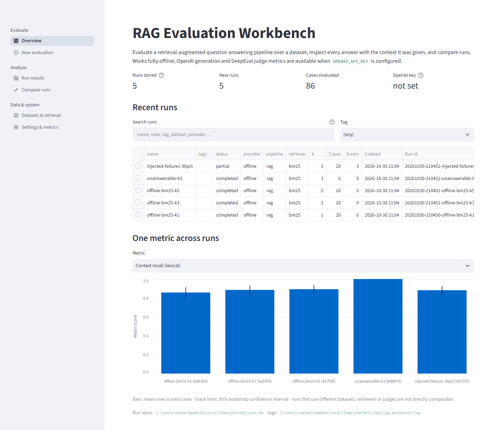
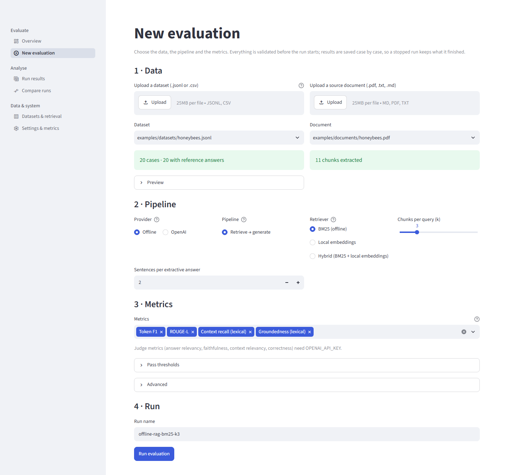
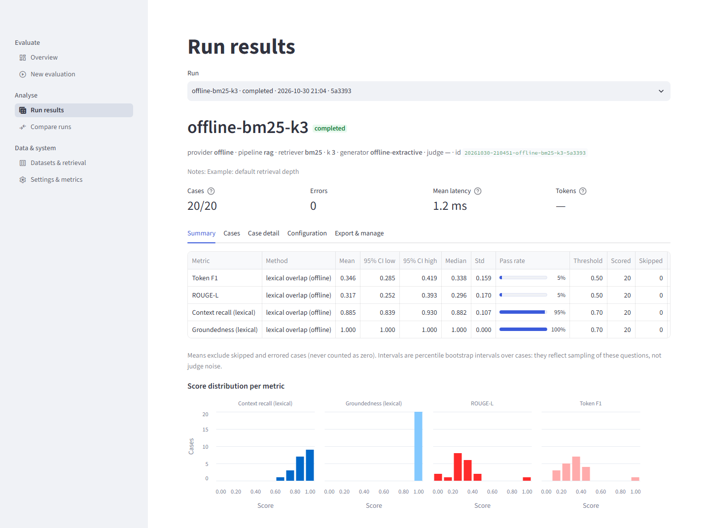
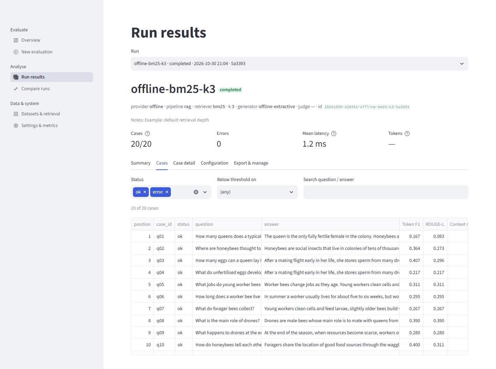
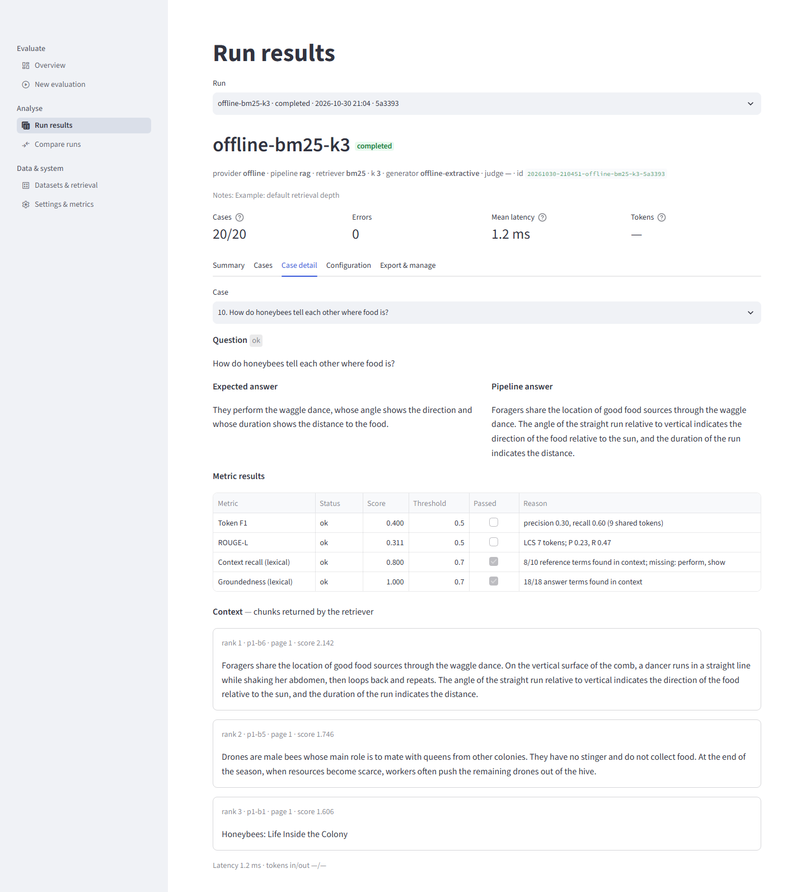
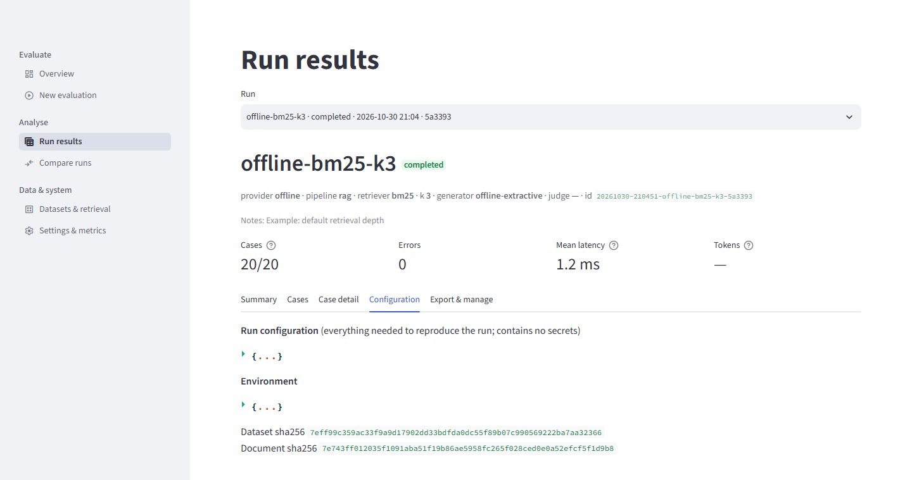
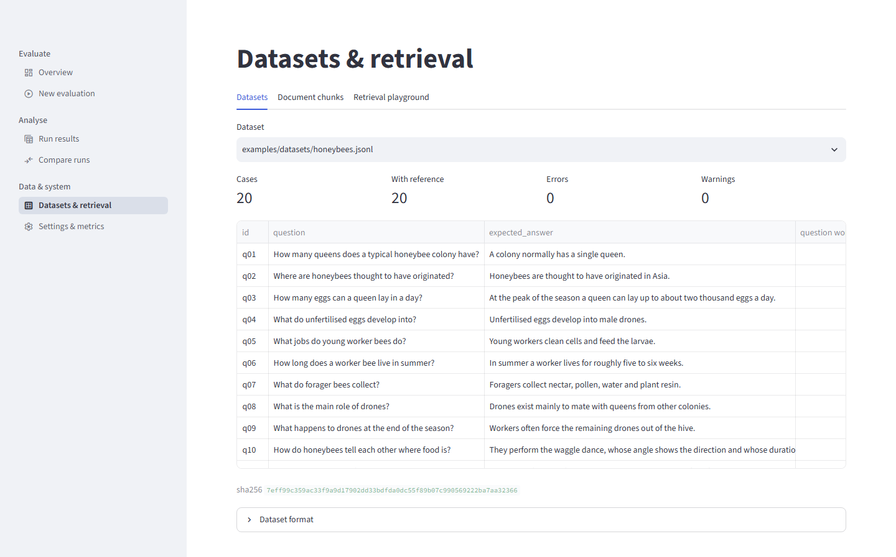
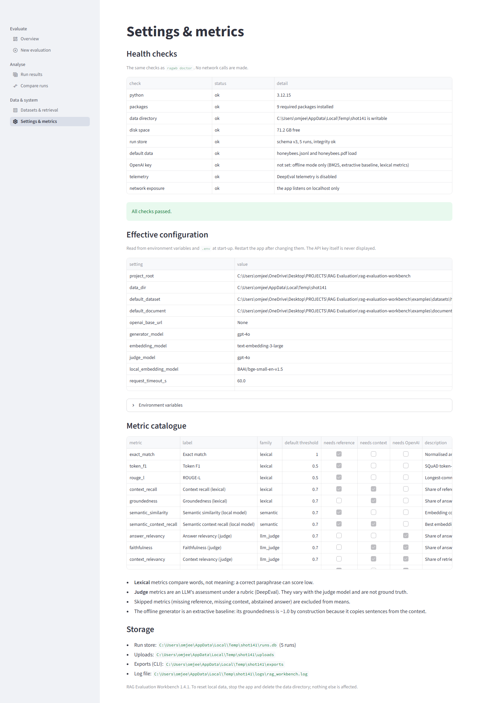
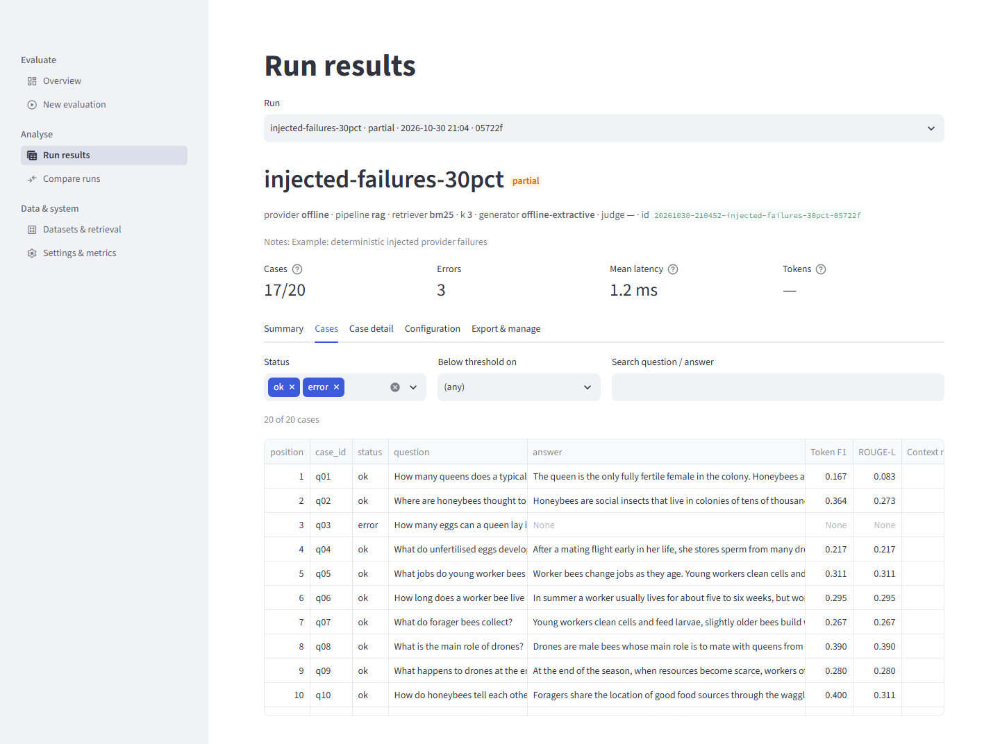
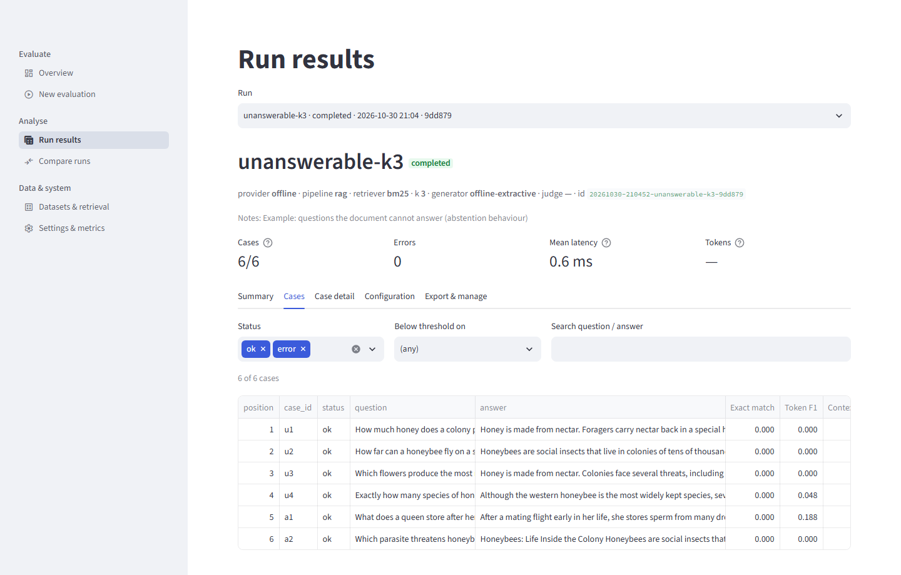

# RAG Evaluation Workbench — The Practitioner's Guide

**How to get the best results from the workbench: what to prepare, what to choose, how to read what comes back, and playbooks for real use cases**

| | |
|---|---|
| Product | RAG Evaluation Workbench (`rag_workbench`, command-line tool `ragwb`, launcher `start.py`) |
| Product version | 1.4.1 |
| Guide edition | 1.0, written against the source tree as of 2026-10-31 |
| Prepared for | TheOneAboveALL |
| Companion book | *The Project Book* (engineering, file-by-file reference, methodology and the full test and verification record) |
| Source of truth | the product's own help output and documents: where this guide and the code disagree, the code is right |

## What this guide is, and what it is not

The Project Book explains how the workbench is **built**. This guide explains how to **use** it well. It is organised around the
questions a practitioner actually has: *What should I put in? What should I choose? What do these numbers mean? Is this change an
improvement? How do I keep it running for a team?* Every procedure was written against the real command-line help and, wherever it could
be run without a network or an API key, was run, and the output you see is real output. Anything illustrative is labelled as such.

It is not a theory text. When a metric's formula or the statistics behind a comparison matter, this guide explains them in plain words
and points to the Project Book (for example "Project Book Part VI") for the derivation.

## Reading paths

| If you are... | Read first | Then |
|---|---|---|
| **New to the project**, want results today | Part I (the 15-minute tour), Part IV §4.1 | Part V, Part III |
| **A student or teacher** running labs offline | Part I, Part II, Part VII §7.5 (teaching) | Part V, Part IX (cards) |
| **An engineer changing a RAG pipeline** and needing to know whether it got better | Part III, Part VI §6.1-6.2 (tuning, regression gate) | Part V, Part VII §7.3 (scheduling) |
| **Evaluating with a model provider** (OpenAI-compatible, free tier or paid) | Part III §3.6-3.7, Part IV (live runs) | Part VI §6.4 (judge validation), Part VII §7.4 (cost and quota) |
| **Responsible for a shared deployment** | Part VII §7.1-7.2, Part VIII | Part IX (checklists) |
| **In trouble right now** | Part VIII (symptom-first) | Part IX (command cards) |

## Conventions

* `ragwb ...` means the command-line tool. From the project folder it can be run as `uv run ragwb ...` or, with the project's virtual
  environment, as `python -m rag_workbench ...`; both are the same program.
* A block starting with `>` and a bold label is a call-out: **Pitfall** (a mistake people make), **Why this works** (the reason behind a
  recommendation), **Honest limit** (something the workbench cannot tell you).
* Commands are written for a Unix-style shell. On Windows PowerShell, replace line continuations (`\`) with a backtick and quote paths
  with spaces.
* "Run" means one evaluation (one dataset against one document with one configuration); "case" means one question within a run.

## What was and was not verified

So that you can calibrate how much to trust the advice:

* **Run and observed in this project:** everything offline (BM25 retrieval, the extractive baseline, the lexical and local-embedding
  metrics, storage, export and import, comparison, regression gating, calibration tooling, accounts, backup and restore), and, against one
  OpenAI-compatible provider (Groq's free tier), answer generation, the tool-calling agent pipeline, and the four judge metrics, on small
  samples (the project's `docs/LIVE_VERIFICATION.md` is the record, including what failed).
* **Not run:** anything against OpenAI itself; API embeddings (that provider has none); a human calibration of any judge metric (a
  30-case sheet is waiting for a person; the only labels that exist were written by an AI model and are labelled as such); the container
  image; a screen-reader pass. Where advice in this guide depends on one of these, it says so.
* **Numbers from live runs** in this guide come only from that record and describe one provider, a few models and small samples. They
  illustrate behaviour; they are not benchmarks of any provider.

## Map of the book

| Part | Title | You will learn |
|---|---|---|
| I | Orientation | what the workbench measures, the mental model, installing, a guided tour of the app and the CLI |
| II | Preparing documents and datasets | chunking, file formats, writing good questions and reference answers, building a dataset from scratch |
| III | Choosing a configuration | provider, pipeline, retriever, depth, metrics, thresholds, cost and quota, recommended starting points |
| IV | Running evaluations | the New evaluation page and `ragwb run` in depth, storage, reruns, failures, organising and exchanging runs |
| V | Reading results | summaries, intervals, skipped and errored scores, comparisons, slices, judge noise, calibration, common misreadings |
| VI | Playbooks for improving quality | tuning retrieval, gating changes, unanswerable questions, validating a judge, diagnosing failures |
| VII | Playbooks for teams and operations | accounts, backup and restore, scheduling, cost control, teaching, multiple corpora, wheel and container, the Python API |
| VIII | Troubleshooting and FAQ | symptom-first fixes and answers to the questions people ask most |
| IX | Reference cards | every command, variable and metric; formats; glossary; checklists; a worked end-to-end example |


# Part I — Orientation

This guide is about using the RAG Evaluation Workbench well. It is not about how the workbench is built: the Project Book (`docs/project-book/`) covers that. Here the question is always the same: *you have a document, a set of questions, and a way of answering them. How do you find out, honestly, whether the answers are any good, and whether a change you made made them better?*

This first Part gives you the picture you need before anything else: what the tool is, what it measures, what it cannot measure, how to start it, and two short guided tours (one in the web app, one on the command line) so that you have seen every important screen and command once. Part II then covers how to prepare documents and datasets. Parts III to V cover choosing a configuration, running evaluations and reading results.

Every command in this Part was run against version 1.4.1, offline, in a scratch data directory. The output you see in the fenced blocks is real output, shortened where noted (long paths and run ids are abbreviated). Your run ids and timestamps will differ; your scores will not, because the offline path is deterministic.

---

## 1.1 What the workbench is, and what it is not

### 1.1.1 What it is

The workbench evaluates a **retrieval-augmented question-answering (RAG) pipeline** over a **dataset of questions**. You give it:

* one source document (PDF, TXT or Markdown);
* a dataset of questions, usually with a reference answer for each (JSONL or CSV);
* a pipeline configuration: how many chunks to retrieve, which retriever, which answer generator;
* a choice of metrics.

It runs every question through the pipeline, scores every answer, stores the whole run in a local SQLite database, and lets you inspect, slice, compare and export the results, from a Streamlit web app or the `ragwb` command line.

Four properties make it more than a script that prints a number:

1. **It shows its evidence.** For every question you can see the answer next to the exact chunks that were retrieved, and the reason behind each score ("8/10 reference terms found in context; missing: perform, show").
2. **It keeps history.** Each run stores its configuration, the SHA-256 hashes of the dataset and the document, package versions, per-case latency and any errors. You can reproduce a run or explain, months later, why two runs differ.
3. **It compares runs with paired statistics.** The same question in run A and run B is compared case by case, and the interval on the difference tells you whether the change is distinguishable from noise.
4. **It runs offline.** With no API key and no network, the whole workflow works on a laptop: BM25 retrieval, an extractive answer baseline and lexical metrics. The same workflow can then be pointed at a live model provider.

### 1.1.2 What it is not

| It is not... | What that means for you |
|---|---|
| A language model or a chat product | The offline "generator" copies sentences out of the retrieved text. It is a baseline for measuring, not an assistant. |
| A multi-document search engine | One run evaluates one document. To evaluate a corpus of ten documents, you make ten runs (or merge them into one document yourself). |
| A ground-truth oracle | Lexical metrics measure word overlap. Judge metrics are an LLM's opinion. Neither is truth; both are evidence. |
| A benchmark leaderboard | Scores are only comparable between runs that share a dataset and a document. A 0.35 on honeybees and a 0.20 on volcanoes say nothing about which pipeline is better. |
| A production monitor | It is a local tool: one machine, one SQLite file, localhost by default. It can be shared on a network with a login (Part VII), but it is not a hosted service. |
| A calibrated measuring instrument | Default pass thresholds (0.5, 0.7, 1.0) are conventions. They have not been calibrated against human judgements (§1.11). |

> **Why this works.** Being clear about what the tool is not saves you the most common mistake: reading a single score as a verdict. The workbench is designed to make *differences between runs on the same data* trustworthy. It is much weaker at saying whether any one run is "good" in an absolute sense.

---

## 1.2 The mental model

Everything in the workbench follows one pipeline. Learn it once and every screen, option and metric has a place in it.

```text
 document ──► chunks ──► retriever ──► generator ──► metrics ──► stored run ──► comparison
 (PDF/TXT/MD)  (blocks)   (top-k      (answer)      (scores,    (SQLite,       (paired,
                          chunks)                    reasons)    hashes)        with CIs)
     ▲                         ▲                          ▲
     │                         │                          │
  dataset: question + reference answer + metadata ────────┘
```

### 1.2.1 The stages

| Stage | What happens | Your controls | What typically goes wrong |
|---|---|---|---|
| **Document → chunks** | The file is split into blocks: one per paragraph (text, Markdown) or per text block (PDF). Blocks longer than 2,000 characters are split on sentence boundaries. Headings become chunks of their own unless you drop them. | document choice, `--skip-headings` | Scanned PDFs yield no text; tables become run-on text; headings occupy retrieval slots (Part II §2.2). |
| **Chunks → retriever** | For each question the retriever ranks chunks and returns the top *k*. Offline this is BM25, a classic keyword ranker with light stemming. Live options add embeddings. | `--retriever`, `-k` | The right chunk is not in the top *k*; the keyword ranker misses synonyms ("parasite" is not "parasitic"). |
| **Retriever → generator** | The generator writes an answer from the question and the retrieved chunks. Offline it picks the best-matching sentences (an extractive baseline). Live it is a language model, or a tool-calling agent. | `--provider`, `--pipeline`, `--model`, `--answer-sentences`, `--min-evidence` | The model ignores the context, invents details, or fails to say "I cannot answer". |
| **Generator → metrics** | Each answer is scored against the reference (token F1, ROUGE-L, exact match), against the retrieved context (context recall, groundedness) or by a judge model. | `--metrics`, `--threshold` | A correct paraphrase scores low on word overlap; a fluent wrong answer reuses the reference's words and scores high. |
| **Metrics → stored run** | Scores, reasons, answers, contexts, configuration and hashes are saved case by case. | `--name`, `--notes`, tags | Forgetting to name or annotate runs so that you cannot tell them apart next week. |
| **Stored run → comparison** | Two runs are paired by question and the difference is summarised with a bootstrap interval. | `ragwb compare`, Compare page, `ragwb regress` | Comparing runs that differ in more than one thing, or on different datasets. |

### 1.2.2 The two diagnostic questions

When an answer is bad, there are only two places it can have gone wrong, and the workbench is built to tell them apart:

1. **Did retrieval fail?** Was the information needed to answer in the chunks that were retrieved? This is what **context recall** looks at (how many of the reference answer's content words appear in the retrieved context) and what the Case detail view lets you see with your own eyes.
2. **Did generation fail?** Given what was retrieved, did the generator produce a correct, faithful answer? **Groundedness** (are the answer's words in the context?), the judge metrics and the answer-vs-reference metrics look at this.

Most improvement work is: find the stage that fails most, change one thing there, run again, compare. Part V §5.4 and Part VI make this concrete.

> **Pitfall.** Do not read a low answer score as a retrieval problem, or a high context recall as proof that retrieval is fine. If context recall is high and token F1 is low, the answer text is the problem (or the reference answer is phrased very differently). If context recall is low, no generator can recover. Look at both columns before deciding what to change.

---

## 1.3 Who should use it, and for what

### 1.3.1 Five use cases

**Research.** You want to study how retrieval depth, chunking or retriever choice affects answer quality. The workbench gives you controlled, reproducible runs: same dataset hash, same document hash, one setting changed, paired comparison with intervals. The offline path is deterministic, so a reviewer can re-run your study and get the same numbers.

**Regression-testing a RAG change.** You changed a prompt, a model, a chunk size or a retriever and want to know whether it made things worse. Keep a baseline run, make the candidate run from the same dataset, and compare. `ragwb regress` turns the comparison into an exit code (0 = fine, 3 = a significant regression, 4 = not enough paired data to judge) that a scheduler or CI job can act on (Part VII).

**Teaching.** The offline mode costs nothing, needs no account, and every score has a visible reason. Students can see, for example, that a correct paraphrase scores low on token F1, or that a title chunk steals a retrieval slot. The bundled honeybee, volcano, coffee and lighthouse documents are short enough to read in two minutes.

**Choosing between configurations.** BM25 or embeddings? k = 3 or k = 5? Two models? Run each on the same dataset and use the Compare page. The tool gives you the means, the intervals and the per-question wins, ties and losses, so you can say "B is better on 9 of 20 questions and never worse" rather than "B scored 0.02 higher".

**Auditing answer quality.** You have an existing question set (support tickets, FAQs) and want to know where the pipeline fails: which question types, which topics, which difficulty. Put metadata on the questions (`type`, `difficulty`, `topic`) and use `ragwb slices` or the Results page's metadata breakdown (Part II §2.8).

### 1.3.2 When the workbench is the wrong tool

* You need to evaluate **many documents at once** with per-question document routing. The tool takes one document per run.
* You need **human-quality ground truth** on open-ended answers (summaries, long explanations). Reference-based metrics work best on short factual answers; for long ones you need a judge or humans, and the workbench has no human-rating workflow beyond a labelling sheet (§1.11).
* You need **live production monitoring** with user traffic. This is an offline evaluation harness.
* You need **multi-turn conversation** evaluation. Each case is one independent question.

---

## 1.4 What "a good evaluation" means

A score is only as good as the evaluation behind it. A good evaluation has four ingredients, and the rest of this guide is mostly about getting each of them right.

### 1.4.1 Questions

The questions should look like the questions real users will ask: the same vocabulary, the same mix of easy and hard, the same share of things the document cannot answer. A set of twenty questions that all copy the document's own wording will make any keyword retriever look excellent. Part II §2.5 covers coverage, difficulty mix, paraphrase style and unanswerable questions.

### 1.4.2 References

A reference answer is what you compare against. It must be **correct** (checkable in the document), **short**, **complete** (it includes every fact the question asks for) and **paraphrased** rather than copied. Part II §2.6 shows, with real numbers, how copying a sentence from the document into the reference nearly doubles token F1 for exactly the same pipeline (0.265 versus 0.603), which means a score can reflect the author's habit rather than the pipeline's quality.

### 1.4.3 Metrics

Different metrics answer different questions. Do not pick them by habit; pick them by what you need to know.

| Metric | Family | Question it answers | Needs | Weakness |
|---|---|---|---|---|
| `exact_match` | lexical | Is the answer identical to the reference after normalisation? | reference | Almost always 0 for free text. Useful only for single-token answers (numbers, names). |
| `token_f1` | lexical | How many words does the answer share with the reference (precision and recall)? | reference | Penalises correct paraphrases and long answers; rewards quoting. |
| `rouge_l` | lexical | How long is the longest common word subsequence? | reference | Same weaknesses; sensitive to word order. |
| `context_recall` | lexical | Do the retrieved chunks contain the words the reference needs? | reference + context | A retrieval metric: says nothing about the answer. Skipped when the reference is an abstention. |
| `groundedness` | lexical | Are the answer's content words present in the retrieved chunks? | context | Is 1.0 by construction for the offline extractive generator. Skipped for abstained answers. |
| `semantic_similarity`, `semantic_context_recall` | semantic (optional) | How close in meaning (embedding cosine)? | reference, `fastembed` | With the default local model, scores sit near 0.5 even for unrelated text, so default thresholds are not meaningful until calibrated. |
| `answer_relevancy`, `faithfulness`, `context_relevancy`, `correctness` | LLM judge (DeepEval) | Is the answer on-topic, supported by the context, is the context relevant, is it factually in line with the reference? | a provider key; some need reference or context | The judge is a model with opinions; scores vary with the judge model and with sampling. |

The exact definitions, with worked examples, are in Project Book Part VI. The point to take away here is that **lexical metrics are cheap, deterministic and shallow; judge metrics are expensive, noisy and deeper.** Part III §3.4 helps you choose.

### 1.4.4 Uncertainty

A mean without an interval is a rumour. Every mean the workbench shows comes with a **95% percentile bootstrap confidence interval** over the questions: resample the questions many times, recompute the mean, and take the middle 95% of the results. It answers: *"if I had asked a different but similar set of questions, how much would this mean move?"*

Two consequences that you should keep in mind from the start:

* With 20 or 30 questions the intervals are wide. In the honeybee baseline below, token F1 is 0.346 with an interval of 0.285 to 0.419.
* The interval covers the **sampling of questions only**. It does not include judge noise, the choice of reference answers, or the choice of document.

> **Why this works.** The workbench's honesty about uncertainty is deliberate. When the Compare page says "inconclusive", that is information: it means your dataset is too small, or the two configurations are too alike, to tell them apart. The correct response is more or better questions (Part II §2.9), not a looser reading.

---

## 1.5 The two modes

### 1.5.1 Offline baseline

`--provider offline` (the default). No network, no key, no cost; deterministic.

* **Retrieval:** BM25 over the chunks (`--retriever bm25`).
* **Generation:** an extractive baseline. It scores every sentence in the retrieved chunks by how many rare question words it shares, and returns the best one or two (`--answer-sentences`, default 2) in document order. If no sentence shares any content word with the question it abstains with the sentence "The PDF does not provide enough information to answer the question." (The sentence says "PDF" even for Markdown and text sources.)
* **Optional abstention:** `--min-evidence` (0 to 1) makes the baseline abstain unless its selected sentences cover that share of the question's terms.
* **Metrics:** the five lexical metrics, plus the two semantic ones if `fastembed` is installed.
* **Local embeddings:** with `uv sync --extra semantic`, `--retriever local` or `hybrid-local` adds a local embedding model (default `BAAI/bge-small-en-v1.5`, downloaded once, then fully local). This is still "offline" in the sense that no provider is contacted at run time.

**What offline can tell you.**

* Whether retrieval brings the needed words into context (context recall).
* Whether a change to chunking, *k* or the retriever moves things, with paired statistics.
* Whether your dataset is well-formed, whether your pipeline plumbing works and whether your regression gate triggers.
* How a baseline behaves on unanswerable questions (it almost never abstains by default; §1.11).

**What offline cannot tell you.**

* How a language model will answer. The extractive baseline can only quote. A real model paraphrases, summarises and sometimes invents.
* Anything about answer quality in the sense of meaning. Token F1 on the bundled honeybee set is about 0.35 for a baseline that quotes the right sentence, because the references are paraphrases.
* Whether groundedness is good. It is 1.0 by construction for this generator.

### 1.5.2 Live provider

`--provider openai` (and optionally `--pipeline agent`). It uses an OpenAI-style chat API to generate answers and, if you select the judge metrics, DeepEval judge models to score them. It needs `OPENAI_API_KEY` in the environment or in a `.env` file (copy `.env.example` to `.env` and fill it in; the app never displays the value). **Runs make paid API calls**, and the UI says so before it starts.

**OpenAI-compatible endpoints.** The same settings accept any provider that speaks the OpenAI API. You put that provider's key in `OPENAI_API_KEY`, set `OPENAI_BASE_URL` to its endpoint, and set `RAGWB_GENERATOR_MODEL` and `RAGWB_JUDGE_MODEL` to that provider's model names. For retrieval, use `--retriever bm25` (or `local` / `hybrid-local`) unless the provider offers an embeddings endpoint.

**What live verification actually covers.** Be precise about this, because it shapes how much you can lean on the live path (`docs/LIVE_VERIFICATION.md`, `docs/KNOWN_LIMITATIONS.md`):

| Claim | Status |
|---|---|
| Answer generation and the four DeepEval judge metrics work through an OpenAI-compatible endpoint | Verified against Groq's free tier (`openai/gpt-oss-20b`, `openai/gpt-oss-120b`, `qwen/qwen3.8-27b`) on small samples |
| It works against OpenAI itself | **Not verified.** No run was made against OpenAI. |
| API embeddings (`embedding`, `hybrid`) | **Not verified live** (the test provider offered none) |
| Tool-calling agent pipeline | Run live on 3 honeybee questions (3/3 answered) |
| Other compatible providers (xAI Grok, etc.) | Supported by configuration only; nothing was sent |
| Judge scores agree with human judgement | **Never measured.** They were compared with labels written by an AI rater (Claude), one rater, 30 cases. |

A taste of why the live path matters: on the 30 volcano questions with `qwen/qwen3.8-27b` generating, token F1 was 0.489 (interval 0.381 to 0.600, run 7 in the live record). The offline extractive baseline on the same dataset scores 0.199 (we reproduce that below). A language model that writes a concise paraphrase simply matches short references better than a baseline that quotes two sentences. Neither number is "the truth" about quality; the difference tells you how much of the offline number is the baseline's style.

### 1.5.3 Choosing a mode

| If you want to... | Use | Because |
|---|---|---|
| Learn the tool, teach, or try ideas for free | offline | deterministic, instant, no key |
| Test chunking, *k* or retriever changes | offline first | retrieval effects show up in context recall without paying for generation |
| Gate a pipeline change in CI without cost | offline | no network, a stable exit code |
| Measure how a particular model answers | live | only a real model produces real answers |
| Measure faithfulness or correctness in meaning | live, judge metrics | lexical metrics cannot see meaning |
| Do both | offline for retrieval, live for generation | change one thing at a time (Part III) |

> **Pitfall.** Do not use offline scores as a proxy for how a live model will behave. They are a lower bound on lexical overlap and a reliable instrument for *retrieval* comparisons. For generation quality, run live, and keep the sample small and the provider's quota in mind (Part IV §4.6).

---

## 1.6 Installing and starting

### 1.6.1 Requirements

* Python 3.12 or newer (`.python-version` pins 3.12).
* [uv](https://docs.astral.sh/uv/) is recommended. Without it, `start.py` creates a `.venv` and installs with pip.
* Optional: an API key for a provider, only if you want live runs.

### 1.6.2 The one-command start

```bash
python start.py
```

On first launch this:

1. prepares the environment (`uv sync`, or a local `.venv` with pip if uv is absent);
2. runs five offline example evaluations if the run store is empty;
3. starts the web app and opens it at `http://localhost:8501`.

Press Ctrl+C in the terminal to stop it. Nothing is installed outside the project folder.

### 1.6.3 `start.py` options

| Option | Effect |
|---|---|
| `--port 8600` | preferred port (default 8501); if it is busy the script picks a free one |
| `--no-browser` | do not open a browser window |
| `--no-examples` | skip the first-launch example runs |
| `--setup-only` | prepare the environment and examples, then exit |
| `--host 0.0.0.0` | listen on the network; **refuses to start unless a login exists** (`RAGWB_APP_PASSWORD` or named accounts) |
| `--ssl-cert`, `--ssl-key` | serve HTTPS from a PEM certificate and key; without them, credentials cross the network in clear text |

Sharing the app with a team is covered in Part VII §7.2.

### 1.6.4 Manual steps and optional extras

```bash
uv sync                      # runtime and dev dependencies, editable install
uv sync --extra semantic     # adds fastembed: local embedding retrieval and the two semantic metrics
uv run ragwb run --name first-run -k 3
```

The first use of a local embedding model downloads it (about 70 MB for the default) into `<data dir>/models`; after that nothing leaves the machine. On Windows, keep the data directory path short: the model cache nests folders deeply and can exceed the 260-character path limit.

### 1.6.5 Command-line tool only (wheel)

`uv build --wheel` builds a wheel that bundles the example data. Installing it gives you the `ragwb` command; **the web app needs the project folder**. `RAGWB_HOME` sets the folder that holds `data/` and `.env` for a wheel install. The wheel was installed into a clean virtual environment and used from a neutral folder (10 of 10 checks in `scripts/wheel_check.py`).

### 1.6.6 Docker

The repository contains a `Dockerfile`, but **it has never been built or run**: Docker was not available where the project was developed. Treat it as a starting point you must verify yourself.

### 1.6.7 Quick health check

```bash
ragwb doctor
```

checks Python, packages, the data directory and disk, the run store, the default data files, key presence, telemetry and network exposure. It makes no network calls. (In this guide `ragwb` is shorthand for `uv run ragwb`, or for `.venv/Scripts/python.exe -m rag_workbench` on Windows.) In a fresh scratch directory it printed:

```text
[ok  ] python            3.12.15
[ok  ] packages          9 required packages installed
[ok  ] data directory    <data dir> is writable
[ok  ] disk space        71.8 GB free
[ok  ] run store         schema v3, 3 runs, integrity ok
[ok  ] default data      honeybees.jsonl and honeybees.pdf load
[ok  ] OpenAI key        not set: offline mode only (BM25, extractive baseline, lexical metrics)
[ok  ] telemetry         DeepEval telemetry is disabled
[ok  ] network exposure  the app listens on localhost only

9 ok, 0 warning(s), 0 failure(s)
```

The exit code is 1 if any check fails, so `doctor` can run from a scheduler.

---

## 1.7 A 15-minute tour of the web app

The web app has six pages, in a sidebar under three headings: **Evaluate** (Overview, New evaluation), **Analyse** (Run results, Compare runs) and **Data & system** (Datasets & retrieval, Settings & metrics). The screenshots in this section come from the Project Book and were captured on version 1.4.1; run names such as `offline-bm25-k3` are the examples `start.py` creates on first launch.

Start the app with `python start.py`. The tour below takes about fifteen minutes.

### 1.7.1 Minutes 0 to 2: Overview



The Overview is the landing page. Read it top to bottom:

* **Four headline numbers**: runs stored, new runs (not imported), cases evaluated, and whether an OpenAI key is configured ("not set" until you configure one).
* **Recent runs**: a table of every run, newest first, with a *Search runs* box (every word must appear in a run's name, notes, tags, id, status, provider, retriever or file names) and a *Tag* filter. Tick a row's checkbox and an **Open run results** link appears.
* **One metric across runs**: a bar chart of one metric (choose it in the selector) for every run, with the 95% interval drawn as a black line. The caption warns that runs on different datasets, retrievers or judges are not directly comparable.

Note the status column. `completed` means every case finished; `partial` means some cases errored; `cancelled` and `interrupted` mean the run stopped early. The screenshot shows one `partial` run, a deliberate example with 3 injected failures out of 20.

**Try this.** Click the row `offline-bm25-k3`, then **Open run results**.

### 1.7.2 Minutes 2 to 5: New evaluation



This page configures and launches one run in four steps. It validates everything before anything runs, and results are saved case by case, so a stopped run keeps what it finished.

1. **Data.** Upload a dataset (`.jsonl` or `.csv`) and a document (`.pdf`, `.txt`, `.md`), or pick one of the bundled ones. The page validates immediately: a green box reads "20 cases · 20 with reference answers" and "11 chunks extracted"; a red box lists up to ten line-numbered errors. The **Preview** expander shows the first 20 parsed cases.
2. **Pipeline.** Provider (Offline or OpenAI), pipeline (Retrieve → generate, or Tool-calling agent when OpenAI is chosen), retriever, **k** (chunks per query) and, offline, the number of sentences per extractive answer. Retriever options appear only when they are usable: API embeddings need a key; local embeddings need the `semantic` extra.
3. **Metrics.** A multiselect (default: Token F1, ROUGE-L, Context recall, Groundedness), a **Pass thresholds** expander and an **Advanced** expander (parallel cases, evaluate only the first N, seed, inject failures, notes).
4. **Run.** A run name (prefilled, e.g. `offline-rag-bm25-k3`) and the **Run evaluation** button. The button is disabled, with a list of problems, if the dataset or document is invalid, no metric is chosen, OpenAI is selected without a key, or the name is empty. If a paid provider or a judge model is involved, a notice tells you how many generation calls will happen first.

**Try this.** Keep the defaults, change *k* to 1, name the run `my-k1`, and click **Run evaluation**. It takes a fraction of a second. A progress bar and the last eight case outcomes appear, then a summary and an **Inspect this run** link.

> **Pitfall.** The upload widget says "25MB per file". That is Streamlit's ceiling. The workbench's own limits are lower for datasets (5 MB by default, `RAGWB_MAX_DATASET_BYTES`) and the error appears only after upload.

### 1.7.3 Minutes 5 to 9: Run results

The Results page has a run selector, a header, four headline tiles (Cases, Errors, Mean latency, Tokens) and five tabs.



**Summary tab.** One row per metric: mean, 95% interval, median, standard deviation, pass rate (against the threshold shown), and the counts *Scored*, *Skipped* and *Errors*. Under the table the caption says what matters: *"Means exclude skipped and errored cases (never counted as zero)."* Below the table are histograms of every metric's scores. Read the shape, not only the mean: in the screenshot groundedness is a single bar at 1.0, context recall is concentrated between 0.6 and 1.0, and token F1 clusters below 0.5 with one outlier near 0.9. If the dataset has metadata, a **Break down by dataset metadata** control appears (described at the end of this section).



**Cases tab.** Every question, answer and per-metric score, with three filters: status, *Below threshold on* (cases where a chosen metric was scored and failed), and a plain-text search. Use it to sort the worst cases to the top.



**Case detail tab.** The most instructive page in the tool. For one question it shows the reference and the pipeline's answer side by side, a metric table with a **Reason** column, and the retrieved chunks with rank, chunk id, page and score. In the screenshot, question 10 ("How do honeybees tell each other where food is?") has token F1 0.400 and context recall 0.800 with the reason "8/10 reference terms found in context; missing: perform, show". Look at rank 3: it is the document's one-line title. A chunk with no information took a retrieval slot. That single observation drives a whole class of fixes (Part II §2.2, Part VI).



**Configuration tab.** The full stored configuration (collapsed JSON trees for configuration and environment) plus the SHA-256 hashes of the dataset and the document. This is how you prove, later, that two runs used the same data.

**Export & manage tab.** Download CSV (one row per case), JSON (a full record that can be re-imported) or a Markdown report; add tags and a note; delete the run (you must type its run id to confirm).


**Metadata breakdown.** When the dataset has metadata, choose a field (here `type`) to get one row per value. In this screenshot, an unanswerable-question run shows `answerable` (2 cases) and `unanswerable` (4 cases); context recall is `None` for the unanswerable slice because it was skipped. Small slices have wide uncertainty.

### 1.7.4 Minutes 9 to 12: Compare runs


Select two or more runs. The page then shows:

1. **Configuration**: a table with one column per run. Rows that differ are highlighted in amber. If more than one row is highlighted, you changed more than one thing, and you cannot attribute the difference to either (Part IV §4.3).
2. **Metric means**: a grouped bar chart with 95% intervals. Overlapping intervals mean the difference may be sampling noise.
3. **Best run per metric**: the highest mean per metric. Ties are listed, never broken arbitrarily. It ignores intervals, so do not stop here.
4. **Paired comparison**: choose a baseline (A) and a candidate (B). The table gives, for each metric, the paired mean difference with its interval, and how many questions B won, tied or lost, ending in a verdict: "B better", "B worse" or "inconclusive". It says "better" or "worse" only if the 95% interval of the paired difference excludes zero.
5. **Per-case differences**: a table sorted so the biggest regressions come first. This is how you find out *why* a mean moved.

In the screenshot, comparing k = 1 with k = 3: token F1 is 0.404 → 0.346 ("B worse", 3 better / 10 ties / 7 worse). The worst row is "How does a honeybee colony reproduce?" (0.629 → 0.273): with three chunks retrieved, the title chunk and an unrelated sentence displaced the right answer.

### 1.7.5 Minutes 12 to 14: Datasets and retrieval



Three tabs:

* **Datasets**: counts of cases, cases with a reference, errors and warnings; every case in a table; the dataset's SHA-256; a "Dataset format" help expander.
* **Document chunks**: how the document was split, with chunk ids, pages, character counts and text. **Check this before you evaluate.** If the chunks look wrong, every number downstream is wrong.
* **Retrieval playground**: type any query, choose *k*, and see which chunks BM25 returns with their scores. Use it to debug why a question retrieves the wrong chunk, at no cost (the playground never calls a paid embedding API).

### 1.7.6 Minutes 14 to 15: Settings and health



The page begins with **Health checks** (the same nine checks as `ragwb doctor`), then the **Effective configuration** (every setting except the key itself; read at start-up, so restart the app after changing an environment variable), a **Metric catalogue** (name, label, family, default threshold, and what each metric needs), four reminder notes (lexical metrics compare words, judge metrics are opinions, skipped metrics are excluded, the offline generator's groundedness is about 1.0 by construction) and **Storage** paths. The page changes nothing: all configuration is through environment variables or `.env`.

### 1.7.7 What you have now seen

You have seen where data goes in (New evaluation, Datasets), where evidence comes out (Run results), how to compare (Compare) and how to check the system (Settings). The rest of the guide teaches you to do each of these deliberately.

---

## 1.8 A 10-minute tour of the CLI

Everything in the web app that matters for evaluation is also a command. The CLI is the better tool for scripts, CI and repeatable experiments. The commands below were run exactly as shown (with the abbreviations noted) in a clean scratch data directory.

### 1.8.1 Minute 0: version and help

```bash
ragwb --version
ragwb --help
```

```text
ragwb 1.4.1
```

`ragwb --help` lists 24 commands. This tour uses eight of them: `run`, `list`, `show`, `compare`, `export`, `slices`, `doctor` and `backup`. Others (`validate`, `tag`, `note`, `regress`, `rerun`, `import`, `delete`, `prune`, `restore`, `user`, `metrics`, `score`, `tune-abstention`, `calibrate`, `labels-template`, `judge-noise`) appear in later Parts. Each has `--help`.

### 1.8.2 Minutes 1 to 3: `run`

```bash
ragwb run --name tour-baseline -k 3
```

With no `--dataset` or `--document`, `run` uses the bundled honeybee set (`examples/datasets/honeybees.jsonl`, `examples/documents/honeybees.pdf`).

```text
[  1/20] ok  q01
[  2/20] ok  q02
...
[ 20/20] ok  q20

Run 20261030-204923-tour-baseline-1e4b21: completed
cases 20  ok 20  errors 0  mean latency 1.0 ms
metric                          mean           95% CI    pass  scored  skip  err
Token F1                       0.346      0.285-0.419      5%      20     0    0
ROUGE-L                        0.317      0.252-0.393      5%      20     0    0
Context recall (lexical)       0.885      0.839-0.930     95%      20     0    0
Groundedness (lexical)         1.000      1.000-1.000    100%      20     0    0
```

Read it like this:

* **Token F1 0.346, pass rate 5%.** Only 1 of 20 answers reaches the 0.5 threshold. This baseline quotes whole sentences while the references are short paraphrases, so precision is low.
* **Context recall 0.885, 95% pass.** In most cases the retrieved chunks contain nearly all the content words of the reference. Retrieval is largely doing its job.
* **Groundedness 1.000.** The answers are copied from the context, so every answer word is in it. This is not evidence of quality.
* **scored 20, skip 0, err 0.** The three counts are the honesty columns (§1.10). They must add up to the number of cases.

`--quiet` suppresses the per-case lines. Now a second run that changes the retrieval depth and drops headings, to have something to compare:

```bash
ragwb run --name tour-k1-skip -k 1 --skip-headings --quiet
```

```text
Run 20261030-204935-tour-k1-skip-1cfdd2: completed
cases 20  ok 20  errors 0  mean latency 0.9 ms
metric                          mean           95% CI    pass  scored  skip  err
Token F1                       0.407      0.340-0.478     20%      20     0    0
ROUGE-L                        0.376      0.305-0.451     20%      20     0    0
Context recall (lexical)       0.870      0.823-0.916     95%      20     0    0
Groundedness (lexical)         1.000      1.000-1.000    100%      20     0    0
```

> **Pitfall.** This pair of runs changes *two* things (k and `--skip-headings`). It is fine for a tour, but in a real comparison you could not say which change produced the difference. Change one setting per run (Part IV §4.3).

### 1.8.3 Minute 3: `list`

```bash
ragwb list
```

```text
                          run_id          name    status provider pipeline retriever  k  n_cases  n_errors tags
 20261030-204935-tour-k1-skip-1cfdd2  tour-k1-skip completed  offline      rag      bm25  1       20         0
20261030-204923-tour-baseline-1e4b21 tour-baseline completed  offline      rag      bm25  3       20         0
```

Newest first. `ragwb list --search honeybee`, `--tag baseline` and `--status running` filter the list. Every other command takes a run reference: the full id, a unique prefix of it, its last 6 characters, or the exact run name (at least 4 characters, and it must match exactly one run). The id has the form `<UTC timestamp>-<name>-<6 hex>`. Later commands in this guide use names such as `tour-baseline` to keep the lines short; in scripts, prefer full ids (Part VI §6.1.2).

### 1.8.4 Minute 4: `show`

```bash
ragwb show 20261030-204923-tour-baseline-1e4b21
```

```text
tour-baseline [20261030-204923-tour-baseline-1e4b21] status=completed created=2026-10-30 20:49:23
  provider: offline
  pipeline: rag
  retriever: bm25
  k: 3
  generator_model: offline-extractive
  judge_model: None
  dataset_path: <project>\examples\datasets\honeybees.jsonl
  document_path: <project>\examples\documents\honeybees.pdf
cases 20  ok 20  errors 0  mean latency 1.0 ms
metric                          mean           95% CI    pass  scored  skip  err
...
```

`show` is the header and summary only. For per-case detail use the web app's Cases and Case detail tabs, or `export`.

If the run has tags or a note, `show` prints them as two more header lines (they are absent above because this run has neither). After `ragwb tag tour-baseline --add baseline,keep` and `ragwb note tour-baseline "Reference run"`, the header ends with:

```text
  document_path: <project>\examples\documents\honeybees.pdf
  tags: baseline, keep
  notes: Reference run
```

### 1.8.5 Minutes 5 to 6: `compare`

```bash
ragwb compare 20261030-204923-tour-baseline-1e4b21 20261030-204935-tour-k1-skip-1cfdd2
```

```text
A = tour-baseline [...]
B = tour-k1-skip [...]

                   label  paired_cases  mean_a  mean_b  diff_b_minus_a  ci_low  ci_high  b_better  ties  b_worse  ci_excludes_zero
                Token F1            20   0.346   0.407           0.060   0.012    0.117         7    10        3              True
                 ROUGE-L            20   0.317   0.376           0.058   0.013    0.111         8    10        2              True
Context recall (lexical)            20   0.885   0.870          -0.015  -0.040    0.000         0    18        2             False
  Groundedness (lexical)            20   1.000   1.000           0.000   0.000    0.000         0    20        0             False
```

B is always compared against A: `diff_b_minus_a` positive means B is higher. Token F1 improved by 0.060 and the interval (0.012 to 0.117) excludes zero, so the improvement is distinguishable from noise: B was better on 7 questions, tied on 10 and worse on 3. Context recall dropped by 0.015, but its interval (-0.040 to 0.000) touches zero, so the tool will not call it a loss (`ci_excludes_zero` is False). Groundedness is identical.

Cases are paired by normalised question text. If the two runs used different datasets, only shared questions are compared; always check the `paired_cases` column.

### 1.8.6 Minutes 6 to 7: `export`

```bash
ragwb export 20261030-204923-tour-baseline-1e4b21 --format md --out-dir ./out
ragwb export 20261030-204923-tour-baseline-1e4b21 --format csv --out-dir ./out
ragwb export 20261030-204923-tour-baseline-1e4b21 --format json --out-dir ./out
```

Three formats: `md` (a human-readable report), `csv` (one row per case, with answers, contexts' chunk ids and one set of columns per metric) and `json` (the full record, re-importable with `ragwb import`). Without `--out-dir`, files go to `<data dir>/exports`. The Markdown report begins:

```text
  # Evaluation report: tour-baseline

* Run id: `20261030-204923-tour-baseline-1e4b21`
* Status: **completed**
* Provider / pipeline / retriever: offline / rag / bm25
* k: 3  ·  generator: offline-extractive  ·  judge: None
* Dataset: `honeybees.jsonl` (sha256 `7eff99c359ac`)
* Document: `honeybees.pdf` (sha256 `7e743ff01203`)
```

followed by the summary table (with medians and thresholds) and a "Lowest ..." table for each metric. For example the five lowest token F1 cases were q14 (0.151, "Why do bees build hexagonal cells?"), q01 (0.167), q12 (0.186), q04 (0.217) and q07 (0.267), each with a reason such as "precision 0.10, recall 0.36 (4 shared tokens)". The CSV has columns such as `case_id`, `status`, `question`, `expected_answer`, `answer`, `context_ids`, and for each metric a score, a `_passed` and a `_status` column.

### 1.8.7 Minutes 7 to 8: `slices`

The honeybee dataset has no metadata, so for `slices` use one that has: the 30-question volcano set.

```bash
ragwb run --name volc-k3 --dataset examples/datasets/volcanoes.jsonl --document examples/documents/volcanoes.pdf -k 3 --quiet
ragwb slices <run-id> --by type
```

```text
volc-k3 [20261030-205015-volc-k3-ecd8d0] by type
slice                    cases   ok            Token F1             ROUGE-L  Context recall (le  Groundedness (lexi
factual                     14   14     0.276      (14)     0.249      (14)     0.746      (14)     1.000      (14)
list                         4    4     0.128       (4)     0.128       (4)     0.686       (4)     1.000       (4)
numeric                      2    2     0.064       (2)     0.064       (2)     0.500       (2)     1.000       (2)
unanswerable                 5    5     0.042       (5)     0.042       (5)         -       (0)     1.000       (5)
why                          5    5     0.251       (5)     0.206       (5)     0.463       (5)     1.000       (5)
(n scored in brackets; small slices have wide uncertainty)
```

The number in brackets is how many cases were scored. Note the `unanswerable` row: context recall shows `-` with `(0)`, because the metric is skipped when the reference is an abstention. It is not a zero. The whole run was: Token F1 0.199, context recall 0.660 on 25 scored and 5 skipped cases. Slicing by `difficulty` and `topic` works the same way (`--by difficulty`, `--by topic`).

### 1.8.8 Minute 8: `doctor`

We ran it in §1.6.7. Run it after upgrades, after restoring a backup and before sharing the app.

### 1.8.9 Minutes 9 to 10: `backup`

```bash
ragwb backup
```

```text
Backup written and verified: <data dir>\backups\runs-20261030-205031-626723.db (282,624 bytes)
```

It uses SQLite's online backup, so it is safe while the app is running, and it verifies the copy. It covers the run store only; copy `users.json` separately if you use accounts (Part VII §7.4). Restore is `ragwb restore <backup.db> --yes` (stop the app first).

### 1.8.10 Exit codes you can rely on

| Command | Exit code |
|---|---|
| `ragwb validate` | 0 if the dataset is valid, 1 if invalid |
| `ragwb doctor` | 0 if no check fails, 1 otherwise |
| `ragwb regress` | 0 no regression, 3 significant regression, 4 not enough data to judge |

---

## 1.9 Where your data lives

Everything the workbench writes goes into one **data directory**:

| Location | Contents |
|---|---|
| default: `data/` beside the project | the data directory when nothing else is set |
| `RAGWB_DATA_DIR` | overrides the data directory |
| `RAGWB_HOME` | wheel installs: the folder that holds `data/` and `.env` |

Inside the data directory:

| Item | Purpose |
|---|---|
| `runs.db` | the SQLite run store: every run, case, score and configuration |
| `users.json` | named accounts, if you created any |
| `uploads/` | datasets and documents uploaded in the web app, named `<12 hex of SHA-256>-<name>` |
| `exports/` | default target of `ragwb export` |
| `logs/rag_workbench.log` | rotating log; secrets are redacted |
| `backups/` | output of `ragwb backup` |
| `models/` | the downloaded local embedding model, if used |

In the scratch directory used for this guide, after one run and one backup, the data directory held exactly `runs.db`, `logs/` and `backups/`; the other folders are created when needed.

Three practical rules:

* **To reset, stop the app and delete the data directory.** The next `python start.py` recreates the example runs. Nothing else is affected.
* **Do not keep the data directory in a folder that a sync tool rewrites while the app runs.** The run store is a SQLite file; a sync client rewriting it can corrupt it (Part VIII).
* **The store keeps absolute file paths** for the dataset and document used. Exported bundles do not, so share bundles, not the database.

Never put an API key in a file you share. If you use a `.env` file, it is ignored by git and by Docker builds; do not zip or cloud-sync the project folder while it exists (`docs/SECURITY.md`).

---

## 1.10 The honesty principles of the tool

The workbench makes several commitments about how it treats numbers. They are the reason you can trust a comparison from it more than a hand-made spreadsheet, and they define the traps you should not make by working around them.

### 1.10.1 Skipped and errored scores are excluded and counted, never zero

A metric can produce one of three outcomes for a case: **scored** (a number), **skipped** (it does not apply) or **error** (it failed). Means are computed over scored cases only. The summary always shows `scored`, `skip` and `err`.

Skips happen for good reasons:

* a reference-based metric on a case with no reference answer;
* `context_recall` when the reference is itself an abstention ("The PDF does not provide enough information...");
* `groundedness` when the *answer* is an abstention, since there is no claim to ground.

In the volcano run, context recall shows 25 scored and 5 skipped: those are the five unanswerable questions. Their absence from the mean is correct; counting them as zero would have punished retrieval for a question that has no answer to retrieve.

> **Pitfall.** When two runs have different `scored` counts for a metric, their means are over different sets of questions. The paired comparison handles this by using only cases scored in both. When you read means side by side, check the counts first.

### 1.10.2 The context scored is the context retrieved

The workbench scores the chunks that the retriever actually returned, as recorded, rather than whatever the model says it relied on. For the agent pipeline, the context is what the retrieval tool returned to the agent. A model cannot talk its way into a high faithfulness or context score by describing its sources.

Concretely: when you open a case, the chunks you see in the Case detail view are the chunks every context metric was computed from. If a score surprises you, open the case and read those chunks. The evidence for each score is never more than one click away.

### 1.10.3 Confidence intervals on every mean

Every mean has a 95% bootstrap interval, and every comparison is paired per question with an interval on the paired difference. "Better" and "worse" appear only when that interval excludes zero. There is no correction for comparing many metrics at once: with four metrics, one "significant" difference in twenty comparisons can occur by chance, so look for consistent patterns across metrics and cases rather than for a single star.

### 1.10.4 Reproducibility

Each run stores its configuration, dataset and document hashes, package versions and seed. The offline path is deterministic: the same dataset, document and settings produce the same scores. The intervals are reproducible for a given run because the dataset order and seed are fixed (two runs with identical scores in a different order can differ in the third decimal). `ragwb rerun <run-id>` repeats a stored run from its recorded configuration.

### 1.10.5 What the principles do not give you

They make the *arithmetic* honest. They do not make the *choices* wise. A dataset with leaked answers, a reference copied from the document, or twenty similar questions will produce clean, honest-looking, misleading numbers. Part II is about avoiding that.

---

## 1.11 The limits, and what is and is not verified

Read `docs/KNOWN_LIMITATIONS.md` before you rely on this tool for a decision. The list below is a summary organised by how it affects you.

### 1.11.1 What has been verified

| Area | Evidence |
|---|---|
| The offline workflow end to end (run, store, show, compare, export, slices, backup) | an offline test suite and an end-to-end CLI run; every command in this guide was run for it |
| The CLI as an installed wheel | clean virtual environment, 10/10 checks (`scripts/wheel_check.py`); installs the CLI only |
| Offline throughput | about 100 cases per second on one laptop, flat from 200 to 5,000 cases (5,000 cases in 47 s, 54 MB peak Python memory) |
| Document handling speed | 5,000 chunks index in about 0.3 s and answer a query in about 3 ms; a 200-page PDF (1,600 chunks) loads in 0.2 s (`docs/OPERATIONS.md` §7) |
| OpenAI-compatible generation and the four judge metrics | Groq free tier, small samples |
| A real local embedding model | `BAAI/bge-small-en-v1.5`, five datasets, three retrievers |
| Accessibility | axe-core 4.10.2 on six page views found no violations (one minor third-party issue on New evaluation); keyboard walks of three pages found no trap |

### 1.11.2 What has not been verified

| Area | Status |
|---|---|
| Any run against OpenAI itself | none was made |
| API embeddings (`embedding`, `hybrid`) | not run live |
| Docker | the image was never built or run |
| Judge scores versus **human** labels | never done. A comparison exists against labels written by Claude, an AI rater (one rater, 30 volcano cases; correctness judge agreement 0.967, kappa 0.870; token F1 agreement 0.600, kappa 0.237). That supports "the judge is not obviously unreliable on easy cases" and nothing stronger. The human labelling sheet is unfilled. |
| Screen readers | no screen-reader pass was done; no formal accessibility audit |
| Semantic metric thresholds | the default 0.7 is not meaningful until calibrated: with the default local model, unrelated text scores about 0.5 |
| Multi-user exposure | there has been no third-party security review; it is a local-first tool |

### 1.11.3 Methodological limits that shape your reading

* **Lexical metrics measure word overlap, not meaning.** The offline baseline's token F1 is about 0.35 to 0.40 on the honeybee set even when it quotes the right sentence.
* **The offline generator is a baseline.** By default it never abstains on the bundled unanswerable questions, because every question shares words with the document. In the stored abstention tuning on the four documents, the best setting (`min_evidence=0.8`) declined 10 of 12 unanswerable test questions but also 24 of 33 answerable ones, so the default stays at no abstention. In the guide's own run (§2.7.3 of Part II) `--min-evidence 0.7` with `--skip-headings` abstained correctly on all four unanswerable honeybee questions and also on one of the two answerable controls.
* **BM25 has only light stemming and no synonyms.** "threatens" does not match "threats".
* **Headings become chunks** unless `--skip-headings` is on, and that heuristic can drop a real short chunk.
* **Judge scores are model opinions**, vary with the judge model, and intervals do not include judge noise.
* **Twenty or thirty questions is a small sample.** Many differences between configurations will be inconclusive. That is the tool being honest, not failing.
* **Local embeddings have no consistent winner on the bundled data.** They helped the paraphrased honeybee questions (context recall 0.664 with BM25 to 0.786 with local embeddings) and hurt the main honeybee set (0.885 to 0.792).

### 1.11.4 Engineering limits worth knowing

* Cancelling a run from the UI finishes the in-flight model calls first.
* A `running` run whose process died is shown as `running` until no case has been committed for 15 minutes; then the next start-up marks it `interrupted`.
* The per-case time limit (`RAGWB_CASE_TIMEOUT_S`, default 600 s) abandons a stuck case, but a Python thread cannot be killed, so the abandoned call may continue in the background until its own HTTP timeout.
* On a provider's free tier, daily token quotas are small; a 10-case run with four judge metrics used most of one model's 200,000-token daily budget in the live record.
* After editing package code, restart the web app (Streamlit caches imported modules).
* Importing DeepEval (judge metrics) creates an empty `.deepeval/` folder in the working directory.

> **Why this works.** The two most important sentences in this section are: *nothing here has been run against OpenAI itself*, and *no judge has been compared with human labels*. Everything you read in this guide about live behaviour comes from a free-tier open-weight model on small samples. Use live results to compare configurations of your own, not as certified numbers.

---

## 1.12 How to use the rest of this guide

| You want to... | Go to |
|---|---|
| Prepare a document and a dataset | Part II (next) |
| Choose retriever, *k*, mode, metrics | Part III |
| Run evaluations (single, batch, live, CI) | Part IV |
| Read results and diagnose failures | Part V |
| Fix retrieval, generation or abstention problems | Part VI |
| Share the tool, back up, gate changes in CI | Part VII |
| Fix an error message | Part VIII |
| Look up a command or setting | Part IX |
| Understand how a metric is computed | Project Book Part VI |

### 1.12.1 Before you trust a result: Part I checklist

1. Do I know which two runs I am comparing, and that they share one dataset hash and one document hash?
2. Did I change exactly one setting between them?
3. Do the `scored`, `skipped` and `errors` counts add up to the number of cases, and do I understand each skip?
4. Do I have an interval, and does the paired interval exclude zero before I say "better"?
5. Have I opened at least five individual cases (best, worst, middle) in Case detail and read the retrieved chunks?
6. Did I check the Document chunks tab to confirm the document was split sensibly?
7. Am I treating offline scores as a retrieval instrument and live scores as small-sample evidence, rather than as certified quality?
8. For a live run, did I stay within my provider's quota, and are any errors counted rather than hidden?


# Part II — Preparing documents and datasets

An evaluation can only be as good as its inputs. The pipeline, the metrics and the statistics are the easy part: they are code, and they behave the same every time. The hard part is the **document** (is it split into chunks that a retriever can use?) and the **dataset** (do the questions and reference answers measure what you care about?). This Part teaches you to prepare both, using the bundled examples and a small worked example that you build yourself from nothing.

Everything in this Part was run offline on version 1.4.1 in a scratch data directory. Where output is quoted it is real, shortened only for width. Where a number is a worked example of arithmetic rather than a measurement, it says "illustrative".

---

## 2.1 Supported documents

The workbench evaluates one document per run.

| Type | Extension | How it is read | Notes |
|---|---|---|---|
| PDF | `.pdf` | PyMuPDF text blocks, per page, sorted top to bottom then left to right | Needs a text layer. A scanned image has none. |
| Plain text | `.txt` | split on blank lines | Must be valid UTF-8. |
| Markdown | `.md` | split on blank lines; a leading `#` to `######` heading marker is removed, other Markdown is **not** interpreted | lists, tables, emphasis and links stay as plain text (§2.2.3). |

Anything else is refused with a clear message:

```text
error: Unsupported document type '.docx'; use one of ['.md', '.pdf', '.txt']
error: No extractable text found in empty.md
error: Document not found: <path>\nothere.pdf
```

Limits, all configurable by environment variable:

| Limit | Default | Setting |
|---|---|---|
| document file size | 25 MB | `RAGWB_MAX_DOCUMENT_BYTES` |
| characters per chunk | 2,000 | fixed in code (`DEFAULT_MAX_CHUNK_CHARS`) |
| dataset file size | 5 MB | `RAGWB_MAX_DATASET_BYTES` |
| cases per dataset | 5,000 | `RAGWB_MAX_CASES` |
| characters per question or reference | 20,000 | `RAGWB_MAX_FIELD_CHARS` |

A document you want to evaluate in Word format or HTML must be converted first (to PDF with a text layer, or to Markdown or text). The conversion is part of your evaluation design: a bad conversion changes what the retriever sees.

> **Why this works.** The same content in `.md` and `.pdf` form produces the same *paragraph* chunks (§2.2.1), but different *files*, so the two runs carry different document hashes and are not strictly comparable as a controlled pair. In the guide's test, the honeybee Markdown and PDF gave identical scores (token F1 0.346, context recall 0.885) because the paragraph text is identical and the title chunk reads the same in both (since release 1.4.1 the `#` marker of a Markdown heading is removed from the chunk text). Do not rely on that for your own documents: a real PDF conversion usually differs in more ways. If you compare formats, compare them as two documents.

---

## 2.2 How chunking works in practice

A **chunk** is the unit the retriever ranks and the generator reads. The workbench makes chunks by simple, predictable rules, which is both a strength (you can reason about them) and a limit (it does not understand layout).

### 2.2.1 The rules

1. **Text and Markdown**: the file is split on blank lines (a blank line is two newline characters). Each paragraph, with its internal line breaks collapsed into single spaces, becomes one chunk.
2. **PDF**: each page's text blocks, as reported by the PDF library, are collected, sorted by vertical then horizontal position, and each non-empty block becomes one chunk. For an ordinary single-column PDF a block is a paragraph.
3. **Long blocks** are split. Any chunk longer than 2,000 characters is cut at sentence boundaries into pieces no longer than 2,000 characters; a single "sentence" longer than that is hard-cut.
4. **Ids** are `p{page}-b{n}`: page number and the block's order on that page. Text and Markdown files are always "page 1".
5. **Nothing is removed** by default. Headings, bullet lists, table rows and captions all become chunks or parts of chunks.

You can see every chunk of any document on the **Datasets & retrieval** page, Document chunks tab, before you run anything. Do this every time you use a new document.

### 2.2.2 What the bundled honeybee document looks like

The honeybee document has a one-line title and ten paragraphs. Loaded with the workbench's own loader:

```text
honeybees.md 11 chunks; after dropping headings: 10
  p1-b1   page=1 len=  33 heading=True  'Honeybees: Life Inside the Colony'
  p1-b2   page=1 len= 381 heading=False 'Honeybees are social insects that live in colonies of tens o'
  p1-b3   page=1 len= 302 heading=False 'The queen is the only fully fertile female in the colony. Af'
  ...
  p1-b11  page=1 len= 305 heading=False 'Honeybees are important pollinators of many fruit, nut and s'
honeybees.pdf 11 chunks; after dropping headings: 10
  p1-b1   page=1 len=  33 heading=True  'Honeybees: Life Inside the Colony'
  ...
  p1-b10  page=1 len= 329 heading=False 'A colony reproduces by swarming. When a colony grows crowded'
  p2-b1   page=2 len= 305 heading=False 'Honeybees are important pollinators of many fruit, nut and s'
```

Three observations:

* The Markdown and PDF titles are the same 33 characters. The loader removes the `# ` marker from a Markdown heading (it is markup, not text), so the title chunk carries only the words. Other Markdown is not rendered (§2.2.3).
* In the PDF, the last paragraph falls on page 2, so its id is `p2-b1` and the chunk ids are not simply consecutive. Chunk ids are stable for a given file, which is why you can refer to them in notes.
* The title is chunk 1 in both. With `-k 3`, that title chunk can occupy one of the three retrieval slots even though it contains no information. This is the "title chunk" effect that recurs through the guide.

The other three bundled documents (coffee, volcanoes, lighthouses) each produce 15 chunks, on two PDF pages.

### 2.2.3 Headings, lists and tables

The loader treats Markdown as text with one exception: a heading marker (`#` to `######` followed by a space) at the start of a block is removed, and the words are kept. Everything else (lists, emphasis, links, tables) is not interpreted and stays as written. A `.txt` file is never touched this way.

Here is a deliberately awkward Markdown file, `edge.md`:

```text
  # Edge case document

## Section heading

First paragraph with a soft
line break inside it.
Still the same paragraph.
- bullet one
- bullet two

| Zone | Covered |
|---|---|
| Splash | rarely |
| Low | almost always |

Short unpunctuated line

Final paragraph ends here.
```

and what the loader makes of it:

```text
edge.md 6 chunks; after dropping headings: 3
  p1-b1   len=  18 heading=True   'Edge case document'
  p1-b2   len=  15 heading=True   'Section heading'
  p1-b3   len= 101 heading=False  'First paragraph with a soft line break inside it. Still the ...'
  p1-b4   len=  72 heading=False  '| Zone | Covered | |---|---| | Splash | rarely | | Low | alm'
  p1-b5   len=  23 heading=True   'Short unpunctuated line'
  p1-b6   len=  26 heading=False  'Final paragraph ends here.'
```

What to learn from it:

| Input | Result | Consequence |
|---|---|---|
| soft line breaks inside a paragraph | joined into one chunk | hard-wrapped text is fine, as long as paragraphs are separated by blank lines |
| a bullet list right after a paragraph, with no blank line | merged into the paragraph's chunk | put a blank line before a list if you want it to be its own chunk |
| a Markdown table | one chunk of pipe-separated text | numbers in a table lose their row and column labels once flattened |
| `#` to `######` marker at the start of a block (`.md` only) | removed; the words stay | the heading chunk is clean text and an answer that includes it no longer shows a `#`. A `.txt` file keeps the marker, because plain text has no markup |
| bullets, table pipes, `**emphasis**`, `[links](url)` | kept exactly as written | only the heading marker is treated as markup; nothing else is interpreted, so a table is flattened text |
| a short line without final punctuation | treated as a heading | it may be a real, short fact (a caption, a list label) |

### 2.2.4 `--skip-headings`

`ragwb run --skip-headings` (in the web app: the checkbox "Skip heading-like blocks (e.g. the document title)" in the Advanced expander of New evaluation) drops chunks that look like headings before the index is built. The heuristic is simple: a chunk of **12 words or fewer that does not end in `.`, `!`, `?`, `:`, `;`, a quote or `)`**. If *every* chunk looks like a heading, all chunks are kept.

On the honeybee document it removes exactly the title (11 chunks become 10). On `edge.md` it removes three chunks (6 become 3): the two headings and the short unpunctuated line. The third was not a heading, which shows the cost of the heuristic: it can drop a real short chunk. That is why it is **off by default**: runs stay comparable with earlier runs and nothing is lost silently.

When to use it:

| Situation | Advice |
|---|---|
| The document has a title and section headings, and the retriever puts them in the top *k* | turn it on, and re-check the Document chunks tab for casualties |
| The document has short real facts without punctuation (glossary terms, list labels, captions) | leave it off, or clean the document first |
| You are comparing runs against earlier runs | keep it the same in both, or compare it deliberately as the one changed setting |

The effect is measurable, and smaller than you might expect. The tour in Part I §1.8 changed two settings at once (k and headings). To isolate the headings, run two runs that differ only in that flag and compare them:

```bash
ragwb run --name hb-k3 -k 3 --quiet
ragwb run --name hb-k3-skip -k 3 --skip-headings --quiet
ragwb compare <hb-k3-id> <hb-k3-skip-id>
```

```text
                   label  paired_cases  mean_a  mean_b  diff_b_minus_a  ci_low  ci_high  b_better  ties  b_worse  ci_excludes_zero
                Token F1            20   0.346   0.334          -0.013  -0.033    0.000         0    17        3             False
                 ROUGE-L            20   0.317   0.305          -0.012  -0.024    0.000         0    17        3             False
Context recall (lexical)            20   0.885   0.885           0.000   0.000    0.000         0    20        0             False
  Groundedness (lexical)            20   1.000   1.000           0.000   0.000    0.000         0    20        0             False
```

Dropping the title changed three answers and made none better; token F1 fell by 0.013 (inconclusive) and context recall did not move at all. The tour's gain of 0.060 therefore came almost entirely from lowering *k* from 3 to 1, not from skipping the title. Why would removing a useless chunk not help? At k = 3 the freed slot is simply filled by the next-best paragraph, and the extractive generator, which picks the best sentences across all retrieved chunks, can then pick a sentence from that extra paragraph instead. The title chunk is not always the problem it looks like in a single case (Part I §1.7.3 shows the one where it was).

> **Why this works.** This is the reason to change one setting per run. Had you only compared the tour's two runs, you would have concluded that skipping headings plus k = 1 helps and not known which half mattered. Keeping everything else equal is the whole point of paired comparison (Part IV §4.3).

### 2.2.5 Long blocks

Here is a text file of 30 sentences in one paragraph (1,550 characters). With the default limit of 2,000 characters it is one chunk. With a limit of 300 characters (a programming-level option, not exposed on the command line), it splits into six chunks of 254 to 259 characters, each starting at a sentence boundary:

```text
long.txt 6 chunks (max 300)  p1-b1 len=254  p1-b2 len=255 ... p1-b6 len=259
long.txt 1 chunk  (default)  p1-b1 len=1550
```

Chunk size is not a command-line setting in this release. If you want smaller chunks, make smaller paragraphs in the document: blank lines are your chunking control.

### 2.2.6 What chunk granularity means for retrieval

Paragraph chunks are coarse. A 300-character paragraph about several things will be retrieved if any of them matches, and the extractive generator then has to pick sentences from it. That has predictable effects:

* **A question's answer is usually in one paragraph**, so *k = 1* often suffices when the retriever ranks well, and larger *k* adds noise (§2.9, Part III §3.3).
* **A paragraph that covers three facts** can answer three questions, and a single bad ranking can lose all three. Datasets built from such paragraphs are correlated: three questions are not three independent samples (§2.9).
* **Paragraphs that are too long** (near 2,000 characters) dilute the keyword signal in BM25 (long chunks get length-normalised) and give a generator more irrelevant text.

> **Pitfall.** Do not judge a chunker by how it looks in a text editor. Judge it by the Document chunks tab and by running the Retrieval playground on five of your own questions. If the answer to a question is split across two chunks, no *k* will fix that: restructure the document or the question.

---

## 2.3 What makes a document easy or hard

| Property | Effect | What to do |
|---|---|---|
| **Short, single-column prose with blank-line paragraphs** | easy: one block per paragraph; the bundled examples are all like this | nothing |
| **Scanned PDF (page images, no text layer)** | no text is extracted, so the run is refused: "No extractable text found" | run OCR first and evaluate the OCR output, as a different document |
| **Multi-column PDF** | the library's blocks are sorted by vertical position then left to right, so two-column text can interleave lines from the two columns | check the Document chunks tab; if interleaved, convert to text with a column-aware tool |
| **Tables** | cells become run-on text, losing column headers | write the table as sentences in the source, or accept that table questions are hard |
| **Headers, footers and page numbers** | each becomes its own short chunk on every page | clean the source, or use `--skip-headings` and verify |
| **Very long paragraphs** (over 2,000 characters) | split at sentence boundaries, which may separate a fact from its context | add paragraph breaks in the source |
| **Hard-wrapped text without blank lines between paragraphs** | the whole text becomes one huge paragraph, split only at 2,000 characters | insert blank lines between paragraphs |
| **Very large documents** | no problem for the workbench: it is fast | see below |
| **Non-UTF-8 text** | refused: "is not valid UTF-8 text" | re-save as UTF-8 |

### 2.3.1 How large can a document be?

The workbench is not the bottleneck. The document benchmark in `docs/OPERATIONS.md` §7 reports, on one laptop: **5,000 chunks index in about 0.3 s and answer a query in about 3 ms (p95 under 4 ms)**, and a **200-page PDF (1,600 chunks) loads in 0.2 s** and answers in under 1 ms. (These were re-measured in release 1.4 after an earlier benchmark that ran under a memory tracer had inflated times.) The input ceiling is the 25 MB file-size default. So size is not what makes a document hard.

What makes a large document hard is evaluation design: with 1,600 chunks and *k = 3*, retrieval has to find the right three among 1,600, a much harder task than among 11. Your questions must cover the document's breadth (§2.5.2), and your dataset needs to be larger to say anything about it (§2.9).

### 2.3.2 Diagnosing a hard document

Before you write a single question, do this for any new document (five minutes):

1. Open **Datasets & retrieval**, Document chunks tab. Scroll all the chunks. Do they look like what a human would call paragraphs?
2. Note the count and the shortest and longest chunks. Chunks under 30 characters are usually headings, page numbers or stray labels.
3. Open the Retrieval playground. Type two real questions and check that the right paragraph is rank 1.
4. Decide whether to clean the source, convert it, or turn on `--skip-headings`.

If you skip this step, a poor chunking will look like a poor retriever or a poor generator, and you will spend days tuning the wrong stage.

---

## 2.4 Dataset formats

A dataset is a list of **cases**. A case is a question, usually a reference answer, and optional metadata.

### 2.4.1 JSONL

One JSON object per line. Blank lines are ignored.

```json
{"id": "t01", "question": "What is a tide pool?", "expected_answer": "A small basin of seawater that stays behind on a rocky shore after the tide goes out.", "metadata": {"type": "factual", "difficulty": "easy", "topic": "definition"}}
```

| Field | Required | Meaning |
|---|---|---|
| `question` | **yes** | non-empty string |
| `expected_answer` | no | the reference answer (a string). Without it, reference-based metrics are skipped for that case. |
| `id` | no | string or integer, unique. If omitted, the case gets `case-001`, `case-002`, ... by position. |
| `metadata` | no | a JSON **object** of your own fields, used for slicing |

Other keys are ignored with a warning ("ignored unknown field(s): answer").

### 2.4.2 CSV

A header row that includes `question`. The columns `id` and `expected_answer` are optional. **Every other column becomes metadata** (empty cells are dropped):

```text
id,question,expected_answer,topic
p1,What tells other bees how far away the food is?,The length of the waggle run shows the distance to the food.,communication
p2,Why do bees fan nectar with their wings?,Fanning evaporates water so the nectar thickens into honey.,honey
```

CSV is convenient for spreadsheets. Remember to quote fields that contain commas, and save as UTF-8 (a leading byte-order mark is accepted). JSONL is safer for long answers and nested metadata.

### 2.4.3 Validation, with line numbers

`ragwb validate` (and the dataset check on the New evaluation and Datasets pages) never silently drops a row. Every problem is reported with its line number. **Errors** make the dataset unusable; **warnings** do not.

Here is a deliberately broken file, `bad.jsonl`:

```text
{"id": "b1", "question": "What is a tide pool?", "expected_answer": "A basin of seawater."}
{"id": "b2", "question": "Why do mussels spread?", "expected_answer": "No sea stars.", "metadata": {"type": "why"}
{"id": "b1", "question": "What is a sea star?", "expected_answer": "An echinoderm."}
["not", "an", "object"]
{"id": "b4", "question": "", "expected_answer": "Empty question."}
{"id": "b5", "question": "What is a tide pool?", "expected_answer": 42}
{"id": "b6", "question": "How do anemones feed?", "expected_answer": "They sting prey.", "metadata": "hard"}
{"id": "b7", "question": "What do barnacles do?", "answer": "They glue down."}
```

```bash
ragwb validate bad.jsonl
```

```text
bad.jsonl: 2 cases, 1 with reference answers
  ERROR   line 2: invalid JSON (Expecting ',' delimiter at column 115)
  ERROR   line 4: expected a JSON object, got list
  ERROR   line 3: duplicate id 'b1' (first seen on line 1)
  ERROR   line 5: missing or empty 'question'
  ERROR   line 6: 'expected_answer' must be a string
  ERROR   line 7: 'metadata' must be a JSON object
  warning line 8: ignored unknown field(s): answer
  warning 1 case(s) have no expected_answer; reference-based metrics will be skipped for them
INVALID
```

The exit code is 1. Notes on reading it:

* The errors are listed with the JSON-syntax problems first (lines 2 and 4), then the row-level ones; so the line numbers are not in ascending order. Fix them all.
* Line 2 is missing its closing brace (the column number points at where parsing failed, not necessarily at the typo).
* The first line says "2 cases", which counts only the rows that parsed into cases; do not read it as the number you intended.
* Line 8 is a warning: the reference key is `answer`, which is not a recognised field, so the case would have no reference. That is a silent-failure trap that the warning catches. Always read warnings.
* If you pass the invalid file to `ragwb run`, the run is refused before anything executes:

```text
error: Dataset 'bad.jsonl' is invalid: line 2: invalid JSON (...); line 4: expected a JSON object, got list; line 3: duplicate id 'b1' (first seen on line 1); line 5: missing or empty 'question'; line 6: 'expected_answer' must be a string (+1 more)
```

CSV-specific cases:

```text
warn.csv: 3 cases, 2 with reference answers
  warning line 4: duplicate question (also on line 2)
  warning 1 case(s) have no expected_answer; reference-based metrics will be skipped for them
valid
```

and a CSV without a `question` header:

```text
nohdr.csv: 0 cases, 0 with reference answers
  ERROR   line 1: CSV header must include a 'question' column
INVALID
```

Other file-level errors: `file not found`, `unsupported file type '.md'; use .jsonl or .csv`, "file is not valid UTF-8", "dataset exceeds the limit of 5,000 cases".

### 2.4.4 `validate` on the bundled sets

```text
honeybees.jsonl: 20 cases, 20 with reference answers            valid
volcanoes.jsonl: 30 cases, 30 with reference answers            valid
honeybees_paraphrased.csv: 5 cases, 5 with reference answers    valid
honeybees_unanswerable.jsonl: 6 cases, 6 with reference answers valid
```

Make `ragwb validate` a habit after every edit, and put it in your CI if the dataset lives in version control (Part VII).

> **Pitfall.** A *valid* dataset is not a *good* dataset. Validation checks syntax, ids, types and duplicates. It does not check that the reference is right, that the question is answerable from the document, or that the dataset is balanced. The rest of this Part is about those.

---

## 2.5 How to write good questions

### 2.5.1 Start from your users, not from the document

The most common failure is writing questions by reading a paragraph and turning it into a question using its own words. The questions then share their words with the answer, a keyword retriever finds them trivially, and the evaluation reports high scores that do not predict real use.

Instead, in order of preference:

1. **Real questions**: from logs, support tickets, a search box, interviews. Keep their phrasing, including typos and vagueness if your users have them.
2. **Questions by someone who has not read the document closely**: ask a colleague to write ten questions about the topic, then check which the document can answer.
3. **Questions you write after reading, paraphrased on purpose**: the "paraphrase style" below.

### 2.5.2 Coverage

Aim to cover the document, not just its first page. A practical method:

1. List the document's paragraphs (the Document chunks tab gives you the list).
2. Make sure **every paragraph is the source of at least one question**, and no paragraph is the source of more than three or four.
3. Record the source chunk id in the case's metadata (`"source": "p1-b6"`), so you can later ask "which paragraphs fail?" with `ragwb slices --by source`.

The bundled datasets follow this: the 20-question honeybee set has two questions on several paragraphs (queen, drones, waggle dance) and one or two on the others; the document has ten content paragraphs.

### 2.5.3 Difficulty mix

A set of only easy questions tells you nothing about hard ones and makes every pipeline look good. The bundled 30-question sets use a mix:

| Dataset | easy | medium | hard |
|---|---:|---:|---:|
| volcanoes (30) | 6 | 18 | 6 |
| coffee (30) | 6 | 19 | 5 |
| lighthouses (30) | 6 | 16 | 8 |

Define "hard" concretely in your own dataset. Useful definitions for a retrieval pipeline:

* **easy**: the question shares several words with the answer paragraph; one sentence answers it.
* **medium**: the question uses some of the paragraph's words and some synonyms; the answer needs one sentence or two.
* **hard**: the question is phrased with different vocabulary, or the answer needs facts from two sentences, or it requires a small inference ("which island lies over the hotspot?" → "the youngest").

### 2.5.4 Paraphrase style

For each question, ask: *if a user did not know the document's exact words, how would they ask?* The honeybee set has a paraphrased companion, `honeybees_paraphrased.csv`:

| Original style (honeybees.jsonl) | Paraphrased style (honeybees_paraphrased.csv) |
|---|---|
| "How do honeybees tell each other where food is?" | "What tells other bees how far away the food is?" |
| "How is nectar turned into honey?" | "Why do bees fan nectar with their wings?" |

On the offline baseline (k = 3): original set token F1 0.346 and context recall 0.885; paraphrased set (5 questions) token F1 0.225 and context recall 0.664. This is a **different, much smaller dataset**, so treat the gap as an illustration, not a measurement. The live record's embeddings table (run 9) gives a better controlled picture: on the paraphrased questions, a local embedding retriever raised context recall from 0.664 (BM25) to 0.786, while on the main honeybee set it lowered it from 0.885 to 0.792. Paraphrase is exactly where retriever differences show up, and only a dataset with paraphrased questions can reveal them.

> **Why this works.** A keyword retriever and an embedding retriever are indistinguishable on questions that copy the document's words. Evaluating retrievers requires questions that do not. If you are choosing between retrievers (Part III §3.2), at least a third of your questions should be paraphrased.

### 2.5.5 Question types

Use a few types and label them in metadata (§2.8). The bundled 30-question sets use these:

| Type | Example (volcanoes) | What it stresses |
|---|---|---|
| `factual` | "What name is given to molten rock that is still underground?" | one-sentence lookup |
| `numeric` | numbers, dates, quantities | exactness: a lexical metric can rate "ten" and "10" differently; check your references (§2.6) |
| `list` | "What are the three types of ..." | completeness: the answer must contain several items, and a short extractive answer may get only some |
| `why` | "Why does rock melt above a subduction zone?" | explanation: references are longer and more paraphrased, so lexical scores are lower |
| `unanswerable` | "What was the deadliest volcanic eruption in history?" | abstention (§2.7) |

Counts in the three 30-question sets (`type` field):

| Dataset | factual | list | numeric | unanswerable | why |
|---|---:|---:|---:|---:|---:|
| volcanoes | 14 | 4 | 2 | 5 | 5 |
| coffee | 13 | 6 | 2 | 5 | 4 |
| lighthouses | 10 | 4 | 2 | 5 | 9 |

Write each question so that it has **one right answer in the document**. "What are the threats to honeybees?" has a list as the right answer; "Tell me about honeybees" has none.

### 2.5.6 Question writing checklist

* Does a user plausibly ask this?
* Could the question be answered *without* the document? If yes, it does not test retrieval; it tests the model's memory.
* Does it avoid copying more than three or four consecutive words from the answer sentence? (The audit script in §2.11 measures this.)
* Is it self-contained? "What does it do?" has no meaning outside a conversation.
* Does it have exactly one defensible answer?
* Does it differ from the other questions? Near-duplicates inflate the sample without adding information.

---

## 2.6 How to write reference answers

The reference is the answer you compare against. It determines what the lexical metrics reward.

### 2.6.1 The rules

1. **Short.** One sentence, or a short list, containing the facts the question asks for and little else. Long references make token F1 punish any answer that is not equally long.
2. **Complete.** Every fact required by the question is present. For "How do bees cool the hive?", both mechanisms ("spread water" and "fan wings").
3. **Paraphrased.** Written in your own words, not pasted from the document (below).
4. **Correct.** Verified against the document, not recalled from memory. A reference that is true in the world but not in the document will punish a correct, faithful answer.
5. **Self-standing.** It reads as an answer to the question without the question.
6. **Consistent style.** If most references are full sentences, all should be; if numbers are digits in some and words in others, normalise. "ten" and "10" are different tokens to a lexical metric.

### 2.6.2 Why verbatim sentences inflate lexical scores: a controlled experiment

The reference should describe the answer, not copy a sentence. To show why, here are two datasets for the **same ten questions** on the **same document**, run through the **same pipeline** (offline, BM25, k = 3). The only difference is the reference answers. In `tidepools.jsonl` they are my own paraphrases ("Mussels multiply and push out other species."). In `tidepools_verbatim.jsonl` each reference is replaced by the document sentence with the most words in common with my paraphrase (so "When sea stars are removed from a shore, mussels spread and crowd out other species.").

```text
tidepools.jsonl (paraphrased references)
Token F1                       0.265      0.145-0.385     20%      10     0    0
ROUGE-L                        0.252      0.137-0.371     10%      10     0    0
Context recall (lexical)       0.818      0.701-0.926     67%       9     1    0

tidepools_verbatim.jsonl (references copied from the document)
Token F1                       0.603      0.409-0.753     80%      10     0    0
ROUGE-L                        0.600      0.403-0.753     80%      10     0    0
Context recall (lexical)       1.000      1.000-1.000    100%       9     1    0
```

The paired comparison confirms it is not noise:

```text
                   label  paired_cases  mean_a  mean_b  diff_b_minus_a  ci_low  ci_high  b_better  ties  b_worse
                Token F1            10   0.265   0.603           0.339   0.220    0.440         9     1        0
                 ROUGE-L            10   0.252   0.600           0.348   0.224    0.453         9     1        0
Context recall (lexical)             9   0.818   1.000           0.182   0.077    0.296         6     3        0
```

**Token F1 more than doubled (0.265 to 0.603), the pass rate went from 20% to 80%, and context recall went to a perfect 1.000, with no change in the pipeline.** The extractive baseline quotes sentences from the document, and a reference that is a sentence from the document is by construction what it quotes. The scores then measure whether the baseline picked *that sentence*, not whether it answered the question.

A live language model that paraphrases would be hurt by verbatim references the other way: a correct answer in different words scores low against a copied sentence.

> **Pitfall.** Verbatim references are tempting because they are fast to write and easy to verify. They make your numbers higher, your pipeline look better and your comparisons less informative. They also make baselines look unrealistically strong compared with live models. Write references in your own words.

You can measure how much of your references is copied with the audit script in §2.11: it reports the longest run of consecutive words each reference shares with the document. In this experiment, the paraphrased references share on average **31%** of their words as one contiguous run; the verbatim ones share **97%**. The bundled honeybee references share about **50%**, volcanoes **37%**, coffee **44%** and lighthouses **49%**. These bundled sets are written in a paraphrased style but still reuse some of the document's phrasing: the offline token F1 of 0.2 to 0.35 on them reflects partial overlap, not a failure.

### 2.6.3 Words that do not appear in the document

A second effect, visible in the tide pool run. Lowest context recall cases:

```text
| t08 | 0.500 | How do hermit crabs deal with growing too big for their shell? | 4/8 reference terms found in context; missing: bigger, chain, look, swapping |
| t05 | 0.667 | What happens to the salt level when pool water evaporates?     | 4/6 reference terms found in context; missing: get, stay |
| t09 | 0.667 | What do anemones do at low tide to avoid drying out?           | 4/6 reference terms found in context; missing: fragment, retract |
```

In case t08, retrieval worked: the hermit-crab paragraph was retrieved. Context recall was low because my reference used words ("bigger", "chain", "look", "swapping") that the document does not use ("larger", "line up", "find", "swap"). The metric cannot tell a synonym from a miss. This is a fact of life with reference-based lexical metrics. Ways to live with it:

* Use some of the document's content words in the reference (not whole sentences): "a larger empty shell", "swap shells".
* Read the **Reason** column before concluding retrieval failed.
* Add semantic or judge metrics when meaning matters (Part III §3.4).

### 2.6.4 Reference length

Token F1 balances precision (how much of the answer is in the reference) against recall (how much of the reference is in the answer). An extractive baseline that returns two sentences (about 30 words) against a 7-word reference has low precision by construction. Look at the Lowest Token F1 table of the tide pool run:

```text
| t10 | 0.000 | How many species of sea star live on the Pacific coast? | no shared tokens |
| t03 | 0.050 | What are the zones of a rocky shore, from the highest to the lowest? | precision 0.03, recall 0.10 (1 shared tokens) |
| t05 | 0.140 | What happens to the salt level when pool water evaporates? | precision 0.08, recall 0.43 (3 shared tokens) |
```

(t10 is an unanswerable question; see §2.7.) Case t03 asks for a list and the reference is a 10-word list ("Splash zone, high tide zone, middle zone and low zone."). The pipeline's answer was two long sentences about zones that included the list only in passing, so precision is 0.03 and recall 0.10. Neither is a "wrong answer" in a human sense: the metric prefers an answer of the reference's length. For list questions, consider whether a metric like context recall (did the retrieved chunk contain the zones?) is the fairer measure for your baseline.

### 2.6.5 Numbers, names and units

* Prefer to state numbers the way the document does: if the document says "about thirty-five degrees Celsius", a reference saying "35°C" shares no tokens with it.
* Normalisation (lower-casing, removing articles and punctuation) is applied by token F1, ROUGE-L and exact match: so "The Queen." and "queen" match, but digits and spelled-out numbers do not.
* If the answer is a single token (a name, a year), `exact_match` becomes useful; for sentences it is nearly always 0.000 (it was 0.000 on every row of the bundled unanswerable run).

### 2.6.6 When there is no reference

A case without `expected_answer` is allowed. Reference-based metrics (`exact_match`, `token_f1`, `rouge_l`, `context_recall`, `correctness`) are skipped for it, and the summary shows the skip. Reference-free metrics (`groundedness`, `faithfulness`, `answer_relevancy`, `context_relevancy`) still work. Use this for quick exploration of a new question set, never for a decision.

---

## 2.7 Unanswerable questions and the abstention sentence

A pipeline that answers confidently when the document has no answer is dangerous. The workbench lets you test for it by including questions the document cannot answer and a reference that is the **abstention sentence**:

> The PDF does not provide enough information to answer the question.

This exact sentence is the pipeline's own abstention answer (a constant in the code; the wording says "PDF" even for Markdown or text). Both live prompts instruct the model to use it verbatim when the context does not contain the answer.

### 2.7.1 How to write one

* The question is on-topic (it shares vocabulary with the document) but asks for something the document does not state. "How much honey does a colony produce in a year?" is on-topic for the honeybee document, which never says.
* Check the document carefully: it must be genuinely absent, not only hard to find.
* The reference is the abstention sentence, word for word. Metadata `"type": "unanswerable"`.

The bundled honeybee set `honeybees_unanswerable.jsonl` has 6 cases: four unanswerable (`u1`-`u4`, for example "How far can a honeybee fly on a single foraging trip?") and two answerable controls (`a1`, `a2`). The three 30-question sets each include 5 unanswerable cases.

### 2.7.2 What the metrics do with them

* The workbench recognises an abstention by four patterns (for example "does not provide enough information", "cannot be answered", "no information").
* If the **reference** is an abstention, `context_recall` is **skipped** ("reference answer is an abstention (unanswerable case)"). In the volcano run: 25 scored, 5 skipped.
* If the **answer** is an abstention, `groundedness` is skipped (no claim to ground).
* `token_f1`, `rouge_l` and `exact_match` are still scored: a correct abstention against an abstention reference scores 1.0; a confident wrong answer scores about 0.

### 2.7.3 What the offline baseline does with them (real run)

By default the extractive baseline abstains only if no retrieved sentence shares a content word with the question. Unanswerable questions about honeybees share words ("honeybee", "colony"), so it does not:

```bash
ragwb run --name hb-unans --dataset examples/datasets/honeybees_unanswerable.jsonl -k 3 --quiet
```

```text
Token F1                       0.039      0.000-0.102       0%       6     0    0
ROUGE-L                        0.039      0.000-0.102       0%       6     0    0
Context recall (lexical)       1.000      1.000-1.000     100%       2     4    0
```

The four unanswerable questions all received a confident answer made of copied sentences (for example u1 "How much honey does a colony produce in a year?" got "Honey is made from nectar. Foragers carry nectar back in a special honey stomach..."). Token F1 on them is about 0. Context recall shows 2 scored and 4 skipped.

With the optional `--min-evidence` threshold and `--skip-headings`:

```bash
ragwb run --name hb-unans2 --dataset examples/datasets/honeybees_unanswerable.jsonl -k 3 --skip-headings --min-evidence 0.7 --quiet
```

```text
Token F1                       0.698      0.365-1.000      67%       6     0    0
```

Looking at the answers: u1-u4 all abstained (token F1 1.0 each), a1 was answered ("After a mating flight early in her life, she stores sperm from many drones...", 0.187) and a2 ("Which parasite threatens honeybee colonies?") also abstained (0.0). **The threshold bought four correct abstentions at the cost of one missed answerable question.** This matches the documented limit: the baseline cannot tell an unanswerable question from a hard one by word overlap alone. On the four bundled documents with held-out questions, the best threshold declined 10 of 12 unanswerable questions but also 24 of 33 answerable ones (`docs/KNOWN_LIMITATIONS.md`), which is why the default is no abstention.

> **Why this works.** The unanswerable cases are the honest test for a live model: models are generally fluent, and a fluent hallucination is the failure that matters. In offline mode they only teach you what the baseline does. Keep them in your dataset so that when you move to a live provider you can measure the abstention behaviour, and make the share match reality (5 of 30, about 17%, in the bundled sets).

### 2.7.4 Reading a slice with unanswerable cases

Because unanswerable cases pull token F1 down (near zero for a confident answer), a mean over the whole dataset mixes two populations. Slice by `type` (§2.8) and read answerable and unanswerable separately. In the volcano run, token F1 was 0.042 on the five unanswerable cases against 0.276 on the 14 factual ones.

---

## 2.8 Metadata for slicing

Metadata is what turns one number into a diagnosis. Put at least these three fields in every serious dataset:

| Field | Values | Answers the question |
|---|---|---|
| `type` | factual, numeric, list, why, unanswerable | Which kinds of questions fail? |
| `difficulty` | easy, medium, hard | Does the pipeline fail only on hard ones? |
| `topic` | your own (for example "plate boundaries") | Which parts of the document are weak? |

Optional extras: `source` (the chunk id), `author` (who wrote the question), `batch` (when it was added), `origin` ("real-user" or "written").

### 2.8.1 `ragwb slices`

```bash
ragwb slices <run-id> --by type
ragwb slices <run-id> --by difficulty
ragwb slices <run-id> --by topic
```

Output for the 30-question volcano run at k = 3 (offline), by `difficulty`:

```text
slice                    cases   ok            Token F1             ROUGE-L  Context recall (le  Groundedness (lexi
easy                         6    6     0.150       (6)     0.114       (6)     0.629       (5)     1.000       (6)
hard                         6    6     0.175       (6)     0.162       (6)     0.492       (4)     1.000       (6)
medium                      18   18     0.223      (18)     0.206      (18)     0.712      (16)     1.000      (18)
(n scored in brackets; small slices have wide uncertainty)
```

Notice what a sloppy reading would conclude ("the baseline is worse on easy questions than on medium ones: 0.150 against 0.223") and why it would be wrong: the easy slice has 6 cases, and "easy" here means easy for a *human* to see the answer, not easy to match lexically. The metadata describes the question, not the metric. Two cautions:

1. **Small slices have wide uncertainty.** `ragwb slices` prints no interval, only the scored count in brackets. A slice of 1 to 3 cases (the topic slices in the volcano set have 1 to 4) is an anecdote, not a statistic.
2. **A metadata field name must exist** in the dataset. Slices work on any field in the `metadata` object (or any extra CSV column), and the web app offers the available fields in a selector.

### 2.8.2 Designing metadata so slices mean something

* **Few values, many cases each.** 3 difficulty levels over 30 questions gives about 10 per slice; 13 topics over 30 questions gives 2 to 4 per slice. Use coarse topics, or accept that topic slices are for finding candidates to read, not for concluding.
* **Define each value** in a short note next to the dataset (what is "hard"?), so that a second author labels consistently.
* **Label before you run.** If you assign `difficulty` after seeing which questions failed, the slices will tell you what you already believed.
* **Keep types mutually exclusive.** A question that is both `numeric` and `why` should be given one, by a stated rule.

---

## 2.9 Dataset size and what it buys

### 2.9.1 Why size matters: the interval

Every mean comes with a 95% interval over the questions. How wide it is depends on how spread out the per-question scores are and on how many questions you have. For a rough rule, the half-width is about 2 × (standard deviation of the scores) ÷ √(number of questions).

Real numbers from the bundled data (offline baseline, k = 3, token F1):

| Dataset | Questions | Token F1 mean | 95% interval | Width |
|---|---:|---:|---|---:|
| honeybees | 20 | 0.346 | 0.285 – 0.419 | 0.134 |
| volcanoes | 30 | 0.199 | 0.149 – 0.252 | 0.103 |
| coffee | 30 | 0.257 | 0.186 – 0.328 | 0.142 |
| lighthouses | 30 | 0.212 | 0.149 – 0.277 | 0.128 |

Widths of 0.10 to 0.14 around means of 0.2 to 0.35 are wide. **Two pipelines whose means differ by less than about 0.1 cannot be told apart on 20 to 30 questions by their separate intervals**, which is why the paired comparison exists (it removes question difficulty from the difference and so is sharper).

### 2.9.2 Illustrative arithmetic: how many questions for a target precision

The honeybee token F1 scores have a standard deviation of 0.159 (shown on the Run results Summary tab). With the rule above, the half-width at 20 questions is about 2 × 0.159 ÷ √20 = 0.071, close to the observed 0.067. To halve it to about 0.035 you need four times as many questions: 80. To bring it to ±0.03 you need about 110 (illustrative arithmetic: 1.96 × 0.159 ÷ 0.03 = 10.4, squared). The cost of precision grows with the square.

| Target half-width on this spread (illustrative) | Questions needed |
|---|---:|
| ±0.07 | about 20 |
| ±0.05 | about 40 |
| ±0.035 | about 80 |
| ±0.03 | about 110 |

For paired comparisons, the spread of the *differences* matters, which is usually smaller than the spread of the scores, so fewer questions are needed to detect a given gain. The tour comparison in Part I found a 0.060 gain in token F1 significant on 20 questions (interval 0.012 to 0.117), while a similar comparison on ten tide-pool questions found a context-recall gain of 0.105 not significant (interval 0.000 to 0.278): ten questions are not enough to see even a 0.1 change.

### 2.9.3 A small experiment: the same dataset, truncated

`--limit N` evaluates only the first N cases. Running the honeybee set at three sizes:

| `--limit` | Token F1 mean | 95% interval | Context recall mean | 95% interval |
|---:|---:|---|---:|---|
| 5 | 0.293 | 0.216 – 0.371 | 0.950 | 0.850 – 1.000 |
| 10 | 0.310 | 0.261 – 0.357 | 0.891 | 0.817 – 0.961 |
| 20 | 0.346 | 0.285 – 0.419 | 0.885 | 0.839 – 0.930 |

Read this carefully, because it contains two warnings:

* **The means move.** Context recall is 0.950 on the first five questions and 0.885 on all twenty. A sample of five told you retrieval was nearly perfect.
* **The interval does not shrink steadily.** The width for 5 cases (0.155) is larger than for 10 cases (0.096), because the width depends on how spread out the particular scores are, not only on how many there are. The bootstrap can only resample what it has seen; with very few cases the interval is unreliable in both directions. Do not interpret an interval on fewer than about 15 to 20 cases as a measure of anything.

> **Pitfall.** `--limit` takes the *first* N questions, not a random sample. If your dataset is ordered by topic or difficulty, a limited run is biased. Shuffle the file (and keep it shuffled) before using `--limit` for quick checks, and never publish a result from `--limit`.

### 2.9.4 What size to aim for

| Purpose | Sensible size | Because |
|---|---|---|
| Smoke test, plumbing check | 5-10 | checks that the pipeline runs; says nothing about quality |
| Exploration, development | 20-30 | enough to see big differences (more than 0.1) and read every failing case |
| A decision between two configurations | 50-100 paired questions, or more | detects differences of 0.05 to 0.1 with confidence |
| A regression gate in CI | at least 30, and stable | `ragwb regress` needs 10 paired questions per metric by default (`--min-pairs`) and a 0.02 tolerated drop; with few questions it will report "not judged" |
| A claim in a report | as many as needed to report an interval narrower than the effect you claim | see §2.9.2 |

### 2.9.5 Independence: more questions are not always more information

Ten questions about the same paragraph are not ten independent samples; they share a retrieval outcome. The interval assumes independent questions, so correlated questions make it too narrow. Spread your questions across paragraphs (§2.5.2) and consider the *effective* sample size to be closer to the number of distinct paragraphs or facts covered. The honeybee document has ten content paragraphs: a 20-question set is, in effect, two questions per fact area.

---

## 2.10 Building a dataset from a new document: a worked example

This is the full procedure, with a document and dataset created from nothing. Everything below was run.

### 2.10.1 Step 1: the document

Create `tidepools.md`: a short, original document about tide pools (ten paragraphs including the title). Part of it:

```text
  # Tide Pools: Life Between the Tides

A tide pool is a small basin of seawater left behind on a rocky shore when the tide goes out. Because the
water in a pool is trapped for several hours, the animals that live there must cope with sudden changes in
temperature, saltiness and oxygen.

The shore is divided into zones by how long each part is covered by the sea. The splash zone is wetted only
by spray, the high tide zone is covered for a short time twice a day, the middle zone is covered and
uncovered every day, and the low zone is almost always underwater.

On a sunny afternoon the water in a shallow pool can warm by as much as ten degrees Celsius. ...
```

(Each paragraph is on one line in the real file; it is wrapped here for width. The remaining paragraphs cover sea stars, mussels and barnacles, hermit crabs, anemones, predators, and how visitors can help.)

**Rules I followed:** one idea per paragraph, blank line between paragraphs, a title, no tables, ordinary punctuation, every fact stated once.

### 2.10.2 Step 2: look at the chunks

Before writing questions, check how the document is chunked. Open the Document chunks tab, or load it with the loader. Result: **10 chunks** (title plus nine paragraphs), 181 to 275 characters each, one 34-character heading chunk (`Tide Pools: Life Between the Tides`). With `--skip-headings`, 9 chunks.

Nothing alarming: no chunk is a fragment, none is near the 2,000-character limit.

### 2.10.3 Step 3: plan coverage

The document has nine content paragraphs (the Document chunks tab numbers them `p1-b2` to `p1-b10`). I planned ten questions: nine answerable and one unanswerable. Types: factual 4, why 3, list 1, numeric 1, unanswerable 1. Difficulty: easy 2, medium 5, hard 3.

Now the honest part, which you should do as well: map each question to its source paragraph.

| Paragraph | Topic | Questions |
|---|---|---|
| `p1-b2` | what a tide pool is, why conditions change | t01, t02 |
| `p1-b3` | shore zones | t03 |
| `p1-b4` | temperature and salt swings | t04, t05 |
| `p1-b5` | sea stars | t06, t07 |
| `p1-b6` | mussels and barnacles | none |
| `p1-b7` | hermit crabs | t08 |
| `p1-b8` | anemones | t09 |
| `p1-b9` | predators and hiding | none |
| `p1-b10` | protecting tide pools | none |

Three of nine paragraphs have no question, so this first version of the dataset says nothing about whether retrieval can find them. That is a coverage gap, found by a table that took two minutes to write. For a real dataset you would add questions for `p1-b6`, `p1-b9` and `p1-b10` before trusting any result. I leave the gap in this worked example so that the numbers below can be reproduced from the files above.

### 2.10.4 Step 4: write questions and references

The ten cases of `tidepools.jsonl`, with the rationale:

```json
{"id": "t01", "question": "What is a tide pool?", "expected_answer": "A small basin of seawater that stays behind on a rocky shore after the tide goes out.", "metadata": {"type": "factual", "difficulty": "easy", "topic": "definition"}}
{"id": "t02", "question": "Why must tide pool animals tolerate sudden changes?", "expected_answer": "The water in a pool is trapped for hours, so temperature, saltiness and oxygen can change quickly.", "metadata": {"type": "why", "difficulty": "medium", "topic": "conditions"}}
{"id": "t03", "question": "What are the zones of a rocky shore, from the highest to the lowest?", "expected_answer": "Splash zone, high tide zone, middle zone and low zone.", "metadata": {"type": "list", "difficulty": "medium", "topic": "zones"}}
{"id": "t04", "question": "By how much can a shallow pool warm on a sunny afternoon?", "expected_answer": "By up to about ten degrees Celsius.", "metadata": {"type": "numeric", "difficulty": "easy", "topic": "conditions"}}
{"id": "t05", "question": "What happens to the salt level when pool water evaporates?", "expected_answer": "The pool gets saltier because the salt stays behind.", "metadata": {"type": "why", "difficulty": "medium", "topic": "conditions"}}
{"id": "t06", "question": "How does a sea star eat a mussel?", "expected_answer": "It pulls the shell open with its arms, pushes its stomach inside and digests the body there.", "metadata": {"type": "factual", "difficulty": "medium", "topic": "predators"}}
{"id": "t07", "question": "What happens to a shore when its sea stars are taken away?", "expected_answer": "Mussels multiply and push out other species.", "metadata": {"type": "why", "difficulty": "hard", "topic": "predators"}}
{"id": "t08", "question": "How do hermit crabs deal with growing too big for their shell?", "expected_answer": "They look for a bigger empty shell, sometimes swapping in a chain by size.", "metadata": {"type": "factual", "difficulty": "medium", "topic": "crabs"}}
{"id": "t09", "question": "What do anemones do at low tide to avoid drying out?", "expected_answer": "They retract their tentacles and cover themselves with shell fragments and sand.", "metadata": {"type": "factual", "difficulty": "hard", "topic": "anemones"}}
{"id": "t10", "question": "How many species of sea star live on the Pacific coast?", "expected_answer": "The PDF does not provide enough information to answer the question.", "metadata": {"type": "unanswerable", "difficulty": "hard", "topic": "predators"}}
```

Design notes on a few of these:

* **t01** is easy and shares words with the paragraph: a sanity check that the pipeline can do the basics.
* **t02** is a *why* question whose answer spans two sentences; the reference summarises them.
* **t03** is a list question: the reference lists all four zones; I expect low token F1 and want to see it (§2.6.4).
* **t07** has a hard question phrased differently from the document ("taken away" for "removed", "multiply" for "spread"): it tests paraphrase.
* **t08** and **t09**: I wrote the references with synonyms on purpose, to demonstrate §2.6.3 (it worked: "bigger", "chain", "retract" are not in the document).
* **t10** is on-topic (sea stars, predators) but asks for a figure the document never gives; the reference is the abstention sentence.

### 2.10.5 Step 5: validate

```bash
ragwb validate tidepools.jsonl
```

```text
tidepools.jsonl: 10 cases, 10 with reference answers
valid
```

### 2.10.6 Step 6: run it offline

```bash
ragwb run --name tp-k3 --dataset tidepools.jsonl --document tidepools.md -k 3 --quiet
```

```text
Run 20261030-205127-tp-k3-502661: completed
cases 10  ok 10  errors 0  mean latency 0.5 ms
metric                          mean           95% CI    pass  scored  skip  err
Token F1                       0.265      0.145-0.385     20%      10     0    0
ROUGE-L                        0.252      0.137-0.371     10%      10     0    0
Context recall (lexical)       0.818      0.701-0.926     67%       9     1    0
Groundedness (lexical)         1.000      1.000-1.000    100%      10     0    0
```

The same run with headings dropped (`--skip-headings`) gave token F1 0.242 (0.142-0.336), ROUGE-L 0.230, the same context recall 0.818: no real change on this document, because the short title was not in anyone's top three. Not every option helps; on the honeybee document, the title was.

### 2.10.7 Step 7: read the result like an evaluator

1. **Counts add up.** 10 cases, 10 ok; context recall has 9 scored and 1 skipped. Which one? The unanswerable t10, whose reference is an abstention. Good: that is intended.
2. **Retrieval looks fine** (context recall 0.818, 67% pass) and **answers look weak** (token F1 0.265, 20% pass). Which part? The Lowest Token F1 table:

   ```text
   | t10 | 0.000 | How many species of sea star live on the Pacific coast? | no shared tokens |
   | t03 | 0.050 | What are the zones of a rocky shore, ...                 | precision 0.03, recall 0.10 (1 shared tokens) |
   | t05 | 0.140 | What happens to the salt level when pool water evaporates? | precision 0.08, recall 0.43 (3 shared tokens) |
   ```

   t10 is the confident answer to an unanswerable question: a real failure of the baseline (§2.7). t03 is the list question with a mismatch of answer length. t05 is a *why* question where the baseline returned a longer passage.
3. **Slice it:**

   ```text
   slice                    cases   ok            Token F1             ROUGE-L  Context recall (le  Groundedness (lexi
   factual                      4    4     0.393       (4)     0.373       (4)     0.764       (4)     1.000       (4)
   list                         1    1     0.050       (1)     0.050       (1)     1.000       (1)     1.000       (1)
   numeric                      1    1     0.186       (1)     0.186       (1)     1.000       (1)     1.000       (1)
   unanswerable                 1    1     0.000       (1)     0.000       (1)         -       (0)     1.000       (1)
   why                          3    3     0.280       (3)     0.264       (3)     0.769       (3)     1.000       (3)
   ```

   (The unanswerable row's context recall is `-` with 0 scored: skipped, not zero.) Slices of one case (list, numeric, unanswerable) are anecdotes, but they show the mechanics: with ten questions you can slice by type only to find cases to read, not to conclude.
4. **Vary one setting.** I ran k = 1, 3 and 5:

   | Run | Token F1 | Context recall (scored 9) |
   |---|---:|---:|
   | k = 1 | 0.257 (0.163-0.341) | 0.713 (0.512-0.889) |
   | k = 3 | 0.265 (0.145-0.385) | 0.818 (0.701-0.926) |
   | k = 5 | 0.265 (0.145-0.385) | 0.832 (0.736-0.926) |

   And the paired comparisons: k = 1 to k = 3 gives context recall +0.105 (0.000 to 0.278), 2 better, 7 tied, 0 worse; `ci_excludes_zero` is False, so the tool calls it inconclusive. k = 3 to k = 5: +0.014 (0.000 to 0.042), 1 better, 8 tied. **Ten questions cannot decide this**, though the pattern (more context recall with more chunks, never worse) is suggestive. This is exactly what §2.9 predicts: to confirm a 0.1 gain in context recall you need considerably more than ten questions.

### 2.10.8 Step 8: check the references, then fix them

Two findings need action. The coverage table in §2.10.3 shows three paragraphs with no questions, so I would write at least one question for each. And the Lowest Context recall table (§2.6.3) showed that three references used words the document does not use. Two options for those: rewrite those references to use the document's content words, or keep them, accepting a slight score penalty, as a test of paraphrase robustness. A decision, recorded in a notes file next to the dataset, is better than either habit. In a real project I would rewrite t08 and t09 and **version the dataset** (§2.12).

### 2.10.9 Step 9: save and tag

```bash
ragwb tag 20261030-205127-tp-k3-502661 --add baseline
ragwb note 20261030-205127-tp-k3-502661 "tidepools v1, 10 questions, BM25 k=3"
```

Later: `ragwb list --tag baseline`. Tags and notes make the run findable in a month.

---

## 2.11 Reviewing a dataset for leakage and ambiguity

Before you trust a dataset, review it. The goal is to find questions that are too easy for the wrong reason (**leakage**), questions with no single right answer (**ambiguity**), and references that are wrong.

### 2.11.1 Kinds of leakage

| Leak | Example | Effect |
|---|---|---|
| **Question copies the answer sentence** | "The queen can lay up to two thousand eggs a day. How many eggs can a queen lay in a day?" | any keyword retriever finds it; inflates retrieval |
| **Reference copies the document** | §2.6.2 | inflates lexical metrics for extractive and quoting pipelines |
| **The question names the paragraph** | "In the section on beeswax, what produces wax?" | gives the retriever a free hint a real user would not |
| **Answerable from general knowledge** | "What is the capital of France?" in a document about France | tests the model's memory, not the retriever |
| **Test questions seen during tuning** | you tune `min_evidence` on the same 20 questions you report on | optimistic result; keep a held-out half (the workbench's `tune-abstention` does so) |
| **Near-duplicates** | five phrasings of one question | inflates the sample and over-weights one paragraph |

### 2.11.2 A copy-detection script

A simple, standard-library-only script measures, for each case, the longest run of consecutive words shared with the document, for the question and for the reference. Save it as `audit_dataset.py`:

```python
"""usage: python audit_dataset.py DATASET.jsonl DOCUMENT.md"""
import json, re, sys
from pathlib import Path

def words(text):
    return re.findall(r"[a-z0-9']+", text.lower())

def longest_shared_run(a, grams, max_n=30):
    best = 0
    for n in range(1, min(len(a), max_n) + 1):
        if any(tuple(a[i:i + n]) in grams[n] for i in range(len(a) - n + 1)):
            best = n
        else:
            break
    return best

def main(dataset, document):
    doc_words = words(Path(document).read_text(encoding="utf-8"))
    grams = {n: {tuple(doc_words[i:i + n]) for i in range(len(doc_words) - n + 1)} for n in range(1, 31)}
    rows = [json.loads(l) for l in Path(dataset).read_text(encoding="utf-8").splitlines() if l.strip()]
    ref_ratios, q_runs = [], []
    print(f"{'id':5} {'q_run':>5} {'ref_len':>7} {'ref_run':>7} {'ref_copied%':>11}")
    for r in rows:
        q, ref = words(r["question"]), words(r.get("expected_answer") or "")
        q_run = longest_shared_run(q, grams)
        ref_run = longest_shared_run(ref, grams) if ref else 0
        ratio = 100 * ref_run / len(ref) if ref else 0
        q_runs.append(q_run)
        if "does not provide enough" not in (r.get("expected_answer") or ""):
            ref_ratios.append(ratio)
        print(f"{r.get('id','?'):5} {q_run:5d} {len(ref):7d} {ref_run:7d} {ratio:10.0f}%")
    print(f"mean longest question run: {sum(q_runs)/len(q_runs):.1f} words; "
          f"mean reference copied (answerable only): {sum(ref_ratios)/len(ref_ratios):.0f}%")

main(sys.argv[1], sys.argv[2])
```

It is not part of the workbench; it is a helper for you. Running it on the example sets and on my tide pool files:

| Dataset | mean longest question run (words) | mean reference copied (answerable) |
|---|---:|---:|
| tidepools.jsonl (my paraphrased references) | 2.9 | 31% |
| tidepools_verbatim.jsonl | 2.9 | 97% |
| honeybees.jsonl | 2.4 | 50% |
| volcanoes.jsonl | 2.3 | 37% |
| coffee.jsonl | 2.1 | 44% |
| lighthouses.jsonl | 2.7 | 49% |

Rules of thumb (these are my judgement, not thresholds from the workbench): a mean question run above about four words suggests the questions were written by copying; a reference copied above about 70% suggests verbatim references. Both are flags to review, not proofs. A "copied" two-word run like "honeybee colony" is normal.

### 2.11.3 Reviewing for ambiguity

Read each question and ask a colleague to answer it from the document **without seeing your reference**. Compare:

* **Different answers** → the question is ambiguous or the reference incomplete.
* **"The document doesn't say"** when you labelled it answerable → wrong label, or the answer is too hidden.
* **An answer more detailed than your reference** → decide whether the reference should be longer.

Disagreement between two reviewers on 10% of questions is normal in a first pass. Fix the questions, not the metric.

### 2.11.4 Review checklist per case

1. Can I point at the sentence(s) in the document that answer it?
2. Is the reference correct and complete according to that sentence?
3. Is the question phrased the way a user would ask?
4. Could the answer be known without the document?
5. Is it too similar to another case?
6. Is the `type`, `difficulty` and `topic` label right?
7. If it is unanswerable: is the topic really absent?

A 10-question dataset takes about 20 minutes to review this way. A 100-question dataset deserves two reviewers.

---

## 2.12 Versioning datasets

A dataset changes: questions are added, references corrected, labels fixed. The workbench records, with every run:

* the **dataset file's SHA-256** and the **document's SHA-256** (first 12 hex characters shown in reports and on the Compare page's configuration table; the full hash on the Results Configuration tab and the Datasets page);
* the file paths, configuration, package versions, seed.

These hashes are over the *file bytes*, so any change, including a changed comma or line ending, gives a new hash. In the tide pool example:

```text
* Dataset: `tidepools.jsonl` (sha256 `5effea36fd90`)
* Document: `tidepools.md` (sha256 `17b222f206fa`)
```

I then changed one word in the document ("ten degrees" to "eight degrees", for a different version of the fact), saved it as another file and re-ran with the same dataset:

```text
* Dataset: `tidepools.jsonl` (sha256 `5effea36fd90`)
* Document: `tidepools_edit.md` (sha256 `646ddfc53718`)
```

The dataset hash is unchanged and the document hash is different, so the record proves that **only the document changed**. The scores moved slightly (token F1 0.265 to 0.260, context recall 0.818 to 0.781), and exactly one case changed: t04, whose reference says "ten degrees" while the document now says "eight" (its context recall fell from 1.000 to 0.667 and its token F1 from 0.186 to 0.139). The Compare page's configuration table shows the dataset hash row; the document hash is on the Results Configuration tab and in every export, so check it there when you suspect the document changed.

### 2.12.1 A versioning practice that works

1. **Name files with a version**: `tidepools-v1.jsonl`, `tidepools-v2.jsonl`. Never edit a file that a published run used.
2. **Keep datasets in version control** (git or any other) and record the commit.
3. **Write a changelog** next to the dataset: "v2: rewrote t08 and t09 references to use document words; added t11-t14".
4. **Re-run the baseline on the new version.** Runs on different dataset versions are not comparable. If you change v1 to v2 and compare old v1 runs with new v2 runs, the paired comparison pairs by question text and uses only shared questions, and `paired_cases` will show how many survived. Check that column.
5. **Tag runs**: `ragwb tag <run> --add baseline,v2`.
6. **Export bundles** (`ragwb export <run> --format json`) to keep the evidence with its configuration; bundles can be re-imported elsewhere.

> **Pitfall.** If two runs have different dataset hashes, any difference in scores may come from the data. Always check the dataset hash row on the Compare page before interpreting a difference as the effect of a configuration change. The Compare page warns when hashes differ.

### 2.12.2 Changing a dataset without breaking history

If you fix a reference in place, the question text is unchanged, so old and new runs still pair by question; but scores for that case may change for reasons that have nothing to do with the pipeline. For a regression gate, fix the dataset first, re-run the baseline on the fixed dataset, and only then compare candidates against it.

---

## 2.13 The bundled example corpus

Four short documents, each as `.md` (the source) and `.pdf` (the rendering the examples use). Three of the documents have a 30-question dataset with metadata, and honeybees has three.

| Document | Chunks | Datasets | Questions |
|---|---:|---|---:|
| honeybees | 11 | `honeybees.jsonl` | 20 |
| | | `honeybees_paraphrased.csv` | 5 |
| | | `honeybees_unanswerable.jsonl` | 6 |
| volcanoes | 15 | `volcanoes.jsonl` | 30 |
| coffee | 15 | `coffee.jsonl` | 30 |
| lighthouses | 15 | `lighthouses.jsonl` | 30 |

Baseline offline results (BM25, k = 3, default headings, extractive generator) that you can reproduce exactly:

| Run | Questions | Token F1 | 95% interval | Context recall | Scored / skipped |
|---|---:|---:|---|---:|---|
| honeybees | 20 | 0.346 | 0.285 – 0.419 | 0.885 | 20 / 0 |
| honeybees_paraphrased | 5 | 0.225 | 0.109 – 0.360 | 0.664 | 5 / 0 |
| honeybees_unanswerable | 6 | 0.039 | 0.000 – 0.102 | 1.000 | 2 / 4 |
| volcanoes | 30 | 0.199 | 0.149 – 0.252 | 0.660 | 25 / 5 |
| coffee | 30 | 0.257 | 0.186 – 0.328 | 0.765 | 25 / 5 |
| lighthouses | 30 | 0.212 | 0.149 – 0.277 | 0.819 | 25 / 5 |

(The honeybees_unanswerable context recall of 1.000 is on only two answerable control cases, with a degenerate interval: do not read it as good retrieval.)

### 2.13.1 What each is good for

**Honeybees (20).** The first thing to run. Ten paragraphs, one-line title, no metadata. Good for learning the interface, for seeing the title-chunk effect (k = 1 versus k = 3), and for observing that a baseline that quotes the right sentence still scores token F1 of about 0.35. The live record has many runs on it, so you can compare offline numbers with live ones (for example run 4: 10 honeybee questions, token F1 0.680, with `gpt-oss-20b` generating via Groq).

**Honeybees paraphrased (5, CSV).** Shows the CSV format (an extra `topic` column becomes metadata) and the effect of paraphrased questions. Too small to conclude anything; excellent for a demonstration, and a template for writing your own paraphrased set.

**Honeybees unanswerable (6).** Four unanswerable and two answerable control questions: the minimal test of abstention, `--min-evidence` and slicing by `type`. Its reference for unanswerable cases is the abstention sentence.

**Volcanoes (30).** The fullest dataset: `type`, `difficulty` and `topic` metadata on every case, five unanswerable, six hard questions, 13 topics. It is the one used for the live judge study (30 questions in runs 6 and 7, and the AI-rater labels), so it is the right dataset for practising `slices` and for comparing offline with live results. For example, with `qwen/qwen3.8-27b` generating, token F1 was 0.489, against 0.199 for the offline baseline, on the same questions.

**Coffee (30).** More `list` questions (6) and a richer set of topics (growing region, caffeine, processing, roasting, history). A good second dataset for checking that a finding on volcanoes holds elsewhere.

**Lighthouses (30).** The most `why` questions (9) and the most hard ones (8): the best set for testing explanation-style answers, where lexical metrics are weakest. Context recall (0.819) is the highest of the 30-question sets, token F1 (0.212) near the lowest: strong retrieval, weak overlap, a vivid example of why the two metrics must be read apart.

### 2.13.2 Using the corpus to practise

A sensible sequence for a new user:

1. Run honeybees at k = 1, 3, 5 and compare (Part IV §4.3).
2. Run `honeybees_unanswerable` with and without `--min-evidence 0.7 --skip-headings`.
3. Run volcanoes and slice by `type` and `difficulty`.
4. Run coffee and lighthouses and ask whether volcano's findings hold.
5. Then write your own document and dataset (§2.10).

Remember that the documents are short and were written for this project. Results on them show how the tool behaves, not how your documents behave.

---

## 2.14 Before you trust an evaluation set

Run through this checklist for every dataset before you act on a result from it.

### Document

- [ ] I opened the Document chunks tab and read the chunks. They are paragraphs, not fragments or interleaved columns.
- [ ] The document is text-based (not a scan), UTF-8 (for `.txt`/`.md`) and under the size limit.
- [ ] I know whether the title and headings are chunks, and I decided on `--skip-headings` deliberately.
- [ ] I tried the Retrieval playground on at least two questions.
- [ ] I recorded the document's SHA-256 (it is in every run).

### Questions

- [ ] The questions resemble real user questions; some were not written by the document's own author.
- [ ] Every paragraph is the source of at least one question, and none of more than three or four.
- [ ] There is a mix of easy, medium and hard, and of factual, numeric, list and why.
- [ ] At least a third are paraphrased (if I am choosing between retrievers).
- [ ] Some are unanswerable, in a share that matches reality, and the document truly lacks the answer.
- [ ] No question copies more than three or four consecutive words from its answer sentence (audit script).
- [ ] No near-duplicates; no questions answerable without the document.

### References

- [ ] Each reference is short, complete, correct per the document, and in my own words.
- [ ] I measured how much is copied (the audit script) and it is well below 70%.
- [ ] Numbers and names are written in a consistent form that matches the document's.
- [ ] Unanswerable cases use the abstention sentence exactly.
- [ ] A second person checked at least a sample.

### Format and size

- [ ] `ragwb validate` says valid, and I read every warning.
- [ ] Metadata (`type`, `difficulty`, `topic`) is present, defined, and was assigned before I saw any results.
- [ ] I know how wide my intervals are at this size (§2.9) and what difference I can detect.
- [ ] I did not tune settings on the questions I report on (or I kept a held-out half).

### Versioning

- [ ] The dataset has a version in its filename and is under version control.
- [ ] Baseline runs exist on *this* version of the dataset, tagged.
- [ ] Any comparison I make shares one dataset hash and one document hash.

If you cannot tick most of these, the numbers that come out will be honest, precise-looking and wrong in ways the tool cannot warn you about. The tool is strict about arithmetic. It cannot be strict about the quality of the questions you give it.

Next: Part III helps you choose a configuration (retriever, *k*, mode, metrics) to run on the evaluation set you have just prepared.


# Part III — Choosing a configuration

A run is the answer to a question you asked the workbench, and the configuration is the question. "How good is my retrieval?" and "How good is my answer?" are different questions, and they need different settings. This Part walks through every choice you make before pressing Run, says what each option really measures, and gives you decision tables you can follow without reading any code.

Everything quoted as output in this Part was produced offline for this guide, with the bundled example data, the offline provider and the BM25 retriever, unless it says otherwise. Numbers that come from a live provider are quoted from `docs/LIVE_VERIFICATION.md` and carry the run number (for example "live run 17"). Those live runs used one provider's free tier, a few models and small samples. Treat them as examples of what to expect, not as benchmarks of any model.

## 3.1 The configuration at a glance

### 3.1.1 The twelve decisions

Every run records the same set of choices. Here they are in the order this Part covers them, with the CLI flag (or environment variable) that sets each one and the default.

| # | Decision | CLI flag or variable | Default | Section |
|---|---|---|---|---|
| 1 | Provider (who writes the answers) | `--provider offline\|openai` | `offline` | 3.2 |
| 2 | Pipeline (how context reaches the generator) | `--pipeline rag\|agent` | `rag` | 3.3 |
| 3 | Retriever (how chunks are found) | `--retriever bm25\|embedding\|hybrid\|local\|hybrid-local` | `bm25` | 3.4 |
| 4 | Chunks per query | `-k N` | `3` | 3.5 |
| 5 | Extractive baseline knobs | `--answer-sentences`, `--min-evidence`, `--skip-headings` | `2`, `0` (never abstain), off | 3.6 |
| 6 | Metrics | `--metrics a,b,c` | four lexical metrics offline; those plus four judge metrics with `--provider openai` | 3.7 |
| 7 | Pass thresholds | `--threshold METRIC=VALUE` | 0.5 for token F1 and ROUGE-L, 1.0 for exact match, 0.7 for the rest | 3.7 |
| 8 | Models | `--model`, `--judge-model`, `RAGWB_GENERATOR_MODEL`, `RAGWB_JUDGE_MODEL`, `RAGWB_EMBEDDING_MODEL` | `gpt-4o`, `gpt-4o`, `text-embedding-3-large` | 3.8 |
| 9 | Pacing, retries and budget | `RAGWB_MAX_REQUESTS_PER_MINUTE`, `RAGWB_MAX_RETRIES`, `RAGWB_RETRY_BASE_DELAY_S` | unpaced, 3 retries, 1 s | 3.9 |
| 10 | Parallelism | `--workers` | 1 offline, `RAGWB_MAX_WORKERS` (4) with `openai` | 3.10 |
| 11 | Time limits | `RAGWB_CASE_TIMEOUT_S`, `RAGWB_REQUEST_TIMEOUT_S` | 600 s, 60 s | 3.11 |
| 12 | Seed and size | `--seed`, `--limit` | `0`, all cases | 3.12 |

Two more settings shape every run but are not really choices: the dataset and the document. They are covered in Part II.

> **Why this works.** Because the workbench stores the whole configuration with each run, you can change one decision at a time and compare two runs afterwards (Part V). The single most valuable habit in configuration work is to change exactly one row of the table above between two runs.

### 3.1.2 What the defaults are good for

The defaults are chosen so that `ragwb run` works on a fresh checkout with no key and no network. They give you a deterministic baseline: BM25 retrieval, an extractive answer generator that copies the best sentences from the retrieved text, and four word-overlap metrics. That is the right starting point for learning the tool, for checking that a dataset loads, and for regression testing retrieval changes. It is not a measure of how a language model would answer.

Here is the shortest possible run, exactly as I ran it for this guide:

```text
$ ragwb run --name smoke --limit 3
[  1/3] ok  q01
[  2/3] ok  q02
[  3/3] ok  q03

Run 20261030-205005-smoke-b30ed3: completed
cases 3  ok 3  errors 0  mean latency 0.7 ms
metric                          mean           95% CI    pass  scored  skip  err
Token F1                       0.313      0.167-0.407      0%       3     0    0
ROUGE-L                        0.217      0.083-0.296      0%       3     0    0
Context recall (lexical)       0.917      0.750-1.000    100%       3     0    0
Groundedness (lexical)         1.000      1.000-1.000    100%       3     0    0
```

Read the output once, because the rest of this Part keeps returning to it. Context recall is high (the right words reached the generator), token F1 is low (the answer does not look like the reference), and groundedness is exactly 1.000. Section 3.2 explains why that pattern is expected, not a bug.

> **Pitfall.** Do not read a three-case run as a result. The 95% confidence interval for token F1 above runs from 0.167 to 0.407. A smoke run proves the plumbing works; it says almost nothing about quality.

## 3.2 Provider: offline baseline or an OpenAI-compatible model?

The provider decides who writes the answer. It is the first choice and the one with the largest consequences.

### 3.2.1 What each provider is

* **`offline`** is a deterministic extractive baseline. It is *not* a language model. It splits the retrieved chunks into sentences, scores each sentence by IDF-weighted overlap with the question's content words, and returns the best one or two (in their original order). It needs no key, no network and costs nothing. It runs at about 0.5 to 2 ms per case.
* **`openai`** sends the question and the retrieved chunks to a chat model at temperature 0 and records the model's answer, its token usage and its latency. "OpenAI" is a name for the protocol: any server that speaks the OpenAI chat API works when you set `OPENAI_BASE_URL` (see §3.8). It requires `OPENAI_API_KEY`.

### 3.2.2 What the offline provider can and cannot tell you

The offline provider answers the same way no matter which retriever feeds it, so a difference between two offline runs is a difference in *retrieval* (or in the extractive knobs), never in answer quality. That makes it a precise instrument for one job and a misleading one for another.

| You want to know... | Offline provider | OpenAI-compatible provider |
|---|---|---|
| Does my retriever find the passage that contains the answer? | Yes. Use context recall. | Yes, but with cost and noise you do not need. |
| Did my change to chunking or `k` make retrieval better or worse? | Yes, deterministically. | Only with extra cost. |
| Does my dataset, document and metric set load and score? | Yes. | Wasteful. |
| Is my answer well phrased, complete, not hallucinated? | **No.** The baseline cannot hallucinate and cannot paraphrase. | Yes. |
| Is groundedness informative? | **No.** It is 1.000 by construction because every answer sentence is copied from the context. | Yes (and the judge-based faithfulness is better still). |
| Will the system abstain on unanswerable questions? | Only if you tune `--min-evidence` (§3.6.2), and the measured trade-off is poor. | Depends on the prompt and model. |
| Is the run reproducible bit for bit? | Yes (only latency varies). | No. Temperature 0 helps but cannot pin a model snapshot. |

The measured numbers make the point. On the 20 honeybee questions the offline baseline gets a token F1 of 0.346 and a context recall of 0.885 (this is the run above, with all 20 cases). Live run 17 (a Qwen model as generator on the same 20 questions, with BM25 and k = 3) got a token F1 of 0.629 and a context recall of 0.885. The context recall is identical because the retriever is identical; only the answers changed. That single comparison tells you what the baseline is for: it is a floor. A live model that does not beat it on the same data is not doing useful work.

> **Why this works.** The baseline is a lower-bound control, in the sense that a drug trial has a placebo arm. When a metric moves between two live runs, you can check whether the same metric moves in the baseline. If it does, the cause is retrieval, not the model.

### 3.2.3 Decision table

| Situation | Choose | Reason |
|---|---|---|
| First time with the tool, a CI check, a classroom | `offline` | Free, fast, deterministic, no secrets. |
| You are tuning retrieval (k, retriever, skip headings) | `offline` first | Retrieval effects are isolated from model noise. Confirm the winner live once. |
| You must judge answer quality, hallucination, refusals | `openai` | Only a model produces paraphrase, partial answers and refusals. |
| You must compare two generator models | `openai` for both, with the same retriever and `k` | Keep everything else fixed. |
| You have no budget or no key | `offline`, and say so in the report | Never present extractive-baseline numbers as model quality. |
| You want a regression gate in CI | `offline` | Deterministic, so `ragwb regress` has no noise to explain away. |

### 3.2.4 A staged workflow that saves money

1. Run the offline baseline on the whole dataset. Fix dataset errors and obvious retrieval problems here, where a run takes a fraction of a second.
2. Run the live provider on `--limit 3` with only the cheapest metrics. Check that answers, contexts and token counts look sane.
3. Run the live provider on the full dataset with lexical metrics plus at most one judge metric (`correctness` is the cheapest informative one).
4. Add the other judge metrics only when the first live run shows they are needed, and pace them (§3.9).

Part IV (live runs) shows the same staging with the real commands.

## 3.3 Pipeline: retrieve-then-generate or tool-calling agent?

### 3.3.1 What each pipeline does

* **`rag` (retrieve → generate)**: the workbench retrieves the top-k chunks for the question and hands exactly those to the generator. The context you score is the context the generator saw. There is one model call per case.
* **`agent`**: a tool-calling agent receives the question and a search tool (named `collecting_info`). The agent decides whether to call the tool, with which query, and how many times. Every chunk the tool returns is captured; those chunks, de-duplicated and ranked by the order they were found, become the recorded context (`context_source = agent_tool`). The agent's own description of the context it used is stored separately as an audit field (`model_context_claim`) and is never scored. There can be several model calls per case.

The agent pipeline needs a tool-calling model and therefore the `openai` provider. Combining `--provider offline` with `--pipeline agent` is refused:

```text
$ ragwb run --name x --pipeline agent --quiet
error: The agent pipeline needs a tool-calling LLM; choose provider 'openai' or pipeline 'rag'.
```

### 3.3.2 What each pipeline really measures

The key sentence of this section: **in both pipelines, the context that is scored is the context that was retrieved**. Context recall, groundedness, faithfulness and context relevancy never see anything the system did not retrieve. That has three consequences.

| Property | `rag` | `agent` |
|---|---|---|
| Number of chunks scored per case | exactly `k` | whatever the agent's tool calls returned (up to `k` per call, de-duplicated); may be fewer or more than `k` |
| What a low context recall means | the retriever missed the answer's words in its top k | the agent never searched, searched poorly, or the retriever missed |
| Does `k` mean the same thing? | yes, a fixed budget | no, it is *per tool call* |
| Cost per case | one generation call | several calls (one per reasoning step) plus the tool calls |
| Comparability between runs | high | lower: the agent's strategy varies |

So the two pipelines answer different questions. The `rag` pipeline measures *your retriever plus your generator on a fixed recipe*. The `agent` pipeline measures *the whole agent as a system*, including its decision to search. If you want to know whether a new retriever is better, use `rag`, because the agent's search behaviour is a second variable. If you want to know whether the product you actually ship (an agent with a search tool) works, use `agent`, because `rag` does not exercise the loop.

> **Pitfall.** With the agent pipeline, a case in which the model answers from its own knowledge without calling the tool has *empty context*. Context-based metrics are then skipped for that case, not scored as zero. A run whose "scored" count for `context_recall` is lower than its case count may mean the agent skipped retrieval. Look at `context_source` and the number of contexts in the case detail (Part V).

### 3.3.3 What has been verified

The agent pipeline was run live exactly once, on 3 honeybee questions with a Qwen model (live run 12): all three answered, each with 3 chunks captured from the agent's tool calls, one attempt each, 1,104 to 1,166 prompt tokens and 153 to 283 completion tokens per case. The lexical means over those three cases (token F1 0.811, context recall 0.917, groundedness 0.933) prove the path works. They say nothing about agent quality. Before that it had only been tested with a scripted fake model. If you rely on the agent pipeline, run your own small live check first (Part IV (live runs)).

### 3.3.4 Decision table

| If you are evaluating... | Choose |
|---|---|
| a retriever, a chunking change, `k` | `rag` |
| a generator model or a prompt, with retrieval held fixed | `rag` |
| a deployed assistant that decides when to search | `agent` |
| anything offline | `rag` (the only option) |
| something on a tight token budget | `rag`: the agent pays for several model turns per case |

## 3.4 Retriever: bm25, embedding, hybrid, local, hybrid-local

### 3.4.1 The five retrievers

| Name | How it ranks | Needs | Network | Good at | Weak at |
|---|---|---|---|---|---|
| `bm25` | Okapi BM25 over content words (light stemming, no synonyms) | nothing | none | exact terms, names, numbers, rare words | paraphrase and synonyms ("parasite" vs "parasitic", "threatens" vs "threats") |
| `embedding` | cosine similarity of API embeddings | `OPENAI_API_KEY` and an embeddings endpoint | yes, to embed every chunk and every query | paraphrase, loose wording | exact identifiers, cost, provider availability |
| `hybrid` | BM25 and API embeddings fused by reciprocal rank (RRF, constant 60) | same as `embedding` | yes | a safe default when both signals matter | needs an embeddings endpoint |
| `local` | cosine similarity of a local embedding model (default `BAAI/bge-small-en-v1.5`) | optional `fastembed` package | one-time model download, none afterwards | paraphrase with no key and no per-call cost | model download, disk space, Windows long paths |
| `hybrid-local` | BM25 and the local model fused by RRF | same as `local` | one-time download | paraphrase without losing exact matches | same as `local` |

Hybrid retrievers take a wider pool from each ranker (three times k) before fusing, then keep the top k of the fused ranking.

Which of these your own installation offers is visible in the New evaluation page: `embedding` and `hybrid` appear only when an API key is configured, and `local` and `hybrid-local` only when `fastembed` is importable (Part IV).

### 3.4.2 The evidence: run 9

The project measured all three offline-capable retrievers with a real local embedding model across five datasets (live-verification run 9, offline provider, k = 3). The table below is that record, trimmed to lexical context recall, which is the metric that isolates retrieval. All rows are means over every case of the dataset.

| Dataset | bm25 | local | hybrid-local | Best |
|---|---:|---:|---:|---|
| honeybees (20 questions) | 0.885 | 0.792 | 0.870 | bm25 |
| honeybees-paraphrased (5 questions) | 0.664 | 0.786 | 0.697 | local |
| volcanoes (30 questions) | 0.660 | 0.738 | 0.666 | local |
| coffee (30 questions) | 0.765 | 0.801 | 0.801 | local, hybrid-local (tie) |
| lighthouses (30 questions) | 0.819 | 0.835 | 0.824 | local |

The same record gives token F1 and the two semantic metrics. Honeybees under hybrid-local had the best token F1 of the table (0.376 against 0.346 for bm25 and 0.340 for local). The semantic columns barely moved at all: values between 0.63 and 0.76 for every retriever on every dataset.

I reproduced the BM25 rows of this table independently for this guide. With `--retriever bm25 -k 3` on each bundled dataset, the offline provider gave the same token F1 and context recall: honeybees 0.346 and 0.885, honeybees-paraphrased 0.225 and 0.664, volcanoes 0.199 and 0.660, coffee 0.257 and 0.765, lighthouses 0.212 and 0.819. (I did not re-run the `local` and `hybrid-local` rows: they need a model download, which was not allowed while writing this guide.)

### 3.4.3 Reading the table honestly

* **There is no consistent winner.** `local` is best or tied for best on four of five datasets for context recall, and worst on the one with the most exact-term questions (honeybees: 0.885 down to 0.792).
* **The sets are small.** Five questions for the paraphrased set, 20 to 30 for the rest. Differences of 0.02 to 0.04 are inside the noise of such samples (the confidence intervals of the offline runs are typically 0.1 wide or more).
* **The gain from embeddings is largest where questions are paraphrased.** On the paraphrased honeybee questions local embeddings raised context recall from 0.664 to 0.786, a gain of 0.122 that is bigger than anything else in the table.
* **Hybrid is a hedge, not a magic wand.** In these data `hybrid-local` stayed close to BM25 (0.870 against 0.885 on honeybees, 0.666 against 0.660 on volcanoes), because with a short document BM25's ranking dominates the fusion.
* **Semantic metrics barely distinguished the retrievers**, because the extractive baseline gives the same answer whatever the retriever, and the embedding cosines have a high floor (a paraphrase scored 0.847 and an unrelated sentence 0.501 in a direct check). That is a statement about the metrics, not a verdict on the retrievers.

> **Pitfall.** Do not use semantic *answer* metrics on offline runs to compare retrievers. The extractive baseline picks sentences from the retrieved text, so a better retriever changes the answer only a little, and the semantic score has a high floor. Compare retrievers with context recall (lexical or semantic) and, live, with the judge's context relevancy.

### 3.4.4 A worked example: the paraphrase problem

BM25 has only light stemming and no synonyms. The question "Which parasite threatens honeybee colonies?" fails on the bundled honeybee document because the document says "threats" and "parasitic". BM25 ranks the title chunk first and the varroa paragraph third. This is a known limitation recorded in `docs/KNOWN_LIMITATIONS.md`.

The bundled paraphrased set was written to expose exactly this. Offline BM25 on it:

```text
$ ragwb run --name para --dataset examples/datasets/honeybees_paraphrased.csv --quiet
cases 5  ok 5  errors 0  mean latency 0.7 ms
Token F1                       0.225      0.109-0.360      0%       5     0    0
Context recall (lexical)       0.664      0.533-0.792     20%       5     0    0
```

Context recall falls to 0.664 from 0.885 on the original questions. That is the signature to look for: when a paraphrased version of your question set loses recall and the original does not, your retriever depends on exact wording. A dense or hybrid retriever is then worth testing.

### 3.4.5 Decision table

| If... | Then choose | Because |
|---|---|---|
| your questions reuse the document's own words (manuals, specs, FAQs) | `bm25` | It was best on the original honeybee set and costs nothing. |
| your users paraphrase freely | `local`, then compare with `hybrid-local` | Run 9's largest gain was on paraphrased questions. |
| questions mix exact terms and loose wording | `hybrid-local` (or `hybrid` with an embeddings API) | A hedge that stayed close to the better of the two. |
| you have no key and no model download allowed | `bm25` | Everything else needs one of the two. |
| your provider has no embeddings endpoint | `bm25`, `local` or `hybrid-local` | The only provider tested has none (§3.8.4). |
| you need identifiers, part numbers, error codes | `bm25` or a hybrid | Dense models blur exact strings. |
| you are unsure | run `bm25` and `local` on 20 or more of *your own* questions, `-k 3`, and compare `context_recall` | The bundled data cannot decide this for your documents. |

### 3.4.6 Practical notes about local and API embeddings

* **Local model download.** The first use of `local` or `hybrid-local` (or either semantic metric) downloads the configured model (`RAGWB_LOCAL_EMBEDDING_MODEL`, default `BAAI/bge-small-en-v1.5`) into `<data dir>/models`. After that, no data leaves the machine.
* **Windows paths.** The model cache nests folders deeply and can exceed Windows' 260-character path limit under a long data directory. Keep `RAGWB_DATA_DIR` short.
* **API embeddings cost.** The `embedding` and `hybrid` retrievers build their index in memory for the run, embedding every chunk on first use and every query. In the code I read, nothing persists that index between runs, so each run pays to embed the whole document again. For a large document this is a real cost; the local retrievers have no per-call price.
* **Untested.** API embeddings and API hybrid retrieval were never run live (the only provider tested has no embeddings endpoint). If you use them, make a three-case check first.

## 3.5 Chunks per query (k)

### 3.5.1 What k controls

`k` is the number of chunks the retriever returns per query (CLI `-k`, default 3, allowed 1 to 50; the New evaluation slider goes from 1 to 10, or fewer when the document has fewer chunks). The "chunks" are the document's text blocks (paragraphs or similar blocks, at most 2,000 characters each); the workbench does not expose a chunk-size setting, so `k` is your main handle on how much context the generator sees. The bundled honeybee PDF has 11 chunks, so `k = 5` retrieves almost half of the document.

There are three effects to keep apart:

1. **Recall rises with k.** More chunks mean more chances to contain the reference's words.
2. **Precision falls with k.** More chunks mean more irrelevant text. A judge-based context relevancy score drops as `k` grows, and a generator can be distracted.
3. **The extractive baseline picks from everything it is given.** With more chunks it can choose a high-overlap sentence from a less relevant chunk.

### 3.5.2 The real findings: k = 1, 3 and 5

I ran the offline baseline on four datasets at three values of `k` (BM25, two sentences per answer). Context recall and token F1 are means over all cases; "n" is the number of questions.

| Dataset (n) | k | Token F1 | Context recall | Token F1 pass rate | Context recall pass rate |
|---|---:|---:|---:|---:|---:|
| honeybees (20) | 1 | 0.404 | 0.857 | 20% | 90% |
| honeybees (20) | 3 | 0.346 | 0.885 | 5% | 95% |
| honeybees (20) | 5 | 0.346 | 0.892 | 5% | 95% |
| volcanoes (30) | 1 | 0.199 | 0.571 | 10% | 32% |
| volcanoes (30) | 3 | 0.199 | 0.660 | 3% | 44% |
| volcanoes (30) | 5 | 0.199 | 0.693 | 3% | 56% |
| coffee (30) | 1 | 0.259 | 0.679 | 13% | 64% |
| coffee (30) | 3 | 0.257 | 0.765 | 10% | 76% |
| coffee (30) | 5 | 0.260 | 0.826 | 10% | 80% |
| lighthouses (30) | 1 | 0.255 | 0.762 | 13% | 68% |
| lighthouses (30) | 3 | 0.212 | 0.819 | 10% | 76% |
| lighthouses (30) | 5 | 0.212 | 0.828 | 10% | 76% |

Context recall is scored on 25 of the 30 cases in the three 30-question datasets, because the 5 unanswerable questions have no reference to recall (they are skipped, not zeroed).

Three patterns hold across all four documents:

* **Context recall rises with k, with diminishing returns.** The jump from 1 to 3 is larger than the jump from 3 to 5 in every dataset (honeybees +0.028 then +0.007; volcanoes +0.089 then +0.033; coffee +0.086 then +0.061; lighthouses +0.057 then +0.009), though coffee keeps climbing noticeably.
* **Token F1 does not rise with k, and on two documents it falls.** On honeybees it drops from 0.404 at k = 1 to 0.346 at k = 3; on lighthouses from 0.255 to 0.212. Token F1 is flat on volcanoes and coffee. This matches the note in `docs/KNOWN_LIMITATIONS.md`: with more retrieved chunks the extractive baseline can pick sentences from less relevant passages.
* **k = 5 on honeybees equals k = 3 on token F1** (0.346 both) because the extractive baseline already finds its best two sentences within the top 3.

### 3.5.3 A worked example: the same question at k = 1, 3, 5

Question q01, "How many queens does a typical honeybee colony have?" (reference: "A colony normally has a single queen."). Extractive answer, chunk ids with BM25 scores in brackets:

| k | Chunks retrieved | Answer produced | Token F1 | Context recall |
|---:|---|---|---:|---:|
| 1 | p1-b3 (3.57) | "The queen is the only fully fertile female in the colony. After a mating flight early in her life, she stores sperm from many drones and can lay up to two thousand eggs a day during the peak of the season." | 0.103 | 0.50 |
| 3 | p1-b3 (3.57), p1-b2 (3.17), p2-b1 (3.10) | "The queen is the only fully fertile female in the colony. Honeybees are important pollinators of many fruit, nut and seed crops." | 0.167 | 0.75 |
| 5 | adds p1-b1 (2.61), p1-b10 (2.15) | same as k = 3 | 0.167 | 0.75 |

Notice what happened. The retrieval got *better* from k = 1 to k = 3 (context recall rose from 0.50 to 0.75, because the extra chunk supplied a reference word). The answer did not get better: the second sentence of the k = 3 answer is an irrelevant pollination sentence from a chunk the retriever pulled in to fill a slot. Neither answer says "single queen" in the reference's words, which is why token F1 stays below 0.2 for a basically correct first sentence.

Question q14, "Why do bees build hexagonal cells?", shows the opposite. At k = 1 the answer is two sentences from the right chunk and scores token F1 0.50. At k = 3 the extractive generator's second sentence comes from a different chunk about worker roles, and token F1 falls to 0.151 even though context recall stayed at 0.875.

> **Why this works.** A paired comparison tells you whether such a drop is real rather than noise. `ragwb compare` on the k = 1 and k = 3 honeybee runs reports token F1 down 0.057 with a 95% interval of -0.116 to -0.008 (3 questions better, 10 tied, 7 worse), and context recall up 0.028 with an interval that touches zero (3 better, 17 tied, 0 worse). The tool concludes the first is a real drop; the second is a possible gain. Part V explains how to read these tables.

### 3.5.4 Choosing k: a procedure

1. Start with `k = 3`. It is the default and a sensible middle on every document tested.
2. Run `k` = 1, 3 and 5 offline with the same dataset, one run each, and name them `k1`, `k3`, `k5`.
3. Compare context recall. If the gain from 3 to 5 is below about 0.03 and its interval includes zero, stay at 3.
4. If you will use a live generator, remember that the offline token F1 tells you about the *extractive baseline's* sentence picking, not about your model. A live model is free to ignore the irrelevant chunk. Re-check the winner with `correctness` and `context_relevancy` live on a small sample.
5. Record the choice in the run's notes (`--notes "chose k=3: recall gain from 5 under 0.03"`).

| If... | Then |
|---|---|
| answers are short facts and the document is paragraph-sized | `k` 1 to 3 |
| questions need information from several places | `k` 5 or more, and use a live generator, not the baseline |
| your live judge's context relevancy is low | lower `k`: it measures the share of retrieved statements that are relevant, so extra chunks lower it |
| context recall is low at every k | fix the retriever, the dataset's reference wording or the chunking, not `k` |
| the document has only a handful of chunks | cap `k` below the chunk count; the New evaluation slider does this for you |

> **Pitfall.** Context recall is a set measure over the union of all retrieved chunks. A reference word found in an irrelevant chunk counts as recalled. At large `k` the metric becomes easy to satisfy, so "recall at k = 5" can look better than the retriever deserves. Pair it with the judge's context relevancy when you can afford it.

## 3.6 The extractive baseline's three knobs

These three settings apply only to the offline provider (the first two) and to the chunk list (the third). They exist so you can use the baseline as a controlled instrument.

### 3.6.1 Answer sentences (`--answer-sentences`)

The baseline returns this many best-matching sentences (default 2, up to 10; the New evaluation page calls it "Sentences per extractive answer"). More sentences raise recall of the reference's words and lower precision. Honeybees, k = 3:

| Sentences | Token F1 | ROUGE-L | Token F1 pass rate | Context recall |
|---:|---:|---:|---:|---:|
| 1 | 0.419 | 0.395 | 45% | 0.885 |
| 2 (default) | 0.346 | 0.317 | 5% | 0.885 |
| 3 | 0.297 | 0.270 | 5% | 0.885 |

Context recall is unchanged because the sentence count does not change which chunks were retrieved. Token F1 falls as sentences are added because the extra sentences are padding relative to a one-sentence reference.

How to use this: if your reference answers are one sentence long, set `--answer-sentences 1` to make the baseline's token F1 a fairer floor. If your references are multi-sentence, leave it at 2 or 3. Whichever you choose, keep it fixed across the runs you compare, and note it.

> **Pitfall.** The default of 2 is a convention, not a measurement of your references' length. A baseline floor that is artificially low (as token F1 0.346 at 2 sentences against 0.419 at 1) makes a live model look better than it is. Report the baseline setting next to the baseline number.

### 3.6.2 Abstention: `--min-evidence` and `ragwb tune-abstention`

By default the extractive baseline always answers, as long as at least one sentence shares a content word with the question. It abstains (returns the standard "The PDF does not provide enough information to answer the question." sentence) only if *no* sentence shares any word. That essentially never happens on the bundled documents, because every question shares content words with the document, including the unanswerable ones.

`--min-evidence X` (0 to 1) makes the baseline abstain unless the chosen sentences together cover at least that share of the question's content terms, weighted by IDF. It is a crude proxy for "the passages answer this question".

I ran the six-question unanswerable honeybee set (four unanswerable questions plus two answerable controls) with and without it:

```text
$ ragwb run --name unans --dataset examples/datasets/honeybees_unanswerable.jsonl --quiet
Token F1                       0.039      0.000-0.102      0%       6     0    0
Context recall (lexical)       1.000      1.000-1.000    100%       2     4    0
Groundedness (lexical)         1.000      1.000-1.000    100%       6     0    0

$ ragwb run --name unans-me --dataset examples/datasets/honeybees_unanswerable.jsonl \
      --min-evidence 0.7 --skip-headings --quiet
Token F1                       0.698      0.365-1.000     67%       6     0    0
Context recall (lexical)       1.000      1.000-1.000    100%       2     4    0
Groundedness (lexical)         1.000                -    100%       1     5    0
```

Token F1 jumped from 0.039 to 0.698 because the four unanswerable questions now got the correct abstention (the reference answer for an unanswerable row is the abstention sentence, so a matching abstention scores 1.0). Groundedness now has only one scored case, because abstentions are skipped (there is nothing to ground). This is the evidence behind the statement in `docs/KNOWN_LIMITATIONS.md`: at 0.7 with `--skip-headings`, the baseline abstained on all four unanswerable questions but also on one answerable control.

**Does it generalise? Ask the tuner.** `ragwb tune-abstention` chooses `--min-evidence` on a development half of the bundled unanswerable-bearing datasets and reports on a held-out half. This is the real output:

```text
$ ragwb tune-abstention
Development questions: 51 | test questions: 45
Chosen on the development half: min_evidence=0.8

setting                             declined unanswerable  answered answerable  balanced acc.
Held-out test half:
  min_evidence=0.0 (default)                 0/12 (0.000)        33/33 (1.000)          0.500
  min_evidence=0.8 (tuned)                  10/12 (0.833)         9/33 (0.273)          0.553

Development half, every setting (best five):
  min_evidence=0.8                            7/7 (1.000)        19/44 (0.432)          0.716
  ...
Only 12 unanswerable test questions (fewer than 30): treat the test figures as rough.
```

Read it as the project's own documentation does. On the held-out half, the tuned threshold declined 10 of 12 unanswerable questions (good) but also declined 24 of 33 answerable ones (bad): balanced accuracy 0.553 against 0.500 for never abstaining. **It does not pay off on the bundled data.** The default stays at no abstention. The extractive baseline cannot tell an unanswerable question from a hard one by word overlap alone; a real fix needs a model that judges whether the passages answer the question.

When is it still worth running?

| Situation | Use `--min-evidence`? |
|---|---|
| Your questions are mostly answerable and abstention is not part of what you evaluate | No. Leave it at 0. |
| You want to see how abstention changes the metrics (a teaching demo) | Yes, as in the run above. |
| You have your own dataset with many labelled unanswerable questions | Run `ragwb tune-abstention --dataset yours.jsonl --document yours.pdf`, read the held-out half, and adopt a value only if balanced accuracy beats 0.500 clearly. |
| You evaluate a live model's refusals | Not applicable: the knob is offline-only. Judge refusals with `correctness` against the abstention reference. |

Part VI has a full playbook for unanswerable questions.

### 3.6.3 Skipping headings (`--skip-headings`)

PDF documents often have a title or section heading as its own block. It becomes a chunk with no sentence punctuation, and BM25 may rank it highly because it repeats the topic's key words. The extractive baseline can then return the title as part of the answer. `--skip-headings` drops short blocks that do not end like a sentence before indexing. It is off by default so that results stay comparable with earlier runs, and the heuristic can drop a real short chunk.

On honeybees (k = 3, two sentences) the effect is small: token F1 0.346 to 0.334, ROUGE-L 0.317 to 0.305, context recall unchanged at 0.885. It did not help there, and it slightly lowered token F1. That is the honest finding: it matters when the title outranks the evidence (the "parasite" question in §3.4.4), not as a free improvement.

| If... | Then |
|---|---|
| a failing case's answer or context contains the document title | try `--skip-headings` on a copy of the run and compare |
| your document has many short one-line items that are real content (glossaries, spec tables) | do **not** use it; it can drop them |
| you compare runs across time | keep the setting fixed, or the comparison is not like for like |

## 3.7 Metrics

`ragwb metrics` prints the catalogue. There are eleven metrics: five lexical, two semantic and four judge-based. ("The nine-plus" in casual talk is these eleven; `exact_match`, `semantic_similarity` and `semantic_context_recall` are the ones people forget.)

### 3.7.1 The catalogue

| Metric | Family | Default threshold | Needs | What it measures |
|---|---|---:|---|---|
| `exact_match` | lexical | 1.0 | reference | The normalised answer string equals the reference. |
| `token_f1` | lexical | 0.5 | reference | SQuAD-style token-overlap F1 between answer and reference. |
| `rouge_l` | lexical | 0.5 | reference | Longest-common-subsequence F1: like token F1 but order-sensitive. |
| `context_recall` | lexical | 0.7 | reference, context | Share of the reference's content terms found in the retrieved context. **Retrieval.** |
| `groundedness` | lexical | 0.7 | context | Share of the answer's content terms found in the retrieved context. |
| `semantic_similarity` | semantic | 0.7 | reference, `fastembed` | Embedding cosine between answer and reference. |
| `semantic_context_recall` | semantic | 0.7 | reference, context, `fastembed` | Best embedding similarity between the reference and any retrieved chunk. **Retrieval.** |
| `answer_relevancy` | judge | 0.7 | a judge model | Share of the answer's statements the judge finds relevant to the question. |
| `faithfulness` | judge | 0.7 | context, a judge model | Share of the answer's claims the judge finds supported by the context. |
| `context_relevancy` | judge | 0.7 | context, a judge model | Share of retrieved-context statements the judge finds relevant to the question. **Retrieval (precision).** |
| `correctness` | judge | 0.7 | reference, a judge model | A rubric score (GEval) of factual agreement between answer and reference. |

Three metrics measure *retrieval* (`context_recall`, `semantic_context_recall`, `context_relevancy`); the other eight measure the *answer*. The offline default set is `token_f1, rouge_l, context_recall, groundedness`; with `--provider openai` the four judge metrics are added.

### 3.7.2 Lexical, semantic or judge?

| Property | Lexical | Semantic (local model) | Judge (LLM) |
|---|---|---|---|
| Cost | zero | zero per call; one model download | API calls, several per measurement |
| Network | none | none after download | yes |
| Deterministic | yes | yes | no (a model's opinion) |
| Understands paraphrase | no | partly | yes |
| Speed | microseconds | milliseconds | seconds, and rate limits |
| Validated against labels here | token F1 poor, groundedness moderate (run 11) | threshold sweep, one document (run 13) | `correctness` strong on one easy document (run 11) |
| Best use | regression gates, retrieval checks, first pass | paraphrase-tolerant answer check, retrieval check | final answer quality, hallucination, relevance |

Every family has a failure mode you should know.

* **Lexical metrics measure word overlap, not meaning.** A correct paraphrase scores low. In live run 11, token F1 passed only 14 of the 26 answers a labeller (an AI rater, not a person) had passed: agreement 0.600, kappa 0.237 (fair). Its low pass rate is a property of the metric on paraphrased references, not of the answers.
* **Semantic metrics have a high floor.** The default local model gives about 0.5 for unrelated text and about 0.85 for a paraphrase, so a 0.7 threshold means little until calibrated. In live run 13, `semantic_similarity` with the default 0.70 agreed with the AI-written labels on 0.867 of the cases, but thresholds of 0.55 to 0.65 agreed on 0.967.
* **Judges are model opinions.** They vary with the judge model, cost money, hit rate limits and have call-to-call jitter (§3.7.5).

### 3.7.3 Which metric for which question

| You want to know... | Use | Do not use |
|---|---|---|
| Did retrieval fetch the passage that contains the answer? | `context_recall`; add `semantic_context_recall` for paraphrased references | `groundedness` |
| Is retrieval returning too much irrelevant text? | `context_relevancy` (judge) | `context_recall` (it only rewards presence) |
| Does the answer match the reference closely in wording? | `token_f1`, `rouge_l` | `exact_match` unless references are short canonical strings (names, numbers, dates) |
| Is the answer factually equal to the reference, in any wording? | `correctness` (judge); `semantic_similarity` as a free approximation | lexical overlap alone |
| Does the answer stay within the retrieved evidence (no hallucination)? | `faithfulness` (judge) | `groundedness` on the extractive baseline (always 1.0) |
| Is the answer on-topic? | `answer_relevancy` (judge) | any reference-based metric |
| Is a configuration change safe? (CI) | lexical metrics plus `ragwb regress` | judge metrics (noisy, costly) |

Two practical rules come out of this.

1. **Pair a lexical metric with a meaning metric.** Token F1 says whether the words match; `correctness` or `semantic_similarity` says whether the meaning matches. When they disagree (high correctness, low token F1) you have found a paraphrase, not a failure.
2. **Pair a retrieval metric with an answer metric.** An answer metric moving without a retrieval metric moving means the generator changed. The reverse means retrieval changed.

### 3.7.4 Thresholds and pass rates

Every metric produces a score in [0, 1] per case. The *threshold* turns a score into pass or fail, and the *pass rate* is the share of scored cases at or above it. The mean does not depend on any threshold and is the primary statistic. The pass rate is useful for "how many cases are good enough" questions, but it is only meaningful together with its threshold.

The default thresholds are conventions. They were not derived from data. Token F1 at 0.5 is the clearest example:

```text
$ ragwb run --name honeybees-default --quiet           # threshold token_f1 = 0.5
Token F1                       0.346      0.285-0.419       5%      20     0    0

$ ragwb run --name thr --threshold token_f1=0.3 --threshold rouge_l=0.3 --quiet
Token F1                       0.346      0.285-0.419      60%      20     0    0
ROUGE-L                        0.317      0.252-0.393      45%      20     0    0
```

The mean (0.346) and the scores themselves did not change. Moving the threshold from 0.5 to 0.3 moved the pass rate from 5% to 60%. Neither percentage is "right"; they answer different questions. Because the threshold is stored with the run, you can always see which was used, but two runs with different thresholds have incomparable pass rates. Rules:

* Quote the mean and interval first, the pass rate second, always with the threshold.
* Compare pass rates only between runs that used the same threshold.
* To set a threshold on a defensible basis, calibrate it (§3.7.6).

### 3.7.5 Judge metrics: cost, skips and noise

* **One measurement is several calls.** DeepEval's faithfulness metric extracts claims and then verifies each one; context relevancy splits the context into statements and judges them. Plan for several API calls and substantial output tokens per measurement. Part IV (live runs) shows what that does to a free tier.
* **Abstentions are not skipped by judge metrics.** Only the lexical groundedness and context recall skip abstentions. A judge scores an abstention like any other answer, which is usually what you want for `correctness` against an abstention reference.
* **Failures are excluded, never zeroed.** A measurement that fails after its retries is recorded as an error for that metric on that case and left out of the mean. The run's "scored" and "err" columns tell you how much of the mean rests on how many cases. In live run 17, the faithfulness mean rested on 6 of 20 cases and context relevancy on 1: those means are missing, not results.
* **Noise.** `ragwb judge-noise` re-scores stored answers to measure the jitter between repeated measurements (it makes API calls). Live run 8 (`correctness`, 10 cases, 3 repeats): within-case SD 0.023, between-case SD 0.371, noise to signal ratio 0.062, one of ten cases flipping its pass or fail verdict. For that judge, model and rubric the jitter is small next to real differences between cases. Other judge metrics were not measured.

### 3.7.6 Picking a threshold with `ragwb calibrate --sweep`

Calibration needs *labels*: a pass or fail verdict per case that you trust. `ragwb labels-template RUN_ID --out labels.csv` writes a CSV of the run's cases with a blank `human_pass` column; fill it with `pass` or `fail`, then run:

```text
ragwb calibrate RUN_ID --labels labels.csv --metric correctness --sweep
```

The report shows a confusion table, agreement, Cohen's kappa, and (with `--sweep`) the agreement and kappa at every threshold from 0.10 to 0.95. `--rescore` computes an offline or local-model metric the run does not have from its stored answers, with no API calls. If that metric cannot be computed for any case (for example the local embedding model cannot be loaded), `--rescore` fails with a clear message instead of printing a report of zeros.

The project ships labels, but they are **AI-written labels**: `calibration/volcanoes-labels-by-claude.csv` holds pass or fail verdicts for the 30 answers of live run 7, written by Claude (an AI model), not by a person. The column is called `human_pass` because the tool names it that way; the report header says only "labels from <file name>". The human labelling sheet (`calibration/volcanoes-labelling-sheet.csv`) is still waiting for a person. Using the run 7 bundle from `calibration/` and those labels, I reproduced the live-run result offline (no API call is needed because the judge scores are stored in the bundle):

```text
$ ragwb import calibration/20261028-035657-qwen-volcanoes-30-b-7d604e.json
$ ragwb calibrate 20261028-035657-qwen-volcanoes-30-b-7d604e \
      --labels calibration/volcanoes-labels-by-claude.csv --metric correctness --sweep
Correctness (judge) vs labels from volcanoes-labels-by-claude.csv, run qwen-volcanoes-30-b [20261028-035657-qwen-volcanoes-30-b-7d604e]
labelled cases matched: 30   compared: 30   metric did not score: 0   labels for unknown cases: 0
                    human pass   human fail
metric pass                25            0
metric fail                 1            4
agreement 0.967   kappa 0.870 (almost perfect)   precision 1.000   recall 0.962
pass rate: metric 0.833, human 0.867

 threshold  agreement   kappa  metric pass rate
      0.10      1.000   1.000             0.867   <- best
      0.20      1.000   1.000             0.867
      0.25      0.967   0.870             0.833
      ...
      0.70      0.967   0.870             0.833
      0.75      0.900   0.672             0.767
      0.95      0.767   0.420             0.633
The best row is chosen on these same labels, so it is optimistic; ...
```

How to read a sweep:

1. **Look for a plateau, not a peak.** Agreement is flat at 0.967 for every threshold from 0.25 to 0.70, so the default of 0.70 sits on a wide stable plateau and nothing needs changing. A threshold you would defend is one in the middle of a plateau.
2. **Distrust the `<- best` marker.** It is chosen on the same labels it is scored on, so it is optimistic. Here it picks 0.10 (agreement 1.000) only because one borderline case scored 0.20.
3. **Count the failures.** Only 4 of the 30 labels are fails. A sweep with a handful of fails cannot show how the metric treats subtle errors.
4. **Confirm on new labels before changing a default.** The project did not change its defaults after these sweeps: one document, 30 cases and one AI rater are not enough.

The same calibration command on the lexical groundedness in that run gives agreement 0.909 and kappa 0.463 (moderate) on 22 compared cases (8 skipped as abstentions), and on token F1 the live-run record gives agreement 0.600 and kappa 0.237. The ranking (judge strongest, token F1 weakest) is the finding; the absolute numbers are small-sample.

> **Pitfall.** Labels belong to a particular *set of answers*. I demonstrated the danger by running the offline baseline on the volcano dataset and calibrating its token F1 against the same AI-written labels:
>
> ```text
> $ ragwb calibrate <offline volcano run> --labels calibration/volcanoes-labels-by-claude.csv --metric token_f1 --sweep
> agreement 0.167   kappa 0.011 (slight)   precision 1.000   recall 0.038
> pass rate: metric 0.033, human 0.867
> ```
>
> That result is meaningless: the labels judged the *live model's* answers, not the baseline's. The case ids match, so the tool ran without complaint, but a label for "v05" describes a different answer text. Always generate labels from the run you calibrate (`labels-template`) or from a run with identical answers.

| If... | Then |
|---|---|
| you have no labels | keep the defaults, report means and intervals, and say the thresholds are unvalidated |
| you have 30 or more labelled cases with at least 8 to 10 fails | run `calibrate --sweep` and look for a plateau |
| the plateau is far from the default | change the threshold per run with `--threshold`, record why in `--notes`, and re-check on new labels |
| the metric cannot reach kappa above about 0.6 at any threshold | stop using its pass rate; use another metric or only the mean |

Part VI turns this into a full playbook for building a labelled calibration set.

## 3.8 Models and providers

### 3.8.1 Where the model settings live

You configure the provider through environment variables, which you can put in a `.env` file in the project root (see `.env.example`) or set in your shell. This guide names the variables only; never paste a key into a chat, a commit or a screenshot, and never put one into a shared note.

| Variable | Purpose | Default |
|---|---|---|
| `OPENAI_API_KEY` | credential for the provider | none (offline mode) |
| `OPENAI_BASE_URL` | base URL of any OpenAI-compatible endpoint | OpenAI's own |
| `RAGWB_GENERATOR_MODEL` | model that writes the answers | `gpt-4o` |
| `RAGWB_JUDGE_MODEL` | model that judges (DeepEval) | `gpt-4o` |
| `RAGWB_EMBEDDING_MODEL` | API embedding model for `embedding` and `hybrid` | `text-embedding-3-large` |
| `RAGWB_LOCAL_EMBEDDING_MODEL` | local model for `local`, `hybrid-local` and semantic metrics | `BAAI/bge-small-en-v1.5` |
| `RAGWB_PRICE_INPUT_PER_MTOK`, `RAGWB_PRICE_OUTPUT_PER_MTOK` | USD per million tokens, for generator cost reporting | unset: cost reported as unknown |

On the command line, `--model` overrides the generator and `--judge-model` the judge for one run. Setting a variable to an empty value is the same as not setting it.

### 3.8.2 Any OpenAI-compatible endpoint

To use another provider, put that provider's key in `OPENAI_API_KEY`, set `OPENAI_BASE_URL` to its OpenAI-compatible endpoint, and use model names from that provider's own console. Runs 1 to 17 of `docs/LIVE_VERIFICATION.md` used Groq's free tier this way. Other providers (for example xAI) are supported by configuration only; nothing has been sent to them. Treat any provider other than the one in the live record as untested until you have made a three-case run.

Model naming follows the provider, not this tool. The record used names such as `openai/gpt-oss-20b`, `openai/gpt-oss-120b` and `qwen/qwen3.8-27b` (note the vendor prefixes, which are part of the name). If a name is wrong, the run's cases fail with the provider's "model not found" error: check this on `--limit 1` before a long run.

### 3.8.3 Generator and judge: two different roles

| Role | Setting | What to consider |
|---|---|---|
| Generator | `--model` | This is the system under test. Pick the model you intend to ship. |
| Judge | `--judge-model` | This is the measuring instrument. Use a model at least as strong as the generator; a judge weaker than the generator cannot reliably spot its mistakes. Never judge a model with itself without noting it (a model can favour its own style). |

Run 7 used one model (`qwen/qwen3.8-27b`) for both roles because the free tier offered few models, and the result is labelled accordingly. If you have a choice, use different models, or at least different families. Run 11's labeller (an AI from another family than the judge) is the pattern.

The judge model is recorded in the run only when a judge metric is selected, so an offline run never claims a judge it did not use.

### 3.8.4 Embeddings availability varies

Embeddings are a separate endpoint from chat. The provider in the live record had chat models only, so the `embedding` and `hybrid` retrievers were never exercised live. Before choosing them:

1. Check the provider's documentation for an embeddings endpoint.
2. Set `RAGWB_EMBEDDING_MODEL` to its model name.
3. Run `--retriever embedding --limit 3` and look at the case detail.

If the provider has no embeddings, use `bm25`, `local` or `hybrid-local`. The New evaluation page offers `embedding` and `hybrid` as soon as any key is set, and it cannot know whether your provider actually supports them.

### 3.8.5 Free-tier limits you should plan for

The only live numbers this guide has are from one provider's free tier (documented in `docs/LIVE_VERIFICATION.md` and `docs/KNOWN_LIMITATIONS.md`). They are examples of the *kinds* of limit to expect, not promises about that provider today:

| Limit | Documented value | Effect |
|---|---|---|
| Daily token budget per model | about 200,000 tokens | Live run 5 (20 questions, four judge metrics) could not run: the judge model's daily budget was already used (199,638 of 200,000). |
| Per-minute output tokens, one model | 1,000 output tokens per minute | Live run 17's long judge outputs kept hitting it; 34 of 80 judge measurements failed after the retry budget. |
| Embeddings | none offered | API embedding and hybrid retrieval not exercised. |
| Judge cost reported | none | DeepEval reported no cost for that provider; the cost column is empty. |

Your provider will have its own numbers. The next section shows how to turn them into a plan.

## 3.9 Cost and quota planning

### 3.9.1 Count operations before you spend them

The workbench counts *operations*: one answer generation or one judge measurement. For a dataset of `N` cases and `J` judge metrics:

```text
operations = N x (1 + J)
```

With 20 honeybee questions and four judge metrics that is 20 x 5 = 100 operations (20 answers and 80 measurements), and that is what live run 17 did. Each *measurement* can itself be several API calls, so the number of HTTP requests is larger than the number of operations. A live run's size is therefore dominated by the judge metrics, not by the answers.

| Run shape | Operations (N = 20) | Comment |
|---|---:|---|
| offline, four lexical metrics | 0 API calls | free |
| live, lexical metrics only | 20 | cheapest live run |
| live + `correctness` | 40 | the single most informative judge metric, per cost |
| live + `correctness` + `answer_relevancy` | 60 | both short-output judges |
| live + all four judge metrics | 100 | the expensive configuration |
| agent pipeline, lexical metrics | at least 20, with several model turns each | tokens per case roughly 1,100 prompt and 150 to 280 completion (live run 12) |

### 3.9.2 Token budget arithmetic (illustrative)

Two documented facts bound a calculation. Generation is cheap: for the 10 honeybee questions of live run 4 the generator used 3,375 prompt and 1,105 completion tokens in total (about 340 in and 110 out per question), and for the 20 questions of live run 17, 5,688 prompt and 613 completion tokens in total. Judging is expensive: the project records that a 10-case run with four judge metrics used most of one model's 200,000 token daily budget. If "most" means about 150,000 tokens over 40 measurements, that is about 4,000 tokens per measurement; this is a back-of-envelope estimate from two documented facts, not a measurement, so take it as an order of magnitude and measure your own.

The planning rule that falls out:

* Generation tokens for a typical RAG question are in the hundreds.
* Judge tokens for one measurement are in the thousands, so a four-judge-metric run of 20 cases can consume on the order of 300,000 tokens, which exceeds a 200,000-token daily budget by itself.
* Therefore: budget in judge measurements, not in questions.

> **Why this works.** The daily cap is the plan's hard limit and it is a quota, not a rate. Pacing and retries cannot create quota. Run 5 and the early part of run 6 stalled on daily budgets, and the retry logic waits at most 60 seconds per attempt, which does not outlast a daily reset.

### 3.9.3 Pacing: `RAGWB_MAX_REQUESTS_PER_MINUTE`

Setting `RAGWB_MAX_REQUESTS_PER_MINUTE` spaces model operations evenly, so that the run stays under a provider's request-per-minute quota instead of hitting it and recovering. One process-wide limiter is shared by every worker thread, so several workers cannot exceed the budget together. Allowed values are above 0 and up to 6,000; unset means no pacing.

How to choose a value:

1. Read the provider's requests-per-minute and tokens-per-minute limits.
2. Because one judge measurement can make several requests, divide the request limit by that fan-out. If the limit is tokens per minute rather than requests, tune the value down until runs stop hitting 429 errors.
3. Start low. Live run 17 was paced at 10 operations per minute: 100 operations therefore need at least 10 minutes of pure pacing, and the run still took hours because the *token-per-minute* cap kept rejecting the long judge outputs. Pacing cannot fix a cap on output length.

You can see the pacing work without any provider: a paced offline run waits for its slots. At 120 operations per minute the interval is 0.5 s. I ran six offline cases with `RAGWB_MAX_REQUESTS_PER_MINUTE=120` and the whole command took about 4 s, where the cases themselves take milliseconds. A value of `abc` is refused with a clear message: `Invalid configuration: RAGWB_MAX_REQUESTS_PER_MINUTE: Input should be a valid number...`.

### 3.9.4 Retries and Retry-After

Transient provider errors (rate limit, timeout, connection error, server error) are retried; other errors (authentication, a bad model name, an invalid request) are not.

| Setting | Variable | Default | Range |
|---|---|---|---|
| Retries per generation (and per judge call) | `RAGWB_MAX_RETRIES` | 3 | 0 to 10 |
| Base delay | `RAGWB_RETRY_BASE_DELAY_S` | 1 s | 0 to 60 |
| Request timeout | `RAGWB_REQUEST_TIMEOUT_S` | 60 s | up to 600 |

The delay before retry attempt `n` is `base x 2^(n-1)` plus a random jitter of up to `base`, so with the defaults roughly 1 to 2 s, 2 to 3 s, then 4 to 5 s. When the provider sends a `Retry-After` hint, the delay is stretched to it, capped at 60 seconds. Three consequences:

* A short outage or an occasional 429 is absorbed invisibly. The case record shows how many attempts it needed.
* A rate-limit window longer than a minute is not waited out. Live run 17 used four retries of at most 60 s each; 34 of 80 judge measurements still failed.
* A daily quota is never waited out. Retrying more does not help; a different model, a paid tier or another day does.

Raise `RAGWB_MAX_RETRIES` (up to 10) when failures are bursts of rate limiting; lower it to 0 or 1 when you want a fast failure while debugging a configuration. When you raise it, raise the case time limit too (§3.11), because a case's time limit covers its retries.

### 3.9.5 Cost reporting

Cost is reported only for generation, and only when you configure prices (`RAGWB_PRICE_INPUT_PER_MTOK` and `RAGWB_PRICE_OUTPUT_PER_MTOK`, USD per million tokens). The prices are stored with the run, so old runs keep the prices they were costed with. Judge cost is whatever DeepEval reports; for the provider in the record it reported nothing, and judge token counts are not available. If you need a real judge bill, read it from your provider's usage page.

The New evaluation page warns before a live run ("This run calls the OpenAI API and may incur cost") with the number of generation calls it will make, and mentions judge calls when a judge metric is selected.

## 3.10 Workers

`--workers` sets how many cases are evaluated in parallel (the New evaluation page calls it "Parallel cases"). The default is 1 for the offline provider; for the `openai` provider the CLI uses `RAGWB_MAX_WORKERS` (default 4, allowed 1 to 32).

| Situation | Workers | Reason |
|---|---|---|
| offline | 1 | Offline cases take about a millisecond; the benchmark shows 4 workers at about 116 cases/s versus 100 cases/s for one at 1,000 cases: not worth it. |
| live, no tight quota | 2 to 4 | Cases wait on the network, so parallelism pays. |
| live, free tier, judge metrics | 1 | The quota is the bottleneck; parallel workers only trigger more 429s. |
| shared server, several users running at once | 1 to 2 per run, and set a request-per-minute limit | The limiter is shared per process, which protects the provider key. |
| debugging | 1 | Logs and failures are in dataset order. |

What parallelism does and does not change:

* **Scores are unchanged.** Offline results are identical for 1 and 4 workers; I ran the honeybee set with `--workers 4` and with one worker: both summaries were identical (token F1 0.346, ROUGE-L 0.317, context recall 0.885, groundedness 1.000), and each case keeps its dataset position.
* **Progress is reported approximately in dataset order**, and every case keeps its dataset position in the stored results.
* **Cancelling is not instant.** In-flight model calls finish (and with several workers up to 2 x workers queued cases) before the run stops.
* **Quota is shared.** Two workers do not double your quota; they double the pace at which you consume it.

## 3.11 Time limits

There are two time limits, and they protect against different failures.

| Limit | Variable | Default | Maximum | Protects against |
|---|---|---|---|---|
| One HTTP request | `RAGWB_REQUEST_TIMEOUT_S` | 60 s | 600 s | a single model call that never returns |
| One whole case | `RAGWB_CASE_TIMEOUT_S` | 600 s | 3,600 s | a case that takes too long overall (generation, retries, and every metric) |

The case limit covers *everything* a case does: the generation (with retries and back-off), then every metric (with each judge measurement's retries). When it passes, the case is recorded as an error with the message "Case exceeded the N s time limit and was abandoned (raise RAGWB_CASE_TIMEOUT_S if your provider is slow)", and the run moves on. Python cannot kill a thread, so the abandoned call may keep running in the background until its own HTTP timeout; its result is discarded.

How to size them:

* A generation call on a fast model takes under a second (the mean latency in live run 7 was about 535 ms per case), so 600 s is generous for plain RAG.
* A case with four judge metrics under rate limiting can spend minutes in retries: 4 retries of up to 60 s, times several measurements. If you raise `RAGWB_MAX_RETRIES`, raise `RAGWB_CASE_TIMEOUT_S` with it, or a case will be cut off while it is still retrying.
* Agent cases take several model turns each, so give them more headroom than plain RAG.
* Keep the request timeout well below the case timeout, or one stuck call uses the whole case budget.

Invalid values are rejected before anything runs:

```text
$ RAGWB_CASE_TIMEOUT_S=0 ragwb run --name x --quiet
error: Invalid configuration: RAGWB_CASE_TIMEOUT_S: Input should be greater than 0
```

## 3.12 Seeds and reproducibility

### 3.12.1 What the seed does

`--seed` (default 0) has exactly one effect on the offline path: it seeds the *failure injection* (`--inject-failures`), so that the same cases fail on every rerun. It does not change retrieval, answers or scores. I verified this by running the honeybee baseline with `--seed 7` and `--seed 0`; the two summaries were identical to the digit (token F1 0.346, ROUGE-L 0.317, context recall 0.885, groundedness 1.000). It is not passed to a live model (generation runs at temperature 0), and the bootstrap confidence intervals use their own fixed internal seed.

A different seed with `--inject-failures` selects a different set of failing cases. With `--inject-failures 0.3`, seed 1 failed 6 of 20 cases (q01, q02, q11, q16, q19, q20) and seed 2 also failed 6 (a different set, with a token F1 of 0.378 against 0.343 over the survivors). The rate is a per-case probability, not a quota, so the number failed varies.

### 3.12.2 How reproducible is a run?

| Path | Reproducible? | Notes |
|---|---|---|
| offline + BM25 + lexical metrics | yes, exactly | only latency varies |
| offline + local embeddings | yes for a given model file | same model, same inputs |
| live generation, temperature 0 | approximately | a model alias can change behind your back; the tool cannot pin a snapshot |
| judge metrics | approximately | a judge's opinion jitters (live run 8: SD 0.023 within a case) |
| agent pipeline | approximately, less than RAG | the agent's tool-calling strategy varies |

To make a result trustworthy and re-creatable, rely on what the workbench stores: the whole configuration, SHA-256 hashes of the dataset and document, the effective thresholds, the generator's model name, the package versions and the Python version. `ragwb rerun` warns when the dataset or document hash no longer matches (Part IV). For live runs, also write the date and the provider into `--notes`.

### 3.12.3 `--limit` and sampling

`--limit N` evaluates the first N cases, in dataset order. It is a smoke-testing tool, not a sampler: the first N cases may not be representative (datasets are often grouped by topic or difficulty). For an unbiased subset, make a smaller dataset file by sampling yourself and validate it (Part II). Always say in the notes that a run used `--limit`.

## 3.13 Recommended starting configurations

These eight starting points are my recommendations for the scenarios below, derived from the evidence in this Part. Commands are real flags; the first block was run on the bundled data. Adjust names and files to your own. Environment variables go in `.env` or the shell.

### 3.13.1 The table

| # | Scenario | Provider, pipeline | Retriever, k | Metrics | Other settings |
|---|---|---|---|---|---|
| 1 | Quick smoke test | `offline`, `rag` | `bm25`, 3 | defaults (token F1, ROUGE-L, context recall, groundedness) | `--limit 3` |
| 2 | Offline regression test (CI) | `offline`, `rag` | `bm25`, 3 | defaults, fixed thresholds | same dataset and document every time; `ragwb regress BASELINE CANDIDATE` |
| 3 | Retrieval tuning | `offline`, `rag` | compare `bm25`, `local`, `hybrid-local`; k in 1, 3, 5 | `context_recall`, plus `semantic_context_recall` | one change per run; `ragwb compare` |
| 4 | Answer-quality judging on a budget | `openai`, `rag` | `bm25`, 3 | `token_f1`, `context_recall`, then `correctness` only | `--workers 1`, `RAGWB_MAX_REQUESTS_PER_MINUTE` set, start with `--limit 5` |
| 5 | Paraphrase-heavy questions | `openai` or `offline`, `rag` | `local` or `hybrid-local`, 3 to 5 | `semantic_similarity`, `semantic_context_recall`, `correctness`, `context_recall` | calibrate semantic thresholds first |
| 6 | Teaching lab | `offline`, `rag` | `bm25`, vary k | defaults | `--inject-failures 0.2`, `--seed`, `--answer-sentences` experiments; bundled datasets |
| 7 | Shared team server | `openai`, `rag` | `bm25` or `hybrid-local`, 3 | lexical plus `correctness` | accounts, `RAGWB_RUN_VISIBILITY=own`, one worker per run, `RAGWB_MAX_REQUESTS_PER_MINUTE` set |
| 8 | Large document | `offline` first, then `openai` | `bm25`, 3 to 5 | `context_recall`, then `correctness` | keep inside input limits; larger `RAGWB_CASE_TIMEOUT_S` for live |

### 3.13.2 The scenarios, one by one

**1. Quick smoke test.** Goal: prove the install, the dataset and the document work. Nothing here is a quality statement.

```text
ragwb run --name smoke --limit 3
```

**2. Offline regression test.** Goal: catch a change that makes retrieval worse. Keep the dataset and document files unchanged (the hashes are stored), run the baseline once and tag it, then run the candidate and gate on it. The k = 1 against k = 3 pair below is a real example. Exit code 3 means a regression was found.

```text
ragwb run --name baseline-k1 -k 1 --quiet
ragwb run --name candidate-k3 -k 3 --quiet
ragwb regress <baseline-id> <candidate-id>
```

On the honeybee data this prints `token_f1 regression` (down 0.057, interval [-0.116, -0.008]) and `FAIL: regression detected.` with exit code 3. Reverse the arguments and the same difference prints `improved` and exit code 0. Which direction "better" points is your decision; the gate only says whether a drop is significant.

**3. Retrieval tuning.** Goal: choose retriever and k. Offline, one change at a time.

```text
ragwb run --name bm25-k3 --retriever bm25 -k 3 --metrics context_recall,token_f1 --quiet
ragwb run --name local-k3 --retriever local -k 3 --metrics context_recall,token_f1,semantic_context_recall --quiet
ragwb compare <id-bm25> <id-local>
```

Use at least 20 questions from your own domain, because the bundled sets cannot choose for your documents (§3.4.3).

**4. Answer-quality judging on a budget.** Goal: evidence about answer quality without exhausting a free quota. Use the cheapest informative judge, one worker, pacing, and a tiny first run.

```text
ragwb run --name live-probe --provider openai --metrics token_f1,context_recall,correctness --limit 5 --workers 1
```

Then run the full dataset only after reading the probe's case detail. Skip `faithfulness` and `context_relevancy` unless you need them: they are the long-output metrics that failed most often in live run 17. Part VI covers the full budget playbook.

**5. Paraphrase-heavy questions.** Goal: find out whether wording sensitivity, not missing content, is what costs you. Test `local` against `bm25` on a paraphrased copy of your questions (the bundled `honeybees_paraphrased.csv` shows the pattern), and use meaning-aware metrics, because token F1 under-credits correct paraphrases.

```text
ragwb run --name para-local --dataset examples/datasets/honeybees_paraphrased.csv --retriever local --metrics context_recall,semantic_context_recall,semantic_similarity
```

This needs `fastembed` and a one-time model download; I could not run it for this guide, so check it on your machine with `--limit 2` first. If the model cannot be loaded, the run stops immediately with a single message (Part VIII §8.13) rather than failing case by case. Calibrate the semantic thresholds (§3.7.6) before you trust a pass rate.

**6. Teaching lab.** Goal: let students see cause and effect in seconds, at no cost. Use the bundled data. Give each student a different single change: `-k`, `--answer-sentences`, `--skip-headings`, `--min-evidence`, `--inject-failures`. Have them predict the direction, run, and compare. The runs finish in about a second, so a whole class can iterate repeatedly. Part VI has a ready lab sheet.

**7. Shared team server.** Goal: several people running evaluations without trampling each other or the provider key. Create accounts, set `RAGWB_RUN_VISIBILITY=own`, serve over TLS, put a request-per-minute limit in place and keep each run to one or two workers (Part VII). A single key's quota is shared by everyone who uses it.

**8. Large document.** Goal: evaluate retrieval on a long document without surprises. Input limits apply (a 25 MB document and 5 MB dataset by default, 5,000 cases): beyond them the tool refuses the input instead of struggling. The offline path is fast (the benchmark indexes 5,000 chunks in about 0.3 s and answers a query in about 3 ms), so do the retrieval tuning offline. With API embeddings every chunk is embedded for each run, so cost grows with document size (§3.4.6); prefer `bm25` or `local`. Live, raise `RAGWB_CASE_TIMEOUT_S` if you also raise retries, and sample the dataset rather than running every question the first time.

> **Pitfall.** A bigger document means more distractor chunks, so the same `k` gets harder, and a lexical context recall that was comfortable on a 11-chunk PDF will fall. Re-tune `k` for each document; do not carry the honeybee numbers into your data.

## 3.14 Before you start a run

Work through this list at the keyboard. Each item is something that has bitten a real run.

1. **State the question.** Write one sentence: "I am testing whether ___ improves ___." If you cannot, you are not ready to run.
2. **Change one thing.** Compare to a run that differs in exactly one row of the table in §3.1.1.
3. **Validate the inputs.** `ragwb validate yourdata.jsonl` reports the case count and how many have reference answers. Open the document's chunk count on the New evaluation page.
4. **Pick the provider deliberately.** Offline for retrieval and plumbing, live for answer quality. Do not report baseline numbers as model quality.
5. **Choose metrics that match the question** (§3.7.3): a retrieval metric for retrieval, an answer metric for answers, one lexical and one meaning-aware metric together.
6. **Know your thresholds.** Defaults are conventions. If you will quote a pass rate, record the thresholds and consider calibrating.
7. **Check the key and models** (live only): the key variable is set (the `ragwb doctor` line "OpenAI key" says so without printing it), the base URL is your provider's, the model names are your provider's.
8. **Estimate operations** (§3.9.1): `N x (1 + J)`. Compare it with the provider's daily and per-minute budgets. If it does not fit, shrink `N` or drop a judge metric.
9. **Set pacing** when live: `RAGWB_MAX_REQUESTS_PER_MINUTE` below the quota, workers at 1 on a free tier.
10. **Set time limits** to match your retry budget (§3.11).
11. **Start small.** `--limit 3` or `--limit 5`, then read the case details before scaling up.
12. **Name and annotate the run.** `--name` and `--notes` with the changed setting, the date and the provider.
13. **Know the cost of failure.** Failed cases are recorded and excluded from means, never counted as zero; a run with many errors is a configuration or quota problem, not a score. Read "scored" and "err" before the mean.
14. **Decide what you will do with the result** before you see it, so the number cannot pick the story.

> **Why this works.** Nearly every wasted evaluation falls into one of three patterns: more than one thing changed, the sample was too small to see the difference, or the budget ran out halfway. The list above targets those three.


# Part IV — Running evaluations

Part III helped you decide what to run. This Part is about running it: the New evaluation page, the equivalent `ragwb run` command, what the workbench stores, how to repeat, organise, share and recover runs, and what to expect from a live provider. Everything shown as output was produced offline for this guide on the bundled data unless it names a live-verification run from `docs/LIVE_VERIFICATION.md`.

A note on commands. This guide writes `ragwb` for the command-line tool. It is the same as `python -m rag_workbench` (or `uv run ragwb` from the project folder). All output below came from version 1.4.1.

## 4.1 Three ways to run the same thing

There is one evaluation engine and three front doors.

| Front door | Best for | Needs | Notes |
|---|---|---|---|
| **New evaluation page** (web app) | exploring, teaching, one-off runs, uploading your own files | the app running (`python start.py`) | validates as you click; live progress; Stop button |
| **`ragwb run`** (command line) | scripts, CI, repeated experiments, batch sweeps | a terminal | every option as a flag; exit codes you can test |
| **Python API** | notebooks, custom loops, automated studies | `import rag_workbench` | the same runner the other two use |

All three write to the same run store, so a run started from a script shows up in the web app's Run results page and the reverse. A run's configuration is identical whichever door it came through, apart from the `started_by` field, which the web app fills with the signed-in user when accounts are enabled.

> **Why this works.** Because the engine is shared, a result you got in the browser can be reproduced from a script by copying the configuration shown on the run's Configuration tab. You never need to wonder whether the UI "does something extra".

## 4.2 The New evaluation page, step by step

The page is a single form in four numbered sections: Data, Pipeline, Metrics, Run. Nothing starts until you press the Run evaluation button at the bottom.


*The New evaluation page with its defaults: the bundled honeybee dataset and PDF, the offline provider, BM25, k = 3, and the four default lexical metrics.*

If your account is a read-only viewer, the page shows a warning ("Your account is read-only (viewer)") and stops: viewers can browse results but not start evaluations (Part VII).

### 4.2.1 Section 1: Data

Two columns, one for the dataset and one for the document.

**Dataset (left).**

1. *Upload a dataset (.jsonl or .csv).* Optional. A JSONL file has one object per line with `question`, optionally `expected_answer` and `id`, and optional `metadata`; a CSV needs a `question` column. The size limit is shown in the control's help (5 MB by default, `RAGWB_MAX_DATASET_BYTES`). An upload is saved once and becomes the selected dataset.
2. *Dataset (drop-down).* Lists the bundled datasets and anything you uploaded. The default is `examples/datasets/honeybees.jsonl`.
3. *Validation message.* Immediately below the drop-down you see either a green line such as "20 cases · 20 with reference answers", or a red box listing the first ten problems ("This dataset cannot be used"). Warnings (for example, rows without reference answers) appear in an expander. Fix a red box before you do anything else: the Run button will stay disabled.
4. *Preview.* An expander shows the first 20 cases in a table.

**Document (right).**

1. *Upload a source document (.pdf, .txt, .md).* Optional, 25 MB limit by default (`RAGWB_MAX_DOCUMENT_BYTES`).
2. *Document (drop-down).* Default `examples/documents/honeybees.pdf`.
3. *Chunk message.* A green "11 chunks extracted" for the default document, or a red error when the file has no usable text (a scanned PDF with no text layer, for example). The page re-reads the selected document on every interaction, which is fast for small documents.

What to check: the number of cases and the number with reference answers (reference-based metrics need them), and the chunk count (it limits the useful range of `k`). Part II explains how to prepare both files.

### 4.2.2 Section 2: Pipeline

| Control | Options | What it does | CLI equivalent |
|---|---|---|---|
| Provider | Offline, OpenAI | Who writes the answers. Choosing OpenAI without a key shows a warning ("OPENAI_API_KEY is not set") and later disables the Run button. | `--provider` |
| Pipeline | Retrieve → generate; Tool-calling agent | The agent option is offered only when the provider is OpenAI. | `--pipeline rag\|agent` |
| Retriever | BM25 (offline); API embeddings; Hybrid (BM25 + API embeddings); Local embeddings; Hybrid (BM25 + local embeddings) | The API options appear only when a key is configured; the local options appear only when the optional `fastembed` package is importable. | `--retriever` |
| Chunks per query (k) | slider, 1 to 10 (or the number of chunks, if smaller) | How many chunks are retrieved per question. Default 3. | `-k` (CLI allows up to 50) |
| Sentences per extractive answer | number, 1 to 10 | Offline provider only. | `--answer-sentences` |
| Generator model | text box | OpenAI provider only; pre-filled from `RAGWB_GENERATOR_MODEL`. | `--model` |

The choices are explained in Part III §3.2 to §3.6. The help icons beside Provider, Pipeline and Retriever carry a one-line version of the same advice.

### 4.2.3 Section 3: Metrics

* **Metrics (multi-select).** Lists only the metrics you can actually run. Judge metrics appear only when a key is configured; the two semantic metrics only when `fastembed` is importable. The default selection is the four lexical metrics: Token F1, ROUGE-L, Context recall (lexical) and Groundedness (lexical).
* **Judge model.** A text box that appears when any selected metric is a judge metric, pre-filled from `RAGWB_JUDGE_MODEL`.
* **Pass thresholds (expander).** One number box per selected metric, step 0.05, defaulting to the metric's convention (0.5 for token F1 and ROUGE-L, 0.7 for most others, 1.0 for exact match). Changing a threshold changes the pass rate, never the score (Part III §3.7.4).
* **Advanced (expander).**

| Control | What it does | CLI |
|---|---|---|
| Parallel cases | Cases evaluated at once, 1 to 32; 1 offline, the configured maximum (default 4) for OpenAI | `--workers` |
| Evaluate first N cases (0 = all) | A smoke-test limit. In the CLI, leave `--limit` out for all cases: 0, negative numbers and text are rejected | `--limit` |
| Seed | Seeds failure injection only | `--seed` |
| Inject failures (offline only) | Fraction of cases that fail on purpose, 0 to 1 | `--inject-failures` |
| Skip heading-like blocks | Drops short unpunctuated blocks (titles) from the chunks | `--skip-headings` |
| Abstain below this evidence share (offline only) | The extractive baseline's abstention threshold, 0 means always answer | `--min-evidence` |
| Notes | Free text stored with the run | `--notes` |

### 4.2.4 Section 4: Run

* **Run name.** Pre-filled as `provider-pipeline-retriever-kN` (for example `offline-rag-bm25-k3`), maximum 120 characters. Rename it to say what is different about this run ("k1-no-headings"), because the names are what you will search later.
* **Problems list.** If something prevents a run, a yellow box says "Cannot start yet:" followed by the reasons, and the Run evaluation button is disabled. The conditions are: the dataset has validation errors; the document has no usable text; no metric is selected; OpenAI is selected but the key is not set; the run needs a name.
* **Cost notice.** For an OpenAI run, or whenever a judge model is selected, a blue box says the run "calls the OpenAI API and may incur cost" and shows how many generation calls it will make, plus a note about judge calls when judge metrics are selected. Read it before pressing the button.
* **Run evaluation.** Pressing it first builds and validates the configuration ("Configuration rejected: ..." appears in red if the combination is invalid, for example a threshold outside 0 to 1), then starts.

### 4.2.5 What you see while it runs

A progress bar and a log box. The bar reads "7/20 cases". The log box shows the last eight cases, each with a tick for success or a cross with the error message for a failure ("✗ q11 — Injected offline failure ..."). Cases are reported approximately in dataset order even when several run in parallel.

Results are saved case by case. If something goes wrong halfway, the cases that finished are already in the run store.

### 4.2.6 Cancelling

Use Streamlit's own Stop button (top right while the app is running). The run is marked `cancelled` and keeps every finished case. Two things to know:

* In-flight model calls are allowed to finish, and with several workers up to twice the worker count of queued cases may also complete. Cancelling a live run is therefore not instant.
* A cancelled run is a real run with a real, partial summary. Its summary is computed over the cases that finished only (Part V explains why you must not compare it with a complete run).

### 4.2.7 After it finishes

The page shows a green or yellow banner ("Run X finished: completed · 20/20 cases succeeded"), a row of metric tiles with each metric's mean (hover for the scored, skipped and error counts), and a link "Inspect this run" to the Run results page. Part V takes over from there.

### 4.2.8 Differences between the page and the CLI

| Aspect | New evaluation page | `ragwb run` |
|---|---|---|
| Validation | live, as you select | when you press Enter; errors printed as `error: ...` with exit code 1 |
| k range | 1 to 10 | 1 to 50 |
| Default run name | built from your choices | `cli-run` |
| Judge and semantic metrics | hidden when unavailable | accepted, then refused with a clear message when the key is missing |
| Cancel | Stop button | Ctrl+C |
| Uploads | built in | give a file path |
| Parallel cases default | 1 offline, configured maximum for OpenAI | same |
| Signed-in user | recorded as `started_by` | not recorded |

## 4.3 `ragwb run`: every option

### 4.3.1 The reference table

This table is checked against `ragwb run --help` of version 1.4.1. Every option is optional; with no options the command evaluates the bundled honeybee dataset and PDF with the offline provider.

| Option | Meaning | Default | Notes |
|---|---|---|---|
| `--name NAME` | run name | `cli-run` | 1 to 120 characters; used in the run id and for searching |
| `--dataset DATASET` | dataset `.jsonl` or `.csv` | `examples/datasets/honeybees.jsonl` | path resolved to absolute and stored |
| `--document DOCUMENT` | source `.pdf`, `.txt` or `.md` | `examples/documents/honeybees.pdf` | |
| `--provider {offline,openai}` | who answers | `offline` | `openai` needs `OPENAI_API_KEY` |
| `--pipeline {rag,agent}` | how context reaches the generator | `rag` | `agent` needs `--provider openai` |
| `--retriever {bm25,embedding,hybrid,local,hybrid-local}` | how chunks are found | `bm25` | `embedding`, `hybrid` need a key; `local`, `hybrid-local` need `fastembed` |
| `-k K` | chunks retrieved per query | `3` | 1 to 50 |
| `--metrics METRICS` | comma-separated metric names | four lexical metrics offline; those plus the four judge metrics with `openai` | no spaces needed; duplicates are rejected |
| `--threshold METRIC=VALUE` | override a pass threshold | metric defaults | repeatable; value 0 to 1 |
| `--model MODEL` | generator model (`openai` only) | `RAGWB_GENERATOR_MODEL`, else `gpt-4o` | |
| `--judge-model JUDGE_MODEL` | judge model | `RAGWB_JUDGE_MODEL`, else `gpt-4o` | recorded only when a judge metric runs |
| `--workers WORKERS` | parallel cases | 1 offline; `RAGWB_MAX_WORKERS` (4) with `openai` | 1 to 32; 0, negatives and text are rejected (`argument --workers: must be 1 or more`, exit 2) |
| `--limit LIMIT` | evaluate only the first N cases | all | 1 or more; 0, negatives and text are rejected (`argument --limit: must be 1 or more`, exit 2) |
| `--answer-sentences N` | sentences per extractive answer | `2` | offline only; 1 to 10 |
| `--inject-failures F` | fraction of cases that fail on purpose | `0.0` | offline only; 0 to 1 |
| `--min-evidence X` | abstain unless the answer covers this share of the question's terms | `0.0` | offline only; 0 to 1 |
| `--skip-headings` | drop heading-like blocks from the chunks | off | flag |
| `--seed SEED` | seed for failure injection | `0` | no other effect |
| `--notes NOTES` | free-text note stored with the run | none | up to 2,000 characters when edited later |
| `--quiet` | suppress the per-case progress lines | off | the summary still prints |

The metric names accepted by `--metrics` are `exact_match`, `token_f1`, `rouge_l`, `context_recall`, `groundedness`, `semantic_similarity`, `semantic_context_recall`, `answer_relevancy`, `faithfulness`, `context_relevancy` and `correctness`.

Not options of `run`, but they shape it: `RAGWB_DATA_DIR` (where the run store lives), `RAGWB_MAX_REQUESTS_PER_MINUTE`, `RAGWB_MAX_RETRIES`, `RAGWB_RETRY_BASE_DELAY_S`, `RAGWB_REQUEST_TIMEOUT_S`, `RAGWB_CASE_TIMEOUT_S` (Part III §3.9 to §3.11).

### 4.3.2 Reading the output

```text
$ ragwb run --name smoke --limit 3
[  1/3] ok  q01
[  2/3] ok  q02
[  3/3] ok  q03

Run 20261030-205005-smoke-b30ed3: completed
cases 3  ok 3  errors 0  mean latency 0.7 ms
metric                          mean           95% CI    pass  scored  skip  err
Token F1                       0.313      0.167-0.407      0%       3     0    0
```

* **Run id.** `<UTC date>-<UTC time>-<name slug>-<six hex>`. Every other command accepts it, or a unique prefix, the last 6 characters (the short id the web app shows), or the exact run name, as long as the text is at least 4 characters and matches one run (Part VI §6.1.2). Copy ids from `ragwb list`.
* **Status.** `completed` (no case errors), `partial` (some cases errored), `failed` (every case errored), `cancelled` (stopped), or later `interrupted` and `imported` (§4.7, §4.10).
* **cases / ok / errors.** How many cases were evaluated, produced an answer, or failed to.
* **mean latency.** Average time per case in the pipeline (retrieval plus generation), not including scoring.
* **The metric table.** `mean` and a bootstrap 95% confidence interval; `pass` is the share of scored cases at or above the threshold; `scored`, `skip` and `err` partition the cases for that metric. A skipped case had nothing to score (for example, no reference); an error means the metric itself failed. Skips and errors are left out of the mean, never counted as zeros.
* **Provenance warnings**, if any, print as lines starting with `!`.

### 4.3.3 Exit codes

| Code | Meaning |
|---|---|
| 0 | the run finished with status `completed` |
| 1 | a configuration or input error; nothing was run (the message starts `error:`) |
| 2 | the run finished `partial` or `failed` |
| Ctrl+C | the run is stored as `cancelled` and Python's interrupt exit applies |

A script can therefore tell "bad command" (1) from "ran, but some cases failed" (2) from success (0). `ragwb regress` has its own codes (§3.13.2 of Part III, and Part VII).

### 4.3.4 What `run` refuses, and how it says so

Every refusal below was produced offline. Errors go to standard error and nothing is stored.

```text
$ ragwb run --name x --provider openai --quiet          # no key configured
error: Metric(s) answer_relevancy, faithfulness, context_relevancy, correctness use an OpenAI judge model and need OPENAI_API_KEY.

$ ragwb run --name x --metrics nope --quiet
error: Unknown metric(s): nope. Available: exact_match, token_f1, rouge_l, context_recall, ...

$ ragwb run --name x -k 0 --quiet
error: 1 validation error for RunConfig
k
  Input should be greater than or equal to 1 ...

$ ragwb run --name x --threshold token_f1=1.5 --quiet
error: Invalid threshold(s): {'token_f1': 1.5}; thresholds must be in [0, 1] for known metrics

$ ragwb run --name x --dataset nofile.jsonl --quiet
error: Dataset 'nofile.jsonl' is invalid: file not found: ...

$ ragwb run --name x --retriever hybrid --quiet
error: OPENAI_API_KEY is not set; it is required for the hybrid retriever. Add it to .env or use the offline provider with the BM25 retriever.
```

All exit with code 1. A refusal costs nothing and happens before a run row is created, so a typo never leaves clutter in your run list.

## 4.4 Recipes

Each recipe below was run offline for this guide. Replace the dataset and document with your own files when you have them. Outputs are shortened to the lines that matter.

### 4.4.1 Recipe: smoke run with `--limit`

Goal: prove an install, a dataset and a document work in a second.

```text
ragwb run --name smoke --limit 3
```

Output: the one shown in §4.3.2. Use it after every install or upgrade, and after editing a dataset. (Part I walks through the same check as part of the first-run tour.)

### 4.4.2 Recipe: a full offline run

Goal: the baseline for a dataset. Run all cases and keep the run.

```text
$ ragwb run --name honeybees-baseline --quiet
Run 20261030-...-honeybees-baseline-...: completed
cases 20  ok 20  errors 0  mean latency 0.5 ms
Token F1                       0.346      0.285-0.419       5%      20     0    0
ROUGE-L                        0.317      0.252-0.393       5%      20     0    0
Context recall (lexical)       0.885      0.839-0.930      95%      20     0    0
Groundedness (lexical)         1.000      1.000-1.000     100%      20     0    0
```

This is the baseline to remember for the bundled honeybee data. Any later change (a different `k`, retriever or skip-headings setting) should be compared with it.

### 4.4.3 Recipe: a different dataset and document

```text
ragwb run --name volcanoes-k3 --dataset examples/datasets/volcanoes.jsonl --document examples/documents/volcanoes.pdf
```

The dataset and the document must belong together: the questions in `volcanoes.jsonl` are about the document `volcanoes.pdf`. Running the honeybee questions against the volcano document would give meaningless low scores and no error, because the tool cannot know your questions do not fit the document. The dataset hash and document hash are stored, so a mismatch can at least be spotted later.

Other bundled pairs: `coffee.jsonl` with `coffee.pdf`, `lighthouses.jsonl` with `lighthouses.pdf`, and the two honeybee variants `honeybees_paraphrased.csv` (5 questions) and `honeybees_unanswerable.jsonl` (6 questions) with `honeybees.pdf`.

### 4.4.4 Recipe: a sweep over k

Goal: three runs that differ only in `k`. Put them in a shell loop so they cannot drift apart. (This is the loop I used for Part III §3.5.2.)

```bash
for k in 1 3 5; do
  ragwb run --name "honeybees-k$k" -k $k --quiet | grep -E "^(Token|Context)"
done
```

Result:

```text
Token F1                       0.404      0.335-0.476      20%      20     0    0
Context recall (lexical)       0.857      0.798-0.912      90%      20     0    0
Token F1                       0.346      0.285-0.419       5%      20     0    0
Context recall (lexical)       0.885      0.839-0.930      95%      20     0    0
Token F1                       0.346      0.285-0.419       5%      20     0    0
Context recall (lexical)       0.892      0.846-0.937      95%      20     0    0
```

Then `ragwb compare <id-k1> <id-k3>` for the paired comparison (Part V).

### 4.4.5 Recipe: threshold overrides

```text
$ ragwb run --name thr --threshold token_f1=0.3 --threshold rouge_l=0.3 --quiet
Token F1                       0.346      0.285-0.419      60%      20     0    0
ROUGE-L                        0.317      0.252-0.393      45%      20     0    0
```

Same means as the default run, different pass rates. The effective thresholds are stored in the run (§4.5).

### 4.4.6 Recipe: injected failures, to see error handling

Goal: see what a run with failures looks like before you meet one by accident. `--inject-failures F` makes the offline generator fail on a fraction `F` of the cases, deterministically for a given seed. It is a testing aid and it is only available offline.

```text
$ ragwb run --name inject --inject-failures 0.3 --seed 1 --notes "failure demo"
[  1/20] ERR q01  Injected offline failure (offline_failure_rate > 0)
[  2/20] ERR q02  Injected offline failure (offline_failure_rate > 0)
[  3/20] ok  q03
...
[ 11/20] ERR q11  Injected offline failure (offline_failure_rate > 0)
...
[ 20/20] ERR q20  Injected offline failure (offline_failure_rate > 0)

Run 20261030-205205-inject-34d959: partial
cases 20  ok 14  errors 6  mean latency 1.1 ms
metric                          mean           95% CI    pass  scored  skip  err
Token F1                       0.343      0.269-0.448       7%      14     0    6
ROUGE-L                        0.316      0.240-0.424       7%      14     0    6
Context recall (lexical)       0.906      0.853-0.953      93%      14     0    6
Groundedness (lexical)         1.000      1.000-1.000     100%      14     0    6
```

What to learn from it:

* Six of the 20 cases failed. The rate 0.3 is a per-case probability, so the exact count varies by seed (seed 2 also failed six cases, a different six).
* The run status is `partial`, and the command's exit code is 2.
* Every metric shows `scored 14` and `err 6`. The six failed cases did not become zeros; they were excluded from the means. The mean token F1 is the mean over the 14 that worked. This is also why a heavily failing run can look *better* than a clean one: it only reports on the cases that succeeded. Always read `scored` next to `mean`.
* The failures are not retried. An injected failure is a permanent error, not a transient one, so retrying it would only add delay.
* At `--inject-failures 1.0` every case fails and the run status is `failed`, with every metric showing `scored 0` and a dash for the mean (I ran it with `--limit 3`).

### 4.4.7 Recipe: `--workers`

```text
$ ragwb run --name w4 --workers 4 --quiet
Run ...-w4-...: completed
cases 20  ok 20  errors 0  mean latency 0.5 ms
Token F1                       0.346      0.285-0.419       5%      20     0    0
```

Identical scores to one worker. Offline it buys nothing; live it matters (Part III §3.10).

### 4.4.8 Recipe: `--seed`

`--seed 7` and `--seed 0` gave identical summaries for the honeybee baseline. A seed is only meaningful together with `--inject-failures`; without it, passing different seeds records different numbers in the configuration and changes nothing else. Do not make a "seed sweep" of a deterministic offline run and report the spread as variance: there is none.

### 4.4.9 Recipe: `--notes` and `--name`

Treat the name as a short label and the notes as the lab notebook.

```text
ragwb run --name "hb-k1-nohead" -k 1 --skip-headings --notes "testing whether the title chunk hurts at k=1; baseline is honeybees-baseline" --quiet
```

Good names say what changed. Good notes say why you ran it and what you expect. Both are searchable (§4.9).

### 4.4.10 Recipe: abstention and skip headings

```text
ragwb run --name unans --dataset examples/datasets/honeybees_unanswerable.jsonl --quiet
ragwb run --name unans-me --dataset examples/datasets/honeybees_unanswerable.jsonl --min-evidence 0.7 --skip-headings --quiet
```

Token F1 rises from 0.039 to 0.698 because the baseline now abstains correctly on the unanswerable questions. The details and the cost of that trade are in Part III §3.6.2.

### 4.4.11 Recipe: a paced run

```text
RAGWB_MAX_REQUESTS_PER_MINUTE=120 ragwb run --name paced --limit 6 --quiet
```

Six offline cases at 120 operations per minute, which is one every half second. The whole command took about 4 s. This is how to rehearse pacing without a provider. In PowerShell, set the variable first: `$env:RAGWB_MAX_REQUESTS_PER_MINUTE = "120"`.

## 4.5 What is stored with a run

When a run starts the workbench writes a row to the run store (`runs.db`, in your data directory) and then adds each case as it finishes. Nothing is held only in memory.

### 4.5.1 The run record

I exported a completed run to JSON and listed its keys. These are the real field names.

```text
run keys:    id, name, status, created_at, finished_at, config, dataset_sha256,
             document_sha256, n_cases, summary, environment, notes, tags
config keys: started_by, name, dataset_path, document_path, provider, pipeline, retriever,
             k, metrics, thresholds, generator_model, embedding_model, judge_model,
             max_workers, max_retries, request_timeout_s, case_timeout_s,
             max_answer_sentences, min_evidence, skip_headings, limit, notes,
             offline_failure_rate, seed, prices_usd_per_mtok
environment: rag_workbench 1.4.1, python 3.12.15, platform Windows-11-..., packages:
             deepeval 4.3.1, langchain 1.4.7, langchain-openai 1.7.2, openai 3.37.0,
             pymupdf 1.28.2, streamlit 1.66.1, pydantic 2.14.1
```

| Part | What it is for |
|---|---|
| `config` | everything needed to repeat the run; **no secrets** (the API key is never stored). `thresholds` holds the effective thresholds actually used, `generator_model` the model that actually answered, `prices_usd_per_mtok` the prices in force |
| `dataset_sha256`, `document_sha256` | SHA-256 hashes of the two input files; `ragwb rerun` compares them with the current files to warn when an input changed |
| `environment` | the workbench version, Python version, platform and the versions of the key libraries |
| `summary` | per-metric statistics (mean, median, SD, min, max, 95% CI, threshold, pass counts, scored, skipped and error counts) plus latency and token totals |
| `status`, `created_at`, `finished_at` | lifecycle |
| `notes`, `tags` | your annotations (§4.9) |

### 4.5.2 The per-case results

Each case holds: its id and dataset position; the question and expected answer; the `status` (`ok` or `error`); the `answer`; the retrieved `contexts` (chunk id, text, page, retrieval score, rank); where the context came from (`context_source`: `retriever`, or `agent_tool` for the agent pipeline); latency; prompt and completion tokens; cost; the number of `attempts`; the `error` text if any; and, for every metric, a record with `status` (ok, skipped or error), `score`, `threshold`, `passed`, a human-readable `reason` and a `cost_usd`.

That is why you can answer after the fact "what did the retriever give for q14, and what did the metric say?" without re-running anything. The `reason` field is worth reading: the token F1 reason for q01 says "precision 0.11, recall 0.40 (2 shared tokens)".

### 4.5.3 Where it lives

| Item | Location |
|---|---|
| run store | `<data dir>/runs.db` (SQLite) |
| uploads from the web app | `<data dir>/uploads/` |
| exports | `<data dir>/exports/` (default for `ragwb export`) |
| logs | `<data dir>/logs/rag_workbench.log` |
| backups | `<data dir>/backups/` |
| local embedding model | `<data dir>/models/` |

`<data dir>` is `data/` beside the project, or the folder named by `RAGWB_DATA_DIR`. The store keeps absolute file paths for the dataset and document; exported bundles use relative paths (§4.10).

### 4.5.4 Reproducibility, as far as it goes

For the offline path, the stored configuration plus the two input files and the code are everything needed to get the same scores again; only latency varies. For a live provider, the record tells you what you asked for, but it cannot pin a model alias to a snapshot or capture the judge's internal prompts, so a rerun gives similar, not identical, numbers (Part III §3.12.2).

## 4.6 Reruns

`ragwb rerun RUN_ID` repeats a stored run with its recorded configuration: same dataset and document paths, provider, pipeline, retriever, `k`, metrics, thresholds, models, workers, seed and so on. It creates a new run; the original is untouched.

```text
$ ragwb rerun 20261030-205208-inject2-1b2ca1 --name inject2-rerun --quiet

Run 20261030-205306-inject2-rerun-608e73: partial (re-run of 20261030-205208-inject2-1b2ca1)
cases 20  ok 14  errors 6  mean latency 1.6 ms
```

The rerun failed the same six cases, because failure injection is deterministic for a given seed and question.

Details:

* **Name.** Default is `<old name>-rerun`; give another with `--name`.
* **Notes.** The new run's note is set to "Re-run of <original id>" followed by the old run's note, if it had one.
* **Changed inputs.** If the dataset or document file no longer has the stored SHA-256, the command prints a warning to standard error: "the dataset has changed since the original run (different SHA-256); results are not like-for-like". The run still happens. Read the warning.
* **Relative paths.** A run imported from a bundle has relative dataset and document paths; they are resolved against the project folder, so the example data works and your own data works only if the files are at those relative locations.
* **What a rerun is for.** (1) A run was interrupted or cancelled and you want a complete one. (2) You want to check that offline results reproduce. (3) A provider hiccup left many errors and you want a clean run. (4) You upgraded the tool and want to know whether scores moved.
* **What a rerun is not.** It does not change anything. To change one setting, start a new run with that setting (copy the command from the stored configuration) rather than a rerun.
* **Judge and live runs.** A rerun of a live run calls the provider again and costs again. If the key is no longer configured, it refuses with the same message as `run`.

## 4.7 Cancelled, interrupted and partial runs

Three different situations end with fewer than all cases complete. Telling them apart tells you what to do.

| Status | What happened | Cases stored | Summary | What to do |
|---|---|---|---|---|
| `completed` | every case ran with no case error | all | complete | nothing |
| `partial` | the run finished, but some cases errored | all (errored ones marked) | over the cases that worked | find out why they failed (§4.8); `rerun` after fixing |
| `failed` | every case errored | all (all errored) | no scores | it is a configuration or provider problem |
| `cancelled` | you stopped it (Stop button or Ctrl+C) | the cases finished before the stop | over those cases | `rerun` for a full run |
| `interrupted` | the process died (power, crash, closed terminal) and the run was left `running` | the cases committed before the crash | over those cases | `rerun` |
| `imported` | the run came from a bundle (§4.10) | all from the bundle | recomputed from the bundle | read only |

### 4.7.1 Cancelled

Both front doors cancel the same way: the runner finishes the cases in flight, writes the summary for what was done and marks the run `cancelled`. From Python you can demonstrate it with a `threading.Event`. I cancelled a 20-case run after seven cases:

```text
status cancelled  cases stored 7 of 20
summary n_cases 7  metrics {'token_f1': 7, 'context_recall': 7}
```

Seven cases were stored; the summary counts only those seven. Do not read the means of a cancelled run as if they covered the dataset: the first cases of a dataset are often not representative.

### 4.7.2 Interrupted, and the 15-minute heartbeat

Each committed case refreshes a heartbeat timestamp on its run. If a run is still `running` and no case has been committed for 15 minutes, the next start-up marks it `interrupted`. "Start-up" means any command or page that opens the run store: the CLI, the web app, `ragwb doctor`. A run that really is executing in another process keeps a fresh heartbeat and is left alone.

I rehearsed this offline by creating a run record that was never finished, giving it an old heartbeat in my scratch store, and listing runs:

```text
$ ragwb list --status interrupted
                        run_id    name      status provider pipeline retriever  k  n_cases n_errors tags
20260101-000000-crashed-abc123 crashed interrupted  offline      rag      bm25  3       20     None
```

(That row was forged for the demonstration; it did not come from a real crash.) `ragwb doctor` also reports runs that look abandoned, with a warning such as "1 run(s) look abandoned (they are marked interrupted at the next start)", which is why `doctor` is worth running after a crash.

Recovery steps:

1. `ragwb list --status running` to see what is still marked running.
2. Wait 15 minutes since the last case, or simply start any command: stale runs are marked `interrupted`.
3. `ragwb rerun <run id>` to repeat the run in full. I did this with the forged run and it produced a normal `completed` run named `recovered`.
4. Optionally delete the interrupted run: `ragwb delete <run id> --yes`.

> **Pitfall.** The interrupted run's stored cases are real. Do not mix them into a comparison with a complete run; either rerun or compare only on the cases both runs have.

### 4.7.3 Partial runs

`partial` is the status to watch for after a live run. It means the run finished, but at least one case could not produce an answer. A complete summary of a partial run is still a summary of the cases that worked. Two quick checks:

```text
ragwb list --status partial
ragwb export <run id> --format csv
```

The CSV export has an `error` column for every case, and the Markdown report lists the lowest-scoring cases per metric. In the web app, the Run results page has a Failed cases view with the same information (Part V). Decide for each error whether it is transient (rate limit, timeout, connection drop) and worth a rerun, or permanent (bad model name, authentication, an injected failure) and worth a configuration fix.

## 4.8 Failure handling

### 4.8.1 Two levels of failure: case and metric

The workbench keeps these apart, and so should you.

| Level | What it means | How it is recorded | Effect on means |
|---|---|---|---|
| **Case error** | the pipeline could not produce an answer (provider error, retries exhausted, time limit) | case `status = error`, with the error text; no metrics are scored | none of that case's metrics include it |
| **Metric error** | the answer exists, but one metric failed (a judge call failed after its retries) | that metric result `status = error`; the other metrics for the case are fine | only that metric loses the case |
| **Metric skipped** | the metric does not apply (no reference, no context, an abstention) | `status = skipped`, with a reason | left out, on purpose |

Errors and skips are both left out of the mean and counted separately in `scored`, `skip` and `err`. Never counted as zero. That is deliberate (a failing judge should not look like a wrong answer), and it is also the reason to read those columns every time.

### 4.8.2 Retries and back-off

A generation call that fails with a *transient* error (rate limit, timeout, connection error, 5xx) is retried up to `RAGWB_MAX_RETRIES` times (default 3) with exponential back-off and jitter; a judge call is retried the same way inside the judge wrapper. A permanent error (authentication, an unknown model, a malformed request, an injected failure) is not retried.

With the default base delay of 1 s, the wait before the first retry is roughly 1 to 2 s, then 2 to 3 s, then 4 to 5 s. If the provider supplies a `Retry-After`, the wait is stretched to it, capped at 60 s. The case record's `attempts` field shows how many tries a case needed, and a case that gave up carries an error ending "(gave up after N attempts)". Part III §3.9.4 has the settings and their limits.

### 4.8.3 The case time limit

`RAGWB_CASE_TIMEOUT_S` (default 600 s, maximum 3,600 s) caps the wall-clock time of one case, including generation, retries and every metric. A case that exceeds it is abandoned and recorded as an error: "Case exceeded the N s time limit and was abandoned (raise RAGWB_CASE_TIMEOUT_S if your provider is slow)". The run carries on. Python cannot kill a thread, so the abandoned call may keep running in the background until its own HTTP timeout, and its result is thrown away.

### 4.8.4 A failure triage table

| What you see | Likely cause | First action |
|---|---|---|
| `Injected offline failure` | you set `--inject-failures` | remove it unless you meant it |
| `OpenAI-compatible API RateLimitError ... (gave up after N attempts)` | provider rate or token limit | slow down: `RAGWB_MAX_REQUESTS_PER_MINUTE`, fewer workers; check the daily quota |
| `... Timeout ...` or `Connection error` | slow provider or network drop | retries handle short drops; raise `RAGWB_REQUEST_TIMEOUT_S` if consistently slow; `rerun` |
| `OpenAI rejected the API key (AuthenticationError)` | wrong or expired key, or key for a different provider | fix the key (Part VIII); no retry will help |
| a "model not found" style error | model name does not exist at that provider | use the provider's own model names |
| `Case exceeded the N s time limit` | slow provider, many retries, many judge metrics | raise `RAGWB_CASE_TIMEOUT_S` together with the retry budget |
| `Agent returned no structured answer` | the agent model did not return the required answer format | try another tool-calling model |
| `Unexpected ...Error` or `Internal ...Error` | a bug or an unusual response | note the message, check `<data dir>/logs/rag_workbench.log`, report it |

### 4.8.5 Seeing every failed case

* **Markdown export:** `ragwb export RUN_ID --format md` lists the lowest-scoring cases per metric with the metric's reason.
* **CSV export:** one row per case with an `error` column (§4.10).
* **Web app:** the Run results page has a Failed cases view and per-case detail (Part V).
* **Log file:** `<data dir>/logs/rag_workbench.log` records retries, throttling and run lifecycle. Keys and passwords are redacted.

## 4.9 Organising runs: tags, notes and search

After a day of experiments you will have dozens of runs with similar names. The workbench has three tools for finding them again, and they all work from the CLI and the web app.

### 4.9.1 Tags

`ragwb tag RUN_ID --add a,b --remove c`. Tags are lowercase letters, digits, `.`, `_` and `-` (at most 30 characters each, at most 10 per run). Spaces become hyphens and capitals become lowercase.

```text
$ ragwb tag 20261030-205214-w4-94e19c --add baseline,week1
20261030-205214-w4-94e19c: tags = baseline, week1
$ ragwb tag 20261030-205214-w4-94e19c --add Needs-Review
20261030-205214-w4-94e19c: tags = baseline, week1, needs-review
$ ragwb tag 20261030-205214-w4-94e19c --remove week1
20261030-205214-w4-94e19c: tags = baseline, needs-review
```

### 4.9.2 Notes

`ragwb note RUN_ID "text"` sets the note, `ragwb note RUN_ID --clear` removes it. A note is at most 2,000 characters. `--notes` at run time sets the same field.

```text
$ ragwb note 20261030-205214-w4-94e19c "first offline baseline, k=3"
20261030-205214-w4-94e19c: note saved
```

### 4.9.3 Listing and searching

```text
$ ragwb list --tag baseline
                   run_id name    status provider pipeline retriever  k  n_cases  n_errors                  tags
20261030-205214-w4-94e19c   w4 completed  offline      rag      bm25  3       20         0 baseline,needs-review

$ ragwb list --status partial
                        run_id    name  status provider pipeline retriever  k  n_cases  n_errors tags
20261030-205208-inject2-1b2ca1 inject2 partial  offline      rag      bm25  3       20         6
 20261030-205205-inject-34d959  inject partial  offline      rag      bm25  3       20         6

$ ragwb list --search baseline honeybees       # every word must match
$ ragwb list --status cancelled
No run matches (of 28 stored).
```

`--search` takes one or more words; every word must appear (case-insensitively) somewhere in the run's id, name, notes, tags, status, provider, pipeline, retriever or the dataset and document file names. `--tag` and `--status` filter exactly. They combine.

### 4.9.4 A naming and tagging convention that works

| Element | Convention | Example |
|---|---|---|
| name | `<dataset>-<what changed>` | `honeybees-k1`, `volcanoes-hybrid-local` |
| tags | a stage, a purpose, a person | `baseline`, `candidate`, `release-2`, `ana` |
| notes | the hypothesis and the comparison run | `testing if skip-headings fixes q-parasite; compare with honeybees-baseline` |
| `needs-review` tag | runs a colleague should look at | |

> **Pitfall.** `ragwb prune --keep-last N` and `--older-than-days D` delete old runs, and only one tag protects a run from it: `keep`. A run tagged `baseline` (or anything else) can still be pruned, so tag the runs you must not lose `baseline,keep`. Without `--yes` it only lists what it would delete. Use that dry run first, and back up (`ragwb backup`) before pruning anything you might need.

## 4.10 Importing and exporting runs

### 4.10.1 Three export formats

`ragwb export RUN_ID --format csv|json|md [--out-dir DIR]` writes one file named after the run id. The default folder is `<data dir>/exports/`.

| Format | What it contains | Use it for |
|---|---|---|
| `json` | a re-importable bundle: the whole run record and every case result | moving a run to another machine, archiving, sharing |
| `csv` | one row per case: position, id, status, question, expected answer, answer, error, latency, tokens, cost, attempts, number and ids of contexts, and score, passed and status for every metric | spreadsheets, pivot tables, your own plots |
| `md` | a readable report: configuration summary, the metric table, and the lowest scores per metric with the reasons | pasting into a ticket, a review, a lab report |

I exported one run in all three formats. The Markdown report begins like this:

```text
Evaluation report: w4 (the file's first line is a Markdown heading)

* Run id: `20261030-205214-w4-94e19c`
* Status: **completed**
* Provider / pipeline / retriever: offline / rag / bm25
* k: 3  ·  generator: offline-extractive  ·  judge: None
* Dataset: `honeybees.jsonl` (sha256 `7eff99c359ac`)
* Document: `honeybees.pdf` (sha256 `7e743ff01203`)

## Summary

Cases: 20 · succeeded: 20 · errors: 0 · mean latency: 0.5 ms · p95: 0.7 ms · tokens in/out: —/— · cost: — USD
```

and continues with the metric table and "Lowest Token F1" and "Lowest ROUGE-L" tables. The CSV starts with the columns `position,case_id,status,question,expected_answer,answer,error,latency_ms,prompt_tokens,completion_tokens,cost_usd,attempts,n_contexts,context_ids,token_f1,token_f1_passed,token_f1_status,...`. (It begins with a byte-order mark so Excel opens it with the right encoding.)

### 4.10.2 The bundle format

A JSON export is a bundle:

```json
{"format": "rag-workbench-run", "version": 1, "run": { ...the run record... }, "cases": [ ...case results... ]}
```

Bundles contain relative dataset and document paths, so they do not leak your folder layout. They are validated on import: the wrong format or version, invalid JSON, duplicate case ids and files over 50 MB are refused with a clear error.

### 4.10.3 Importing

`ragwb import BUNDLE [BUNDLE ...]` imports one or more bundles. I imported the bundle into a second, empty data directory and then repeated the command:

```text
$ ragwb import 20261030-205214-w4-94e19c.json
20261030-205214-w4-94e19c.json: imported as 20261030-205214-w4-94e19c
$ ragwb import 20261030-205214-w4-94e19c.json
20261030-205214-w4-94e19c.json: already present, skipped
$ ragwb list
                   run_id name   status provider pipeline retriever  k  n_cases  n_errors                  tags
20261030-205214-w4-94e19c   w4 imported  offline      rag      bm25  3       20         0 baseline,needs-review
```

Notes:

* An imported run has the status `imported`; its original status is kept in its configuration.
* **Duplicates are skipped**, so importing twice is harmless.
* Tags and notes travel with the bundle.
* **The summary is recomputed** from the case results in the bundle using the same aggregation as a new run. A summary written into the file is never displayed. The per-case scores are taken as they are: a bundle holds results, not the means to re-run a judge.
* An imported run can be viewed, compared and exported. To rerun it, the dataset and document must exist at the relative paths it records.

The project ships one real bundle, the live run 7 (30 volcano questions, judged by a Qwen model), in `calibration/`. Importing it lets you explore live results and calibrate a judge offline with no key (Part III §3.7.6, Part VI).

### 4.10.4 Sharing results safely

| Share | How | Safe because |
|---|---|---|
| one run with a colleague | `export --format json`, send the file, they `import` it | no key and no absolute paths inside |
| a report for a manager | `export --format md` or `csv` | plain text |
| everything | `ragwb backup` (copies `runs.db`) | a verified snapshot; also copy `users.json` separately if you use accounts |

> **Pitfall.** Exports and backups contain your questions, your reference answers and the retrieved text of your documents. They do not contain keys, but they can contain confidential content. Treat them like the documents themselves.

## 4.11 Scoring one answer with `ragwb score`

`ragwb score` scores a single answer against a question, an optional reference and optional context, and stores nothing. It is the quickest way to learn how a metric behaves, to settle an argument about one case, and to try a metric you have not used.

```text
ragwb score --question Q --answer A [--expected REF] [--context TEXT ...] [--metrics a,b] [--judge-model M]
```

`--context` is repeatable (one per passage).

A perfect answer, with context:

```text
$ ragwb score --question "How many queens does a typical honeybee colony have?" \
    --answer "A colony normally has a single queen." \
    --expected "A colony normally has a single queen." \
    --context "A healthy colony normally has a single queen, thousands of workers and a few hundred drones." \
    --metrics token_f1,context_recall,groundedness
Token F1                      1.000  pass    precision 1.00, recall 1.00 (5 shared tokens)
Context recall (lexical)      1.000  pass    4/4 reference terms found in context
Groundedness (lexical)        1.000  pass    4/4 answer terms found in context
```

A wrong answer:

```text
$ ragwb score --question "Where are honeybees thought to have originated?" \
    --answer "Honeybees originated in Europe." \
    --expected "Honeybees are thought to have originated in Asia." \
    --metrics token_f1,exact_match,rouge_l
Token F1                      0.500  pass    precision 0.75, recall 0.38 (3 shared tokens)
Exact match                   0.000  fail    normalised strings differ
ROUGE-L                       0.500  pass    LCS 3 tokens; P 0.75, R 0.38
```

This second example is the best short lesson in why lexical metrics are not enough: a factually wrong answer ("Europe" for "Asia") passes token F1 at the default 0.5 threshold because three of its four words overlap with the reference. A meaning-aware metric (`correctness`, or `semantic_similarity`) would have a chance of catching it; the lexical ones cannot.

A judge metric without a key is refused before anything happens:

```text
$ ragwb score --question q --answer a --expected e --metrics correctness
error: Metric(s) correctness use an OpenAI judge model and need OPENAI_API_KEY.
```

The default metrics for `score` are the four offline ones. A metric whose inputs are missing is reported as skipped with its reason: with no `--context`, `context_recall` and `groundedness` print `skipped  no retrieved context for this case` (I checked).

> **Why this works.** `ragwb score` is also your debugger. If a case in a run looks wrong, copy its question, answer, reference and contexts from the case detail into `ragwb score` and try different metrics and wordings until the behaviour makes sense.

## 4.12 Running from Python

The workbench has no HTTP API. The Python package is the programmatic interface, and the CLI and the web app are thin layers over it.

### 4.12.1 The minimal script

This is the script from `docs/API_REFERENCE.md` with its real output.

```python
from rag_workbench.config import load_settings
from rag_workbench.models import RunConfig
from rag_workbench.services import open_context
from rag_workbench.reporting import export_markdown

ctx = open_context(load_settings(), console_logging=False)      # settings + the run store
config = RunConfig(
    name="scripted-k3",
    dataset_path=str(ctx.settings.default_dataset),
    document_path=str(ctx.settings.default_document),
    k=3,
    metrics=["token_f1", "context_recall"],
)
run = ctx.runner().run(config, progress=lambda p: print(p.done, "/", p.total, end="  "))
print()
print(run.status, run.summary.metrics["context_recall"].mean)
md = export_markdown(run, ctx.store.get_case_results(run.id))
print(len(md), "characters of Markdown")
```

Output:

```text
1 / 20  2 / 20  3 / 20  ... 19 / 20  20 / 20
completed 0.8846608946608946
2222 characters of Markdown
```

Points to know:

* `load_settings()` reads the environment and, unless `RAGWB_NO_DOTENV=1` is set, the project's `.env` file. It raises `ConfigError`, naming the bad variable, for an invalid setting.
* `RunConfig` validates everything (k from 1 to 50, unique metrics, thresholds, and so on). It holds no secrets.
* `ctx.runner().run(config, progress=..., cancel=...)` validates first (`prepare`), then executes. If you want to separate the two steps, call `prepare(config)` and `execute(prepared, ...)` yourself: `prepare` has no side effects and raises before any run row is created.
* The progress callback receives an object with `done`, `total`, `case_id`, `status` and `message`.

### 4.12.2 Cancelling from code

Pass a `threading.Event`. Set it from the progress callback, from another thread, or from a signal handler.

```python
import threading
cancel = threading.Event()

def stop_after_seven(p):
    if p.done >= 7:
        cancel.set()

cfg2 = config.model_copy(update={"name": "scripted-cancel"})
run2 = ctx.runner().run(cfg2, progress=stop_after_seven, cancel=cancel)
print("status", run2.status, "cases stored", len(ctx.store.get_case_results(run2.id)), "of", run2.n_cases)
```

```text
status cancelled  cases stored 7 of 20
```

### 4.12.3 A parameter sweep in code

```python
for k in (1, 3, 5):
    cfg = config.model_copy(update={"name": f"scripted-k{k}", "k": k})
    run = ctx.runner().run(cfg)
    print(k, run.status, round(run.summary.metrics["context_recall"].mean, 3))
```

Use `model_copy(update=...)` so each configuration differs by exactly one field. Add a try/except for `ConfigError`, `DatasetError` and `DocumentError` around `run` if your sweep includes inputs that might be invalid.

### 4.12.4 The main building blocks

| Object | Module | Use |
|---|---|---|
| `load_settings()` | `config` | read the environment into `Settings` |
| `RunConfig` | `models` | everything a run needs |
| `open_context(settings)` | `services` | settings plus an open run store, with `.runner()` |
| `EvaluationRunner.prepare / execute / run` | `runner` | validate then execute; `cancel` is a `threading.Event` |
| `RunStore` | `storage` | `list_runs`, `get_run`, `get_case_results`, `delete_run` |
| `export_run`, `export_markdown`, `comparison_dataframe` | `reporting` | exports and tables |
| `summarize_run`, `paired_comparison`, `bootstrap_ci` | `aggregate` | statistics over case results |
| `load_bundle`, `import_bundle` | `archive` | bundles |
| `validate_file` | `datasets` | dataset validation report |

> **Pitfall.** `open_context` opens the run store in `RAGWB_DATA_DIR` (or the project's `data/`). A script run from a different folder with a different environment writes to a different store. Print `ctx.settings.db_path` the first time to be certain which one you are using.

## 4.13 Live runs with an OpenAI-compatible provider

This section describes how to run against a real provider and what to expect from a free tier. I did not run anything live for this guide (no key was used and no network was contacted); everything about live behaviour comes from `docs/LIVE_VERIFICATION.md` and is labelled with its run number.

### 4.13.1 Configuration: the variables only

Put the settings in a `.env` file in the project root (copy `.env.example` and uncomment what you need), or set them in your shell. The values are yours to supply and never go into a command line you share, a chat, a screenshot, a commit or a bundle.

| Variable | What to set it to |
|---|---|
| `OPENAI_API_KEY` | your provider's key. The tool never writes it to the run store, the logs, exports or bundles; it is held in memory as a secret |
| `OPENAI_BASE_URL` | your provider's OpenAI-compatible base URL (leave unset for OpenAI itself) |
| `RAGWB_GENERATOR_MODEL` | a model name from your provider's console |
| `RAGWB_JUDGE_MODEL` | a model name for judging (often a stronger one) |
| `RAGWB_EMBEDDING_MODEL` | only if you use `embedding` or `hybrid` and the provider has embeddings |
| `RAGWB_MAX_REQUESTS_PER_MINUTE` | pacing below the provider's quota |
| `RAGWB_MAX_RETRIES`, `RAGWB_RETRY_BASE_DELAY_S`, `RAGWB_REQUEST_TIMEOUT_S`, `RAGWB_CASE_TIMEOUT_S` | the retry budget and time limits (Part III §3.9 to §3.11) |
| `RAGWB_PRICE_INPUT_PER_MTOK`, `RAGWB_PRICE_OUTPUT_PER_MTOK` | if you want generation cost reported |

Keep `.env` out of version control and out of cloud-sync folders if you can (`docs/SECURITY.md` explains why). `RAGWB_NO_DOTENV=1` tells the tool to ignore `.env` entirely, which is how this guide's offline examples were produced even on a machine that has one.

### 4.13.2 A safe sequence for a first live run

1. **Check the environment.** `ragwb doctor` prints one line about the key. Offline it says "not set: offline mode only (BM25, extractive baseline, lexical metrics)"; with a key configured it says "configured (not verified: doctor makes no network calls)". It never prints the key and never contacts the provider, so a wrong key or model name only shows up in step 3.
2. **Rehearse offline.** Run the same dataset, document and retriever with the offline provider. Fix dataset and chunk problems where it is free.
3. **One live case.** `ragwb run --name live-1 --provider openai --metrics token_f1,context_recall --limit 1`. This tests the key, the base URL and the model name for the price of one call. Read the case detail: the answer, the contexts, the token counts.
4. **A small probe.** `--limit 5` with the metrics you want, one worker, and pacing set. Check the `attempts` values and the error column.
5. **The full run**, only after the probe looks right.
6. **Tag and note it.** Provider, models, date and why.

```text
ragwb run --name live-probe --provider openai --metrics token_f1,context_recall,correctness --limit 5 --workers 1 --notes "provider X, model Y, probe"
```

### 4.13.3 Pacing and budget in practice

Before the run, compute the number of operations (Part III §3.9.1): `N x (1 + J)`. Compare with the provider's per-minute and per-day limits, set `RAGWB_MAX_REQUESTS_PER_MINUTE` accordingly, and use one worker if the limit is tight. Pacing prevents rate-limit errors; it cannot create quota. If the daily token budget is smaller than the run's needs, no setting helps: shrink the run (fewer cases, fewer judge metrics) or change the plan.

Cost reporting: with prices configured, generation cost is stored per case and totalled for the run. Judge cost is whatever DeepEval reports, which for the provider in the record was nothing; use your provider's usage page for the real bill.

### 4.13.4 What a free tier looks like: live run 17

The most useful real example in the project's records is live run 17: all 20 honeybee questions, all four judge metrics, a Qwen model (`qwen/qwen3.8-27b`) as both generator and judge, on a free tier, paced at 10 operations per minute. The result, from `docs/LIVE_VERIFICATION.md`:

| Metric | Mean | Scored | Failed (rate limit) |
|---|---:|---:|---:|
| Token F1 | 0.629 | 20 | 0 |
| Context recall (lexical) | 0.885 | 20 | 0 |
| Groundedness (lexical) | 0.920 | 20 | 0 |
| Answer relevancy (judge) | 0.925 | 20 | 0 |
| Faithfulness (judge) | 1.000 | 6 | 14 |
| Context relevancy (judge) | 0.429 | 1 | 19 |
| Correctness (judge) | 0.958 | 19 | 1 |

What it teaches:

* **All 20 answers were produced** (5,688 prompt and 613 completion tokens in total): generation is cheap.
* **The run took hours and is only partly complete as an evaluation.** The model's free tier allowed 1,000 output tokens per minute; the faithfulness and context-relevancy judges write long outputs; 34 of the 80 judge measurements kept hitting the limit until the retry budget (4 retries, at most 60 s each) ran out.
* **Those 34 were recorded as errors and left out of the means, never counted as zero.** So the faithfulness mean rests on 6 cases and the context-relevancy mean on 1. The run's own `scored` and `err` columns said so. Treat those two means as missing, not as results.
* **The metrics that fit the cap** (answer relevancy, correctness, the lexical ones) completed or nearly so.
* A paid tier, a provider without that cap or a longer retry budget (`RAGWB_MAX_RETRIES`) would have completed the run; none was available.

The practical lessons for your own live run:

| Lesson | Do this |
|---|---|
| judge metrics are where the budget goes | add judge metrics one at a time; `correctness` first |
| long-output judges fail first on a token-per-minute cap | run `faithfulness` and `context_relevancy` separately, on a smaller sample, or on a provider without the cap |
| a partial metric is a missing metric | always read `scored` and `err` before quoting a mean |
| pacing is not quota | check the daily budget before you start |
| long runs and sleeping laptops do not mix | keep the machine awake or use a server; the earlier development runs stalled when the machine slept |

Other live records worth knowing: run 4 (10 questions, four judge metrics) lost 3 of 40 judge scores to rate limits; run 5 (20 questions) could not complete because the judge model's daily budget was already used; run 7 (30 volcano questions, `correctness` only) completed 30/30 after a bug fix and gave a correctness mean of 0.803; run 12 exercised the agent pipeline on 3 questions.

### 4.13.5 What has and has not been verified live

Verified (one provider's free tier, small samples): the OpenAI-compatible generation path, all four judge metrics, rate-limit retry with `Retry-After`, the agent pipeline on three cases, and the `calibrate` and `judge-noise` tooling. Not verified: any run against OpenAI itself, API embeddings and API hybrid retrieval, a judge compared with human labels (only with an AI rater's labels), and a provider without a tight token cap. If your setup differs from that, treat your first live runs as the verification (Part III §3.14).

## 4.14 Troubleshooting while running

| Symptom | Cause | Fix |
|---|---|---|
| Run evaluation button is disabled; a yellow "Cannot start yet" box | one of: dataset invalid, document has no text, no metric, key missing, no run name | read the listed reasons and fix them |
| "Your account is read-only (viewer)" | your role | ask an admin for an editor account (Part VII) |
| `error: Metric(s) ... need OPENAI_API_KEY` | judge metric chosen but no key in the environment | set the key, or choose lexical metrics; offline runs with `RAGWB_NO_DOTENV=1` ignore `.env` |
| `error: OPENAI_API_KEY is not set; it is required for the hybrid retriever` | API embedding retriever without a key | use `bm25`, `local` or `hybrid-local` |
| `error: The agent pipeline needs a tool-calling LLM ...` | `--pipeline agent` with the offline provider | use `--provider openai` or `--pipeline rag` |
| `error: Invalid configuration: RAGWB_...: ...` | an environment variable has a bad value | the message names the variable; fix it |
| `error: 1 validation error for RunConfig ... k` | `-k` outside 1 to 50 | choose a value in range |
| `error: Invalid threshold(s)` | threshold outside 0 to 1 or unknown metric | fix the `--threshold METRIC=VALUE` |
| `error: Dataset ... is invalid` | file missing, wrong format, missing `question` column, too big | `ragwb validate FILE` and Part II |
| the install hint about `fastembed` | `local`, `hybrid-local` or a semantic metric without the optional package | install the optional package (the message says how), or use another retriever |
| many `ERR` lines with "Injected offline failure" | `--inject-failures` set | remove it |
| rate-limit errors, "gave up after N attempts" | provider quota | pace, reduce workers, check daily budget, raise `RAGWB_MAX_RETRIES` and `RAGWB_CASE_TIMEOUT_S` together |
| "Case exceeded the N s time limit" | slow case, many retries | raise `RAGWB_CASE_TIMEOUT_S` or lower the retry budget |
| run ends `partial`, exit code 2 | some cases errored | §4.8.4, then `rerun` |
| run ends `failed` | every case errored | a configuration or credential problem; run `--limit 1` and read the error |
| progress stalls with no errors | a slow model, a long retry wait, or a sleeping machine | check the log file; a case stuck beyond its limit is abandoned automatically |
| run still `running` after a crash | the process died | wait 15 minutes, or run any command: it becomes `interrupted`; then `rerun` |
| metric mean looks too good | failures excluded, or few cases scored | read `scored`, `skip` and `err` first |
| pass rate low but means fine | threshold stricter than the metric's scale | look at the mean and the threshold; consider calibrating (Part III §3.7.6) |
| context metrics skipped everywhere | no context (for example, an agent that never searched) or references are abstentions | open a case in Run results and check the context list |
| results differ between two identical live runs | provider nondeterminism | expected; offline runs are the reproducible ones |
| `ragwb import` says "already present, skipped" | a run with that id is already in the store | harmless |
| a run cannot be rerun after an import | the relative dataset or document path does not exist on this machine | place the files at those paths |
| the web page loses state after changing code | the server caches modules | restart the app after editing package code |

## 4.15 Before you trust a run

A short checklist to run through when a run finishes, before you copy a number anywhere.

1. **Status.** Is it `completed`? If `partial`, `failed`, `cancelled` or `interrupted`, the numbers describe fewer cases than the dataset.
2. **Scored, skipped, errors.** For every metric you quote, do `scored` and `err` match what you expect? A mean over 6 of 20 cases is not a result.
3. **Interval.** Is the 95% interval narrow enough that the difference you care about is bigger than it?
4. **Input hashes.** Do the dataset and document hashes match the runs you are comparing against?
5. **Configuration.** Does the stored configuration show the provider, retriever, `k`, thresholds and models you intended? Open the Configuration tab or `ragwb show`.
6. **Pass rates.** Were the thresholds the same as in the runs you compare?
7. **A few cases by hand.** Open at least three cases, including the worst scores, and read the question, the answer and the retrieved text. Numbers without examples are easy to misread.
8. **Baseline.** Is there an offline baseline on the same data to put the number in context?
9. **Annotation.** Did you name, tag and note the run so you can find it and understand it next month?
10. **Export.** For anything important, export the bundle: runs live in one SQLite file, and a bundle is the portable copy.

> **Why this works.** Most disappointing evaluation results come from one of five things: a changed input, an incomplete run, a lopsided sample, a misread threshold, or a metric used for something it does not measure. The list above looks for each of them.


# Part V — Reading results

A run finishes, a table of numbers appears, and now comes the part that decides whether the evaluation was worth doing: deciding what the numbers mean. This Part teaches you to read a result the way a careful practitioner does. It tells you what every column in the summary is, what every metric's number does and does not say, how to look at individual cases, how to compare two runs without fooling yourself, how much a handful of questions can show, and how to write up a conclusion that someone else can trust.

Everything here uses the bundled example data, so you can reproduce each output. The commands were run offline (no key, no network). Where a number comes from a live model run, the text names the run in `docs/LIVE_VERIFICATION.md`; those are the only live numbers in this guide, and they come from a free-tier provider on small samples. Where a number is an illustration, it says so.

> **Run ids on your machine will differ.** A run id starts with a timestamp, for example `20261030-204909-offline-bm25-k3-7123f1`. The numbers in the tables are the same on your machine (the offline path is deterministic), but the ids are not. In the commands below, `$K1`, `$K3`, `$K5`, `$UN` and `$FA` stand for the ids of the five example runs `offline-bm25-k1`, `offline-bm25-k3`, `offline-bm25-k5`, `unanswerable-k3` and `injected-failures-30pct`. Get them from `ragwb list`. The example runs are created the first time you start the app with an empty run store (`python start.py`), or by `python scripts/seed_demo_runs.py`.

> **Setting up a safe offline shell.** Every command in this Part works without a key. To make sure of it, and to keep experiments out of your real run store, start each session with a scratch data folder, for example (PowerShell) `$env:RAGWB_NO_DOTENV = "1"; $env:OPENAI_API_KEY = ""; $env:RAGWB_DATA_DIR = "C:\scratch\ragwb-data"`. See Part III for what these settings do.

---

## 5.1 The shape of a result

A run produces three layers of information, and you should read them in this order.

1. **The header.** Which pipeline, retriever, k, generator, judge, dataset and document produced the numbers, and whether the run is `completed`, `partial` (some cases errored), `failed` or `imported`. If you do not know what was run, no number below it means anything.
2. **The summary table.** One row per metric: a mean, an interval, a pass rate, and three counts (scored, skipped, errors). This is where most people stop, and it is the layer that is most easily over-read.
3. **The cases.** One row per question, with the answer, the retrieved chunks, every metric's score and the reason behind it. This is where you find out *why* the summary looks the way it does.

A good reading goes header, summary, cases, then back to the summary with a better idea of what it is made of. A bad reading goes straight to the headline mean and stops.


The screenshot above is the Summary tab for the example run `offline-bm25-k3`. The same information is available at the terminal with `ragwb show`:

```text
$ ragwb show $K3
offline-bm25-k3 [20261030-204909-offline-bm25-k3-7123f1] status=completed created=2026-10-30 20:49:09
  provider: offline
  pipeline: rag
  retriever: bm25
  k: 3
  generator_model: offline-extractive
  judge_model: None
  ...
cases 20  ok 20  errors 0  mean latency 0.8 ms
metric                          mean           95% CI    pass  scored  skip  err
Token F1                       0.346      0.285-0.419      5%      20     0    0
ROUGE-L                        0.317      0.252-0.393      5%      20     0    0
Context recall (lexical)       0.885      0.839-0.930     95%      20     0    0
Groundedness (lexical)         1.000      1.000-1.000    100%      20     0    0
```

(The `show` command prints the mean, interval, pass rate and the three counts, and, when the run has any, a `tags:` and a `notes:` line in the header. The median and standard deviation appear on the Summary tab and in the Markdown export, `ragwb export $K3 --format md`.)

This run is the baseline of the whole Part: an offline pipeline (BM25 retrieval plus an extractive sentence picker, which is not a language model) answering 20 honeybee questions. By the end of the chapter you will be able to say what each of those twelve numbers does and does not tell you.

---

## 5.2 The run summary, column by column

### 5.2.1 Mean

The mean is the arithmetic average of the metric's score over the cases that were scored. It is the main statistic because it does not depend on any threshold. Token F1 of 0.346 means that, averaged over the 20 questions, the answers share about a third of their words with the reference answers (in the balanced F1 sense; §5.4.2).

Two things to remember. First, the mean is only over *scored* cases (§5.3). A mean over 20 cases and a mean over 6 cases are different kinds of statement, even if both print as `0.346`. Second, a mean hides the shape. A mean of 0.5 can be twenty cases at 0.5 or ten at 0 and ten at 1. The score histograms on the Summary tab (the "Score distribution per metric" charts at the bottom of the screenshot) show the shape; look at them.

### 5.2.2 The 95% bootstrap confidence interval

The interval answers one question: *if I had drawn a different sample of questions of the same size from the same kind of question, how much would the mean move?* It is computed by resampling the per-case scores with replacement 2,000 times and taking the 2.5th and 97.5th percentiles of the resampled means (Project Book Part VI §71).

For the baseline run, token F1 is 0.346 with an interval of 0.285 to 0.419. Read that as: with 20 questions, the "true" average on questions like these could plausibly be anywhere from about 0.29 to 0.42. The interval is about 0.13 wide. That is typical for 20 cases, and it is the most important number on the page for judging how much to say.

What the interval covers, and what it does not:

| It covers | It does not cover |
|---|---|
| Which questions happened to be in the dataset | Judge noise (each case is judged once) |
| | Generation noise (a live model could answer differently on a rerun) |
| | Whether the questions represent your real users |
| | Whether the metric measures what you care about |
| | Dependence between near-duplicate questions (they make the interval too narrow) |

Three technical points worth knowing, all measured on the example runs:

* **With fewer than two scored cases there is no interval.** The cell shows a dash. In the live run 17 table, context relevancy was scored on one case and shows `—` for its interval.
* **A zero-width interval is not certainty.** Groundedness of `1.000–1.000` means every case scored 1.0, so there is nothing to resample. It tells you the sample has no variation, not that the population value is exactly 1.
* **The third decimal of a bound is noise.** The resampler uses a fixed seed, so a run always shows the same interval, but a different seed moves the bounds by up to about 0.005. Do not report `0.2854` as though the last digit meant something.

### 5.2.3 Median and standard deviation

The median is the middle score. When it is far from the mean, a few extreme cases are pulling the mean. For the baseline run, token F1 has a mean of 0.346 and a median of 0.338, so the scores are fairly symmetric. For `exact_match` on a dataset with full-sentence references, the median is 0 and the mean is also near 0, which is the useful way to see that the metric is not discriminating at all.

The standard deviation is the sample standard deviation (n minus 1 in the denominator) of the scores, shown only when at least two cases were scored. It is the spread between questions, not the uncertainty of the mean. Quote it when you want to say "the questions vary a lot"; quote the interval when you want to say "we do not know the mean precisely".

### 5.2.4 Pass rate, and why it needs its threshold

Every metric has a pass threshold (token F1 and ROUGE-L 0.5, context recall and groundedness 0.7, exact match 1.0, and 0.7 for all judge and semantic metrics). A case passes when its score is at least the threshold, and the pass rate is the share of scored cases that passed.

Look at the baseline: token F1 has a mean of 0.346 and a pass rate of 5%. That means only one of the 20 answers reached 0.5. The pass rate is more dramatic than the mean, and it is dramatic only because of where the threshold sits. Change the threshold to 0.3 and the pass rate would jump, while the mean would not move at all.

The thresholds are conventions chosen for this project. They have not been calibrated against anyone's judgement of "acceptable" (§5.10 shows how to test one against labels). Therefore:

* Read the mean first and the pass rate second.
* Never compare pass rates between runs that used different thresholds. The run's configuration records the thresholds it used.
* Prefer to say "mean 0.35, only 1 of 20 answers above 0.5" than "5% pass rate".

> **Pitfall.** A pass rate over a handful of cases changes in big steps. With 6 scored cases, one case moves the pass rate by 17 points. The unanswerable example run has context recall "100% pass" on 2 scored cases.

### 5.2.5 Scored, skipped, errors

These three counts add up to the number of cases in the run, and they are the key to reading the means honestly. The next section is entirely about them.

---

## 5.3 Scored, skipped and errors: why missing is never zero

For each metric and each case, the result is one of three things:

* **ok (scored):** the metric produced a score in [0, 1].
* **skipped:** the metric does not apply to this case. A reference-based metric is skipped when the case has no reference. Context recall is skipped when the reference is an abstention sentence. Groundedness is skipped when the answer is an abstention (there is nothing to ground). Faithfulness and context relevancy are skipped when no context was retrieved.
* **error:** something broke: the generator failed for this case, the judge hit a rate limit and ran out of retries, or a metric computed a nonsense value.

The summary excludes skipped and errored cases from the mean, the interval, the median and the pass rate, and reports how many there were. They are never counted as zero.

### 5.3.1 Why not count them as zero?

Because a zero is a claim: "this answer was bad". An error is not a claim about the answer at all. If a judge call died of a rate limit, the answer might have been perfect. Counting it as zero would make your pipeline look worse because of a network problem. Counting it as 1 would be as wrong the other way. The honest options are to leave it out and say how many were left out, which is what the summary does, or to fix the cause and rerun.

### 5.3.2 What it looks like: three examples

**Errors from a failed generation.** The example run `injected-failures-30pct` deliberately fails some cases:

```text
$ ragwb show $FA
cases 20  ok 17  errors 3  mean latency 1.0 ms
metric                          mean           95% CI    pass  scored  skip  err
Token F1                       0.344      0.276-0.432      6%      17     0    3
ROUGE-L                        0.320      0.247-0.416      6%      17     0    3
Context recall (lexical)       0.881      0.834-0.924     94%      17     0    3
Groundedness (lexical)         1.000      1.000-1.000    100%      17     0    3
```

Seventeen scored, three errors on every metric. The mean token F1 is 0.344, against 0.346 for the identical healthy run. That is not "slightly worse": the 17 surviving answers are exactly the same as the healthy run's. The tiny gap in the mean exists only because the three failed cases happened to be slightly above average. Comparing these two means directly would be a mistake; the paired comparison (§5.7) over the 17 shared questions shows a difference of exactly 0.000 on every metric.

In the Cases tab, the failed cases appear with status `error` and `None` scores (screenshot 07).



**A missing local model stops the run; it does not score zero.** If the local embedding model is not on your computer (not downloaded, no network), a run that needs it (`--retriever local`, `hybrid-local`, or a semantic metric) is refused when it is prepared, with one message that names the model and the fix (Part VIII §8.13). No run is stored and nothing is scored as zero. In older builds the model was loaded per case, every case failed after a long wait, and the run finished `failed` with `scored 0` and a dash for each mean; if you open such an old run, a dash with `scored 0` is still the right way to read it: not 0.000, but missing.

**Skips from abstention and missing references.** The volcano dataset has 30 questions, five of them unanswerable. Offline, BM25 plus the extractive sentence picker (no abstention) gives:

```text
cases 30  ok 30  errors 0
Token F1                       0.199      0.149-0.252      3%      30     0    0
Context recall (lexical)       0.660      0.539-0.774     44%      25     5    0
Groundedness (lexical)         1.000      1.000-1.000    100%      30     0    0
```

Context recall is scored on 25 of 30: the five unanswerable questions have an abstention sentence for a reference, so there are no facts to look for in the context. This is correct behaviour, and it matters when you read the number: context recall of 0.660 describes the 25 answerable questions.

### 5.3.3 The selective-answering trap

Skipping creates one dangerous effect. Groundedness skips answers that are abstentions. So a pipeline that refuses to answer hard questions is scored only on the questions it chose to answer, and those are the easy ones. Here is the same volcano dataset with the optional abstention switch turned on (`--min-evidence 0.7 --skip-headings`):

```text
$ ragwb run --name volc-me --dataset examples/datasets/volcanoes.jsonl \
      --document examples/documents/volcanoes.pdf --min-evidence 0.7 --skip-headings --quiet
cases 30  ok 30  errors 0
Token F1                       0.204      0.108-0.321     10%      30     0    0
Context recall (lexical)       0.660      0.539-0.774     44%      25     5    0
Groundedness (lexical)         1.000      1.000-1.000    100%      12    18    0
```

Token F1 barely moved (0.199 to 0.204) but groundedness is now scored on only 12 cases, because 18 of the 30 answers are abstentions. The groundedness mean did not "improve" (it was 1.000 before); the point is that the denominator changed. In a live pipeline where groundedness can be below 1, abstaining on difficult questions would raise the mean groundedness by removing hard cases from it. Always look at `scored` next to the mean, and compare the numbers of scored cases across runs before you compare their means.

> **Why this works.** The summary shows `scored`, `skip` and `err` next to every metric precisely so that you can ask the question "is this a mean over the same questions as the other run?" If the counts differ, the means are not directly comparable. Use the paired comparison (§5.7), which only uses cases scored in both runs.

### 5.3.4 What to do when you see errors

| What you see | What it usually means | What to do |
|---|---|---|
| Errors on every metric for the same cases | The generation for those cases failed (timeout, provider error, injected failure) | Open the case; read the error text; fix the cause; `ragwb rerun` |
| Errors on one judge metric only | The judge's long outputs hit a rate limit or token cap (live run 17: 34 of 80 judge measurements) | Treat that metric as missing, not as a result; raise `RAGWB_MAX_RETRIES`, pace the run, or use a provider with more quota |
| All cases errored on semantic metrics | The local model is missing | Install or provide the model; do not report the metric |
| A few errors on a lexical metric | Very rare; a bug or a corrupted value | Report it as a defect |

Rule of thumb: if more than a few percent of the cases are errors, fix them before you interpret anything. Errors are rarely random. A rate limit tends to hit the longest outputs, which means the missing cases are the ones with the most claims or the longest context, and the mean over the survivors is biased.

---

## 5.4 What each metric's number does and does not mean

The workbench has eleven metrics in three families: lexical (word counting, deterministic), semantic (local embeddings) and LLM judge (a model scores the answer). Project Book Part VI has the exact formulas. This section explains each in plain language, with real examples, and tells you when to trust it.

Four questions to ask of any metric before you trust its number:

1. **What does it compare?** Answer to reference, answer to context, context to reference, or answer to question?
2. **What makes it high?** And is that the thing I care about?
3. **What would a good answer that scores low look like?** (false alarms)
4. **What would a bad answer that scores high look like?** (missed problems)

The two examples below are run with `ragwb score`, which scores one answer and stores nothing. The inputs are illustrative (written for this guide); the outputs are real.

### 5.4.1 Exact match

*Compares:* answer to reference, after lower-casing and removing punctuation and the words "a", "an", "the". *Score:* 1 if identical, else 0.

Meaningful only when references are short exact answers (a name, a number) or when you check whether a pipeline emits an exact abstention sentence. With sentence-length references it is 0 nearly everywhere:

```text
$ ragwb show $UN
Exact match                    0.000      0.000-0.000      0%       6     0    0
```

All six unanswerable-run cases score 0, including the two answerable ones, because no extractive answer reproduces a full reference sentence exactly. A metric that is always 0 carries no information; leave it out of such runs.

### 5.4.2 Token F1

*Compares:* the bag of words of the answer with the bag of words of the reference. *Score:* the harmonic mean of precision (what share of the answer's words are in the reference) and recall (what share of the reference's words are in the answer).

It is high when the answer reuses the reference's wording. It is low for correct answers phrased differently, and it is blind to word order and meaning. Three real examples:

```text
$ ragwb score --question "What do forager bees collect?" \
    --answer "Foragers gather nectar, pollen and water." \
    --expected "Foragers collect nectar, pollen, water and plant resin." \
    --metrics token_f1,rouge_l
Token F1                      0.714  pass    precision 0.83, recall 0.62 (5 shared tokens)
ROUGE-L                       0.571  pass    LCS 4 tokens; P 0.67, R 0.50

$ ragwb score --question "How do honeybees cool the hive?" \
    --answer "Droplets on the honeycomb evaporate while bees beat air over them." \
    --expected "They spread water on the comb and fan their wings so that evaporation cools it." \
    --metrics token_f1,rouge_l
Token F1                      0.083  fail    precision 0.10, recall 0.07 (1 shared tokens)
ROUGE-L                       0.083  fail    LCS 1 tokens; P 0.10, R 0.07

$ ragwb score --question "What do eggs develop into?" \
    --answer "Unfertilised eggs develop into workers and fertilised eggs develop into drones." \
    --expected "Fertilised eggs develop into workers and unfertilised eggs develop into drones." \
    --metrics token_f1,rouge_l
Token F1                      1.000  pass    precision 1.00, recall 1.00 (11 shared tokens)
ROUGE-L                       0.818  pass    LCS 9 tokens; P 0.82, R 0.82
```

The first answer is accurate but incomplete (it omits "plant resin") and uses a synonym: 0.714. The second answer is correct and says the same thing in different words: 0.083, a failure. The third states the biological opposite of the reference and scores a perfect 1.000. All three numbers are "correct" as arithmetic and wrong as a verdict on quality. That is why token F1 is a *similarity-to-the-reference-wording* measure and nothing more.

One more real effect: verbose answers lose precision. In the baseline run, "What jobs do young worker bees do?" scores 0.311 with precision 0.18 and recall 1.00: the answer contains every reference word and also two sentences about other jobs.

**Use it for:** comparing two variants of the same pipeline on the same references, where wording differences cancel. **Do not use it for:** an absolute statement of quality, or comparing pipelines that phrase answers differently (an extractive baseline versus an LLM).

### 5.4.3 ROUGE-L

*Compares:* the longest common subsequence of words (in order) between answer and reference. *Score:* the F1 of that overlap.

It behaves like token F1 but also requires the shared words to be in the same order, so it is never higher than token F1. In the baseline run, token F1 0.346 against ROUGE-L 0.317. Case q01 shows the difference: token F1 0.167 and ROUGE-L 0.083. In the third example above, swapping "fertilised" and "unfertilised" costs ROUGE-L only 0.182 (to 0.818): it detects some reordering but has no idea what the reordering means.

Treat ROUGE-L as a second opinion on token F1. If they agree, you have learned nothing new. A large gap tells you the answer has the right words in a different order.

### 5.4.4 Context recall (lexical)

*Compares:* the content words of the reference with the content words of all retrieved chunks, taken together. *Score:* the share of the reference's content words that appear somewhere in the retrieved text.

This is a *retrieval* metric. It asks: could the answer have been built from what was retrieved? A low value points at retrieval; a high value says the vocabulary is present, not that the relevant fact is.

What its "missing terms" tell you (these come straight from the baseline run's reasons):

```text
q08  0.667  What is the main role of drones?        missing: exist, mainly
q16  0.714  How do honeybees keep warm in cold weather?  missing: produce, shiver
q01  0.750  How many queens does a typical honeybee colony have?  missing: normally
q19  0.750  How do scout bees choose a new nest site?  missing: dance, win
q10  0.800  How do honeybees tell each other where food is?  missing: perform, show
```

Read these reasons. "mainly", "normally", "perform" and "exist" are filler words in the reference; the retrieval did not fail, the reference was wordy. "shiver" is missing because the document says "shivering" (the matcher does not know they are the same word); "dance" is missing because the document says "dancing". Only a human reading the case can tell a real retrieval miss from a vocabulary quirk.

Three properties to remember:

* **A chunk that does not answer the question can still supply a word.** Case q04 ("What do unfertilised eggs develop into?") has the reference word "male". BM25 found only one matching chunk, scored zero for the other two and filled the remaining slots with the first chunks of the document in order; one of them contains "male", so recall rose from 0.8 to 1.0 without any better retrieval. Context recall therefore never falls as k grows.
* **A high value can sit on a wrong answer.** Case a2 ("Which parasite threatens honeybee colonies?", reference "The varroa mite.") has context recall 1.000 and token F1 0.000. The right paragraph was retrieved at rank 3, but the pipeline answered with the document title.
* **It is not the judge metric called "contextual recall" in other libraries.** It is a term-overlap statistic.

### 5.4.5 Groundedness (lexical)

*Compares:* the content words of the answer with the content words of the retrieved chunks. *Score:* the share of the answer's content words found in the retrieved text. It needs no reference.

For an LLM pipeline this is a cheap alarm for content that did not come from the context. A drop from 0.95 to 0.7 across two runs would be worth investigating. But note what it is not: it is word support, not logical support. "Drones collect pollen and sting intruders" is fully "grounded" if each of those words is somewhere in the context. And a correct paraphrase can lose points for using a synonym:

```text
Groundedness (lexical)        0.800  pass    4/5 answer terms found in context; unsupported: gather
```

That is the first example above: one synonym ("gather" for "collect") cost 0.2.

> **Pitfall.** For the offline extractive baseline, groundedness is 1.000 on every case *by construction*, because the generator copies sentences from the context. `1.000–1.000` in every example run says nothing about quality. Do not put it in a report as a good sign; see §5.11.

Abstentions are skipped (nothing to ground). The unanswerable run shows another weakness: groundedness is 1.000 on all six cases, including the four where the question cannot be answered and the pipeline answered something irrelevant. The metric cannot tell whether an answer addresses the question.

### 5.4.6 Semantic similarity and semantic context recall

*Compares:* meaning, using the cosine similarity of sentence embeddings from a local model (`BAAI/bge-small-en-v1.5`, via the optional `fastembed` package). Semantic similarity compares answer and reference; semantic context recall compares the reference with the best-matching retrieved chunk. They are not defaults.

They solve the paraphrase problem in principle, but with an important catch from the real measurement (live-verification run 9 and run 13, both with the local model): this model's cosine scores have a high floor. In a direct check, a correct paraphrase scored 0.847, while an *unrelated* sentence scored 0.501. Scores for extractive answers sat between 0.63 and 0.76 across five datasets, so the default threshold 0.70 splits them arbitrarily. On the 30 LLM-written volcano answers, `semantic_similarity` at 0.70 agreed with the AI-written labels on 0.867 of cases (kappa 0.595); lowering the threshold to 0.55 to 0.65 gave 0.967 (kappa 0.839). The defaults were not changed, because 30 cases, 4 failures and one AI rater are not enough.

So: compare semantic scores *between runs* (higher is better), never read them as an absolute grade, and do not trust the 0.70 pass rate until you have calibrated it (§5.10).

### 5.4.7 The four judge metrics

The judge metrics send the question, answer and context to a language model (the "judge", via DeepEval) and turn its verdicts into a score. They need a key and a provider. They are *opinions of a model*, so they carry the model's biases, and each case is judged once, so the interval does not include judge noise (§5.9).

| Metric | What the judge does | Score | High means | Failure modes |
|---|---|---|---|---|
| Answer relevancy | Splits the answer into statements and decides whether each is relevant to the question | Share of statements judged relevant (borderline counts) | The answer stays on topic | Ceiling at 1.0: concise answers all score 1.0; says nothing about truth |
| Faithfulness | Extracts claims from the answer and checks each against the retrieved context | Share of claims supported (borderline counts) | The answer's claims are in the context | Ceiling at 1.0; only as good as the context; a wrong-but-supported answer passes |
| Context relevancy | Splits the retrieved context into statements and decides which are relevant to the question | Share of relevant statements | Retrieval is precise | Measures precision, so more chunks (higher k) lowers it; empty context scores 0 |
| Correctness | A rubric judgement of the answer against the reference ("is it factually correct given the expected output?") | The judge's 0-10 score normalised to 0-1 | The answer agrees with the reference in substance | Does not see the question; judge opinion; needs a reference |

Real numbers (all from `docs/LIVE_VERIFICATION.md`, a free-tier provider, small samples):

* **Run 4** (10 honeybee questions, `gpt-oss-20b` generating, `gpt-oss-120b` judging): answer relevancy 1.000 (CI 1.000–1.000) and faithfulness 1.000 on 10 cases each, context relevancy 0.173 on 8 (2 lost to the rate limit), correctness 0.522 (CI 0.233–0.822) on 9.
* **Run 7** (30 volcano questions, `qwen/qwen3.8-27b` both roles, `correctness` only): 0.803, CI 0.663–0.920, 30 scored.
* **Run 17** (20 honeybee questions, four judge metrics): answer relevancy 0.925, correctness 0.958 (19 scored); faithfulness 1.000 on only 6 cases and context relevancy 0.429 on 1 case, because 34 of the 80 judge measurements hit the provider's per-minute token cap and were recorded as errors.

What these teach, in plain language:

* **A judge mean of 1.000 on a few cases is a ceiling, not a verdict** (§5.11). Answer relevancy and faithfulness both count "borderline" as acceptable and both are computed as a share of statements, so concise, on-topic answers cluster at the top.
* **Context relevancy of 0.173 is low by design.** It is the share of *context statements* that bear on the question. With three retrieved chunks, most of the text is about something else. It is useful for comparing k values, not for a pass/fail verdict.
* **Compare judge scores only when the same judge model produced them.** Run 7 and run 17 used the same model but different documents, so "0.803 versus 0.958" is not a measured improvement (the live record says exactly this).
* **A metric with 1 scored case is missing, not low.** Run 17's context relevancy of 0.429 rests on one case.

### 5.4.8 Which metric for which question

| If you want to know... | Look at | And be careful because |
|---|---|---|
| Did retrieval fetch the needed text? | context recall (lexical or semantic) | Any chunk can supply a word; wording quirks cost points |
| Was retrieval focused or noisy? | context relevancy (judge) | Falls as k rises; judge opinion |
| Is the answer supported by what was retrieved? | faithfulness (judge); groundedness (lexical) | Lexical version is word overlap; judge version has a ceiling |
| Is the answer on topic? | answer relevancy (judge) | Says nothing about truth |
| Is the answer right (given a reference)? | correctness (judge); token F1 / ROUGE-L / semantic similarity (weak proxies) | Reference wording drives the lexical ones; calibrate the judge |
| Does the pipeline abstain when it should? | exact match on the abstention sentence, plus a slice by question type (§5.6) | Needs unanswerable questions in the dataset |


---

## 5.5 The case table and the case detail

The summary tells you how the run did on average. The cases tell you *why*. Every finding in this guide that sounds like an insight ("the title chunk leaks into answers", "the word 'male' came from an irrelevant chunk") was found by reading cases, not by staring at means.

### 5.5.1 The Cases tab

The Cases tab lists one row per question: position, case id, status, the question, the answer and one column per metric. Three controls help you find the interesting rows:

* **Status** (`ok`, `error`): to isolate failed cases.
* **Below threshold on**: pick a metric to show only the cases that failed it.
* **Search question / answer**: free text.


A productive routine for any run:

1. Sort or filter by your most important metric, lowest first.
2. Open the five lowest cases one by one in Case detail (§5.5.2).
3. For each, write down in a sentence what went wrong. Do not use the metric's name as the explanation; say what happened ("answered about the wrong chunk", "reference is more verbose than the document", "correct answer in different words").
4. Count your sentences by type. The pattern ("three of five are vocabulary mismatches") is the real finding.

You can get the same view without the UI. The Markdown export lists the five lowest cases per metric with their reasons:

```text
$ ragwb export $K3 --format md --out-dir ./out
## Lowest Token F1
| Case | Score | Question | Reason |
| q14 | 0.151 | Why do bees build hexagonal cells? | precision 0.10, recall 0.36 (4 shared tokens) |
| q01 | 0.167 | How many queens does a typical honeybee colony have? | precision 0.11, recall 0.40 (2 shared tokens) |
| q12 | 0.186 | How is nectar turned into honey? | precision 0.15, recall 0.24 (4 shared tokens) |
| q04 | 0.217 | What do unfertilised eggs develop into? | precision 0.12, recall 0.83 (5 shared tokens) |
| q07 | 0.267 | What do forager bees collect? | precision 0.15, recall 1.00 (8 shared tokens) |
```

The CSV export (`--format csv`) has one row per case with every score, pass flag and status, and the retrieved chunk ids, which is the right format for your own analysis in a spreadsheet or a notebook.

### 5.5.2 The Case detail tab

Case detail shows, for one question: the question, the expected answer, the pipeline's answer, a metric table (status, score, threshold, passed, and the reason), and below it the chunks the retriever returned, each with its rank, id, page and retrieval score.


The screenshot is case q10 of the baseline run: "How do honeybees tell each other where food is?" The metric table shows token F1 0.400, ROUGE-L 0.311, context recall 0.800 (missing "perform" and "show") and groundedness 1.000. The retrieved chunks are, in order, the waggle-dance paragraph (rank 1, score 2.142), the drones paragraph (rank 2, 1.746), and the title "Honeybees: Life Inside the Colony" (rank 3, 1.606).

**Read the retrieved chunks next to the answer. That is the single most valuable habit in this guide.** Here is what that reading says about q10:

* Rank 1 is exactly the right paragraph, and the answer is two sentences from it. Retrieval worked.
* Rank 2 (drones) and rank 3 (the title) are noise. They were retrieved to fill slots. The title chunk has a high BM25 score only because it is very short, so the length normalisation favours it.
* Token F1 of 0.400 is not a retrieval problem or a correctness problem. The reference says "They perform the waggle dance, whose angle shows the direction and whose duration shows the distance"; the answer says the same thing with "indicates" instead of "shows". The metric is punishing wording.
* Verdict on this case: pipeline fine, metric harsh.

Now a case where the same reading reaches the opposite conclusion. Here is `a2` in the unanswerable run, printed from the stored case results:

```text
CASE a2
Q:   Which parasite threatens honeybee colonies?
REF: The varroa mite.
ANS: Honeybees: Life Inside the Colony Honeybees are social insects that live in
     colonies of tens of thousands of individuals.
  CHUNK p1-b1  score 2.61  | Honeybees: Life Inside the Colony
  CHUNK p1-b2  score 2.31  | Honeybees are social insects that live in colonies of tens of thousands ...
  CHUNK p2-b1  score 1.56  | Honeybees are important pollinators ... the parasitic varroa mite ...
  token_f1 0.000   context_recall 1.000   groundedness 1.000
```

The summary metrics look fine for this case (recall 1.000, groundedness 1.000) and the answer is plainly wrong. Reading the chunks tells you exactly why: the question says "parasite" and "threatens"; the document says "parasitic" and "threats". BM25 has only light stemming and no synonyms, so those words did not match. Only "honeybee" and "colony" matched, which favoured the title and the introduction paragraph; the right paragraph was third. This is a retrieval problem (with a generation weakness on top: the extractive picker took the title as a "sentence"), and only the chunk list reveals it. Part VI §6.6 (Playbook E) walks through diagnosing cases like this one.

### 5.5.3 What an abstention looks like

An abstention is the pipeline declining to answer, using the fixed sentence "The PDF does not provide enough information to answer the question." (An OpenAI model is told to use this sentence verbatim; the offline generator uses it when its optional evidence threshold is not met.) The pipeline detects an abstention by searching for a few phrases such as "does not provide enough information" or "cannot answer", so a refusal in other words ("I don't know") is *not* recognised as an abstention.

In the example unanswerable run, the baseline never abstains (it has no way to): every answer is some extracted sentence, and exact match is 0 on all six cases. Case u1:

```text
Q:   How much honey does a colony produce in a year?
REF: The PDF does not provide enough information to answer the question.
ANS: Honey is made from nectar. Foragers carry nectar back in a special honey stomach,
     and house bees pass it between them, adding enzymes that break down sugars.
  exact_match 0.0   token_f1 0.0   context_recall skipped (reference is an abstention)
  groundedness 1.0
```

The question shares words with the honey paragraph ("honey", "colony"), so the extractor found sentences with positive weight and returned them. Now the same dataset with the abstention switch on (`--min-evidence 0.7 --skip-headings`):

```text
CASE u1   ANS: The PDF does not provide enough information to answer the question.
  exact_match 1.0   token_f1 1.0   context_recall skipped   groundedness skipped (answer abstained)
CASE a2   ANS: The PDF does not provide enough information to answer the question.
  exact_match 0.0   token_f1 0.0   context_recall 1.0       groundedness skipped (answer abstained)
```

Case u1 is a correct abstention and scores 1.0 on exact match and token F1. Case a2 is an *incorrect* abstention: the question is answerable, the retrieved context contains the answer (context recall 1.0), and the pipeline declined anyway. In the table, both look like "abstained", but they are opposite outcomes. The slice view (§5.6) shows it at a glance:

```text
$ ragwb slices <run-with-min-evidence> --by type
slice          cases   ok     Exact match   Token F1   Context recall   Groundedness
answerable         2    2     0.000 (2)     0.094 (2)    1.000 (2)       1.000 (1)
unanswerable       4    4     1.000 (4)     1.000 (4)        - (0)           - (0)
```

Perfect on the four unanswerable questions, nothing on the two answerable ones. That is the cost-benefit of abstaining, in one table, and it is also why you must look at both kinds of question together (Part VI §6.4).



When reading an abstention-aware run, ask three questions: What fraction of the unanswerable questions did it decline? What fraction of the answerable questions did it decline wrongly? And are my metrics computed on the cases that were skipped by abstaining (§5.3.3)?

### 5.5.4 Reading a failed case

For a case with status `error`, the detail view shows the error text instead of metrics. Read it before anything else. Typical messages: an injected failure (the example `injected-failures-30pct` run reads "Injected offline failure"), a provider error, a timeout, a rate limit. Some are permanent (a bad request), some are transient and are retried automatically. The count of attempts is stored with the case. A case that errors in two reruns for the same reason is a pipeline problem; one that succeeds on a rerun was transient.

---

## 5.6 Slices: reading a run by question type

A dataset row can carry metadata (a `type`, a `difficulty`, a `topic`, a language, a source section, anything). `ragwb slices` computes each metric's mean for every value of one metadata field. It answers the question that a single overall mean cannot: *where is the pipeline weak?*

```text
$ ragwb slices $VOLC --by type
volc-k3 [...] by type
slice          cases   ok       Token F1       ROUGE-L    Context recall   Groundedness
factual           14   14   0.276   (14)   0.249 (14)   0.746 (14)   1.000 (14)
list               4    4   0.128    (4)   0.128  (4)   0.686  (4)   1.000  (4)
numeric            2    2   0.064    (2)   0.064  (2)   0.500  (2)   1.000  (2)
unanswerable       5    5   0.042    (5)   0.042  (5)       -  (0)   1.000  (5)
why                5    5   0.251    (5)   0.206  (5)   0.463  (5)   1.000  (5)
(n scored in brackets; small slices have wide uncertainty)
```

(The run is the offline baseline on the 30 volcano questions; the table is shortened to fit the page.) Notice what this view reveals that the overall mean (token F1 0.199) did not:

* **Factual** questions score best (0.276), "why" questions have the lowest context recall (0.463), and **numeric** questions barely score at all (0.064 on two cases).
* The `unanswerable` slice has a context-recall dash with `(0)` scored: the metric does not apply to those cases.
* The numbers in brackets are the number of scored cases per slice. Most slices here have 2 to 5 cases.

In the UI, the Summary tab has a "Break down by dataset metadata" section with a field selector (screenshot 12 is the page for a run with the metadata field `type`):


### 5.6.1 How to use slices well

* **Slice by the things you can act on.** Question type, topic, document section, difficulty, language. If you cannot imagine a different action for the two halves, the slice is not useful.
* **Do not trust small slices.** The numbers in brackets are your guard rail. A slice with two cases is an anecdote. Use it to choose which cases to *read*, not to draw a conclusion. The CLI prints a reminder: "small slices have wide uncertainty".
* **Slices multiply comparisons.** If you look at four fields with five values each, some will look interesting by chance. Treat a slice finding as a hypothesis, and test it on more questions of that type.
* **Add the metadata you will need before you write the dataset.** The workbench can only slice by fields that are in the dataset (Part II). Asking for a field that does not exist is an error and lists the fields that do:

```text
$ ragwb slices $K3 --by topic
error: No case in this run has metadata field 'topic'. Available: (none; add a metadata object to dataset rows)
```

The paraphrased CSV dataset (`honeybees_paraphrased.csv`) has a `topic` column, so a run on it can be sliced by `topic`; the 20-question honeybee set has no metadata, so it cannot be sliced.

---

## 5.7 Comparing two runs

Most of the useful questions in evaluation are comparisons: is k=3 better than k=1? Did the new prompt help? Did the change break anything? Comparing two means by eye is the worst way to answer them. The workbench does a **paired comparison**.

### 5.7.1 How the pairing works

`ragwb compare A B` takes baseline run A and candidate run B and:

1. Matches cases by *question text* (lower-cased, whitespace collapsed), not by case id. That lets you compare runs from different dataset files on the questions they share.
2. Keeps only the questions that have a score for that metric in both runs.
3. For each pair, computes the difference (B minus A).
4. Reports the mean difference, a bootstrap 95% interval of the differences, and the number of questions where B won, tied or lost.

It also prints the means of each run over the *paired* questions only, which may differ from the runs' own means if some cases were errored or skipped on one side.

### 5.7.2 A real comparison: k=1 versus k=3

```text
$ ragwb compare $K1 $K3
A = offline-bm25-k1
B = offline-bm25-k3

label                      paired  mean_a  mean_b  diff_b_minus_a  ci_low  ci_high  b_better  ties  b_worse  ci_excludes_zero
Token F1                       20   0.404   0.346          -0.057  -0.116   -0.008         3    10        7              True
ROUGE-L                        20   0.373   0.317          -0.056  -0.108   -0.010         3    10        7              True
Context recall (lexical)       20   0.857   0.885           0.028   0.000    0.062         3    17        0             False
Groundedness (lexical)         20   1.000   1.000           0.000   0.000    0.000         0    20        0             False
```

(Columns shortened; the CLI prints them in this order.) Read it row by row.

**Token F1: B is worse.** The mean falls by 0.057 and the interval (−0.116 to −0.008) lies entirely below zero, so `ci_excludes_zero` is `True`. The win/tie/loss counts show the shape: 7 questions got worse, 3 got better and 10 did not change. The drop is driven by a minority of cases: the biggest losses were "How does a honeybee colony reproduce?" (0.629 to 0.273, a loss of 0.356) and "Why do bees build hexagonal cells?" (0.500 to 0.151, a loss of 0.349). More chunks gave the extractive picker more sentences to choose from, and it sometimes chose a worse second sentence (including the document title).

**Context recall: inconclusive.** The mean rises by 0.028 but the interval touches zero (0.000 to 0.062). Three questions improved, 17 tied, none worsened. Context recall cannot fall as k grows (a smaller k's list is a prefix of a larger one), so there are never any losses here; the question is only whether the gain is large enough to be believed. It is not, at this sample size.

**Groundedness: a tie on every case.** All 20 questions are 1.000 in both runs. The interval is 0.000 to 0.000 and the flag is `False`: "no evidence of a difference" is exactly right.

The UI shows the same table with plain-language verdicts: "B better", "B worse" or "inconclusive" (screenshot 08).


### 5.7.3 Why pairing beats comparing intervals

The same two runs, viewed as independent intervals: k=1 token F1 is 0.335 to 0.476 and k=3 is 0.285 to 0.419. Those overlap heavily. A reader comparing two error bars would say "no clear difference". But the paired interval for the difference is −0.116 to −0.008 and excludes zero. The reason is that the questions vary a great deal (some are easy, some hard) and this variation is the same in both runs; pairing subtracts it out. So: **use the paired table, not overlapping error bars, to judge a difference.** The Compare page's bar chart carries a reminder: overlapping intervals mean the difference *may* be sampling noise; use the paired analysis for a sharper test.

### 5.7.4 What `ci_excludes_zero` does and does not say

`ci_excludes_zero` is true when the interval of the paired differences is entirely above or entirely below zero. It is an approximate two-sided test at about the 5% level. Read it with these cautions:

* **It is evaluated separately for every metric and every pair of runs.** There is no multiple-comparison correction. If you compare four metrics across five pairs of runs, you are making twenty checks, and about one "significant" result is expected by chance alone. A single `True` among many `False` rows deserves suspicion; a consistent pattern across related metrics (token F1 and ROUGE-L both worse, for the same mechanism) is stronger.
* **`False` means "not shown", not "no difference".** At this sample size an interval is wide. "The change did nothing" and "the change did something we cannot detect with 20 questions" look identical.
* **A bound of exactly 0.000 is not significant.** Context recall from k=1 to k=3 has an interval of 0.000 to 0.062 and the flag is `False`. From k=1 to k=5 (+0.035, interval 0.005 to 0.070) the flag is `True`.
* **Statistical significance is not importance.** The k=1 to k=3 token F1 loss is "significant" and small (0.057 on a scale where the baseline's numbers are themselves a metric of wording). Whether it matters depends on whether you care about wording-overlap at all.
* **The interval depends on the random seed and ordering.** Its last digit can change by about 0.005 between orderings of the same data. A bound printed as `-0.008` is "very close to zero", not "precisely -0.008".

### 5.7.5 Win, tie, loss

The three counts complement the mean. A mean difference of −0.057 could be a small loss everywhere or a large loss on a few cases. Here it is the second: seven losses, three wins, ten ties. When most cases tie, ask *what is different about the cases that changed?* In the k=1 versus k=3 comparison, the answer shows up in the case list: the changed cases are the ones where the extra chunks contained sentences that outweighed the best chunk's second sentence.

Ties are exact (to one part in a billion). Lexical scores are exact rationals, so they tie only when truly equal. For judge scores, which are noisy, a tie is unusual and a small win or loss may be pure jitter (§5.9).

### 5.7.6 Comparisons that cannot be made

* **No shared questions.** If the two runs share no question text, every row shows 0 paired cases and all the differences are `None`. Comparing the honeybee baseline with the volcano run:

```text
$ ragwb compare $K3 $VOLC
label                      paired  mean_a  mean_b  diff_b_minus_a  ci_low  ci_high  b_better  ties  b_worse  ci_excludes_zero
Token F1                        0    None    None            None    None     None         0     0        0             False
...
```

* **No shared metrics.** The command prints "The two runs share no metrics." and exits with status 1.
* **Punctuation differences.** "How do honeybees cool the hive?" and "How do honeybees cool the hive" are different keys and do not pair. If you edit questions between runs, you lose pairing for the edited ones.
* **Duplicate questions overwrite each other.** If a dataset contains the same question twice, the pairing keeps only the later one. `ragwb validate` warns about duplicate questions.
* **Different judges.** If two runs used different judge models, a difference in a judge metric mixes the effect of the change with the effect of the judge. Compare judge metrics only within the same judge model.

### 5.7.7 Comparing more than two runs

The Compare page can show several runs at once, with a configuration table that highlights the settings that differ and a bar chart of means with intervals. Pick one baseline and one candidate for the paired table. With three runs (k=1, 3, 5) you can make three pairs, which is three times the number of checks. In the example data:

| A → B | Metric | Difference | 95% CI | B better / tie / B worse | `ci_excludes_zero` |
|---|---|---|---|---|---|
| k1 → k3 | Token F1 | −0.057 | −0.116 to −0.008 | 3 / 10 / 7 | True |
| k3 → k5 | Token F1 | 0.000 | 0.000 to 0.000 | 0 / 20 / 0 | False |
| k3 → k5 | Context recall | +0.007 | 0.000 to 0.021 | 1 / 19 / 0 | False |
| k1 → k5 | Context recall | +0.035 | 0.005 to 0.070 | 4 / 16 / 0 | True |

Going from 3 to 5 chunks changed no answers at all (every case ties on token F1), so the extra retrieval cost bought nothing for this generator. That is a useful operational finding: the extra chunks did not matter *for this document and generator*.

---

## 5.8 Small samples: what 20 to 30 questions can and cannot show

Every example in this guide has 20 to 30 questions. That is a deliberate fit for learning, and it is also what many real teams start with. Here is the honest picture of what that buys.

### 5.8.1 What you can see

* **Large differences.** If one pipeline is far better than another on a metric, 20 questions will show it. The interval on the paired difference will exclude zero.
* **Gross failures.** Crashes, wrong-document retrieval, systematic abstention failures, a prompt that makes the model refuse, an answer style that ignores the context. These show up in the first five cases you read.
* **Mechanisms.** Reading 20 cases is enough to find out *why* something fails, which is the most valuable output of a small evaluation.
* **Regressions of a gross kind**, in a pipeline you have already measured, with `ragwb regress` (Part VI §6.3).

### 5.8.2 What you cannot see

* **Small differences.** With 20 cases, differences in means below roughly 0.05 to 0.10 are usually inside the noise for answer-overlap metrics. The k=1 to k=3 token F1 loss of 0.057 barely clears the bar: its interval's upper end is −0.008.
* **Rare failure modes.** If 3% of real questions trigger a failure, 20 questions will usually not include one. Failures that happen to one question in fifty are not visible; they need a larger dataset or targeted adversarial questions.
* **Performance in a subgroup.** Five questions on a topic cannot tell you how the pipeline does on that topic (§5.6.1).
* **The effect of fine-tuning knobs.** Whether `--answer-sentences 2` beats `3` by 0.01 is not something 20 questions can answer.
* **Anything about generalisation.** All 20 honeybee questions come from one two-page document. A result on them says nothing about another document, another domain or another language.

### 5.8.3 A rough guide to dataset size

This is guidance, not a theorem; the right size depends on how noisy your metric is and how big the effect you need to see.

| Goal | Roughly how many questions | Why |
|---|---|---|
| Learn the tool, see a pipeline end to end | 5 to 20 | Cases are readable one by one |
| Smoke test that the pipeline works at all | 10 to 20 | Gross failures are visible |
| Gate a change with `ragwb regress` | At least 10 paired per metric (the default minimum); 30 to 100 is much better | The gate refuses to judge a metric with fewer paired questions |
| Detect a difference of about 0.05 in a metric with a standard deviation near 0.2 | Several hundred | The standard error shrinks with the square root of the number of questions |
| Report a per-type result | At least 30 per type | Small slices are anecdotes |

The last two rows follow from the standard error of a mean (the standard deviation divided by the square root of n): to halve an interval you need four times the questions. If your per-question scores have a standard deviation of 0.2, a 95% interval is roughly plus or minus 0.09 at n=20 and roughly plus or minus 0.04 at n=100. (Illustrative arithmetic; your metric's spread will differ, and you can read it from the "Std" column.)

### 5.8.4 Making a small dataset go further

1. **Use paired comparisons.** Pairing removes between-question variation (§5.7.3).
2. **Read the cases.** Twenty cases read carefully beat two hundred glanced at.
3. **Add the failure you saw.** When you find a bad case, add similar questions to the dataset so the failure is covered in future runs.
4. **Keep the dataset fixed while comparing.** Changing the questions between runs changes two things at once.
5. **Say how small it is.** Put the number of questions in the first sentence of any report.

---

## 5.9 Judge noise

A language-model judge is not a ruler. Ask it to score the same answer twice and you may get two different scores. A run summary scores each case once, so the interval includes only the sampling of *questions*; it does not include judge jitter. `ragwb judge-noise` measures that jitter.

### 5.9.1 What the command does

```text
ragwb judge-noise RUN_ID [--repeats N] [--metrics a,b] [--limit N] [--yes]
```

It takes the stored answers and contexts of an existing run, scores them again with the judge `--repeats` times (2 or more, default 3) and reports, for each judge metric:

| Column | Meaning |
|---|---|
| `cases` | Cases with at least two successful repeats |
| `repeats` | Scorings per case |
| `within SD` | The average, over cases, of the standard deviation of the repeated scores of one case: the judge's jitter |
| `between SD` | The standard deviation of the per-case mean scores: how much the cases genuinely differ |
| `noise/signal` | within SD divided by between SD |
| `flips` | Cases whose pass/fail verdict changed between repeats |
| `errors` | Measurements that failed (excluded, never counted as zero) |

It re-uses the stored answers, so retrieval and generation are not repeated; only the judge is called. It prints the number of judge measurements first (repeats times metrics times cases), and refuses to go over 30 measurements without `--yes`, because each measurement can make several API calls and therefore cost money and quota. It needs a key; without one it stops before doing anything:

```text
$ ragwb judge-noise $QWEN --repeats 3 --limit 3
error: Metric(s) correctness use an OpenAI judge model and need OPENAI_API_KEY.
9 judge measurements (3 repeats x 1 metrics x cases), each of which can make several API calls.
```

(This guide's author ran this offline to confirm that it refuses safely; no judge was ever called.)

### 5.9.2 How to read the report

* **noise/signal below about 0.5:** jitter is small next to real differences between cases. Differences between runs larger than the jitter are meaningful.
* **noise/signal above 0.5:** the tool warns that "the judge's jitter is comparable to real differences between cases, so small score differences between runs for that metric are not meaningful".
* **`between SD` of 0:** every case scored the same (a ceiling), so noise/signal cannot be computed. This happens with the 1.000 relevancy and faithfulness means.
* **Verdict flips:** a pass/fail flip near the threshold is expected for a few cases; many flips mean the threshold sits in the middle of the noise.
* **Fewer than 10 cases with usable repeats:** the tool says to treat the rows as rough.

### 5.9.3 The one real measurement

`docs/LIVE_VERIFICATION.md`, run 8, measured `correctness` on 10 cases of the live volcano run (run 7) with 3 repeats: **within-case SD 0.023, between-case SD 0.371, noise/signal 0.062, and 1 of 10 cases changed its pass/fail verdict between repeats.**

What that supports: for this judge model (`qwen/qwen3.8-27b`), this rubric and these ten cases, the call-to-call jitter was small next to the differences between cases. A difference between two runs of, say, 0.2 in `correctness` is far larger than the jitter of 0.023.

What it does not support:

* **Only `correctness` was measured.** Faithfulness, answer relevancy and context relevancy were not. Faithfulness and context relevancy use long multi-step prompts and may jitter more; nobody has measured it.
* **Only ten cases.** The tool itself warns below ten usable cases.
* **One judge model, one provider, one day.** A different model, or the same model after a provider update, may jitter differently.
* **Jitter is not bias.** A judge can be perfectly repeatable and consistently wrong. Noise tells you about repeatability; calibration (§5.10) tells you about agreement with people.
* **One case changed its verdict.** At the 0.70 threshold, a case near the threshold can flip. Expect that to happen to some cases.

> **Pitfall.** Do not read "noise/signal 0.062" as "the correctness score is accurate to 2%". It says that repeated scoring of the *same answers* varied little. It says nothing about whether the judge agrees with a careful human, which was a separate experiment (§5.10.5).

### 5.9.4 When to run it

* Before you commit to a judge metric as a gate (Part VI §6.5).
* After you change the judge model or its settings.
* When two runs differ by a small amount on a judge metric and you need to know if that is meaningful.
* Not routinely on every run: it costs as many judge calls as `repeats` times the original scoring.

---

## 5.10 Calibrating a metric against labels

A metric's pass/fail verdict is only useful if it agrees with what you would decide. Calibration is the check: take a run, have a person (or several) label each answer pass or fail, and compare the metric's verdicts with the labels. The workbench has three commands for it: `labels-template`, `calibrate`, and, inside `calibrate`, the options `--sweep` and `--rescore`.

### 5.10.1 Step by step

1. **Pick the run and the metric.** Use a run with at least 30 cases, ideally more, with a mix of good, bad and borderline answers. A run where every answer is obviously fine tells you nothing about how the metric treats borderline ones.
2. **Write a labelling sheet.**

   ```text
   ragwb labels-template RUN_ID --out labels.csv
   ```

   The CSV has one row per case: `case_id`, the question, the reference answer, the pipeline's answer, the run's scores for each metric, an empty `human_pass` column and a `note` column. (Use `--force` to overwrite an existing file.)

3. **Label without looking at the scores.** The sheet includes the metric scores for convenience, but if you read them first you will be calibrating the judge against yourself. Hide those columns (or delete them from the sheet before you label) and fill `human_pass` with `pass` or `fail` for each row: would you accept this answer as correct given the reference? Leave a row blank if you genuinely cannot decide. The tool also accepts `true/false`, `yes/no` and `1/0`. A `.jsonl` file with `case_id` and `human_pass` keys also works.
4. **Compare.**

   ```text
   ragwb calibrate RUN_ID --labels labels.csv --metric correctness
   ```

5. **Sweep the threshold (optional).** Add `--sweep` to see agreement at every pass threshold from 0.10 to 0.95.
6. **Rescore a metric the run did not have (optional).** `--rescore` computes a lexical or local-model metric from the run's *stored answers* and then calibrates it, with no API calls. This is how you check, say, whether `semantic_similarity` would have agreed with your labels, without rerunning the pipeline. If the metric cannot be computed for any case (for example the local embedding model cannot be loaded), the command stops with `error: <metric> could not be computed for any case: <reason>` (or, for a model that cannot be loaded at all, the one-line message of Part VIII §8.13); it never prints a table of zeros.

### 5.10.2 Reading the report

The report is a confusion matrix plus a few summary numbers. This is the real output for the `correctness` judge and the labels in `calibration/volcanoes-labels-by-claude.csv` (written by Claude, an AI rater; see §5.10.5), on the live run of 30 volcano questions that ships in `calibration/`:

```text
Correctness (judge) vs labels from volcanoes-labels-by-claude.csv, run qwen-volcanoes-30-b [20261028-035657-qwen-volcanoes-30-b-7d604e]
labelled cases matched: 30   compared: 30   metric did not score: 0   labels for unknown cases: 0
                    human pass   human fail
metric pass                25            0
metric fail                 1            4
agreement 0.967   kappa 0.870 (almost perfect)   precision 1.000   recall 0.962
pass rate: metric 0.833, human 0.867
```

| Item | What it says |
|---|---|
| `labelled cases matched` | Cases whose id appears in both the run and the labels |
| `compared` | Matched cases that the metric actually scored (a skipped or errored case cannot be compared) |
| `metric did not score` | Matched cases where the metric had no score |
| `labels for unknown cases` | Label rows whose id is not in the run (a sign you labelled the wrong run) |
| Confusion matrix | Rows are the metric's verdict, columns are the labels |
| `agreement` | The share of compared cases where metric and labels agree |
| `kappa` | Agreement corrected for the agreement expected by chance |
| `precision` | Of the answers the metric passed, the share the labels also passed |
| `recall` | Of the answers the labels passed, the share the metric also passed |
| `pass rate` | How often each side says "pass" |

**Why kappa and not just agreement?** If 87% of the answers are good, a metric that says "pass" for everything agrees with the labels 87% of the time and has learned nothing. Cohen's kappa subtracts the agreement expected by chance. A common reading is: below 0.20 slight, 0.21 to 0.40 fair, 0.41 to 0.60 moderate, 0.61 to 0.80 substantial, above 0.80 almost perfect. The tool prints this word.

**Cautions that the report itself prints:** with fewer than 30 compared cases it says "treat kappa as indicative only". Kappa also depends on the pass rate, so a sample with very few failures gives an unstable kappa even when the agreement is good.

**Precision and recall in the right direction.** A metric with precision 1.000 and recall 0.538 (the real result for token F1, below) never passes an answer the labels failed, but fails nearly half of the answers the labels passed. That is a metric that is too strict: it generates false alarms.

### 5.10.3 The threshold sweep

`--sweep` recomputes agreement and kappa at every threshold using the stored scores. Real output for the judge, shortened:

```text
threshold  agreement   kappa  metric pass rate
     0.10      1.000   1.000             0.867   <- best
     0.20      1.000   1.000             0.867
     0.25      0.967   0.870             0.833
     0.50      0.967   0.870             0.833
     0.70      0.967   0.870             0.833
     0.75      0.900   0.672             0.767
     0.90      0.867   0.595             0.733
     0.95      0.767   0.420             0.633
The best row is chosen on these same labels, so it is optimistic; with a few dozen labels several thresholds tie.
```

The pattern to look for is a **plateau**: agreement flat across a wide range of thresholds. For `correctness` it is flat at 0.967 from 0.25 to 0.70, so the default 0.70 sits on a wide stable plateau and nothing needs changing. The `<- best` marker at 0.10 to 0.20 (agreement 1.000) is one borderline case (v05, which scored 0.20) and not a reason to lower the threshold to 0.10: you would be tuning to one case.

Now the lexical metric on the same labels:

```text
$ ragwb calibrate $QWEN --labels calibration/volcanoes-labels-by-claude.csv --metric token_f1 --sweep
                    human pass   human fail
metric pass                14            0
metric fail                12            4
agreement 0.600   kappa 0.237 (fair)   precision 1.000   recall 0.538
pass rate: metric 0.467, human 0.867

threshold  agreement   kappa  metric pass rate
     0.10      1.000   1.000             0.867   <- best
     0.15      0.967   0.870             0.833
     0.20      0.967   0.870             0.833
     0.25      0.867   0.595             0.733
     0.30      0.833   0.528             0.700
     0.40      0.733   0.375             0.600
     0.50      0.633   0.267             0.500
     0.70      0.333   0.074             0.200
```

Token F1 at its default 0.5 passes only 14 of the 26 answers the labeller passed; agreement is highest at 0.10 to 0.20. The metric is not bad; its *default threshold* is far too strict for answers phrased differently from the reference. Lowering the threshold to 0.15 to 0.20 would make it agree, but note what the number then means: an answer "passes" if it shares about a fifth of the reference's words. That is a rough "is it in the neighbourhood?" test, and no longer a measure of correctness.

Do not move a default because one sweep says so. The report's own warning applies: the best row is chosen on the labels it is measured on.

### 5.10.4 What to do with a calibration result

| Result | Action |
|---|---|
| High kappa (above about 0.6), plateau of thresholds around your setting | Keep the metric and threshold; state the calibration (n, rater, kappa) in the report |
| High agreement but low kappa, few failures in the sample | Not enough failures to tell; label more, especially more borderline and wrong answers |
| Precision high, recall low (metric too strict) | Lower the threshold within the plateau, or use the metric only for comparing runs |
| Precision low, recall high (metric too lenient) | Raise the threshold; check the failures the metric passed (read them) |
| Agreement only at extreme thresholds | The metric does not separate your good from bad answers; do not use its pass rate |
| The misses cluster in one kind of answer (e.g. abstentions) | Slice the labels by type and decide whether to handle that type separately |

### 5.10.5 The real AI-rater result (not a human calibration)

The project ships one calibration study, and you should be exact about what it is.

**What it is.** `calibration/volcanoes-labels-by-claude.csv` holds pass/fail labels for the 30 answers of live run 7 (volcano questions, `qwen/qwen3.8-27b` as generator and judge). The labels were written by **Claude, an AI model, at the project owner's request**, before looking at any metric score, by judging each answer against its reference answer (a correct abstention on an unanswerable question counted as a pass). They are **AI-written labels, not human labels**. The tool's column is named `human_pass` (the name is historical); its report header says "labels from <file name>", and for these labels you should read the column as "the labels you supplied".

**What it found** (`docs/LIVE_VERIFICATION.md` runs 11 and 13, and reproduced offline from the shipped run bundle for this guide):

| Metric | Cases compared | Agreement | Cohen's kappa | Metric pass rate | Label pass rate |
|---|---:|---:|---|---:|---:|
| Correctness (judge) | 30 | 0.967 | 0.870 (almost perfect) | 0.833 | 0.867 |
| Token F1 (lexical) | 30 | 0.600 | 0.237 (fair) | 0.467 | 0.867 |
| Groundedness (lexical) | 22 | 0.909 | 0.463 (moderate) | 0.864 | 0.955 |
| Semantic similarity (local model), at 0.70 | 30 | 0.867 | 0.595 | n/a | n/a |

The labels have 26 passes and 4 fails. The `correctness` judge agreed on 29 of 30; its one miss was case v05, which it failed and the labeller passed. It caught all four of the labeller's fails (v08 answered a different question; v20, v23 and v26 abstained although the document answers them). For `semantic_similarity`, agreement was 0.967 (kappa 0.839) for thresholds 0.55 to 0.65, 0.933 at 0.40 to 0.50, and fell to 0.767 at 0.75 and 0.433 at 0.90 (run 13, computed with the local model; the semantic row of this table could not be recomputed in the guide's offline environment because that model was not installed there; the number is quoted from the live record).

**Why this is not human calibration.** Be precise about all of the following whenever you cite it:

* **One rater, and an AI.** The rater is a model from a different family than the judge, but it shares the general blind spots of language models, and it *saw the reference answers*, as a human labeller would. A person might disagree with it on borderline answers.
* **Thirty cases of one document.** The sample is mostly easy cases; only four fails. Kappa from four failures is unstable, and the sample has no subtle errors, so it cannot show how the judge treats them.
* **It is a check for an obvious failure, not a validation.** What it supports is "the `correctness` judge is not obviously unreliable on this easy set". What it does not support is "the judge is accurate" or "the judge agrees with people".
* **The defaults were not changed.** One document, 30 cases, four failures and one AI rater are not enough to move a threshold.
* **The human sheet is still waiting.** `calibration/volcanoes-labelling-sheet.csv` is the same 30 answers with a blank `human_pass` column. Nobody has filled it. If you do, run `ragwb calibrate` against your own labels and compare it with the AI-rater result. A real human calibration is exactly the missing piece.

If you cite the result in a report, write something like: "On 30 volcano questions, the `correctness` judge agreed with labels written by an AI rater on 29 (kappa 0.87); no human labelling has been done."

### 5.10.6 Calibrating on your own data

A practical plan that fits in an afternoon:

1. Run your pipeline on 40 to 60 questions, with the metric you want to validate. Aim for a mix: include questions you expect the pipeline to get wrong.
2. Generate the sheet with `labels-template` and remove the score columns before you label.
3. Have two people label independently if you can. Compute how often they agree. If two people agree with each other only 80% of the time, no metric will agree with you better than that.
4. Run `calibrate --sweep`. Look for a plateau.
5. Write down: number of labelled cases, number of labellers, agreement between labellers, the metric's agreement and kappa, the chosen threshold.
6. Re-do this when you change the judge model, the rubric or the kind of question.

> **Pitfall.** Do not calibrate a metric against labels written for a different run's answers. The labels file is matched by case id, so labels for run A's answers, used with run B's metric scores, produce a report with perfectly plausible numbers that mean nothing. (For example, the volcano ids `v01` to `v30` appear in every run on the bundled volcano dataset, but the AI-rater labels describe only the 30 answers of the shipped live run.) The `labels for unknown cases` line catches wrong ids, not wrong answers; check the run id yourself.

---

## 5.11 Common misreadings

These are the mistakes a careful reader sees most often. Each is demonstrated on the example data.

### 5.11.1 "The judge mean is 1.000, so the answers are perfect"

Run 4 of the live record: answer relevancy and faithfulness both scored `1.000` with an interval of `1.000–1.000` on 10 cases, while the same run's correctness mean was 0.522 (interval 0.233 to 0.822) and context relevancy 0.173. The answers were on topic and supported by the context, and still, on average, only about half right by the judge's correctness rubric.

Why a 1.000 means little: both metrics are computed as a *share of acceptable statements*, a "borderline" verdict counts as acceptable, and concise extractive-style answers have very few statements. So the scores pile up at the ceiling and the interval is a zero-width line. A ceiling cannot show improvement, and a mean of 1.000 on ten cases does not mean that case eleven will be perfect. Use these metrics to catch *drops* (a candidate that falls to 0.8 is a signal), not to certify.

### 5.11.2 "Token F1 is 0.35, so the answers are 35% correct"

Token F1 measures word overlap with a reference, not correctness. In the volcano study, the live model's answers had a token F1 mean of 0.489 and a pass rate (at 0.5) of 47%, while the labeller passed 87% of the same answers. The lexical metric under-credits correct answers when the reference is paraphrased (recall 0.538). The honest sentence is "the answers share about a third of their words with the references", and "35% correct" is not.

### 5.11.3 "Lexical metrics punish paraphrase, so a low score means a bad answer"

This is the converse, and it is the most common error in practice. The E2 example above ("Droplets on the honeycomb evaporate while bees beat air over them" against a correct reference) scores 0.083. If your pipeline is an LLM that rewrites the context, expect lexical overlap with your references to be modest even when answers are right. Never judge an LLM pipeline against a baseline on lexical metrics alone. Use a judge metric (calibrated), or semantic similarity (calibrated), or read cases.

### 5.11.4 "Groundedness is 1.000, so the pipeline is faithful"

For the offline extractive generator, groundedness is 1.000 on every case by construction: it copies sentences from the retrieved context, so every answer word is in the context. Every example run in this guide has `1.000–1.000`. The same 1.000 appears on the unanswerable run, including the four questions the pipeline cannot answer and the answer to one of them is a completely irrelevant sentence. Groundedness tells you the answer words came from the context, not that the answer addresses the question or that the context is the right context.

### 5.11.5 "Context recall is 0.885, so retrieval is good"

Context recall asks whether the reference's words appear in *any* retrieved chunk. An irrelevant chunk can supply a word (the "male" example), filler words in the reference lower the score ("normally", "mainly"), and the maximum is capped by how the reference is worded. In the baseline, a2 has context recall 1.000 and a completely wrong answer. Use context recall to compare retrievers on the same dataset, and read the chunks of the lowest cases.

### 5.11.6 "Higher k always helps"

Context recall never falls with k, which can look like improvement. But the extractive generator's answers got *worse* from k=1 to k=3 on token F1 (−0.057, interval excludes zero), and k=5 changed no answers compared with k=3. For judge-based pipelines, context relevancy usually falls with k, because most retrieved text is not about the question. More context is a trade, not a free gain (Part VI §6.2).

### 5.11.7 "The paired difference is not significant, so there is no difference"

It means the sample could not show one. With 20 questions the interval for a small effect usually contains zero. "Inconclusive" is the honest word. The `regress` gate uses a related idea and labels a large drop with an interval that includes zero as a *possible* regression (Part VI §6.3).

### 5.11.8 Comparing runs on different datasets

Two kinds of mistake here. First, comparing means across datasets: the baseline run on the honeybees has token F1 0.346, and on the volcanoes the same pipeline has 0.199. The extractive baseline is not "worse at volcanoes"; the questions, references and document differ. In the live record, `correctness` was 0.803 on the volcano run and 0.958 on a honeybee run, and the record explicitly states that they are different documents and samples, so do not read that as an improvement. Second, the paired comparison needs shared questions; with none, it reports zero pairs (§5.7.6).

Even runs on the "same" dataset can differ if the file changed. The run stores a hash of the dataset and the document; the Compare page's configuration table shows the dataset hash, and a highlighted difference there means you are not comparing like with like.

### 5.11.9 Comparing runs with different numbers of scored cases

The injected-failures run has token F1 0.344 over 17 cases; the healthy run 0.346 over 20. The means differ only because three cases are absent. Use the paired comparison, or compare the same set of cases.

### 5.11.10 Mistaking the interval for the whole uncertainty

The interval covers question sampling only. For a judge metric the true uncertainty is larger: add judge jitter (§5.9), generation variability and metric validity. State that the interval is "sampling of questions only" when you quote it.

### 5.11.11 Treating the default thresholds as standards

0.5 for token F1, 0.7 for most others: conventions. The real calibration sweep shows token F1's convention is too strict for paraphrased references (agreement 0.600 at 0.50 against 0.967 at 0.15 to 0.20) and that the `semantic_similarity` convention (0.70) is stricter than the data supports.

### 5.11.12 Reading a single run as a trend

One run with a different seed or ordering produces a slightly different interval, and a live run can produce different answers. A trend needs at least two or three runs. If you cannot afford to repeat a live run, say so.

---

## 5.12 How to write up an evaluation honestly

A write-up should let a reader reproduce your work and decide how much to trust it. Here is a template, followed by a filled-in example using real numbers.

### 5.12.1 The template

```text
Title: <what was evaluated, in one line>

1. Question
   What decision does this evaluation support?

2. What was evaluated
   Pipeline (rag or agent), retriever and k, generator model, judge model (if any).
   Document(s) and dataset: name, number of questions, how the questions and references were written, by whom.
   Run id(s), dates, workbench version, dataset and document hashes (they are in each run's configuration).

3. Metrics and thresholds
   Which metrics, why those, thresholds used (default or changed), and what is known about each metric's
   reliability (calibration: n, rater(s), agreement, kappa; judge noise if measured).

4. Results
   A table: metric, mean, 95% CI, scored / skipped / errors.
   For comparisons: paired difference, CI, win/tie/loss, which metrics.
   Slices only if each slice has enough cases.

5. What the numbers do and do not show
   - Sampling: number of questions; the interval covers question sampling only.
   - Metric validity: what each metric measures; known blind spots.
   - Judge: model, noise, calibration status.
   - Anything excluded (errors, skips, abstentions) and how many.

6. Case review
   Number of cases read, patterns found, three example cases with the retrieved chunks.

7. Conclusion
   What can be concluded; what cannot; the next step that would resolve the biggest uncertainty.

8. Reproduce
   Exact commands, environment settings, run ids.
```

### 5.12.2 A filled-in example (real numbers, offline runs)

> **Title:** Retrieval depth for the offline baseline on the honeybee document
>
> **Question.** Should the baseline use k=1, 3 or 5 retrieved chunks?
>
> **Evaluated.** Offline pipeline: BM25 retrieval and the extractive sentence picker (two sentences per answer; not a language model), no judge. Dataset `honeybees.jsonl`, 20 questions with full-sentence references, written together with the document by the project's author. Runs: `offline-bm25-k1`, `-k3`, `-k5`, workbench 1.4.1.
>
> **Metrics.** Token F1, ROUGE-L, context recall and groundedness at their default thresholds (0.5, 0.5, 0.7, 0.7). Groundedness is 1.000 by construction for this generator and is shown only for completeness. No calibration exists for these metrics on this dataset.
>
> **Results.**
>
> | Run | Token F1 (95% CI) | Context recall (95% CI) | Scored |
> |---|---|---|---:|
> | k=1 | 0.404 (0.335–0.476) | 0.857 (0.798–0.912) | 20 |
> | k=3 | 0.346 (0.285–0.419) | 0.885 (0.839–0.930) | 20 |
> | k=5 | 0.346 (0.285–0.419) | 0.892 (0.846–0.937) | 20 |
>
> Paired k=1 to k=3: token F1 −0.057 (−0.116 to −0.008; 3 better, 10 tied, 7 worse), context recall +0.028 (0.000 to 0.062; inconclusive). Paired k=3 to k=5: no answer changed.
>
> **What this does and does not show.** It shows, for this generator and document, that more retrieved chunks lower the wording overlap of the answers (largest drops on two questions where an extra chunk supplied a worse second sentence) and do not measurably raise context recall. It does not show that k=1 is better in general: the generator is a sentence picker, the document has 11 chunks, and wording overlap is not correctness. Twenty questions cannot detect differences below roughly 0.05. The intervals cover question sampling only.
>
> **Case review.** Read the largest losses from k=1 to k=3 (the Compare page lists them). In the colony-reproduction and hexagonal-cell questions the answer at k=3 included a competing sentence or the document's title instead of the second sentence of the best chunk.
>
> **Conclusion.** For this baseline, use k=1 or 3; k=5 adds nothing. Do not generalise to an LLM generator, which uses context differently; repeat on the intended pipeline with a calibrated judge metric.
>
> **Reproduce.** `ragwb run --name offline-bm25-k1 -k 1`, `-k 3`, `-k 5`; `ragwb compare <k1 id> <k3 id>`.

Notice what the example does: it states the sample size, names the limits, says the generator is not a language model, keeps claims inside what was measured, and says what next step would answer the real question.

### 5.12.3 Phrases to use and avoid

| Instead of | Write |
|---|---|
| "The pipeline is 85% accurate" | "The `correctness` judge passed 83% of 30 answers (labeller 87%); no human labelling exists" |
| "k=3 is better than k=1" | "k=3 had a higher context recall by 0.028, inconclusive at 20 questions; token F1 was lower by 0.057 (CI −0.116 to −0.008)" |
| "No regression" | "No regression was detected among 4 metrics on 20 paired questions; differences below about 0.05 are not detectable" |
| "The judge says it is faithful" | "The judge scored faithfulness 1.000 on 10 cases; this metric clusters at its ceiling" |
| "Significant" without a number | The difference, its interval and the number of questions |
| "Human-validated" | "Compared with labels written by an AI rater on 30 cases" (if that is what was done) |

---

## 5.13 Before you trust a result

Use this checklist before you act on a number or forward a report. Every "no" is a reason to say less.

**The run**

- [ ] I know what was run: pipeline, retriever, k, generator, judge, dataset and document (and their hashes).
- [ ] The run status is `completed`, or I know why it is `partial` or `imported`.
- [ ] The errors count is small and I have read the error text of at least one failed case.
- [ ] I know how many cases were skipped for each metric and why.

**The numbers**

- [ ] I read the mean together with `scored`, and the interval together with the number of questions.
- [ ] I did not read a pass rate without its threshold.
- [ ] I did not compare means from runs with different numbers of scored cases or different datasets.
- [ ] No metric I rely on sits at a ceiling (1.000) or a floor (0.000) with zero spread.
- [ ] No metric I rely on is "scored" on one or two cases.

**The metric**

- [ ] I can say in one sentence what each metric measures and what a good answer that scores low looks like.
- [ ] For lexical metrics, I know the reference wording drives the score.
- [ ] For judge metrics, I know the judge model, and I have either measured its noise (`judge-noise`) or said I have not.
- [ ] For any metric used for pass/fail decisions, I have checked its agreement with labels (`calibrate`), or I say it is uncalibrated; and I know whether the labels were human or AI-written.

**The cases**

- [ ] I read the retrieved chunks next to the answer for at least the five lowest cases.
- [ ] I can name the type of failure for each (retrieval, generation, reference or metric).
- [ ] I looked at abstentions: correct ones and wrong ones.

**The comparison**

- [ ] I used the paired comparison, not overlapping intervals.
- [ ] I looked at win/tie/loss, not only the mean.
- [ ] I did not read "inconclusive" as "equal".
- [ ] I counted how many comparisons I made.

**The claim**

- [ ] My conclusion is no bigger than the sample (number of questions, one document, one language).
- [ ] I wrote down what the result does not show.
- [ ] Someone else could reproduce the run from what I recorded.


# Part VI — Playbooks for improving quality

Part V taught you to read a result. This Part is about changing one. Each playbook is a procedure you can follow at a keyboard: a goal, a setup, the exact commands, what to look at, how to decide, and what goes wrong. They share one idea: **change one thing, measure with a paired comparison, read the cases, and decide with the limits in mind.**

| Playbook | Goal | Needs a key? |
|---|---|---|
| A | Tune retrieval depth k and the retriever | No for BM25; local embeddings need the optional model |
| B | Gate a change with `rerun` and `regress` | No (judge metrics need one) |
| C | Handle unanswerable questions | No for the offline baseline; a live model for a real fix |
| D | Choose and validate a judge metric | Yes (judge); calibration of stored runs needs none |
| E | Diagnose a failing question end to end | No |
| F | Improve a document for retrieval and re-measure | No |
| G | Compare local-embedding and BM25 retrieval on paraphrased questions | No, but needs the local model |

> **What was verified for this Part.** Every command shown was run offline (no key, no network) on the bundled examples, in a scratch data folder, unless a playbook says otherwise. The offline pipeline is BM25 retrieval plus an extractive sentence picker. It is a baseline, not a language model, so the *conclusions* about it (for example "k=1 beats k=3 on token F1") are conclusions about that generator. The playbooks teach the method; run them on your own pipeline to get conclusions that matter to you. Live-provider numbers appear only where `docs/LIVE_VERIFICATION.md` has them, and they are labelled with the run number.

---

## 6.1 Before you start: the common setup

### 6.1.1 A clean working folder

Use a scratch run store while you practise, so you do not clutter the real one. In PowerShell:

```powershell
$env:RAGWB_NO_DOTENV = "1"          # do not read a .env file
$env:OPENAI_API_KEY = ""            # offline: no model provider can be contacted
$env:RAGWB_DATA_DIR = "C:\scratch\ragwb-playbooks"
```

(`RAGWB_DATA_DIR` moves the run store; Part III explains the other settings.) With no key, the workbench uses the offline pipeline and the lexical metrics.

### 6.1.2 Run ids

Every command that takes a RUN_ID accepts any of these, as long as the text is at least 4 characters and matches exactly one run:

* the full id (for example `20261030-214313-doca-28f262`),
* a unique prefix of the id (`20261030-2143`),
* the short suffix the web app shows, the last 6 characters (`28f262`),
* an exact run name (`docA`).

At a keyboard the short forms save typing: `ragwb show docA`, `ragwb compare docA docB`. If the text matches several runs the command stops with `'<text>' matches N runs (<ids>); give more of the id.`; if it matches none you get `No run with id '<text>'. Use 'list' to see run ids.`

In a script, use the full id. Names can repeat (you rerun an experiment under the same name), and a name that matched one run yesterday can match two today. Capture ids in shell variables:

```powershell
ragwb list
$K1 = "<paste the id of offline-bm25-k1>"
```

On Git Bash: `K1=$(ragwb list | grep offline-bm25-k1 | awk '{print $1}')`; if the name was used twice this returns two lines, so check the variable before you use it.

Give your own runs names that say what changed (`k3-skipheadings`, `edited-doc`), and use `ragwb tag RUN --add baseline,keep` to mark the run you compare against (`keep` also protects it from `ragwb prune`). `ragwb list --tag baseline` finds it again. `ragwb note RUN "text"` stores a free-text note with a run.

### 6.1.3 The loop

Every playbook follows this loop:

1. **Fix a baseline run** you trust (right dataset, enough questions, no errors).
2. **Change one thing** (k, retriever, document, prompt, model).
3. **Run** with a new name, same dataset.
4. **Compare** (`ragwb compare BASELINE CANDIDATE`) or **gate** (`ragwb regress BASELINE CANDIDATE`).
5. **Read the cases that changed.** The win/tie/loss counts tell you how many; the case detail tells you why.
6. **Decide and record** (a tag and a note on the run you chose).

---

## 6.2 Playbook A: tune retrieval depth k and the retriever with paired comparisons

### Goal

Find the number of retrieved chunks (k), and the retriever, that give the best answers for your pipeline on your data, without fooling yourself with noise.

### Why k is a trade-off

Raising k gives the generator more chances to see the right text, and more chances to be distracted by wrong text. On the retrieval side, context recall can only rise or stay the same as k grows. On the answer side, answers can get better, worse, or stay the same. On the judge side, context relevancy tends to fall as k rises, because more of the retrieved text is off-topic. Cost and latency also rise with k for a live model (more prompt tokens). So the right k is where the answer metrics stop improving, not where context recall is highest.

### Setup

* A dataset of at least 20 questions with references (Part II). More is better; see Part V §5.8.
* One fixed document, one fixed generator, one fixed set of metrics. Only k changes.

### Commands (verified offline)

Run the same dataset at several values of k. The bundled example runs already do k=1, 3 and 5; you can add k=2:

```text
ragwb run --name k1 -k 1 --quiet
ragwb run --name k2 -k 2 --quiet
ragwb run --name k3 -k 3 --quiet
ragwb run --name k5 -k 5 --quiet
```

(`ragwb run` defaults to `examples/datasets/honeybees.jsonl`, `examples/documents/honeybees.pdf`, the offline provider and BM25. Use `--dataset` and `--document` for your own files, `--retriever` for another retriever and `--metrics` for another metric set.) Real results over the same 20 questions:

| k | Token F1 | ROUGE-L | Context recall | Groundedness |
|---|---:|---:|---:|---:|
| 1 | 0.404 | 0.373 | 0.857 | 1.000 |
| 2 | 0.355 | 0.326 | 0.875 | 1.000 |
| 3 | 0.346 | 0.317 | 0.885 | 1.000 |
| 5 | 0.346 | 0.317 | 0.892 | 1.000 |

Now the paired comparisons, adjacent pairs first:

```text
$ ragwb compare $K1 $K2
Token F1                       20   0.404   0.355          -0.049  -0.104   -0.002         3    10        7              True
ROUGE-L                        20   0.373   0.326          -0.047  -0.097   -0.004         3    10        7              True
Context recall (lexical)       20   0.857   0.875           0.018   0.000    0.048         2    18        0             False

$ ragwb compare $K2 $K3
Token F1                       20   0.355   0.346          -0.008  -0.022    0.002         1    17        2             False
Context recall (lexical)       20   0.875   0.885           0.010   0.000    0.030         1    19        0             False

$ ragwb compare $K3 $K5
Token F1                       20   0.346   0.346           0.000   0.000    0.000         0    20        0             False
Context recall (lexical)       20   0.885   0.892           0.007   0.000    0.021         1    19        0             False
```

(Columns: paired cases, mean A, mean B, difference B minus A, interval low, interval high, B better, ties, B worse, `ci_excludes_zero`; groundedness rows are all ties and omitted.)

### What to look at

1. **The answer metric, paired.** Going from k=1 to k=2 costs token F1 about 0.049 and the interval excludes zero; k=2 to 3 and 3 to 5 change almost nothing. The loss is already complete at k=2.
2. **Win/tie/loss.** From k=1 to k=2 there are 7 worse, 3 better and 10 unchanged: most answers do not change at all. Find the 7 (Compare page, per-case differences for Token F1) and read two of them.
3. **Retrieval metric, paired.** Context recall edges up but never significantly (every interval's lower bound is 0.000). Remember it cannot fall.
4. **Whether the gain is real.** Check whether the extra context supplied the *needed* text or any text (Part V §5.4.4, the "male" and "roughly" examples).
5. **Cost.** For a live model, read the tokens and cost columns of the run: they scale with k.

### How to decide

| Pattern | Decision |
|---|---|
| Answer metrics flat from k=N upward | Choose the smallest k at or above N: same answers, lower cost and latency |
| Answer metrics fall with k (as for the extractive baseline) | The generator is distracted by extra chunks; prefer smaller k, or improve the generator |
| Answer metrics rise with k, context recall rises | The right text was being missed; take the largest k that still improves, then re-check cost |
| Context recall rises, answer metrics do not | The needed fact is now retrieved but the generator does not use it: a generation problem, not a retrieval problem |
| Context relevancy (judge) falls steeply | Too much off-topic text; try a smaller k or a better retriever |
| Differences inside the intervals | Inconclusive: add questions rather than argue |

Here the decision for the example baseline is "k=1 or k=2, not 3 or 5": it keeps the token F1 and loses no significant context recall. The decision for a live LLM pipeline could be different; repeat the playbook with your pipeline and a calibrated metric.

### Changing the retriever

The retriever options are `bm25` (lexical, the default), `local` (a local embedding model, optional `fastembed` package, no key), `hybrid-local` (BM25 plus local embeddings fused by reciprocal rank), and `embedding` and `hybrid` (embeddings from an API; they need a key and a provider with an embeddings endpoint). Change only `--retriever`, keep k, and compare:

```text
ragwb run --name bm25-k3  --retriever bm25  -k 3 --dataset <your dataset> --document <your doc>
ragwb run --name local-k3 --retriever local -k 3 --dataset <your dataset> --document <your doc>
ragwb compare $BM25 $LOCAL
```

Playbook G has a worked example of the comparison on paraphrased questions and the documented numbers.

### Pitfalls

> **Pitfall: tuning on the dataset you report on.** If you choose k because it is best on your 20 questions and then report that run's mean as "the performance", the number is optimistic. Hold back some questions for the final report, or confirm the choice on a fresh set.

> **Pitfall: many comparisons.** Comparing four values of k on four metrics is sixteen checks. A lone `True` among many `False` rows can be chance. Look for a consistent pattern across related metrics.

> **Pitfall: reading context recall as quality.** It rises with k by construction. If you pick k by context recall alone you will pick the largest k tested.

> **Pitfall: the retriever changes the chunk text, not just the order.** If you change chunking, see Playbook F: you have then changed two things.

> **Pitfall: comparing a retriever on only one question style.** A local embedding model may help on paraphrased questions and hurt on questions that reuse the document's words. Playbook G and the documented run 9 show both.

---

## 6.3 Playbook B: gate a change with `rerun` and `regress`

### Goal

Make "did this change make things worse?" an automatic yes/no with an exit code, so that a change cannot slip into your pipeline unmeasured.

### The idea

You have a baseline run you trust. After a change (a new prompt, a different model, a different retriever, an edited document), you produce a candidate run on the same dataset and ask `ragwb regress` whether it is measurably worse. The gate is deliberately conservative in two ways: it fails only when a drop is *both* large and statistically distinguishable from noise, and it refuses to pass when it could not judge anything.

### Two commands

**`ragwb rerun RUN_ID [--name NAME] [--quiet]`** repeats a stored run from its recorded configuration (provider, pipeline, retriever, k, metrics, thresholds, models, dataset path, document path) with today's code and the files as they are now. Use it when *something other than a command-line option changed*: you edited the document, the dataset, the prompt text in the code, upgraded the library, or switched a model's behind-the-scenes version. It does not accept new settings. To change k or the retriever, use `ragwb run`.

**`ragwb regress BASELINE CANDIDATE [--max-drop X] [--min-pairs N] [--max-error-increase X] [--metrics a,b]`** pairs the two runs by question text (Part V §5.7), and for every shared metric decides one of five verdicts.

### The decision rule

| Verdict | Rule |
|---|---|
| `regression` | the mean difference is below `-max_drop` and the paired interval lies entirely below zero |
| `possible` | the drop is larger than `max_drop` but the interval includes zero (does not fail the gate) |
| `improved` | the paired interval lies entirely above zero (and the mean difference is positive) |
| `ok` | anything else |
| `insufficient` | fewer than `min_pairs` paired questions, so the metric is not judged |

The error rate is gated as well: if the candidate's share of failed cases exceeds the baseline's by more than `--max-error-increase`, the gate fails even when every metric looks fine.

### The options and their defaults

| Option | Default | Meaning | When to change it |
|---|---|---|---|
| `--max-drop` | 0.02 | Largest tolerated drop in a metric's mean | Raise it if your metric is noisy and small drops are expected; lower it for a very stable metric |
| `--min-pairs` | 10 | Paired questions needed to judge a metric | Raise it (30 or more) when the dataset allows; below 10 the gate refuses to judge |
| `--max-error-increase` | 0.05 | Largest tolerated rise in the share of failed cases | Tighten for production-like checks; 0.0 means "no new errors" |
| `--metrics` | all shared | Comma-separated metrics to gate | Gate only the metrics you trust (calibrated ones) and leave out the rest. A name that is not in both runs fails with exit 1 and lists the shared metrics |

### Exit codes

| Exit code | Meaning | What a scheduler should do |
|---|---|---|
| 0 | No significant regression (at least one metric was judged) | Continue |
| 3 | A regression, or an error-rate increase beyond the tolerance | Fail the job; read the report |
| 4 | Nothing could be judged (no metric reached `--min-pairs`) | Fail the job: a check that checked nothing must not look clean |

Any other non-zero code (such as 1 for an unknown run id) is an operational error.

### Real outputs

**A real regression (exit 3).** The k=3 run as the "change" from a k=1 baseline:

```text
$ ragwb regress $K1 $K3
baseline  = offline-bm25-k1 [...]
candidate = offline-bm25-k3 [...]

metric                verdict        pairs  baseline  candidate     diff  95% CI of diff
token_f1              regression        20     0.404      0.346   -0.057  [-0.116, -0.008]
rouge_l               regression        20     0.373      0.317   -0.056  [-0.108, -0.010]
context_recall        ok                20     0.857      0.885   +0.028  [+0.000, +0.062]
groundedness          ok                20     1.000      1.000   +0.000  [+0.000, +0.000]
error rate: baseline 0.0%, candidate 0.0%
FAIL: regression detected.
exit=3
```

**The other direction (exit 0, with a note).** The same two runs with the roles swapped:

```text
$ ragwb regress $K3 $K1
token_f1              improved          20     0.346      0.404   +0.057  [+0.008, +0.116]
rouge_l               improved          20     0.317      0.373   +0.056  [+0.010, +0.108]
context_recall        possible          20     0.885      0.857   -0.028  [-0.062, +0.000]
groundedness          ok                20     1.000      1.000   +0.000  [+0.000, +0.000]
error rate: baseline 0.0%, candidate 0.0%
PASS: no significant regression.
Note: a 'possible' drop is larger than 0.02 but its interval includes zero; gather more questions before trusting either reading.
exit=0
```

Here the gate says: token F1 and ROUGE-L improved significantly; context recall dropped by 0.028 (more than `--max-drop`) but the interval touches zero, so it is only a *possible* regression and does not fail the build. The note is the gate being honest about a small dataset.

**Identical runs (exit 0).** `ragwb rerun` on the offline baseline reproduces it exactly, so the gate sees no change:

```text
$ ragwb rerun $K3 --name k3-again --quiet
$ ragwb regress $K3 $K3_AGAIN
token_f1              ok                20     0.346      0.346   +0.000  [+0.000, +0.000]
...
PASS: no significant regression.
```

(The offline path is deterministic, so a rerun matches exactly. A live model would not match exactly; see "Gating live runs".)

**An error-rate regression (exit 3).** The candidate's scores are identical on the 17 cases that succeeded, but three failed:

```text
$ ragwb regress $K3 $FA
token_f1              ok                17     0.344      0.344   +0.000  [+0.000, +0.000]
...
error rate: baseline 0.0%, candidate 15.0%  -> REGRESSION
FAIL: regression detected.
exit=3
```

**Tuning the thresholds.** A larger tolerated drop lets the first example pass (exit 0):

```text
$ ragwb regress $K1 $K3 --max-drop 0.1
token_f1              ok                20     0.404      0.346   -0.057  [-0.116, -0.008]
...
PASS: no significant regression.
```

Do this only if a 0.057 drop is acceptable to *you*; the interval says it is real, and `--max-drop` says whether you care. Gating on a subset of metrics:

```text
$ ragwb regress $K1 $K3 --metrics context_recall,groundedness
context_recall        ok                20     0.857      0.885   +0.028  [+0.000, +0.062]
groundedness          ok                20     1.000      1.000   +0.000  [+0.000, +0.000]
PASS: no significant regression.
```

**Nothing could be judged (exit 4).** Two runs with no shared questions, or fewer pairs than `--min-pairs`:

```text
$ ragwb regress $K1 $UN
token_f1              insufficient       0       n/a        n/a      n/a  [n/a, n/a]
...
NOT JUDGED: no metric had at least 10 paired questions; nothing was verified.
exit=4

$ ragwb regress $K1 $K3 --min-pairs 25
token_f1              insufficient      20     0.404      0.346   -0.057  [-0.116, -0.008]
...
NOT JUDGED: no metric had at least 25 paired questions; nothing was verified.
exit=4
```

### A complete procedure

1. **Create and tag the baseline.**

   ```text
   ragwb run --name baseline-2026-11 --dataset questions.jsonl --document handbook.pdf -k 3 --quiet
   ragwb tag <baseline id> --add baseline,keep
   ```

2. **Make your change** (edit the document, the code, the model setting).
3. **Run the candidate.** Use `ragwb rerun <baseline id> --name candidate` if the change is in the files or the code and the recorded configuration still applies; use `ragwb run ...` with the new option if the change is an option.
4. **Gate.**

   ```text
   ragwb regress <baseline id> <candidate id> --metrics token_f1,context_recall --min-pairs 30
   echo $?
   ```

5. **If exit 0:** accept; tag the candidate as the new baseline if you will keep it.
6. **If exit 3:** open the Compare page for the pair, read the largest losses, and decide whether the drop is a real problem (revert), an accepted trade (raise `--max-drop` and write down why), or a metric artefact (fix the metric, not the pipeline).
7. **If exit 4:** you are not testing anything. Fix the dataset overlap, or lower `--min-pairs` only if you accept a weaker check.

### Wiring it into any scheduler

`ragwb regress` is a normal command that signals through its exit status, so any scheduler can run it: cron, Windows Task Scheduler, a CI service, a make target. The script below is a plain shell example (adapt the commands to your scheduler). It assumes a baseline id stored in a file, a persistent run store (`RAGWB_DATA_DIR`), and the offline pipeline; for a live pipeline see "Gating live runs".

```bash
#!/usr/bin/env bash
# nightly_gate.sh: run the candidate and gate it against the stored baseline.
set -u
export RAGWB_NO_DOTENV=1
export RAGWB_DATA_DIR=/var/lib/ragwb            # the persistent run store
BASELINE_ID=$(cat /var/lib/ragwb/baseline.id)    # written when you accepted the baseline

ragwb run --name "nightly-$(date +%F)" --dataset questions.jsonl --document handbook.pdf -k 3 --quiet || exit 2
CANDIDATE_ID=$(ragwb list --search "nightly-$(date +%F)" | awk 'NR==2{print $1}')

ragwb regress "$BASELINE_ID" "$CANDIDATE_ID" --metrics token_f1,context_recall --min-pairs 30
code=$?
case $code in
  0) echo "gate passed" ;;
  3) echo "REGRESSION: see the report above" ;;
  4) echo "gate could not judge anything" ;;
  *) echo "operational error ($code)" ;;
esac
exit $code
```

Points to get right when you wire it up:

* **Keep the baseline in the run store the scheduler uses.** A baseline created on your laptop is not in the server's store. Move it with `ragwb export BASELINE --format json --out-dir DIR` and `ragwb import DIR/<file>.json`. Exported bundles are written without absolute file paths and without keys. (Imported runs keep their per-case scores, but the pipeline cannot be re-run from them unless the dataset and document paths still resolve on the new machine.)
* **Use the same dataset file** for baseline and candidate; the pairing is by question text, so edits to questions reduce the number of pairs.
* **Treat 4 as a failure**, not a skip.
* **Back up the store** (`ragwb backup`) so your baseline cannot be lost, and prune old nightly runs deliberately with `ragwb prune` (a dry run unless `--yes`).
* **Do not give the scheduler more than it needs.** For an offline gate it needs no key at all. For a live gate, give the key through the scheduler's secret store, never through a committed file (Part VII covers operations and secrets).

### Gating live runs

A live model does not reproduce exactly: the same pipeline run twice gives slightly different answers and judge scores. Therefore, with a live generator or judge:

* A candidate that is "the same" will show small non-zero differences. That is why the gate needs both a size (`--max-drop`) and an interval, and why you should not set `--max-drop 0`.
* Measure the noise first. If you gate on a judge metric, run `ragwb judge-noise` (Playbook D) and set `--max-drop` comfortably above the within-case jitter.
* A second baseline (an independent rerun of the baseline) shows you what "no change" looks like for your pipeline: run `ragwb regress BASELINE BASELINE_RERUN` and see how far apart they are.
* Expect rate-limit errors. The error-rate gate will fail a candidate whose judge calls were throttled, which is correct: an unscored run did not pass. Fix the pacing and rerun (Part IV).

### Pitfalls

> **Pitfall: a gate on a tiny dataset.** With 20 questions the gate can only detect gross drops (roughly 0.05 or more on a wording-overlap metric). A "PASS" means "no drop large enough to detect", not "no drop". Say so in the pipeline's documentation.

> **Pitfall: gating metrics you have not validated.** A gate on token F1 for an LLM pipeline rewards copying the reference's wording. Gate only on metrics you trust for that pipeline (calibrated, Part V §5.10).

> **Pitfall: the baseline drifting.** If each accepted candidate becomes the new baseline, many small accepted drops (each under `--max-drop`) can add up to a large one. Keep a fixed "anchor" run too, and compare the current candidate against it now and then.

> **Pitfall: "possible" ignored forever.** A `possible` verdict is a request for more data. If you see it repeatedly, enlarge the dataset.

> **Pitfall: changing the dataset between baseline and candidate.** Each changed question loses its pair. If your pairs fall below `--min-pairs`, the gate exits 4.

---

## 6.4 Playbook C: handle unanswerable questions

### Goal

Make a pipeline say "the document does not say" when the document does not say, without making it refuse questions the document does answer.

### The two kinds of mistake

An unanswerable question is one whose answer is not in the document. A pipeline can fail on it in two directions, and the fix for one makes the other worse:

* **Answering when it should abstain.** It produces a confident, irrelevant or invented answer. The user is misled.
* **Abstaining when it should answer.** It refuses a question the document answers. The user is frustrated, and the pipeline looks useless.

A pipeline's "abstention quality" is therefore two numbers, not one: the share of unanswerable questions it declines, and the share of answerable questions it wrongly declines.

### Setup: datasets with unanswerable questions

The workbench has two bundled examples (Part II shows how to build your own):

* `examples/datasets/honeybees_unanswerable.jsonl`: six questions: four unanswerable (`u1` to `u4`) and two answerable controls (`a1`, `a2`), marked in `metadata.type`.
* `examples/datasets/volcanoes.jsonl`: 30 questions, five of type `unanswerable`, with `type`, `difficulty` and `topic` metadata.

For an unanswerable row, the reference answer is the abstention sentence: *"The PDF does not provide enough information to answer the question."* Always include some answerable control questions in the same dataset. A dataset of only unanswerable questions rewards a pipeline that refuses everything.

### Step 1: measure the baseline

```text
ragwb run --name un-baseline --dataset examples/datasets/honeybees_unanswerable.jsonl --quiet
ragwb slices <un-baseline id> --by type
```

Real output:

```text
cases 6  ok 6  errors 0
Exact match                    0.000      0.000-0.000      0%       6     0    0
Token F1                       0.039      0.000-0.102      0%       6     0    0
Context recall (lexical)       1.000      1.000-1.000    100%       2     4    0
Groundedness (lexical)         1.000      1.000-1.000    100%       6     0    0

slice          cases   ok    Exact match    Token F1   Context recall   Groundedness
answerable         2    2    0.000 (2)     0.094 (2)     1.000 (2)       1.000 (2)
unanswerable       4    4    0.000 (4)     0.012 (4)         - (0)       1.000 (4)
```

Reading it (Part V §5.5.3 shows the screenshot):

* Exact match 0.000 on the four unanswerable cases: the baseline **never abstains**. Every answer is an extracted sentence. This is not a bug; the offline generator has no way to say "I do not know" unless an evidence threshold is set.
* Groundedness is 1.000 on all four: the metric cannot see that the answer is irrelevant.
* Context recall is skipped on the unanswerable cases (4 skipped), so the `1.000` describes only the two answerable questions.


### Step 2: switch abstention on (offline)

The offline generator has an optional rule: abstain unless the answer covers at least a given share of the question's content terms. The options are `--min-evidence` (0 to 1) and `--skip-headings` (drop heading-like blocks from the chunks so the title cannot be chosen as an "answer").

```text
ragwb run --name un-me07 --dataset examples/datasets/honeybees_unanswerable.jsonl \
    --min-evidence 0.7 --skip-headings --metrics exact_match,token_f1,context_recall,groundedness --quiet
ragwb slices <un-me07 id> --by type
```

Real output:

```text
slice          cases   ok    Exact match    Token F1   Context recall   Groundedness
answerable         2    2    0.000 (2)     0.094 (2)     1.000 (2)       1.000 (1)
unanswerable       4    4    1.000 (4)     1.000 (4)         - (0)           - (0)
```

All four unanswerable questions are now declined (exact match 1.000). The answerable slice did not improve, and its groundedness is now scored on one case instead of two: one of the two answerable questions was *wrongly* declined. Case `a2` ("Which parasite threatens honeybee colonies?") returns the abstention sentence although its context recall is 1.0: the answer was in the retrieved text, but the question's words ("parasite", "threatens") barely overlap with the document's ("parasitic", "threats"), so the evidence share fell under 0.7.

### Step 3: look at both sides on a bigger dataset

Six questions are an anecdote. The same switch on the 30-question volcano dataset, sliced by type:

```text
ragwb run --name volc-base --dataset examples/datasets/volcanoes.jsonl --document examples/documents/volcanoes.pdf --quiet
ragwb run --name volc-me   --dataset examples/datasets/volcanoes.jsonl --document examples/documents/volcanoes.pdf \
    --min-evidence 0.7 --skip-headings --quiet
ragwb slices <volc-base id> --by type
ragwb slices <volc-me id>   --by type
```

| Type (cases) | Token F1, baseline | Token F1, `--min-evidence 0.7 --skip-headings` |
|---|---:|---:|
| factual (14) | 0.276 | 0.101 |
| list (4) | 0.128 | 0.097 |
| numeric (2) | 0.064 | 0.000 |
| why (5) | 0.251 | 0.221 |
| unanswerable (5) | 0.042 | 0.642 |
| all (30) | 0.199 | 0.204 |

The overall token F1 hardly moves (0.199 to 0.204). The headline says "nothing happened", the slices say "we traded answerable questions for unanswerable ones": on the unanswerable type, 0.042 to 0.642; on the factual type, 0.276 to 0.101. The skipped counts confirm it. Groundedness is scored on only 12 of 30 cases, so 18 answers were abstentions. In the unanswerable slice it is scored on 2 of 5 (so 3 of 5 were declined), which leaves 15 abstentions among the 25 answerable questions. (These counts are inferred from the skipped columns, because groundedness skips exactly the abstained answers.)

This is the central lesson of the playbook: **an overall mean can hide a trade; the slice by question type shows it.**

### Step 4: tune the threshold on held-out data

You do not have to guess the threshold. `ragwb tune-abstention` picks `--min-evidence` (and whether to skip headings) on a development half of the questions and reports the result on a held-out half:

```text
$ ragwb tune-abstention
Development questions: 51 | test questions: 45
Chosen on the development half: min_evidence=0.8

setting                             declined unanswerable  answered answerable  balanced acc.
Held-out test half:
  min_evidence=0.0 (default)                 0/12 (0.000)        33/33 (1.000)          0.500
  min_evidence=0.8 (tuned)                  10/12 (0.833)         9/33 (0.273)          0.553

Development half, every setting (best five):
  min_evidence=0.8                            7/7 (1.000)        19/44 (0.432)          0.716
  ...
Only 12 unanswerable test questions (fewer than 30): treat the test figures as rough.
```

With no arguments it uses the four bundled unanswerable-containing example datasets and their documents (it takes `--dataset` and `--document` lists, in matching order, for your own data). It does not call any model and takes a few seconds.

### The negative result, with its numbers

On the held-out half, the tuned setting declined 10 of 12 unanswerable questions and **also declined 24 of the 33 answerable ones** (it answered only 9 of 33). Balanced accuracy (the average of the two rates) is 0.553 against 0.500 for never abstaining: barely above chance. `docs/KNOWN_LIMITATIONS.md` records the verdict: that is a poor trade, so the default stays at no abstention.

The reason is in the method, not the tuning. The extractive baseline can only compare *words* of the question with words of the text. It cannot tell an unanswerable question from a hard one, or from one phrased in different words, by overlap alone. Every question shares some content word with the document, which is why the untuned baseline never abstains; and a threshold high enough to stop it from answering "How much honey does a colony produce in a year?" also stops it from answering "Which parasite threatens honeybee colonies?".

### What would actually fix it

Nothing in this tool's offline baseline will. The fix needs a component that judges whether the retrieved text answers the question:

1. **A language-model generator with an abstention instruction.** With the OpenAI provider, the pipeline's prompt tells the model to answer from the context and to use the fixed abstention sentence verbatim otherwise. In the live record, run 7 (30 volcano questions, `qwen/qwen3.8-27b`), the groundedness metric was scored on 22 of 30 answers and skipped on 8. Five of the 8 are the five unanswerable questions, which the model correctly declined; the other three are the labeller's fails v20, v23 and v26, where the model abstained although the document answers them (the same trade, in a language model: some false abstentions).
2. **A relevance check on the retrieved chunks.** Declining when the best chunk is judged irrelevant to the question (for example with the `context_relevancy` judge metric) is a better signal than word overlap. This is a design suggestion, not something the workbench does for you.
3. **Better retrieval for the vocabulary mismatch.** Many false abstentions come from synonyms and inflections (parasite/parasitic). Embedding retrieval (Playbook G) or an edited document (Playbook F) reduces them.
4. **A bigger and more varied set of unanswerable questions**, so that your measured trade-off has meaning. The bundled test half has 12 unanswerable questions; the tool itself says to treat the figures as rough.

### How to decide

| Situation | Decision |
|---|---|
| A wrong answer is worse than no answer (medical, legal, compliance) | Prefer abstention; accept a high false-abstention rate; measure both rates; have a person review the declined answerable cases |
| A missing answer is worse than a wrong one (search-like assistant) | Prefer answering; show sources so the user can judge |
| Unsure | Report both rates on a mixed dataset, with sample sizes, and let the owner of the product decide the trade |

### Pitfalls

> **Pitfall: a mean that improves by abstaining.** Abstained answers are skipped by groundedness, so abstaining on hard questions raises the mean groundedness. Always check `scored` (Part V §5.3.3).

> **Pitfall: abstention phrases not recognised.** The pipeline recognises only a few phrases ("does not provide enough information", "cannot answer", and similar). A model that says "I don't know" is not counted as abstaining; either instruct it to use the exact sentence or normalise its output.

> **Pitfall: tuning on the dataset you report on.** `tune-abstention` splits for this reason; do the same if you tune any threshold yourself.

> **Pitfall: unanswerable questions that are actually answerable.** If the document says the thing in a different place, a "wrong" answer may be right. Review disagreements by hand.

---

## 6.5 Playbook D: choose and validate a judge metric

### Goal

Decide which judge metric (if any) to use as the main quality signal, and establish how far to trust it, before it gates anything.

### What can be run offline and what cannot

Judge metrics (`answer_relevancy`, `faithfulness`, `context_relevancy`, `correctness`) call a language model, so every step that scores answers needs a key and a provider, and it uses quota and money. What you can do offline, with no key: calibrate any metric already stored in a run against labels, run the threshold sweep, rescore lexical metrics from stored answers, and import the shipped live run to practise. This playbook marks which is which. All the real numbers in it come from `docs/LIVE_VERIFICATION.md` or from the offline calibration of the shipped run bundle.

### Step 1: choose a candidate from what you want to know

| Your question | Candidate | Needs a reference? |
|---|---|---|
| Is the answer right? | `correctness` | Yes |
| Is the answer supported by the retrieved text? | `faithfulness` | No |
| Does the answer address the question? | `answer_relevancy` | No |
| Is the retrieved text focused? | `context_relevancy` | No |

`correctness` is the only judge metric that checks the answer against a reference; the others are reference-free. Choose by the decision you will make, not by the number that looks best.

### Step 2: run a small live pilot and read it

Run 30 or more questions with the candidate metric and a judge model different from, or at least as strong as, your generator. Pace the run and watch for errors (Part IV). Then:

* Read the `scored`/`err` counts: a judge metric with many errors is missing, not low (live run 17: faithfulness scored on 6 of 20, context relevancy on 1 of 20, because of a per-minute token cap).
* Look at the distribution. A ceiling (all 1.000, as with answer relevancy and faithfulness in run 4) leaves nothing to compare.
* Read the judge's reasons on the lowest ten cases. Do they make sense?

### Step 3: measure the judge's noise

```text
ragwb judge-noise RUN_ID --metrics correctness --repeats 3 --limit 10
```

(This is the live step; it needs a key. It prints the number of judge measurements first and refuses to go over 30 without `--yes`.) The real measurement in `docs/LIVE_VERIFICATION.md` run 8: `correctness`, 10 cases, 3 repeats: **within SD 0.023, between SD 0.371, noise/signal 0.062, 1 of 10 cases flipped pass/fail.** Decision rule: if noise/signal is under about 0.5, differences between runs larger than the within-SD are meaningful for that metric on that judge model. Limits: one metric, ten cases, one judge, one day. Repeat for any other metric you plan to rely on; none of faithfulness, answer relevancy or context relevancy has a measurement yet.

### Step 4: calibrate against labels

1. Write a sheet from your pilot run: `ragwb labels-template RUN_ID --out sheet.csv`.
2. Hide the score columns, label each answer `pass` or `fail` against the reference, preferably with two independent labellers.
3. Run the comparison, with the sweep:

   ```text
   ragwb calibrate RUN_ID --labels sheet.csv --metric correctness --sweep
   ```

4. Read agreement, kappa, the confusion matrix and the plateau of the sweep (Part V §5.10.2 and §5.10.3).

You can practise steps 1 to 4 offline on the shipped example. Import the live volcano run, then compare the judge with the AI-written labels:

```text
ragwb import calibration/20261028-035657-qwen-volcanoes-30-b-7d604e.json
ragwb calibrate qwen-volcanoes-30-b --labels calibration/volcanoes-labels-by-claude.csv --metric correctness --sweep
```

Real result (labels written by Claude, an AI rater; not human labels). The first line of the report names the metric, the label file and the run:

```text
Correctness (judge) vs labels from volcanoes-labels-by-claude.csv, run qwen-volcanoes-30-b [20261028-035657-qwen-volcanoes-30-b-7d604e]
                    human pass   human fail
metric pass                25            0
metric fail                 1            4
agreement 0.967   kappa 0.870 (almost perfect)   precision 1.000   recall 0.962
pass rate: metric 0.833, human 0.867
```

and the sweep is flat at 0.967 from threshold 0.25 to 0.70, falling to 0.900 at 0.75 and 0.767 at 0.95.

### Step 5: compare against cheaper metrics on the same labels

A metric that costs nothing and agrees about as well is a better choice than one that costs quota. Compare on the same labels. Lexical and local-model metrics can be computed from the stored answers with `--rescore` (no API calls):

```text
ragwb calibrate RUN_ID --labels labels.csv --metric token_f1 --sweep
ragwb calibrate RUN_ID --labels labels.csv --metric rouge_l --rescore
ragwb calibrate RUN_ID --labels labels.csv --metric semantic_similarity --rescore --sweep   # needs the local model
```

Real results on the same 30 answers and the same AI-written labels (live runs 11 and 13, reproduced offline except the semantic row):

| Metric | Agreement at default threshold | Kappa | Best plateau |
|---|---:|---:|---|
| `correctness` (judge), 0.70 | 0.967 | 0.870 | 0.967 for every threshold 0.25 to 0.70 |
| `semantic_similarity` (local), 0.70 | 0.867 | 0.595 | 0.967 / 0.839 at 0.55 to 0.65; 0.933 at 0.40 to 0.50; falls to 0.767 at 0.75 |
| `groundedness` (lexical), 0.70 | 0.909 (22 compared) | 0.463 | measures support, not correctness |
| `token_f1` (lexical), 0.50 | 0.600 | 0.237 | 0.967 at 0.15 to 0.20 |
| `rouge_l` (lexical), 0.50 | 0.533 | 0.186 | not swept |

(For this guide, the author ran `token_f1`, `rouge_l`, `groundedness` and `correctness` offline from the shipped bundle. The `semantic_similarity` row is the live record's number; rescoring it offline without the local model cannot work: the command now stops with the one-line message "The local embedding model ... could not be loaded" (Part VIII §8.13) or `semantic_similarity could not be computed for any case: <reason>`, and never prints a table of zeros.)

### Step 6: decide

| Finding | Decision |
|---|---|
| Judge agrees with labels, plateau wide, noise small | Use the judge for comparisons; keep the threshold; say how it was validated |
| Judge agrees but a cheaper metric agrees nearly as well | Use the cheap metric for routine gating; use the judge on a sample |
| Judge disagrees on a pattern (e.g. abstentions, long answers) | Read those cases; maybe rewrite the rubric (the criteria text is in the code) or handle the pattern separately |
| Noise/signal above 0.5 | Do not use small differences in that metric; average over repeats or pick another metric |
| Only AI labels, only easy cases | You have a smoke test, not a validation; collect human labels |
| Few failures in the sample | Add failure cases to the sample before trusting kappa |

### The real AI-rater evidence, and its limits

For the `correctness` judge, the shipped evidence is runs 8, 11 and 13 of the live record: low noise on 10 cases; 29 of 30 agreement with **AI-written labels** (one rater, an AI model that saw the reference answers); and a stable threshold plateau. Together this supports "not obviously unreliable on an easy set". It does **not** support "validated", for these reasons: no human labels exist (the sheet `calibration/volcanoes-labelling-sheet.csv` is blank), one document, 30 cases, 4 failures (so the kappa is unstable), mostly easy answers. If you are going to rely on a judge, label your own sheet; the tooling is all there.

### Pitfalls

> **Pitfall: calibrating on the pipeline you are trying to improve.** If you tweak the pipeline to raise the judge's score, the judge's score goes up whether or not answers improve. Keep a labelled set the judge is never tuned against.

> **Pitfall: self-preference.** A judge from the same model family as the generator may favour its style. Use a different judge model where you can, and check agreement with labels.

> **Pitfall: changing the judge model mid-comparison.** All runs in one comparison need the same judge model. A change of provider alias can change the model behind it silently.

> **Pitfall: tuning the threshold to the best row.** The report says it: the best row is optimistic because it is chosen on the labels it is measured on. Choose a threshold from the *plateau*, not the peak.

> **Pitfall: reading kappa without looking at the table.** With 4 failures, one disagreement moves kappa by more than 0.1.

---

## 6.6 Playbook E: diagnose a failing question end to end

### Goal

Take one question with a bad score and decide, with evidence, which part of the system failed: **retrieval**, **generation**, the **reference** or the **metric**. The fix differs for each, and treating a metric artefact as a pipeline failure wastes days.

### Setup

A completed run, and a question whose score is low or whose answer looks wrong. In the UI, use Run results, Cases tab (filter "Below threshold on" your metric), then Case detail. At the command line, export the run as JSON, which holds the full case record including the retrieved chunks, and read the case you want:

```text
ragwb export RUN_ID --format json --out-dir out
```

The file has `run` and `cases`; each case has `question`, `expected_answer`, `answer`, `contexts` (each with chunk id, rank, score and text), `metrics` (score, status, reason) and `error`. Any JSON viewer, or a few lines of Python, will show it.

### The five-question protocol

Answer these in order. Stop at the first "yes".

1. **Did the case run?** Status `error`? Read the error text. A provider error, a timeout or an injected failure is an operations problem, not a quality problem (Part VIII has troubleshooting).
2. **Is the reference sound?** Does the document actually say what the reference says? Is the reference so long or wordy that a correct answer cannot score well? If the reference is wrong or odd, fix the dataset: that is a **reference problem**.
3. **Is the right text in the retrieved chunks?** Read the chunks (the Case detail tab lists them in rank order). If no chunk contains the answer: **retrieval problem**. If the right chunk is there but ranked low: still retrieval (ranking); a larger k might hide it, but it also dilutes.
4. **Given the right text was retrieved, is the answer right?** If the answer is wrong, incomplete or off-topic although a retrieved chunk contains the answer: **generation problem** (the generator did not use the text well).
5. **Is the answer good but the score low?** If an answer is correct and the right text was retrieved, and a metric still scores it low (paraphrase against a lexical metric, a harsh judge), it is a **metric problem**: do not change the pipeline.

### The decision table

| Evidence | Diagnosis | Typical fix |
|---|---|---|
| Right paragraph absent from the chunks | Retrieval | Better retriever, edit/split the document (Playbook F), embeddings (Playbook G), larger k |
| Right paragraph present at rank 2 or 3 and the title or an unrelated chunk is at rank 1 | Retrieval ranking | Vocabulary overlap, chunk size, `--skip-headings`, hybrid retrieval |
| Right paragraph at rank 1, answer wrong or irrelevant | Generation | Different generator/prompt; for the extractive baseline, nothing short of a language model |
| Right paragraph present, answer complete, lexical score low | Metric (wording) | Use a calibrated semantic or judge metric; do not tune the pipeline to the reference's words |
| Reference includes details not in the document | Reference | Fix the reference |
| Judge score low and reason cites a contradiction you cannot find | Metric (judge) | Check calibration; try judge-noise; flag for human review |
| Metric scores an abstention as a failure although the question is unanswerable | Reference/metric setup | Make the reference the abstention sentence |

### Worked cases (offline baseline, k=3, real data)

**Case q10: "How do honeybees tell each other where food is?" (token F1 0.400).**
Reference: "They perform the waggle dance, whose angle shows the direction and whose duration shows the distance to the food." Chunks: rank 1 the waggle-dance paragraph (score 2.142), rank 2 the drones paragraph, rank 3 the title. The answer is two sentences from rank 1 that say the same thing in other words ("indicates" for "shows"). Step 2: reference fine. Step 3: right text at rank 1. Step 4: answer correct. Step 5: yes. **Metric problem.** Do not touch the pipeline. The 0.8 context recall is filler words ("perform", "show") that are missing.

**Case q12: "How is nectar turned into honey?" (token F1 0.186, context recall 0.909).**
Reference: "Bees add enzymes to the nectar, fan their wings to evaporate water, and then seal the cells with wax." The right paragraph is rank 1 (score 4.797) and contains all three steps. The answer: "Honey is made from nectar. Foragers carry nectar back in a special honey stomach, and house bees pass it between them, adding enzymes that break down sugars." It has the first part of the process but not the fanning and sealing. Context recall is high (the words are in the chunks), but the answer stops after two sentences. **Generation problem.** The offline picker takes only the two highest-weighted sentences (`--answer-sentences` can change that, at a precision cost). With a real generator, check that the prompt asks for complete answers.

**Case a2: "Which parasite threatens honeybee colonies?" (token F1 0.000, context recall 1.000).**
Reference: "The varroa mite." The right paragraph is rank 3 (score 1.56). Ranks 1 and 2 are the title and the introduction (scores 2.61 and 2.31). The answer is the title plus the first sentence of the introduction. Step 3: the right text is retrieved at rank 3, but ranked below two irrelevant chunks. Why: the question's words "parasite" and "threatens" do not match the document's "parasitic" and "threats" under BM25's light stemming, so only "honeybee" and "colony" scored, and the title is short, which BM25's length normalisation favours. **Retrieval (ranking and vocabulary) problem, with a generation weakness** (the title was treated as a sentence). Context recall of 1.000 hid this because the third chunk supplied the words. Fix: Playbook F (edit the document) or Playbook G (embeddings).

**Case q01: "How many queens does a typical honeybee colony have?" (token F1 0.167).**
Reference: "A colony normally has a single queen." Chunks: the queen paragraph (rank 1), the introduction (rank 2, which says "A single colony contains one queen") and the pollinators paragraph. The answer: "The queen is the only fully fertile female in the colony. Honeybees are important pollinators of many fruit, nut and seed crops." The sentence that answers the question ("... contains one queen") is in a retrieved chunk, but the extractive picker scores sentences by shared content words with the question and chose two that share "queen"/"colony"/"honeybee" without the number. Diagnosis: **generation problem** (selection of the wrong sentences), with a mild reference issue (a wordy reference: "normally" is a missing term). At k=1 the answer was a different pair of sentences about the queen's mating flight, equally off-target, so raising or lowering k does not help here.

### Recording a diagnosis

Keep a one-line log per case: id, symptom, diagnosis class (retrieval / generation / reference / metric), evidence (chunk ids, scores), action. After 10 to 20 cases, count the classes. The most common class decides where to spend your effort. For the offline baseline, the counts would be mostly generation and metric; for a live pipeline they are usually different, and counting is the way to find out.

> **Pitfall: fixing the metric instead of the pipeline.** If many cases are "metric problems", the right action may be a better metric (calibrate, Part V §5.10), not editing answers to match references.

> **Pitfall: treating one case as a pattern.** A single failure is an anecdote. Check whether the failure type repeats before building a fix; slice by metadata (`ragwb slices`) to see whether it clusters.

> **Pitfall: reading only the answer.** The retrieved chunks are half the evidence. The same wrong answer can be a retrieval failure or a generation failure depending on what was retrieved.

---

## 6.7 Playbook F: improve a document for retrieval and re-measure

### Goal

Make the source document easier to retrieve from (clearer headings, sensible paragraph size, the words your users will use) and show with a paired comparison that the change helped and did not hurt other questions.

### What you can and cannot change

The workbench reads a document, splits it into blocks (for PDFs, text blocks and their pages; for the example `.md` file, its blank-line-separated paragraphs) and indexes each block as a chunk. There is no chunk-size setting; **the structure of your document is the chunking.** So the levers are in the document itself:

* **Paragraph size.** A paragraph with five facts is retrieved as one unit and dilutes each fact; a paragraph with one fact is precise. Split long paragraphs by topic.
* **Headings.** A short heading with no sentence punctuation becomes its own chunk. It scores well in BM25 (short chunks get a length bonus) and can be copied into answers. The `--skip-headings` option drops heading-like blocks before indexing. A good heading sits in the same chunk as its first paragraph, or is dropped.
* **Vocabulary.** If your users say "parasite" and the document says "parasitic varroa mite", a lexical retriever will not connect them. Adding the plain-language phrase ("the main parasite that threatens colonies") puts the user's words in the text.

### Step 1: baseline

Pick the failing questions, and a set of other questions to catch collateral damage. Run the baseline on both. This example uses the markdown form of the honeybee document:

```text
ragwb run --name docA-un --dataset examples/datasets/honeybees_unanswerable.jsonl --document examples/documents/honeybees.md --quiet
ragwb run --name docA     --dataset examples/datasets/honeybees.jsonl            --document examples/documents/honeybees.md --quiet
```

The unanswerable file contains the failing question `a2` ("Which parasite threatens honeybee colonies?"); the 20-question file is the set to guard.

### Step 2: edit a copy of the document

Never edit the original: work on a copy so the baseline stays reproducible (the run stores the document's hash). The edit here splits the last paragraph and adds the question's own words:

```text
Honeybees are important pollinators of many fruit, nut and seed crops.

The main parasite that threatens honeybee colonies is the varroa mite, which also spreads viruses. Other threats include pesticide exposure, poor nutrition from a lack of diverse flowers, and the stress of being moved long distances for commercial pollination.
```

(One paragraph became two. The new second paragraph contains "parasite" and "threatens".)

### Step 3: measure the target

```text
ragwb run --name docB-un --dataset examples/datasets/honeybees_unanswerable.jsonl --document honeybees_edited.md --quiet
ragwb compare docA-un docB-un
```

Real output:

```text
Token F1                        6   0.039   0.074           0.035   0.000    0.105         1     5        0             False
ROUGE-L                         6   0.039   0.074           0.035   0.000    0.105         1     5        0             False
Context recall (lexical)        2   1.000   1.000           0.000   0.000    0.000         0     2        0             False
Groundedness (lexical)          6   1.000   1.000           0.000   0.000    0.000         0     6        0             False
```

One question improved, five are unchanged: the paired mean difference is +0.035 and, with six cases, the interval touches zero. Of course it does; the sample is six questions and only one was meant to change. The case detail is the real evidence:

```text
CASE a2
ANS: The main parasite that threatens honeybee colonies is the varroa mite, which also spreads viruses. Honeybees: Life Inside the Colony
  CHUNK p1-b12  score 6.21  | The main parasite that threatens honeybee colonies is the varroa mite, ...
  CHUNK p1-b1   score 2.52  | Honeybees: Life Inside the Colony
  CHUNK p1-b2   score 2.17  | Honeybees are social insects ...
  token_f1 0.211   context_recall 1.000
```

Before the edit the right paragraph was at rank 3 with a score of 1.56; now it is at rank 1 with a score of 6.21, and the first sentence of the answer is exactly the right one. Token F1 is still modest (0.211): the answer contains the full sentence, and the title chunk is appended as a second "sentence". Note that the title chunk is still a chunk: even though the loader strips the `#` marker from a `.md` heading, the title text is retrieved and appended to the answer. That is a reminder that headings still need handling (Step 5).

### Step 4: guard the rest

Rerun the whole 20-question set on the edited document and gate it against the baseline:

```text
ragwb run --name docB --dataset examples/datasets/honeybees.jsonl --document honeybees_edited.md --quiet
ragwb regress docA docB
```

Real output:

```text
token_f1              ok                20     0.346      0.349   +0.002  [-0.004, +0.010]
rouge_l               ok                20     0.317      0.319   +0.002  [-0.004, +0.010]
context_recall        ok                20     0.885      0.885   +0.000  [+0.000, +0.000]
groundedness          ok                20     1.000      1.000   +0.000  [+0.000, +0.000]
error rate: baseline 0.0%, candidate 0.0%
PASS: no significant regression.
```

(`ragwb compare` shows 2 better, 17 tied, 1 worse on token F1.) The edit fixed the target question and did not measurably hurt the others, which is what you want. Read the one question that got worse before you accept the edit (the Compare page's per-case table lists it).

### Step 5: headings

Try `--skip-headings` on the original PDF and compare with the default:

```text
ragwb run --name k3-skiph --skip-headings -k 3 --quiet
ragwb compare <k3 id> <k3-skiph id>
```

```text
Token F1                       20   0.346   0.334          -0.013  -0.033    0.000         0    17        3             False
ROUGE-L                        20   0.317   0.305          -0.012  -0.024    0.000         0    17        3             False
Context recall (lexical)       20   0.885   0.885           0.000   0.000    0.000         0    20        0             False
```

Dropping the title chunk did *not* help on these 20 questions: token F1 fell by 0.013 with an interval that touches zero (3 cases worse, none better). Reading the three cases explains it. In q18 and q20 the answer's second "sentence" used to be the four-word title; without it, a full introduction sentence took its place, and a long irrelevant sentence costs more precision than a short one. In q01, removing a chunk changed BM25's statistics (the average chunk length and the term weights) enough to change which second sentence won, and the new one scored 0.000 instead of 0.167. The option is not a free win. Its documented trade-off is the same: the heuristic can also drop a real short chunk. Keep it off unless you have shown that it helps on your data (it is off by default so that results stay comparable with earlier runs).

### How to decide

| Result | Decision |
|---|---|
| The target question improves, guard set unchanged | Keep the edit; record the new document's hash with the run |
| The target improves, some guard questions fall | Read the fallen cases: an edit that stole the retrieval rank of another paragraph is a trade; revert or reword |
| No change anywhere | The problem was not in the document; go back to Playbook E |
| Improvement only in one lexical metric | Check with a different metric or read the cases |

### Pitfalls

> **Pitfall: editing the document to the questions.** Adding the exact words of the test questions to the document makes the test pass and teaches you nothing about real users. Edit for *real user phrasing* collected from logs or interviews; keep the evaluation questions separate from the ones you used to guide the edit.

> **Pitfall: no guard set.** An edit that fixes one question and breaks three is invisible if you only run the one.

> **Pitfall: re-measuring on the same questions you edited for.** Use the paired comparison on the failing question for the mechanism and a held-out set for the claim.

> **Pitfall: tiny datasets.** A six-question run cannot reach statistical significance for one improved case (the interval above touches zero). Use the case detail as the evidence, and say so.

> **Pitfall: PDFs.** For PDFs you cannot change paragraph size without regenerating the PDF (or converting to `.md` or `.txt`). Keep the source format the same in baseline and candidate to avoid changing the chunking in ways you did not intend.

---

## 6.8 Playbook G: compare local-embedding and BM25 retrieval on paraphrased questions

### Goal

Find out whether a local embedding retriever finds the right text when the question is worded differently from the document, and whether it does so without hurting questions that reuse the document's words.

### Why paraphrase matters

BM25 matches words. A question that uses synonyms or other inflections ("What tells other bees how far away the food is?", where the document says "the duration of the run indicates the distance") scores lower on BM25 than the same question in the document's words. Embedding models map meaning into numbers, so in principle they bridge that gap. The test is to measure both retrievers on questions written in plain words and on questions in the document's words.

### Setup

* `examples/datasets/honeybees_paraphrased.csv`: five questions (`p1` to `p5`) written in different words from the document, with a `topic` column. `examples/datasets/honeybees.jsonl`: 20 questions in the document's own wording.
* The `local` and `hybrid-local` retrievers need the optional `fastembed` package and its model (`BAAI/bge-small-en-v1.5`), downloaded once and then used offline. **Without the model, those retrievers cannot run**: the run stops at once with one message that names the model, not with a score of 0.

### Step 1: BM25 on the paraphrased set (real, offline)

```text
ragwb run --name para-bm25 --dataset examples/datasets/honeybees_paraphrased.csv -k 3 --quiet
```

```text
cases 5  ok 5  errors 0
Token F1                       0.225      0.109-0.360      0%       5     0    0
ROUGE-L                        0.203      0.081-0.353      0%       5     0    0
Context recall (lexical)       0.664      0.533-0.792     20%       5     0    0
Groundedness (lexical)         1.000      1.000-1.000    100%       5     0    0
```

These match the numbers recorded in the live-verification table (run 9: honeybees-paraphrased with BM25, token F1 0.225, context recall 0.664). Note the five-case sample: the interval on context recall is 0.533 to 0.792.

### Step 2: the local retriever on the same questions

```text
ragwb run --name para-local --dataset examples/datasets/honeybees_paraphrased.csv --retriever local -k 3 \
    --metrics token_f1,context_recall,semantic_similarity,semantic_context_recall --quiet
```

**This step could not be run for this guide: the local model was not available, and the guide's rules forbid downloading anything.** The tool's behaviour in that case is worth knowing: the run is stopped when it is prepared, with one message that begins `The local embedding model 'BAAI/bge-small-en-v1.5' could not be loaded` and says what to do (Part VIII §8.13). So you will not get a misleading number, but you also will not get a result until the model is available. To make it available, follow Part III (the model is downloaded once, to the data folder; allow the first run to use the network, then switch to offline mode so no network is needed afterwards).

### Step 3: what the documented run found (live record, run 9)

`docs/LIVE_VERIFICATION.md` run 9 measured all three retrievers with the real local model, offline, k=3, over five datasets. The generator was the extractive baseline in every row, so the table describes retrieval, not answer quality. Here are the honeybee rows (means over every case of the dataset):

| dataset | retriever | token F1 | context recall | semantic similarity | semantic context recall |
|---|---|---:|---:|---:|---:|
| honeybees (20) | bm25 | 0.346 | 0.885 | 0.757 | 0.734 |
| honeybees (20) | local | 0.340 | 0.792 | 0.725 | 0.714 |
| honeybees (20) | hybrid-local | 0.376 | 0.870 | 0.758 | 0.734 |
| honeybees-paraphrased (5) | bm25 | 0.225 | 0.664 | 0.715 | 0.733 |
| honeybees-paraphrased (5) | local | 0.242 | 0.786 | 0.751 | 0.765 |
| honeybees-paraphrased (5) | hybrid-local | 0.244 | 0.697 | 0.748 | 0.733 |

and the other three datasets (volcanoes, coffee, lighthouses): local context recall 0.738, 0.801 and 0.835 against BM25's 0.660, 0.765 and 0.819. The record's own reading:

* **No consistent winner.** Local embeddings raised lexical context recall on the paraphrased questions (0.664 to 0.786) and on volcanoes, coffee and lighthouses, and *lowered* it on the main honeybee set (0.885 to 0.792).
* **Hybrid-local sat close to BM25**, and gave the best token F1 on honeybees (0.376).
* **The semantic metrics barely move**: scores between 0.63 and 0.76 for these extractive answers; the model's cosines have a high floor (a paraphrase scored 0.847 against 0.501 for an unrelated sentence), so the 0.70 default says almost nothing until calibrated.
* **Because the answers come from the same extractive generator regardless of retriever**, the table says which chunks were found, not how good the final answers were.

### Step 4: how to read your own run when you have the model

1. Compare the pair on the paraphrased dataset: `ragwb compare <para-bm25 id> <para-local id>`. With five questions, expect `ci_excludes_zero` to be `False` even when the mean difference is visible; use the case detail instead (what did the local retriever put at rank 1 for each question?).
2. Run both retrievers on your *non-paraphrased* questions as well; the point of the playbook is to see whether the gain on paraphrases costs you on the others.
3. Check the retrieval metric with the answer metric: if context recall rises and token F1 does not, the extra recall is not reaching the answer.
4. Check hybrid retrieval, which fuses BM25 and embedding rankings and tends to hedge: it is the first thing to try when neither alone wins consistently.
5. Slice by `topic` (the paraphrased dataset has one): `ragwb slices <run id> --by topic`; but with five questions, each slice has one case, which is only for deciding which cases to read.

### How to decide

| Pattern | Decision |
|---|---|
| Local clearly better on paraphrases, equal on the rest | Use `local` or `hybrid-local` |
| Local better on paraphrases, worse on the rest | Use `hybrid-local`, or choose by the question style your users have |
| No difference on your questions | Stay with BM25: no model to install, deterministic and fast |
| Differences inside noise | Collect more questions before spending effort |

### Pitfalls

> **Pitfall: believing the semantic metrics' absolute values.** They sit between 0.63 and 0.76 for almost any plausible answer with this model. Compare runs; do not read 0.75 as "75% similar".

> **Pitfall: five questions.** The paraphrased set is five questions. It is an illustration of the method, not a benchmark. Write your own paraphrased set from real user phrasing (Part II).

> **Pitfall: a long data path.** The model cache nests folders deeply and can exceed Windows' 260-character path limit under a long data directory (`docs/KNOWN_LIMITATIONS.md`). Use a short `RAGWB_DATA_DIR` if the model fails to load.

> **Pitfall: confusing retrieval with answer quality.** With the extractive generator, the answer is a copy of the best sentences; a better retriever changes which sentences are available, not how well they are used. For answer quality, use a live generator and calibrated metrics.

---

## 6.9 Before you change anything: a checklist for improvement work

- [ ] I have a baseline run on a fixed dataset, no errors, with a tag (`baseline`, plus `keep` so that `prune` cannot delete it) and a note saying what it is.
- [ ] I am changing one thing at a time.
- [ ] I compare with `ragwb compare` or `ragwb regress` (paired), never with two means by eye.
- [ ] I looked at win/tie/loss and read the cases that changed.
- [ ] I have a guard set: questions the change should not affect.
- [ ] I looked at both sides of any trade (answered and abstained; precision and recall of retrieval; answer quality and cost).
- [ ] I know which metric I trust for this decision, and how I know (calibration, noise, or I say that I do not).
- [ ] I recorded the decision and the run ids.
- [ ] I said what the sample size cannot show.


# Part VII — Playbooks for teams and operations

Parts I to VI taught you to run and read an evaluation on your own machine. This Part is for the moment the workbench stops being
"my laptop" and becomes something other people rely on: a classroom that shares it, a team that gates changes with it, an operator
who has to back it up, a budget that has to be respected. Each section is a self-contained playbook with exact commands. Every
command here was run offline against a scratch data directory for this guide unless the text says otherwise, and the output
quoted is real (paths and run ids shortened where it helps reading).

**How the commands are written.** In a checkout, `ragwb` means `uv run ragwb`, or `.venv\Scripts\python.exe -m rag_workbench` on
Windows (`.venv/bin/python -m rag_workbench` elsewhere). The examples below write plain `ragwb`. Where a scheduler or script
runs the tool, use the full interpreter path, as the example scripts do.

**What this Part does not claim.** No live OpenAI run, no Docker build or run, no human calibration, no TLS-proxy test and no
third-party security review exist (see `docs/KNOWN_LIMITATIONS.md`). Where a playbook touches one of those, it says so.

---

## 7.1 Run the workbench for a team

Out of the box the web app listens on `localhost` only and has no login. That is right for one person. The moment a second person
needs it, three things change: who may sign in, what each person may do, and what each person can see.

### 7.1.1 What you are setting up

| Piece | What it gives you | Where it lives |
|---|---|---|
| Named accounts | one login per person, scrypt-hashed passwords, per-user lockout | `<data dir>/users.json` |
| Roles | viewer / editor / admin, read again on every page load | the `role` field of each account |
| Run visibility | `shared` (default) or `own` | `RAGWB_RUN_VISIBILITY` |
| Transport | HTTPS from the app itself | `start.py --ssl-cert/--ssl-key` |
| Listener | which address the web server binds to | `start.py --host` |

The alternative to named accounts is one shared password (`RAGWB_APP_PASSWORD`). It works, but everyone is the same person: no
roles, no `own` visibility, no way to tell who started a run. Use it only for a short demo. If both exist, **accounts take
precedence** (`docs/OPERATIONS.md` §2).

### 7.1.2 Roles: who may do what

| Role | Browse and export | Start runs | Edit tags and notes | Delete runs | Manage accounts |
|---|:---:|:---:|:---:|:---:|:---:|
| viewer | yes | no | no | no | no |
| editor | yes | yes | yes | no | no |
| admin | yes | yes | yes | yes | yes (Accounts page) |

These come from the permission table in the app (`viewer` has no write actions, `editor` has run and tag, `admin` adds delete)
and from the `--role` help text of `ragwb user`. Without named accounts (no login, or the shared password), everyone has full
access, as before roles existed.

> **Pitfall.** Roles guard the **web app**. The command line does not ask who you are: anyone who can run `ragwb` against your
> data directory can run, delete and prune regardless of any role. Roles are a courtesy between colleagues using the browser, not
> a boundary between users of the machine. See §7.1.6.

### 7.1.3 Create the accounts (step by step)

1. Pick the data directory the shared instance will use, and set it for every command (here a scratch folder):

   ```bash
   export RAGWB_DATA_DIR=/srv/ragwb-data      # PowerShell: $env:RAGWB_DATA_DIR = "D:\ragwb-data"
   ```

2. Create the first admin. In a script, feed the password on standard input; interactively, omit `--password-stdin` and you are
   asked twice (the prompt does not echo).

   ```bash
   echo "choose-a-long-password" | ragwb user add alice --role admin --password-stdin
   ```

   ```
   Saved user alice (admin). Sign in on the web app with this username.
   ```

3. Add the rest. The default role is **editor** when you omit `--role`:

   ```bash
   echo "classroom-test-pass-2" | ragwb user add bob --role editor --password-stdin
   echo "classroom-test-pass-3" | ragwb user add carol --password-stdin
   ragwb user set-role carol --role viewer
   ragwb user list
   ```

   ```
   carol is now viewer. The change applies on the next page load.
   alice  (admin)
   bob  (editor)
   carol  (viewer)
   ```

4. Read the rules the tool enforces, so you are not surprised by them:

   | Rule | Real message |
   |---|---|
   | Passwords are 10 to 200 characters | `error: Passwords must be 10-200 characters` |
   | Usernames are 1 to 32 characters: lowercase letters, digits, `.`, `_`, `-`, starting with a letter or digit | (names are lower-cased automatically) |
   | A name cannot be added twice | `error: User 'carol' already exists (use --replace to change the password)` |
   | The last admin is protected | `error: 'alice' is the last admin; removing them would leave nobody able to manage accounts (make another user an admin first, or use --force)` |
   | Demoting the last admin is also refused | `error: 'alice' is the last admin; demoting them would leave nobody able to manage accounts ...` |
   | Unknown user | `No such user: nobody` (exit 1) |

5. Hand people their username and initial password through a channel you trust, and tell them to change it: once signed in, the
   sidebar has **Change password**. An admin can also reset any password from the **Accounts** page or with
   `ragwb user set-password NAME`. There is no e-mail reset flow.

> **Why this works.** Passwords are never stored. Each account keeps a random salt and a scrypt hash (n=2^14, r=8, p=1), the
> comparison takes constant time, and an unknown username costs the same hashing work as a known one, so timing does not reveal
> which names exist (`docs/SECURITY.md`).

### 7.1.4 The Accounts page

Admins see an extra **Accounts** page (`/accounts`) under an *Admin* heading in the sidebar. A non-admin who opens it is told
"Managing accounts needs an admin account." The page has three parts, taken from the page source:

* **Add an account**: username, a password field labelled with the minimum length, and a role selector (default editor).
* **Change an account**: pick an account, then **Set role**, **Reset password**, or remove it. Removal asks you to type the
  username to confirm; you cannot remove the account you are signed in with.
* A table of current accounts and roles above those forms.

Everything the page does is the same code as `ragwb user ...`; use whichever is convenient. A removed user's open session ends
on their next page load, and a role change applies on the next page load (not instantly in a page already open).


*The Settings page also reports health checks, including whether the app is exposed beyond localhost.*

### 7.1.5 What the accounts file looks like

`users.json` is small and readable. This is its structure, with the secret fields masked:

```json
{
 "version": 1,
 "users": {
  "rescue": {
   "salt": "...",
   "hash": "...",
   "role": "admin",
   "created": "2026-10-30T21:04:55+00:00"
  }
 }
}
```

Treat the file as confidential even though it holds only hashes: a copied file allows offline guessing. It is not included in
`ragwb backup`; copy it yourself (§7.2). File permissions are tightened on a best-effort basis, but Windows ignores most mode
bits, so use the operating system's own access controls on the data directory.

### 7.1.6 Run visibility: `RAGWB_RUN_VISIBILITY=own`

By default every signed-in user sees every run. Set the variable before starting the app:

```bash
export RAGWB_RUN_VISIBILITY=own
```

In `own` mode:

* **admins** see every run;
* everyone else sees the runs they started **plus every run that has no owner**. Runs with no owner are the first-launch example
  runs, runs created from the command line, re-runs (a re-run is a new run and does not inherit the original starter), and
  imported bundles.

The consequence is easy to miss: **a nightly job that uses the CLI creates ownerless runs, which every signed-in user can see in
`own` mode.** If those results are confidential, run the scheduled job against a different data directory.

An invalid value is rejected at start-up, before anything runs:

```
error: Invalid configuration: RAGWB_RUN_VISIBILITY: Input should be 'shared' or 'own'
```

### 7.1.7 Exposing the app: `--host`, TLS and what start.py checks

```bash
python start.py --host 0.0.0.0 --ssl-cert cert.pem --ssl-key key.pem
```

`start.py` is deliberately strict. Its checks, exercised here by calling its functions (not by starting a server):

| Situation | Real result |
|---|---|
| `--host 0.0.0.0`, no password and no accounts | `refusing to listen on '0.0.0.0' without a login. Set RAGWB_APP_PASSWORD (environment or .env), or create accounts with `ragwb user add NAME`, first; or use the default localhost.` (a password in `.env` counts, unless `RAGWB_NO_DOTENV=1` is set: `start.py` then ignores `.env` too) |
| `--host 0.0.0.0` with a password or accounts | accepted |
| `--host localhost` | accepted, no login needed |
| `--ssl-cert` without `--ssl-key` | `--ssl-cert and --ssl-key must be given together` |
| a certificate file that does not exist | `--ssl-cert file not found: nofile.pem` |
| a data directory containing a `users.json` with users | counted as "accounts exist" |
| a damaged `users.json` | also counts as "accounts exist": the app locks rather than opens |

Without TLS on a non-local host, `start.py` prints "warning: serving over plain HTTP; sign-in credentials cross the network unencrypted". `start.py` serves HTTPS through
Streamlit's own certificate options; this was probed with a self-signed certificate (HTTPS answered, HTTP refused). **Behaviour
behind a TLS-terminating proxy was not verified.** A self-signed certificate can be made with OpenSSL
(`openssl req -x509 -newkey rsa:2048 -nodes -keyout key.pem -out cert.pem -days 365 -subj "/CN=your-host"`); that command was
not run for this guide, and browsers will warn about a certificate they do not trust.

Useful facts for the operator:

* `--port N` is a *preferred* port; `start.py` takes the first free port from N (it tries 50).
* The web server's health endpoint is `/_stcore/health` and returns `ok`.
* `ragwb doctor` includes a **network exposure** line. When the server address is local it reads
  `the app listens on localhost only`.

### 7.1.8 What is and is not protected

| Protected | Not protected |
|---|---|
| Secrets never appear in logs, tracebacks, the UI or exports (redaction in text and JSON log formats) | Anyone with file access to the data directory can read `runs.db` and `users.json` |
| Sign-in is rate-limited: 5 failures per 60 s per username, plus a global limit | There is no password reset by e-mail, no MFA, no SSO |
| Roles are re-read on every page load; a removed user's session ends | Roles and visibility are enforced **in the application only**, not in the database |
| `own` visibility hides other people's runs in the UI | The CLI ignores roles and visibility entirely |
| Uploads are sanitised, CSV exports neutralise formula cells, stored values are HTML-escaped when shown | No audit trail beyond the log file; sign-ins are logged, **changes to runs are not** |
| Run bundles are validated on import and their summaries recomputed | Sessions live in server memory and end on restart; one shared deployment is one process |
| Telemetry from DeepEval and Streamlit is disabled | Dependencies were audited at a point in time only; no third-party penetration test was done |

### 7.1.9 Provider data flow, for the privacy conversation

With the offline provider nothing leaves the machine. With a provider, the **questions, the retrieved text and the answers** are
sent to it; judge metrics send more (every answer and its context) than generation alone. A local embedding model is downloaded
once from a public hub, and no project data is sent. Tell your users which mode a shared instance runs in.

### 7.1.10 Hardening checklist for a shared instance

1. Named accounts (not the shared password); one or two admins; everyone else editor or viewer.
2. TLS (`--ssl-cert/--ssl-key` or a proxy); keep the port off the public internet.
3. `RAGWB_RUN_VISIBILITY=own` if users should not see each other's runs, and scheduled CLI jobs on a separate data directory.
4. The data directory on an encrypted disk with owner-only permissions; `ragwb backup` on a schedule; a restore rehearsal (§7.2).
5. The API key in the service environment, not in a file that a sync or backup tool uploads (§7.7); a rotation procedure you have read (§7.1.12).
6. A look at the log for repeated `sign-in failed` lines.
7. `docs/KNOWN_LIMITATIONS.md` read, so the limits you accept are the limits you stated.

### 7.1.11 When the last admin is gone

You removed the last admin with `--force`, or `users.json` is damaged. On the server, with the app stopped:

```bash
echo "rescue-admin-pass-9" | ragwb user add rescue --role admin --password-stdin
```

If the file is malformed, every `ragwb user` command refuses, with a clear message:

```
error: The users file users.json is unreadable or malformed (Expecting property name enclosed in double quotes: line 1 column 3 (char 2)); fix or delete it to continue
```

Move the damaged file aside (`mv users.json users.json.bad`) and the tool falls back to "no accounts":

```
No user accounts (the app uses RAGWB_APP_PASSWORD, or no login).
```

Then add a fresh admin. **Before you expose the host again, make sure a password or an account exists**: with neither, anyone
who reaches the port has full access (and `start.py --host` will refuse to start, which is the safety net).

### 7.1.12 Handling the provider key: where it lives, how to rotate it

The key (`OPENAI_API_KEY`) is the one secret on a workbench that talks to a provider. Four facts decide how you handle it:

* **Only this project's loader reads `<project>/.env`.** DeepEval, the evaluation library underneath the judge metrics, used to read
  dotenv files by itself; the package now sets `DEEPEVAL_DISABLE_DOTENV=1` by default, so a stray `.env` in the current folder cannot
  feed it settings. With `RAGWB_NO_DOTENV=1` nothing reads `.env` at all, which is how every offline example in this guide was run
  (`start.py` honours that switch too when it checks whether a password is configured).
* **`.env` is ignored by git and by Docker builds, but it is not excluded from a zip, a copy or a sync client** (OneDrive, Dropbox,
  a shared drive). Anything that copies the folder copies the key (§7.7.5).
* **The environment wins over `.env`.** A key set in the service's environment overrides the file, so a scheduler or container
  does not need a `.env` at all.
* **The key is never written to run stores, exports, bundles or logs.** It is held as a secret and redacted. What can leak it is
  your own habits: pasting it into a chat, a ticket, a command line or a screenshot.

**Install or replace a key without it appearing on screen.** The project ships a helper, `scripts/set_api_key.py`. It replaces only
the `OPENAI_API_KEY` line of `.env` (every other line and comment stays; a missing `.env` is created from `.env.example`), reads the
key from a hidden prompt, and reports only its length:

```text
python scripts/set_api_key.py              # hidden prompt; the key is never echoed or printed
python scripts/set_api_key.py --stdin      # read the first line of standard input (for a password manager)
python scripts/set_api_key.py --remove     # blank the key: back to offline mode
python scripts/set_api_key.py --check      # after saving, send ONE request to <OPENAI_BASE_URL>/models and print the HTTP status
python scripts/set_api_key.py --help
```

`--check` is the only option that uses the network, and it contacts your configured provider; leave it out on a machine that must
stay offline. The script was not run for this guide (running it would write the real `.env`); its options were confirmed with `--help`.

**The rotation procedure (a key was shown to someone or somewhere it should not be):**

1. **Rotate at the provider first.** In the provider's console, create a new key and revoke the exposed one. The workbench cannot do
   this for you; until the old key is revoked, anyone who saw it can use your quota.
2. **Install the new key** with `python scripts/set_api_key.py` (or set it in the service environment and delete the line in `.env`).
3. **Test it once** with `python scripts/set_api_key.py --check`, or with a one-case live run (`--limit 1`, Part IV §4.13.2).
4. **Look for other copies:** shell history, a synced `.env`, backups or zips of the project folder, screenshots, and any log or
   ticket where it was pasted. `ragwb doctor` tells you whether a key is configured, never what it is.
5. **Restart the web app.** It reads settings once per process (Part VIII §8.11).

> **Pitfall.** Do not type or paste the key as a command-line argument (it lands in shell history and process lists) and do not
> ask an assistant or a colleague to "look at your `.env`". If you need help, say that a key is set, not what it is.

---

## 7.2 Backups, restore and upgrades

### 7.2.1 What a backup covers

| Item | In `ragwb backup`? | What to do |
|---|:---:|---|
| `runs.db` (every run, case, score) | yes | automatic |
| `users.json` | no | copy it yourself (it is small) |
| `uploads/`, `exports/`, `logs/` | no | copy if you need them; exports can be regenerated from runs |
| `models/` (downloaded embedding model) | no | re-downloaded on demand |
| `.env` | no | **never** copy it into a backup location you do not control |
| your dataset and document files | no | they are yours; keep them in version control. The run store records file *hashes*, so you can prove which version a run used |

A backup uses SQLite's online backup API, so it is safe **while the app is running**.

### 7.2.2 Take a backup

```bash
ragwb backup
```

```
Backup written and verified: <data dir>\backups\runs-20261030-205134-178225.db (393,216 bytes)
```

"Verified" means SQLite's `integrity_check` passed on the copy. To write somewhere else (an external disk, a network share),
use `--out-dir`.

### 7.2.3 Rehearse a restore (do this before you need it)

The following was run for this guide on a *copy* of a data directory. First, a store with five runs was backed up. Then a sixth
run was added, so the live store and the backup differ:

```bash
ragwb run --name extra-after-backup --limit 5 --quiet     # live store now has 6 runs
ragwb restore <backup.db>                                  # without --yes
```

```
error: re-run with --yes to proceed (stop the web app first)
This replaces the run store <data2>\runs.db with <data1>\backups\runs-20261030-205134-178225.db.
A safety copy of the current store is written first, so the restore can be undone.
```

Nothing changed: `restore` refuses to act without `--yes`. With it:

```bash
ragwb restore <backup.db> --yes
```

```
This replaces the run store <data2>\runs.db with <data1>\backups\runs-20261030-205134-178225.db.
A safety copy of the current store is written first, so the restore can be undone.
Restored <data2>\runs.db. Previous store saved as <data2>\backups\pre-restore-runs-20261030-205203-928808.db.
```

`ragwb list` now shows the five original runs; `extra-after-backup` is gone, but it is not lost: it lives in the
`pre-restore-...` file. **Undo the restore** by restoring that file:

```bash
ragwb restore <data2>\backups\pre-restore-runs-20261030-205203-928808.db --yes
```

The six runs came back, and a *second* `pre-restore-...` file was written (the state you just undid). Each restore is itself
reversible, so you can move back and forth safely.

> **Why this works.** The safety copy is written *before* anything is replaced, from a consistent snapshot, and the restore swaps
> the file in with an atomic replace of a staged copy. If anything fails midway, the original store is still there.

### 7.2.4 What a restore refuses to do (all reproduced)

| You try to restore... | Real message |
|---|---|
| a file that is not a database | `error: corrupt.db is not a readable run store: file is not a database` |
| a path that does not exist | `error: Backup not found: <path>` |
| a backup made by a newer version (schema 99 in the test) | `error: newer.db was made by a newer version (schema 99); upgrade first` |
| into a store with a recently active run | `error: Run 20261030-205006-bees-k1-1ebcf6 is still active; stop it first or pass --force` |
| while the web app holds the file open (Windows) | "The run store is in use by another process ...; stop the web app and any running evaluation, then try again. Nothing was changed." (message from the code; not reproduced, no app was running) |

"Recently active" means a run with status `running` whose last committed case is less than 15 minutes old. `--force` overrides
it; use it only when you are sure nothing is still writing.

A restore also works when the **live store is the damaged one**, which is exactly when you need it. A live `runs.db` replaced by
garbage gave:

```
[FAIL] run store         <data3>\runs.db cannot be read: Run store error (runs.db): file is not a database
8 ok, 0 warning(s), 1 failure(s)
```

(`ragwb doctor` exits 1 with any failed check.) After `ragwb restore good.db --yes` the output ended
`Previous store saved as <data3>\backups\pre-restore-damaged-20261030-205303-856409.db.` and `doctor` reported
`schema v3, 5 runs, integrity ok`. A raw copy of the damaged file is kept, named `pre-restore-damaged-...`, so even the wreckage
can be inspected.

### 7.2.5 Upgrades and rollback

The release procedure in `docs/OPERATIONS.md` §5 is four steps. Here is each, with what to check:

1. **`ragwb backup`** and keep the file. Also copy `users.json`.
2. **Stop the app**, replace the code, run `uv sync` (or `python start.py --setup-only`). Network access is needed for this step
   only; it was not run for this guide.
3. **Start.** The store migrates in place. The schema is currently **version 3**; migrations only *add columns*
   (`heartbeat_at`, `tags_json`). `ragwb doctor` should report `schema v3`.
4. **Rollback:** stop, put the old code back, `ragwb restore` the backup from step 1. An older version refuses a newer store by
   design, so the restore is required, not optional.

**Proof that migration works.** A version-1 store was simulated: the two columns were dropped from a copy of a backup and its
`user_version` set to 1. Restoring it with the current code and then running `doctor` gave

```
[ok  ] run store         schema v3, 5 runs, integrity ok
```

so the restore opened the old file, added the missing columns, and stamped version 3. (Dropping columns used SQLite 3.53 in this
environment; the test simulates an old file, it is not a file from a real earlier release.)

### 7.2.6 A retention routine that is safe

```bash
ragwb backup                              # 1. snapshot first
ragwb prune --keep-last 20                # 2. dry run: lists what would go
ragwb prune --keep-last 20 --yes          # 3. delete
```

> **Pitfall.** `prune` selects runs by age and count, and the only tag it respects is **`keep`**. A run tagged `baseline` (or
> `reference`, or anything else) is still prunable: it is deleted as soon as it is older than the newest N. Tag every baseline you
> care about `keep` as well. Real output on a scratch store with six runs, where `ref-k3` is tagged `baseline,keep` and `try-1` is
> tagged only `baseline`:
>
> ```text
> $ ragwb prune --keep-last 2
> 1 run(s) tagged 'keep' are never pruned.
>   20261030-214719-try-3-84434e  completed   2026-10-30  try-3
>   20261030-214716-try-2-607efe  completed   2026-10-30  try-2
>   20261030-214714-try-1-4cfad5  completed   2026-10-30  try-1
> 3 run(s) would be deleted. Re-run with --yes to delete them (consider `ragwb backup`).
> ```
>
> `ref-k3` is the oldest run and is spared because of `keep`; `try-1`, tagged only `baseline`, is on the list. The habit is
> `ragwb tag RUN --add baseline,keep`. As a second safety net, export baselines as JSON bundles
> (`ragwb export RUN_ID --format json`) before pruning. Runs that are `running` and fresh are never selected.

`prune` refuses to run with no policy (`error: Give keep_last and/or older_than_days; refusing to select every run`). With both
`--keep-last` and `--older-than-days`, a run must satisfy both conditions to be deleted.

### 7.2.7 Moving a run to another machine

Backups move a whole store. To move *one run*, use a bundle: `ragwb export RUN_ID --format json --out-dir DIR` on the source,
`ragwb import FILE.json` on the target. The bundle stores dataset and document paths relative to the project, and the import
validates it and recomputes the summary instead of trusting it. Importing the same bundle twice is harmless:

```
20261030-205009-bees-k3-1bf34f.json: already present, skipped
```

A file that is not a bundle is rejected: `error: broken.jsonl is not valid UTF-8 JSON: Extra data: line 2 column 1 (char 54)`.

### 7.2.8 Checklist: backup and upgrade

- [ ] A backup exists from today and `ragwb restore` has been rehearsed on a copy.
- [ ] `users.json` is copied next to it, and `.env` is not.
- [ ] The app is stopped before restore or upgrade.
- [ ] `ragwb doctor` reports schema v3 and `integrity ok` afterwards.
- [ ] You know where the `pre-restore-*` files are, and when you will delete them.

---

## 7.3 Schedule recurring regression checks

The goal: every night (or after every deployment), repeat a known run, compare it with the baseline, and make the scheduler
notice when it gets worse. Two commands carry the whole idea: `ragwb rerun` repeats a stored run from its recorded configuration,
and `ragwb regress` turns a paired comparison into an exit code.

### 7.3.1 The exit codes you can build on

| Command | Exit code | Meaning |
|---|---:|---|
| `ragwb rerun RUN_ID` | 0 | completed |
| | 2 | partial or failed (some or all cases errored) |
| | 1 | configuration error |
| `ragwb regress BASELINE CANDIDATE` | 0 | no significant regression |
| | 3 | a regression was detected |
| | 4 | **not judged**: nothing could be verified |
| | 1 | error (for example an unknown run id) |
| `ragwb doctor` | 0 / 1 | all ok / a check failed |

Exit 4 matters. It means the gate had nothing to stand on, which a naive script would treat as success. Real cases, all
reproduced:

```bash
ragwb regress A B --min-pairs 50       # only 20 questions
```

```
token_f1              insufficient      20     0.346      0.346   +0.000  [+0.000, +0.000]
...
NOT JUDGED: no metric had at least 50 paired questions; nothing was verified.
[exit 4]
```

Also exit 4: comparing runs from different datasets (zero paired questions). A **metric name that is not in both runs**
(`--metrics nothing`, an easy typo to make) is no longer a "not judged" case: it is an error with exit 1, and the message lists
what you could have asked for:

```text
$ ragwb regress docA docB --metrics token_f2
error: Metric(s) not present in both runs: token_f2. Shared metrics: context_recall, groundedness, rouge_l, token_f1
[exit 1]
```

Always treat anything other than 0 as a failure that a person must look at.

### 7.3.2 How the verdicts are decided

`regress` pairs the two runs question by question and reports, per metric, one of: `ok`, `improved`, `regression`, `possible` or
`insufficient`. In the real run below, the candidate (k = 3) is worse than the baseline (k = 1) on token F1 and ROUGE-L, with
confidence intervals that exclude zero:

```
metric                verdict        pairs  baseline  candidate     diff  95% CI of diff
token_f1              regression        20     0.404      0.346   -0.057  [-0.116, -0.008]
rouge_l               regression        20     0.373      0.317   -0.056  [-0.108, -0.010]
context_recall        ok                20     0.857      0.885   +0.028  [+0.000, +0.062]
groundedness          ok                20     1.000      1.000   +0.000  [+0.000, +0.000]
error rate: baseline 0.0%, candidate 0.0%
FAIL: regression detected.
[exit 3]
```

Swap the arguments and the same data reads as an improvement on those two metrics; a context-recall drop of 0.028 whose interval
touches zero is labelled `possible`, which does **not** fail the gate:

```
context_recall        possible          20     0.885      0.857   -0.028  [-0.062, +0.000]
PASS: no significant regression.
Note: a 'possible' drop is larger than 0.02 but its interval includes zero; gather more questions before trusting either reading.
```

The three thresholds are options, with these defaults:

| Option | Default | Meaning |
|---|---:|---|
| `--max-drop` | 0.02 | the largest tolerated drop in a metric mean |
| `--min-pairs` | 10 | paired questions required to judge a metric |
| `--max-error-increase` | 0.05 | the largest tolerated rise in the share of failed cases |
| `--metrics` | all shared | comma-separated list to gate |

A candidate that errors on more cases is a regression too, even if its remaining scores look fine (the error-rate line).

> **Why this works.** The gate fails only when a drop is both larger than `--max-drop` **and** its bootstrap interval excludes
> zero. A twenty-question suite is noisy; this rule keeps you from paging someone at 3 a.m. for jitter, and the `possible` note
> tells you when you need more questions instead.

### 7.3.3 What "rerun" repeats, and what it does not

`ragwb rerun RUN_ID --name NAME --quiet` rebuilds the configuration from the stored run (dataset path, document path, provider,
retriever, k, metrics, thresholds, models) and runs it as a **new** run named `<old name>-rerun` unless you give `--name`. The new
run's notes say `Re-run of <old id>`. It does not copy the starter, and it uses the **current content of the files at the recorded
paths**: if someone edited the dataset or document, the rerun measures the new files while the baseline measured the old ones.
Compare the dataset hashes in `ragwb show` (or in the Markdown export, which prints a short sha256) when a gate fails
unexpectedly.

A run that used a paid provider will cost money every time it is repeated. For scheduled gates prefer an offline or free
configuration, or a small `--limit`; see §7.4.

### 7.3.4 A bash script (cron)

This script finds the newest run tagged `baseline`, repeats it, and returns the `regress` exit code. It was run for this guide on
a scratch data directory: exit 0 with a matching baseline, and exit 10 when no run carried the tag. The function wrapper keeps
paths with spaces working (an early version without it failed on this project's own folder name).

```bash
#!/usr/bin/env bash
# nightly_regress.sh - repeat the run tagged "baseline" and gate it with `ragwb regress`.
# Exit codes: 0 ok, 3 regression, 4 not judged, 1 error, 10 no baseline run found.
set -u
PYTHON="${PYTHON:-python}"              # full path of the project interpreter, e.g. /srv/ragwb/.venv/bin/python
ragwb() { "$PYTHON" -m rag_workbench "$@"; }   # a function, so paths with spaces survive
STAMP="$(date +%Y%m%d-%H%M%S)"
LOG="${LOG_DIR:-.}/nightly-$STAMP.log"

BASELINE="$(ragwb list --tag baseline | awk 'NR==2 {print $1}')"
if [ -z "$BASELINE" ]; then
  echo "no run tagged baseline; tag one with: ragwb tag RUN_ID --add baseline" | tee -a "$LOG"
  exit 10
fi

ragwb rerun "$BASELINE" --name "nightly-$STAMP" --quiet >>"$LOG" 2>&1 || {
  echo "rerun failed (exit $?)" | tee -a "$LOG"; exit 1; }

CANDIDATE="$(ragwb list --search "nightly-$STAMP" | awk 'NR==2 {print $1}')"
ragwb regress "$BASELINE" "$CANDIDATE" --max-drop 0.02 --min-pairs 10 >>"$LOG" 2>&1
CODE=$?
echo "regress exit code: $CODE" | tee -a "$LOG"
exit $CODE
```

`list` prints newest first with a header line, so `NR==2` is the newest match. The log ends with

```
baseline  = bees-k3 [20261030-205009-bees-k3-1bf34f]
candidate = nightly-20261031-022556 [20261030-205600-nightly-20261031-022556-6e9ff5]
...
PASS: no significant regression.
regress exit code: 0
```

Install it with cron (the crontab syntax is standard; this line was not installed for this guide):

```cron
# every night at 02:15; the environment must be explicit in cron
15 2 * * * RAGWB_DATA_DIR=/srv/ragwb-data PYTHON=/srv/ragwb/.venv/bin/python LOG_DIR=/var/log/ragwb /srv/ragwb/nightly_regress.sh || mail -s "ragwb gate failed" you@example.com < /dev/null
```

### 7.3.5 A PowerShell script (Windows Task Scheduler)

The same logic for Windows. It was run with `powershell -File` for this guide: exit 0 on a matching baseline, exit 10 with no
tagged run.

```powershell
# nightly_regress.ps1 - repeat the run tagged "baseline" and gate it with `ragwb regress`.
# Exit codes: 0 ok, 3 regression, 4 not judged, 1 error, 10 no baseline run found.
param(
    [string]$Project = "C:\path\to\rag-evaluation-workbench",
    [string]$LogDir  = "$env:USERPROFILE\ragwb-logs"
)
$Python = Join-Path $Project ".venv\Scripts\python.exe"
New-Item -ItemType Directory -Force $LogDir | Out-Null
$Stamp = Get-Date -Format "yyyyMMdd-HHmmss"
$Log = Join-Path $LogDir "nightly-$Stamp.log"

function Ragwb { & $Python -m rag_workbench @args }

# newest run that carries the tag "baseline": first data row of `list`
$Rows = @(Ragwb list --tag baseline)
if ($Rows.Count -lt 2) {
    "no run tagged baseline; tag one with: ragwb tag RUN_ID --add baseline" | Tee-Object -FilePath $Log -Append
    exit 10
}
$Baseline = ($Rows[1].Trim() -split "\s+")[0]

Ragwb rerun $Baseline --name "nightly-$Stamp" --quiet *>> $Log
if ($LASTEXITCODE -ne 0) { "rerun failed (exit $LASTEXITCODE)" | Tee-Object -FilePath $Log -Append; exit 1 }

$Rows = @(Ragwb list --search "nightly-$Stamp")
$Candidate = ($Rows[1].Trim() -split "\s+")[0]
Ragwb regress $Baseline $Candidate --max-drop 0.02 --min-pairs 10 *>> $Log
$Code = $LASTEXITCODE
"regress exit code: $Code" | Tee-Object -FilePath $Log -Append
exit $Code
```

Register it with `schtasks` (the option names were checked against `schtasks /Create /?`; the task itself was **not** created):

```powershell
schtasks /Create /SC DAILY /ST 02:15 /TN "ragwb-nightly" /F /TR "powershell.exe -NoProfile -ExecutionPolicy Bypass -File C:\ops\nightly_regress.ps1 -Project C:\ragwb"
```

Set `RAGWB_DATA_DIR` as a *user* or *machine* environment variable (System Properties, Environment Variables), because a
scheduled task does not read your shell profile. Task Scheduler's "Last Run Result" column shows the script's exit code; a
non-zero value (3 or 4) is your alarm.

### 7.3.6 Make the gate worth trusting

- **Tag the baseline deliberately** (`ragwb tag RUN_ID --add baseline,keep`; `keep` is what protects it from `prune`), and write down why (`ragwb note RUN_ID "k=3 reference run"`).
  When you accept a new configuration as the standard, tag the new run and remove the tag from the old one
  (`ragwb tag OLD --remove baseline`).
- **Re-baseline when the dataset changes**, not before: a changed dataset makes every pair different and the gate exits 4.
- **Use enough questions.** With the default `--min-pairs 10` and a `--max-drop` of 0.02, only larger suites can ever *prove* a
  small drop; with 20 questions you detect big regressions and get `possible` for small ones. See Part V §5.8.
- **Judge metrics make the gate noisy.** The same answer can score differently on two calls (Part V §5.9). If you gate a judge
  metric, measure its noise first with `ragwb judge-noise`, and widen `--max-drop` accordingly.
- **Alert on 4 as well as 3.** A gate that silently stops judging is worse than a loud one.
- **Keep the log** and let the scheduler keep the exit code. Prune old nightly runs (`ragwb list --search nightly`, then
  `prune`) but never the baseline, which is why it carries the `keep` tag (§7.2.6).

### 7.3.7 Checklist: scheduled regression

- [ ] A baseline is tagged `baseline` and `keep`, and its dataset/document hashes are recorded in a note.
- [ ] The script returns the `regress` exit code unchanged, and exit 4 raises an alert.
- [ ] The scheduler runs with the right interpreter, working directory and `RAGWB_DATA_DIR`.
- [ ] The job uses a configuration whose cost you have accepted (offline, or capped with `--limit`).
- [ ] Old nightly runs are pruned on a schedule; the baseline is exported before any prune.

---

## 7.4 Control cost and quota on a metered or free-tier provider

> **Source note.** Every provider number in this section comes from `docs/LIVE_VERIFICATION.md` (runs on Groq's free tier, with
> `openai/gpt-oss-20b`, `openai/gpt-oss-120b` and `qwen/qwen3.8-27b`, made on 2026-10-28) or `docs/KNOWN_LIMITATIONS.md`. **No run
> against OpenAI itself exists.** Prices, quotas and limits belong to your provider and change; treat the numbers as examples of
> orders of magnitude on one free tier.

### 7.4.1 Where the tokens go

| Spend | Which runs | Notes from the record |
|---|---|---|
| Generation (answer + retrieved context in the prompt) | every case, once | live run 1: 658 prompt and 179 completion tokens for 2 cases; run 4: 3,375 in and 1,105 out for 10 cases; run 17: 5,688 in and 613 out for 20 cases |
| Lexical and semantic metrics | every case | **no API cost**; run locally (semantic ones need the optional local model) |
| Judge metrics (`answer_relevancy`, `faithfulness`, `context_relevancy`, `correctness`) | every case, per metric | one measurement can make several API calls (faithfulness extracts claims, then verifies each); DeepEval reported no cost for the tested provider, and judge token counts are not available |
| Embedding retrieval (`embedding`, `hybrid`) | indexing the document + every query | not exercised live (the tested provider had no embedding models) |
| Agent pipeline | several model calls per question | live run 12: 3 questions, 1,104 to 1,166 prompt tokens and 153 to 283 completion tokens per case |

**Judge metrics are the expensive ones**, and not equally. In live run 17 the long-output judges (`faithfulness`,
`context_relevancy`) were the ones that hit the provider's cap; `answer_relevancy` and `correctness` fit. Lexical metrics were
free and complete.

### 7.4.2 The controls, ordered from cheapest decision to most invasive

| Control | How | Effect |
|---|---|---|
| Stay offline first | default provider is offline | zero cost, deterministic; develop datasets and configuration here |
| Fewer metrics | `--metrics token_f1,correctness` | each judge metric you drop removes about one judge measurement per case |
| Fewer cases | `--limit N` | evaluates the **first N** cases in file order (not a random sample; see §7.4.4) |
| Pacing | `RAGWB_MAX_REQUESTS_PER_MINUTE` | spaces operations so you do not hit the per-minute quota |
| Fewer workers | `--workers 1` | less parallel pressure, fewer 429s |
| Retry budget | `RAGWB_MAX_RETRIES` (default 3, max 10), `RAGWB_RETRY_BASE_DELAY_S` (default 1 s, max 60) | how long a transient failure is tried before the case is recorded as an error |
| Timeouts | `RAGWB_REQUEST_TIMEOUT_S` (60 s), `RAGWB_CASE_TIMEOUT_S` (600 s, max 3600) | stop a hung call; the abandoned HTTP call may still finish in the background |
| Cost tracking | `RAGWB_PRICE_INPUT_PER_MTOK`, `RAGWB_PRICE_OUTPUT_PER_MTOK` (USD per million tokens) | cost appears in the run; unset means `cost: — USD` (unknown), never a guess |
| Cheaper models | `--model`, `--judge-model` | the biggest lever, and the one you must validate (Part III §3.8) |

### 7.4.3 Pacing, tested

`RAGWB_MAX_REQUESTS_PER_MINUTE` counts *operations*: one answer generation or one judge measurement. A judge measurement may be
several API calls, so choose a value well below the provider's request quota divided by that fan-out. One limiter is shared by
every thread, so several workers cannot exceed the budget together. Because pacing is client-side, it also applies to the offline
provider, which makes it easy to verify without spending anything:

```bash
RAGWB_MAX_REQUESTS_PER_MINUTE=6 ragwb run --limit 4 --name paced --quiet
```

The four cases took **32 seconds** (the first goes immediately, then one every ten seconds), against well under a second
unpaced. Invalid values are rejected: `RAGWB_MAX_REQUESTS_PER_MINUTE: Input should be greater than 0`, and
`RAGWB_MAX_RETRIES: Input should be less than or equal to 10`.

**Plan with arithmetic.** For N cases, a generator and J judge metrics there are at least N x (1 + J) operations. Twenty cases
and four judge metrics is 100 operations, so at 10 operations per minute pacing alone takes 10 minutes. That is the minimum,
before any retry.

> **Pitfall.** Pacing cannot create quota. On the free tier used for verification each model had a **200,000-token daily
> budget**; a 10-case run with four judge metrics consumed most of one model's budget, and a later 20-case run (run 5) was
> stopped with 199,638 of 200,000 tokens used. Retries wait at most 60 s per attempt, so a daily reset is never waited out.

### 7.4.4 Sampling: do not use `--limit` as a random sample

`--limit N` takes the first N rows. If your dataset is ordered (easy questions first, one topic at a time), the first N are not
representative. In a real offline check on the volcano dataset, the same configuration gave:

| Cases evaluated | Context recall (mean, 95% CI) | Token F1 |
|---|---|---:|
| all 30 | 0.660 (0.539 to 0.774), 25 scored | 0.199 |
| the first 10 (`--limit 10`) | 0.652 (0.478 to 0.830), 9 scored | 0.241 |
| a random 10 (seed 7) | 0.765 (0.634 to 0.905), 8 scored | 0.280 |

The two ten-case runs differ from each other by more than 0.1 in context recall, and both intervals contain the full-set value:
10 cases cannot tell these apart. A small, reproducible random sample needs a helper; this one (tested) writes the sample as a new
dataset file:

```python
"""Write a reproducible random sample of a JSONL dataset: python sample_dataset.py IN.jsonl OUT.jsonl N [SEED]"""
import random
import sys

src, dst, n = sys.argv[1], sys.argv[2], int(sys.argv[3])
seed = int(sys.argv[4]) if len(sys.argv) > 4 else 1
lines = [ln for ln in open(src, encoding="utf-8") if ln.strip()]
picked = sorted(random.Random(seed).sample(range(len(lines)), min(n, len(lines))))
with open(dst, "w", encoding="utf-8", newline="\n") as out:
    out.writelines(lines[i] if lines[i].endswith("\n") else lines[i] + "\n" for i in picked)
print(f"kept {len(picked)} of {len(lines)} rows (seed {seed}): lines {[i + 1 for i in picked]}")
```

```
kept 10 of 30 rows (seed 7): lines [2, 3, 4, 5, 11, 12, 13, 18, 19, 21]
```

Run `ragwb validate` on the sample before using it. For a stratified sample, sample within each `metadata.type` value instead.

### 7.4.5 A staged plan for an expensive evaluation

1. **Offline pass over the whole dataset.** Fix dataset and document problems for free (Part II).
2. **Live smoke test, 2 to 3 cases, lexical metrics only.** Confirm the key, base URL and model names work. (The project's own
   `scripts/live_smoke.py` did this with 2 cases; reading it is optional.)
3. **Add one judge metric** on 5 to 10 cases, paced. Read the token usage in the run. Multiply to forecast the full cost.
4. **Add the remaining judge metrics** if the forecast fits your budget and quota. Do the expensive long-output metrics last.
5. **Full run**, with pacing, `--workers 1` or 2, and a retry budget raised if you know the quota resets within minutes.
6. **Never re-run a paid run just to read it again.** Export (CSV, Markdown, JSON bundle) and slice from the stored results.
   Re-scoring offline metrics from stored answers needs no API calls (`ragwb calibrate ... --rescore`).

### 7.4.6 What an incomplete run looks like, and how to read it

Live run 17 (20 honeybee questions, four judge metrics, one model both roles, paced at 10 operations per minute) is the
cautionary example. All 20 answers were produced, yet 34 of 80 judge measurements kept hitting a 1,000-output-tokens-per-minute
cap until the retry budget ran out. The summary showed this:

| Metric | Scored | Failed (rate limit) |
|---|---:|---:|
| Token F1, Context recall, Groundedness (lexical) | 20 each | 0 |
| Answer relevancy (judge) | 20 | 0 |
| Correctness (judge) | 19 | 1 |
| Faithfulness (judge) | 6 | 14 |
| Context relevancy (judge) | 1 | 19 |

The failures were recorded as errors and **left out of the means, never counted as zero**, so the faithfulness mean (1.000)
rests on 6 cases and the context-relevancy mean on 1. Read the *Scored* column before the mean (Part V §5.3). The honest
conclusion is "these two metrics are missing", not "faithfulness is perfect". The record says a paid tier, another provider
without the cap, or a longer retry budget would complete the run, and that none of those was available.

### 7.4.7 Cost control for scheduled jobs

A nightly gate (§7.3) multiplies cost by the number of nights. Options in order of preference: gate on offline metrics only;
gate on a small fixed sample (a dataset file of 20 to 30 questions, not `--limit`); run the judged evaluation weekly rather than
nightly; or set a hard ceiling by pacing and a small retry count so a bad night fails fast instead of running for hours.

### 7.4.8 Checklist: before a paid run

- [ ] The same configuration ran offline on the full dataset first.
- [ ] You know your provider's per-minute and per-day request and token limits (they are not in this tool).
- [ ] Pacing is set below quota divided by judge fan-out; workers are 1 or 2.
- [ ] A 2-to-3-case smoke test succeeded with the exact model names and base URL.
- [ ] Prices are set if you want a cost figure, and you accept `—` if not.
- [ ] You can state the sample (all cases, or which sample) when you report the result.

---

## 7.5 Use the workbench for teaching

The workbench is a good teaching instrument because the offline path is **fast, free, deterministic and honest**: a class of
thirty can run exactly the same experiment and compare numbers cell by cell, with no key and no network. Everything in this
section runs offline.

### 7.5.1 Lab setup (10 minutes, once)

1. Install the project on the lab machines (or give each student the folder). Students do not need any key. Running
   `python start.py --no-browser --setup-only` prepares the environment (this step needs network access to fetch packages).
2. Give each student a **separate data directory** so nobody's runs collide:
   `set RAGWB_DATA_DIR=C:\lab\<student>` (Windows cmd) or `export RAGWB_DATA_DIR=~/lab/<student>`.
3. Confirm with `ragwb doctor`. All nine checks should be `ok`. A classroom with no key will read
   `OpenAI key  not set: offline mode only`, which is correct.
4. For a shared demo machine, create accounts (§7.1) and use `own` visibility so each student sees only their runs.

### 7.5.2 Why offline numbers can be compared exactly

The offline path (BM25 retrieval, extractive answers, lexical metrics) is deterministic, and the confidence intervals use a fixed
seed, so the same inputs give the same numbers to the printed decimals on any machine. Every student who runs
`ragwb run --name bees-k3 -k 3` gets a context recall of 0.885 with the interval 0.839 to 0.930. If a student's number differs,
something else differs (dataset, document, k, an edited file): a great debugging lesson in itself.

### 7.5.3 Six exercises with answer keys

All answers below come from real runs on the bundled data.

**Exercise 1: What does a score mean? (10 min)**

Task: score four candidate answers to "How many queens does a typical honeybee colony have?" against the reference "A colony
normally has a single queen." with the context "The queen is the only fully fertile female in the colony. A colony normally has
a single queen." Use `ragwb score --question ... --answer ... --expected ... --context ...`.

Answer key (token F1 / context recall / groundedness):

| Candidate answer | Token F1 | Context recall | Groundedness | The lesson |
|---|---:|---:|---:|---|
| "A colony normally has a single queen." | 1.000 | 1.000 | 1.000 | copying the reference is perfect on every lexical metric |
| "Usually just one." | 0.000 | 1.000 | 0.000 | a **correct** answer scores zero: lexical metrics count shared words, not meaning |
| "A hive has thousands of queens." | 0.200 | 1.000 | 0.333 | a **wrong** answer scores above the correct paraphrase on token F1 |
| "The Eiffel Tower is in Paris." | 0.000 | 1.000 | 0.000 | context recall depends on the context and reference only, not on the answer |

Discussion: which metric detected the nonsense answer? (Groundedness: `unsupported: eiffel, paris, tower`.) Which one detected
the correct-but-differently-worded answer as a failure? (All the answer-based ones, wrongly.) This is why Part V §5.4 insists on
reading each metric for what it measures.

**Exercise 2: The k experiment (15 min)**

Task: run the honeybees dataset at k = 1, 3 and 5, then compare k = 1 with k = 3.

Answer key:

| k | Token F1 (mean) | Context recall (mean) | Groundedness |
|---:|---:|---:|---:|
| 1 | 0.404 | 0.857 | 1.000 |
| 3 | 0.346 | 0.885 | 1.000 |
| 5 | 0.346 | 0.892 | 1.000 |

`ragwb compare` (k = 1 as A, k = 3 as B): token F1 difference **-0.057**, interval -0.116 to -0.008 (excludes zero), 3 cases
better, 10 ties, 7 worse; context recall **+0.028**, interval 0.000 to 0.062 (does not exclude zero). Going from k = 3 to k = 5
changes token F1 by exactly 0.000 and context recall by +0.007.

Discussion: more context raised recall slightly, but *lowered* token F1, because the extractive baseline picks sentences from the
extra chunks and its answers get longer and less precise. A higher k is not automatically better: it depends on what consumes the
context (Part III §3.5). Ask students why groundedness is 1.000 everywhere (the extractive generator can only copy sentences from
the context, so it is grounded by construction).

**Exercise 3: Is the difference real? (10 min)**

Task: using the exercise 2 comparison, decide for each metric whether to claim a difference.

Answer key: token F1 yes (interval excludes zero, but the effect is small and the suite has only 20 questions); context recall no
(the interval touches zero); groundedness no (all ties). Then run `ragwb regress` (baseline k = 1, candidate k = 3): the gate exits
**3** because token F1 and ROUGE-L regress; swap the arguments and it exits **0** with a note that the recall drop is only
`possible`. Discussion: the same data supports "k = 3 regressed token F1" and "k = 3 improved recall", so the question to ask is
which metric matches your goal.

**Exercise 4: Slices (10 min)**

Task: run the volcano set and slice by `type`, then by `difficulty`:

```bash
ragwb run --name volc --dataset examples/datasets/volcanoes.jsonl --document examples/documents/volcanoes.pdf --quiet
ragwb slices RUN_ID --by type
```

Answer key (token F1 / context recall; n scored in brackets):

| type | cases | Token F1 | Context recall |
|---|---:|---:|---|
| factual | 14 | 0.276 | 0.746 (14) |
| list | 4 | 0.128 | 0.686 (4) |
| numeric | 2 | 0.064 | 0.500 (2) |
| unanswerable | 5 | 0.042 | not scored (0) |
| why | 5 | 0.251 | 0.463 (5) |

By difficulty: easy 0.150, medium 0.223, hard 0.175 token F1 (6, 18 and 6 cases). Discussion: "why" questions retrieve worst
(context recall 0.463), which a flat mean of 0.660 hides. And "easy" scores *below* "medium": with 6 cases per slice this
ordering means nothing, and the tool says so (`small slices have wide uncertainty`).

**Exercise 5: Unanswerable questions (15 min)**

Task: run `examples/datasets/honeybees_unanswerable.jsonl` (four unanswerable and two answerable questions) with the defaults and
then with `--min-evidence 0.6`.

Answer key:

| Setting | Token F1 | Context recall | Groundedness scored |
|---|---:|---:|---:|
| default | 0.039 | 1.000 (2 scored, 4 skipped) | 6 |
| `--min-evidence 0.6` | 0.531 | 1.000 (2 scored, 4 skipped) | 2 (4 skipped) |

At the default the baseline answers everything, including questions the document cannot answer. With `--min-evidence 0.6` it
abstains on some, which raises token F1 (abstaining matches the reference sentence) and *skips* groundedness for abstained answers
(nothing to ground). Then run `ragwb tune-abstention`: it chose `min_evidence=0.8` on a development half, and on the held-out
half declined 10 of 12 unanswerable questions but answered only 9 of 33 answerable ones (balanced accuracy 0.553 against 0.500 for
never abstaining). Discussion: abstention buys fewer wrong answers at the price of missed answers; a threshold tuned on 51
questions does not generalise comfortably.

**Exercise 6: Break it on purpose (10 min)**

Task: `ragwb run --name partial --inject-failures 0.3 --quiet`, then check the exit code, then `ragwb list --status partial`.

Answer key: 17 of 20 cases ok, 3 errors; status `partial`; **exit code 2**; every metric shows `scored 17 ... err 3`, and the means
are computed over the 17 only. With `--inject-failures 1`, all 20 error, status `failed`, exit 2, and the metric rows show `-`
(no mean). Discussion: errors are excluded, not zero (Part V §5.3). What would the mean have been if errors had counted as zero?
(Students compute: 17 of 20 scored at a mean of 0.344 is 0.344 x 17/20 = 0.292, a number that looks like a worse system but is not.)

### 7.5.4 A 90-minute session plan

| Minutes | Activity |
|---:|---|
| 0-10 | Orientation: what a RAG evaluation is, the three questions (did it retrieve, did it answer, how do we know). Demo `ragwb run`. |
| 10-25 | Exercise 1 in pairs: break the metrics with candidate answers. |
| 25-45 | Exercise 2 and 3: k sweep, compare, regress. Whole-class table on the board; check everyone matches. |
| 45-55 | Break; students open the web app (Run results, case detail) on their own runs. |
| 55-70 | Exercise 4: slices on volcanoes; each pair writes one sentence they could defend. |
| 70-85 | Exercise 5 or 6 (choose by audience). |
| 85-90 | Discussion: what would you need before trusting this on a real product? (answer: a bigger, human-checked dataset, Part II §2.9 and Part V §5.10) |

### 7.5.5 Assessment ideas

- **Interpretation report.** Give each student a stored run bundle (`ragwb export --format json`; students `ragwb import` it) and
  ask for a one-page honest write-up using Part V §5.12.
- **Spot the misleading claim.** Show "Configuration B improved token F1 from 0.346 to 0.404" and ask what is missing (the sample
  size, the interval, which metrics got worse).
- **Design a dataset.** Students write ten questions on a short document of their own (including two unanswerable), validate
  with `ragwb validate`, and defend each reference answer.

> **Pitfall for teachers.** Do not let the classroom conclude that the offline baseline is "a bad RAG system". It is an
> extractive reference point, not a language model; its job is to make the *metrics and statistics* visible. Say so, and point to
> `docs/KNOWN_LIMITATIONS.md` ("Methodological limits").

---

## 7.6 Evaluate several documents or corpora and aggregate

The workbench's unit of evaluation is **one dataset against one document**. A product that answers questions over many
documents needs one run per document (or per corpus), and then a deliberate choice about how to combine them. There is no
built-in aggregation command; the stored results and the Python API make it a short script.

### 7.6.1 Three designs, and when to use each

| Design | How | Choose it when |
|---|---|---|
| One run per document, reported separately | loop in a shell; compare per document | documents differ a lot, or owners differ, or you need to see *where* quality is low |
| One combined document | concatenate the sources into one `.md` or `.txt`, with one dataset | the product retrieves across all documents at once: then the evaluation should too (distractors between documents are part of the test) |
| Per-document runs plus a pooled summary | run each, then pool case scores | you want one headline figure and the per-document breakdown |

The first is the most informative. The second is the most realistic for a real multi-document retriever, but a concatenated file
can exceed `RAGWB_MAX_DOCUMENT_BYTES` (default 25 MB). The third needs the care in §7.6.3.

### 7.6.2 A tested script

This script evaluates the four bundled corpora with one configuration, prints each run's context recall with its interval, then
the **macro** average (mean of corpus means) and the **pooled** mean with a bootstrap interval over all cases:

```python
import statistics
from pathlib import Path

from rag_workbench.aggregate import bootstrap_ci
from rag_workbench.config import load_settings
from rag_workbench.models import RunConfig
from rag_workbench.services import open_context

CORPORA = ["honeybees", "volcanoes", "coffee", "lighthouses"]
METRIC = "context_recall"

ctx = open_context(load_settings(), console_logging=False)
root = ctx.settings.project_root / "examples"

per_corpus: dict[str, list[float]] = {}
for name in CORPORA:
    config = RunConfig(
        name=f"corpus-{name}",
        dataset_path=str(root / "datasets" / f"{name}.jsonl"),
        document_path=str(root / "documents" / f"{name}.pdf"),
        k=3,
        metrics=["token_f1", METRIC],
    )
    run = ctx.runner().run(config)
    cases = ctx.store.get_case_results(run.id)
    scores = [c.score(METRIC) for c in cases if c.score(METRIC) is not None]
    per_corpus[name] = scores
    s = run.summary.metrics[METRIC]
    print(f"{name:11s} run={run.id} status={run.status} n_scored={s.n_scored} "
          f"mean={s.mean:.3f} CI=[{s.ci_low:.3f}, {s.ci_high:.3f}]")

macro = statistics.fmean(statistics.fmean(v) for v in per_corpus.values())
pooled = [x for v in per_corpus.values() for x in v]
lo, hi = bootstrap_ci(pooled)
print(f"macro average of corpus means : {macro:.3f}")
print(f"pooled mean over {len(pooled)} cases  : {statistics.fmean(pooled):.3f}  CI=[{lo:.3f}, {hi:.3f}]")
```

Real output (run ids shortened):

```
honeybees   status=completed n_scored=20 mean=0.885 CI=[0.839, 0.930]
volcanoes   status=completed n_scored=25 mean=0.660 CI=[0.539, 0.774]
coffee      status=completed n_scored=25 mean=0.765 CI=[0.649, 0.859]
lighthouses status=completed n_scored=25 mean=0.819 CI=[0.747, 0.888]
macro average of corpus means : 0.782
pooled mean over 95 cases  : 0.777  CI=[0.727, 0.823]
```

Run it with `-I` or from outside the project's source folder so no stray file shadows the package, and set the environment
variables (`RAGWB_NO_DOTENV=1`, `RAGWB_DATA_DIR=...`) as you would for any scratch evaluation.

### 7.6.3 Pooled or macro? Read the caveats

- The **pooled** figure weights each corpus by its number of scored questions; the **macro** figure weights each corpus equally.
  They differ slightly here (0.777 against 0.782) because the corpora have 20 and 25 scored cases.
- The pooled interval treats all 95 cases as one sample. It ignores the fact that questions cluster within documents, so it is
  **narrower than it should be** if documents differ systematically (here they do: 0.660 to 0.885). For a defensible headline,
  report the per-corpus table and say the pooled number is a convenience.
- **Skipped scores are excluded**: volcanoes and coffee have unanswerable questions, which have no reference to recall, so their
  `n_scored` is 25 rather than 30. Pool only the scored ones, as the script does.
- **Do not pool different metrics' thresholds** or pass rates across runs unless every run used the same thresholds (the run
  record stores them).
- Pooling judge-metric scores across different documents mixes judge noise with document differences. Keep the judge model and
  rubric identical for every corpus.

### 7.6.4 Comparing two configurations across corpora

For "does configuration B beat A across all four corpora?", run both configurations on each corpus, then use `ragwb compare` or
`ragwb regress` **per corpus** (paired comparison only makes sense within one dataset). Report the number of corpora where B wins
with an interval that excludes zero, rather than one blended p-value-like statement. If B wins on three corpora and loses on one,
the loss is the finding.

### 7.6.5 Naming and tagging at scale

Names are free text; use a convention you can search: `<corpus>__<config>__<date>`. Tag with `ragwb tag RUN_ID --add
corpus-volcanoes,candidate`, and find sets with `ragwb list --tag corpus-volcanoes --status completed`. Every word given to
`list --search` must match somewhere in the run's id, name, notes, tags, status, provider, retriever or file names.

---

## 7.7 Keep the data directory healthy

### 7.7.1 What is in it

| Path | Contents | Grows with | Safe to delete? |
|---|---|---|---|
| `runs.db` | all runs and case results | every run | only via `delete`/`prune`, after a backup |
| `users.json` | accounts | accounts | no (back up) |
| `uploads/` | files uploaded in the web app | uploads | yes, if no stored run needs the path (runs keep absolute paths to their files) |
| `exports/` | exports written from the web app | exports | yes; they can be regenerated |
| `logs/rag_workbench.log` | rotating log | activity | rotates itself |
| `backups/` | backups and `pre-restore-*` files | backups, restores | yes, old ones, once newer ones are verified |
| `models/` | downloaded local embedding model | one model | yes; re-downloaded on demand |

The run store keeps absolute paths to the dataset and document of each run (exported bundles do not). If you move the files, old
runs still display but `rerun` will not find them.

### 7.7.2 The routine

Weekly, or from a scheduler:

```bash
ragwb doctor            # exit 1 if a check fails, so it is schedulable
ragwb backup
ragwb prune --keep-last 50          # dry run first; add --yes after reading the list
```

`doctor` is the single best health check. Real output on a healthy scratch store:

```
[ok  ] python            3.12.15
[ok  ] packages          9 required packages installed
[ok  ] data directory    <data dir> is writable
[ok  ] disk space        71.8 GB free
[ok  ] run store         schema v3, 5 runs, integrity ok
[ok  ] default data      honeybees.jsonl and honeybees.pdf load
[ok  ] OpenAI key        not set: offline mode only (BM25, extractive baseline, lexical metrics)
[ok  ] telemetry         DeepEval telemetry is disabled
[ok  ] network exposure  the app listens on localhost only

9 ok, 0 warning(s), 0 failure(s)
```

What each line can warn about: **run store** warns when a `running` run looks abandoned (it will be marked `interrupted` at the
next start); **telemetry** warns if `DEEPEVAL_TELEMETRY_OPT_OUT` is not set; **network exposure** *fails* when the server
address is non-local and no password is configured; **default data** warns when the default dataset or document cannot be
loaded. `doctor` makes no network calls and does not verify that a key works.

### 7.7.3 Disk

A small store is tiny: 5 runs of 20 to 30 cases is about 0.4 MB; the measured capacity figure is 21 MB of database for 5,000
cases (`docs/OPERATIONS.md` §7). What fills a disk is backups (each is a full copy) and the local model cache. Delete old
backups by hand. There is no automatic backup retention.

### 7.7.4 Windows: keep paths short

The local embedding model cache nests folders deeply and can exceed Windows' 260-character path limit under a long data
directory. A data directory such as `C:\ragwb-data` is safe; one buried under several long folder names inside a user profile may
not be. Symptoms and a fix are in Part VIII §8.12. Set `RAGWB_DATA_DIR` to a short absolute path.

### 7.7.5 Cloud-synced folders (OneDrive, Dropbox, and similar)

Two separate risks, both from `docs/SECURITY.md` and `docs/OPERATIONS.md`:

1. **Secrets leak into the sync.** `.env` is excluded from git, Docker builds and wheels, but **not from a zip, a copy, or a sync
   client**. If the project folder lives inside OneDrive (this project's own folder is under OneDrive's Desktop), `.env` is
   uploaded. Either move the folder out of the synced area, exclude `.env` from sync, or keep the key in a user environment
   variable and delete `.env`. A key that was pasted anywhere visible should be rotated at the provider; §7.1.12 gives the
   procedure and the helper script that installs the new key without showing it.
2. **Corruption.** A sync client that rewrites `runs.db` while the app is writing can corrupt it: the operations runbook's
   corruption row blames "disk or sync-tool corruption". Do not keep the data directory in a folder a sync tool rewrites while
   the app runs. Point `RAGWB_DATA_DIR` at a local, unsynced folder; back up with `ragwb backup` to a synced folder if you want
   off-machine copies (the backup file is a finished snapshot, not a live database).

### 7.7.6 Logs

`<data dir>/logs/rag_workbench.log` rotates. It records sign-ins and failures, throttling, password changes, retries and run
lifecycle, but never passwords or keys. For a log collector set `RAGWB_LOG_FORMAT=json` (one object per line; secrets are redacted
in both formats), and `RAGWB_LOG_LEVEL` to `DEBUG`, `INFO`, `WARNING`, `ERROR` or `CRITICAL`. Check periodically for repeated
`sign-in failed` lines.

### 7.7.7 Stale runs

A `running` run whose process died keeps showing `running` until no case has been committed for 15 minutes; the next start-up then
marks it `interrupted`. `ragwb list --status running` shows what is active. `ragwb rerun RUN_ID` repeats an interrupted run as a new
one (Part IV §4.7). Old stale runs are eligible for `prune`; fresh running ones are never selected.

### 7.7.8 Checklist: a healthy data directory

- [ ] `ragwb doctor` ends `0 failure(s)`.
- [ ] The data directory is short-pathed, local and not rewritten by a sync client.
- [ ] A backup from this week exists off the machine, with `users.json`.
- [ ] `backups/` and `models/` are within your disk budget.
- [ ] `.env` is not inside any synced or backed-up location you do not control.

---

## 7.8 Install as a CLI-only wheel, and in a container

### 7.8.1 The CLI-only wheel

You may want just the command-line tool on a build server or a scheduler host. The project builds a wheel; the record of a clean
install is `scripts/wheel_check.py` (live verification run 14): it builds the wheel, installs it with all dependencies into a
fresh virtual environment, and uses it from a neutral folder. Its 10 checks passed: the wheel builds; it installs; the package
imports from `site-packages`; `--version` prints `ragwb 1.4.0` (at the time of that check); an offline evaluation completes; data
is written to the current directory and nothing lands in `site-packages`; `doctor` reports 9 ok and 0 failures;
`tune-abstention` finds the bundled examples; and the run store reads back. The check found one defect (the example folder was
resolved relative to the project), which was fixed, and the check now guards it.

The commands (from `docs/OPERATIONS.md` §1; **not run for this guide**, because they need network access to fetch packages):

```bash
uv build --wheel
uv pip install dist/*.whl
```

What to know about a wheel install:

- It installs the **whole dependency set** (including Streamlit and DeepEval); "CLI-only" describes what you *use*, not what is
  installed. The optional local-embedding extra is separate (`semantic`, which adds `fastembed`).
- **Where data goes.** There is no checkout, so the "project root" is `RAGWB_HOME` if set, otherwise the **current directory**.
  Data lands in `<root>/data`. To avoid scattering stores in whatever folder a script happens to run from, always set
  `RAGWB_DATA_DIR` (or `RAGWB_HOME`) explicitly.
- **Bundled examples.** The wheel contains the example datasets and documents, so `ragwb run` and `ragwb tune-abstention` work out
  of the box.
- **A relative path in `RAGWB_DATASET` and similar** resolves against the project root, not the current directory.
- The web app is not the point of a wheel install, but its code is present.

### 7.8.2 The container (Docker): the honest caveat

> **Not built, not run.** The repository's `Dockerfile` has **never been built or run**: no Docker was available where the project
> was developed (`docs/KNOWN_LIMITATIONS.md`). Treat it as a starting point, build it yourself, and test it before relying on it.
> Nothing in this guide was checked against a running container.

What the file contains, so you can judge it before you build:

- Base image `python:3.12-slim`; it installs `uv`, copies `pyproject.toml`, `uv.lock`, `README.md`, `src`, `examples`,
  `.streamlit`, `start.py`, `streamlit_app.py` and `scripts`, and runs `uv sync --frozen --no-dev`.
- `VOLUME ["/app/data"]` and `EXPOSE 8501`. Data (the run store, accounts, backups) belongs in that volume.
- A start command that **refuses to start** unless `RAGWB_APP_PASSWORD` is set or a non-empty `/app/data/users.json` exists,
  because the server listens on `0.0.0.0` inside the container. The message is
  `Set RAGWB_APP_PASSWORD, or create accounts first (ragwb user add) in the data volume.`
- No TLS. Put the container behind a TLS-terminating proxy before exposing it beyond a trusted network. Behaviour behind such a
  proxy has not been verified either.
- The `.dockerignore` excludes `.env`, `.git`, `.venv`, `data` and `tests`. Pass the provider key at run time with `-e`; never
  bake it into the image.
- Example runs are not pre-created; use the New evaluation page, or run once
  `docker exec <id> uv run --no-sync python scripts/seed_demo_runs.py`.

The commands from the file's own comments (unverified):

```bash
docker build -t rag-workbench .
docker run --rm -p 8501:8501 -e RAGWB_APP_PASSWORD=choose-a-password -v ragwb-data:/app/data rag-workbench
```

Questions to answer when you test it: does `uv sync --frozen --no-dev` complete during the build? does the health endpoint
`/_stcore/health` answer? is the volume writable by the container user? do backups taken with `docker exec` land in the volume?
Report what you find, because nobody has yet.

To run the CLI inside a container you would use `docker exec <id> uv run --no-sync ragwb ...` (the same pattern as the seed
command above), also unverified.

### 7.8.3 Checklist: packaging

- [ ] You built the wheel or image yourself, on your platform, and ran `ragwb --version` and `ragwb doctor` from it.
- [ ] Data lives in an explicit, persistent location (`RAGWB_DATA_DIR`, a volume).
- [ ] No key is baked into any image or file in the package.
- [ ] A login exists before any non-local listener starts.

---

## 7.9 Use the Python API for custom pipelines

Everything the CLI does is available in-process; there is no HTTP API (`docs/API_REFERENCE.md`). Two patterns cover most needs:
run an evaluation the workbench's way from a script, and score a pipeline of your own with the workbench's data and metrics.

### 7.9.1 Pattern 1: run and read an evaluation from Python

This is the reference example, verified here:

```python
from rag_workbench.config import load_settings
from rag_workbench.models import RunConfig
from rag_workbench.services import open_context
from rag_workbench.reporting import export_markdown

ctx = open_context(load_settings(), console_logging=False)   # settings + SQLite store
config = RunConfig(
    name="scripted-k3",
    dataset_path=str(ctx.settings.default_dataset),
    document_path=str(ctx.settings.default_document),
    k=3,
    metrics=["token_f1", "context_recall"],
)
run = ctx.runner().run(config, progress=lambda p: print(p.done, "/", p.total))
print(run.status, run.summary.metrics["context_recall"].mean)
print(export_markdown(run, ctx.store.get_case_results(run.id)))
```

Output ended `completed 0.8846608946608946` followed by the Markdown report. The run is stored like any other and appears in
`ragwb list` and the web app.

Key objects (from the API reference): `load_settings()` reads environment and `.env` and raises `ConfigError` naming the bad
variable; `RunConfig` is validated (k from 1 to 50, unique metrics, and so on); `EvaluationRunner.prepare()` / `.execute()` /
`.run()` validate then execute, and `cancel` is a `threading.Event`; `RunStore(path)` offers `list_runs`, `get_run`,
`get_case_results`, `delete_run`; `bootstrap_ci`, `summarize_run`, `paired_comparison` are the statistics; `export_run`,
`comparison_dataframe` produce tables; `load_bundle`, `import_bundle` handle bundles; `validate_file`, `parse_dataset`,
`load_dataset` handle datasets; `load_chunks` turns a document into chunks.

> **Pitfall.** `load_settings()` loads the project's `.env` unless `RAGWB_NO_DOTENV=1` is set. In tests, notebooks you share and
> classroom scripts, set it, and set `RAGWB_DATA_DIR`, so a real key or a real store can never be touched by accident.

### 7.9.2 Pattern 2: score your own pipeline with the workbench's metrics

Often your system is not "BM25 plus the extractive baseline": it is a service you already have. You can keep the workbench's
**datasets, retriever, metrics and statistics** and replace only the answering function. This script, tested offline, uses the
BM25 retriever and a toy "generator" (the first sentence of the best chunk) standing in for your system:

```python
import statistics

from rag_workbench.aggregate import bootstrap_ci
from rag_workbench.config import load_settings
from rag_workbench.datasets import load_dataset
from rag_workbench.documents import load_chunks
from rag_workbench.metrics import MetricInput, build_metrics
from rag_workbench.retrieval import BM25Retriever

settings = load_settings()
cases = load_dataset(settings.default_dataset)
retriever = BM25Retriever(load_chunks(settings.default_document))
metrics = build_metrics(["token_f1", "context_recall", "groundedness"], settings)


def my_answer(question: str) -> tuple[str, list[str]]:
    hits = retriever.retrieve(question, 2)          # replace with your own retrieval + generation
    contexts = [h.text for h in hits]
    return contexts[0].split(". ")[0] + ".", contexts


scores = {m.name: [] for m in metrics}
for case in cases:
    answer, contexts = my_answer(case.question)
    inp = MetricInput(case.question, answer, case.expected_answer, contexts)
    for metric in metrics:
        result = metric.evaluate(inp)               # default threshold from the catalogue
        if result.status == "ok":
            scores[metric.name].append(result.score)

for name, values in scores.items():
    lo, hi = bootstrap_ci(values)
    print(f"{name:15s} n={len(values):2d} mean={statistics.fmean(values):.3f} CI=[{lo:.3f}, {hi:.3f}]")
```

```
token_f1        n=20 mean=0.200 CI=[0.103, 0.307]
context_recall  n=20 mean=0.875 CI=[0.830, 0.920]
groundedness    n=20 mean=1.000 CI=[1.000, 1.000]
```

Notes on this pattern:

- `Metric.evaluate(MetricInput, threshold)` returns a `MetricResult` with `status` (`ok`, `skipped`, `error`), `score`, `passed`
  and a `reason`. It does the same skip logic as a run: a metric that needs a reference is *skipped* if there is none. Honour the
  status: **only `ok` results have a score**, and skipped or errored ones must be left out, not set to zero.
- You get the workbench's statistics but **not its storage or comparison**, unless you store your results as a run. To compare
  your pipeline with the baseline through `ragwb compare`, produce a **run bundle** (the JSON format of §9.4.3 in Part IX) and
  `ragwb import` it; the bundle is validated on import (duplicate case ids, wrong format or version, invalid JSON and files
  over 50 MB are rejected).
- A judge metric in this pattern needs `OPENAI_API_KEY` and costs money; `build_metrics` raises `ConfigError` when the key is
  missing, which is also a safe default in scripts.
- Retrieval, generation and metrics are separate objects (`Retriever` and `Pipeline` are protocols), so a custom retriever only
  needs a `retrieve(query, k)` method returning `RetrievedChunk` objects (chunk id, text, page, score, rank).

### 7.9.3 Pattern 3: notebooks and dashboards

`ctx.store.list_runs()` and `reporting.summary_dataframe(runs)` give pandas tables for your own plots. Keep `RAGWB_DATA_DIR`
pointing at the same store as the app, and remember the app caches imported modules: restart it after editing package code.

### 7.9.4 Rules for scripts that other people will run

1. Set `RAGWB_NO_DOTENV=1` and `RAGWB_DATA_DIR` explicitly.
2. Open the context with `console_logging=False` for clean output.
3. Treat `run.status` as part of the result: `partial` and `failed` need handling (the CLI returns exit 2 for them).
4. Never put keys in the script; read them from the environment.
5. Keep the dataset and document paths in the run configuration absolute or relative to a known root (stored runs keep absolute
   paths).

### 7.9.5 Checklist: custom pipelines

- [ ] Skipped and errored metric results are excluded, not zero.
- [ ] The same dataset, document and k are used when you compare your system with the baseline.
- [ ] The script runs from a clean environment with `RAGWB_NO_DOTENV=1`.
- [ ] You report the sample size and the interval, not only the mean.


# Part VIII — Troubleshooting and FAQ

This Part is organised by **what you see**, not by what is wrong. Find your symptom, check the likely cause with the command shown,
and apply the fix. Wherever it was possible without a network or a key, the problem was reproduced for this guide and the
**real error text** is quoted. Where it was not possible (a port race, a screen that stays blank, a path-length failure), the
entry says so and relies on the project's own documentation instead, naming it.

The second half (§8.15) is a FAQ of 54 short questions with direct answers.

---

## 8.1 How to use this chapter

Every entry has the same four parts:

| Part | Meaning |
|---|---|
| **Symptom** | what you see, in the words the tool uses |
| **Likely cause** | the usual reason, most likely first |
| **How to confirm** | a command or a place to look that distinguishes the causes |
| **Fix** | what to do, and what *not* to do |

Three habits make most problems smaller before you start:

1. **Read the first line of the error.** Expected problems are printed as `error: ...` on stderr with exit code 1; there is no
   traceback for them. A traceback means something unexpected, and the log has more.
2. **Run `ragwb doctor`.** It checks Python, packages, the data directory and free disk, the run store, the default data, the key,
   telemetry and network exposure in a second and makes no network calls.
3. **Look at the log:** `<data dir>/logs/rag_workbench.log`. It records run starts, retries, throttling, sign-ins and unexpected
   case errors with their tracebacks. Keys and passwords are redacted.

> **Pitfall.** Do not "fix" a problem by pasting your API key into a ticket, a chat or a log to show what you did. A key that has
> been pasted anywhere should be rotated at the provider.
>
> **If a key was exposed:** (1) rotate it in the provider's console (create a new key, revoke the old one: the workbench cannot do
> this); (2) install the new one with `python scripts/set_api_key.py`, which asks for it with hidden input and never prints it
> (`--stdin` for a password manager, `--remove` to go back to offline mode, `--check` to test the new key with one request);
> (3) look for other copies: shell history, backups, and any zip or cloud-sync copy of the project folder, because `.env` is
> ignored by git and Docker but **not** by zips or sync clients (Part VII §7.1.12, §7.7.5).

---

## 8.2 Start-up problems

### 8.2.1 `error: Invalid configuration: ...`

**Symptom.** Every command fails at once with a message naming an environment variable. Real examples:

```
error: Invalid configuration: RAGWB_MAX_RETRIES: Input should be less than or equal to 10
error: Invalid configuration: RAGWB_MAX_REQUESTS_PER_MINUTE: Input should be greater than 0
error: Invalid configuration: RAGWB_RUN_VISIBILITY: Input should be 'shared' or 'own'
error: Invalid configuration: RAGWB_LOG_LEVEL: Value error, unknown log level 'LOUD'
error: Invalid configuration: RAGWB_MAX_DOCUMENT_BYTES: Input should be greater than 0
```

**Likely cause.** A variable (in your shell, a scheduler's environment, or `.env`) holds a value outside its allowed range. Blank
values are treated as unset, so an empty `RAGWB_MAX_RETRIES=` is fine.

**How to confirm.** The variable is named in the message. Print it: `echo $RAGWB_MAX_RETRIES` (PowerShell
`$env:RAGWB_MAX_RETRIES`). Ranges are in Part IX §9.2.

**Fix.** Correct or unset the variable. If you did not set it, a stale value is coming from your shell profile, a scheduled task, or
`.env`. Run with `RAGWB_NO_DOTENV=1` to rule out `.env`.

### 8.2.2 `start.py` refuses to start

**Symptom (exposure).** `[start] refusing to listen on '0.0.0.0' without a login. Set RAGWB_APP_PASSWORD (environment or .env), or
create accounts with `ragwb user add NAME`, first; or use the default localhost.`

**Likely cause.** You passed `--host` with a non-local address and no password or accounts exist. This is the safety net, not a bug.

**Fix.** Create an account (`echo "a-long-password" | ragwb user add alice --role admin --password-stdin`), or set
`RAGWB_APP_PASSWORD`, or drop `--host`. See Part VII §7.1.

**Symptom (TLS).** `[start] --ssl-cert and --ssl-key must be given together`, or `[start] --ssl-cert file not found: nofile.pem`.

**Fix.** Give both options, and check the files exist (the paths are tested before anything starts).

### 8.2.3 No uv, old Python

**Symptom.** `[start] uv is not installed and this Python is 3.x; install uv (https://docs.astral.sh/uv/) or run this file with
Python 3.12 or newer.`

**Likely cause.** Without `uv`, `start.py` falls back to creating a `.venv` with the standard library, which needs Python 3.12+.

**Fix.** Install `uv`, or launch `start.py` with a 3.12+ interpreter. (Reproduced from the source; no environment was built.)

### 8.2.4 `the application could not open its run store`

**Symptom.** `[start] the application could not open its run store:` followed by details.

**Likely cause.** A bad setting, an unwritable data directory, a damaged `runs.db`, or a store from a newer version.

**How to confirm.** `ragwb doctor` prints the real reason on the `data directory` and `run store` lines.

**Fix.** See §8.10 (corrupt store) and §7.2 for the restore procedure.

---

## 8.3 Ports and reachability

**Symptom.** The browser says "connection refused" at `http://localhost:8501`, or `start.py` reports "the app exited during
start-up", or Streamlit logs `Port <n> is not available`.

**Likely causes**, in order:

1. The app is not running (you closed the terminal, or pressed Ctrl+C).
2. It is running on a **different port** than you expect. `start.py` takes the first free port from 8501 (it tries 50), so a second
   instance comes up on 8502. Read the URL it prints.
3. Another process took the chosen port between the launcher's check and Streamlit's start (a race). The project book (Part VIII,
   §88.2) documents this; it was not reproduced for this guide.
4. You are connecting from another machine to an app bound to `localhost`.
5. A firewall blocks the port when you use `--host 0.0.0.0`.

**How to confirm.** Health endpoint: `/_stcore/health` returns `ok` when the server is up. Who holds a port, on Windows:

```powershell
Get-NetTCPConnection -LocalPort 8501 | Select-Object OwningProcess
netstat -ano | findstr :8501
```

**Fix.** Re-run `python start.py` (the race is rare); choose a port with `--port 8600`; use `--host` only together with a login (and
preferably TLS); open the firewall port deliberately. `ragwb doctor` line **network exposure** tells you which address the app is
configured to listen on.

---

## 8.4 `uv sync`, downloads and the network

**Symptom.** `[start] `uv sync` failed; see the messages above (a slow network may need a retry).`, or a package download times out.

**Likely cause.** A slow or filtered network. `start.py` already raises uv's HTTP timeout to 180 seconds unless `UV_HTTP_TIMEOUT` is
set.

**How to confirm.** The messages printed above the failure show which package and what error.

**Fix.**

```bash
UV_HTTP_TIMEOUT=600 python start.py            # PowerShell: $env:UV_HTTP_TIMEOUT = "600"; python start.py
```

Re-locking (`uv lock`) can take minutes on a slow network without being an error.

> **Why this works.** Nothing in the *evaluation* needs the network; only installing packages (and, optionally, a first-time model
> download or a provider call) does. Once the environment exists, `ragwb` runs fully offline.

**Do not** "fix" install trouble by deleting `uv.lock`: the lock pins the audited dependency set.

---

## 8.5 Validation errors

Validation is the cheapest place to catch problems. Always run `ragwb validate FILE` before a run; it exits 0 when valid and 1 when
not, and lists problems with line numbers.

### 8.5.1 Dataset errors (all reproduced)

Input file with a duplicate id, a line that is not JSON, a row with no question and a row with an empty question:

```
broken.jsonl: 1 cases, 1 with reference answers
  ERROR   line 3: invalid JSON (Expecting value at column 1)
  ERROR   line 2: duplicate id 'a1' (first seen on line 1)
  ERROR   line 4: missing or empty 'question'
  ERROR   line 5: missing or empty 'question'
INVALID
```

| Message | Cause | Fix |
|---|---|---|
| `file not found: <path>` | wrong path or working directory | give a full path |
| `dataset contains no cases` | empty file | add rows |
| `line N: invalid JSON (...)` | broken JSONL line (a trailing comma, single quotes, a pasted line break) | one JSON object per line |
| `line N: duplicate id 'x' (first seen on line M)` | ids must be unique | rename |
| `line N: missing or empty 'question'` | the only required field | fill it |
| `line N: 'expected_answer' must be a string` | a number or list was used | quote it |
| `line N: 'id' must be a string or integer` | a boolean or object | use text or a number |
| `line N: 'metadata' must be a JSON object` | metadata given as a string or list | use `{"type": "..."}` |
| `line N: dataset exceeds the limit of 5 cases` (limit shown) | more rows than `RAGWB_MAX_CASES` (default 5,000) | raise the limit or split |
| `'question' is N characters; the limit is M` | over `RAGWB_MAX_FIELD_CHARS` (20,000) | shorten or raise |
| `CSV header must include a 'question' column` | missing/misnamed column | add the header |

Warnings do not block a run: `1 case(s) have no expected_answer; reference-based metrics will be skipped for them` (valid, exit 0), and
`ignored unknown field(s): ...`.

When a run is started with an invalid dataset the same problem is reported as one line, for example
`error: Dataset 'nothere.jsonl' is invalid: file not found: <path>`.

### 8.5.2 Document and configuration errors

| Command | Real message |
|---|---|
| `run --document file.docx` | `error: Unsupported document type '.docx'; use one of ['.md', '.pdf', '.txt']` |
| `run --document empty.txt` | `error: No extractable text found in empty.txt` |
| a document over the size limit | `error: Document is 17 bytes; the limit is 5 bytes` (limit set via `RAGWB_MAX_DOCUMENT_BYTES`) |
| `run -k 0` | `error: 1 validation error for RunConfig` then `k` / `Input should be greater than or equal to 1` |
| `run -k 99` | the same, `less than or equal to 50` |
| `run --limit 0` (or a negative number, or text) | `ragwb run: error: argument --limit: must be 1 or more` (exit 2, the argument parser; text gives `'abc' is not a whole number`) |
| `run --workers 0` | `ragwb run: error: argument --workers: must be 1 or more` (exit 2) |
| `run --min-evidence 1.5` | `min_evidence` / `Input should be less than or equal to 1` |
| `run --metrics nonsense` | `error: Unknown metric(s): nonsense. Available: exact_match, token_f1, rouge_l, context_recall, groundedness, semantic_similarity, semantic_context_recall, answer_relevancy, faithfulness, context_relevancy, correctness` |
| `run --threshold token_f1=2` | `error: Invalid threshold(s): {'token_f1': 2.0}; thresholds must be in [0, 1] for known metrics` |
| `run --threshold token_f1` | `error: Bad --threshold 'token_f1'; expected metric=value` |
| `run --metrics answer_relevancy` (no key) | `error: Metric(s) answer_relevancy use an OpenAI judge model and need OPENAI_API_KEY.` |
| `run --provider openai --metrics token_f1` (no key) | `error: OPENAI_API_KEY is not set; it is required for the OpenAI provider. Add it to .env or use the offline provider with the BM25 retriever.` |
| `run --retriever embedding` (no key) | `error: OPENAI_API_KEY is not set; it is required for the embedding retriever. Add it to .env or use the offline provider with the BM25 retriever.` |
| `run --pipeline agent` (offline) | `error: The agent pipeline needs a tool-calling LLM; choose provider 'openai' or pipeline 'rag'.` |
| `show nope` / `compare A nope` | `error: No run with id 'nope'. Use 'list' to see run ids.` |
| `show 2026` (a prefix, suffix or name that matches several runs) | `error: '2026' matches 3 runs (<ids>); give more of the id.` Type more of the id, or use the full id. |
| `delete ID` without `--yes` | exit 1 (add `--yes`) |
| `slices RUN --by type` when no case has metadata | `error: No case in this run has metadata field 'type'. Available: (none; add a metadata object to dataset rows)` |
| `prune` with no policy | `error: Give keep_last and/or older_than_days; refusing to select every run` |

> **Pitfall.** `--workers` and `--limit` (and `judge-noise --limit`) reject 0, negative numbers and text with exit 2, so a typo
> cannot silently mean "the default". One input is still accepted silently when you might expect an error: a dataset with
> **no reference answers** runs to completion with every reference metric skipped:
>
> ```
> Token F1                           -                -       -       0     1    0
> Context recall (lexical)           -                -       -       0     1    0
> ```
>
> That is "completed", exit 0, and no scores. See §8.6.3.

---

## 8.6 Empty, low and surprising scores

Most "the tool is broken" reports are really "the number does not mean what I thought". This section is about reading numbers; the
detailed theory is in Part V §5.4.

### 8.6.1 Token F1 is low although the answers look right

**Symptom.** Token F1 around 0.2 to 0.4 (the bundled honeybee baseline gets a mean of 0.346 with a 5% pass rate at k = 3).

**Likely cause.** Token F1 counts shared words between the answer and the reference. The offline baseline copies whole sentences
from the document, while references are short paraphrases. A correct paraphrase can score 0.000:

```
Candidate: "Usually just one."   Reference: "A colony normally has a single queen."
Token F1  0.000  fail  no shared tokens
```

**How to confirm.** Open a case in Run results, or run `ragwb score` with your own pair. The `reason` column says how many tokens
were shared. Check recall versus precision in the reason (`precision 0.11, recall 0.40`): long answers have low precision.

**Fix.** Do not tune the system to raise token F1. Use a semantic or judge metric for meaning, report token F1 as a lexical
overlap measure, and read the live record: with LLM-written answers, lexical F1 under-credits correct ones (live run 11:
token F1 passed 14 of the 26 answers a rater passed).

### 8.6.2 Groundedness is exactly 1.000 everywhere

**Symptom.** Groundedness 1.000, interval 1.000 to 1.000.

**Likely cause.** The offline generator can only copy sentences from the retrieved context, so every answer word is in the context by
construction. This is a property of the baseline, not evidence of quality.

**Fix.** Ignore groundedness for the offline baseline. It becomes informative with a real generator. Also see §8.6.7 for the
lexical-groundedness limits.

### 8.6.3 Scores are `-` or "not scored"

**Symptom.** A metric row shows `-` for mean and interval and `scored 0`, with a skip count.

**Likely cause**, by what the `reason` says:

| Reason | Meaning | Fix |
|---|---|---|
| `no expected_answer for this case` | the metric needs a reference and the row has none | add references, or accept that these cases are skipped |
| `no retrieved context for this case` | nothing retrieved (or the agent made no search) | check the retriever and `k` |
| status `error` | the metric raised; the reason names the exception | read the case detail; see §8.7 |

**Important.** Skipped and errored cases are **excluded** from every mean and counted; they are never treated as zero. Always read
the *scored* column next to the mean. A 1.000 on 1 scored case is not a result (live run 17: context relevancy "0.429" on 1 case).

In the volcano example, `context_recall` shows `scored 25, skip 5` because the five unanswerable questions have no reference
text to recall.

### 8.6.4 Context recall is low

**Likely causes**, most to least common: the answer is not in the document; BM25 cannot match the question's words to the passage
(no synonyms, only light stemming); `k` is too small; the chunk boundary splits the answer; or the reference is a paraphrase
whose terms never occur in the passage.

**How to confirm.** Look at the retrieved chunks of a low case. Then sweep `k`. On the volcano set, offline, context recall
rose steadily with `k`:

| k | 1 | 3 | 5 | 10 |
|---|---:|---:|---:|---:|
| context recall | 0.571 | 0.660 | 0.693 | 0.748 |
| token F1 | 0.199 | 0.199 | 0.199 | 0.199 |

**Fix.** Raise `k` if recall is the problem; try a dense retriever for paraphrased questions (Part III §3.4); fix the dataset if the
answer is not in the document. Recall is a ceiling for the whole system: a generator cannot use what was not retrieved.

### 8.6.5 Scores did not change when I changed the retriever or k

**Likely cause.** The offline extractive baseline can ignore most of the extra context: token F1 above was *identical* for k = 3, 5
and 10. Another cause: the run did not use the setting you thought (check `ragwb show RUN_ID`), or you compared a run with itself.

### 8.6.6 A difference is large but "not significant"

**Symptom.** Means differ by 0.03 and `ci_excludes_zero` is `False`; `regress` says `possible`.

**Likely cause.** Twenty questions is a small sample. The paired interval is wide.

**Fix.** Add questions (Part II §2.9), or accept "no detectable difference". The honest sentence is "this evaluation cannot tell".

### 8.6.7 A semantic metric gives high scores to everything

**Symptom.** Semantic similarity between 0.63 and 0.76 for nearly all answers.

**Likely cause.** bge-style cosines have a high floor: in the project's check an unrelated sentence scored 0.501 and a paraphrase
0.847. The default threshold 0.7 is not meaningful until calibrated.

**Fix.** Calibrate on labelled cases (`ragwb calibrate ... --sweep`, Part V §5.10). In the one AI-labelled sweep on 30 cases, a threshold of
0.55 to 0.65 agreed better than 0.70; that is a single document and an AI rater, not a recommendation.

### 8.6.8 My judge scores look too good or too bad

**Likely cause.** Judge metrics are model opinions. Faithfulness and answer relevancy were 1.000 on easy sets in live runs; context
relevancy was 0.173 in run 4 because most retrieved chunks do not address the question. Judge scores vary with judge model,
and a `RetryError`-style rate-limit loss reduces the number of scored cases (§8.7).

**Fix.** Measure noise (`ragwb judge-noise`, makes API calls), compare with labels, and report the judge model name.

### 8.6.9 All metrics are lower on a new dataset

**Likely cause.** Different document or question style, not necessarily worse system. Compare only runs on the same dataset and
document (the paired comparison requires shared questions). Dataset and document hashes are stored with each run.

---

## 8.7 Rate limits, retries and connection errors

These apply to live (provider) runs. I did not run any live call for this guide; the messages and numbers below come from
`docs/LIVE_VERIFICATION.md`, `docs/KNOWN_LIMITATIONS.md`, `docs/OPERATIONS.md` and the project book.

### 8.7.1 Many cases fail with rate-limit errors

**Symptom.** Case errors mentioning a rate limit (HTTP 429), or judge metric errors on a fraction of cases.

**Likely cause.** Your requests per minute or tokens per minute (or per day) exceed the provider quota. A judge measurement may be
several calls; judges that write long outputs hit **output-token** limits first (live run 17).

**How to confirm.** The case detail shows the error; the log shows retries and throttling. Count: `scored` plus `err` in the
summary.

**Fix**, in order:

1. `RAGWB_MAX_REQUESTS_PER_MINUTE` well below the quota (Part VII §7.4.3);
2. `--workers 1`;
3. fewer or cheaper judge metrics; a model with a higher cap;
4. a larger `RAGWB_MAX_RETRIES` (max 10). Retries wait at most 60 seconds per attempt and honour `Retry-After`;
5. `ragwb rerun RUN_ID` after the quota resets.

> **Pitfall.** Pacing cannot create quota. If a **daily** token budget is exhausted (live run 5: 199,638 of 200,000 tokens used), no
> pacing or retry setting will finish the run today. Stop, wait for the reset, or change model/provider.

### 8.7.2 `Connection error` on some cases

**Symptom.** Case errors reading `Connection error`.

**Likely cause.** A network drop. Short drops are retried; a long one exhausts the retry budget. (Live run 6 hit this.)

**Fix.** Check connectivity, `ragwb rerun RUN_ID`, and consider a higher `RAGWB_MAX_RETRIES` and `RAGWB_REQUEST_TIMEOUT_S` on a flaky
link. A rare variant (a defect fixed in the live record) mislabelled a connection drop as an unexpected error; if you see
"Unexpected error answering question" in the log, report it with the traceback.

### 8.7.3 `OpenAI rejected the API key (AuthenticationError). Check OPENAI_API_KEY.`

**Likely cause.** A wrong, expired or revoked key, or a key for a different provider than `OPENAI_BASE_URL`. The key is validated
only when a call is made, so each case fails with this permanent (non-retried) error and the run ends `failed`.

**Fix.** Correct the key (in the environment or `.env`; `python scripts/set_api_key.py` replaces it from a hidden prompt without printing it; restart the app, which reads settings once per process), and re-run.
A key in the process environment overrides one in `.env`.

### 8.7.4 The run seems to hang

**Likely causes.** Retry waits; pacing; a very slow provider; a stuck call. The per-case limit (`RAGWB_CASE_TIMEOUT_S`, default
600 seconds) abandons a stuck case and records an error, but Python cannot kill the thread, so the abandoned call may keep running
until its own HTTP timeout.

**How to confirm.** The log. Offline, pacing alone can make a run slow on purpose: four cases at 6 operations per minute took 32
seconds.

**Fix.** Lower timeouts and retries, or cancel (Ctrl+C in the CLI; the Stop button in the app) and `rerun`.

---

## 8.8 Partial, failed, cancelled and interrupted runs

| Status | Meaning | Exit code of `run` | What to do |
|---|---|---:|---|
| `completed` | every case answered | 0 | nothing |
| `partial` | some cases errored | 2 | read the errors; `rerun` |
| `failed` | every case errored | 2 | fix the cause (configuration, key, network) first |
| `cancelled` | you stopped it (Ctrl+C) | Python's interrupt code | `rerun` when ready |
| `interrupted` | the process died; marked at the next start | n/a | `rerun` |
| `running` | active, or died less than 15 minutes ago | n/a | wait, or restart |
| `imported` | came from a bundle | n/a | n/a |

**Reproduced.** Injecting failures into 30% of cases offline:

```
Run 20261030-210042-partial-29cf43: partial
cases 20  ok 17  errors 3  mean latency 0.5 ms
Token F1                       0.344      0.276-0.432       6%      17     0    3
```

exit code 2, and every metric shows `scored 17 ... err 3`. With `--inject-failures 1` all 20 error, status `failed`, exit 2, and the
metric rows show `-`.

**Likely cause of a stuck `running`.** The process was killed (power loss, closed terminal). The run stays `running` until no case has
been committed for 15 minutes; the next start-up marks it `interrupted`. `ragwb list --status running` shows it; `ragwb doctor`
warns about runs that look abandoned.

**Fix.** Completed cases of a partial or interrupted run are kept and scored. To get a complete run, `ragwb rerun RUN_ID` (a new run
with the same configuration); do not average a partial run with a full one without saying so. Part IV §4.7 explains the lifecycle.

> **Why this works.** Cases are committed as they finish, and failures are recorded per case, so one bad question never loses the
> rest of the run.

---

## 8.9 Locked-out admin, forgotten passwords and sign-in trouble

### 8.9.1 No admin can sign in

**Symptom.** Nobody can manage accounts; the Accounts page says "Managing accounts needs an admin account."

**Likely cause.** The last admin was demoted or removed with `--force`, or an admin forgot their password (there is no self-service
reset).

**How to confirm.** `ragwb user list` on the server.

**Fix (reproduced).** Stop the app, then create a new admin:

```bash
echo "rescue-admin-pass-9" | ragwb user add rescue --role admin --password-stdin
```

```
Saved user rescue (admin). Sign in on the web app with this username.
```

To reset a user's password: `ragwb user set-password NAME` (prompts twice) or `... --password-stdin`. Result:
`Password changed for bob. Open sessions stay signed in until they end.`

### 8.9.2 `error: The users file users.json is unreadable or malformed`

**Symptom (real).**

```
error: The users file users.json is unreadable or malformed (Expecting property name enclosed in double quotes: line 1 column 3 (char 2)); fix or delete it to continue
```

**Likely cause.** A hand-edit, a half-synced or truncated file. The app treats a damaged file as "accounts exist" and **locks** rather than
opening.

**Fix.** Restore your copy of `users.json`, or move the file aside and add a new admin: the tool then reports
`No user accounts (the app uses RAGWB_APP_PASSWORD, or no login).` and `user add` works. Until you add a password or an account,
nothing protects the app; keep it on `localhost`.

### 8.9.3 Locked out for 60 seconds

**Symptom.** Sign-in is refused though the password is right.

**Likely cause.** Five failed attempts for that username within 60 seconds trigger a lockout; a global limit also exists. Check the log
for `sign-in failed` lines.

**Fix.** Wait a minute. If you see failures you did not cause, that is someone guessing: restrict the network exposure.

### 8.9.4 `Passwords must be 10-200 characters`, or a username is rejected

Usernames are lowercase letters, digits, `.`, `_` and `-`, up to 32 characters, starting with a letter or digit. See Part VII §7.1.3.

### 8.9.5 A removed user is still signed in

A removed user's session ends on their next page load, and role changes apply at the next page load. A browser tab left open does not
refresh by itself.

---

## 8.10 A corrupt store and restoring from a backup

**Symptom.** Any command fails with `Run store error (runs.db): file is not a database`, `Cannot open run store ...: ...`, or `database
is locked`; `ragwb doctor` shows a `[FAIL] run store` line (reproduced):

```
[FAIL] run store         <data dir>\runs.db cannot be read: Run store error (runs.db): file is not a database
8 ok, 0 warning(s), 1 failure(s)
```

and `ragwb list` gives `error: Run store error (runs.db): file is not a database` (exit 1).

**Likely causes.** Disk errors; a sync client rewriting the file while the app runs (the data directory inside OneDrive, Dropbox or
similar); a copy taken while the file was being written; a full disk.

**How to confirm.** `ragwb doctor` (integrity check), free disk space on the `disk space` line, and whether the data directory is
inside a synced folder.

**Fix.**

1. Stop the web app and any running evaluation.
2. Find your newest backup (`<data dir>/backups/`, or wherever you keep them).
3. `ragwb restore BACKUP --yes`. With a damaged live file the command keeps a raw copy as
   `pre-restore-damaged-<timestamp>.db` and carries on.
4. `ragwb doctor` should read `schema v3, N runs, integrity ok`.
5. Move `RAGWB_DATA_DIR` out of any synced folder (Part VII §7.7.5).

Restore also refuses (all reproduced): a non-database backup, a missing file, a backup from a newer schema, and a store with a
run still active without `--force`. See Part VII §7.2.4 for the exact messages.

> **Pitfall.** With no backup you cannot recover run data from a damaged `runs.db` with these tools. Runs exported as JSON bundles
> can be re-imported (`ragwb import FILE.json`). That is the cheapest insurance there is.

If the message is `database is locked`, another process holds the file: stop the app or the other evaluation, or move the data
directory off a synced folder. The store waits up to 15 seconds for a lock before failing.

---

## 8.11 The web app is blank, slow or shows old behaviour

I did not drive a browser for this guide, so the entries below come from the project's documentation
(`docs/KNOWN_LIMITATIONS.md` and the project book, Part VIII) and from reading the code. Treat them as the documented causes.

| Symptom | Likely cause | How to confirm | Fix |
|---|---|---|---|
| Blank page or spinner forever | the Streamlit server is not up, or crashed on start | `/_stcore/health` should say `ok`; look at the terminal that launched it | restart `python start.py`; read the first error |
| `ImportError` or old behaviour after editing package code | Streamlit caches imported modules between page reruns | the error appears only after a code change | stop and start the server (changes in `ui/views/` are picked up; other modules are not) |
| Changed `.env` and nothing happened | settings are read once per process | `Settings & metrics` page shows the old value | restart the app |
| New evaluation page slow with a large PDF | the page re-parses the selected PDF on every interaction | small PDFs are fast; a 200-page PDF loads in about 0.2 s offline | use a smaller file for experimenting, or run from the CLI |
| Pages slow with thousands of cases | tables are drawn in the browser | a 5,000-case read-back takes 0.3 s in the library; the browser is the cost | export CSV and analyse there |
| A run looks stuck at 0 of N | provider waiting, pacing, or retries | the log | §8.7 |
| "Managing accounts needs an admin account" | you are not an admin, or no accounts exist | `ragwb user list` | §8.9 |
| Table navigation by keyboard is tedious | every cell is a Tab stop | documented limitation | use the CSV download of the table |
| Page asks for a login you do not remember | accounts or a shared password are configured | `ragwb user list`; `RAGWB_APP_PASSWORD` set? | reset with `ragwb user set-password` |

The Stop button cancels a run, but in-flight model calls (and with several workers up to 2 x workers queued cases) finish first.

---

## 8.12 Windows path length

**Symptom.** Import errors for compiled modules (documented example: `ImportError: cannot import name 'ArgsKwargs' from
'pydantic_core._pydantic_core'`), or a local-model download that fails with a file-not-found error deep inside `models/`.

**Likely cause.** Windows' 260-character `MAX_PATH` limit. Two things nest deeply: a `.venv` inside a deeply nested project folder, and the
embedding model cache under `<data dir>/models`. This project's own folder sits several levels deep under OneDrive, so it is a realistic
case. I did not reproduce a path-length failure for this guide.

**How to confirm.** Count characters of the longest path: in PowerShell,
`Get-ChildItem -Recurse -File | ForEach-Object { $_.FullName.Length } | Measure-Object -Maximum`.

**Fix.** Move the project to a short path (for example `C:\ragwb`), or enable Win32 long paths in Windows and tools; set
`RAGWB_DATA_DIR=C:\ragwb-data`; then run `python start.py` again.

---

## 8.13 Local embeddings: `fastembed` and model downloads

The local retrievers (`local`, `hybrid-local`) and the semantic metrics use a small embedding model through the optional
`fastembed` package (`uv sync --extra semantic`). The first use downloads the model from a public hub into `<data dir>/models`; after
that nothing leaves the machine and `HF_HUB_OFFLINE=1` works.

### 8.13.1 The run stops at once: "The local embedding model ... could not be loaded"

**Symptom.** `run --retriever local` (or `hybrid-local`, or any run with `semantic_similarity` or `semantic_context_recall`) stops
before the first case with one error and exit 1. The message looks like this (a real one, shortened; the path is yours):

```text
error: The local embedding model 'BAAI/bge-small-en-v1.5' could not be loaded (ValueError: Could not load model
BAAI/bge-small-en-v1.5 from any source.). The first use downloads it (about 70 MB, needs network access once) into
<data dir>\models; after that it works offline. Check the network or pre-download the model (see Local embeddings in
BUILD_AND_RUN.md).
```

In earlier builds the same situation looked like a hang: the model was loaded lazily, so *every case* waited for its own failed
download (about 45 seconds each) and then logged an error, and the run ended `failed` with a dash for every mean. Now the model is
loaded when the run is **prepared** (in `build_retriever` for the retrievers and in `build_semantic_metric` for the metrics, both in
the `src/rag_workbench` package), so a model that cannot be loaded produces this single message and no run is stored. The text in
parentheses is the error type and detail from the loader; it is the part to look at (`ValueError` above means every source failed;
a `PermissionError` or `OSError` points at the folder).

**Likely causes.** The model has never been downloaded and the machine has no network, a firewall or proxy blocks the model hub, the
download was interrupted (the cache folder then holds only a `refs/main` marker), or the cache path is too long for Windows. In the
last case the loader reports `WinError 206` ("The filename or extension is too long") in its log, because the cache nests folders
deeply; this guide's author saw exactly that when the data directory sat in a very long path.

**How to confirm.** Look in `<data dir>/models` (is there a model snapshot with `.onnx` files?). Note the cost of finding out: the
loader retries a few times with growing pauses, so the message can take about 40 seconds to appear. That is one wait, not one per case.

**Fix.** Download the model once on a connected machine (run a local-retriever evaluation with the network on), then copy the
`models/` folder to the offline machine's data directory, or set `RAGWB_DATA_DIR` to a store that already has it. Keep the data
directory path short (for example `C:
agwb-data`). After that, `HF_HUB_OFFLINE=1` prevents any contact. Delete an empty or partial
`models` folder before retrying.

The same check protects `ragwb calibrate --rescore` for the semantic metrics: if the model cannot be loaded you get this message; if
the metric loads but cannot be computed for any case, the command fails with `<metric> could not be computed for any case: <reason>`
instead of printing a report of zeros.

> **Pitfall.** On a connected machine, **even `--metrics semantic_similarity` contacts the hub on first use**, and the console may
> show `Warning: You are sending unauthenticated requests to the HF Hub` and a "Fetching 5 files" progress bar. No project data is sent,
> but if your policy forbids any outbound connection, do not run semantic metrics or local retrievers until the model is in place.

### 8.13.2 The metric or retriever says the package is missing

If `fastembed` is not installed, the semantic metrics are described as "optional, needs fastembed" in `ragwb metrics`, and the
retrievers refuse to start with an install hint. Install the extra (`uv sync --extra semantic`, which needs the network).

### 8.13.3 Which model is used

`BAAI/bge-small-en-v1.5` by default; change it with `RAGWB_LOCAL_EMBEDDING_MODEL`. The model is English-oriented.

---

## 8.14 More symptoms, briefly

| Symptom | Likely cause | Fix |
|---|---|---|
| `ragwb` is not recognised | the environment is not on `PATH` | use `uv run ragwb`, or `.venv\Scripts\python.exe -m rag_workbench` |
| Non-English characters print as `?` or raise `UnicodeEncodeError` in your own script | the Windows console code page is cp1252 | set `PYTHONIOENCODING=utf-8` for your scripts; files written by the tool are UTF-8 |
| Excel shows garbled characters in a CSV export | Excel needs a BOM | the export already starts with a UTF-8 byte-order mark; open it with Data > From Text if it still misbehaves |
| A `.deepeval/` folder appeared | importing DeepEval creates it | harmless; it is ignored by git |
| `regress` exits 4 and "nothing was verified" | fewer paired questions than `--min-pairs`, or different datasets | §7.3.1 of Part VII |
| `regress` exits 1: `Metric(s) not present in both runs: X. Shared metrics: ...` | a `--metrics` name that is mistyped or missing from one of the runs | use one of the shared metrics the message lists |
| `compare` says no shared metric | the runs used disjoint metric sets | re-run with the same metrics |
| `import` says `already present, skipped` | the bundle's run id exists | harmless; delete the run first to replace it |
| `restore` is refused: "still active" | a run looked active within 15 minutes | stop it, or `--force` if you are sure |
| `prune` deleted my baseline | only runs tagged `keep` are spared; `baseline` does not protect | tag baselines `keep` (`ragwb tag RUN --add baseline,keep`); export them first; Part VII §7.2.6 |
| A `rerun` gives different numbers | the dataset or document file changed, or the provider is non-deterministic | compare hashes in `ragwb show` / the Markdown export |
| `labels-template` fails: file exists | it will not overwrite | add `--force` |
| `calibrate` finds nothing comparable | label case ids do not match the run, or the metric was not scored | match `case_id`; use `--rescore` for offline and local metrics |
| Cost shows `—` | no prices configured | set `RAGWB_PRICE_INPUT_PER_MTOK` and `RAGWB_PRICE_OUTPUT_PER_MTOK`, or accept unknown |

---

## 8.15 FAQ

Fifty-four questions, answered directly. References in brackets point to where a longer answer lives.

### Metrics

**1. Which metrics should I start with?** Offline: token F1, ROUGE-L, context recall and groundedness (the defaults). With a provider,
add `correctness` first; it needs a reference and had the best agreement with AI-written labels in the project's check. Add the
other judge metrics later and one at a time. (Part III §3.7)

**2. Why is token F1 so low when the answer is right?** It counts shared words, and a correct paraphrase shares few. The bundled
baseline scores 0.346 mean on honeybees. (§8.6.1)

**3. What does context recall measure?** The share of the reference answer's content terms that appear in the retrieved context.
It measures retrieval, not the generator, and it is skipped when there is no reference. (Part V §5.4)

**4. What does groundedness measure?** The share of the answer's content terms present in the retrieved context. It cannot
detect a wrong claim phrased with words that happen to be in the context, and it is 1.000 by construction for the extractive
baseline.

**5. What is the difference between groundedness and faithfulness?** Groundedness is lexical (word presence). Faithfulness is a
judge metric: a model extracts claims from the answer and checks each against the context. Faithfulness understands meaning; it also
costs money and can be rate-limited. (Part V §5.4)

**6. What is context relevancy and why can it be low?** The share of retrieved statements the judge finds relevant to the question.
It penalises retrieving more than you need: live run 4 gave 0.173 with `k = 3` because most retrieved text did not address the
question. Low context relevancy with high recall means "found the answer but also a lot of noise".

**7. Are the semantic metrics useful?** Only after calibration. The tested model (`bge-small-en-v1.5`) scores 0.63 to 0.76 on
nearly everything; the default threshold 0.7 says little. (§8.6.7)

**8. Does the pass threshold matter?** It changes the **pass rate**, not the mean or the interval. A mean of 0.346 with a 5% pass
rate and a threshold of 0.5 tells you the distribution is below 0.5. Change thresholds with `--threshold metric=value`, but report
the mean and interval first.

**9. What happens to errors and skipped cases?** Excluded from means and counted, never zero. (§8.6.3, Part V §5.3)

**10. Can I add my own metric?** In a script, yes: `Metric(MetricSpec(...), scorer)` takes a function that returns
`(score, reason)`, and `.evaluate(MetricInput(...))` applies the standard skip/error handling (tested with a toy "short answer"
metric). The CLI's `--metrics` list is fixed to the built-in catalogue. (Part VII §7.9)

**11. Which metric catches hallucination?** None alone. Groundedness (cheap, lexical) and faithfulness (judge) look for answer content
unsupported by the context; correctness looks for disagreement with the reference. Read the case detail for the cases they flag.

**12. Are the judge metrics reliable?** One measurement exists: in a 10-case, 3-repeat check of `correctness`, call-to-call
jitter was small (within-case SD 0.023) next to differences between cases (0.371), and one of ten cases flipped its verdict. Against
AI-written labels on 30 volcano cases the judge agreed on 29 (kappa 0.870), with an AI rater and mostly easy cases. No human
calibration exists. (`docs/LIVE_VERIFICATION.md` runs 8 and 11; Part V §5.9)

### Statistics

**13. What is the confidence interval?** A percentile bootstrap interval of the mean: 2,000 resamples of the scored cases, 95%
confidence, a fixed seed (12345). The same results always give the same interval. It captures **question sampling only**, not judge
noise. (Part V §5.2)

**14. How many questions do I need?** Twenty to thirty shows large differences only; many configurations are statistically
indistinguishable at that size, and the tool says so. More questions narrow the interval roughly with the square root of the
number. (Part II §2.9, Part V §5.8)

**15. What does the paired comparison do?** It matches the two runs question by question and bootstraps the difference, so a
question that is hard for both cancels out. It lists how many questions B won, tied and lost. `ci_excludes_zero` is the claim to make.

**16. Why does my k = 5 versus k = 3 comparison show zeros?** The extractive baseline answered the same on all 20 questions
(token F1 difference 0.000, 20 ties). Not a bug. (Part VII §7.5.3, exercise 2)

**17. What is Cohen's kappa?** Agreement between a metric's pass/fail and labels, corrected for chance. 0 is chance-level, 1 is
perfect. With fewer than 30 compared cases the tool warns it is indicative only. (Part V §5.10)

**18. How does `regress` decide?** A metric regresses when its mean drops by more than `--max-drop` (0.02) **and** the interval of
the paired difference excludes zero; a drop beyond the limit with an interval including zero is `possible` (not a failure); the
error rate may not rise by more than `--max-error-increase` (0.05). Exit codes: 0 ok, 3 regression, 4 not judged, 1 error.

**19. Can I trust a run where "pass rate" is 100% on few cases?** No. Read the scored count and the interval.

### Privacy and data flow

**20. What is sent to a provider?** With a provider: the questions, the retrieved text and the generated answers go to the
provider's API, and judge metrics send every answer and its context again. Offline mode sends nothing. (`docs/SECURITY.md`)

**21. Is anything sent in offline mode?** No evaluation data. DeepEval and Streamlit telemetry are disabled (`ragwb doctor` checks
it). Installing packages and the optional one-time model download use the network.

**22. Is my API key stored in runs, exports or logs?** No: keys are held as secrets, redacted in logs and tracebacks, never rendered in
the UI or written to run configurations (the settings view shows only whether a key is configured). The key lives in the environment or in
`.env`; see Part VII §7.7.5 about `.env` in synced folders. If the key was ever exposed, rotate it at the provider and install the new one with `scripts/set_api_key.py` (Part VII §7.1.12).

**23. Does the local embedding model send my documents anywhere?** No project data. It downloads the model from a public hub once
(§8.13), then runs locally.

**24. Can I use a provider other than OpenAI?** Any OpenAI-compatible endpoint: put its key in `OPENAI_API_KEY`, its URL in
`OPENAI_BASE_URL`, and its model names in `RAGWB_GENERATOR_MODEL` and `RAGWB_JUDGE_MODEL`. The live record is Groq's free tier; other
providers are supported by configuration only. Use `--retriever bm25` unless the provider offers embeddings.

**25. Who can see runs on a shared instance?** With the default `shared` visibility, every signed-in user; with `own`, non-admins see
only their runs and ownerless ones. Application-level only. (Part VII §7.1.6)

**26. Where are my documents kept?** Wherever you keep them; uploads through the web app go to `<data dir>/uploads`. The run store
keeps absolute paths and hashes, not copies, of dataset and document files.

### Reproducibility

**27. Will two people get the same numbers?** Offline: yes, to every printed decimal, given the same dataset, document and settings.
Judge metrics: no, model calls vary; measure the noise.

**28. What does the run store record?** The full configuration, dataset and document hashes, package versions, per-case latency, tokens
and errors, and the prices used for cost. (Part IV §4.5)

**29. What does `--seed` do?** It seeds the offline failure injection (`--inject-failures`). The offline pipeline is otherwise
deterministic, and the bootstrap uses its own fixed seed.

**30. Why can bootstrap bounds differ in the third decimal for the same scores?** They depend on the order of the scores as well as
the seed; a run's order is the dataset order, so a given run is reproducible. (`docs/KNOWN_LIMITATIONS.md`)

**31. How do I prove which dataset a run used?** Compare the sha256 in `ragwb show` or the Markdown export header with your file.

### Scale

**32. How many cases can I run?** Up to `RAGWB_MAX_CASES` (default 5,000); larger datasets are refused. Offline, 5,000 cases took
about 47 seconds, with 54 MB peak Python memory and a 21 MB database; throughput was about 100 cases per second, flat from 200
to 5,000 (`docs/OPERATIONS.md` §7). Measured on one laptop.

**33. How big can a document be?** 25 MB by default (`RAGWB_MAX_DOCUMENT_BYTES`). 5,000 chunks index in about 0.3 s and answer a
query in about 3 ms; a 200-page PDF (1,600 chunks) loads in about 0.2 s.

**34. Do more workers help?** Offline only slightly (4 workers: about 115 versus 100 cases per second at 1,000 cases). With a
provider they matter, until you hit its quota. (Part III §3.10)

**35. How fast is a live run?** Set by the provider's quotas, not by this tool. A 20-question run with four judge metrics took hours
on a free tier with a 1,000 output-tokens-per-minute cap (live run 17).

**36. How many people can use one instance?** It is a single process; sessions live in memory. It is intended for a small trusted
group, not for the public internet. A third-party security review has not been done.

**37. Were the older benchmark numbers wrong?** Earlier releases published roughly half these throughputs and claimed four workers
were slower; they were measured with a memory tracer running and withdrawn in release 1.4. Use the corrected numbers above.

### Supported inputs

**38. Which document types?** `.pdf`, `.txt`, `.md`. Anything else gives `Unsupported document type`. (Part II §2.1)

**39. What about scanned PDFs?** There is no OCR. A PDF with no extractable text fails with `No extractable text found in <file>`.
Convert it to text first.

**40. Which dataset formats?** `.jsonl` (one object per line) and `.csv` (header with a `question` column). Required: `question`. Optional:
`id`, `expected_answer`, `metadata`. In CSV, **extra columns become metadata** (the bundled `topic` column of the paraphrased set
slices as `--by topic`). Unknown JSON fields are ignored with a warning. (Part II §2.4)

**41. Can questions have no reference answer?** Yes. Reference-based metrics are skipped for them, which is correct for testing
groundedness-only or live monitoring, but a dataset with no references scores nothing on reference metrics (§8.5.2).

**42. How are unanswerable questions marked?** By giving them the abstention sentence as the reference answer (the bundled sets use
"The PDF does not provide enough information to answer the question.") and a `type: unanswerable` metadata value for slicing.
(Part II §2.7)

### Languages

**43. Does it work for languages other than English?** Partly, and be honest about it. The tokenizer matches letters of any script
and lower-cases after Unicode normalisation, so German, French and Russian text is split into words. But the stop-word list, the
stemmer (a light English plural stripper) and BM25's behaviour are English-oriented, and the abstention patterns are English
sentences. In a test, an 8-word German sentence kept all 8 as content tokens (no German stop words removed), and the French word
`œufs` was stemmed with an English rule to `œuf`. Scores in other languages are therefore noisier and not comparable with English
ones.

**44. What about Chinese or Japanese?** There is **no word segmentation**: a Japanese sentence without spaces became a **single
token**, so lexical metrics (token F1, ROUGE-L, recall, groundedness) are close to all-or-nothing and BM25 retrieval cannot match
partial words. Use judge or embedding-based approaches, and expect lexical metrics to be unusable. Judge quality in other languages
depends on the judge model and was not tested.

**45. Do judge metrics work in other languages?** The prompts are English; whether a given model judges, say, Hindi answers
reliably is unmeasured here. Test with labelled cases first.

### Modes and choices

**46. Offline provider or an OpenAI-compatible one?** Offline: free, deterministic, fast, an extractive baseline that quotes the
document. Provider: real generation and judge metrics, at cost and noise. Develop offline, finish live. (Part III §3.2)

**47. RAG pipeline or agent?** The RAG pipeline always retrieves `k` chunks, then generates. The agent lets a tool-calling model decide
when to search; the scored context is what its search tool actually returned, never its own account of it. The agent was run live on
3 questions only, so treat it as proven to work, not as characterised. (Part III §3.3)

**48. Which retriever?** `bm25` is the lexical default and needs no setup; `embedding` and `hybrid` call an embeddings API (needs a key and
a provider that offers embeddings); `local` and `hybrid-local` use a local model. On the bundled data there is no consistent winner:
local embeddings helped paraphrased questions (context recall 0.664 to 0.786) and hurt the main honeybee set (0.885 to 0.792).
(`docs/LIVE_VERIFICATION.md` run 9; Part III §3.4)

**49. Web app or CLI?** The same code. The web app is for exploring and sharing; the CLI is for scripting, schedulers and CI. The CLI
has no access control. A run started in either appears in both.

**50. Shared password or named accounts?** A shared password is one login for everyone, no roles, no ownership. Named accounts give
roles, ownership and per-user lockout. If both exist, accounts win. Prefer accounts for any real team. (Part VII §7.1)

### A few more, quickly

**51. Can I run two evaluations at once?** Yes, as separate processes against the same store; writes are short and wait up to 15
seconds for a lock. Avoid two writers on a synced folder.

**52. Can I delete a single run safely?** `ragwb delete RUN_ID --yes` (admin role in the web app). It is permanent; back up first.

**53. Can I change a dataset after a run?** You can, but the stored hash no longer matches the file, and a rerun will measure the new
file. Version your datasets (Part II §2.12).

**54. How do I report a defect?** Include the command, the first line of the error, `ragwb --version`, the `doctor` output, and the
relevant log lines. Do not include keys or documents you may not share.

---

## 8.16 Checklist: when something looks wrong

- [ ] I read the first line of the error and ran `ragwb doctor`.
- [ ] I checked `ragwb show RUN_ID` to see what the run really used.
- [ ] I looked at the *scored* and *skipped* counts before the mean.
- [ ] I re-ran the smallest case that shows the problem (`--limit 3`).
- [ ] I did not paste a key anywhere, and I restored from a backup rather than editing `runs.db`.
- [ ] I wrote down the fix, so the next person finds it.


# Part IX — Reference cards

Keep this Part open next to your terminal. It holds nine cards: every command, every environment variable, every metric, the file
formats, a glossary, six printable checklists, a "which command do I need?" table, and one complete worked example with its real
output. Everything was checked against `ragwb <command> --help`, `src/rag_workbench/config.py`, `.env.example` and `ragwb metrics`
for version 1.4.1.

**Conventions.** `ragwb` means `uv run ragwb` or `.venv\Scripts\python.exe -m rag_workbench`. `RUN_ID` is the id printed by `run` and
`list`; it can also be a unique id prefix, the last 6 characters of the id, or an exact run name (at least 4 characters, matching exactly one run). Square brackets mean optional. All commands print errors as `error: ...` on stderr, without a traceback, for expected problems.

---

## 9.1 CLI command cards

`ragwb --help` lists 24 sub-commands. `ragwb --version` prints `ragwb 1.4.1` and exits 0. Run `ragwb COMMAND --help` for the argument
listing. The cards below follow the order of the table in §9.7.

### 9.1.1 Quick index

| Command | One-line purpose |
|---|---|
| `run` | run and store an evaluation |
| `list` | list stored runs, optionally filtered |
| `show` | configuration and summary of one run |
| `compare` | paired comparison of run B against run A |
| `regress` | regression gate: exit code reflects a significant drop |
| `slices` | scores per value of a dataset metadata field |
| `export` | write a CSV, JSON bundle or Markdown report |
| `import` | read run bundles written by `export --format json` |
| `validate` | validate a dataset file |
| `score` | score one answer, store nothing |
| `metrics` | print the metric catalogue |
| `rerun` | repeat a stored run from its recorded configuration |
| `tag` / `note` | label runs and attach a note |
| `delete` | delete one run |
| `prune` | delete runs by retention policy |
| `labels-template` | write a CSV for labelling a run's cases |
| `calibrate` | compare a metric with labels (agreement, kappa) |
| `judge-noise` | re-score answers to measure judge jitter (API calls) |
| `tune-abstention` | choose `--min-evidence` on a development half |
| `doctor` | health checks, no network |
| `backup` / `restore` | consistent copy of the run store and its restore |
| `user` | named accounts for the web app |

### 9.1.2 `run`

```
ragwb run [--name NAME] [--dataset DATASET] [--document DOCUMENT] [--provider {offline,openai}]
          [--pipeline {rag,agent}] [--retriever {bm25,embedding,hybrid,local,hybrid-local}] [-k K]
          [--metrics METRICS] [--threshold METRIC=VALUE] [--model MODEL] [--judge-model JUDGE_MODEL]
          [--workers WORKERS] [--limit LIMIT] [--answer-sentences N] [--inject-failures F]
          [--min-evidence X] [--skip-headings] [--seed SEED] [--notes NOTES] [--quiet]
```

**Purpose.** Run an evaluation of a dataset against a document and store the result.

| Option | Default | Meaning |
|---|---|---|
| `--name` | `cli-run` | human-readable run name (becomes part of the run id) |
| `--dataset` | `examples/datasets/honeybees.jsonl` | dataset `.jsonl` or `.csv` |
| `--document` | `examples/documents/honeybees.pdf` | source `.pdf`, `.txt` or `.md` |
| `--provider` | `offline` | `offline` (extractive baseline) or `openai` (any OpenAI-compatible endpoint) |
| `--pipeline` | `rag` | `rag` retrieve then generate; `agent` tool-calling model (needs provider `openai`) |
| `--retriever` | `bm25` | `bm25`; `embedding`/`hybrid` need an embeddings API; `local`/`hybrid-local` need `fastembed` and a one-time model download |
| `-k` | 3 | chunks retrieved per query, 1 to 50 |
| `--metrics` | offline: `token_f1,rouge_l,context_recall,groundedness`; with provider `openai` the four judge metrics are added | comma-separated names from §9.3 |
| `--threshold METRIC=VALUE` | per-metric default | override a pass threshold, 0 to 1; repeatable |
| `--model` | `gpt-4o` (`RAGWB_GENERATOR_MODEL`) | generator model (provider `openai`) |
| `--judge-model` | `gpt-4o` (`RAGWB_JUDGE_MODEL`) | DeepEval judge model |
| `--workers` | `RAGWB_MAX_WORKERS` (4) | parallel cases |
| `--limit` | all | evaluate only the **first** N cases, N at least 1 |
| `--answer-sentences` | 2 | offline generator: sentences per answer |
| `--inject-failures` | 0 | offline: fraction of cases that fail on purpose (for testing) |
| `--min-evidence` | 0 | offline: abstain unless the answer covers this share (0 to 1) of the question's terms |
| `--skip-headings` | off | drop heading-like blocks from the chunks |
| `--seed` | 0 | seed for offline failure injection |
| `--notes` | none | note stored with the run |
| `--quiet` | off | suppress progress output |

**Exit codes.** 0 completed; 2 partial or failed; 1 configuration or input error; Ctrl+C stops it (stored `cancelled`, Python's interrupt exit).

**Typical use.** `ragwb run --name bees-k3 -k 3 --quiet`.

### 9.1.3 `list`

```
ragwb list [--search WORD [WORD ...]] [--tag TAG] [--status STATUS]
```

Lists stored runs, newest first, with a header line. Every `--search` word must appear in the run's id, name, notes, tags, status,
provider, retriever or file names. `--status` is one of `running`, `completed`, `partial`, `failed`, `cancelled`, `interrupted`, `imported`.
**Exit:** 0.

### 9.1.4 `show`

```
ragwb show RUN_ID
```

Prints the run's configuration (provider, pipeline, retriever, k, models, dataset and document paths), its `tags:` and `notes:` lines when it has them, and its summary table.
**Exit:** 0; 1 unknown id.

### 9.1.5 `compare`

```
ragwb compare RUN_A RUN_B
```

Paired comparison of B against A per shared metric: paired cases, means, difference (B minus A), a bootstrap interval of the difference,
and counts of questions where B is better, tied or worse; `ci_excludes_zero` is the claim to make. **Exit:** 0; 1 no shared metric or
unknown id.

### 9.1.6 `regress`

```
ragwb regress BASELINE CANDIDATE [--max-drop 0.02] [--min-pairs 10] [--max-error-increase 0.05] [--metrics a,b]
```

| Option | Default | Meaning |
|---|---:|---|
| `--max-drop` | 0.02 | largest tolerated drop in a metric mean |
| `--min-pairs` | 10 | paired questions needed to judge a metric |
| `--max-error-increase` | 0.05 | largest tolerated rise in the share of failed cases |
| `--metrics` | all shared | comma-separated metrics to gate |

Verdicts per metric: `ok`, `improved`, `regression`, `possible`, `insufficient`. A `--metrics` name that is not in both runs is an error (`Metric(s) not present in both runs: X. Shared metrics: ...`, exit 1). **Exit:** 0 ok; 3 regression; 4 not judged; 1 error.

### 9.1.7 `slices`

```
ragwb slices RUN_ID --by FIELD
```

Mean score per value of a dataset **metadata** field (for example `type`, `difficulty`, `topic`), with the scored count in brackets.
**Exit:** 0; 1 unknown field (the message lists the available ones).

### 9.1.8 `export`

```
ragwb export RUN_ID [--format {csv,json,md}] [--out-dir OUT_DIR]
```

Writes `<RUN_ID>.<ext>` and prints `Wrote <path>`. `json` is a re-importable bundle. CSV starts with a UTF-8 byte-order mark and neutralises
formula cells. **Exit:** 0.

### 9.1.9 `import`

```
ragwb import BUNDLE [BUNDLE ...]
```

Imports bundles; a run id already present is skipped (`... already present, skipped`, exit 0). Bundles are validated, summaries are
recomputed. **Exit:** 0; 1 invalid bundle.

### 9.1.10 `validate`

```
ragwb validate DATASET
```

Prints `NAME: N cases, M with reference answers`, then errors (`ERROR line N: ...`) and warnings, then `valid` or `INVALID`. **Exit:** 0 valid;
1 invalid.

### 9.1.11 `score`

```
ragwb score --question Q --answer A [--expected REF] [--context PASSAGE ...] [--metrics a,b] [--judge-model M]
```

Scores one answer and stores nothing. `--context` is repeatable. Metrics needing a reference or context are skipped if absent;
judge metrics need a key. **Exit:** 0; 1 error.

### 9.1.12 `metrics`

```
ragwb metrics
```

Prints the catalogue of §9.3. **Exit:** 0.

### 9.1.13 `rerun`

```
ragwb rerun RUN_ID [--name NAME] [--quiet]
```

Repeats a stored run from its recorded configuration, as a new run named `<old name>-rerun` unless `--name` is given. It reads the files at
the recorded paths *now*. **Exit:** as `run`.

### 9.1.14 `tag` and `note`

```
ragwb tag RUN_ID [--add a,b] [--remove c]
ragwb note RUN_ID TEXT
ragwb note RUN_ID --clear
```

Tags are short labels (`ragwb list --tag baseline`); invalid tags give exit 1. A note is free text; give the text **or** `--clear`, not both.
**Exit:** 0; 1 error.

### 9.1.15 `delete`

```
ragwb delete RUN_ID --yes
```

Permanent. Without `--yes` it prints `Refusing to delete without --yes` and exits 1; an unknown id exits 1. **Exit:** 0 deleted.

### 9.1.16 `prune`

```
ragwb prune [--keep-last N] [--older-than-days D] [--yes]
```

Without `--yes` it lists the runs it would delete (a dry run). A policy is required. With both options a run must satisfy both. Fresh
`running` runs are never selected. A run tagged `keep` is never pruned (the output says `N run(s) tagged 'keep' are never pruned.`); any other tag, including `baseline`, does not protect a run. **Exit:** 0; 1 no policy.

### 9.1.17 `labels-template`

```
ragwb labels-template RUN_ID --out F.csv [--force]
```

Writes a CSV with one row per case: `case_id, question, expected_answer, answer`, one `<metric>_score` column per metric, a blank
`human_pass` column and a `note` column. Refuses to overwrite without `--force`. **Exit:** 0; 1 file exists.

### 9.1.18 `calibrate`

```
ragwb calibrate RUN_ID --labels F --metric M [--sweep] [--rescore]
```

Compares a metric's pass/fail with labels: a 2-by-2 table, agreement, Cohen's kappa, precision, recall and pass rates. `--sweep` also
shows agreement at thresholds 0.10 to 0.95; `--rescore` computes an offline or local-model metric the run did not have, from stored
answers, with no API calls. **Exit:** 0; 1 nothing comparable.

### 9.1.19 `judge-noise`

```
ragwb judge-noise RUN_ID [--repeats 3] [--metrics a,b] [--limit N] [--yes]
```

Re-scores stored answers several times to measure jitter. **Makes API calls**; `--yes` is required above 30 measurements. `--repeats` is
2 or more. **Exit:** 0; 1 error.

### 9.1.20 `tune-abstention`

```
ragwb tune-abstention [--dataset F [F ...]] [--document F [F ...]]
```

Chooses `--min-evidence` on a development half and reports on a held-out half. Default: the bundled examples with unanswerable rows
(51 development and 45 test questions). Documents are given in the same order as datasets. **Exit:** 0.

### 9.1.21 `doctor`

```
ragwb doctor
```

Nine checks: python, packages, data directory, disk space, run store, default data, OpenAI key, telemetry, network exposure. No network
calls. **Exit:** 0 all ok (warnings allowed); 1 a check failed.

### 9.1.22 `backup` and `restore`

```
ragwb backup [--out-dir OUT_DIR]
ragwb restore BACKUP [--yes] [--force]
```

`backup` writes a verified consistent copy to `<data dir>/backups` (or `--out-dir`) and prints its size. `restore` needs `--yes`, writes a
`pre-restore-*` safety copy first, and refuses a corrupt backup, a newer schema, or a recently active run (override: `--force`).
**Exit:** 0; 1 refused or error.

### 9.1.23 `user`

```
ragwb user {add,remove,set-role,set-password,list} [NAME] [--role {viewer,editor,admin}] [--replace]
           [--password-stdin] [--force]
```

| Action | Use | Notes |
|---|---|---|
| `add NAME` | create an account | `--role` default editor; `--replace` changes an existing user's password; password 10 to 200 characters |
| `set-role NAME --role R` | change role | applies on the next page load |
| `set-password NAME` | change password | prompts twice, or `--password-stdin` |
| `remove NAME` | delete account | the last admin needs `--force` |
| `list` | list accounts and roles | prints `No user accounts ...` when none |

**Exit:** 0; 1 error or unknown user.

### 9.1.24 Exit codes at a glance

| Code | Where | Meaning |
|---:|---|---|
| 0 | all | success (for `regress`: no significant regression; for `doctor`: no failed check) |
| 1 | all | error: bad input, unknown run, refused action, invalid dataset, failed check |
| 2 | `run`, `rerun` | the run ended `partial` or `failed` |
| 3 | `regress` | regression detected |
| 4 | `regress` | not judged: nothing could be verified |
| other | `run` | Ctrl+C: Python's interrupt exit; the run is stored `cancelled` |

---

## 9.2 Environment variable card

Variables are read from the process environment and, unless `RAGWB_NO_DOTENV=1`, from `.env` in the project root (the process environment wins).
Blank values count as unset. Invalid values stop every command with `error: Invalid configuration: NAME: ...`.

### 9.2.1 Provider and models

| Variable | Default | Meaning |
|---|---|---|
| `OPENAI_API_KEY` | unset | key for the `openai` provider, embedding retrievers and judge metrics; unset means offline only. Held as a secret, never logged |
| `OPENAI_BASE_URL` | unset | another OpenAI-compatible endpoint (a provider's API URL) |
| `RAGWB_GENERATOR_MODEL` | `gpt-4o` | answer-generation model |
| `RAGWB_EMBEDDING_MODEL` | `text-embedding-3-large` | embeddings model for `embedding` and `hybrid` |
| `RAGWB_JUDGE_MODEL` | `gpt-4o` | judge model for the four judge metrics |
| `RAGWB_LOCAL_EMBEDDING_MODEL` | `BAAI/bge-small-en-v1.5` | local model for `local`, `hybrid-local` and the semantic metrics |

### 9.2.2 Reliability, pacing and cost

| Variable | Default | Range | Meaning |
|---|---|---|---|
| `RAGWB_REQUEST_TIMEOUT_S` | 60 | above 0, at most 600 | per-request timeout |
| `RAGWB_CASE_TIMEOUT_S` | 600 | above 0, at most 3600 | per-case limit; a stuck case is abandoned and recorded as an error |
| `RAGWB_MAX_RETRIES` | 3 | 0 to 10 | retries for transient provider errors (each wait is capped at 60 s and honours `Retry-After`) |
| `RAGWB_RETRY_BASE_DELAY_S` | 1 | 0 to 60 | back-off base delay |
| `RAGWB_MAX_REQUESTS_PER_MINUTE` | unset (no pacing) | above 0, at most 6000 | evenly space operations (an answer or a judge measurement); also applies offline |
| `RAGWB_MAX_WORKERS` | 4 | 1 to 32 | default parallel cases |
| `RAGWB_PRICE_INPUT_PER_MTOK` | unset | at least 0 | USD per million input tokens; unset means cost unknown |
| `RAGWB_PRICE_OUTPUT_PER_MTOK` | unset | at least 0 | USD per million output tokens |

### 9.2.3 Locations and limits

| Variable | Default | Meaning |
|---|---|---|
| `RAGWB_HOME` | the checkout, or the current directory for a wheel install | overrides the project root |
| `RAGWB_DATA_DIR` | `<root>/data` | data directory (`runs.db`, `users.json`, `uploads/`, `exports/`, `logs/`, `backups/`, `models/`); a relative path resolves against the project root |
| `RAGWB_DATASET` | `examples/datasets/honeybees.jsonl` | default dataset |
| `RAGWB_DOCUMENT` | `examples/documents/honeybees.pdf` | default document |
| `RAGWB_MAX_DATASET_BYTES` | 5,000,000 | dataset size ceiling |
| `RAGWB_MAX_DOCUMENT_BYTES` | 25,000,000 | document size ceiling |
| `RAGWB_MAX_CASES` | 5,000 | cases per dataset |
| `RAGWB_MAX_FIELD_CHARS` | 20,000 | characters per question or reference |

### 9.2.4 Logging and access

| Variable | Default | Meaning |
|---|---|---|
| `RAGWB_LOG_LEVEL` | `INFO` | `DEBUG`, `INFO`, `WARNING`, `ERROR` or `CRITICAL` (case-insensitive) |
| `RAGWB_LOG_FORMAT` | `text` | `text` or `json` (one object per line); secrets redacted in both |
| `RAGWB_APP_PASSWORD` | unset | shared web-app password; required for a non-local host unless accounts exist |
| `RAGWB_RUN_VISIBILITY` | `shared` | `shared` or `own` (with accounts, non-admins see only their runs and ownerless ones) |

### 9.2.5 Switches and variables read by other tools

| Variable | Read by | Meaning |
|---|---|---|
| `RAGWB_NO_DOTENV` | settings loader, `start.py` | `1` ignores `.env` entirely, including `start.py`'s check for a configured password (the test suite sets it) |
| `DEEPEVAL_TELEMETRY_OPT_OUT` | DeepEval | set to `1` when the package is imported |
| `DEEPEVAL_DISABLE_DOTENV` | DeepEval | set to `1` by default when the package is imported, so DeepEval does not load dotenv files itself; `0` restores its behaviour |
| `UV_HTTP_TIMEOUT` | `uv`, via `start.py` | `start.py` raises it to 180 s unless set |
| `HF_HUB_OFFLINE` | the model hub client | `1` forbids any hub contact once the model is cached |
| `PYTHONIOENCODING` | Python | set to `utf-8` for your own scripts printing non-ASCII on Windows |

---

## 9.3 Metric catalogue

Output of `ragwb metrics`, arranged as a table. "Needs" lists what must exist for the metric to be scored; otherwise it is **skipped**
(never zero).

| Metric | Family | Default threshold | Needs | What it measures |
|---|---|---:|---|---|
| `exact_match` | lexical | 1.0 | reference | normalised answer string equals the reference |
| `token_f1` | lexical | 0.5 | reference | SQuAD token-overlap F1 between answer and reference |
| `rouge_l` | lexical | 0.5 | reference | longest-common-subsequence F1 between answer and reference |
| `context_recall` | lexical | 0.7 | reference, context | share of reference terms present in the retrieved context |
| `groundedness` | lexical | 0.7 | context | share of answer terms present in the retrieved context |
| `semantic_similarity` | semantic | 0.7 | reference, `fastembed` | embedding cosine similarity between answer and reference |
| `semantic_context_recall` | semantic | 0.7 | reference, context, `fastembed` | best embedding similarity between the reference and any retrieved chunk |
| `answer_relevancy` | llm_judge | 0.7 | OpenAI key | share of answer statements the judge considers relevant to the question (DeepEval) |
| `faithfulness` | llm_judge | 0.7 | context, OpenAI key | share of answer claims supported by the retrieved context (DeepEval) |
| `context_relevancy` | llm_judge | 0.7 | context, OpenAI key | share of retrieved statements relevant to the question (DeepEval) |
| `correctness` | llm_judge | 0.7 | reference, OpenAI key | rubric (GEval) score of factual agreement with the reference |

Default sets: offline `token_f1, rouge_l, context_recall, groundedness`; judge set (with a key) the four `llm_judge` metrics. Cost:
lexical and semantic metrics have no API cost; judge metrics do (§7.4 of Part VII). For what each number does and does not mean, read
Part V §5.4.

---

## 9.4 File formats

### 9.4.1 Dataset: JSONL

One JSON object per line; blank lines are ignored.

```json
{"id": "v03", "question": "Why does rock melt above a subduction zone?", "expected_answer": "The sinking plate gives off water, and that water helps the rock above it to melt.", "metadata": {"type": "why", "difficulty": "medium", "topic": "plate boundaries"}}
```

| Field | Required | Rule |
|---|---|---|
| `question` | yes | non-empty string, at most 20,000 characters (`RAGWB_MAX_FIELD_CHARS`) |
| `id` | no | string or integer, unique; absent means `case-001`, `case-002`, ... by position |
| `expected_answer` | no | string; blank means none (reference metrics are skipped for the row) |
| `metadata` | no | JSON object of anything you want to slice by |
| other fields | ignored | a warning `ignored unknown field(s): ...` |

Limits: at most 5,000 cases and 5,000,000 bytes by default.

### 9.4.2 Dataset: CSV

The header must include `question`. The columns `id`, `question` and `expected_answer` are the known fields; **every other
column becomes metadata** for that row when non-empty. (Do not name a plain column `metadata`: that name is reserved for a JSON object.)

```
id,question,expected_answer,topic
p1,What tells other bees how far away the food is?,The length of the waggle run shows the distance to the food.,communication
```

### 9.4.3 Run bundle (JSON)

Written by `ragwb export RUN_ID --format json`; read by `ragwb import`.

```json
{"format": "rag-workbench-run", "version": 1, "run": { RunRecord }, "cases": [ CaseResult, ... ]}
```

`run` has `id`, `name`, `status`, `created_at`, `finished_at`, a `config` object (dataset and document paths, provider, pipeline, retriever,
`k`, `metrics`, `thresholds`, models, ...), hashes, environment and the `summary`. Each case has `case_id`, `position`, `question`,
`expected_answer`, `status`, `metadata`, `answer`, `contexts` (chunk id, text, page, score, rank), `latency_ms`, tokens, `cost_usd`,
`attempts`, `error` and a `metrics` object of per-metric `{status, score, threshold, passed, reason}`. Scores are between 0 and 1 or null.
On import the bundle is validated; duplicate case ids, a wrong `format` or `version`, invalid JSON, and files over 50 MB are rejected, and
summaries are recomputed rather than trusted. Paths in a bundle are relative to the project.

### 9.4.4 CSV export

One row per case. Columns: `position, case_id, status, question, expected_answer, answer, error, latency_ms, prompt_tokens,
completion_tokens, cost_usd, attempts, n_contexts, context_ids`, then for each metric `<metric>`, `<metric>_passed`, `<metric>_status`.
UTF-8 with a byte-order mark. Cells beginning with a formula character are neutralised.

### 9.4.5 Markdown export

A report with the run header (id, status, created, provider/pipeline/retriever, k, models, dataset and document names with short sha256), a
summary line (cases, succeeded, errors, latency, tokens, cost), a table per metric (mean, 95% CI, median, pass rate, threshold, scored, skipped,
errors) and the five lowest-scoring cases per metric with their reasons.

### 9.4.6 Labels

For `ragwb calibrate --labels F`:

* **CSV:** the header must contain `case_id` and `human_pass`. `labels-template` writes the file with a blank `human_pass`. Accepted spellings:
  `pass/fail`, `true/false`, `yes/no`, `1/0` (plus `y`, `t`, `ok`, `correct`, ...). Blank means unlabelled.
* **JSONL:** one object per line, `{"case_id": "v01", "human_pass": "pass"}`.
* Duplicate case ids are rejected; unknown spellings are rejected with the allowed list. The shipped `calibration/volcanoes-labels-by-claude.csv`
  holds **AI-written labels** (written by Claude, not by a person), despite the column name `human_pass`.

### 9.4.7 Users file

`<data dir>/users.json`: `{"version": 1, "users": {"<name>": {"salt": ..., "hash": ..., "role": ..., "created": ...}}}`. Salt and hash are
the scrypt parameters of the password; role is `viewer`, `editor` or `admin`; `created` is an ISO timestamp. Not included in `ragwb backup`.
A malformed file locks the app (see Part VIII §8.9.2).

### 9.4.8 Other stored files

| Path | What |
|---|---|
| `<data dir>/runs.db` | SQLite run store, schema version 3 (tables `runs`, `case_results`) |
| `<data dir>/backups/runs-<timestamp>.db` | `ragwb backup` output |
| `<data dir>/backups/pre-restore-*.db` | safety copies written by `restore` (`pre-restore-damaged-*` for an unreadable live store) |
| `<data dir>/exports/` | exports written from the web app |
| `<data dir>/logs/rag_workbench.log` | rotating log |
| `<data dir>/models/` | downloaded local embedding model |
| `<project>/.env` | settings and the provider key; read only by this project's loader (DeepEval's own dotenv loading is switched off). Ignored by git and Docker, **not** excluded from zips or cloud-sync folders; never back it up elsewhere |

---

## 9.5 Glossary

| Term | Meaning |
|---|---|
| **RAG** | retrieval-augmented generation: retrieve passages from a document, then generate an answer from them |
| **Evaluation run** | one dataset evaluated against one document with one configuration; stored with its configuration and results |
| **Dataset** | the questions, optional reference answers and metadata you evaluate with |
| **Case** | one dataset row and everything recorded for it in a run |
| **Reference answer** | the expected answer written by you; `expected_answer` |
| **Chunk** | a passage of the document the retriever can return; ids look like `p1-b2` (page 1, block 2) |
| **Chunking** | splitting a document into chunks |
| **Retriever** | the component that picks the `k` most relevant chunks for a question |
| **k** | the number of chunks retrieved per question |
| **BM25** | a lexical ranking function that scores chunks by query-term frequency, rarity and chunk length |
| **IDF** | inverse document frequency: rarer terms count more |
| **Stemming** | cutting word endings so plural and singular match; here a light English rule |
| **Stop words** | very common words ignored by content-term measures; the list is English |
| **Embedding** | a vector representing the meaning of text |
| **Cosine similarity** | the angle-based closeness of two embeddings, from -1 to 1 (mostly 0 to 1 for text) |
| **Dense retrieval** | retrieval by embedding similarity |
| **Hybrid retrieval** | BM25 and dense retrieval fused together |
| **RRF** | reciprocal rank fusion: each retriever contributes `1 / (60 + rank)` per chunk and the sums are ranked |
| **Local model** | an embedding model that runs on your machine (`fastembed`) after a one-time download |
| **Generator** | the component that writes the answer; offline it is an extractive baseline |
| **Extractive baseline** | an offline "generator" that copies the best sentences from the context; not a language model |
| **Agent pipeline** | a tool-calling model that decides when to call the search tool |
| **Provider** | where models run: `offline` or an OpenAI-compatible service |
| **Judge (LLM-as-a-judge)** | a model used to score answers; four metrics use one |
| **Judge model** | the model acting as judge (`--judge-model`) |
| **Judge noise** | variation in a judge's score for the same input on repeated calls |
| **Metric** | a scoring function with a name, a family and a pass threshold |
| **Lexical metric** | scores by word overlap |
| **Semantic metric** | scores by embedding similarity |
| **Token F1** | harmonic mean of token precision and recall between answer and reference |
| **Precision / recall** | the share of answer tokens in the reference / the share of reference tokens in the answer |
| **ROUGE-L** | F1 over the longest common subsequence of tokens |
| **Exact match** | 1 if the normalised answer equals the reference, else 0 |
| **Context recall** | how much of the reference is present in what was retrieved |
| **Groundedness** | how much of the answer is present in what was retrieved (lexical) |
| **Faithfulness** | how many of the answer's claims the context supports (judge) |
| **Answer relevancy** | how much of the answer addresses the question (judge) |
| **Context relevancy** | how much of the retrieved text addresses the question (judge) |
| **Correctness** | factual agreement with the reference by a rubric (judge) |
| **Hallucination** | an answer claim not supported by the context or by fact |
| **Abstention** | declining to answer because the document does not contain the answer |
| **Unanswerable question** | a question the document cannot answer; the right response is to abstain |
| **Abstention sentence** | the fixed reference text used for unanswerable questions |
| **`--min-evidence`** | the offline baseline's abstention knob |
| **Threshold** | the score at or above which a case counts as a pass |
| **Pass rate** | the share of scored cases at or above the threshold |
| **Scored / skipped / error** | scored: has a number; skipped: not applicable (never zero); error: failed (never zero) |
| **Partial run** | a run where some cases errored |
| **Interrupted run** | a run whose process died; marked after 15 minutes without progress |
| **Bootstrap** | resampling cases with replacement to see how much a statistic varies |
| **Confidence interval (CI)** | a range from the bootstrap; 95% with 2,000 resamples here |
| **Paired comparison** | comparing two runs question by question, so shared difficulty cancels |
| **Tie** | a question where two runs score identically |
| **Regression gate** | a check that fails when a candidate is significantly worse than a baseline |
| **Baseline** | the reference run you compare new runs against; tag it |
| **Slice** | the subset of cases sharing a metadata value |
| **Metadata** | extra fields on a dataset row used for slicing |
| **Calibration** | comparing a metric's verdicts with labels to learn how far to trust it |
| **Agreement** | share of cases where metric and label give the same verdict |
| **Cohen's kappa** | agreement corrected for chance; 0 chance, 1 perfect |
| **Threshold sweep** | agreement at each candidate threshold |
| **AI-written labels** | labels written by an AI model, not a person; weaker evidence than human labels |
| **Run bundle** | a JSON file holding one run and all its cases |
| **Run store** | the SQLite file `runs.db` |
| **Schema version** | the store's format number; migrations add columns |
| **Safety copy** | the `pre-restore-*` file a restore writes first |
| **Visibility** | whether users see all runs (`shared`) or their own (`own`) |
| **Role** | viewer, editor or admin |
| **Pacing** | evenly spacing requests to stay under a provider quota |
| **Quota** | a provider's limit on requests or tokens per minute or day |
| **Retry-After** | the provider header saying how long to wait before retrying |
| **Heartbeat** | the timestamp of the last committed case, used to detect dead runs |
| **Data directory** | where the tool keeps its files (`RAGWB_DATA_DIR`) |

---

## 9.6 Six printable checklists

Copy these into your own notes or print them.

### 9.6.1 Before a run

- [ ] The document is the version you intend; its text extracts (open a case and read the contexts).
- [ ] `ragwb validate DATASET` says `valid` and the reference-answer count is what you expect.
- [ ] Questions include a few the document cannot answer, marked in metadata.
- [ ] The configuration is written down: provider, retriever, `k`, metrics, models.
- [ ] Metrics chosen on purpose; judge metrics only where you accept cost and noise.
- [ ] For a paid provider: an offline pass first, a 2-to-3-case smoke test, pacing set, workers 1 or 2.
- [ ] `RAGWB_DATA_DIR` is where you think it is; `ragwb doctor` is clean.
- [ ] The run has a name you can search for.

### 9.6.2 Before you trust a result

- [ ] Status is `completed`, or you know exactly what `partial` lost.
- [ ] You read **scored / skipped / error** counts before any mean.
- [ ] You looked at the five lowest cases for each metric and read their reasons.
- [ ] You know what each metric does not measure (groundedness 1.000 offline is by construction).
- [ ] Differences carry an interval, and you did not claim one where it includes zero.
- [ ] The sample size is stated, and slices with a handful of cases are not over-read.
- [ ] A judge metric has a noise estimate or a label comparison, or you say it has not.
- [ ] Reruns on the same files reproduce the offline numbers.

### 9.6.3 Before sharing a report

- [ ] The report names the dataset, document (with hashes), provider, models, `k`, date and tool version.
- [ ] It states what was and was not measured; AI-written labels are called AI-written.
- [ ] No keys, passwords, private documents or personal data are in the export, notes or file names.
- [ ] Skipped and error counts appear next to every mean.
- [ ] Limits are stated as findings ("20 questions", "one document"), not buried.
- [ ] Anyone reading can reproduce it: the bundle or the commands are attached.

### 9.6.4 Before upgrading

- [ ] `ragwb backup` done and the file kept; `users.json` copied.
- [ ] A restore was rehearsed on a copy.
- [ ] The app and any scheduled job are stopped.
- [ ] You read `CHANGELOG.md` for the new version.
- [ ] After the upgrade `ragwb --version`, `ragwb doctor` (schema v3, integrity ok) and one small offline run pass.
- [ ] Your rollback is clear: old code plus `ragwb restore` of the backup.

### 9.6.5 Before exposing the app

- [ ] Named accounts exist; one or two admins; no shared password in use.
- [ ] TLS is on (`--ssl-cert/--ssl-key` or a proxy); the port is not on the public internet.
- [ ] `RAGWB_RUN_VISIBILITY=own` if users should not see each other's runs; scheduled CLI jobs use a different data directory.
- [ ] The data directory is on an encrypted disk with owner-only permissions and outside any sync folder.
- [ ] The API key is in the service environment, and `.env` is not synced, zipped or backed up elsewhere (it is excluded from git and Docker, not from zips or sync clients). A key that was ever exposed has been rotated at the provider and replaced with `scripts/set_api_key.py`.
- [ ] Backups run and a restore has been tried.
- [ ] You told users what is sent to a provider and that the CLI ignores roles.
- [ ] You read `docs/SECURITY.md` and `docs/KNOWN_LIMITATIONS.md`.

### 9.6.6 Release checklist

From `docs/OPERATIONS.md` §9, for people who change the code:

- [ ] `uv run python scripts/verify.py --audit` passes (environment, lockfile, secrets, lint, types, tests with coverage, end-to-end CLI,
  dependency audit).
- [ ] `uv run python scripts/wheel_check.py` passes (clean install of the wheel).
- [ ] `scripts/benchmark.py` re-run if performance-relevant code changed.
- [ ] The project book is rebuilt (`docs/project-book/tools/build_book.py`).
- [ ] `docs/KNOWN_LIMITATIONS.md` read so the limits you ship are the limits you state.
- [ ] The version and `CHANGELOG.md` agree; no key-shaped string anywhere except an ignored `.env`.

---

## 9.7 Which command do I need?

| I want to... | Use | Notes |
|---|---|---|
| check my dataset before running | `ragwb validate FILE` | exit 1 if invalid |
| run an evaluation | `ragwb run ...` | exit 2 on partial or failed |
| try one answer quickly | `ragwb score --question ... --answer ...` | stores nothing |
| see what runs exist | `ragwb list [--tag T] [--status S] [--search W]` | newest first |
| read one run | `ragwb show RUN_ID` | configuration and summary |
| know if B really beat A | `ragwb compare A B` | paired; look at `ci_excludes_zero` |
| gate a change in CI | `ragwb regress BASE CAND` | exit 0 / 3 / 4 / 1 |
| find where quality is low | `ragwb slices RUN --by FIELD` | needs dataset metadata |
| share or archive a result | `ragwb export RUN --format md|csv|json` | json is re-importable |
| load someone else's result | `ragwb import FILE.json` | validated, recomputed |
| repeat an old run | `ragwb rerun RUN_ID` | uses current file contents |
| label a run | `ragwb tag` / `ragwb note` | `baseline` is a good tag |
| decide if a metric deserves trust | `ragwb labels-template`, fill, `ragwb calibrate` | needs labels; 30+ cases |
| measure judge jitter | `ragwb judge-noise RUN` | API calls |
| tune abstention offline | `ragwb tune-abstention` | bundled data by default |
| check the installation | `ragwb doctor` | exit 1 on a failed check |
| protect my data | `ragwb backup`, copy `users.json` | online-safe |
| undo or recover | `ragwb restore FILE --yes` | stop the app first |
| free disk / clean up | `ragwb prune --keep-last N` | dry run first; tag baselines `keep`; export them |
| delete one run | `ragwb delete RUN --yes` | permanent |
| give a colleague a login | `ragwb user add NAME --role R` | min 10 character password |
| replace or remove the provider key in `.env` | `python scripts/set_api_key.py` | hidden prompt; `--stdin`, `--remove`, `--check`; rotate at the provider first (Part VII §7.1.12) |
| see all metrics | `ragwb metrics` | with thresholds and needs |
| print the version | `ragwb --version` | `ragwb 1.4.1` |

---

## 9.8 A worked end-to-end example (honeybees, offline)

This is the complete session behind most of this guide, run with `RAGWB_NO_DOTENV=1`, an empty `OPENAI_API_KEY` and a scratch data
directory. Output is real and complete except that long file paths are shortened with `...`. Nothing here needs a key or a network.

### 9.8.1 Validate the dataset

```
$ ragwb validate examples/datasets/honeybees.jsonl
honeybees.jsonl: 20 cases, 20 with reference answers
valid
```

### 9.8.2 Run at k = 1, 3 and 5

```
$ ragwb run --name bees-k1 -k 1 --quiet

Run 20261030-205006-bees-k1-1ebcf6: completed
cases 20  ok 20  errors 0  mean latency 0.4 ms
metric                          mean           95% CI    pass  scored  skip  err
Token F1                       0.404      0.335-0.476     20%      20     0    0
ROUGE-L                        0.373      0.301-0.450     20%      20     0    0
Context recall (lexical)       0.857      0.798-0.912     90%      20     0    0
Groundedness (lexical)         1.000      1.000-1.000    100%      20     0    0
```

```
$ ragwb run --name bees-k3 -k 3 --quiet

Run 20261030-205009-bees-k3-1bf34f: completed
cases 20  ok 20  errors 0  mean latency 0.4 ms
metric                          mean           95% CI    pass  scored  skip  err
Token F1                       0.346      0.285-0.419      5%      20     0    0
ROUGE-L                        0.317      0.252-0.393      5%      20     0    0
Context recall (lexical)       0.885      0.839-0.930     95%      20     0    0
Groundedness (lexical)         1.000      1.000-1.000    100%      20     0    0
```

```
$ ragwb run --name bees-k5 -k 5 --quiet

Run 20261030-205011-bees-k5-4a9335: completed
cases 20  ok 20  errors 0  mean latency 0.7 ms
metric                          mean           95% CI    pass  scored  skip  err
Token F1                       0.346      0.285-0.419      5%      20     0    0
ROUGE-L                        0.317      0.252-0.393      5%      20     0    0
Context recall (lexical)       0.892      0.846-0.937     95%      20     0    0
Groundedness (lexical)         1.000      1.000-1.000    100%      20     0    0
```

Run ids contain the UTC timestamp, the run name and a short random suffix, so your ids will differ; substitute your own below.

```
$ ragwb list
                        run_id    name    status provider pipeline retriever  k  n_cases  n_errors tags
20261030-205011-bees-k5-4a9335 bees-k5 completed  offline      rag      bm25  5       20         0
20261030-205009-bees-k3-1bf34f bees-k3 completed  offline      rag      bm25  3       20         0
20261030-205006-bees-k1-1ebcf6 bees-k1 completed  offline      rag      bm25  1       20         0
```

### 9.8.3 Compare

```
$ ragwb compare 20261030-205006-bees-k1-1ebcf6 20261030-205009-bees-k3-1bf34f
A = bees-k1 [20261030-205006-bees-k1-1ebcf6]
B = bees-k3 [20261030-205009-bees-k3-1bf34f]

                   label  paired_cases  mean_a  mean_b  diff_b_minus_a  ci_low  ci_high  b_better  ties  b_worse  ci_excludes_zero
                Token F1            20   0.404   0.346          -0.057  -0.116   -0.008         3    10        7              True
                 ROUGE-L            20   0.373   0.317          -0.056  -0.108   -0.010         3    10        7              True
Context recall (lexical)            20   0.857   0.885           0.028   0.000    0.062         3    17        0             False
  Groundedness (lexical)            20   1.000   1.000           0.000   0.000    0.000         0    20        0             False
```

```
$ ragwb compare 20261030-205009-bees-k3-1bf34f 20261030-205011-bees-k5-4a9335
A = bees-k3 [20261030-205009-bees-k3-1bf34f]
B = bees-k5 [20261030-205011-bees-k5-4a9335]

                   label  paired_cases  mean_a  mean_b  diff_b_minus_a  ci_low  ci_high  b_better  ties  b_worse  ci_excludes_zero
                Token F1            20   0.346   0.346           0.000   0.000    0.000         0    20        0             False
                 ROUGE-L            20   0.317   0.317           0.000   0.000    0.000         0    20        0             False
Context recall (lexical)            20   0.885   0.892           0.007   0.000    0.021         1    19        0             False
  Groundedness (lexical)            20   1.000   1.000           0.000   0.000    0.000         0    20        0             False
```

Reading: k = 3 versus k = 1 lowers token F1 by 0.057 (the interval excludes zero) and raises context recall by 0.028 (it does not).
k = 5 changes nothing detectable over k = 3.

### 9.8.4 Slices

The honeybee set has no metadata, and the tool says so:

```
$ ragwb slices 20261030-205009-bees-k3-1bf34f --by type
error: No case in this run has metadata field 'type'. Available: (none; add a metadata object to dataset rows)
[exit 1]
```

The paraphrased honeybee set (a CSV with a `topic` column, which becomes metadata) can be sliced:

```
$ ragwb run --name paraphrased --dataset examples/datasets/honeybees_paraphrased.csv --quiet

Run 20261030-205044-paraphrased-673e3d: completed
cases 5  ok 5  errors 0  mean latency 0.6 ms
metric                          mean           95% CI    pass  scored  skip  err
Token F1                       0.225      0.109-0.360      0%       5     0    0
ROUGE-L                        0.203      0.081-0.353      0%       5     0    0
Context recall (lexical)       0.664      0.533-0.792     20%       5     0    0
Groundedness (lexical)         1.000      1.000-1.000    100%       5     0    0

$ ragwb slices 20261030-205044-paraphrased-673e3d --by topic
paraphrased [20261030-205044-paraphrased-673e3d] by topic
slice                    cases   ok            Token F1             ROUGE-L  Context recall (le  Groundedness (lexi
communication                1    1     0.222       (1)     0.148       (1)     0.667       (1)     1.000       (1)
honey                        1    1     0.062       (1)     0.062       (1)     0.667       (1)     1.000       (1)
pollination                  1    1     0.480       (1)     0.480       (1)     0.875       (1)     1.000       (1)
reproduction                 1    1     0.098       (1)     0.066       (1)     0.444       (1)     1.000       (1)
workers                      1    1     0.261       (1)     0.261       (1)     0.667       (1)     1.000       (1)
(n scored in brackets; small slices have wide uncertainty)
```

With one case per slice these numbers are anecdotes; the tool's own footnote says so. Note also that on the paraphrased questions context
recall (0.664) is clearly below the original set (0.885): BM25 needs shared words.

### 9.8.5 Tag the baseline and gate a change

```
$ ragwb tag 20261030-205009-bees-k3-1bf34f --add baseline,keep,bees
20261030-205009-bees-k3-1bf34f: tags = baseline, keep, bees

$ ragwb note 20261030-205009-bees-k3-1bf34f k=3 reference run
20261030-205009-bees-k3-1bf34f: note saved
```

Candidate k = 1 against baseline k = 3 (the "change" is going back to k = 1; here it improves token F1):

```
$ ragwb regress 20261030-205009-bees-k3-1bf34f 20261030-205006-bees-k1-1ebcf6
baseline  = bees-k3 [20261030-205009-bees-k3-1bf34f]
candidate = bees-k1 [20261030-205006-bees-k1-1ebcf6]

metric                verdict        pairs  baseline  candidate     diff  95% CI of diff
token_f1              improved          20     0.346      0.404   +0.057  [+0.008, +0.116]
rouge_l               improved          20     0.317      0.373   +0.056  [+0.010, +0.108]
context_recall        possible          20     0.885      0.857   -0.028  [-0.062, +0.000]
groundedness          ok                20     1.000      1.000   +0.000  [+0.000, +0.000]
error rate: baseline 0.0%, candidate 0.0%
PASS: no significant regression.
Note: a 'possible' drop is larger than 0.02 but its interval includes zero; gather more questions before trusting either reading.
[exit 0]
```

And the other direction, a real failing gate:

```
$ ragwb regress 20261030-205006-bees-k1-1ebcf6 20261030-205009-bees-k3-1bf34f
baseline  = bees-k1 [20261030-205006-bees-k1-1ebcf6]
candidate = bees-k3 [20261030-205009-bees-k3-1bf34f]

metric                verdict        pairs  baseline  candidate     diff  95% CI of diff
token_f1              regression        20     0.404      0.346   -0.057  [-0.116, -0.008]
rouge_l               regression        20     0.373      0.317   -0.056  [-0.108, -0.010]
context_recall        ok                20     0.857      0.885   +0.028  [+0.000, +0.062]
groundedness          ok                20     1.000      1.000   +0.000  [+0.000, +0.000]
error rate: baseline 0.0%, candidate 0.0%
FAIL: regression detected.
[exit 3]
```

### 9.8.6 Slice a larger set: volcanoes

```
$ ragwb run --name volc --dataset examples/datasets/volcanoes.jsonl --document examples/documents/volcanoes.pdf --quiet

Run 20261030-205058-volc-10badb: completed
cases 30  ok 30  errors 0  mean latency 0.5 ms
metric                          mean           95% CI    pass  scored  skip  err
Token F1                       0.199      0.149-0.252      3%      30     0    0
ROUGE-L                        0.179      0.132-0.230      3%      30     0    0
Context recall (lexical)       0.660      0.539-0.774     44%      25     5    0
Groundedness (lexical)         1.000      1.000-1.000    100%      30     0    0

$ ragwb slices 20261030-205058-volc-10badb --by type
volc [20261030-205058-volc-10badb] by type
slice                    cases   ok            Token F1             ROUGE-L  Context recall (le  Groundedness (lexi
factual                     14   14     0.276      (14)     0.249      (14)     0.746      (14)     1.000      (14)
list                         4    4     0.128       (4)     0.128       (4)     0.686       (4)     1.000       (4)
numeric                      2    2     0.064       (2)     0.064       (2)     0.500       (2)     1.000       (2)
unanswerable                 5    5     0.042       (5)     0.042       (5)         -       (0)     1.000       (5)
why                          5    5     0.251       (5)     0.206       (5)     0.463       (5)     1.000       (5)
(n scored in brackets; small slices have wide uncertainty)
```

Reading: "why" questions retrieve worst (context recall 0.463), which the overall 0.660 hides; the unanswerable slice has no context
recall at all (`-`, zero scored) because those questions have no reference text.

### 9.8.7 Export in all three formats

```
$ ragwb export 20261030-205009-bees-k3-1bf34f --format md --out-dir .../exports
Wrote ...\exports\20261030-205009-bees-k3-1bf34f.md
$ ragwb export 20261030-205009-bees-k3-1bf34f --format csv --out-dir .../exports
Wrote ...\exports\20261030-205009-bees-k3-1bf34f.csv
$ ragwb export 20261030-205009-bees-k3-1bf34f --format json --out-dir .../exports
Wrote ...\exports\20261030-205009-bees-k3-1bf34f.json
```

File sizes were about 3.5 KB (Markdown), 10 KB (CSV) and 66 KB (JSON bundle). The head of the Markdown report:

```
# Evaluation report: bees-k3

* Run id: `20261030-205009-bees-k3-1bf34f`
* Status: **completed**
* Created: 2026-10-30T20:50:09+00:00
* Provider / pipeline / retriever: offline / rag / bm25
* k: 3  ·  generator: offline-extractive  ·  judge: None
* Dataset: `honeybees.jsonl` (sha256 `7eff99c359ac`)
* Document: `honeybees.pdf` (sha256 `7e743ff01203`)

## Summary

Cases: 20 · succeeded: 20 · errors: 0 · mean latency: 0.4 ms · p95: 0.9 ms · tokens in/out: —/— · cost: — USD

| Metric | Mean | 95% CI | Median | Pass rate | Threshold | Scored | Skipped | Errors |
|---|---:|---|---:|---:|---:|---:|---:|---:|
| Token F1 | 0.346 | 0.285–0.419 | 0.338 | 5% | 0.50 | 20 | 0 | 0 |
| ROUGE-L | 0.317 | 0.252–0.393 | 0.296 | 5% | 0.50 | 20 | 0 | 0 |
| Context recall (lexical) | 0.885 | 0.839–0.930 | 0.882 | 95% | 0.70 | 20 | 0 | 0 |
| Groundedness (lexical) | 1.000 | 1.000–1.000 | 1.000 | 100% | 0.70 | 20 | 0 | 0 |

## Lowest Token F1

| Case | Score | Question | Reason |
|---|---:|---|---|
| q14 | 0.151 | Why do bees build hexagonal cells? | precision 0.10, recall 0.36 (4 shared tokens) |
| q01 | 0.167 | How many queens does a typical honeybee colony have? | precision 0.11, recall 0.40 (2 shared tokens) |
| q12 | 0.186 | How is nectar turned into honey? | precision 0.15, recall 0.24 (4 shared tokens) |
```

Importing the JSON bundle back into the same store is safe and harmless:

```
$ ragwb import .../exports/20261030-205009-bees-k3-1bf34f.json
20261030-205009-bees-k3-1bf34f.json: already present, skipped
```

### 9.8.8 Health check and backup

```
$ ragwb doctor
[ok  ] python            3.12.15
[ok  ] packages          9 required packages installed
[ok  ] data directory    ... is writable
[ok  ] disk space        71.8 GB free
[ok  ] run store         schema v3, 5 runs, integrity ok
[ok  ] default data      honeybees.jsonl and honeybees.pdf load
[ok  ] OpenAI key        not set: offline mode only (BM25, extractive baseline, lexical metrics)
[ok  ] telemetry         DeepEval telemetry is disabled
[ok  ] network exposure  the app listens on localhost only

9 ok, 0 warning(s), 0 failure(s)

$ ragwb backup
Backup written and verified: ...\backups\runs-20261030-205134-178225.db (393,216 bytes)
```

And the restore rehearsal, in Part VII §7.2.3.

### 9.8.9 What you now have

Three comparable runs, a tagged and noted baseline, a slice view, a gate you have seen fail and pass, three export formats and a verified
backup. The honest summary of this experiment is: on 20 honeybee questions, going from k = 1 to k = 3 lowered the extractive baseline's
token F1 by about 0.06 (interval excludes zero) and raised context recall by about 0.03 (interval touches zero); k = 5 added nothing; and
none of this says anything about answer *quality*, because the baseline is not a language model.
