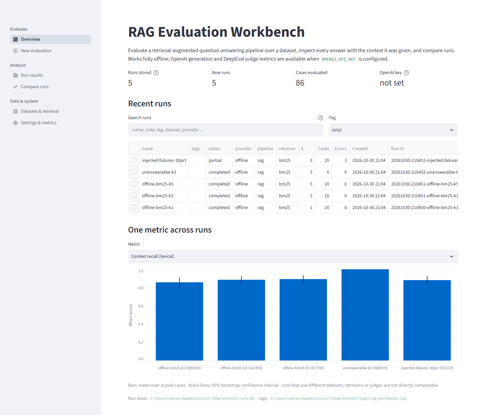
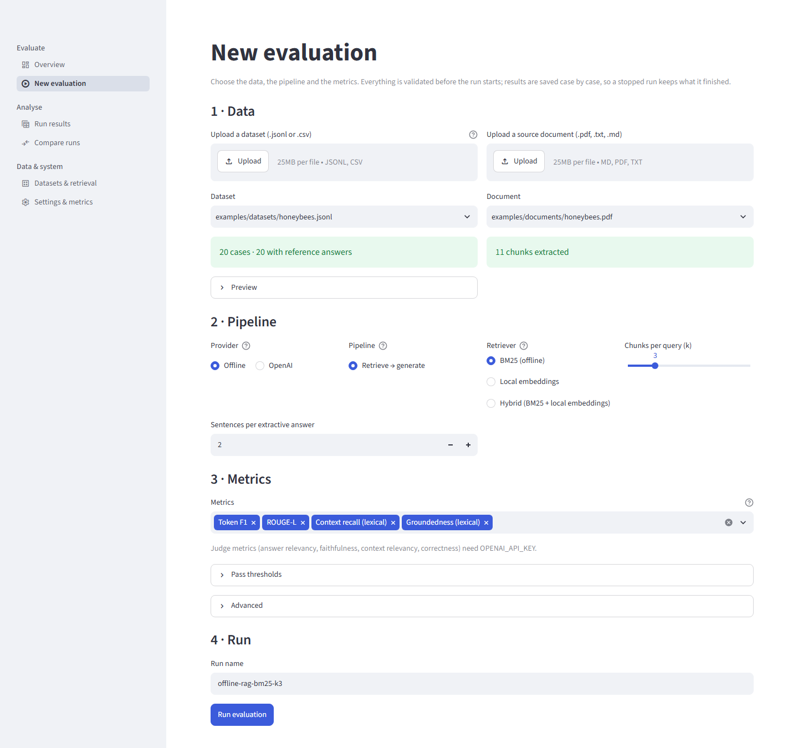
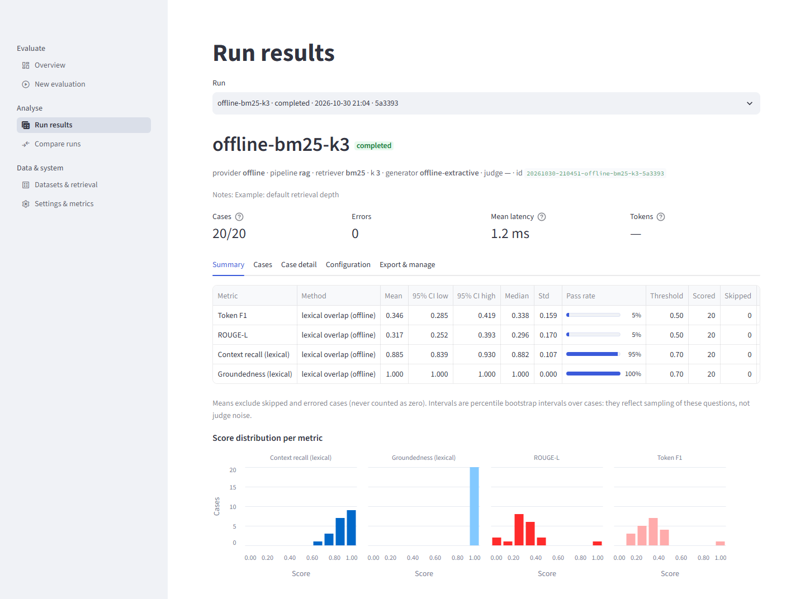
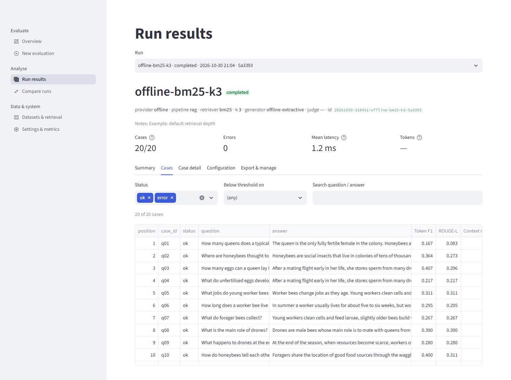
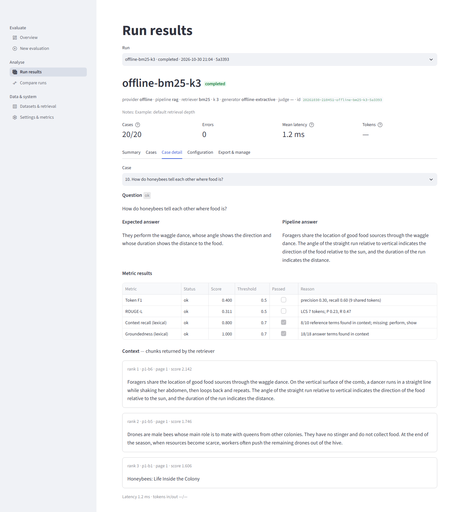
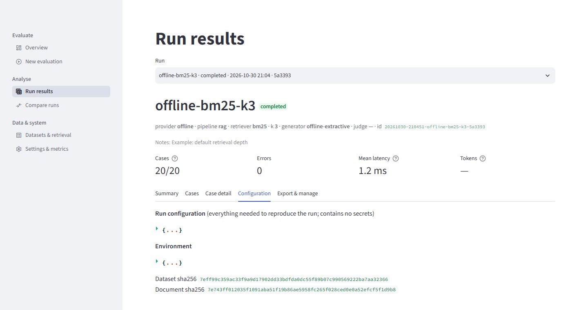
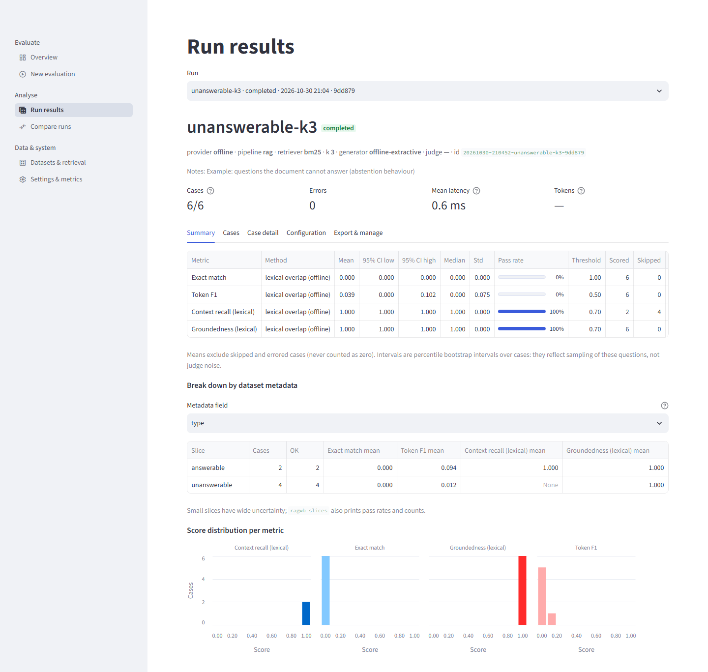
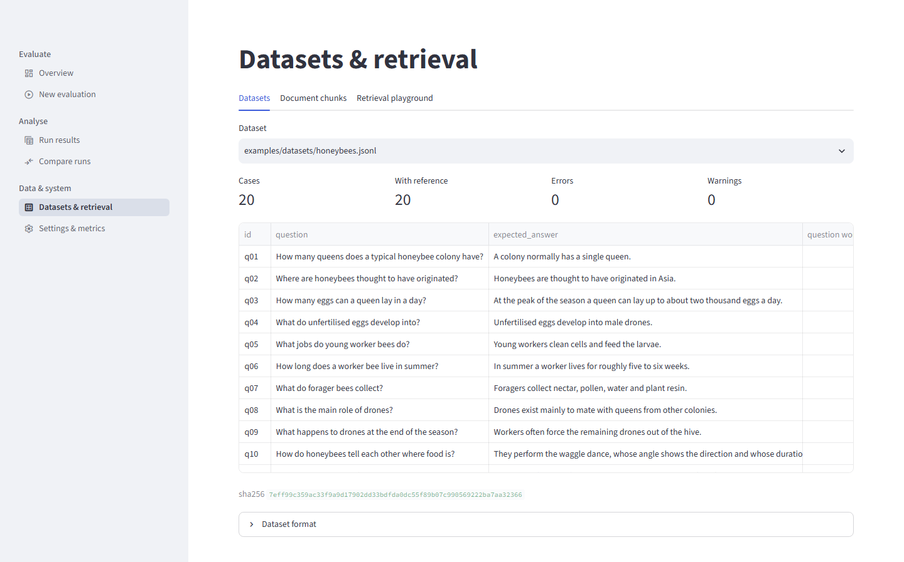
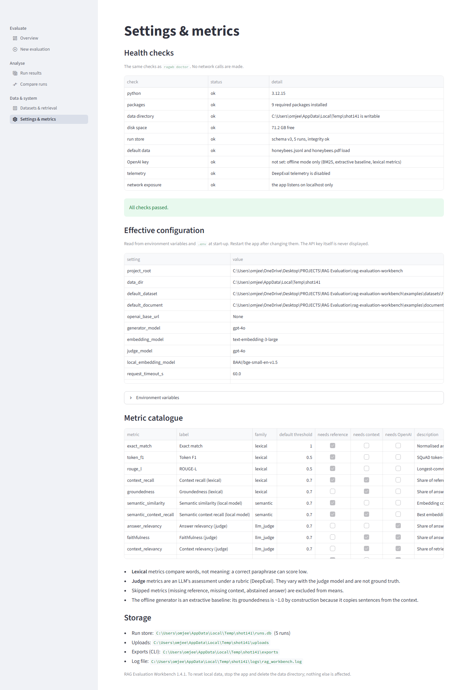

# Part I — Orientation

This guide is about using the RAG Evaluation Workbench well. It is not about how the workbench is built: the Project Book (`docs/project-book/`) covers that. Here the question is always the same: *you have a document, a set of questions, and a way of answering them. How do you find out, honestly, whether the answers are any good, and whether a change you made made them better?*

This first Part gives you the picture you need before anything else: what the tool is, what it measures, what it cannot measure, how to start it, and two short guided tours (one in the web app, one on the command line) so that you have seen every important screen and command once. Part II then covers how to prepare documents and datasets. Parts III to V cover choosing a configuration, running evaluations and reading results.

Every command in this Part was run against version 1.4.1, offline, in a scratch data directory. The output you see in the fenced blocks is real output, shortened where noted (long paths and run ids are abbreviated). Your run ids and timestamps will differ; your scores will not, because the offline path is deterministic.

---

## 1.1 What the workbench is, and what it is not

### 1.1.1 What it is

The workbench evaluates a **retrieval-augmented question-answering (RAG) pipeline** over a **dataset of questions**. You give it:

* one source document (PDF, TXT or Markdown);
* a dataset of questions, usually with a reference answer for each (JSONL or CSV);
* a pipeline configuration: how many chunks to retrieve, which retriever, which answer generator;
* a choice of metrics.

It runs every question through the pipeline, scores every answer, stores the whole run in a local SQLite database, and lets you inspect, slice, compare and export the results, from a Streamlit web app or the `ragwb` command line.

Four properties make it more than a script that prints a number:

1. **It shows its evidence.** For every question you can see the answer next to the exact chunks that were retrieved, and the reason behind each score ("8/10 reference terms found in context; missing: perform, show").
2. **It keeps history.** Each run stores its configuration, the SHA-256 hashes of the dataset and the document, package versions, per-case latency and any errors. You can reproduce a run or explain, months later, why two runs differ.
3. **It compares runs with paired statistics.** The same question in run A and run B is compared case by case, and the interval on the difference tells you whether the change is distinguishable from noise.
4. **It runs offline.** With no API key and no network, the whole workflow works on a laptop: BM25 retrieval, an extractive answer baseline and lexical metrics. The same workflow can then be pointed at a live model provider.

### 1.1.2 What it is not

| It is not... | What that means for you |
|---|---|
| A language model or a chat product | The offline "generator" copies sentences out of the retrieved text. It is a baseline for measuring, not an assistant. |
| A multi-document search engine | One run evaluates one document. To evaluate a corpus of ten documents, you make ten runs (or merge them into one document yourself). |
| A ground-truth oracle | Lexical metrics measure word overlap. Judge metrics are an LLM's opinion. Neither is truth; both are evidence. |
| A benchmark leaderboard | Scores are only comparable between runs that share a dataset and a document. A 0.35 on honeybees and a 0.20 on volcanoes say nothing about which pipeline is better. |
| A production monitor | It is a local tool: one machine, one SQLite file, localhost by default. It can be shared on a network with a login (Part VII), but it is not a hosted service. |
| A calibrated measuring instrument | Default pass thresholds (0.5, 0.7, 1.0) are conventions. They have not been calibrated against human judgements (§1.11). |

> **Why this works.** Being clear about what the tool is not saves you the most common mistake: reading a single score as a verdict. The workbench is designed to make *differences between runs on the same data* trustworthy. It is much weaker at saying whether any one run is "good" in an absolute sense.

---

## 1.2 The mental model

Everything in the workbench follows one pipeline. Learn it once and every screen, option and metric has a place in it.

```text
 document ──► chunks ──► retriever ──► generator ──► metrics ──► stored run ──► comparison
 (PDF/TXT/MD)  (blocks)   (top-k      (answer)      (scores,    (SQLite,       (paired,
                          chunks)                    reasons)    hashes)        with CIs)
     ▲                         ▲                          ▲
     │                         │                          │
  dataset: question + reference answer + metadata ────────┘
```

### 1.2.1 The stages

| Stage | What happens | Your controls | What typically goes wrong |
|---|---|---|---|
| **Document → chunks** | The file is split into blocks: one per paragraph (text, Markdown) or per text block (PDF). Blocks longer than 2,000 characters are split on sentence boundaries. Headings become chunks of their own unless you drop them. | document choice, `--skip-headings` | Scanned PDFs yield no text; tables become run-on text; headings occupy retrieval slots (Part II §2.2). |
| **Chunks → retriever** | For each question the retriever ranks chunks and returns the top *k*. Offline this is BM25, a classic keyword ranker with light stemming. Live options add embeddings. | `--retriever`, `-k` | The right chunk is not in the top *k*; the keyword ranker misses synonyms ("parasite" is not "parasitic"). |
| **Retriever → generator** | The generator writes an answer from the question and the retrieved chunks. Offline it picks the best-matching sentences (an extractive baseline). Live it is a language model, or a tool-calling agent. | `--provider`, `--pipeline`, `--model`, `--answer-sentences`, `--min-evidence` | The model ignores the context, invents details, or fails to say "I cannot answer". |
| **Generator → metrics** | Each answer is scored against the reference (token F1, ROUGE-L, exact match), against the retrieved context (context recall, groundedness) or by a judge model. | `--metrics`, `--threshold` | A correct paraphrase scores low on word overlap; a fluent wrong answer reuses the reference's words and scores high. |
| **Metrics → stored run** | Scores, reasons, answers, contexts, configuration and hashes are saved case by case. | `--name`, `--notes`, tags | Forgetting to name or annotate runs so that you cannot tell them apart next week. |
| **Stored run → comparison** | Two runs are paired by question and the difference is summarised with a bootstrap interval. | `ragwb compare`, Compare page, `ragwb regress` | Comparing runs that differ in more than one thing, or on different datasets. |

### 1.2.2 The two diagnostic questions

When an answer is bad, there are only two places it can have gone wrong, and the workbench is built to tell them apart:

1. **Did retrieval fail?** Was the information needed to answer in the chunks that were retrieved? This is what **context recall** looks at (how many of the reference answer's content words appear in the retrieved context) and what the Case detail view lets you see with your own eyes.
2. **Did generation fail?** Given what was retrieved, did the generator produce a correct, faithful answer? **Groundedness** (are the answer's words in the context?), the judge metrics and the answer-vs-reference metrics look at this.

Most improvement work is: find the stage that fails most, change one thing there, run again, compare. Part V §5.4 and Part VI make this concrete.

> **Pitfall.** Do not read a low answer score as a retrieval problem, or a high context recall as proof that retrieval is fine. If context recall is high and token F1 is low, the answer text is the problem (or the reference answer is phrased very differently). If context recall is low, no generator can recover. Look at both columns before deciding what to change.

---

## 1.3 Who should use it, and for what

### 1.3.1 Five use cases

**Research.** You want to study how retrieval depth, chunking or retriever choice affects answer quality. The workbench gives you controlled, reproducible runs: same dataset hash, same document hash, one setting changed, paired comparison with intervals. The offline path is deterministic, so a reviewer can re-run your study and get the same numbers.

**Regression-testing a RAG change.** You changed a prompt, a model, a chunk size or a retriever and want to know whether it made things worse. Keep a baseline run, make the candidate run from the same dataset, and compare. `ragwb regress` turns the comparison into an exit code (0 = fine, 3 = a significant regression, 4 = not enough paired data to judge) that a scheduler or CI job can act on (Part VII).

**Teaching.** The offline mode costs nothing, needs no account, and every score has a visible reason. Students can see, for example, that a correct paraphrase scores low on token F1, or that a title chunk steals a retrieval slot. The bundled honeybee, volcano, coffee and lighthouse documents are short enough to read in two minutes.

**Choosing between configurations.** BM25 or embeddings? k = 3 or k = 5? Two models? Run each on the same dataset and use the Compare page. The tool gives you the means, the intervals and the per-question wins, ties and losses, so you can say "B is better on 9 of 20 questions and never worse" rather than "B scored 0.02 higher".

**Auditing answer quality.** You have an existing question set (support tickets, FAQs) and want to know where the pipeline fails: which question types, which topics, which difficulty. Put metadata on the questions (`type`, `difficulty`, `topic`) and use `ragwb slices` or the Results page's metadata breakdown (Part II §2.8).

### 1.3.2 When the workbench is the wrong tool

* You need to evaluate **many documents at once** with per-question document routing. The tool takes one document per run.
* You need **human-quality ground truth** on open-ended answers (summaries, long explanations). Reference-based metrics work best on short factual answers; for long ones you need a judge or humans, and the workbench has no human-rating workflow beyond a labelling sheet (§1.11).
* You need **live production monitoring** with user traffic. This is an offline evaluation harness.
* You need **multi-turn conversation** evaluation. Each case is one independent question.

---

## 1.4 What "a good evaluation" means

A score is only as good as the evaluation behind it. A good evaluation has four ingredients, and the rest of this guide is mostly about getting each of them right.

### 1.4.1 Questions

The questions should look like the questions real users will ask: the same vocabulary, the same mix of easy and hard, the same share of things the document cannot answer. A set of twenty questions that all copy the document's own wording will make any keyword retriever look excellent. Part II §2.5 covers coverage, difficulty mix, paraphrase style and unanswerable questions.

### 1.4.2 References

A reference answer is what you compare against. It must be **correct** (checkable in the document), **short**, **complete** (it includes every fact the question asks for) and **paraphrased** rather than copied. Part II §2.6 shows, with real numbers, how copying a sentence from the document into the reference nearly doubles token F1 for exactly the same pipeline (0.265 versus 0.603), which means a score can reflect the author's habit rather than the pipeline's quality.

### 1.4.3 Metrics

Different metrics answer different questions. Do not pick them by habit; pick them by what you need to know.

| Metric | Family | Question it answers | Needs | Weakness |
|---|---|---|---|---|
| `exact_match` | lexical | Is the answer identical to the reference after normalisation? | reference | Almost always 0 for free text. Useful only for single-token answers (numbers, names). |
| `token_f1` | lexical | How many words does the answer share with the reference (precision and recall)? | reference | Penalises correct paraphrases and long answers; rewards quoting. |
| `rouge_l` | lexical | How long is the longest common word subsequence? | reference | Same weaknesses; sensitive to word order. |
| `context_recall` | lexical | Do the retrieved chunks contain the words the reference needs? | reference + context | A retrieval metric: says nothing about the answer. Skipped when the reference is an abstention. |
| `groundedness` | lexical | Are the answer's content words present in the retrieved chunks? | context | Is 1.0 by construction for the offline extractive generator. Skipped for abstained answers. |
| `semantic_similarity`, `semantic_context_recall` | semantic (optional) | How close in meaning (embedding cosine)? | reference, `fastembed` | With the default local model, scores sit near 0.5 even for unrelated text, so default thresholds are not meaningful until calibrated. |
| `answer_relevancy`, `faithfulness`, `context_relevancy`, `correctness` | LLM judge (DeepEval) | Is the answer on-topic, supported by the context, is the context relevant, is it factually in line with the reference? | a provider key; some need reference or context | The judge is a model with opinions; scores vary with the judge model and with sampling. |

The exact definitions, with worked examples, are in Project Book Part VI. The point to take away here is that **lexical metrics are cheap, deterministic and shallow; judge metrics are expensive, noisy and deeper.** Part III §3.4 helps you choose.

### 1.4.4 Uncertainty

A mean without an interval is a rumour. Every mean the workbench shows comes with a **95% percentile bootstrap confidence interval** over the questions: resample the questions many times, recompute the mean, and take the middle 95% of the results. It answers: *"if I had asked a different but similar set of questions, how much would this mean move?"*

Two consequences that you should keep in mind from the start:

* With 20 or 30 questions the intervals are wide. In the honeybee baseline below, token F1 is 0.346 with an interval of 0.285 to 0.419.
* The interval covers the **sampling of questions only**. It does not include judge noise, the choice of reference answers, or the choice of document.

> **Why this works.** The workbench's honesty about uncertainty is deliberate. When the Compare page says "inconclusive", that is information: it means your dataset is too small, or the two configurations are too alike, to tell them apart. The correct response is more or better questions (Part II §2.9), not a looser reading.

---

## 1.5 The two modes

### 1.5.1 Offline baseline

`--provider offline` (the default). No network, no key, no cost; deterministic.

* **Retrieval:** BM25 over the chunks (`--retriever bm25`).
* **Generation:** an extractive baseline. It scores every sentence in the retrieved chunks by how many rare question words it shares, and returns the best one or two (`--answer-sentences`, default 2) in document order. If no sentence shares any content word with the question it abstains with the sentence "The PDF does not provide enough information to answer the question." (The sentence says "PDF" even for Markdown and text sources.)
* **Optional abstention:** `--min-evidence` (0 to 1) makes the baseline abstain unless its selected sentences cover that share of the question's terms.
* **Metrics:** the five lexical metrics, plus the two semantic ones if `fastembed` is installed.
* **Local embeddings:** with `uv sync --extra semantic`, `--retriever local` or `hybrid-local` adds a local embedding model (default `BAAI/bge-small-en-v1.5`, downloaded once, then fully local). This is still "offline" in the sense that no provider is contacted at run time.

**What offline can tell you.**

* Whether retrieval brings the needed words into context (context recall).
* Whether a change to chunking, *k* or the retriever moves things, with paired statistics.
* Whether your dataset is well-formed, whether your pipeline plumbing works and whether your regression gate triggers.
* How a baseline behaves on unanswerable questions (it almost never abstains by default; §1.11).

**What offline cannot tell you.**

* How a language model will answer. The extractive baseline can only quote. A real model paraphrases, summarises and sometimes invents.
* Anything about answer quality in the sense of meaning. Token F1 on the bundled honeybee set is about 0.35 for a baseline that quotes the right sentence, because the references are paraphrases.
* Whether groundedness is good. It is 1.0 by construction for this generator.

### 1.5.2 Live provider

`--provider openai` (and optionally `--pipeline agent`). It uses an OpenAI-style chat API to generate answers and, if you select the judge metrics, DeepEval judge models to score them. It needs `OPENAI_API_KEY` in the environment or in a `.env` file (copy `.env.example` to `.env` and fill it in; the app never displays the value). **Runs make paid API calls**, and the UI says so before it starts.

**OpenAI-compatible endpoints.** The same settings accept any provider that speaks the OpenAI API. You put that provider's key in `OPENAI_API_KEY`, set `OPENAI_BASE_URL` to its endpoint, and set `RAGWB_GENERATOR_MODEL` and `RAGWB_JUDGE_MODEL` to that provider's model names. For retrieval, use `--retriever bm25` (or `local` / `hybrid-local`) unless the provider offers an embeddings endpoint.

**What live verification actually covers.** Be precise about this, because it shapes how much you can lean on the live path (`docs/LIVE_VERIFICATION.md`, `docs/KNOWN_LIMITATIONS.md`):

| Claim | Status |
|---|---|
| Answer generation and the four DeepEval judge metrics work through an OpenAI-compatible endpoint | Verified against Groq's free tier (`openai/gpt-oss-20b`, `openai/gpt-oss-120b`, `qwen/qwen3.8-27b`) on small samples |
| It works against OpenAI itself | **Not verified.** No run was made against OpenAI. |
| API embeddings (`embedding`, `hybrid`) | **Not verified live** (the test provider offered none) |
| Tool-calling agent pipeline | Run live on 3 honeybee questions (3/3 answered) |
| Other compatible providers (xAI Grok, etc.) | Supported by configuration only; nothing was sent |
| Judge scores agree with human judgement | **Never measured.** They were compared with labels written by an AI rater (Claude), one rater, 30 cases. |

A taste of why the live path matters: on the 30 volcano questions with `qwen/qwen3.8-27b` generating, token F1 was 0.489 (interval 0.381 to 0.600, run 7 in the live record). The offline extractive baseline on the same dataset scores 0.199 (we reproduce that below). A language model that writes a concise paraphrase simply matches short references better than a baseline that quotes two sentences. Neither number is "the truth" about quality; the difference tells you how much of the offline number is the baseline's style.

### 1.5.3 Choosing a mode

| If you want to... | Use | Because |
|---|---|---|
| Learn the tool, teach, or try ideas for free | offline | deterministic, instant, no key |
| Test chunking, *k* or retriever changes | offline first | retrieval effects show up in context recall without paying for generation |
| Gate a pipeline change in CI without cost | offline | no network, a stable exit code |
| Measure how a particular model answers | live | only a real model produces real answers |
| Measure faithfulness or correctness in meaning | live, judge metrics | lexical metrics cannot see meaning |
| Do both | offline for retrieval, live for generation | change one thing at a time (Part III) |

> **Pitfall.** Do not use offline scores as a proxy for how a live model will behave. They are a lower bound on lexical overlap and a reliable instrument for *retrieval* comparisons. For generation quality, run live, and keep the sample small and the provider's quota in mind (Part IV §4.6).

---

## 1.6 Installing and starting

### 1.6.1 Requirements

* Python 3.12 or newer (`.python-version` pins 3.12).
* [uv](https://docs.astral.sh/uv/) is recommended. Without it, `start.py` creates a `.venv` and installs with pip.
* Optional: an API key for a provider, only if you want live runs.

### 1.6.2 The one-command start

```bash
python start.py
```

On first launch this:

1. prepares the environment (`uv sync`, or a local `.venv` with pip if uv is absent);
2. runs five offline example evaluations if the run store is empty;
3. starts the web app and opens it at `http://localhost:8501`.

Press Ctrl+C in the terminal to stop it. Nothing is installed outside the project folder.

### 1.6.3 `start.py` options

| Option | Effect |
|---|---|
| `--port 8600` | preferred port (default 8501); if it is busy the script picks a free one |
| `--no-browser` | do not open a browser window |
| `--no-examples` | skip the first-launch example runs |
| `--setup-only` | prepare the environment and examples, then exit |
| `--host 0.0.0.0` | listen on the network; **refuses to start unless a login exists** (`RAGWB_APP_PASSWORD` or named accounts) |
| `--ssl-cert`, `--ssl-key` | serve HTTPS from a PEM certificate and key; without them, credentials cross the network in clear text |

Sharing the app with a team is covered in Part VII §7.2.

### 1.6.4 Manual steps and optional extras

```bash
uv sync                      # runtime and dev dependencies, editable install
uv sync --extra semantic     # adds fastembed: local embedding retrieval and the two semantic metrics
uv run ragwb run --name first-run -k 3
```

The first use of a local embedding model downloads it (about 70 MB for the default) into `<data dir>/models`; after that nothing leaves the machine. On Windows, keep the data directory path short: the model cache nests folders deeply and can exceed the 260-character path limit.

### 1.6.5 Command-line tool only (wheel)

`uv build --wheel` builds a wheel that bundles the example data. Installing it gives you the `ragwb` command; **the web app needs the project folder**. `RAGWB_HOME` sets the folder that holds `data/` and `.env` for a wheel install. The wheel was installed into a clean virtual environment and used from a neutral folder (10 of 10 checks in `scripts/wheel_check.py`).

### 1.6.6 Docker

The repository contains a `Dockerfile`, but **it has never been built or run**: Docker was not available where the project was developed. Treat it as a starting point you must verify yourself.

### 1.6.7 Quick health check

```bash
ragwb doctor
```

checks Python, packages, the data directory and disk, the run store, the default data files, key presence, telemetry and network exposure. It makes no network calls. (In this guide `ragwb` is shorthand for `uv run ragwb`, or for `.venv/Scripts/python.exe -m rag_workbench` on Windows.) In a fresh scratch directory it printed:

```text
[ok  ] python            3.12.15
[ok  ] packages          9 required packages installed
[ok  ] data directory    <data dir> is writable
[ok  ] disk space        71.8 GB free
[ok  ] run store         schema v3, 3 runs, integrity ok
[ok  ] default data      honeybees.jsonl and honeybees.pdf load
[ok  ] OpenAI key        not set: offline mode only (BM25, extractive baseline, lexical metrics)
[ok  ] telemetry         DeepEval telemetry is disabled
[ok  ] network exposure  the app listens on localhost only

9 ok, 0 warning(s), 0 failure(s)
```

The exit code is 1 if any check fails, so `doctor` can run from a scheduler.

---

## 1.7 A 15-minute tour of the web app

The web app has six pages, in a sidebar under three headings: **Evaluate** (Overview, New evaluation), **Analyse** (Run results, Compare runs) and **Data & system** (Datasets & retrieval, Settings & metrics). The screenshots in this section come from the Project Book and were captured on version 1.4.1; run names such as `offline-bm25-k3` are the examples `start.py` creates on first launch.

Start the app with `python start.py`. The tour below takes about fifteen minutes.

### 1.7.1 Minutes 0 to 2: Overview



The Overview is the landing page. Read it top to bottom:

* **Four headline numbers**: runs stored, new runs (not imported), cases evaluated, and whether an OpenAI key is configured ("not set" until you configure one).
* **Recent runs**: a table of every run, newest first, with a *Search runs* box (every word must appear in a run's name, notes, tags, id, status, provider, retriever or file names) and a *Tag* filter. Tick a row's checkbox and an **Open run results** link appears.
* **One metric across runs**: a bar chart of one metric (choose it in the selector) for every run, with the 95% interval drawn as a black line. The caption warns that runs on different datasets, retrievers or judges are not directly comparable.

Note the status column. `completed` means every case finished; `partial` means some cases errored; `cancelled` and `interrupted` mean the run stopped early. The screenshot shows one `partial` run, a deliberate example with 3 injected failures out of 20.

**Try this.** Click the row `offline-bm25-k3`, then **Open run results**.

### 1.7.2 Minutes 2 to 5: New evaluation



This page configures and launches one run in four steps. It validates everything before anything runs, and results are saved case by case, so a stopped run keeps what it finished.

1. **Data.** Upload a dataset (`.jsonl` or `.csv`) and a document (`.pdf`, `.txt`, `.md`), or pick one of the bundled ones. The page validates immediately: a green box reads "20 cases · 20 with reference answers" and "11 chunks extracted"; a red box lists up to ten line-numbered errors. The **Preview** expander shows the first 20 parsed cases.
2. **Pipeline.** Provider (Offline or OpenAI), pipeline (Retrieve → generate, or Tool-calling agent when OpenAI is chosen), retriever, **k** (chunks per query) and, offline, the number of sentences per extractive answer. Retriever options appear only when they are usable: API embeddings need a key; local embeddings need the `semantic` extra.
3. **Metrics.** A multiselect (default: Token F1, ROUGE-L, Context recall, Groundedness), a **Pass thresholds** expander and an **Advanced** expander (parallel cases, evaluate only the first N, seed, inject failures, notes).
4. **Run.** A run name (prefilled, e.g. `offline-rag-bm25-k3`) and the **Run evaluation** button. The button is disabled, with a list of problems, if the dataset or document is invalid, no metric is chosen, OpenAI is selected without a key, or the name is empty. If a paid provider or a judge model is involved, a notice tells you how many generation calls will happen first.

**Try this.** Keep the defaults, change *k* to 1, name the run `my-k1`, and click **Run evaluation**. It takes a fraction of a second. A progress bar and the last eight case outcomes appear, then a summary and an **Inspect this run** link.

> **Pitfall.** The upload widget says "25MB per file". That is Streamlit's ceiling. The workbench's own limits are lower for datasets (5 MB by default, `RAGWB_MAX_DATASET_BYTES`) and the error appears only after upload.

### 1.7.3 Minutes 5 to 9: Run results

The Results page has a run selector, a header, four headline tiles (Cases, Errors, Mean latency, Tokens) and five tabs.



**Summary tab.** One row per metric: mean, 95% interval, median, standard deviation, pass rate (against the threshold shown), and the counts *Scored*, *Skipped* and *Errors*. Under the table the caption says what matters: *"Means exclude skipped and errored cases (never counted as zero)."* Below the table are histograms of every metric's scores. Read the shape, not only the mean: in the screenshot groundedness is a single bar at 1.0, context recall is concentrated between 0.6 and 1.0, and token F1 clusters below 0.5 with one outlier near 0.9. If the dataset has metadata, a **Break down by dataset metadata** control appears (described at the end of this section).



**Cases tab.** Every question, answer and per-metric score, with three filters: status, *Below threshold on* (cases where a chosen metric was scored and failed), and a plain-text search. Use it to sort the worst cases to the top.



**Case detail tab.** The most instructive page in the tool. For one question it shows the reference and the pipeline's answer side by side, a metric table with a **Reason** column, and the retrieved chunks with rank, chunk id, page and score. In the screenshot, question 10 ("How do honeybees tell each other where food is?") has token F1 0.400 and context recall 0.800 with the reason "8/10 reference terms found in context; missing: perform, show". Look at rank 3: it is the document's one-line title. A chunk with no information took a retrieval slot. That single observation drives a whole class of fixes (Part II §2.2, Part VI).



**Configuration tab.** The full stored configuration (collapsed JSON trees for configuration and environment) plus the SHA-256 hashes of the dataset and the document. This is how you prove, later, that two runs used the same data.

**Export & manage tab.** Download CSV (one row per case), JSON (a full record that can be re-imported) or a Markdown report; add tags and a note; delete the run (you must type its run id to confirm).



**Metadata breakdown.** When the dataset has metadata, choose a field (here `type`) to get one row per value. In this screenshot, an unanswerable-question run shows `answerable` (2 cases) and `unanswerable` (4 cases); context recall is `None` for the unanswerable slice because it was skipped. Small slices have wide uncertainty.

### 1.7.4 Minutes 9 to 12: Compare runs


Select two or more runs. The page then shows:

1. **Configuration**: a table with one column per run. Rows that differ are highlighted in amber. If more than one row is highlighted, you changed more than one thing, and you cannot attribute the difference to either (Part IV §4.3).
2. **Metric means**: a grouped bar chart with 95% intervals. Overlapping intervals mean the difference may be sampling noise.
3. **Best run per metric**: the highest mean per metric. Ties are listed, never broken arbitrarily. It ignores intervals, so do not stop here.
4. **Paired comparison**: choose a baseline (A) and a candidate (B). The table gives, for each metric, the paired mean difference with its interval, and how many questions B won, tied or lost, ending in a verdict: "B better", "B worse" or "inconclusive". It says "better" or "worse" only if the 95% interval of the paired difference excludes zero.
5. **Per-case differences**: a table sorted so the biggest regressions come first. This is how you find out *why* a mean moved.

In the screenshot, comparing k = 1 with k = 3: token F1 is 0.404 → 0.346 ("B worse", 3 better / 10 ties / 7 worse). The worst row is "How does a honeybee colony reproduce?" (0.629 → 0.273): with three chunks retrieved, the title chunk and an unrelated sentence displaced the right answer.

### 1.7.5 Minutes 12 to 14: Datasets and retrieval



Three tabs:

* **Datasets**: counts of cases, cases with a reference, errors and warnings; every case in a table; the dataset's SHA-256; a "Dataset format" help expander.
* **Document chunks**: how the document was split, with chunk ids, pages, character counts and text. **Check this before you evaluate.** If the chunks look wrong, every number downstream is wrong.
* **Retrieval playground**: type any query, choose *k*, and see which chunks BM25 returns with their scores. Use it to debug why a question retrieves the wrong chunk, at no cost (the playground never calls a paid embedding API).

### 1.7.6 Minutes 14 to 15: Settings and health



The page begins with **Health checks** (the same nine checks as `ragwb doctor`), then the **Effective configuration** (every setting except the key itself; read at start-up, so restart the app after changing an environment variable), a **Metric catalogue** (name, label, family, default threshold, and what each metric needs), four reminder notes (lexical metrics compare words, judge metrics are opinions, skipped metrics are excluded, the offline generator's groundedness is about 1.0 by construction) and **Storage** paths. The page changes nothing: all configuration is through environment variables or `.env`.

### 1.7.7 What you have now seen

You have seen where data goes in (New evaluation, Datasets), where evidence comes out (Run results), how to compare (Compare) and how to check the system (Settings). The rest of the guide teaches you to do each of these deliberately.

---

## 1.8 A 10-minute tour of the CLI

Everything in the web app that matters for evaluation is also a command. The CLI is the better tool for scripts, CI and repeatable experiments. The commands below were run exactly as shown (with the abbreviations noted) in a clean scratch data directory.

### 1.8.1 Minute 0: version and help

```bash
ragwb --version
ragwb --help
```

```text
ragwb 1.4.1
```

`ragwb --help` lists 24 commands. This tour uses eight of them: `run`, `list`, `show`, `compare`, `export`, `slices`, `doctor` and `backup`. Others (`validate`, `tag`, `note`, `regress`, `rerun`, `import`, `delete`, `prune`, `restore`, `user`, `metrics`, `score`, `tune-abstention`, `calibrate`, `labels-template`, `judge-noise`) appear in later Parts. Each has `--help`.

### 1.8.2 Minutes 1 to 3: `run`

```bash
ragwb run --name tour-baseline -k 3
```

With no `--dataset` or `--document`, `run` uses the bundled honeybee set (`examples/datasets/honeybees.jsonl`, `examples/documents/honeybees.pdf`).

```text
[  1/20] ok  q01
[  2/20] ok  q02
...
[ 20/20] ok  q20

Run 20261030-204923-tour-baseline-1e4b21: completed
cases 20  ok 20  errors 0  mean latency 1.0 ms
metric                          mean           95% CI    pass  scored  skip  err
Token F1                       0.346      0.285-0.419      5%      20     0    0
ROUGE-L                        0.317      0.252-0.393      5%      20     0    0
Context recall (lexical)       0.885      0.839-0.930     95%      20     0    0
Groundedness (lexical)         1.000      1.000-1.000    100%      20     0    0
```

Read it like this:

* **Token F1 0.346, pass rate 5%.** Only 1 of 20 answers reaches the 0.5 threshold. This baseline quotes whole sentences while the references are short paraphrases, so precision is low.
* **Context recall 0.885, 95% pass.** In most cases the retrieved chunks contain nearly all the content words of the reference. Retrieval is largely doing its job.
* **Groundedness 1.000.** The answers are copied from the context, so every answer word is in it. This is not evidence of quality.
* **scored 20, skip 0, err 0.** The three counts are the honesty columns (§1.10). They must add up to the number of cases.

`--quiet` suppresses the per-case lines. Now a second run that changes the retrieval depth and drops headings, to have something to compare:

```bash
ragwb run --name tour-k1-skip -k 1 --skip-headings --quiet
```

```text
Run 20261030-204935-tour-k1-skip-1cfdd2: completed
cases 20  ok 20  errors 0  mean latency 0.9 ms
metric                          mean           95% CI    pass  scored  skip  err
Token F1                       0.407      0.340-0.478     20%      20     0    0
ROUGE-L                        0.376      0.305-0.451     20%      20     0    0
Context recall (lexical)       0.870      0.823-0.916     95%      20     0    0
Groundedness (lexical)         1.000      1.000-1.000    100%      20     0    0
```

> **Pitfall.** This pair of runs changes *two* things (k and `--skip-headings`). It is fine for a tour, but in a real comparison you could not say which change produced the difference. Change one setting per run (Part IV §4.3).

### 1.8.3 Minute 3: `list`

```bash
ragwb list
```

```text
                          run_id          name    status provider pipeline retriever  k  n_cases  n_errors tags
 20261030-204935-tour-k1-skip-1cfdd2  tour-k1-skip completed  offline      rag      bm25  1       20         0
20261030-204923-tour-baseline-1e4b21 tour-baseline completed  offline      rag      bm25  3       20         0
```

Newest first. `ragwb list --search honeybee`, `--tag baseline` and `--status running` filter the list. Every other command takes a run reference: the full id, a unique prefix of it, its last 6 characters, or the exact run name (at least 4 characters, and it must match exactly one run). The id has the form `<UTC timestamp>-<name>-<6 hex>`. Later commands in this guide use names such as `tour-baseline` to keep the lines short; in scripts, prefer full ids (Part VI §6.1.2).

### 1.8.4 Minute 4: `show`

```bash
ragwb show 20261030-204923-tour-baseline-1e4b21
```

```text
tour-baseline [20261030-204923-tour-baseline-1e4b21] status=completed created=2026-10-30 20:49:23
  provider: offline
  pipeline: rag
  retriever: bm25
  k: 3
  generator_model: offline-extractive
  judge_model: None
  dataset_path: <project>\examples\datasets\honeybees.jsonl
  document_path: <project>\examples\documents\honeybees.pdf
cases 20  ok 20  errors 0  mean latency 1.0 ms
metric                          mean           95% CI    pass  scored  skip  err
...
```

`show` is the header and summary only. For per-case detail use the web app's Cases and Case detail tabs, or `export`.

If the run has tags or a note, `show` prints them as two more header lines (they are absent above because this run has neither). After `ragwb tag tour-baseline --add baseline,keep` and `ragwb note tour-baseline "Reference run"`, the header ends with:

```text
  document_path: <project>\examples\documents\honeybees.pdf
  tags: baseline, keep
  notes: Reference run
```

### 1.8.5 Minutes 5 to 6: `compare`

```bash
ragwb compare 20261030-204923-tour-baseline-1e4b21 20261030-204935-tour-k1-skip-1cfdd2
```

```text
A = tour-baseline [...]
B = tour-k1-skip [...]

                   label  paired_cases  mean_a  mean_b  diff_b_minus_a  ci_low  ci_high  b_better  ties  b_worse  ci_excludes_zero
                Token F1            20   0.346   0.407           0.060   0.012    0.117         7    10        3              True
                 ROUGE-L            20   0.317   0.376           0.058   0.013    0.111         8    10        2              True
Context recall (lexical)            20   0.885   0.870          -0.015  -0.040    0.000         0    18        2             False
  Groundedness (lexical)            20   1.000   1.000           0.000   0.000    0.000         0    20        0             False
```

B is always compared against A: `diff_b_minus_a` positive means B is higher. Token F1 improved by 0.060 and the interval (0.012 to 0.117) excludes zero, so the improvement is distinguishable from noise: B was better on 7 questions, tied on 10 and worse on 3. Context recall dropped by 0.015, but its interval (-0.040 to 0.000) touches zero, so the tool will not call it a loss (`ci_excludes_zero` is False). Groundedness is identical.

Cases are paired by normalised question text. If the two runs used different datasets, only shared questions are compared; always check the `paired_cases` column.

### 1.8.6 Minutes 6 to 7: `export`

```bash
ragwb export 20261030-204923-tour-baseline-1e4b21 --format md --out-dir ./out
ragwb export 20261030-204923-tour-baseline-1e4b21 --format csv --out-dir ./out
ragwb export 20261030-204923-tour-baseline-1e4b21 --format json --out-dir ./out
```

Three formats: `md` (a human-readable report), `csv` (one row per case, with answers, contexts' chunk ids and one set of columns per metric) and `json` (the full record, re-importable with `ragwb import`). Without `--out-dir`, files go to `<data dir>/exports`. The Markdown report begins:

```text
  # Evaluation report: tour-baseline

* Run id: `20261030-204923-tour-baseline-1e4b21`
* Status: **completed**
* Provider / pipeline / retriever: offline / rag / bm25
* k: 3  ·  generator: offline-extractive  ·  judge: None
* Dataset: `honeybees.jsonl` (sha256 `7eff99c359ac`)
* Document: `honeybees.pdf` (sha256 `7e743ff01203`)
```

followed by the summary table (with medians and thresholds) and a "Lowest ..." table for each metric. For example the five lowest token F1 cases were q14 (0.151, "Why do bees build hexagonal cells?"), q01 (0.167), q12 (0.186), q04 (0.217) and q07 (0.267), each with a reason such as "precision 0.10, recall 0.36 (4 shared tokens)". The CSV has columns such as `case_id`, `status`, `question`, `expected_answer`, `answer`, `context_ids`, and for each metric a score, a `_passed` and a `_status` column.

### 1.8.7 Minutes 7 to 8: `slices`

The honeybee dataset has no metadata, so for `slices` use one that has: the 30-question volcano set.

```bash
ragwb run --name volc-k3 --dataset examples/datasets/volcanoes.jsonl --document examples/documents/volcanoes.pdf -k 3 --quiet
ragwb slices <run-id> --by type
```

```text
volc-k3 [20261030-205015-volc-k3-ecd8d0] by type
slice                    cases   ok            Token F1             ROUGE-L  Context recall (le  Groundedness (lexi
factual                     14   14     0.276      (14)     0.249      (14)     0.746      (14)     1.000      (14)
list                         4    4     0.128       (4)     0.128       (4)     0.686       (4)     1.000       (4)
numeric                      2    2     0.064       (2)     0.064       (2)     0.500       (2)     1.000       (2)
unanswerable                 5    5     0.042       (5)     0.042       (5)         -       (0)     1.000       (5)
why                          5    5     0.251       (5)     0.206       (5)     0.463       (5)     1.000       (5)
(n scored in brackets; small slices have wide uncertainty)
```

The number in brackets is how many cases were scored. Note the `unanswerable` row: context recall shows `-` with `(0)`, because the metric is skipped when the reference is an abstention. It is not a zero. The whole run was: Token F1 0.199, context recall 0.660 on 25 scored and 5 skipped cases. Slicing by `difficulty` and `topic` works the same way (`--by difficulty`, `--by topic`).

### 1.8.8 Minute 8: `doctor`

We ran it in §1.6.7. Run it after upgrades, after restoring a backup and before sharing the app.

### 1.8.9 Minutes 9 to 10: `backup`

```bash
ragwb backup
```

```text
Backup written and verified: <data dir>\backups\runs-20261030-205031-626723.db (282,624 bytes)
```

It uses SQLite's online backup, so it is safe while the app is running, and it verifies the copy. It covers the run store only; copy `users.json` separately if you use accounts (Part VII §7.4). Restore is `ragwb restore <backup.db> --yes` (stop the app first).

### 1.8.10 Exit codes you can rely on

| Command | Exit code |
|---|---|
| `ragwb validate` | 0 if the dataset is valid, 1 if invalid |
| `ragwb doctor` | 0 if no check fails, 1 otherwise |
| `ragwb regress` | 0 no regression, 3 significant regression, 4 not enough data to judge |

---

## 1.9 Where your data lives

Everything the workbench writes goes into one **data directory**:

| Location | Contents |
|---|---|
| default: `data/` beside the project | the data directory when nothing else is set |
| `RAGWB_DATA_DIR` | overrides the data directory |
| `RAGWB_HOME` | wheel installs: the folder that holds `data/` and `.env` |

Inside the data directory:

| Item | Purpose |
|---|---|
| `runs.db` | the SQLite run store: every run, case, score and configuration |
| `users.json` | named accounts, if you created any |
| `uploads/` | datasets and documents uploaded in the web app, named `<12 hex of SHA-256>-<name>` |
| `exports/` | default target of `ragwb export` |
| `logs/rag_workbench.log` | rotating log; secrets are redacted |
| `backups/` | output of `ragwb backup` |
| `models/` | the downloaded local embedding model, if used |

In the scratch directory used for this guide, after one run and one backup, the data directory held exactly `runs.db`, `logs/` and `backups/`; the other folders are created when needed.

Three practical rules:

* **To reset, stop the app and delete the data directory.** The next `python start.py` recreates the example runs. Nothing else is affected.
* **Do not keep the data directory in a folder that a sync tool rewrites while the app runs.** The run store is a SQLite file; a sync client rewriting it can corrupt it (Part VIII).
* **The store keeps absolute file paths** for the dataset and document used. Exported bundles do not, so share bundles, not the database.

Never put an API key in a file you share. If you use a `.env` file, it is ignored by git and by Docker builds; do not zip or cloud-sync the project folder while it exists (`docs/SECURITY.md`).

---

## 1.10 The honesty principles of the tool

The workbench makes several commitments about how it treats numbers. They are the reason you can trust a comparison from it more than a hand-made spreadsheet, and they define the traps you should not make by working around them.

### 1.10.1 Skipped and errored scores are excluded and counted, never zero

A metric can produce one of three outcomes for a case: **scored** (a number), **skipped** (it does not apply) or **error** (it failed). Means are computed over scored cases only. The summary always shows `scored`, `skip` and `err`.

Skips happen for good reasons:

* a reference-based metric on a case with no reference answer;
* `context_recall` when the reference is itself an abstention ("The PDF does not provide enough information...");
* `groundedness` when the *answer* is an abstention, since there is no claim to ground.

In the volcano run, context recall shows 25 scored and 5 skipped: those are the five unanswerable questions. Their absence from the mean is correct; counting them as zero would have punished retrieval for a question that has no answer to retrieve.

> **Pitfall.** When two runs have different `scored` counts for a metric, their means are over different sets of questions. The paired comparison handles this by using only cases scored in both. When you read means side by side, check the counts first.

### 1.10.2 The context scored is the context retrieved

The workbench scores the chunks that the retriever actually returned, as recorded, rather than whatever the model says it relied on. For the agent pipeline, the context is what the retrieval tool returned to the agent. A model cannot talk its way into a high faithfulness or context score by describing its sources.

Concretely: when you open a case, the chunks you see in the Case detail view are the chunks every context metric was computed from. If a score surprises you, open the case and read those chunks. The evidence for each score is never more than one click away.

### 1.10.3 Confidence intervals on every mean

Every mean has a 95% bootstrap interval, and every comparison is paired per question with an interval on the paired difference. "Better" and "worse" appear only when that interval excludes zero. There is no correction for comparing many metrics at once: with four metrics, one "significant" difference in twenty comparisons can occur by chance, so look for consistent patterns across metrics and cases rather than for a single star.

### 1.10.4 Reproducibility

Each run stores its configuration, dataset and document hashes, package versions and seed. The offline path is deterministic: the same dataset, document and settings produce the same scores. The intervals are reproducible for a given run because the dataset order and seed are fixed (two runs with identical scores in a different order can differ in the third decimal). `ragwb rerun <run-id>` repeats a stored run from its recorded configuration.

### 1.10.5 What the principles do not give you

They make the *arithmetic* honest. They do not make the *choices* wise. A dataset with leaked answers, a reference copied from the document, or twenty similar questions will produce clean, honest-looking, misleading numbers. Part II is about avoiding that.

---

## 1.11 The limits, and what is and is not verified

Read `docs/KNOWN_LIMITATIONS.md` before you rely on this tool for a decision. The list below is a summary organised by how it affects you.

### 1.11.1 What has been verified

| Area | Evidence |
|---|---|
| The offline workflow end to end (run, store, show, compare, export, slices, backup) | an offline test suite and an end-to-end CLI run; every command in this guide was run for it |
| The CLI as an installed wheel | clean virtual environment, 10/10 checks (`scripts/wheel_check.py`); installs the CLI only |
| Offline throughput | about 100 cases per second on one laptop, flat from 200 to 5,000 cases (5,000 cases in 47 s, 54 MB peak Python memory) |
| Document handling speed | 5,000 chunks index in about 0.3 s and answer a query in about 3 ms; a 200-page PDF (1,600 chunks) loads in 0.2 s (`docs/OPERATIONS.md` §7) |
| OpenAI-compatible generation and the four judge metrics | Groq free tier, small samples |
| A real local embedding model | `BAAI/bge-small-en-v1.5`, five datasets, three retrievers |
| Accessibility | axe-core 4.10.2 on six page views found no violations (one minor third-party issue on New evaluation); keyboard walks of three pages found no trap |

### 1.11.2 What has not been verified

| Area | Status |
|---|---|
| Any run against OpenAI itself | none was made |
| API embeddings (`embedding`, `hybrid`) | not run live |
| Docker | the image was never built or run |
| Judge scores versus **human** labels | never done. A comparison exists against labels written by Claude, an AI rater (one rater, 30 volcano cases; correctness judge agreement 0.967, kappa 0.870; token F1 agreement 0.600, kappa 0.237). That supports "the judge is not obviously unreliable on easy cases" and nothing stronger. The human labelling sheet is unfilled. |
| Screen readers | no screen-reader pass was done; no formal accessibility audit |
| Semantic metric thresholds | the default 0.7 is not meaningful until calibrated: with the default local model, unrelated text scores about 0.5 |
| Multi-user exposure | there has been no third-party security review; it is a local-first tool |

### 1.11.3 Methodological limits that shape your reading

* **Lexical metrics measure word overlap, not meaning.** The offline baseline's token F1 is about 0.35 to 0.40 on the honeybee set even when it quotes the right sentence.
* **The offline generator is a baseline.** By default it never abstains on the bundled unanswerable questions, because every question shares words with the document. In the stored abstention tuning on the four documents, the best setting (`min_evidence=0.8`) declined 10 of 12 unanswerable test questions but also 24 of 33 answerable ones, so the default stays at no abstention. In the guide's own run (§2.7.3 of Part II) `--min-evidence 0.7` with `--skip-headings` abstained correctly on all four unanswerable honeybee questions and also on one of the two answerable controls.
* **BM25 has only light stemming and no synonyms.** "threatens" does not match "threats".
* **Headings become chunks** unless `--skip-headings` is on, and that heuristic can drop a real short chunk.
* **Judge scores are model opinions**, vary with the judge model, and intervals do not include judge noise.
* **Twenty or thirty questions is a small sample.** Many differences between configurations will be inconclusive. That is the tool being honest, not failing.
* **Local embeddings have no consistent winner on the bundled data.** They helped the paraphrased honeybee questions (context recall 0.664 with BM25 to 0.786 with local embeddings) and hurt the main honeybee set (0.885 to 0.792).

### 1.11.4 Engineering limits worth knowing

* Cancelling a run from the UI finishes the in-flight model calls first.
* A `running` run whose process died is shown as `running` until no case has been committed for 15 minutes; then the next start-up marks it `interrupted`.
* The per-case time limit (`RAGWB_CASE_TIMEOUT_S`, default 600 s) abandons a stuck case, but a Python thread cannot be killed, so the abandoned call may continue in the background until its own HTTP timeout.
* On a provider's free tier, daily token quotas are small; a 10-case run with four judge metrics used most of one model's 200,000-token daily budget in the live record.
* After editing package code, restart the web app (Streamlit caches imported modules).
* Importing DeepEval (judge metrics) creates an empty `.deepeval/` folder in the working directory.

> **Why this works.** The two most important sentences in this section are: *nothing here has been run against OpenAI itself*, and *no judge has been compared with human labels*. Everything you read in this guide about live behaviour comes from a free-tier open-weight model on small samples. Use live results to compare configurations of your own, not as certified numbers.

---

## 1.12 How to use the rest of this guide

| You want to... | Go to |
|---|---|
| Prepare a document and a dataset | Part II (next) |
| Choose retriever, *k*, mode, metrics | Part III |
| Run evaluations (single, batch, live, CI) | Part IV |
| Read results and diagnose failures | Part V |
| Fix retrieval, generation or abstention problems | Part VI |
| Share the tool, back up, gate changes in CI | Part VII |
| Fix an error message | Part VIII |
| Look up a command or setting | Part IX |
| Understand how a metric is computed | Project Book Part VI |

### 1.12.1 Before you trust a result: Part I checklist

1. Do I know which two runs I am comparing, and that they share one dataset hash and one document hash?
2. Did I change exactly one setting between them?
3. Do the `scored`, `skipped` and `errors` counts add up to the number of cases, and do I understand each skip?
4. Do I have an interval, and does the paired interval exclude zero before I say "better"?
5. Have I opened at least five individual cases (best, worst, middle) in Case detail and read the retrieved chunks?
6. Did I check the Document chunks tab to confirm the document was split sensibly?
7. Am I treating offline scores as a retrieval instrument and live scores as small-sample evidence, rather than as certified quality?
8. For a live run, did I stay within my provider's quota, and are any errors counted rather than hidden?
