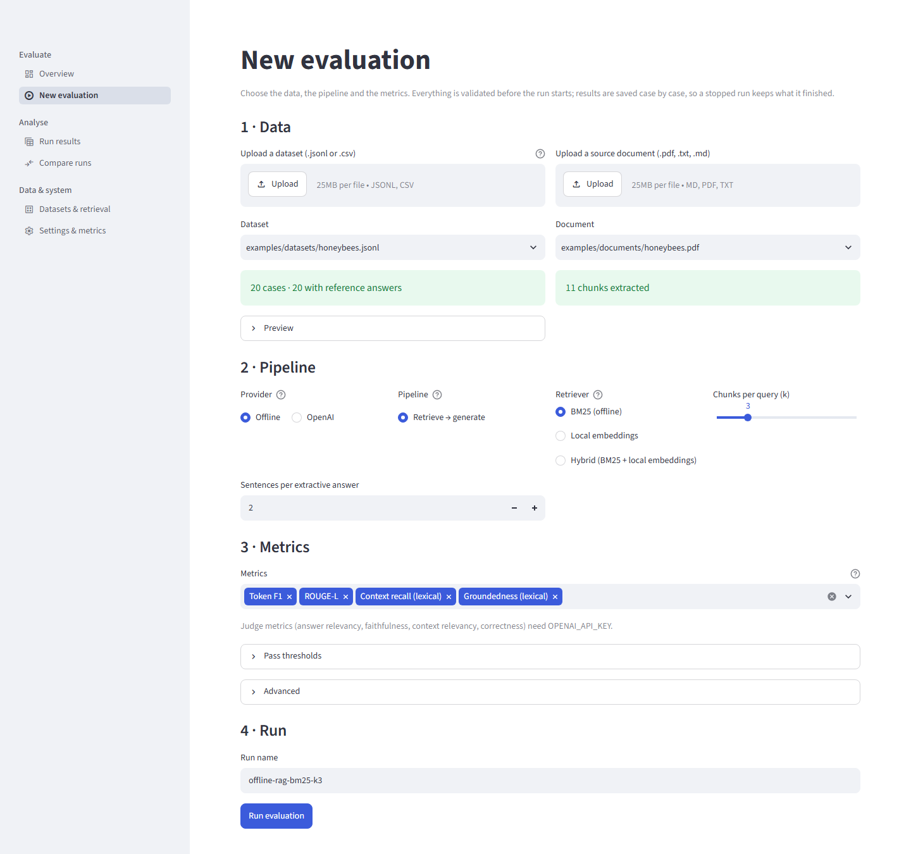

# Part IV — Running evaluations

Part III helped you decide what to run. This Part is about running it: the New evaluation page, the equivalent `ragwb run` command, what the workbench stores, how to repeat, organise, share and recover runs, and what to expect from a live provider. Everything shown as output was produced offline for this guide on the bundled data unless it names a live-verification run from `docs/LIVE_VERIFICATION.md`.

A note on commands. This guide writes `ragwb` for the command-line tool. It is the same as `python -m rag_workbench` (or `uv run ragwb` from the project folder). All output below came from version 1.4.1.

## 4.1 Three ways to run the same thing

There is one evaluation engine and three front doors.

| Front door | Best for | Needs | Notes |
|---|---|---|---|
| **New evaluation page** (web app) | exploring, teaching, one-off runs, uploading your own files | the app running (`python start.py`) | validates as you click; live progress; Stop button |
| **`ragwb run`** (command line) | scripts, CI, repeated experiments, batch sweeps | a terminal | every option as a flag; exit codes you can test |
| **Python API** | notebooks, custom loops, automated studies | `import rag_workbench` | the same runner the other two use |

All three write to the same run store, so a run started from a script shows up in the web app's Run results page and the reverse. A run's configuration is identical whichever door it came through, apart from the `started_by` field, which the web app fills with the signed-in user when accounts are enabled.

> **Why this works.** Because the engine is shared, a result you got in the browser can be reproduced from a script by copying the configuration shown on the run's Configuration tab. You never need to wonder whether the UI "does something extra".

## 4.2 The New evaluation page, step by step

The page is a single form in four numbered sections: Data, Pipeline, Metrics, Run. Nothing starts until you press the Run evaluation button at the bottom.



*The New evaluation page with its defaults: the bundled honeybee dataset and PDF, the offline provider, BM25, k = 3, and the four default lexical metrics.*

If your account is a read-only viewer, the page shows a warning ("Your account is read-only (viewer)") and stops: viewers can browse results but not start evaluations (Part VII).

### 4.2.1 Section 1: Data

Two columns, one for the dataset and one for the document.

**Dataset (left).**

1. *Upload a dataset (.jsonl or .csv).* Optional. A JSONL file has one object per line with `question`, optionally `expected_answer` and `id`, and optional `metadata`; a CSV needs a `question` column. The size limit is shown in the control's help (5 MB by default, `RAGWB_MAX_DATASET_BYTES`). An upload is saved once and becomes the selected dataset.
2. *Dataset (drop-down).* Lists the bundled datasets and anything you uploaded. The default is `examples/datasets/honeybees.jsonl`.
3. *Validation message.* Immediately below the drop-down you see either a green line such as "20 cases · 20 with reference answers", or a red box listing the first ten problems ("This dataset cannot be used"). Warnings (for example, rows without reference answers) appear in an expander. Fix a red box before you do anything else: the Run button will stay disabled.
4. *Preview.* An expander shows the first 20 cases in a table.

**Document (right).**

1. *Upload a source document (.pdf, .txt, .md).* Optional, 25 MB limit by default (`RAGWB_MAX_DOCUMENT_BYTES`).
2. *Document (drop-down).* Default `examples/documents/honeybees.pdf`.
3. *Chunk message.* A green "11 chunks extracted" for the default document, or a red error when the file has no usable text (a scanned PDF with no text layer, for example). The page re-reads the selected document on every interaction, which is fast for small documents.

What to check: the number of cases and the number with reference answers (reference-based metrics need them), and the chunk count (it limits the useful range of `k`). Part II explains how to prepare both files.

### 4.2.2 Section 2: Pipeline

| Control | Options | What it does | CLI equivalent |
|---|---|---|---|
| Provider | Offline, OpenAI | Who writes the answers. Choosing OpenAI without a key shows a warning ("OPENAI_API_KEY is not set") and later disables the Run button. | `--provider` |
| Pipeline | Retrieve → generate; Tool-calling agent | The agent option is offered only when the provider is OpenAI. | `--pipeline rag\|agent` |
| Retriever | BM25 (offline); API embeddings; Hybrid (BM25 + API embeddings); Local embeddings; Hybrid (BM25 + local embeddings) | The API options appear only when a key is configured; the local options appear only when the optional `fastembed` package is importable. | `--retriever` |
| Chunks per query (k) | slider, 1 to 10 (or the number of chunks, if smaller) | How many chunks are retrieved per question. Default 3. | `-k` (CLI allows up to 50) |
| Sentences per extractive answer | number, 1 to 10 | Offline provider only. | `--answer-sentences` |
| Generator model | text box | OpenAI provider only; pre-filled from `RAGWB_GENERATOR_MODEL`. | `--model` |

The choices are explained in Part III §3.2 to §3.6. The help icons beside Provider, Pipeline and Retriever carry a one-line version of the same advice.

### 4.2.3 Section 3: Metrics

* **Metrics (multi-select).** Lists only the metrics you can actually run. Judge metrics appear only when a key is configured; the two semantic metrics only when `fastembed` is importable. The default selection is the four lexical metrics: Token F1, ROUGE-L, Context recall (lexical) and Groundedness (lexical).
* **Judge model.** A text box that appears when any selected metric is a judge metric, pre-filled from `RAGWB_JUDGE_MODEL`.
* **Pass thresholds (expander).** One number box per selected metric, step 0.05, defaulting to the metric's convention (0.5 for token F1 and ROUGE-L, 0.7 for most others, 1.0 for exact match). Changing a threshold changes the pass rate, never the score (Part III §3.7.4).
* **Advanced (expander).**

| Control | What it does | CLI |
|---|---|---|
| Parallel cases | Cases evaluated at once, 1 to 32; 1 offline, the configured maximum (default 4) for OpenAI | `--workers` |
| Evaluate first N cases (0 = all) | A smoke-test limit. In the CLI, leave `--limit` out for all cases: 0, negative numbers and text are rejected | `--limit` |
| Seed | Seeds failure injection only | `--seed` |
| Inject failures (offline only) | Fraction of cases that fail on purpose, 0 to 1 | `--inject-failures` |
| Skip heading-like blocks | Drops short unpunctuated blocks (titles) from the chunks | `--skip-headings` |
| Abstain below this evidence share (offline only) | The extractive baseline's abstention threshold, 0 means always answer | `--min-evidence` |
| Notes | Free text stored with the run | `--notes` |

### 4.2.4 Section 4: Run

* **Run name.** Pre-filled as `provider-pipeline-retriever-kN` (for example `offline-rag-bm25-k3`), maximum 120 characters. Rename it to say what is different about this run ("k1-no-headings"), because the names are what you will search later.
* **Problems list.** If something prevents a run, a yellow box says "Cannot start yet:" followed by the reasons, and the Run evaluation button is disabled. The conditions are: the dataset has validation errors; the document has no usable text; no metric is selected; OpenAI is selected but the key is not set; the run needs a name.
* **Cost notice.** For an OpenAI run, or whenever a judge model is selected, a blue box says the run "calls the OpenAI API and may incur cost" and shows how many generation calls it will make, plus a note about judge calls when judge metrics are selected. Read it before pressing the button.
* **Run evaluation.** Pressing it first builds and validates the configuration ("Configuration rejected: ..." appears in red if the combination is invalid, for example a threshold outside 0 to 1), then starts.

### 4.2.5 What you see while it runs

A progress bar and a log box. The bar reads "7/20 cases". The log box shows the last eight cases, each with a tick for success or a cross with the error message for a failure ("✗ q11 — Injected offline failure ..."). Cases are reported approximately in dataset order even when several run in parallel.

Results are saved case by case. If something goes wrong halfway, the cases that finished are already in the run store.

### 4.2.6 Cancelling

Use Streamlit's own Stop button (top right while the app is running). The run is marked `cancelled` and keeps every finished case. Two things to know:

* In-flight model calls are allowed to finish, and with several workers up to twice the worker count of queued cases may also complete. Cancelling a live run is therefore not instant.
* A cancelled run is a real run with a real, partial summary. Its summary is computed over the cases that finished only (Part V explains why you must not compare it with a complete run).

### 4.2.7 After it finishes

The page shows a green or yellow banner ("Run X finished: completed · 20/20 cases succeeded"), a row of metric tiles with each metric's mean (hover for the scored, skipped and error counts), and a link "Inspect this run" to the Run results page. Part V takes over from there.

### 4.2.8 Differences between the page and the CLI

| Aspect | New evaluation page | `ragwb run` |
|---|---|---|
| Validation | live, as you select | when you press Enter; errors printed as `error: ...` with exit code 1 |
| k range | 1 to 10 | 1 to 50 |
| Default run name | built from your choices | `cli-run` |
| Judge and semantic metrics | hidden when unavailable | accepted, then refused with a clear message when the key is missing |
| Cancel | Stop button | Ctrl+C |
| Uploads | built in | give a file path |
| Parallel cases default | 1 offline, configured maximum for OpenAI | same |
| Signed-in user | recorded as `started_by` | not recorded |

## 4.3 `ragwb run`: every option

### 4.3.1 The reference table

This table is checked against `ragwb run --help` of version 1.4.1. Every option is optional; with no options the command evaluates the bundled honeybee dataset and PDF with the offline provider.

| Option | Meaning | Default | Notes |
|---|---|---|---|
| `--name NAME` | run name | `cli-run` | 1 to 120 characters; used in the run id and for searching |
| `--dataset DATASET` | dataset `.jsonl` or `.csv` | `examples/datasets/honeybees.jsonl` | path resolved to absolute and stored |
| `--document DOCUMENT` | source `.pdf`, `.txt` or `.md` | `examples/documents/honeybees.pdf` | |
| `--provider {offline,openai}` | who answers | `offline` | `openai` needs `OPENAI_API_KEY` |
| `--pipeline {rag,agent}` | how context reaches the generator | `rag` | `agent` needs `--provider openai` |
| `--retriever {bm25,embedding,hybrid,local,hybrid-local}` | how chunks are found | `bm25` | `embedding`, `hybrid` need a key; `local`, `hybrid-local` need `fastembed` |
| `-k K` | chunks retrieved per query | `3` | 1 to 50 |
| `--metrics METRICS` | comma-separated metric names | four lexical metrics offline; those plus the four judge metrics with `openai` | no spaces needed; duplicates are rejected |
| `--threshold METRIC=VALUE` | override a pass threshold | metric defaults | repeatable; value 0 to 1 |
| `--model MODEL` | generator model (`openai` only) | `RAGWB_GENERATOR_MODEL`, else `gpt-4o` | |
| `--judge-model JUDGE_MODEL` | judge model | `RAGWB_JUDGE_MODEL`, else `gpt-4o` | recorded only when a judge metric runs |
| `--workers WORKERS` | parallel cases | 1 offline; `RAGWB_MAX_WORKERS` (4) with `openai` | 1 to 32; 0, negatives and text are rejected (`argument --workers: must be 1 or more`, exit 2) |
| `--limit LIMIT` | evaluate only the first N cases | all | 1 or more; 0, negatives and text are rejected (`argument --limit: must be 1 or more`, exit 2) |
| `--answer-sentences N` | sentences per extractive answer | `2` | offline only; 1 to 10 |
| `--inject-failures F` | fraction of cases that fail on purpose | `0.0` | offline only; 0 to 1 |
| `--min-evidence X` | abstain unless the answer covers this share of the question's terms | `0.0` | offline only; 0 to 1 |
| `--skip-headings` | drop heading-like blocks from the chunks | off | flag |
| `--seed SEED` | seed for failure injection | `0` | no other effect |
| `--notes NOTES` | free-text note stored with the run | none | up to 2,000 characters when edited later |
| `--quiet` | suppress the per-case progress lines | off | the summary still prints |

The metric names accepted by `--metrics` are `exact_match`, `token_f1`, `rouge_l`, `context_recall`, `groundedness`, `semantic_similarity`, `semantic_context_recall`, `answer_relevancy`, `faithfulness`, `context_relevancy` and `correctness`.

Not options of `run`, but they shape it: `RAGWB_DATA_DIR` (where the run store lives), `RAGWB_MAX_REQUESTS_PER_MINUTE`, `RAGWB_MAX_RETRIES`, `RAGWB_RETRY_BASE_DELAY_S`, `RAGWB_REQUEST_TIMEOUT_S`, `RAGWB_CASE_TIMEOUT_S` (Part III §3.9 to §3.11).

### 4.3.2 Reading the output

```text
$ ragwb run --name smoke --limit 3
[  1/3] ok  q01
[  2/3] ok  q02
[  3/3] ok  q03

Run 20261030-205005-smoke-b30ed3: completed
cases 3  ok 3  errors 0  mean latency 0.7 ms
metric                          mean           95% CI    pass  scored  skip  err
Token F1                       0.313      0.167-0.407      0%       3     0    0
```

* **Run id.** `<UTC date>-<UTC time>-<name slug>-<six hex>`. Every other command accepts it, or a unique prefix, the last 6 characters (the short id the web app shows), or the exact run name, as long as the text is at least 4 characters and matches one run (Part VI §6.1.2). Copy ids from `ragwb list`.
* **Status.** `completed` (no case errors), `partial` (some cases errored), `failed` (every case errored), `cancelled` (stopped), or later `interrupted` and `imported` (§4.7, §4.10).
* **cases / ok / errors.** How many cases were evaluated, produced an answer, or failed to.
* **mean latency.** Average time per case in the pipeline (retrieval plus generation), not including scoring.
* **The metric table.** `mean` and a bootstrap 95% confidence interval; `pass` is the share of scored cases at or above the threshold; `scored`, `skip` and `err` partition the cases for that metric. A skipped case had nothing to score (for example, no reference); an error means the metric itself failed. Skips and errors are left out of the mean, never counted as zeros.
* **Provenance warnings**, if any, print as lines starting with `!`.

### 4.3.3 Exit codes

| Code | Meaning |
|---|---|
| 0 | the run finished with status `completed` |
| 1 | a configuration or input error; nothing was run (the message starts `error:`) |
| 2 | the run finished `partial` or `failed` |
| Ctrl+C | the run is stored as `cancelled` and Python's interrupt exit applies |

A script can therefore tell "bad command" (1) from "ran, but some cases failed" (2) from success (0). `ragwb regress` has its own codes (§3.13.2 of Part III, and Part VII).

### 4.3.4 What `run` refuses, and how it says so

Every refusal below was produced offline. Errors go to standard error and nothing is stored.

```text
$ ragwb run --name x --provider openai --quiet          # no key configured
error: Metric(s) answer_relevancy, faithfulness, context_relevancy, correctness use an OpenAI judge model and need OPENAI_API_KEY.

$ ragwb run --name x --metrics nope --quiet
error: Unknown metric(s): nope. Available: exact_match, token_f1, rouge_l, context_recall, ...

$ ragwb run --name x -k 0 --quiet
error: 1 validation error for RunConfig
k
  Input should be greater than or equal to 1 ...

$ ragwb run --name x --threshold token_f1=1.5 --quiet
error: Invalid threshold(s): {'token_f1': 1.5}; thresholds must be in [0, 1] for known metrics

$ ragwb run --name x --dataset nofile.jsonl --quiet
error: Dataset 'nofile.jsonl' is invalid: file not found: ...

$ ragwb run --name x --retriever hybrid --quiet
error: OPENAI_API_KEY is not set; it is required for the hybrid retriever. Add it to .env or use the offline provider with the BM25 retriever.
```

All exit with code 1. A refusal costs nothing and happens before a run row is created, so a typo never leaves clutter in your run list.

## 4.4 Recipes

Each recipe below was run offline for this guide. Replace the dataset and document with your own files when you have them. Outputs are shortened to the lines that matter.

### 4.4.1 Recipe: smoke run with `--limit`

Goal: prove an install, a dataset and a document work in a second.

```text
ragwb run --name smoke --limit 3
```

Output: the one shown in §4.3.2. Use it after every install or upgrade, and after editing a dataset. (Part I walks through the same check as part of the first-run tour.)

### 4.4.2 Recipe: a full offline run

Goal: the baseline for a dataset. Run all cases and keep the run.

```text
$ ragwb run --name honeybees-baseline --quiet
Run 20261030-...-honeybees-baseline-...: completed
cases 20  ok 20  errors 0  mean latency 0.5 ms
Token F1                       0.346      0.285-0.419       5%      20     0    0
ROUGE-L                        0.317      0.252-0.393       5%      20     0    0
Context recall (lexical)       0.885      0.839-0.930      95%      20     0    0
Groundedness (lexical)         1.000      1.000-1.000     100%      20     0    0
```

This is the baseline to remember for the bundled honeybee data. Any later change (a different `k`, retriever or skip-headings setting) should be compared with it.

### 4.4.3 Recipe: a different dataset and document

```text
ragwb run --name volcanoes-k3 --dataset examples/datasets/volcanoes.jsonl --document examples/documents/volcanoes.pdf
```

The dataset and the document must belong together: the questions in `volcanoes.jsonl` are about the document `volcanoes.pdf`. Running the honeybee questions against the volcano document would give meaningless low scores and no error, because the tool cannot know your questions do not fit the document. The dataset hash and document hash are stored, so a mismatch can at least be spotted later.

Other bundled pairs: `coffee.jsonl` with `coffee.pdf`, `lighthouses.jsonl` with `lighthouses.pdf`, and the two honeybee variants `honeybees_paraphrased.csv` (5 questions) and `honeybees_unanswerable.jsonl` (6 questions) with `honeybees.pdf`.

### 4.4.4 Recipe: a sweep over k

Goal: three runs that differ only in `k`. Put them in a shell loop so they cannot drift apart. (This is the loop I used for Part III §3.5.2.)

```bash
for k in 1 3 5; do
  ragwb run --name "honeybees-k$k" -k $k --quiet | grep -E "^(Token|Context)"
done
```

Result:

```text
Token F1                       0.404      0.335-0.476      20%      20     0    0
Context recall (lexical)       0.857      0.798-0.912      90%      20     0    0
Token F1                       0.346      0.285-0.419       5%      20     0    0
Context recall (lexical)       0.885      0.839-0.930      95%      20     0    0
Token F1                       0.346      0.285-0.419       5%      20     0    0
Context recall (lexical)       0.892      0.846-0.937      95%      20     0    0
```

Then `ragwb compare <id-k1> <id-k3>` for the paired comparison (Part V).

### 4.4.5 Recipe: threshold overrides

```text
$ ragwb run --name thr --threshold token_f1=0.3 --threshold rouge_l=0.3 --quiet
Token F1                       0.346      0.285-0.419      60%      20     0    0
ROUGE-L                        0.317      0.252-0.393      45%      20     0    0
```

Same means as the default run, different pass rates. The effective thresholds are stored in the run (§4.5).

### 4.4.6 Recipe: injected failures, to see error handling

Goal: see what a run with failures looks like before you meet one by accident. `--inject-failures F` makes the offline generator fail on a fraction `F` of the cases, deterministically for a given seed. It is a testing aid and it is only available offline.

```text
$ ragwb run --name inject --inject-failures 0.3 --seed 1 --notes "failure demo"
[  1/20] ERR q01  Injected offline failure (offline_failure_rate > 0)
[  2/20] ERR q02  Injected offline failure (offline_failure_rate > 0)
[  3/20] ok  q03
...
[ 11/20] ERR q11  Injected offline failure (offline_failure_rate > 0)
...
[ 20/20] ERR q20  Injected offline failure (offline_failure_rate > 0)

Run 20261030-205205-inject-34d959: partial
cases 20  ok 14  errors 6  mean latency 1.1 ms
metric                          mean           95% CI    pass  scored  skip  err
Token F1                       0.343      0.269-0.448       7%      14     0    6
ROUGE-L                        0.316      0.240-0.424       7%      14     0    6
Context recall (lexical)       0.906      0.853-0.953      93%      14     0    6
Groundedness (lexical)         1.000      1.000-1.000     100%      14     0    6
```

What to learn from it:

* Six of the 20 cases failed. The rate 0.3 is a per-case probability, so the exact count varies by seed (seed 2 also failed six cases, a different six).
* The run status is `partial`, and the command's exit code is 2.
* Every metric shows `scored 14` and `err 6`. The six failed cases did not become zeros; they were excluded from the means. The mean token F1 is the mean over the 14 that worked. This is also why a heavily failing run can look *better* than a clean one: it only reports on the cases that succeeded. Always read `scored` next to `mean`.
* The failures are not retried. An injected failure is a permanent error, not a transient one, so retrying it would only add delay.
* At `--inject-failures 1.0` every case fails and the run status is `failed`, with every metric showing `scored 0` and a dash for the mean (I ran it with `--limit 3`).

### 4.4.7 Recipe: `--workers`

```text
$ ragwb run --name w4 --workers 4 --quiet
Run ...-w4-...: completed
cases 20  ok 20  errors 0  mean latency 0.5 ms
Token F1                       0.346      0.285-0.419       5%      20     0    0
```

Identical scores to one worker. Offline it buys nothing; live it matters (Part III §3.10).

### 4.4.8 Recipe: `--seed`

`--seed 7` and `--seed 0` gave identical summaries for the honeybee baseline. A seed is only meaningful together with `--inject-failures`; without it, passing different seeds records different numbers in the configuration and changes nothing else. Do not make a "seed sweep" of a deterministic offline run and report the spread as variance: there is none.

### 4.4.9 Recipe: `--notes` and `--name`

Treat the name as a short label and the notes as the lab notebook.

```text
ragwb run --name "hb-k1-nohead" -k 1 --skip-headings --notes "testing whether the title chunk hurts at k=1; baseline is honeybees-baseline" --quiet
```

Good names say what changed. Good notes say why you ran it and what you expect. Both are searchable (§4.9).

### 4.4.10 Recipe: abstention and skip headings

```text
ragwb run --name unans --dataset examples/datasets/honeybees_unanswerable.jsonl --quiet
ragwb run --name unans-me --dataset examples/datasets/honeybees_unanswerable.jsonl --min-evidence 0.7 --skip-headings --quiet
```

Token F1 rises from 0.039 to 0.698 because the baseline now abstains correctly on the unanswerable questions. The details and the cost of that trade are in Part III §3.6.2.

### 4.4.11 Recipe: a paced run

```text
RAGWB_MAX_REQUESTS_PER_MINUTE=120 ragwb run --name paced --limit 6 --quiet
```

Six offline cases at 120 operations per minute, which is one every half second. The whole command took about 4 s. This is how to rehearse pacing without a provider. In PowerShell, set the variable first: `$env:RAGWB_MAX_REQUESTS_PER_MINUTE = "120"`.

## 4.5 What is stored with a run

When a run starts the workbench writes a row to the run store (`runs.db`, in your data directory) and then adds each case as it finishes. Nothing is held only in memory.

### 4.5.1 The run record

I exported a completed run to JSON and listed its keys. These are the real field names.

```text
run keys:    id, name, status, created_at, finished_at, config, dataset_sha256,
             document_sha256, n_cases, summary, environment, notes, tags
config keys: started_by, name, dataset_path, document_path, provider, pipeline, retriever,
             k, metrics, thresholds, generator_model, embedding_model, judge_model,
             max_workers, max_retries, request_timeout_s, case_timeout_s,
             max_answer_sentences, min_evidence, skip_headings, limit, notes,
             offline_failure_rate, seed, prices_usd_per_mtok
environment: rag_workbench 1.4.1, python 3.12.15, platform Windows-11-..., packages:
             deepeval 4.3.1, langchain 1.4.7, langchain-openai 1.7.2, openai 3.37.0,
             pymupdf 1.28.2, streamlit 1.66.1, pydantic 2.14.1
```

| Part | What it is for |
|---|---|
| `config` | everything needed to repeat the run; **no secrets** (the API key is never stored). `thresholds` holds the effective thresholds actually used, `generator_model` the model that actually answered, `prices_usd_per_mtok` the prices in force |
| `dataset_sha256`, `document_sha256` | SHA-256 hashes of the two input files; `ragwb rerun` compares them with the current files to warn when an input changed |
| `environment` | the workbench version, Python version, platform and the versions of the key libraries |
| `summary` | per-metric statistics (mean, median, SD, min, max, 95% CI, threshold, pass counts, scored, skipped and error counts) plus latency and token totals |
| `status`, `created_at`, `finished_at` | lifecycle |
| `notes`, `tags` | your annotations (§4.9) |

### 4.5.2 The per-case results

Each case holds: its id and dataset position; the question and expected answer; the `status` (`ok` or `error`); the `answer`; the retrieved `contexts` (chunk id, text, page, retrieval score, rank); where the context came from (`context_source`: `retriever`, or `agent_tool` for the agent pipeline); latency; prompt and completion tokens; cost; the number of `attempts`; the `error` text if any; and, for every metric, a record with `status` (ok, skipped or error), `score`, `threshold`, `passed`, a human-readable `reason` and a `cost_usd`.

That is why you can answer after the fact "what did the retriever give for q14, and what did the metric say?" without re-running anything. The `reason` field is worth reading: the token F1 reason for q01 says "precision 0.11, recall 0.40 (2 shared tokens)".

### 4.5.3 Where it lives

| Item | Location |
|---|---|
| run store | `<data dir>/runs.db` (SQLite) |
| uploads from the web app | `<data dir>/uploads/` |
| exports | `<data dir>/exports/` (default for `ragwb export`) |
| logs | `<data dir>/logs/rag_workbench.log` |
| backups | `<data dir>/backups/` |
| local embedding model | `<data dir>/models/` |

`<data dir>` is `data/` beside the project, or the folder named by `RAGWB_DATA_DIR`. The store keeps absolute file paths for the dataset and document; exported bundles use relative paths (§4.10).

### 4.5.4 Reproducibility, as far as it goes

For the offline path, the stored configuration plus the two input files and the code are everything needed to get the same scores again; only latency varies. For a live provider, the record tells you what you asked for, but it cannot pin a model alias to a snapshot or capture the judge's internal prompts, so a rerun gives similar, not identical, numbers (Part III §3.12.2).

## 4.6 Reruns

`ragwb rerun RUN_ID` repeats a stored run with its recorded configuration: same dataset and document paths, provider, pipeline, retriever, `k`, metrics, thresholds, models, workers, seed and so on. It creates a new run; the original is untouched.

```text
$ ragwb rerun 20261030-205208-inject2-1b2ca1 --name inject2-rerun --quiet

Run 20261030-205306-inject2-rerun-608e73: partial (re-run of 20261030-205208-inject2-1b2ca1)
cases 20  ok 14  errors 6  mean latency 1.6 ms
```

The rerun failed the same six cases, because failure injection is deterministic for a given seed and question.

Details:

* **Name.** Default is `<old name>-rerun`; give another with `--name`.
* **Notes.** The new run's note is set to "Re-run of <original id>" followed by the old run's note, if it had one.
* **Changed inputs.** If the dataset or document file no longer has the stored SHA-256, the command prints a warning to standard error: "the dataset has changed since the original run (different SHA-256); results are not like-for-like". The run still happens. Read the warning.
* **Relative paths.** A run imported from a bundle has relative dataset and document paths; they are resolved against the project folder, so the example data works and your own data works only if the files are at those relative locations.
* **What a rerun is for.** (1) A run was interrupted or cancelled and you want a complete one. (2) You want to check that offline results reproduce. (3) A provider hiccup left many errors and you want a clean run. (4) You upgraded the tool and want to know whether scores moved.
* **What a rerun is not.** It does not change anything. To change one setting, start a new run with that setting (copy the command from the stored configuration) rather than a rerun.
* **Judge and live runs.** A rerun of a live run calls the provider again and costs again. If the key is no longer configured, it refuses with the same message as `run`.

## 4.7 Cancelled, interrupted and partial runs

Three different situations end with fewer than all cases complete. Telling them apart tells you what to do.

| Status | What happened | Cases stored | Summary | What to do |
|---|---|---|---|---|
| `completed` | every case ran with no case error | all | complete | nothing |
| `partial` | the run finished, but some cases errored | all (errored ones marked) | over the cases that worked | find out why they failed (§4.8); `rerun` after fixing |
| `failed` | every case errored | all (all errored) | no scores | it is a configuration or provider problem |
| `cancelled` | you stopped it (Stop button or Ctrl+C) | the cases finished before the stop | over those cases | `rerun` for a full run |
| `interrupted` | the process died (power, crash, closed terminal) and the run was left `running` | the cases committed before the crash | over those cases | `rerun` |
| `imported` | the run came from a bundle (§4.10) | all from the bundle | recomputed from the bundle | read only |

### 4.7.1 Cancelled

Both front doors cancel the same way: the runner finishes the cases in flight, writes the summary for what was done and marks the run `cancelled`. From Python you can demonstrate it with a `threading.Event`. I cancelled a 20-case run after seven cases:

```text
status cancelled  cases stored 7 of 20
summary n_cases 7  metrics {'token_f1': 7, 'context_recall': 7}
```

Seven cases were stored; the summary counts only those seven. Do not read the means of a cancelled run as if they covered the dataset: the first cases of a dataset are often not representative.

### 4.7.2 Interrupted, and the 15-minute heartbeat

Each committed case refreshes a heartbeat timestamp on its run. If a run is still `running` and no case has been committed for 15 minutes, the next start-up marks it `interrupted`. "Start-up" means any command or page that opens the run store: the CLI, the web app, `ragwb doctor`. A run that really is executing in another process keeps a fresh heartbeat and is left alone.

I rehearsed this offline by creating a run record that was never finished, giving it an old heartbeat in my scratch store, and listing runs:

```text
$ ragwb list --status interrupted
                        run_id    name      status provider pipeline retriever  k  n_cases n_errors tags
20260101-000000-crashed-abc123 crashed interrupted  offline      rag      bm25  3       20     None
```

(That row was forged for the demonstration; it did not come from a real crash.) `ragwb doctor` also reports runs that look abandoned, with a warning such as "1 run(s) look abandoned (they are marked interrupted at the next start)", which is why `doctor` is worth running after a crash.

Recovery steps:

1. `ragwb list --status running` to see what is still marked running.
2. Wait 15 minutes since the last case, or simply start any command: stale runs are marked `interrupted`.
3. `ragwb rerun <run id>` to repeat the run in full. I did this with the forged run and it produced a normal `completed` run named `recovered`.
4. Optionally delete the interrupted run: `ragwb delete <run id> --yes`.

> **Pitfall.** The interrupted run's stored cases are real. Do not mix them into a comparison with a complete run; either rerun or compare only on the cases both runs have.

### 4.7.3 Partial runs

`partial` is the status to watch for after a live run. It means the run finished, but at least one case could not produce an answer. A complete summary of a partial run is still a summary of the cases that worked. Two quick checks:

```text
ragwb list --status partial
ragwb export <run id> --format csv
```

The CSV export has an `error` column for every case, and the Markdown report lists the lowest-scoring cases per metric. In the web app, the Run results page has a Failed cases view with the same information (Part V). Decide for each error whether it is transient (rate limit, timeout, connection drop) and worth a rerun, or permanent (bad model name, authentication, an injected failure) and worth a configuration fix.

## 4.8 Failure handling

### 4.8.1 Two levels of failure: case and metric

The workbench keeps these apart, and so should you.

| Level | What it means | How it is recorded | Effect on means |
|---|---|---|---|
| **Case error** | the pipeline could not produce an answer (provider error, retries exhausted, time limit) | case `status = error`, with the error text; no metrics are scored | none of that case's metrics include it |
| **Metric error** | the answer exists, but one metric failed (a judge call failed after its retries) | that metric result `status = error`; the other metrics for the case are fine | only that metric loses the case |
| **Metric skipped** | the metric does not apply (no reference, no context, an abstention) | `status = skipped`, with a reason | left out, on purpose |

Errors and skips are both left out of the mean and counted separately in `scored`, `skip` and `err`. Never counted as zero. That is deliberate (a failing judge should not look like a wrong answer), and it is also the reason to read those columns every time.

### 4.8.2 Retries and back-off

A generation call that fails with a *transient* error (rate limit, timeout, connection error, 5xx) is retried up to `RAGWB_MAX_RETRIES` times (default 3) with exponential back-off and jitter; a judge call is retried the same way inside the judge wrapper. A permanent error (authentication, an unknown model, a malformed request, an injected failure) is not retried.

With the default base delay of 1 s, the wait before the first retry is roughly 1 to 2 s, then 2 to 3 s, then 4 to 5 s. If the provider supplies a `Retry-After`, the wait is stretched to it, capped at 60 s. The case record's `attempts` field shows how many tries a case needed, and a case that gave up carries an error ending "(gave up after N attempts)". Part III §3.9.4 has the settings and their limits.

### 4.8.3 The case time limit

`RAGWB_CASE_TIMEOUT_S` (default 600 s, maximum 3,600 s) caps the wall-clock time of one case, including generation, retries and every metric. A case that exceeds it is abandoned and recorded as an error: "Case exceeded the N s time limit and was abandoned (raise RAGWB_CASE_TIMEOUT_S if your provider is slow)". The run carries on. Python cannot kill a thread, so the abandoned call may keep running in the background until its own HTTP timeout, and its result is thrown away.

### 4.8.4 A failure triage table

| What you see | Likely cause | First action |
|---|---|---|
| `Injected offline failure` | you set `--inject-failures` | remove it unless you meant it |
| `OpenAI-compatible API RateLimitError ... (gave up after N attempts)` | provider rate or token limit | slow down: `RAGWB_MAX_REQUESTS_PER_MINUTE`, fewer workers; check the daily quota |
| `... Timeout ...` or `Connection error` | slow provider or network drop | retries handle short drops; raise `RAGWB_REQUEST_TIMEOUT_S` if consistently slow; `rerun` |
| `OpenAI rejected the API key (AuthenticationError)` | wrong or expired key, or key for a different provider | fix the key (Part VIII); no retry will help |
| a "model not found" style error | model name does not exist at that provider | use the provider's own model names |
| `Case exceeded the N s time limit` | slow provider, many retries, many judge metrics | raise `RAGWB_CASE_TIMEOUT_S` together with the retry budget |
| `Agent returned no structured answer` | the agent model did not return the required answer format | try another tool-calling model |
| `Unexpected ...Error` or `Internal ...Error` | a bug or an unusual response | note the message, check `<data dir>/logs/rag_workbench.log`, report it |

### 4.8.5 Seeing every failed case

* **Markdown export:** `ragwb export RUN_ID --format md` lists the lowest-scoring cases per metric with the metric's reason.
* **CSV export:** one row per case with an `error` column (§4.10).
* **Web app:** the Run results page has a Failed cases view and per-case detail (Part V).
* **Log file:** `<data dir>/logs/rag_workbench.log` records retries, throttling and run lifecycle. Keys and passwords are redacted.

## 4.9 Organising runs: tags, notes and search

After a day of experiments you will have dozens of runs with similar names. The workbench has three tools for finding them again, and they all work from the CLI and the web app.

### 4.9.1 Tags

`ragwb tag RUN_ID --add a,b --remove c`. Tags are lowercase letters, digits, `.`, `_` and `-` (at most 30 characters each, at most 10 per run). Spaces become hyphens and capitals become lowercase.

```text
$ ragwb tag 20261030-205214-w4-94e19c --add baseline,week1
20261030-205214-w4-94e19c: tags = baseline, week1
$ ragwb tag 20261030-205214-w4-94e19c --add Needs-Review
20261030-205214-w4-94e19c: tags = baseline, week1, needs-review
$ ragwb tag 20261030-205214-w4-94e19c --remove week1
20261030-205214-w4-94e19c: tags = baseline, needs-review
```

### 4.9.2 Notes

`ragwb note RUN_ID "text"` sets the note, `ragwb note RUN_ID --clear` removes it. A note is at most 2,000 characters. `--notes` at run time sets the same field.

```text
$ ragwb note 20261030-205214-w4-94e19c "first offline baseline, k=3"
20261030-205214-w4-94e19c: note saved
```

### 4.9.3 Listing and searching

```text
$ ragwb list --tag baseline
                   run_id name    status provider pipeline retriever  k  n_cases  n_errors                  tags
20261030-205214-w4-94e19c   w4 completed  offline      rag      bm25  3       20         0 baseline,needs-review

$ ragwb list --status partial
                        run_id    name  status provider pipeline retriever  k  n_cases  n_errors tags
20261030-205208-inject2-1b2ca1 inject2 partial  offline      rag      bm25  3       20         6
 20261030-205205-inject-34d959  inject partial  offline      rag      bm25  3       20         6

$ ragwb list --search baseline honeybees       # every word must match
$ ragwb list --status cancelled
No run matches (of 28 stored).
```

`--search` takes one or more words; every word must appear (case-insensitively) somewhere in the run's id, name, notes, tags, status, provider, pipeline, retriever or the dataset and document file names. `--tag` and `--status` filter exactly. They combine.

### 4.9.4 A naming and tagging convention that works

| Element | Convention | Example |
|---|---|---|
| name | `<dataset>-<what changed>` | `honeybees-k1`, `volcanoes-hybrid-local` |
| tags | a stage, a purpose, a person | `baseline`, `candidate`, `release-2`, `ana` |
| notes | the hypothesis and the comparison run | `testing if skip-headings fixes q-parasite; compare with honeybees-baseline` |
| `needs-review` tag | runs a colleague should look at | |

> **Pitfall.** `ragwb prune --keep-last N` and `--older-than-days D` delete old runs, and only one tag protects a run from it: `keep`. A run tagged `baseline` (or anything else) can still be pruned, so tag the runs you must not lose `baseline,keep`. Without `--yes` it only lists what it would delete. Use that dry run first, and back up (`ragwb backup`) before pruning anything you might need.

## 4.10 Importing and exporting runs

### 4.10.1 Three export formats

`ragwb export RUN_ID --format csv|json|md [--out-dir DIR]` writes one file named after the run id. The default folder is `<data dir>/exports/`.

| Format | What it contains | Use it for |
|---|---|---|
| `json` | a re-importable bundle: the whole run record and every case result | moving a run to another machine, archiving, sharing |
| `csv` | one row per case: position, id, status, question, expected answer, answer, error, latency, tokens, cost, attempts, number and ids of contexts, and score, passed and status for every metric | spreadsheets, pivot tables, your own plots |
| `md` | a readable report: configuration summary, the metric table, and the lowest scores per metric with the reasons | pasting into a ticket, a review, a lab report |

I exported one run in all three formats. The Markdown report begins like this:

```text
Evaluation report: w4 (the file's first line is a Markdown heading)

* Run id: `20261030-205214-w4-94e19c`
* Status: **completed**
* Provider / pipeline / retriever: offline / rag / bm25
* k: 3  ·  generator: offline-extractive  ·  judge: None
* Dataset: `honeybees.jsonl` (sha256 `7eff99c359ac`)
* Document: `honeybees.pdf` (sha256 `7e743ff01203`)

## Summary

Cases: 20 · succeeded: 20 · errors: 0 · mean latency: 0.5 ms · p95: 0.7 ms · tokens in/out: —/— · cost: — USD
```

and continues with the metric table and "Lowest Token F1" and "Lowest ROUGE-L" tables. The CSV starts with the columns `position,case_id,status,question,expected_answer,answer,error,latency_ms,prompt_tokens,completion_tokens,cost_usd,attempts,n_contexts,context_ids,token_f1,token_f1_passed,token_f1_status,...`. (It begins with a byte-order mark so Excel opens it with the right encoding.)

### 4.10.2 The bundle format

A JSON export is a bundle:

```json
{"format": "rag-workbench-run", "version": 1, "run": { ...the run record... }, "cases": [ ...case results... ]}
```

Bundles contain relative dataset and document paths, so they do not leak your folder layout. They are validated on import: the wrong format or version, invalid JSON, duplicate case ids and files over 50 MB are refused with a clear error.

### 4.10.3 Importing

`ragwb import BUNDLE [BUNDLE ...]` imports one or more bundles. I imported the bundle into a second, empty data directory and then repeated the command:

```text
$ ragwb import 20261030-205214-w4-94e19c.json
20261030-205214-w4-94e19c.json: imported as 20261030-205214-w4-94e19c
$ ragwb import 20261030-205214-w4-94e19c.json
20261030-205214-w4-94e19c.json: already present, skipped
$ ragwb list
                   run_id name   status provider pipeline retriever  k  n_cases  n_errors                  tags
20261030-205214-w4-94e19c   w4 imported  offline      rag      bm25  3       20         0 baseline,needs-review
```

Notes:

* An imported run has the status `imported`; its original status is kept in its configuration.
* **Duplicates are skipped**, so importing twice is harmless.
* Tags and notes travel with the bundle.
* **The summary is recomputed** from the case results in the bundle using the same aggregation as a new run. A summary written into the file is never displayed. The per-case scores are taken as they are: a bundle holds results, not the means to re-run a judge.
* An imported run can be viewed, compared and exported. To rerun it, the dataset and document must exist at the relative paths it records.

The project ships one real bundle, the live run 7 (30 volcano questions, judged by a Qwen model), in `calibration/`. Importing it lets you explore live results and calibrate a judge offline with no key (Part III §3.7.6, Part VI).

### 4.10.4 Sharing results safely

| Share | How | Safe because |
|---|---|---|
| one run with a colleague | `export --format json`, send the file, they `import` it | no key and no absolute paths inside |
| a report for a manager | `export --format md` or `csv` | plain text |
| everything | `ragwb backup` (copies `runs.db`) | a verified snapshot; also copy `users.json` separately if you use accounts |

> **Pitfall.** Exports and backups contain your questions, your reference answers and the retrieved text of your documents. They do not contain keys, but they can contain confidential content. Treat them like the documents themselves.

## 4.11 Scoring one answer with `ragwb score`

`ragwb score` scores a single answer against a question, an optional reference and optional context, and stores nothing. It is the quickest way to learn how a metric behaves, to settle an argument about one case, and to try a metric you have not used.

```text
ragwb score --question Q --answer A [--expected REF] [--context TEXT ...] [--metrics a,b] [--judge-model M]
```

`--context` is repeatable (one per passage).

A perfect answer, with context:

```text
$ ragwb score --question "How many queens does a typical honeybee colony have?" \
    --answer "A colony normally has a single queen." \
    --expected "A colony normally has a single queen." \
    --context "A healthy colony normally has a single queen, thousands of workers and a few hundred drones." \
    --metrics token_f1,context_recall,groundedness
Token F1                      1.000  pass    precision 1.00, recall 1.00 (5 shared tokens)
Context recall (lexical)      1.000  pass    4/4 reference terms found in context
Groundedness (lexical)        1.000  pass    4/4 answer terms found in context
```

A wrong answer:

```text
$ ragwb score --question "Where are honeybees thought to have originated?" \
    --answer "Honeybees originated in Europe." \
    --expected "Honeybees are thought to have originated in Asia." \
    --metrics token_f1,exact_match,rouge_l
Token F1                      0.500  pass    precision 0.75, recall 0.38 (3 shared tokens)
Exact match                   0.000  fail    normalised strings differ
ROUGE-L                       0.500  pass    LCS 3 tokens; P 0.75, R 0.38
```

This second example is the best short lesson in why lexical metrics are not enough: a factually wrong answer ("Europe" for "Asia") passes token F1 at the default 0.5 threshold because three of its four words overlap with the reference. A meaning-aware metric (`correctness`, or `semantic_similarity`) would have a chance of catching it; the lexical ones cannot.

A judge metric without a key is refused before anything happens:

```text
$ ragwb score --question q --answer a --expected e --metrics correctness
error: Metric(s) correctness use an OpenAI judge model and need OPENAI_API_KEY.
```

The default metrics for `score` are the four offline ones. A metric whose inputs are missing is reported as skipped with its reason: with no `--context`, `context_recall` and `groundedness` print `skipped  no retrieved context for this case` (I checked).

> **Why this works.** `ragwb score` is also your debugger. If a case in a run looks wrong, copy its question, answer, reference and contexts from the case detail into `ragwb score` and try different metrics and wordings until the behaviour makes sense.

## 4.12 Running from Python

The workbench has no HTTP API. The Python package is the programmatic interface, and the CLI and the web app are thin layers over it.

### 4.12.1 The minimal script

This is the script from `docs/API_REFERENCE.md` with its real output.

```python
from rag_workbench.config import load_settings
from rag_workbench.models import RunConfig
from rag_workbench.services import open_context
from rag_workbench.reporting import export_markdown

ctx = open_context(load_settings(), console_logging=False)      # settings + the run store
config = RunConfig(
    name="scripted-k3",
    dataset_path=str(ctx.settings.default_dataset),
    document_path=str(ctx.settings.default_document),
    k=3,
    metrics=["token_f1", "context_recall"],
)
run = ctx.runner().run(config, progress=lambda p: print(p.done, "/", p.total, end="  "))
print()
print(run.status, run.summary.metrics["context_recall"].mean)
md = export_markdown(run, ctx.store.get_case_results(run.id))
print(len(md), "characters of Markdown")
```

Output:

```text
1 / 20  2 / 20  3 / 20  ... 19 / 20  20 / 20
completed 0.8846608946608946
2222 characters of Markdown
```

Points to know:

* `load_settings()` reads the environment and, unless `RAGWB_NO_DOTENV=1` is set, the project's `.env` file. It raises `ConfigError`, naming the bad variable, for an invalid setting.
* `RunConfig` validates everything (k from 1 to 50, unique metrics, thresholds, and so on). It holds no secrets.
* `ctx.runner().run(config, progress=..., cancel=...)` validates first (`prepare`), then executes. If you want to separate the two steps, call `prepare(config)` and `execute(prepared, ...)` yourself: `prepare` has no side effects and raises before any run row is created.
* The progress callback receives an object with `done`, `total`, `case_id`, `status` and `message`.

### 4.12.2 Cancelling from code

Pass a `threading.Event`. Set it from the progress callback, from another thread, or from a signal handler.

```python
import threading
cancel = threading.Event()

def stop_after_seven(p):
    if p.done >= 7:
        cancel.set()

cfg2 = config.model_copy(update={"name": "scripted-cancel"})
run2 = ctx.runner().run(cfg2, progress=stop_after_seven, cancel=cancel)
print("status", run2.status, "cases stored", len(ctx.store.get_case_results(run2.id)), "of", run2.n_cases)
```

```text
status cancelled  cases stored 7 of 20
```

### 4.12.3 A parameter sweep in code

```python
for k in (1, 3, 5):
    cfg = config.model_copy(update={"name": f"scripted-k{k}", "k": k})
    run = ctx.runner().run(cfg)
    print(k, run.status, round(run.summary.metrics["context_recall"].mean, 3))
```

Use `model_copy(update=...)` so each configuration differs by exactly one field. Add a try/except for `ConfigError`, `DatasetError` and `DocumentError` around `run` if your sweep includes inputs that might be invalid.

### 4.12.4 The main building blocks

| Object | Module | Use |
|---|---|---|
| `load_settings()` | `config` | read the environment into `Settings` |
| `RunConfig` | `models` | everything a run needs |
| `open_context(settings)` | `services` | settings plus an open run store, with `.runner()` |
| `EvaluationRunner.prepare / execute / run` | `runner` | validate then execute; `cancel` is a `threading.Event` |
| `RunStore` | `storage` | `list_runs`, `get_run`, `get_case_results`, `delete_run` |
| `export_run`, `export_markdown`, `comparison_dataframe` | `reporting` | exports and tables |
| `summarize_run`, `paired_comparison`, `bootstrap_ci` | `aggregate` | statistics over case results |
| `load_bundle`, `import_bundle` | `archive` | bundles |
| `validate_file` | `datasets` | dataset validation report |

> **Pitfall.** `open_context` opens the run store in `RAGWB_DATA_DIR` (or the project's `data/`). A script run from a different folder with a different environment writes to a different store. Print `ctx.settings.db_path` the first time to be certain which one you are using.

## 4.13 Live runs with an OpenAI-compatible provider

This section describes how to run against a real provider and what to expect from a free tier. I did not run anything live for this guide (no key was used and no network was contacted); everything about live behaviour comes from `docs/LIVE_VERIFICATION.md` and is labelled with its run number.

### 4.13.1 Configuration: the variables only

Put the settings in a `.env` file in the project root (copy `.env.example` and uncomment what you need), or set them in your shell. The values are yours to supply and never go into a command line you share, a chat, a screenshot, a commit or a bundle.

| Variable | What to set it to |
|---|---|
| `OPENAI_API_KEY` | your provider's key. The tool never writes it to the run store, the logs, exports or bundles; it is held in memory as a secret |
| `OPENAI_BASE_URL` | your provider's OpenAI-compatible base URL (leave unset for OpenAI itself) |
| `RAGWB_GENERATOR_MODEL` | a model name from your provider's console |
| `RAGWB_JUDGE_MODEL` | a model name for judging (often a stronger one) |
| `RAGWB_EMBEDDING_MODEL` | only if you use `embedding` or `hybrid` and the provider has embeddings |
| `RAGWB_MAX_REQUESTS_PER_MINUTE` | pacing below the provider's quota |
| `RAGWB_MAX_RETRIES`, `RAGWB_RETRY_BASE_DELAY_S`, `RAGWB_REQUEST_TIMEOUT_S`, `RAGWB_CASE_TIMEOUT_S` | the retry budget and time limits (Part III §3.9 to §3.11) |
| `RAGWB_PRICE_INPUT_PER_MTOK`, `RAGWB_PRICE_OUTPUT_PER_MTOK` | if you want generation cost reported |

Keep `.env` out of version control and out of cloud-sync folders if you can (`docs/SECURITY.md` explains why). `RAGWB_NO_DOTENV=1` tells the tool to ignore `.env` entirely, which is how this guide's offline examples were produced even on a machine that has one.

### 4.13.2 A safe sequence for a first live run

1. **Check the environment.** `ragwb doctor` prints one line about the key. Offline it says "not set: offline mode only (BM25, extractive baseline, lexical metrics)"; with a key configured it says "configured (not verified: doctor makes no network calls)". It never prints the key and never contacts the provider, so a wrong key or model name only shows up in step 3.
2. **Rehearse offline.** Run the same dataset, document and retriever with the offline provider. Fix dataset and chunk problems where it is free.
3. **One live case.** `ragwb run --name live-1 --provider openai --metrics token_f1,context_recall --limit 1`. This tests the key, the base URL and the model name for the price of one call. Read the case detail: the answer, the contexts, the token counts.
4. **A small probe.** `--limit 5` with the metrics you want, one worker, and pacing set. Check the `attempts` values and the error column.
5. **The full run**, only after the probe looks right.
6. **Tag and note it.** Provider, models, date and why.

```text
ragwb run --name live-probe --provider openai --metrics token_f1,context_recall,correctness --limit 5 --workers 1 --notes "provider X, model Y, probe"
```

### 4.13.3 Pacing and budget in practice

Before the run, compute the number of operations (Part III §3.9.1): `N x (1 + J)`. Compare with the provider's per-minute and per-day limits, set `RAGWB_MAX_REQUESTS_PER_MINUTE` accordingly, and use one worker if the limit is tight. Pacing prevents rate-limit errors; it cannot create quota. If the daily token budget is smaller than the run's needs, no setting helps: shrink the run (fewer cases, fewer judge metrics) or change the plan.

Cost reporting: with prices configured, generation cost is stored per case and totalled for the run. Judge cost is whatever DeepEval reports, which for the provider in the record was nothing; use your provider's usage page for the real bill.

### 4.13.4 What a free tier looks like: live run 17

The most useful real example in the project's records is live run 17: all 20 honeybee questions, all four judge metrics, a Qwen model (`qwen/qwen3.8-27b`) as both generator and judge, on a free tier, paced at 10 operations per minute. The result, from `docs/LIVE_VERIFICATION.md`:

| Metric | Mean | Scored | Failed (rate limit) |
|---|---:|---:|---:|
| Token F1 | 0.629 | 20 | 0 |
| Context recall (lexical) | 0.885 | 20 | 0 |
| Groundedness (lexical) | 0.920 | 20 | 0 |
| Answer relevancy (judge) | 0.925 | 20 | 0 |
| Faithfulness (judge) | 1.000 | 6 | 14 |
| Context relevancy (judge) | 0.429 | 1 | 19 |
| Correctness (judge) | 0.958 | 19 | 1 |

What it teaches:

* **All 20 answers were produced** (5,688 prompt and 613 completion tokens in total): generation is cheap.
* **The run took hours and is only partly complete as an evaluation.** The model's free tier allowed 1,000 output tokens per minute; the faithfulness and context-relevancy judges write long outputs; 34 of the 80 judge measurements kept hitting the limit until the retry budget (4 retries, at most 60 s each) ran out.
* **Those 34 were recorded as errors and left out of the means, never counted as zero.** So the faithfulness mean rests on 6 cases and the context-relevancy mean on 1. The run's own `scored` and `err` columns said so. Treat those two means as missing, not as results.
* **The metrics that fit the cap** (answer relevancy, correctness, the lexical ones) completed or nearly so.
* A paid tier, a provider without that cap or a longer retry budget (`RAGWB_MAX_RETRIES`) would have completed the run; none was available.

The practical lessons for your own live run:

| Lesson | Do this |
|---|---|
| judge metrics are where the budget goes | add judge metrics one at a time; `correctness` first |
| long-output judges fail first on a token-per-minute cap | run `faithfulness` and `context_relevancy` separately, on a smaller sample, or on a provider without the cap |
| a partial metric is a missing metric | always read `scored` and `err` before quoting a mean |
| pacing is not quota | check the daily budget before you start |
| long runs and sleeping laptops do not mix | keep the machine awake or use a server; the earlier development runs stalled when the machine slept |

Other live records worth knowing: run 4 (10 questions, four judge metrics) lost 3 of 40 judge scores to rate limits; run 5 (20 questions) could not complete because the judge model's daily budget was already used; run 7 (30 volcano questions, `correctness` only) completed 30/30 after a bug fix and gave a correctness mean of 0.803; run 12 exercised the agent pipeline on 3 questions.

### 4.13.5 What has and has not been verified live

Verified (one provider's free tier, small samples): the OpenAI-compatible generation path, all four judge metrics, rate-limit retry with `Retry-After`, the agent pipeline on three cases, and the `calibrate` and `judge-noise` tooling. Not verified: any run against OpenAI itself, API embeddings and API hybrid retrieval, a judge compared with human labels (only with an AI rater's labels), and a provider without a tight token cap. If your setup differs from that, treat your first live runs as the verification (Part III §3.14).

## 4.14 Troubleshooting while running

| Symptom | Cause | Fix |
|---|---|---|
| Run evaluation button is disabled; a yellow "Cannot start yet" box | one of: dataset invalid, document has no text, no metric, key missing, no run name | read the listed reasons and fix them |
| "Your account is read-only (viewer)" | your role | ask an admin for an editor account (Part VII) |
| `error: Metric(s) ... need OPENAI_API_KEY` | judge metric chosen but no key in the environment | set the key, or choose lexical metrics; offline runs with `RAGWB_NO_DOTENV=1` ignore `.env` |
| `error: OPENAI_API_KEY is not set; it is required for the hybrid retriever` | API embedding retriever without a key | use `bm25`, `local` or `hybrid-local` |
| `error: The agent pipeline needs a tool-calling LLM ...` | `--pipeline agent` with the offline provider | use `--provider openai` or `--pipeline rag` |
| `error: Invalid configuration: RAGWB_...: ...` | an environment variable has a bad value | the message names the variable; fix it |
| `error: 1 validation error for RunConfig ... k` | `-k` outside 1 to 50 | choose a value in range |
| `error: Invalid threshold(s)` | threshold outside 0 to 1 or unknown metric | fix the `--threshold METRIC=VALUE` |
| `error: Dataset ... is invalid` | file missing, wrong format, missing `question` column, too big | `ragwb validate FILE` and Part II |
| the install hint about `fastembed` | `local`, `hybrid-local` or a semantic metric without the optional package | install the optional package (the message says how), or use another retriever |
| many `ERR` lines with "Injected offline failure" | `--inject-failures` set | remove it |
| rate-limit errors, "gave up after N attempts" | provider quota | pace, reduce workers, check daily budget, raise `RAGWB_MAX_RETRIES` and `RAGWB_CASE_TIMEOUT_S` together |
| "Case exceeded the N s time limit" | slow case, many retries | raise `RAGWB_CASE_TIMEOUT_S` or lower the retry budget |
| run ends `partial`, exit code 2 | some cases errored | §4.8.4, then `rerun` |
| run ends `failed` | every case errored | a configuration or credential problem; run `--limit 1` and read the error |
| progress stalls with no errors | a slow model, a long retry wait, or a sleeping machine | check the log file; a case stuck beyond its limit is abandoned automatically |
| run still `running` after a crash | the process died | wait 15 minutes, or run any command: it becomes `interrupted`; then `rerun` |
| metric mean looks too good | failures excluded, or few cases scored | read `scored`, `skip` and `err` first |
| pass rate low but means fine | threshold stricter than the metric's scale | look at the mean and the threshold; consider calibrating (Part III §3.7.6) |
| context metrics skipped everywhere | no context (for example, an agent that never searched) or references are abstentions | open a case in Run results and check the context list |
| results differ between two identical live runs | provider nondeterminism | expected; offline runs are the reproducible ones |
| `ragwb import` says "already present, skipped" | a run with that id is already in the store | harmless |
| a run cannot be rerun after an import | the relative dataset or document path does not exist on this machine | place the files at those paths |
| the web page loses state after changing code | the server caches modules | restart the app after editing package code |

## 4.15 Before you trust a run

A short checklist to run through when a run finishes, before you copy a number anywhere.

1. **Status.** Is it `completed`? If `partial`, `failed`, `cancelled` or `interrupted`, the numbers describe fewer cases than the dataset.
2. **Scored, skipped, errors.** For every metric you quote, do `scored` and `err` match what you expect? A mean over 6 of 20 cases is not a result.
3. **Interval.** Is the 95% interval narrow enough that the difference you care about is bigger than it?
4. **Input hashes.** Do the dataset and document hashes match the runs you are comparing against?
5. **Configuration.** Does the stored configuration show the provider, retriever, `k`, thresholds and models you intended? Open the Configuration tab or `ragwb show`.
6. **Pass rates.** Were the thresholds the same as in the runs you compare?
7. **A few cases by hand.** Open at least three cases, including the worst scores, and read the question, the answer and the retrieved text. Numbers without examples are easy to misread.
8. **Baseline.** Is there an offline baseline on the same data to put the number in context?
9. **Annotation.** Did you name, tag and note the run so you can find it and understand it next month?
10. **Export.** For anything important, export the bundle: runs live in one SQLite file, and a bundle is the portable copy.

> **Why this works.** Most disappointing evaluation results come from one of five things: a changed input, an incomplete run, a lopsided sample, a misread threshold, or a metric used for something it does not measure. The list above looks for each of them.
