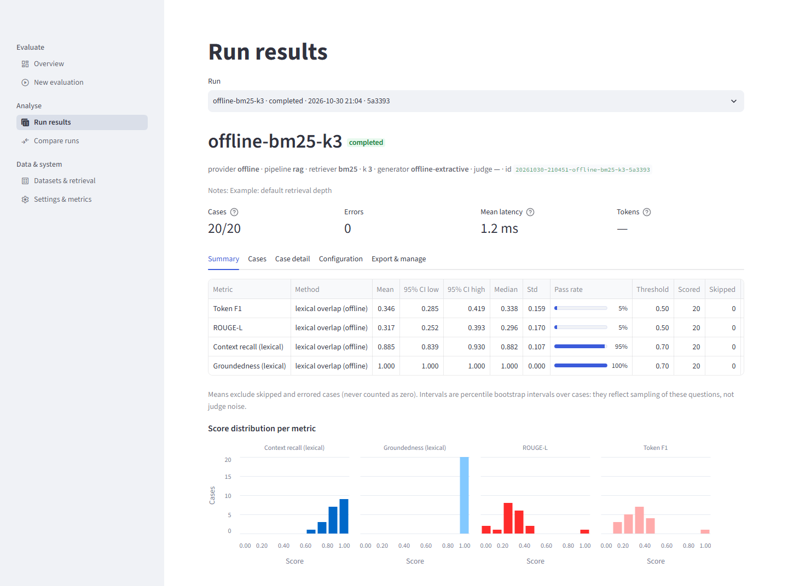
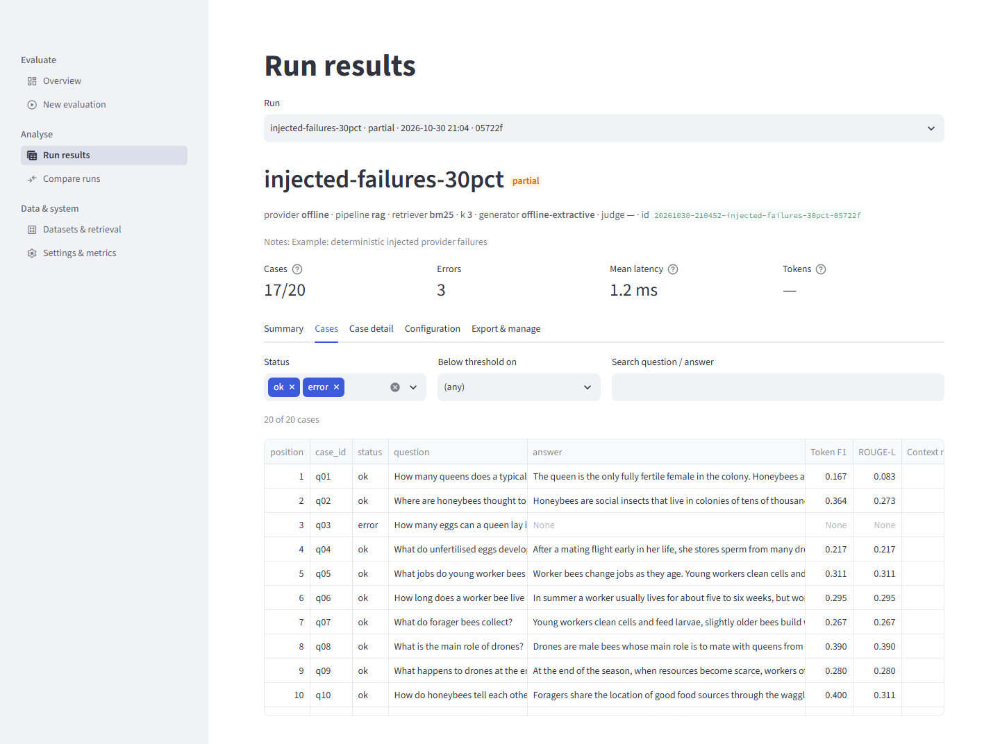
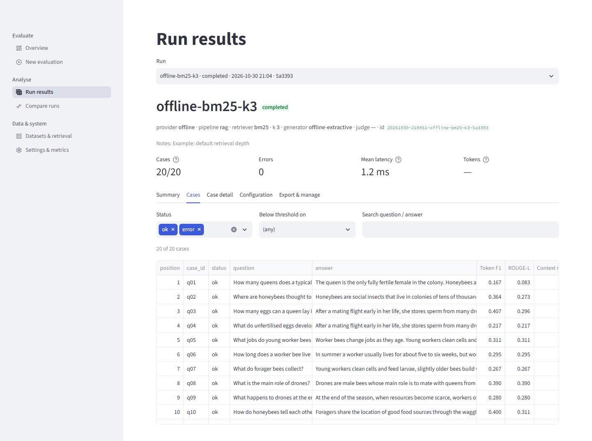
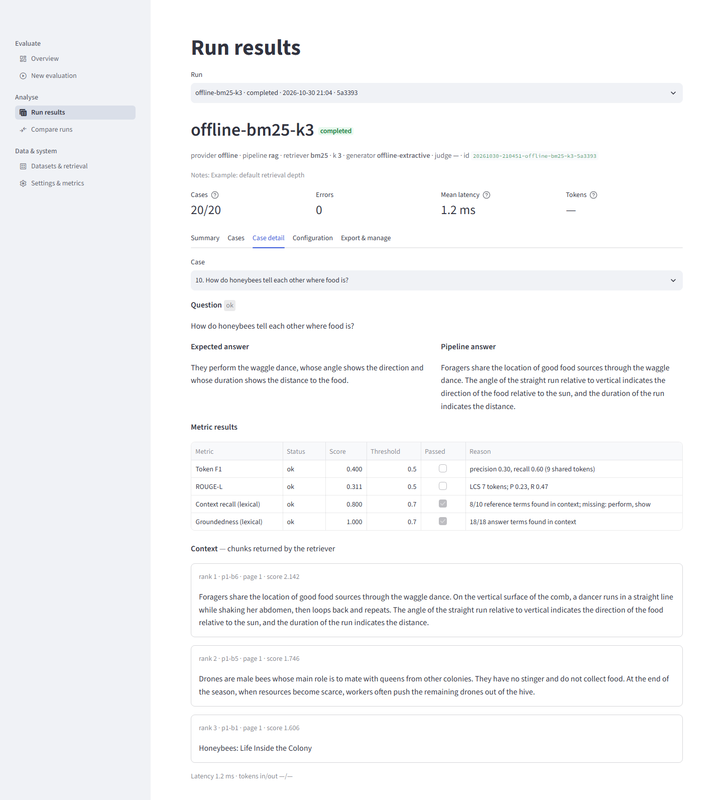
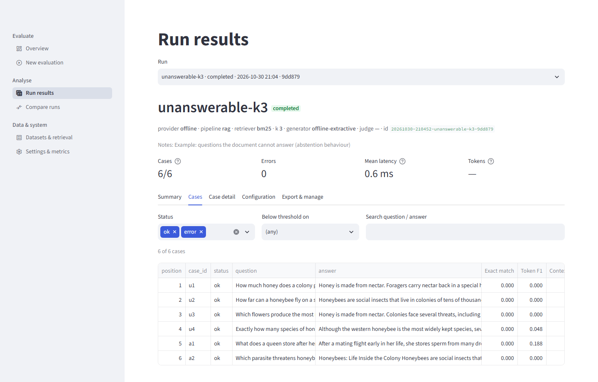

# Part V — Reading results

A run finishes, a table of numbers appears, and now comes the part that decides whether the evaluation was worth doing: deciding what the numbers mean. This Part teaches you to read a result the way a careful practitioner does. It tells you what every column in the summary is, what every metric's number does and does not say, how to look at individual cases, how to compare two runs without fooling yourself, how much a handful of questions can show, and how to write up a conclusion that someone else can trust.

Everything here uses the bundled example data, so you can reproduce each output. The commands were run offline (no key, no network). Where a number comes from a live model run, the text names the run in `docs/LIVE_VERIFICATION.md`; those are the only live numbers in this guide, and they come from a free-tier provider on small samples. Where a number is an illustration, it says so.

> **Run ids on your machine will differ.** A run id starts with a timestamp, for example `20261030-204909-offline-bm25-k3-7123f1`. The numbers in the tables are the same on your machine (the offline path is deterministic), but the ids are not. In the commands below, `$K1`, `$K3`, `$K5`, `$UN` and `$FA` stand for the ids of the five example runs `offline-bm25-k1`, `offline-bm25-k3`, `offline-bm25-k5`, `unanswerable-k3` and `injected-failures-30pct`. Get them from `ragwb list`. The example runs are created the first time you start the app with an empty run store (`python start.py`), or by `python scripts/seed_demo_runs.py`.

> **Setting up a safe offline shell.** Every command in this Part works without a key. To make sure of it, and to keep experiments out of your real run store, start each session with a scratch data folder, for example (PowerShell) `$env:RAGWB_NO_DOTENV = "1"; $env:OPENAI_API_KEY = ""; $env:RAGWB_DATA_DIR = "C:\scratch\ragwb-data"`. See Part III for what these settings do.

---

## 5.1 The shape of a result

A run produces three layers of information, and you should read them in this order.

1. **The header.** Which pipeline, retriever, k, generator, judge, dataset and document produced the numbers, and whether the run is `completed`, `partial` (some cases errored), `failed` or `imported`. If you do not know what was run, no number below it means anything.
2. **The summary table.** One row per metric: a mean, an interval, a pass rate, and three counts (scored, skipped, errors). This is where most people stop, and it is the layer that is most easily over-read.
3. **The cases.** One row per question, with the answer, the retrieved chunks, every metric's score and the reason behind it. This is where you find out *why* the summary looks the way it does.

A good reading goes header, summary, cases, then back to the summary with a better idea of what it is made of. A bad reading goes straight to the headline mean and stops.



The screenshot above is the Summary tab for the example run `offline-bm25-k3`. The same information is available at the terminal with `ragwb show`:

```text
$ ragwb show $K3
offline-bm25-k3 [20261030-204909-offline-bm25-k3-7123f1] status=completed created=2026-10-30 20:49:09
  provider: offline
  pipeline: rag
  retriever: bm25
  k: 3
  generator_model: offline-extractive
  judge_model: None
  ...
cases 20  ok 20  errors 0  mean latency 0.8 ms
metric                          mean           95% CI    pass  scored  skip  err
Token F1                       0.346      0.285-0.419      5%      20     0    0
ROUGE-L                        0.317      0.252-0.393      5%      20     0    0
Context recall (lexical)       0.885      0.839-0.930     95%      20     0    0
Groundedness (lexical)         1.000      1.000-1.000    100%      20     0    0
```

(The `show` command prints the mean, interval, pass rate and the three counts, and, when the run has any, a `tags:` and a `notes:` line in the header. The median and standard deviation appear on the Summary tab and in the Markdown export, `ragwb export $K3 --format md`.)

This run is the baseline of the whole Part: an offline pipeline (BM25 retrieval plus an extractive sentence picker, which is not a language model) answering 20 honeybee questions. By the end of the chapter you will be able to say what each of those twelve numbers does and does not tell you.

---

## 5.2 The run summary, column by column

### 5.2.1 Mean

The mean is the arithmetic average of the metric's score over the cases that were scored. It is the main statistic because it does not depend on any threshold. Token F1 of 0.346 means that, averaged over the 20 questions, the answers share about a third of their words with the reference answers (in the balanced F1 sense; §5.4.2).

Two things to remember. First, the mean is only over *scored* cases (§5.3). A mean over 20 cases and a mean over 6 cases are different kinds of statement, even if both print as `0.346`. Second, a mean hides the shape. A mean of 0.5 can be twenty cases at 0.5 or ten at 0 and ten at 1. The score histograms on the Summary tab (the "Score distribution per metric" charts at the bottom of the screenshot) show the shape; look at them.

### 5.2.2 The 95% bootstrap confidence interval

The interval answers one question: *if I had drawn a different sample of questions of the same size from the same kind of question, how much would the mean move?* It is computed by resampling the per-case scores with replacement 2,000 times and taking the 2.5th and 97.5th percentiles of the resampled means (Project Book Part VI §71).

For the baseline run, token F1 is 0.346 with an interval of 0.285 to 0.419. Read that as: with 20 questions, the "true" average on questions like these could plausibly be anywhere from about 0.29 to 0.42. The interval is about 0.13 wide. That is typical for 20 cases, and it is the most important number on the page for judging how much to say.

What the interval covers, and what it does not:

| It covers | It does not cover |
|---|---|
| Which questions happened to be in the dataset | Judge noise (each case is judged once) |
| | Generation noise (a live model could answer differently on a rerun) |
| | Whether the questions represent your real users |
| | Whether the metric measures what you care about |
| | Dependence between near-duplicate questions (they make the interval too narrow) |

Three technical points worth knowing, all measured on the example runs:

* **With fewer than two scored cases there is no interval.** The cell shows a dash. In the live run 17 table, context relevancy was scored on one case and shows `—` for its interval.
* **A zero-width interval is not certainty.** Groundedness of `1.000–1.000` means every case scored 1.0, so there is nothing to resample. It tells you the sample has no variation, not that the population value is exactly 1.
* **The third decimal of a bound is noise.** The resampler uses a fixed seed, so a run always shows the same interval, but a different seed moves the bounds by up to about 0.005. Do not report `0.2854` as though the last digit meant something.

### 5.2.3 Median and standard deviation

The median is the middle score. When it is far from the mean, a few extreme cases are pulling the mean. For the baseline run, token F1 has a mean of 0.346 and a median of 0.338, so the scores are fairly symmetric. For `exact_match` on a dataset with full-sentence references, the median is 0 and the mean is also near 0, which is the useful way to see that the metric is not discriminating at all.

The standard deviation is the sample standard deviation (n minus 1 in the denominator) of the scores, shown only when at least two cases were scored. It is the spread between questions, not the uncertainty of the mean. Quote it when you want to say "the questions vary a lot"; quote the interval when you want to say "we do not know the mean precisely".

### 5.2.4 Pass rate, and why it needs its threshold

Every metric has a pass threshold (token F1 and ROUGE-L 0.5, context recall and groundedness 0.7, exact match 1.0, and 0.7 for all judge and semantic metrics). A case passes when its score is at least the threshold, and the pass rate is the share of scored cases that passed.

Look at the baseline: token F1 has a mean of 0.346 and a pass rate of 5%. That means only one of the 20 answers reached 0.5. The pass rate is more dramatic than the mean, and it is dramatic only because of where the threshold sits. Change the threshold to 0.3 and the pass rate would jump, while the mean would not move at all.

The thresholds are conventions chosen for this project. They have not been calibrated against anyone's judgement of "acceptable" (§5.10 shows how to test one against labels). Therefore:

* Read the mean first and the pass rate second.
* Never compare pass rates between runs that used different thresholds. The run's configuration records the thresholds it used.
* Prefer to say "mean 0.35, only 1 of 20 answers above 0.5" than "5% pass rate".

> **Pitfall.** A pass rate over a handful of cases changes in big steps. With 6 scored cases, one case moves the pass rate by 17 points. The unanswerable example run has context recall "100% pass" on 2 scored cases.

### 5.2.5 Scored, skipped, errors

These three counts add up to the number of cases in the run, and they are the key to reading the means honestly. The next section is entirely about them.

---

## 5.3 Scored, skipped and errors: why missing is never zero

For each metric and each case, the result is one of three things:

* **ok (scored):** the metric produced a score in [0, 1].
* **skipped:** the metric does not apply to this case. A reference-based metric is skipped when the case has no reference. Context recall is skipped when the reference is an abstention sentence. Groundedness is skipped when the answer is an abstention (there is nothing to ground). Faithfulness and context relevancy are skipped when no context was retrieved.
* **error:** something broke: the generator failed for this case, the judge hit a rate limit and ran out of retries, or a metric computed a nonsense value.

The summary excludes skipped and errored cases from the mean, the interval, the median and the pass rate, and reports how many there were. They are never counted as zero.

### 5.3.1 Why not count them as zero?

Because a zero is a claim: "this answer was bad". An error is not a claim about the answer at all. If a judge call died of a rate limit, the answer might have been perfect. Counting it as zero would make your pipeline look worse because of a network problem. Counting it as 1 would be as wrong the other way. The honest options are to leave it out and say how many were left out, which is what the summary does, or to fix the cause and rerun.

### 5.3.2 What it looks like: three examples

**Errors from a failed generation.** The example run `injected-failures-30pct` deliberately fails some cases:

```text
$ ragwb show $FA
cases 20  ok 17  errors 3  mean latency 1.0 ms
metric                          mean           95% CI    pass  scored  skip  err
Token F1                       0.344      0.276-0.432      6%      17     0    3
ROUGE-L                        0.320      0.247-0.416      6%      17     0    3
Context recall (lexical)       0.881      0.834-0.924     94%      17     0    3
Groundedness (lexical)         1.000      1.000-1.000    100%      17     0    3
```

Seventeen scored, three errors on every metric. The mean token F1 is 0.344, against 0.346 for the identical healthy run. That is not "slightly worse": the 17 surviving answers are exactly the same as the healthy run's. The tiny gap in the mean exists only because the three failed cases happened to be slightly above average. Comparing these two means directly would be a mistake; the paired comparison (§5.7) over the 17 shared questions shows a difference of exactly 0.000 on every metric.

In the Cases tab, the failed cases appear with status `error` and `None` scores (screenshot 07).



**A missing local model stops the run; it does not score zero.** If the local embedding model is not on your computer (not downloaded, no network), a run that needs it (`--retriever local`, `hybrid-local`, or a semantic metric) is refused when it is prepared, with one message that names the model and the fix (Part VIII §8.13). No run is stored and nothing is scored as zero. In older builds the model was loaded per case, every case failed after a long wait, and the run finished `failed` with `scored 0` and a dash for each mean; if you open such an old run, a dash with `scored 0` is still the right way to read it: not 0.000, but missing.

**Skips from abstention and missing references.** The volcano dataset has 30 questions, five of them unanswerable. Offline, BM25 plus the extractive sentence picker (no abstention) gives:

```text
cases 30  ok 30  errors 0
Token F1                       0.199      0.149-0.252      3%      30     0    0
Context recall (lexical)       0.660      0.539-0.774     44%      25     5    0
Groundedness (lexical)         1.000      1.000-1.000    100%      30     0    0
```

Context recall is scored on 25 of 30: the five unanswerable questions have an abstention sentence for a reference, so there are no facts to look for in the context. This is correct behaviour, and it matters when you read the number: context recall of 0.660 describes the 25 answerable questions.

### 5.3.3 The selective-answering trap

Skipping creates one dangerous effect. Groundedness skips answers that are abstentions. So a pipeline that refuses to answer hard questions is scored only on the questions it chose to answer, and those are the easy ones. Here is the same volcano dataset with the optional abstention switch turned on (`--min-evidence 0.7 --skip-headings`):

```text
$ ragwb run --name volc-me --dataset examples/datasets/volcanoes.jsonl \
      --document examples/documents/volcanoes.pdf --min-evidence 0.7 --skip-headings --quiet
cases 30  ok 30  errors 0
Token F1                       0.204      0.108-0.321     10%      30     0    0
Context recall (lexical)       0.660      0.539-0.774     44%      25     5    0
Groundedness (lexical)         1.000      1.000-1.000    100%      12    18    0
```

Token F1 barely moved (0.199 to 0.204) but groundedness is now scored on only 12 cases, because 18 of the 30 answers are abstentions. The groundedness mean did not "improve" (it was 1.000 before); the point is that the denominator changed. In a live pipeline where groundedness can be below 1, abstaining on difficult questions would raise the mean groundedness by removing hard cases from it. Always look at `scored` next to the mean, and compare the numbers of scored cases across runs before you compare their means.

> **Why this works.** The summary shows `scored`, `skip` and `err` next to every metric precisely so that you can ask the question "is this a mean over the same questions as the other run?" If the counts differ, the means are not directly comparable. Use the paired comparison (§5.7), which only uses cases scored in both runs.

### 5.3.4 What to do when you see errors

| What you see | What it usually means | What to do |
|---|---|---|
| Errors on every metric for the same cases | The generation for those cases failed (timeout, provider error, injected failure) | Open the case; read the error text; fix the cause; `ragwb rerun` |
| Errors on one judge metric only | The judge's long outputs hit a rate limit or token cap (live run 17: 34 of 80 judge measurements) | Treat that metric as missing, not as a result; raise `RAGWB_MAX_RETRIES`, pace the run, or use a provider with more quota |
| All cases errored on semantic metrics | The local model is missing | Install or provide the model; do not report the metric |
| A few errors on a lexical metric | Very rare; a bug or a corrupted value | Report it as a defect |

Rule of thumb: if more than a few percent of the cases are errors, fix them before you interpret anything. Errors are rarely random. A rate limit tends to hit the longest outputs, which means the missing cases are the ones with the most claims or the longest context, and the mean over the survivors is biased.

---

## 5.4 What each metric's number does and does not mean

The workbench has eleven metrics in three families: lexical (word counting, deterministic), semantic (local embeddings) and LLM judge (a model scores the answer). Project Book Part VI has the exact formulas. This section explains each in plain language, with real examples, and tells you when to trust it.

Four questions to ask of any metric before you trust its number:

1. **What does it compare?** Answer to reference, answer to context, context to reference, or answer to question?
2. **What makes it high?** And is that the thing I care about?
3. **What would a good answer that scores low look like?** (false alarms)
4. **What would a bad answer that scores high look like?** (missed problems)

The two examples below are run with `ragwb score`, which scores one answer and stores nothing. The inputs are illustrative (written for this guide); the outputs are real.

### 5.4.1 Exact match

*Compares:* answer to reference, after lower-casing and removing punctuation and the words "a", "an", "the". *Score:* 1 if identical, else 0.

Meaningful only when references are short exact answers (a name, a number) or when you check whether a pipeline emits an exact abstention sentence. With sentence-length references it is 0 nearly everywhere:

```text
$ ragwb show $UN
Exact match                    0.000      0.000-0.000      0%       6     0    0
```

All six unanswerable-run cases score 0, including the two answerable ones, because no extractive answer reproduces a full reference sentence exactly. A metric that is always 0 carries no information; leave it out of such runs.

### 5.4.2 Token F1

*Compares:* the bag of words of the answer with the bag of words of the reference. *Score:* the harmonic mean of precision (what share of the answer's words are in the reference) and recall (what share of the reference's words are in the answer).

It is high when the answer reuses the reference's wording. It is low for correct answers phrased differently, and it is blind to word order and meaning. Three real examples:

```text
$ ragwb score --question "What do forager bees collect?" \
    --answer "Foragers gather nectar, pollen and water." \
    --expected "Foragers collect nectar, pollen, water and plant resin." \
    --metrics token_f1,rouge_l
Token F1                      0.714  pass    precision 0.83, recall 0.62 (5 shared tokens)
ROUGE-L                       0.571  pass    LCS 4 tokens; P 0.67, R 0.50

$ ragwb score --question "How do honeybees cool the hive?" \
    --answer "Droplets on the honeycomb evaporate while bees beat air over them." \
    --expected "They spread water on the comb and fan their wings so that evaporation cools it." \
    --metrics token_f1,rouge_l
Token F1                      0.083  fail    precision 0.10, recall 0.07 (1 shared tokens)
ROUGE-L                       0.083  fail    LCS 1 tokens; P 0.10, R 0.07

$ ragwb score --question "What do eggs develop into?" \
    --answer "Unfertilised eggs develop into workers and fertilised eggs develop into drones." \
    --expected "Fertilised eggs develop into workers and unfertilised eggs develop into drones." \
    --metrics token_f1,rouge_l
Token F1                      1.000  pass    precision 1.00, recall 1.00 (11 shared tokens)
ROUGE-L                       0.818  pass    LCS 9 tokens; P 0.82, R 0.82
```

The first answer is accurate but incomplete (it omits "plant resin") and uses a synonym: 0.714. The second answer is correct and says the same thing in different words: 0.083, a failure. The third states the biological opposite of the reference and scores a perfect 1.000. All three numbers are "correct" as arithmetic and wrong as a verdict on quality. That is why token F1 is a *similarity-to-the-reference-wording* measure and nothing more.

One more real effect: verbose answers lose precision. In the baseline run, "What jobs do young worker bees do?" scores 0.311 with precision 0.18 and recall 1.00: the answer contains every reference word and also two sentences about other jobs.

**Use it for:** comparing two variants of the same pipeline on the same references, where wording differences cancel. **Do not use it for:** an absolute statement of quality, or comparing pipelines that phrase answers differently (an extractive baseline versus an LLM).

### 5.4.3 ROUGE-L

*Compares:* the longest common subsequence of words (in order) between answer and reference. *Score:* the F1 of that overlap.

It behaves like token F1 but also requires the shared words to be in the same order, so it is never higher than token F1. In the baseline run, token F1 0.346 against ROUGE-L 0.317. Case q01 shows the difference: token F1 0.167 and ROUGE-L 0.083. In the third example above, swapping "fertilised" and "unfertilised" costs ROUGE-L only 0.182 (to 0.818): it detects some reordering but has no idea what the reordering means.

Treat ROUGE-L as a second opinion on token F1. If they agree, you have learned nothing new. A large gap tells you the answer has the right words in a different order.

### 5.4.4 Context recall (lexical)

*Compares:* the content words of the reference with the content words of all retrieved chunks, taken together. *Score:* the share of the reference's content words that appear somewhere in the retrieved text.

This is a *retrieval* metric. It asks: could the answer have been built from what was retrieved? A low value points at retrieval; a high value says the vocabulary is present, not that the relevant fact is.

What its "missing terms" tell you (these come straight from the baseline run's reasons):

```text
q08  0.667  What is the main role of drones?        missing: exist, mainly
q16  0.714  How do honeybees keep warm in cold weather?  missing: produce, shiver
q01  0.750  How many queens does a typical honeybee colony have?  missing: normally
q19  0.750  How do scout bees choose a new nest site?  missing: dance, win
q10  0.800  How do honeybees tell each other where food is?  missing: perform, show
```

Read these reasons. "mainly", "normally", "perform" and "exist" are filler words in the reference; the retrieval did not fail, the reference was wordy. "shiver" is missing because the document says "shivering" (the matcher does not know they are the same word); "dance" is missing because the document says "dancing". Only a human reading the case can tell a real retrieval miss from a vocabulary quirk.

Three properties to remember:

* **A chunk that does not answer the question can still supply a word.** Case q04 ("What do unfertilised eggs develop into?") has the reference word "male". BM25 found only one matching chunk, scored zero for the other two and filled the remaining slots with the first chunks of the document in order; one of them contains "male", so recall rose from 0.8 to 1.0 without any better retrieval. Context recall therefore never falls as k grows.
* **A high value can sit on a wrong answer.** Case a2 ("Which parasite threatens honeybee colonies?", reference "The varroa mite.") has context recall 1.000 and token F1 0.000. The right paragraph was retrieved at rank 3, but the pipeline answered with the document title.
* **It is not the judge metric called "contextual recall" in other libraries.** It is a term-overlap statistic.

### 5.4.5 Groundedness (lexical)

*Compares:* the content words of the answer with the content words of the retrieved chunks. *Score:* the share of the answer's content words found in the retrieved text. It needs no reference.

For an LLM pipeline this is a cheap alarm for content that did not come from the context. A drop from 0.95 to 0.7 across two runs would be worth investigating. But note what it is not: it is word support, not logical support. "Drones collect pollen and sting intruders" is fully "grounded" if each of those words is somewhere in the context. And a correct paraphrase can lose points for using a synonym:

```text
Groundedness (lexical)        0.800  pass    4/5 answer terms found in context; unsupported: gather
```

That is the first example above: one synonym ("gather" for "collect") cost 0.2.

> **Pitfall.** For the offline extractive baseline, groundedness is 1.000 on every case *by construction*, because the generator copies sentences from the context. `1.000–1.000` in every example run says nothing about quality. Do not put it in a report as a good sign; see §5.11.

Abstentions are skipped (nothing to ground). The unanswerable run shows another weakness: groundedness is 1.000 on all six cases, including the four where the question cannot be answered and the pipeline answered something irrelevant. The metric cannot tell whether an answer addresses the question.

### 5.4.6 Semantic similarity and semantic context recall

*Compares:* meaning, using the cosine similarity of sentence embeddings from a local model (`BAAI/bge-small-en-v1.5`, via the optional `fastembed` package). Semantic similarity compares answer and reference; semantic context recall compares the reference with the best-matching retrieved chunk. They are not defaults.

They solve the paraphrase problem in principle, but with an important catch from the real measurement (live-verification run 9 and run 13, both with the local model): this model's cosine scores have a high floor. In a direct check, a correct paraphrase scored 0.847, while an *unrelated* sentence scored 0.501. Scores for extractive answers sat between 0.63 and 0.76 across five datasets, so the default threshold 0.70 splits them arbitrarily. On the 30 LLM-written volcano answers, `semantic_similarity` at 0.70 agreed with the AI-written labels on 0.867 of cases (kappa 0.595); lowering the threshold to 0.55 to 0.65 gave 0.967 (kappa 0.839). The defaults were not changed, because 30 cases, 4 failures and one AI rater are not enough.

So: compare semantic scores *between runs* (higher is better), never read them as an absolute grade, and do not trust the 0.70 pass rate until you have calibrated it (§5.10).

### 5.4.7 The four judge metrics

The judge metrics send the question, answer and context to a language model (the "judge", via DeepEval) and turn its verdicts into a score. They need a key and a provider. They are *opinions of a model*, so they carry the model's biases, and each case is judged once, so the interval does not include judge noise (§5.9).

| Metric | What the judge does | Score | High means | Failure modes |
|---|---|---|---|---|
| Answer relevancy | Splits the answer into statements and decides whether each is relevant to the question | Share of statements judged relevant (borderline counts) | The answer stays on topic | Ceiling at 1.0: concise answers all score 1.0; says nothing about truth |
| Faithfulness | Extracts claims from the answer and checks each against the retrieved context | Share of claims supported (borderline counts) | The answer's claims are in the context | Ceiling at 1.0; only as good as the context; a wrong-but-supported answer passes |
| Context relevancy | Splits the retrieved context into statements and decides which are relevant to the question | Share of relevant statements | Retrieval is precise | Measures precision, so more chunks (higher k) lowers it; empty context scores 0 |
| Correctness | A rubric judgement of the answer against the reference ("is it factually correct given the expected output?") | The judge's 0-10 score normalised to 0-1 | The answer agrees with the reference in substance | Does not see the question; judge opinion; needs a reference |

Real numbers (all from `docs/LIVE_VERIFICATION.md`, a free-tier provider, small samples):

* **Run 4** (10 honeybee questions, `gpt-oss-20b` generating, `gpt-oss-120b` judging): answer relevancy 1.000 (CI 1.000–1.000) and faithfulness 1.000 on 10 cases each, context relevancy 0.173 on 8 (2 lost to the rate limit), correctness 0.522 (CI 0.233–0.822) on 9.
* **Run 7** (30 volcano questions, `qwen/qwen3.8-27b` both roles, `correctness` only): 0.803, CI 0.663–0.920, 30 scored.
* **Run 17** (20 honeybee questions, four judge metrics): answer relevancy 0.925, correctness 0.958 (19 scored); faithfulness 1.000 on only 6 cases and context relevancy 0.429 on 1 case, because 34 of the 80 judge measurements hit the provider's per-minute token cap and were recorded as errors.

What these teach, in plain language:

* **A judge mean of 1.000 on a few cases is a ceiling, not a verdict** (§5.11). Answer relevancy and faithfulness both count "borderline" as acceptable and both are computed as a share of statements, so concise, on-topic answers cluster at the top.
* **Context relevancy of 0.173 is low by design.** It is the share of *context statements* that bear on the question. With three retrieved chunks, most of the text is about something else. It is useful for comparing k values, not for a pass/fail verdict.
* **Compare judge scores only when the same judge model produced them.** Run 7 and run 17 used the same model but different documents, so "0.803 versus 0.958" is not a measured improvement (the live record says exactly this).
* **A metric with 1 scored case is missing, not low.** Run 17's context relevancy of 0.429 rests on one case.

### 5.4.8 Which metric for which question

| If you want to know... | Look at | And be careful because |
|---|---|---|
| Did retrieval fetch the needed text? | context recall (lexical or semantic) | Any chunk can supply a word; wording quirks cost points |
| Was retrieval focused or noisy? | context relevancy (judge) | Falls as k rises; judge opinion |
| Is the answer supported by what was retrieved? | faithfulness (judge); groundedness (lexical) | Lexical version is word overlap; judge version has a ceiling |
| Is the answer on topic? | answer relevancy (judge) | Says nothing about truth |
| Is the answer right (given a reference)? | correctness (judge); token F1 / ROUGE-L / semantic similarity (weak proxies) | Reference wording drives the lexical ones; calibrate the judge |
| Does the pipeline abstain when it should? | exact match on the abstention sentence, plus a slice by question type (§5.6) | Needs unanswerable questions in the dataset |


---

## 5.5 The case table and the case detail

The summary tells you how the run did on average. The cases tell you *why*. Every finding in this guide that sounds like an insight ("the title chunk leaks into answers", "the word 'male' came from an irrelevant chunk") was found by reading cases, not by staring at means.

### 5.5.1 The Cases tab

The Cases tab lists one row per question: position, case id, status, the question, the answer and one column per metric. Three controls help you find the interesting rows:

* **Status** (`ok`, `error`): to isolate failed cases.
* **Below threshold on**: pick a metric to show only the cases that failed it.
* **Search question / answer**: free text.



A productive routine for any run:

1. Sort or filter by your most important metric, lowest first.
2. Open the five lowest cases one by one in Case detail (§5.5.2).
3. For each, write down in a sentence what went wrong. Do not use the metric's name as the explanation; say what happened ("answered about the wrong chunk", "reference is more verbose than the document", "correct answer in different words").
4. Count your sentences by type. The pattern ("three of five are vocabulary mismatches") is the real finding.

You can get the same view without the UI. The Markdown export lists the five lowest cases per metric with their reasons:

```text
$ ragwb export $K3 --format md --out-dir ./out
## Lowest Token F1
| Case | Score | Question | Reason |
| q14 | 0.151 | Why do bees build hexagonal cells? | precision 0.10, recall 0.36 (4 shared tokens) |
| q01 | 0.167 | How many queens does a typical honeybee colony have? | precision 0.11, recall 0.40 (2 shared tokens) |
| q12 | 0.186 | How is nectar turned into honey? | precision 0.15, recall 0.24 (4 shared tokens) |
| q04 | 0.217 | What do unfertilised eggs develop into? | precision 0.12, recall 0.83 (5 shared tokens) |
| q07 | 0.267 | What do forager bees collect? | precision 0.15, recall 1.00 (8 shared tokens) |
```

The CSV export (`--format csv`) has one row per case with every score, pass flag and status, and the retrieved chunk ids, which is the right format for your own analysis in a spreadsheet or a notebook.

### 5.5.2 The Case detail tab

Case detail shows, for one question: the question, the expected answer, the pipeline's answer, a metric table (status, score, threshold, passed, and the reason), and below it the chunks the retriever returned, each with its rank, id, page and retrieval score.



The screenshot is case q10 of the baseline run: "How do honeybees tell each other where food is?" The metric table shows token F1 0.400, ROUGE-L 0.311, context recall 0.800 (missing "perform" and "show") and groundedness 1.000. The retrieved chunks are, in order, the waggle-dance paragraph (rank 1, score 2.142), the drones paragraph (rank 2, 1.746), and the title "Honeybees: Life Inside the Colony" (rank 3, 1.606).

**Read the retrieved chunks next to the answer. That is the single most valuable habit in this guide.** Here is what that reading says about q10:

* Rank 1 is exactly the right paragraph, and the answer is two sentences from it. Retrieval worked.
* Rank 2 (drones) and rank 3 (the title) are noise. They were retrieved to fill slots. The title chunk has a high BM25 score only because it is very short, so the length normalisation favours it.
* Token F1 of 0.400 is not a retrieval problem or a correctness problem. The reference says "They perform the waggle dance, whose angle shows the direction and whose duration shows the distance"; the answer says the same thing with "indicates" instead of "shows". The metric is punishing wording.
* Verdict on this case: pipeline fine, metric harsh.

Now a case where the same reading reaches the opposite conclusion. Here is `a2` in the unanswerable run, printed from the stored case results:

```text
CASE a2
Q:   Which parasite threatens honeybee colonies?
REF: The varroa mite.
ANS: Honeybees: Life Inside the Colony Honeybees are social insects that live in
     colonies of tens of thousands of individuals.
  CHUNK p1-b1  score 2.61  | Honeybees: Life Inside the Colony
  CHUNK p1-b2  score 2.31  | Honeybees are social insects that live in colonies of tens of thousands ...
  CHUNK p2-b1  score 1.56  | Honeybees are important pollinators ... the parasitic varroa mite ...
  token_f1 0.000   context_recall 1.000   groundedness 1.000
```

The summary metrics look fine for this case (recall 1.000, groundedness 1.000) and the answer is plainly wrong. Reading the chunks tells you exactly why: the question says "parasite" and "threatens"; the document says "parasitic" and "threats". BM25 has only light stemming and no synonyms, so those words did not match. Only "honeybee" and "colony" matched, which favoured the title and the introduction paragraph; the right paragraph was third. This is a retrieval problem (with a generation weakness on top: the extractive picker took the title as a "sentence"), and only the chunk list reveals it. Part VI §6.6 (Playbook E) walks through diagnosing cases like this one.

### 5.5.3 What an abstention looks like

An abstention is the pipeline declining to answer, using the fixed sentence "The PDF does not provide enough information to answer the question." (An OpenAI model is told to use this sentence verbatim; the offline generator uses it when its optional evidence threshold is not met.) The pipeline detects an abstention by searching for a few phrases such as "does not provide enough information" or "cannot answer", so a refusal in other words ("I don't know") is *not* recognised as an abstention.

In the example unanswerable run, the baseline never abstains (it has no way to): every answer is some extracted sentence, and exact match is 0 on all six cases. Case u1:

```text
Q:   How much honey does a colony produce in a year?
REF: The PDF does not provide enough information to answer the question.
ANS: Honey is made from nectar. Foragers carry nectar back in a special honey stomach,
     and house bees pass it between them, adding enzymes that break down sugars.
  exact_match 0.0   token_f1 0.0   context_recall skipped (reference is an abstention)
  groundedness 1.0
```

The question shares words with the honey paragraph ("honey", "colony"), so the extractor found sentences with positive weight and returned them. Now the same dataset with the abstention switch on (`--min-evidence 0.7 --skip-headings`):

```text
CASE u1   ANS: The PDF does not provide enough information to answer the question.
  exact_match 1.0   token_f1 1.0   context_recall skipped   groundedness skipped (answer abstained)
CASE a2   ANS: The PDF does not provide enough information to answer the question.
  exact_match 0.0   token_f1 0.0   context_recall 1.0       groundedness skipped (answer abstained)
```

Case u1 is a correct abstention and scores 1.0 on exact match and token F1. Case a2 is an *incorrect* abstention: the question is answerable, the retrieved context contains the answer (context recall 1.0), and the pipeline declined anyway. In the table, both look like "abstained", but they are opposite outcomes. The slice view (§5.6) shows it at a glance:

```text
$ ragwb slices <run-with-min-evidence> --by type
slice          cases   ok     Exact match   Token F1   Context recall   Groundedness
answerable         2    2     0.000 (2)     0.094 (2)    1.000 (2)       1.000 (1)
unanswerable       4    4     1.000 (4)     1.000 (4)        - (0)           - (0)
```

Perfect on the four unanswerable questions, nothing on the two answerable ones. That is the cost-benefit of abstaining, in one table, and it is also why you must look at both kinds of question together (Part VI §6.4).



When reading an abstention-aware run, ask three questions: What fraction of the unanswerable questions did it decline? What fraction of the answerable questions did it decline wrongly? And are my metrics computed on the cases that were skipped by abstaining (§5.3.3)?

### 5.5.4 Reading a failed case

For a case with status `error`, the detail view shows the error text instead of metrics. Read it before anything else. Typical messages: an injected failure (the example `injected-failures-30pct` run reads "Injected offline failure"), a provider error, a timeout, a rate limit. Some are permanent (a bad request), some are transient and are retried automatically. The count of attempts is stored with the case. A case that errors in two reruns for the same reason is a pipeline problem; one that succeeds on a rerun was transient.

---

## 5.6 Slices: reading a run by question type

A dataset row can carry metadata (a `type`, a `difficulty`, a `topic`, a language, a source section, anything). `ragwb slices` computes each metric's mean for every value of one metadata field. It answers the question that a single overall mean cannot: *where is the pipeline weak?*

```text
$ ragwb slices $VOLC --by type
volc-k3 [...] by type
slice          cases   ok       Token F1       ROUGE-L    Context recall   Groundedness
factual           14   14   0.276   (14)   0.249 (14)   0.746 (14)   1.000 (14)
list               4    4   0.128    (4)   0.128  (4)   0.686  (4)   1.000  (4)
numeric            2    2   0.064    (2)   0.064  (2)   0.500  (2)   1.000  (2)
unanswerable       5    5   0.042    (5)   0.042  (5)       -  (0)   1.000  (5)
why                5    5   0.251    (5)   0.206  (5)   0.463  (5)   1.000  (5)
(n scored in brackets; small slices have wide uncertainty)
```

(The run is the offline baseline on the 30 volcano questions; the table is shortened to fit the page.) Notice what this view reveals that the overall mean (token F1 0.199) did not:

* **Factual** questions score best (0.276), "why" questions have the lowest context recall (0.463), and **numeric** questions barely score at all (0.064 on two cases).
* The `unanswerable` slice has a context-recall dash with `(0)` scored: the metric does not apply to those cases.
* The numbers in brackets are the number of scored cases per slice. Most slices here have 2 to 5 cases.

In the UI, the Summary tab has a "Break down by dataset metadata" section with a field selector (screenshot 12 is the page for a run with the metadata field `type`):


### 5.6.1 How to use slices well

* **Slice by the things you can act on.** Question type, topic, document section, difficulty, language. If you cannot imagine a different action for the two halves, the slice is not useful.
* **Do not trust small slices.** The numbers in brackets are your guard rail. A slice with two cases is an anecdote. Use it to choose which cases to *read*, not to draw a conclusion. The CLI prints a reminder: "small slices have wide uncertainty".
* **Slices multiply comparisons.** If you look at four fields with five values each, some will look interesting by chance. Treat a slice finding as a hypothesis, and test it on more questions of that type.
* **Add the metadata you will need before you write the dataset.** The workbench can only slice by fields that are in the dataset (Part II). Asking for a field that does not exist is an error and lists the fields that do:

```text
$ ragwb slices $K3 --by topic
error: No case in this run has metadata field 'topic'. Available: (none; add a metadata object to dataset rows)
```

The paraphrased CSV dataset (`honeybees_paraphrased.csv`) has a `topic` column, so a run on it can be sliced by `topic`; the 20-question honeybee set has no metadata, so it cannot be sliced.

---

## 5.7 Comparing two runs

Most of the useful questions in evaluation are comparisons: is k=3 better than k=1? Did the new prompt help? Did the change break anything? Comparing two means by eye is the worst way to answer them. The workbench does a **paired comparison**.

### 5.7.1 How the pairing works

`ragwb compare A B` takes baseline run A and candidate run B and:

1. Matches cases by *question text* (lower-cased, whitespace collapsed), not by case id. That lets you compare runs from different dataset files on the questions they share.
2. Keeps only the questions that have a score for that metric in both runs.
3. For each pair, computes the difference (B minus A).
4. Reports the mean difference, a bootstrap 95% interval of the differences, and the number of questions where B won, tied or lost.

It also prints the means of each run over the *paired* questions only, which may differ from the runs' own means if some cases were errored or skipped on one side.

### 5.7.2 A real comparison: k=1 versus k=3

```text
$ ragwb compare $K1 $K3
A = offline-bm25-k1
B = offline-bm25-k3

label                      paired  mean_a  mean_b  diff_b_minus_a  ci_low  ci_high  b_better  ties  b_worse  ci_excludes_zero
Token F1                       20   0.404   0.346          -0.057  -0.116   -0.008         3    10        7              True
ROUGE-L                        20   0.373   0.317          -0.056  -0.108   -0.010         3    10        7              True
Context recall (lexical)       20   0.857   0.885           0.028   0.000    0.062         3    17        0             False
Groundedness (lexical)         20   1.000   1.000           0.000   0.000    0.000         0    20        0             False
```

(Columns shortened; the CLI prints them in this order.) Read it row by row.

**Token F1: B is worse.** The mean falls by 0.057 and the interval (−0.116 to −0.008) lies entirely below zero, so `ci_excludes_zero` is `True`. The win/tie/loss counts show the shape: 7 questions got worse, 3 got better and 10 did not change. The drop is driven by a minority of cases: the biggest losses were "How does a honeybee colony reproduce?" (0.629 to 0.273, a loss of 0.356) and "Why do bees build hexagonal cells?" (0.500 to 0.151, a loss of 0.349). More chunks gave the extractive picker more sentences to choose from, and it sometimes chose a worse second sentence (including the document title).

**Context recall: inconclusive.** The mean rises by 0.028 but the interval touches zero (0.000 to 0.062). Three questions improved, 17 tied, none worsened. Context recall cannot fall as k grows (a smaller k's list is a prefix of a larger one), so there are never any losses here; the question is only whether the gain is large enough to be believed. It is not, at this sample size.

**Groundedness: a tie on every case.** All 20 questions are 1.000 in both runs. The interval is 0.000 to 0.000 and the flag is `False`: "no evidence of a difference" is exactly right.

The UI shows the same table with plain-language verdicts: "B better", "B worse" or "inconclusive" (screenshot 08).


### 5.7.3 Why pairing beats comparing intervals

The same two runs, viewed as independent intervals: k=1 token F1 is 0.335 to 0.476 and k=3 is 0.285 to 0.419. Those overlap heavily. A reader comparing two error bars would say "no clear difference". But the paired interval for the difference is −0.116 to −0.008 and excludes zero. The reason is that the questions vary a great deal (some are easy, some hard) and this variation is the same in both runs; pairing subtracts it out. So: **use the paired table, not overlapping error bars, to judge a difference.** The Compare page's bar chart carries a reminder: overlapping intervals mean the difference *may* be sampling noise; use the paired analysis for a sharper test.

### 5.7.4 What `ci_excludes_zero` does and does not say

`ci_excludes_zero` is true when the interval of the paired differences is entirely above or entirely below zero. It is an approximate two-sided test at about the 5% level. Read it with these cautions:

* **It is evaluated separately for every metric and every pair of runs.** There is no multiple-comparison correction. If you compare four metrics across five pairs of runs, you are making twenty checks, and about one "significant" result is expected by chance alone. A single `True` among many `False` rows deserves suspicion; a consistent pattern across related metrics (token F1 and ROUGE-L both worse, for the same mechanism) is stronger.
* **`False` means "not shown", not "no difference".** At this sample size an interval is wide. "The change did nothing" and "the change did something we cannot detect with 20 questions" look identical.
* **A bound of exactly 0.000 is not significant.** Context recall from k=1 to k=3 has an interval of 0.000 to 0.062 and the flag is `False`. From k=1 to k=5 (+0.035, interval 0.005 to 0.070) the flag is `True`.
* **Statistical significance is not importance.** The k=1 to k=3 token F1 loss is "significant" and small (0.057 on a scale where the baseline's numbers are themselves a metric of wording). Whether it matters depends on whether you care about wording-overlap at all.
* **The interval depends on the random seed and ordering.** Its last digit can change by about 0.005 between orderings of the same data. A bound printed as `-0.008` is "very close to zero", not "precisely -0.008".

### 5.7.5 Win, tie, loss

The three counts complement the mean. A mean difference of −0.057 could be a small loss everywhere or a large loss on a few cases. Here it is the second: seven losses, three wins, ten ties. When most cases tie, ask *what is different about the cases that changed?* In the k=1 versus k=3 comparison, the answer shows up in the case list: the changed cases are the ones where the extra chunks contained sentences that outweighed the best chunk's second sentence.

Ties are exact (to one part in a billion). Lexical scores are exact rationals, so they tie only when truly equal. For judge scores, which are noisy, a tie is unusual and a small win or loss may be pure jitter (§5.9).

### 5.7.6 Comparisons that cannot be made

* **No shared questions.** If the two runs share no question text, every row shows 0 paired cases and all the differences are `None`. Comparing the honeybee baseline with the volcano run:

```text
$ ragwb compare $K3 $VOLC
label                      paired  mean_a  mean_b  diff_b_minus_a  ci_low  ci_high  b_better  ties  b_worse  ci_excludes_zero
Token F1                        0    None    None            None    None     None         0     0        0             False
...
```

* **No shared metrics.** The command prints "The two runs share no metrics." and exits with status 1.
* **Punctuation differences.** "How do honeybees cool the hive?" and "How do honeybees cool the hive" are different keys and do not pair. If you edit questions between runs, you lose pairing for the edited ones.
* **Duplicate questions overwrite each other.** If a dataset contains the same question twice, the pairing keeps only the later one. `ragwb validate` warns about duplicate questions.
* **Different judges.** If two runs used different judge models, a difference in a judge metric mixes the effect of the change with the effect of the judge. Compare judge metrics only within the same judge model.

### 5.7.7 Comparing more than two runs

The Compare page can show several runs at once, with a configuration table that highlights the settings that differ and a bar chart of means with intervals. Pick one baseline and one candidate for the paired table. With three runs (k=1, 3, 5) you can make three pairs, which is three times the number of checks. In the example data:

| A → B | Metric | Difference | 95% CI | B better / tie / B worse | `ci_excludes_zero` |
|---|---|---|---|---|---|
| k1 → k3 | Token F1 | −0.057 | −0.116 to −0.008 | 3 / 10 / 7 | True |
| k3 → k5 | Token F1 | 0.000 | 0.000 to 0.000 | 0 / 20 / 0 | False |
| k3 → k5 | Context recall | +0.007 | 0.000 to 0.021 | 1 / 19 / 0 | False |
| k1 → k5 | Context recall | +0.035 | 0.005 to 0.070 | 4 / 16 / 0 | True |

Going from 3 to 5 chunks changed no answers at all (every case ties on token F1), so the extra retrieval cost bought nothing for this generator. That is a useful operational finding: the extra chunks did not matter *for this document and generator*.

---

## 5.8 Small samples: what 20 to 30 questions can and cannot show

Every example in this guide has 20 to 30 questions. That is a deliberate fit for learning, and it is also what many real teams start with. Here is the honest picture of what that buys.

### 5.8.1 What you can see

* **Large differences.** If one pipeline is far better than another on a metric, 20 questions will show it. The interval on the paired difference will exclude zero.
* **Gross failures.** Crashes, wrong-document retrieval, systematic abstention failures, a prompt that makes the model refuse, an answer style that ignores the context. These show up in the first five cases you read.
* **Mechanisms.** Reading 20 cases is enough to find out *why* something fails, which is the most valuable output of a small evaluation.
* **Regressions of a gross kind**, in a pipeline you have already measured, with `ragwb regress` (Part VI §6.3).

### 5.8.2 What you cannot see

* **Small differences.** With 20 cases, differences in means below roughly 0.05 to 0.10 are usually inside the noise for answer-overlap metrics. The k=1 to k=3 token F1 loss of 0.057 barely clears the bar: its interval's upper end is −0.008.
* **Rare failure modes.** If 3% of real questions trigger a failure, 20 questions will usually not include one. Failures that happen to one question in fifty are not visible; they need a larger dataset or targeted adversarial questions.
* **Performance in a subgroup.** Five questions on a topic cannot tell you how the pipeline does on that topic (§5.6.1).
* **The effect of fine-tuning knobs.** Whether `--answer-sentences 2` beats `3` by 0.01 is not something 20 questions can answer.
* **Anything about generalisation.** All 20 honeybee questions come from one two-page document. A result on them says nothing about another document, another domain or another language.

### 5.8.3 A rough guide to dataset size

This is guidance, not a theorem; the right size depends on how noisy your metric is and how big the effect you need to see.

| Goal | Roughly how many questions | Why |
|---|---|---|
| Learn the tool, see a pipeline end to end | 5 to 20 | Cases are readable one by one |
| Smoke test that the pipeline works at all | 10 to 20 | Gross failures are visible |
| Gate a change with `ragwb regress` | At least 10 paired per metric (the default minimum); 30 to 100 is much better | The gate refuses to judge a metric with fewer paired questions |
| Detect a difference of about 0.05 in a metric with a standard deviation near 0.2 | Several hundred | The standard error shrinks with the square root of the number of questions |
| Report a per-type result | At least 30 per type | Small slices are anecdotes |

The last two rows follow from the standard error of a mean (the standard deviation divided by the square root of n): to halve an interval you need four times the questions. If your per-question scores have a standard deviation of 0.2, a 95% interval is roughly plus or minus 0.09 at n=20 and roughly plus or minus 0.04 at n=100. (Illustrative arithmetic; your metric's spread will differ, and you can read it from the "Std" column.)

### 5.8.4 Making a small dataset go further

1. **Use paired comparisons.** Pairing removes between-question variation (§5.7.3).
2. **Read the cases.** Twenty cases read carefully beat two hundred glanced at.
3. **Add the failure you saw.** When you find a bad case, add similar questions to the dataset so the failure is covered in future runs.
4. **Keep the dataset fixed while comparing.** Changing the questions between runs changes two things at once.
5. **Say how small it is.** Put the number of questions in the first sentence of any report.

---

## 5.9 Judge noise

A language-model judge is not a ruler. Ask it to score the same answer twice and you may get two different scores. A run summary scores each case once, so the interval includes only the sampling of *questions*; it does not include judge jitter. `ragwb judge-noise` measures that jitter.

### 5.9.1 What the command does

```text
ragwb judge-noise RUN_ID [--repeats N] [--metrics a,b] [--limit N] [--yes]
```

It takes the stored answers and contexts of an existing run, scores them again with the judge `--repeats` times (2 or more, default 3) and reports, for each judge metric:

| Column | Meaning |
|---|---|
| `cases` | Cases with at least two successful repeats |
| `repeats` | Scorings per case |
| `within SD` | The average, over cases, of the standard deviation of the repeated scores of one case: the judge's jitter |
| `between SD` | The standard deviation of the per-case mean scores: how much the cases genuinely differ |
| `noise/signal` | within SD divided by between SD |
| `flips` | Cases whose pass/fail verdict changed between repeats |
| `errors` | Measurements that failed (excluded, never counted as zero) |

It re-uses the stored answers, so retrieval and generation are not repeated; only the judge is called. It prints the number of judge measurements first (repeats times metrics times cases), and refuses to go over 30 measurements without `--yes`, because each measurement can make several API calls and therefore cost money and quota. It needs a key; without one it stops before doing anything:

```text
$ ragwb judge-noise $QWEN --repeats 3 --limit 3
error: Metric(s) correctness use an OpenAI judge model and need OPENAI_API_KEY.
9 judge measurements (3 repeats x 1 metrics x cases), each of which can make several API calls.
```

(This guide's author ran this offline to confirm that it refuses safely; no judge was ever called.)

### 5.9.2 How to read the report

* **noise/signal below about 0.5:** jitter is small next to real differences between cases. Differences between runs larger than the jitter are meaningful.
* **noise/signal above 0.5:** the tool warns that "the judge's jitter is comparable to real differences between cases, so small score differences between runs for that metric are not meaningful".
* **`between SD` of 0:** every case scored the same (a ceiling), so noise/signal cannot be computed. This happens with the 1.000 relevancy and faithfulness means.
* **Verdict flips:** a pass/fail flip near the threshold is expected for a few cases; many flips mean the threshold sits in the middle of the noise.
* **Fewer than 10 cases with usable repeats:** the tool says to treat the rows as rough.

### 5.9.3 The one real measurement

`docs/LIVE_VERIFICATION.md`, run 8, measured `correctness` on 10 cases of the live volcano run (run 7) with 3 repeats: **within-case SD 0.023, between-case SD 0.371, noise/signal 0.062, and 1 of 10 cases changed its pass/fail verdict between repeats.**

What that supports: for this judge model (`qwen/qwen3.8-27b`), this rubric and these ten cases, the call-to-call jitter was small next to the differences between cases. A difference between two runs of, say, 0.2 in `correctness` is far larger than the jitter of 0.023.

What it does not support:

* **Only `correctness` was measured.** Faithfulness, answer relevancy and context relevancy were not. Faithfulness and context relevancy use long multi-step prompts and may jitter more; nobody has measured it.
* **Only ten cases.** The tool itself warns below ten usable cases.
* **One judge model, one provider, one day.** A different model, or the same model after a provider update, may jitter differently.
* **Jitter is not bias.** A judge can be perfectly repeatable and consistently wrong. Noise tells you about repeatability; calibration (§5.10) tells you about agreement with people.
* **One case changed its verdict.** At the 0.70 threshold, a case near the threshold can flip. Expect that to happen to some cases.

> **Pitfall.** Do not read "noise/signal 0.062" as "the correctness score is accurate to 2%". It says that repeated scoring of the *same answers* varied little. It says nothing about whether the judge agrees with a careful human, which was a separate experiment (§5.10.5).

### 5.9.4 When to run it

* Before you commit to a judge metric as a gate (Part VI §6.5).
* After you change the judge model or its settings.
* When two runs differ by a small amount on a judge metric and you need to know if that is meaningful.
* Not routinely on every run: it costs as many judge calls as `repeats` times the original scoring.

---

## 5.10 Calibrating a metric against labels

A metric's pass/fail verdict is only useful if it agrees with what you would decide. Calibration is the check: take a run, have a person (or several) label each answer pass or fail, and compare the metric's verdicts with the labels. The workbench has three commands for it: `labels-template`, `calibrate`, and, inside `calibrate`, the options `--sweep` and `--rescore`.

### 5.10.1 Step by step

1. **Pick the run and the metric.** Use a run with at least 30 cases, ideally more, with a mix of good, bad and borderline answers. A run where every answer is obviously fine tells you nothing about how the metric treats borderline ones.
2. **Write a labelling sheet.**

   ```text
   ragwb labels-template RUN_ID --out labels.csv
   ```

   The CSV has one row per case: `case_id`, the question, the reference answer, the pipeline's answer, the run's scores for each metric, an empty `human_pass` column and a `note` column. (Use `--force` to overwrite an existing file.)

3. **Label without looking at the scores.** The sheet includes the metric scores for convenience, but if you read them first you will be calibrating the judge against yourself. Hide those columns (or delete them from the sheet before you label) and fill `human_pass` with `pass` or `fail` for each row: would you accept this answer as correct given the reference? Leave a row blank if you genuinely cannot decide. The tool also accepts `true/false`, `yes/no` and `1/0`. A `.jsonl` file with `case_id` and `human_pass` keys also works.
4. **Compare.**

   ```text
   ragwb calibrate RUN_ID --labels labels.csv --metric correctness
   ```

5. **Sweep the threshold (optional).** Add `--sweep` to see agreement at every pass threshold from 0.10 to 0.95.
6. **Rescore a metric the run did not have (optional).** `--rescore` computes a lexical or local-model metric from the run's *stored answers* and then calibrates it, with no API calls. This is how you check, say, whether `semantic_similarity` would have agreed with your labels, without rerunning the pipeline. If the metric cannot be computed for any case (for example the local embedding model cannot be loaded), the command stops with `error: <metric> could not be computed for any case: <reason>` (or, for a model that cannot be loaded at all, the one-line message of Part VIII §8.13); it never prints a table of zeros.

### 5.10.2 Reading the report

The report is a confusion matrix plus a few summary numbers. This is the real output for the `correctness` judge and the labels in `calibration/volcanoes-labels-by-claude.csv` (written by Claude, an AI rater; see §5.10.5), on the live run of 30 volcano questions that ships in `calibration/`:

```text
Correctness (judge) vs labels from volcanoes-labels-by-claude.csv, run qwen-volcanoes-30-b [20261028-035657-qwen-volcanoes-30-b-7d604e]
labelled cases matched: 30   compared: 30   metric did not score: 0   labels for unknown cases: 0
                    human pass   human fail
metric pass                25            0
metric fail                 1            4
agreement 0.967   kappa 0.870 (almost perfect)   precision 1.000   recall 0.962
pass rate: metric 0.833, human 0.867
```

| Item | What it says |
|---|---|
| `labelled cases matched` | Cases whose id appears in both the run and the labels |
| `compared` | Matched cases that the metric actually scored (a skipped or errored case cannot be compared) |
| `metric did not score` | Matched cases where the metric had no score |
| `labels for unknown cases` | Label rows whose id is not in the run (a sign you labelled the wrong run) |
| Confusion matrix | Rows are the metric's verdict, columns are the labels |
| `agreement` | The share of compared cases where metric and labels agree |
| `kappa` | Agreement corrected for the agreement expected by chance |
| `precision` | Of the answers the metric passed, the share the labels also passed |
| `recall` | Of the answers the labels passed, the share the metric also passed |
| `pass rate` | How often each side says "pass" |

**Why kappa and not just agreement?** If 87% of the answers are good, a metric that says "pass" for everything agrees with the labels 87% of the time and has learned nothing. Cohen's kappa subtracts the agreement expected by chance. A common reading is: below 0.20 slight, 0.21 to 0.40 fair, 0.41 to 0.60 moderate, 0.61 to 0.80 substantial, above 0.80 almost perfect. The tool prints this word.

**Cautions that the report itself prints:** with fewer than 30 compared cases it says "treat kappa as indicative only". Kappa also depends on the pass rate, so a sample with very few failures gives an unstable kappa even when the agreement is good.

**Precision and recall in the right direction.** A metric with precision 1.000 and recall 0.538 (the real result for token F1, below) never passes an answer the labels failed, but fails nearly half of the answers the labels passed. That is a metric that is too strict: it generates false alarms.

### 5.10.3 The threshold sweep

`--sweep` recomputes agreement and kappa at every threshold using the stored scores. Real output for the judge, shortened:

```text
threshold  agreement   kappa  metric pass rate
     0.10      1.000   1.000             0.867   <- best
     0.20      1.000   1.000             0.867
     0.25      0.967   0.870             0.833
     0.50      0.967   0.870             0.833
     0.70      0.967   0.870             0.833
     0.75      0.900   0.672             0.767
     0.90      0.867   0.595             0.733
     0.95      0.767   0.420             0.633
The best row is chosen on these same labels, so it is optimistic; with a few dozen labels several thresholds tie.
```

The pattern to look for is a **plateau**: agreement flat across a wide range of thresholds. For `correctness` it is flat at 0.967 from 0.25 to 0.70, so the default 0.70 sits on a wide stable plateau and nothing needs changing. The `<- best` marker at 0.10 to 0.20 (agreement 1.000) is one borderline case (v05, which scored 0.20) and not a reason to lower the threshold to 0.10: you would be tuning to one case.

Now the lexical metric on the same labels:

```text
$ ragwb calibrate $QWEN --labels calibration/volcanoes-labels-by-claude.csv --metric token_f1 --sweep
                    human pass   human fail
metric pass                14            0
metric fail                12            4
agreement 0.600   kappa 0.237 (fair)   precision 1.000   recall 0.538
pass rate: metric 0.467, human 0.867

threshold  agreement   kappa  metric pass rate
     0.10      1.000   1.000             0.867   <- best
     0.15      0.967   0.870             0.833
     0.20      0.967   0.870             0.833
     0.25      0.867   0.595             0.733
     0.30      0.833   0.528             0.700
     0.40      0.733   0.375             0.600
     0.50      0.633   0.267             0.500
     0.70      0.333   0.074             0.200
```

Token F1 at its default 0.5 passes only 14 of the 26 answers the labeller passed; agreement is highest at 0.10 to 0.20. The metric is not bad; its *default threshold* is far too strict for answers phrased differently from the reference. Lowering the threshold to 0.15 to 0.20 would make it agree, but note what the number then means: an answer "passes" if it shares about a fifth of the reference's words. That is a rough "is it in the neighbourhood?" test, and no longer a measure of correctness.

Do not move a default because one sweep says so. The report's own warning applies: the best row is chosen on the labels it is measured on.

### 5.10.4 What to do with a calibration result

| Result | Action |
|---|---|
| High kappa (above about 0.6), plateau of thresholds around your setting | Keep the metric and threshold; state the calibration (n, rater, kappa) in the report |
| High agreement but low kappa, few failures in the sample | Not enough failures to tell; label more, especially more borderline and wrong answers |
| Precision high, recall low (metric too strict) | Lower the threshold within the plateau, or use the metric only for comparing runs |
| Precision low, recall high (metric too lenient) | Raise the threshold; check the failures the metric passed (read them) |
| Agreement only at extreme thresholds | The metric does not separate your good from bad answers; do not use its pass rate |
| The misses cluster in one kind of answer (e.g. abstentions) | Slice the labels by type and decide whether to handle that type separately |

### 5.10.5 The real AI-rater result (not a human calibration)

The project ships one calibration study, and you should be exact about what it is.

**What it is.** `calibration/volcanoes-labels-by-claude.csv` holds pass/fail labels for the 30 answers of live run 7 (volcano questions, `qwen/qwen3.8-27b` as generator and judge). The labels were written by **Claude, an AI model, at the project owner's request**, before looking at any metric score, by judging each answer against its reference answer (a correct abstention on an unanswerable question counted as a pass). They are **AI-written labels, not human labels**. The tool's column is named `human_pass` (the name is historical); its report header says "labels from <file name>", and for these labels you should read the column as "the labels you supplied".

**What it found** (`docs/LIVE_VERIFICATION.md` runs 11 and 13, and reproduced offline from the shipped run bundle for this guide):

| Metric | Cases compared | Agreement | Cohen's kappa | Metric pass rate | Label pass rate |
|---|---:|---:|---|---:|---:|
| Correctness (judge) | 30 | 0.967 | 0.870 (almost perfect) | 0.833 | 0.867 |
| Token F1 (lexical) | 30 | 0.600 | 0.237 (fair) | 0.467 | 0.867 |
| Groundedness (lexical) | 22 | 0.909 | 0.463 (moderate) | 0.864 | 0.955 |
| Semantic similarity (local model), at 0.70 | 30 | 0.867 | 0.595 | n/a | n/a |

The labels have 26 passes and 4 fails. The `correctness` judge agreed on 29 of 30; its one miss was case v05, which it failed and the labeller passed. It caught all four of the labeller's fails (v08 answered a different question; v20, v23 and v26 abstained although the document answers them). For `semantic_similarity`, agreement was 0.967 (kappa 0.839) for thresholds 0.55 to 0.65, 0.933 at 0.40 to 0.50, and fell to 0.767 at 0.75 and 0.433 at 0.90 (run 13, computed with the local model; the semantic row of this table could not be recomputed in the guide's offline environment because that model was not installed there; the number is quoted from the live record).

**Why this is not human calibration.** Be precise about all of the following whenever you cite it:

* **One rater, and an AI.** The rater is a model from a different family than the judge, but it shares the general blind spots of language models, and it *saw the reference answers*, as a human labeller would. A person might disagree with it on borderline answers.
* **Thirty cases of one document.** The sample is mostly easy cases; only four fails. Kappa from four failures is unstable, and the sample has no subtle errors, so it cannot show how the judge treats them.
* **It is a check for an obvious failure, not a validation.** What it supports is "the `correctness` judge is not obviously unreliable on this easy set". What it does not support is "the judge is accurate" or "the judge agrees with people".
* **The defaults were not changed.** One document, 30 cases, four failures and one AI rater are not enough to move a threshold.
* **The human sheet is still waiting.** `calibration/volcanoes-labelling-sheet.csv` is the same 30 answers with a blank `human_pass` column. Nobody has filled it. If you do, run `ragwb calibrate` against your own labels and compare it with the AI-rater result. A real human calibration is exactly the missing piece.

If you cite the result in a report, write something like: "On 30 volcano questions, the `correctness` judge agreed with labels written by an AI rater on 29 (kappa 0.87); no human labelling has been done."

### 5.10.6 Calibrating on your own data

A practical plan that fits in an afternoon:

1. Run your pipeline on 40 to 60 questions, with the metric you want to validate. Aim for a mix: include questions you expect the pipeline to get wrong.
2. Generate the sheet with `labels-template` and remove the score columns before you label.
3. Have two people label independently if you can. Compute how often they agree. If two people agree with each other only 80% of the time, no metric will agree with you better than that.
4. Run `calibrate --sweep`. Look for a plateau.
5. Write down: number of labelled cases, number of labellers, agreement between labellers, the metric's agreement and kappa, the chosen threshold.
6. Re-do this when you change the judge model, the rubric or the kind of question.

> **Pitfall.** Do not calibrate a metric against labels written for a different run's answers. The labels file is matched by case id, so labels for run A's answers, used with run B's metric scores, produce a report with perfectly plausible numbers that mean nothing. (For example, the volcano ids `v01` to `v30` appear in every run on the bundled volcano dataset, but the AI-rater labels describe only the 30 answers of the shipped live run.) The `labels for unknown cases` line catches wrong ids, not wrong answers; check the run id yourself.

---

## 5.11 Common misreadings

These are the mistakes a careful reader sees most often. Each is demonstrated on the example data.

### 5.11.1 "The judge mean is 1.000, so the answers are perfect"

Run 4 of the live record: answer relevancy and faithfulness both scored `1.000` with an interval of `1.000–1.000` on 10 cases, while the same run's correctness mean was 0.522 (interval 0.233 to 0.822) and context relevancy 0.173. The answers were on topic and supported by the context, and still, on average, only about half right by the judge's correctness rubric.

Why a 1.000 means little: both metrics are computed as a *share of acceptable statements*, a "borderline" verdict counts as acceptable, and concise extractive-style answers have very few statements. So the scores pile up at the ceiling and the interval is a zero-width line. A ceiling cannot show improvement, and a mean of 1.000 on ten cases does not mean that case eleven will be perfect. Use these metrics to catch *drops* (a candidate that falls to 0.8 is a signal), not to certify.

### 5.11.2 "Token F1 is 0.35, so the answers are 35% correct"

Token F1 measures word overlap with a reference, not correctness. In the volcano study, the live model's answers had a token F1 mean of 0.489 and a pass rate (at 0.5) of 47%, while the labeller passed 87% of the same answers. The lexical metric under-credits correct answers when the reference is paraphrased (recall 0.538). The honest sentence is "the answers share about a third of their words with the references", and "35% correct" is not.

### 5.11.3 "Lexical metrics punish paraphrase, so a low score means a bad answer"

This is the converse, and it is the most common error in practice. The E2 example above ("Droplets on the honeycomb evaporate while bees beat air over them" against a correct reference) scores 0.083. If your pipeline is an LLM that rewrites the context, expect lexical overlap with your references to be modest even when answers are right. Never judge an LLM pipeline against a baseline on lexical metrics alone. Use a judge metric (calibrated), or semantic similarity (calibrated), or read cases.

### 5.11.4 "Groundedness is 1.000, so the pipeline is faithful"

For the offline extractive generator, groundedness is 1.000 on every case by construction: it copies sentences from the retrieved context, so every answer word is in the context. Every example run in this guide has `1.000–1.000`. The same 1.000 appears on the unanswerable run, including the four questions the pipeline cannot answer and the answer to one of them is a completely irrelevant sentence. Groundedness tells you the answer words came from the context, not that the answer addresses the question or that the context is the right context.

### 5.11.5 "Context recall is 0.885, so retrieval is good"

Context recall asks whether the reference's words appear in *any* retrieved chunk. An irrelevant chunk can supply a word (the "male" example), filler words in the reference lower the score ("normally", "mainly"), and the maximum is capped by how the reference is worded. In the baseline, a2 has context recall 1.000 and a completely wrong answer. Use context recall to compare retrievers on the same dataset, and read the chunks of the lowest cases.

### 5.11.6 "Higher k always helps"

Context recall never falls with k, which can look like improvement. But the extractive generator's answers got *worse* from k=1 to k=3 on token F1 (−0.057, interval excludes zero), and k=5 changed no answers compared with k=3. For judge-based pipelines, context relevancy usually falls with k, because most retrieved text is not about the question. More context is a trade, not a free gain (Part VI §6.2).

### 5.11.7 "The paired difference is not significant, so there is no difference"

It means the sample could not show one. With 20 questions the interval for a small effect usually contains zero. "Inconclusive" is the honest word. The `regress` gate uses a related idea and labels a large drop with an interval that includes zero as a *possible* regression (Part VI §6.3).

### 5.11.8 Comparing runs on different datasets

Two kinds of mistake here. First, comparing means across datasets: the baseline run on the honeybees has token F1 0.346, and on the volcanoes the same pipeline has 0.199. The extractive baseline is not "worse at volcanoes"; the questions, references and document differ. In the live record, `correctness` was 0.803 on the volcano run and 0.958 on a honeybee run, and the record explicitly states that they are different documents and samples, so do not read that as an improvement. Second, the paired comparison needs shared questions; with none, it reports zero pairs (§5.7.6).

Even runs on the "same" dataset can differ if the file changed. The run stores a hash of the dataset and the document; the Compare page's configuration table shows the dataset hash, and a highlighted difference there means you are not comparing like with like.

### 5.11.9 Comparing runs with different numbers of scored cases

The injected-failures run has token F1 0.344 over 17 cases; the healthy run 0.346 over 20. The means differ only because three cases are absent. Use the paired comparison, or compare the same set of cases.

### 5.11.10 Mistaking the interval for the whole uncertainty

The interval covers question sampling only. For a judge metric the true uncertainty is larger: add judge jitter (§5.9), generation variability and metric validity. State that the interval is "sampling of questions only" when you quote it.

### 5.11.11 Treating the default thresholds as standards

0.5 for token F1, 0.7 for most others: conventions. The real calibration sweep shows token F1's convention is too strict for paraphrased references (agreement 0.600 at 0.50 against 0.967 at 0.15 to 0.20) and that the `semantic_similarity` convention (0.70) is stricter than the data supports.

### 5.11.12 Reading a single run as a trend

One run with a different seed or ordering produces a slightly different interval, and a live run can produce different answers. A trend needs at least two or three runs. If you cannot afford to repeat a live run, say so.

---

## 5.12 How to write up an evaluation honestly

A write-up should let a reader reproduce your work and decide how much to trust it. Here is a template, followed by a filled-in example using real numbers.

### 5.12.1 The template

```text
Title: <what was evaluated, in one line>

1. Question
   What decision does this evaluation support?

2. What was evaluated
   Pipeline (rag or agent), retriever and k, generator model, judge model (if any).
   Document(s) and dataset: name, number of questions, how the questions and references were written, by whom.
   Run id(s), dates, workbench version, dataset and document hashes (they are in each run's configuration).

3. Metrics and thresholds
   Which metrics, why those, thresholds used (default or changed), and what is known about each metric's
   reliability (calibration: n, rater(s), agreement, kappa; judge noise if measured).

4. Results
   A table: metric, mean, 95% CI, scored / skipped / errors.
   For comparisons: paired difference, CI, win/tie/loss, which metrics.
   Slices only if each slice has enough cases.

5. What the numbers do and do not show
   - Sampling: number of questions; the interval covers question sampling only.
   - Metric validity: what each metric measures; known blind spots.
   - Judge: model, noise, calibration status.
   - Anything excluded (errors, skips, abstentions) and how many.

6. Case review
   Number of cases read, patterns found, three example cases with the retrieved chunks.

7. Conclusion
   What can be concluded; what cannot; the next step that would resolve the biggest uncertainty.

8. Reproduce
   Exact commands, environment settings, run ids.
```

### 5.12.2 A filled-in example (real numbers, offline runs)

> **Title:** Retrieval depth for the offline baseline on the honeybee document
>
> **Question.** Should the baseline use k=1, 3 or 5 retrieved chunks?
>
> **Evaluated.** Offline pipeline: BM25 retrieval and the extractive sentence picker (two sentences per answer; not a language model), no judge. Dataset `honeybees.jsonl`, 20 questions with full-sentence references, written together with the document by the project's author. Runs: `offline-bm25-k1`, `-k3`, `-k5`, workbench 1.4.1.
>
> **Metrics.** Token F1, ROUGE-L, context recall and groundedness at their default thresholds (0.5, 0.5, 0.7, 0.7). Groundedness is 1.000 by construction for this generator and is shown only for completeness. No calibration exists for these metrics on this dataset.
>
> **Results.**
>
> | Run | Token F1 (95% CI) | Context recall (95% CI) | Scored |
> |---|---|---|---:|
> | k=1 | 0.404 (0.335–0.476) | 0.857 (0.798–0.912) | 20 |
> | k=3 | 0.346 (0.285–0.419) | 0.885 (0.839–0.930) | 20 |
> | k=5 | 0.346 (0.285–0.419) | 0.892 (0.846–0.937) | 20 |
>
> Paired k=1 to k=3: token F1 −0.057 (−0.116 to −0.008; 3 better, 10 tied, 7 worse), context recall +0.028 (0.000 to 0.062; inconclusive). Paired k=3 to k=5: no answer changed.
>
> **What this does and does not show.** It shows, for this generator and document, that more retrieved chunks lower the wording overlap of the answers (largest drops on two questions where an extra chunk supplied a worse second sentence) and do not measurably raise context recall. It does not show that k=1 is better in general: the generator is a sentence picker, the document has 11 chunks, and wording overlap is not correctness. Twenty questions cannot detect differences below roughly 0.05. The intervals cover question sampling only.
>
> **Case review.** Read the largest losses from k=1 to k=3 (the Compare page lists them). In the colony-reproduction and hexagonal-cell questions the answer at k=3 included a competing sentence or the document's title instead of the second sentence of the best chunk.
>
> **Conclusion.** For this baseline, use k=1 or 3; k=5 adds nothing. Do not generalise to an LLM generator, which uses context differently; repeat on the intended pipeline with a calibrated judge metric.
>
> **Reproduce.** `ragwb run --name offline-bm25-k1 -k 1`, `-k 3`, `-k 5`; `ragwb compare <k1 id> <k3 id>`.

Notice what the example does: it states the sample size, names the limits, says the generator is not a language model, keeps claims inside what was measured, and says what next step would answer the real question.

### 5.12.3 Phrases to use and avoid

| Instead of | Write |
|---|---|
| "The pipeline is 85% accurate" | "The `correctness` judge passed 83% of 30 answers (labeller 87%); no human labelling exists" |
| "k=3 is better than k=1" | "k=3 had a higher context recall by 0.028, inconclusive at 20 questions; token F1 was lower by 0.057 (CI −0.116 to −0.008)" |
| "No regression" | "No regression was detected among 4 metrics on 20 paired questions; differences below about 0.05 are not detectable" |
| "The judge says it is faithful" | "The judge scored faithfulness 1.000 on 10 cases; this metric clusters at its ceiling" |
| "Significant" without a number | The difference, its interval and the number of questions |
| "Human-validated" | "Compared with labels written by an AI rater on 30 cases" (if that is what was done) |

---

## 5.13 Before you trust a result

Use this checklist before you act on a number or forward a report. Every "no" is a reason to say less.

**The run**

- [ ] I know what was run: pipeline, retriever, k, generator, judge, dataset and document (and their hashes).
- [ ] The run status is `completed`, or I know why it is `partial` or `imported`.
- [ ] The errors count is small and I have read the error text of at least one failed case.
- [ ] I know how many cases were skipped for each metric and why.

**The numbers**

- [ ] I read the mean together with `scored`, and the interval together with the number of questions.
- [ ] I did not read a pass rate without its threshold.
- [ ] I did not compare means from runs with different numbers of scored cases or different datasets.
- [ ] No metric I rely on sits at a ceiling (1.000) or a floor (0.000) with zero spread.
- [ ] No metric I rely on is "scored" on one or two cases.

**The metric**

- [ ] I can say in one sentence what each metric measures and what a good answer that scores low looks like.
- [ ] For lexical metrics, I know the reference wording drives the score.
- [ ] For judge metrics, I know the judge model, and I have either measured its noise (`judge-noise`) or said I have not.
- [ ] For any metric used for pass/fail decisions, I have checked its agreement with labels (`calibrate`), or I say it is uncalibrated; and I know whether the labels were human or AI-written.

**The cases**

- [ ] I read the retrieved chunks next to the answer for at least the five lowest cases.
- [ ] I can name the type of failure for each (retrieval, generation, reference or metric).
- [ ] I looked at abstentions: correct ones and wrong ones.

**The comparison**

- [ ] I used the paired comparison, not overlapping intervals.
- [ ] I looked at win/tie/loss, not only the mean.
- [ ] I did not read "inconclusive" as "equal".
- [ ] I counted how many comparisons I made.

**The claim**

- [ ] My conclusion is no bigger than the sample (number of questions, one document, one language).
- [ ] I wrote down what the result does not show.
- [ ] Someone else could reproduce the run from what I recorded.
