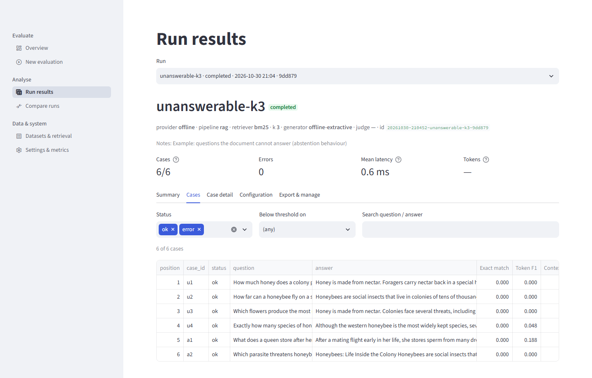

# Part VI — Playbooks for improving quality

Part V taught you to read a result. This Part is about changing one. Each playbook is a procedure you can follow at a keyboard: a goal, a setup, the exact commands, what to look at, how to decide, and what goes wrong. They share one idea: **change one thing, measure with a paired comparison, read the cases, and decide with the limits in mind.**

| Playbook | Goal | Needs a key? |
|---|---|---|
| A | Tune retrieval depth k and the retriever | No for BM25; local embeddings need the optional model |
| B | Gate a change with `rerun` and `regress` | No (judge metrics need one) |
| C | Handle unanswerable questions | No for the offline baseline; a live model for a real fix |
| D | Choose and validate a judge metric | Yes (judge); calibration of stored runs needs none |
| E | Diagnose a failing question end to end | No |
| F | Improve a document for retrieval and re-measure | No |
| G | Compare local-embedding and BM25 retrieval on paraphrased questions | No, but needs the local model |

> **What was verified for this Part.** Every command shown was run offline (no key, no network) on the bundled examples, in a scratch data folder, unless a playbook says otherwise. The offline pipeline is BM25 retrieval plus an extractive sentence picker. It is a baseline, not a language model, so the *conclusions* about it (for example "k=1 beats k=3 on token F1") are conclusions about that generator. The playbooks teach the method; run them on your own pipeline to get conclusions that matter to you. Live-provider numbers appear only where `docs/LIVE_VERIFICATION.md` has them, and they are labelled with the run number.

---

## 6.1 Before you start: the common setup

### 6.1.1 A clean working folder

Use a scratch run store while you practise, so you do not clutter the real one. In PowerShell:

```powershell
$env:RAGWB_NO_DOTENV = "1"          # do not read a .env file
$env:OPENAI_API_KEY = ""            # offline: no model provider can be contacted
$env:RAGWB_DATA_DIR = "C:\scratch\ragwb-playbooks"
```

(`RAGWB_DATA_DIR` moves the run store; Part III explains the other settings.) With no key, the workbench uses the offline pipeline and the lexical metrics.

### 6.1.2 Run ids

Every command that takes a RUN_ID accepts any of these, as long as the text is at least 4 characters and matches exactly one run:

* the full id (for example `20261030-214313-doca-28f262`),
* a unique prefix of the id (`20261030-2143`),
* the short suffix the web app shows, the last 6 characters (`28f262`),
* an exact run name (`docA`).

At a keyboard the short forms save typing: `ragwb show docA`, `ragwb compare docA docB`. If the text matches several runs the command stops with `'<text>' matches N runs (<ids>); give more of the id.`; if it matches none you get `No run with id '<text>'. Use 'list' to see run ids.`

In a script, use the full id. Names can repeat (you rerun an experiment under the same name), and a name that matched one run yesterday can match two today. Capture ids in shell variables:

```powershell
ragwb list
$K1 = "<paste the id of offline-bm25-k1>"
```

On Git Bash: `K1=$(ragwb list | grep offline-bm25-k1 | awk '{print $1}')`; if the name was used twice this returns two lines, so check the variable before you use it.

Give your own runs names that say what changed (`k3-skipheadings`, `edited-doc`), and use `ragwb tag RUN --add baseline,keep` to mark the run you compare against (`keep` also protects it from `ragwb prune`). `ragwb list --tag baseline` finds it again. `ragwb note RUN "text"` stores a free-text note with a run.

### 6.1.3 The loop

Every playbook follows this loop:

1. **Fix a baseline run** you trust (right dataset, enough questions, no errors).
2. **Change one thing** (k, retriever, document, prompt, model).
3. **Run** with a new name, same dataset.
4. **Compare** (`ragwb compare BASELINE CANDIDATE`) or **gate** (`ragwb regress BASELINE CANDIDATE`).
5. **Read the cases that changed.** The win/tie/loss counts tell you how many; the case detail tells you why.
6. **Decide and record** (a tag and a note on the run you chose).

---

## 6.2 Playbook A: tune retrieval depth k and the retriever with paired comparisons

### Goal

Find the number of retrieved chunks (k), and the retriever, that give the best answers for your pipeline on your data, without fooling yourself with noise.

### Why k is a trade-off

Raising k gives the generator more chances to see the right text, and more chances to be distracted by wrong text. On the retrieval side, context recall can only rise or stay the same as k grows. On the answer side, answers can get better, worse, or stay the same. On the judge side, context relevancy tends to fall as k rises, because more of the retrieved text is off-topic. Cost and latency also rise with k for a live model (more prompt tokens). So the right k is where the answer metrics stop improving, not where context recall is highest.

### Setup

* A dataset of at least 20 questions with references (Part II). More is better; see Part V §5.8.
* One fixed document, one fixed generator, one fixed set of metrics. Only k changes.

### Commands (verified offline)

Run the same dataset at several values of k. The bundled example runs already do k=1, 3 and 5; you can add k=2:

```text
ragwb run --name k1 -k 1 --quiet
ragwb run --name k2 -k 2 --quiet
ragwb run --name k3 -k 3 --quiet
ragwb run --name k5 -k 5 --quiet
```

(`ragwb run` defaults to `examples/datasets/honeybees.jsonl`, `examples/documents/honeybees.pdf`, the offline provider and BM25. Use `--dataset` and `--document` for your own files, `--retriever` for another retriever and `--metrics` for another metric set.) Real results over the same 20 questions:

| k | Token F1 | ROUGE-L | Context recall | Groundedness |
|---|---:|---:|---:|---:|
| 1 | 0.404 | 0.373 | 0.857 | 1.000 |
| 2 | 0.355 | 0.326 | 0.875 | 1.000 |
| 3 | 0.346 | 0.317 | 0.885 | 1.000 |
| 5 | 0.346 | 0.317 | 0.892 | 1.000 |

Now the paired comparisons, adjacent pairs first:

```text
$ ragwb compare $K1 $K2
Token F1                       20   0.404   0.355          -0.049  -0.104   -0.002         3    10        7              True
ROUGE-L                        20   0.373   0.326          -0.047  -0.097   -0.004         3    10        7              True
Context recall (lexical)       20   0.857   0.875           0.018   0.000    0.048         2    18        0             False

$ ragwb compare $K2 $K3
Token F1                       20   0.355   0.346          -0.008  -0.022    0.002         1    17        2             False
Context recall (lexical)       20   0.875   0.885           0.010   0.000    0.030         1    19        0             False

$ ragwb compare $K3 $K5
Token F1                       20   0.346   0.346           0.000   0.000    0.000         0    20        0             False
Context recall (lexical)       20   0.885   0.892           0.007   0.000    0.021         1    19        0             False
```

(Columns: paired cases, mean A, mean B, difference B minus A, interval low, interval high, B better, ties, B worse, `ci_excludes_zero`; groundedness rows are all ties and omitted.)

### What to look at

1. **The answer metric, paired.** Going from k=1 to k=2 costs token F1 about 0.049 and the interval excludes zero; k=2 to 3 and 3 to 5 change almost nothing. The loss is already complete at k=2.
2. **Win/tie/loss.** From k=1 to k=2 there are 7 worse, 3 better and 10 unchanged: most answers do not change at all. Find the 7 (Compare page, per-case differences for Token F1) and read two of them.
3. **Retrieval metric, paired.** Context recall edges up but never significantly (every interval's lower bound is 0.000). Remember it cannot fall.
4. **Whether the gain is real.** Check whether the extra context supplied the *needed* text or any text (Part V §5.4.4, the "male" and "roughly" examples).
5. **Cost.** For a live model, read the tokens and cost columns of the run: they scale with k.

### How to decide

| Pattern | Decision |
|---|---|
| Answer metrics flat from k=N upward | Choose the smallest k at or above N: same answers, lower cost and latency |
| Answer metrics fall with k (as for the extractive baseline) | The generator is distracted by extra chunks; prefer smaller k, or improve the generator |
| Answer metrics rise with k, context recall rises | The right text was being missed; take the largest k that still improves, then re-check cost |
| Context recall rises, answer metrics do not | The needed fact is now retrieved but the generator does not use it: a generation problem, not a retrieval problem |
| Context relevancy (judge) falls steeply | Too much off-topic text; try a smaller k or a better retriever |
| Differences inside the intervals | Inconclusive: add questions rather than argue |

Here the decision for the example baseline is "k=1 or k=2, not 3 or 5": it keeps the token F1 and loses no significant context recall. The decision for a live LLM pipeline could be different; repeat the playbook with your pipeline and a calibrated metric.

### Changing the retriever

The retriever options are `bm25` (lexical, the default), `local` (a local embedding model, optional `fastembed` package, no key), `hybrid-local` (BM25 plus local embeddings fused by reciprocal rank), and `embedding` and `hybrid` (embeddings from an API; they need a key and a provider with an embeddings endpoint). Change only `--retriever`, keep k, and compare:

```text
ragwb run --name bm25-k3  --retriever bm25  -k 3 --dataset <your dataset> --document <your doc>
ragwb run --name local-k3 --retriever local -k 3 --dataset <your dataset> --document <your doc>
ragwb compare $BM25 $LOCAL
```

Playbook G has a worked example of the comparison on paraphrased questions and the documented numbers.

### Pitfalls

> **Pitfall: tuning on the dataset you report on.** If you choose k because it is best on your 20 questions and then report that run's mean as "the performance", the number is optimistic. Hold back some questions for the final report, or confirm the choice on a fresh set.

> **Pitfall: many comparisons.** Comparing four values of k on four metrics is sixteen checks. A lone `True` among many `False` rows can be chance. Look for a consistent pattern across related metrics.

> **Pitfall: reading context recall as quality.** It rises with k by construction. If you pick k by context recall alone you will pick the largest k tested.

> **Pitfall: the retriever changes the chunk text, not just the order.** If you change chunking, see Playbook F: you have then changed two things.

> **Pitfall: comparing a retriever on only one question style.** A local embedding model may help on paraphrased questions and hurt on questions that reuse the document's words. Playbook G and the documented run 9 show both.

---

## 6.3 Playbook B: gate a change with `rerun` and `regress`

### Goal

Make "did this change make things worse?" an automatic yes/no with an exit code, so that a change cannot slip into your pipeline unmeasured.

### The idea

You have a baseline run you trust. After a change (a new prompt, a different model, a different retriever, an edited document), you produce a candidate run on the same dataset and ask `ragwb regress` whether it is measurably worse. The gate is deliberately conservative in two ways: it fails only when a drop is *both* large and statistically distinguishable from noise, and it refuses to pass when it could not judge anything.

### Two commands

**`ragwb rerun RUN_ID [--name NAME] [--quiet]`** repeats a stored run from its recorded configuration (provider, pipeline, retriever, k, metrics, thresholds, models, dataset path, document path) with today's code and the files as they are now. Use it when *something other than a command-line option changed*: you edited the document, the dataset, the prompt text in the code, upgraded the library, or switched a model's behind-the-scenes version. It does not accept new settings. To change k or the retriever, use `ragwb run`.

**`ragwb regress BASELINE CANDIDATE [--max-drop X] [--min-pairs N] [--max-error-increase X] [--metrics a,b]`** pairs the two runs by question text (Part V §5.7), and for every shared metric decides one of five verdicts.

### The decision rule

| Verdict | Rule |
|---|---|
| `regression` | the mean difference is below `-max_drop` and the paired interval lies entirely below zero |
| `possible` | the drop is larger than `max_drop` but the interval includes zero (does not fail the gate) |
| `improved` | the paired interval lies entirely above zero (and the mean difference is positive) |
| `ok` | anything else |
| `insufficient` | fewer than `min_pairs` paired questions, so the metric is not judged |

The error rate is gated as well: if the candidate's share of failed cases exceeds the baseline's by more than `--max-error-increase`, the gate fails even when every metric looks fine.

### The options and their defaults

| Option | Default | Meaning | When to change it |
|---|---|---|---|
| `--max-drop` | 0.02 | Largest tolerated drop in a metric's mean | Raise it if your metric is noisy and small drops are expected; lower it for a very stable metric |
| `--min-pairs` | 10 | Paired questions needed to judge a metric | Raise it (30 or more) when the dataset allows; below 10 the gate refuses to judge |
| `--max-error-increase` | 0.05 | Largest tolerated rise in the share of failed cases | Tighten for production-like checks; 0.0 means "no new errors" |
| `--metrics` | all shared | Comma-separated metrics to gate | Gate only the metrics you trust (calibrated ones) and leave out the rest. A name that is not in both runs fails with exit 1 and lists the shared metrics |

### Exit codes

| Exit code | Meaning | What a scheduler should do |
|---|---|---|
| 0 | No significant regression (at least one metric was judged) | Continue |
| 3 | A regression, or an error-rate increase beyond the tolerance | Fail the job; read the report |
| 4 | Nothing could be judged (no metric reached `--min-pairs`) | Fail the job: a check that checked nothing must not look clean |

Any other non-zero code (such as 1 for an unknown run id) is an operational error.

### Real outputs

**A real regression (exit 3).** The k=3 run as the "change" from a k=1 baseline:

```text
$ ragwb regress $K1 $K3
baseline  = offline-bm25-k1 [...]
candidate = offline-bm25-k3 [...]

metric                verdict        pairs  baseline  candidate     diff  95% CI of diff
token_f1              regression        20     0.404      0.346   -0.057  [-0.116, -0.008]
rouge_l               regression        20     0.373      0.317   -0.056  [-0.108, -0.010]
context_recall        ok                20     0.857      0.885   +0.028  [+0.000, +0.062]
groundedness          ok                20     1.000      1.000   +0.000  [+0.000, +0.000]
error rate: baseline 0.0%, candidate 0.0%
FAIL: regression detected.
exit=3
```

**The other direction (exit 0, with a note).** The same two runs with the roles swapped:

```text
$ ragwb regress $K3 $K1
token_f1              improved          20     0.346      0.404   +0.057  [+0.008, +0.116]
rouge_l               improved          20     0.317      0.373   +0.056  [+0.010, +0.108]
context_recall        possible          20     0.885      0.857   -0.028  [-0.062, +0.000]
groundedness          ok                20     1.000      1.000   +0.000  [+0.000, +0.000]
error rate: baseline 0.0%, candidate 0.0%
PASS: no significant regression.
Note: a 'possible' drop is larger than 0.02 but its interval includes zero; gather more questions before trusting either reading.
exit=0
```

Here the gate says: token F1 and ROUGE-L improved significantly; context recall dropped by 0.028 (more than `--max-drop`) but the interval touches zero, so it is only a *possible* regression and does not fail the build. The note is the gate being honest about a small dataset.

**Identical runs (exit 0).** `ragwb rerun` on the offline baseline reproduces it exactly, so the gate sees no change:

```text
$ ragwb rerun $K3 --name k3-again --quiet
$ ragwb regress $K3 $K3_AGAIN
token_f1              ok                20     0.346      0.346   +0.000  [+0.000, +0.000]
...
PASS: no significant regression.
```

(The offline path is deterministic, so a rerun matches exactly. A live model would not match exactly; see "Gating live runs".)

**An error-rate regression (exit 3).** The candidate's scores are identical on the 17 cases that succeeded, but three failed:

```text
$ ragwb regress $K3 $FA
token_f1              ok                17     0.344      0.344   +0.000  [+0.000, +0.000]
...
error rate: baseline 0.0%, candidate 15.0%  -> REGRESSION
FAIL: regression detected.
exit=3
```

**Tuning the thresholds.** A larger tolerated drop lets the first example pass (exit 0):

```text
$ ragwb regress $K1 $K3 --max-drop 0.1
token_f1              ok                20     0.404      0.346   -0.057  [-0.116, -0.008]
...
PASS: no significant regression.
```

Do this only if a 0.057 drop is acceptable to *you*; the interval says it is real, and `--max-drop` says whether you care. Gating on a subset of metrics:

```text
$ ragwb regress $K1 $K3 --metrics context_recall,groundedness
context_recall        ok                20     0.857      0.885   +0.028  [+0.000, +0.062]
groundedness          ok                20     1.000      1.000   +0.000  [+0.000, +0.000]
PASS: no significant regression.
```

**Nothing could be judged (exit 4).** Two runs with no shared questions, or fewer pairs than `--min-pairs`:

```text
$ ragwb regress $K1 $UN
token_f1              insufficient       0       n/a        n/a      n/a  [n/a, n/a]
...
NOT JUDGED: no metric had at least 10 paired questions; nothing was verified.
exit=4

$ ragwb regress $K1 $K3 --min-pairs 25
token_f1              insufficient      20     0.404      0.346   -0.057  [-0.116, -0.008]
...
NOT JUDGED: no metric had at least 25 paired questions; nothing was verified.
exit=4
```

### A complete procedure

1. **Create and tag the baseline.**

   ```text
   ragwb run --name baseline-2026-11 --dataset questions.jsonl --document handbook.pdf -k 3 --quiet
   ragwb tag <baseline id> --add baseline,keep
   ```

2. **Make your change** (edit the document, the code, the model setting).
3. **Run the candidate.** Use `ragwb rerun <baseline id> --name candidate` if the change is in the files or the code and the recorded configuration still applies; use `ragwb run ...` with the new option if the change is an option.
4. **Gate.**

   ```text
   ragwb regress <baseline id> <candidate id> --metrics token_f1,context_recall --min-pairs 30
   echo $?
   ```

5. **If exit 0:** accept; tag the candidate as the new baseline if you will keep it.
6. **If exit 3:** open the Compare page for the pair, read the largest losses, and decide whether the drop is a real problem (revert), an accepted trade (raise `--max-drop` and write down why), or a metric artefact (fix the metric, not the pipeline).
7. **If exit 4:** you are not testing anything. Fix the dataset overlap, or lower `--min-pairs` only if you accept a weaker check.

### Wiring it into any scheduler

`ragwb regress` is a normal command that signals through its exit status, so any scheduler can run it: cron, Windows Task Scheduler, a CI service, a make target. The script below is a plain shell example (adapt the commands to your scheduler). It assumes a baseline id stored in a file, a persistent run store (`RAGWB_DATA_DIR`), and the offline pipeline; for a live pipeline see "Gating live runs".

```bash
#!/usr/bin/env bash
# nightly_gate.sh: run the candidate and gate it against the stored baseline.
set -u
export RAGWB_NO_DOTENV=1
export RAGWB_DATA_DIR=/var/lib/ragwb            # the persistent run store
BASELINE_ID=$(cat /var/lib/ragwb/baseline.id)    # written when you accepted the baseline

ragwb run --name "nightly-$(date +%F)" --dataset questions.jsonl --document handbook.pdf -k 3 --quiet || exit 2
CANDIDATE_ID=$(ragwb list --search "nightly-$(date +%F)" | awk 'NR==2{print $1}')

ragwb regress "$BASELINE_ID" "$CANDIDATE_ID" --metrics token_f1,context_recall --min-pairs 30
code=$?
case $code in
  0) echo "gate passed" ;;
  3) echo "REGRESSION: see the report above" ;;
  4) echo "gate could not judge anything" ;;
  *) echo "operational error ($code)" ;;
esac
exit $code
```

Points to get right when you wire it up:

* **Keep the baseline in the run store the scheduler uses.** A baseline created on your laptop is not in the server's store. Move it with `ragwb export BASELINE --format json --out-dir DIR` and `ragwb import DIR/<file>.json`. Exported bundles are written without absolute file paths and without keys. (Imported runs keep their per-case scores, but the pipeline cannot be re-run from them unless the dataset and document paths still resolve on the new machine.)
* **Use the same dataset file** for baseline and candidate; the pairing is by question text, so edits to questions reduce the number of pairs.
* **Treat 4 as a failure**, not a skip.
* **Back up the store** (`ragwb backup`) so your baseline cannot be lost, and prune old nightly runs deliberately with `ragwb prune` (a dry run unless `--yes`).
* **Do not give the scheduler more than it needs.** For an offline gate it needs no key at all. For a live gate, give the key through the scheduler's secret store, never through a committed file (Part VII covers operations and secrets).

### Gating live runs

A live model does not reproduce exactly: the same pipeline run twice gives slightly different answers and judge scores. Therefore, with a live generator or judge:

* A candidate that is "the same" will show small non-zero differences. That is why the gate needs both a size (`--max-drop`) and an interval, and why you should not set `--max-drop 0`.
* Measure the noise first. If you gate on a judge metric, run `ragwb judge-noise` (Playbook D) and set `--max-drop` comfortably above the within-case jitter.
* A second baseline (an independent rerun of the baseline) shows you what "no change" looks like for your pipeline: run `ragwb regress BASELINE BASELINE_RERUN` and see how far apart they are.
* Expect rate-limit errors. The error-rate gate will fail a candidate whose judge calls were throttled, which is correct: an unscored run did not pass. Fix the pacing and rerun (Part IV).

### Pitfalls

> **Pitfall: a gate on a tiny dataset.** With 20 questions the gate can only detect gross drops (roughly 0.05 or more on a wording-overlap metric). A "PASS" means "no drop large enough to detect", not "no drop". Say so in the pipeline's documentation.

> **Pitfall: gating metrics you have not validated.** A gate on token F1 for an LLM pipeline rewards copying the reference's wording. Gate only on metrics you trust for that pipeline (calibrated, Part V §5.10).

> **Pitfall: the baseline drifting.** If each accepted candidate becomes the new baseline, many small accepted drops (each under `--max-drop`) can add up to a large one. Keep a fixed "anchor" run too, and compare the current candidate against it now and then.

> **Pitfall: "possible" ignored forever.** A `possible` verdict is a request for more data. If you see it repeatedly, enlarge the dataset.

> **Pitfall: changing the dataset between baseline and candidate.** Each changed question loses its pair. If your pairs fall below `--min-pairs`, the gate exits 4.

---

## 6.4 Playbook C: handle unanswerable questions

### Goal

Make a pipeline say "the document does not say" when the document does not say, without making it refuse questions the document does answer.

### The two kinds of mistake

An unanswerable question is one whose answer is not in the document. A pipeline can fail on it in two directions, and the fix for one makes the other worse:

* **Answering when it should abstain.** It produces a confident, irrelevant or invented answer. The user is misled.
* **Abstaining when it should answer.** It refuses a question the document answers. The user is frustrated, and the pipeline looks useless.

A pipeline's "abstention quality" is therefore two numbers, not one: the share of unanswerable questions it declines, and the share of answerable questions it wrongly declines.

### Setup: datasets with unanswerable questions

The workbench has two bundled examples (Part II shows how to build your own):

* `examples/datasets/honeybees_unanswerable.jsonl`: six questions: four unanswerable (`u1` to `u4`) and two answerable controls (`a1`, `a2`), marked in `metadata.type`.
* `examples/datasets/volcanoes.jsonl`: 30 questions, five of type `unanswerable`, with `type`, `difficulty` and `topic` metadata.

For an unanswerable row, the reference answer is the abstention sentence: *"The PDF does not provide enough information to answer the question."* Always include some answerable control questions in the same dataset. A dataset of only unanswerable questions rewards a pipeline that refuses everything.

### Step 1: measure the baseline

```text
ragwb run --name un-baseline --dataset examples/datasets/honeybees_unanswerable.jsonl --quiet
ragwb slices <un-baseline id> --by type
```

Real output:

```text
cases 6  ok 6  errors 0
Exact match                    0.000      0.000-0.000      0%       6     0    0
Token F1                       0.039      0.000-0.102      0%       6     0    0
Context recall (lexical)       1.000      1.000-1.000    100%       2     4    0
Groundedness (lexical)         1.000      1.000-1.000    100%       6     0    0

slice          cases   ok    Exact match    Token F1   Context recall   Groundedness
answerable         2    2    0.000 (2)     0.094 (2)     1.000 (2)       1.000 (2)
unanswerable       4    4    0.000 (4)     0.012 (4)         - (0)       1.000 (4)
```

Reading it (Part V §5.5.3 shows the screenshot):

* Exact match 0.000 on the four unanswerable cases: the baseline **never abstains**. Every answer is an extracted sentence. This is not a bug; the offline generator has no way to say "I do not know" unless an evidence threshold is set.
* Groundedness is 1.000 on all four: the metric cannot see that the answer is irrelevant.
* Context recall is skipped on the unanswerable cases (4 skipped), so the `1.000` describes only the two answerable questions.



### Step 2: switch abstention on (offline)

The offline generator has an optional rule: abstain unless the answer covers at least a given share of the question's content terms. The options are `--min-evidence` (0 to 1) and `--skip-headings` (drop heading-like blocks from the chunks so the title cannot be chosen as an "answer").

```text
ragwb run --name un-me07 --dataset examples/datasets/honeybees_unanswerable.jsonl \
    --min-evidence 0.7 --skip-headings --metrics exact_match,token_f1,context_recall,groundedness --quiet
ragwb slices <un-me07 id> --by type
```

Real output:

```text
slice          cases   ok    Exact match    Token F1   Context recall   Groundedness
answerable         2    2    0.000 (2)     0.094 (2)     1.000 (2)       1.000 (1)
unanswerable       4    4    1.000 (4)     1.000 (4)         - (0)           - (0)
```

All four unanswerable questions are now declined (exact match 1.000). The answerable slice did not improve, and its groundedness is now scored on one case instead of two: one of the two answerable questions was *wrongly* declined. Case `a2` ("Which parasite threatens honeybee colonies?") returns the abstention sentence although its context recall is 1.0: the answer was in the retrieved text, but the question's words ("parasite", "threatens") barely overlap with the document's ("parasitic", "threats"), so the evidence share fell under 0.7.

### Step 3: look at both sides on a bigger dataset

Six questions are an anecdote. The same switch on the 30-question volcano dataset, sliced by type:

```text
ragwb run --name volc-base --dataset examples/datasets/volcanoes.jsonl --document examples/documents/volcanoes.pdf --quiet
ragwb run --name volc-me   --dataset examples/datasets/volcanoes.jsonl --document examples/documents/volcanoes.pdf \
    --min-evidence 0.7 --skip-headings --quiet
ragwb slices <volc-base id> --by type
ragwb slices <volc-me id>   --by type
```

| Type (cases) | Token F1, baseline | Token F1, `--min-evidence 0.7 --skip-headings` |
|---|---:|---:|
| factual (14) | 0.276 | 0.101 |
| list (4) | 0.128 | 0.097 |
| numeric (2) | 0.064 | 0.000 |
| why (5) | 0.251 | 0.221 |
| unanswerable (5) | 0.042 | 0.642 |
| all (30) | 0.199 | 0.204 |

The overall token F1 hardly moves (0.199 to 0.204). The headline says "nothing happened", the slices say "we traded answerable questions for unanswerable ones": on the unanswerable type, 0.042 to 0.642; on the factual type, 0.276 to 0.101. The skipped counts confirm it. Groundedness is scored on only 12 of 30 cases, so 18 answers were abstentions. In the unanswerable slice it is scored on 2 of 5 (so 3 of 5 were declined), which leaves 15 abstentions among the 25 answerable questions. (These counts are inferred from the skipped columns, because groundedness skips exactly the abstained answers.)

This is the central lesson of the playbook: **an overall mean can hide a trade; the slice by question type shows it.**

### Step 4: tune the threshold on held-out data

You do not have to guess the threshold. `ragwb tune-abstention` picks `--min-evidence` (and whether to skip headings) on a development half of the questions and reports the result on a held-out half:

```text
$ ragwb tune-abstention
Development questions: 51 | test questions: 45
Chosen on the development half: min_evidence=0.8

setting                             declined unanswerable  answered answerable  balanced acc.
Held-out test half:
  min_evidence=0.0 (default)                 0/12 (0.000)        33/33 (1.000)          0.500
  min_evidence=0.8 (tuned)                  10/12 (0.833)         9/33 (0.273)          0.553

Development half, every setting (best five):
  min_evidence=0.8                            7/7 (1.000)        19/44 (0.432)          0.716
  ...
Only 12 unanswerable test questions (fewer than 30): treat the test figures as rough.
```

With no arguments it uses the four bundled unanswerable-containing example datasets and their documents (it takes `--dataset` and `--document` lists, in matching order, for your own data). It does not call any model and takes a few seconds.

### The negative result, with its numbers

On the held-out half, the tuned setting declined 10 of 12 unanswerable questions and **also declined 24 of the 33 answerable ones** (it answered only 9 of 33). Balanced accuracy (the average of the two rates) is 0.553 against 0.500 for never abstaining: barely above chance. `docs/KNOWN_LIMITATIONS.md` records the verdict: that is a poor trade, so the default stays at no abstention.

The reason is in the method, not the tuning. The extractive baseline can only compare *words* of the question with words of the text. It cannot tell an unanswerable question from a hard one, or from one phrased in different words, by overlap alone. Every question shares some content word with the document, which is why the untuned baseline never abstains; and a threshold high enough to stop it from answering "How much honey does a colony produce in a year?" also stops it from answering "Which parasite threatens honeybee colonies?".

### What would actually fix it

Nothing in this tool's offline baseline will. The fix needs a component that judges whether the retrieved text answers the question:

1. **A language-model generator with an abstention instruction.** With the OpenAI provider, the pipeline's prompt tells the model to answer from the context and to use the fixed abstention sentence verbatim otherwise. In the live record, run 7 (30 volcano questions, `qwen/qwen3.8-27b`), the groundedness metric was scored on 22 of 30 answers and skipped on 8. Five of the 8 are the five unanswerable questions, which the model correctly declined; the other three are the labeller's fails v20, v23 and v26, where the model abstained although the document answers them (the same trade, in a language model: some false abstentions).
2. **A relevance check on the retrieved chunks.** Declining when the best chunk is judged irrelevant to the question (for example with the `context_relevancy` judge metric) is a better signal than word overlap. This is a design suggestion, not something the workbench does for you.
3. **Better retrieval for the vocabulary mismatch.** Many false abstentions come from synonyms and inflections (parasite/parasitic). Embedding retrieval (Playbook G) or an edited document (Playbook F) reduces them.
4. **A bigger and more varied set of unanswerable questions**, so that your measured trade-off has meaning. The bundled test half has 12 unanswerable questions; the tool itself says to treat the figures as rough.

### How to decide

| Situation | Decision |
|---|---|
| A wrong answer is worse than no answer (medical, legal, compliance) | Prefer abstention; accept a high false-abstention rate; measure both rates; have a person review the declined answerable cases |
| A missing answer is worse than a wrong one (search-like assistant) | Prefer answering; show sources so the user can judge |
| Unsure | Report both rates on a mixed dataset, with sample sizes, and let the owner of the product decide the trade |

### Pitfalls

> **Pitfall: a mean that improves by abstaining.** Abstained answers are skipped by groundedness, so abstaining on hard questions raises the mean groundedness. Always check `scored` (Part V §5.3.3).

> **Pitfall: abstention phrases not recognised.** The pipeline recognises only a few phrases ("does not provide enough information", "cannot answer", and similar). A model that says "I don't know" is not counted as abstaining; either instruct it to use the exact sentence or normalise its output.

> **Pitfall: tuning on the dataset you report on.** `tune-abstention` splits for this reason; do the same if you tune any threshold yourself.

> **Pitfall: unanswerable questions that are actually answerable.** If the document says the thing in a different place, a "wrong" answer may be right. Review disagreements by hand.

---

## 6.5 Playbook D: choose and validate a judge metric

### Goal

Decide which judge metric (if any) to use as the main quality signal, and establish how far to trust it, before it gates anything.

### What can be run offline and what cannot

Judge metrics (`answer_relevancy`, `faithfulness`, `context_relevancy`, `correctness`) call a language model, so every step that scores answers needs a key and a provider, and it uses quota and money. What you can do offline, with no key: calibrate any metric already stored in a run against labels, run the threshold sweep, rescore lexical metrics from stored answers, and import the shipped live run to practise. This playbook marks which is which. All the real numbers in it come from `docs/LIVE_VERIFICATION.md` or from the offline calibration of the shipped run bundle.

### Step 1: choose a candidate from what you want to know

| Your question | Candidate | Needs a reference? |
|---|---|---|
| Is the answer right? | `correctness` | Yes |
| Is the answer supported by the retrieved text? | `faithfulness` | No |
| Does the answer address the question? | `answer_relevancy` | No |
| Is the retrieved text focused? | `context_relevancy` | No |

`correctness` is the only judge metric that checks the answer against a reference; the others are reference-free. Choose by the decision you will make, not by the number that looks best.

### Step 2: run a small live pilot and read it

Run 30 or more questions with the candidate metric and a judge model different from, or at least as strong as, your generator. Pace the run and watch for errors (Part IV). Then:

* Read the `scored`/`err` counts: a judge metric with many errors is missing, not low (live run 17: faithfulness scored on 6 of 20, context relevancy on 1 of 20, because of a per-minute token cap).
* Look at the distribution. A ceiling (all 1.000, as with answer relevancy and faithfulness in run 4) leaves nothing to compare.
* Read the judge's reasons on the lowest ten cases. Do they make sense?

### Step 3: measure the judge's noise

```text
ragwb judge-noise RUN_ID --metrics correctness --repeats 3 --limit 10
```

(This is the live step; it needs a key. It prints the number of judge measurements first and refuses to go over 30 without `--yes`.) The real measurement in `docs/LIVE_VERIFICATION.md` run 8: `correctness`, 10 cases, 3 repeats: **within SD 0.023, between SD 0.371, noise/signal 0.062, 1 of 10 cases flipped pass/fail.** Decision rule: if noise/signal is under about 0.5, differences between runs larger than the within-SD are meaningful for that metric on that judge model. Limits: one metric, ten cases, one judge, one day. Repeat for any other metric you plan to rely on; none of faithfulness, answer relevancy or context relevancy has a measurement yet.

### Step 4: calibrate against labels

1. Write a sheet from your pilot run: `ragwb labels-template RUN_ID --out sheet.csv`.
2. Hide the score columns, label each answer `pass` or `fail` against the reference, preferably with two independent labellers.
3. Run the comparison, with the sweep:

   ```text
   ragwb calibrate RUN_ID --labels sheet.csv --metric correctness --sweep
   ```

4. Read agreement, kappa, the confusion matrix and the plateau of the sweep (Part V §5.10.2 and §5.10.3).

You can practise steps 1 to 4 offline on the shipped example. Import the live volcano run, then compare the judge with the AI-written labels:

```text
ragwb import calibration/20261028-035657-qwen-volcanoes-30-b-7d604e.json
ragwb calibrate qwen-volcanoes-30-b --labels calibration/volcanoes-labels-by-claude.csv --metric correctness --sweep
```

Real result (labels written by Claude, an AI rater; not human labels). The first line of the report names the metric, the label file and the run:

```text
Correctness (judge) vs labels from volcanoes-labels-by-claude.csv, run qwen-volcanoes-30-b [20261028-035657-qwen-volcanoes-30-b-7d604e]
                    human pass   human fail
metric pass                25            0
metric fail                 1            4
agreement 0.967   kappa 0.870 (almost perfect)   precision 1.000   recall 0.962
pass rate: metric 0.833, human 0.867
```

and the sweep is flat at 0.967 from threshold 0.25 to 0.70, falling to 0.900 at 0.75 and 0.767 at 0.95.

### Step 5: compare against cheaper metrics on the same labels

A metric that costs nothing and agrees about as well is a better choice than one that costs quota. Compare on the same labels. Lexical and local-model metrics can be computed from the stored answers with `--rescore` (no API calls):

```text
ragwb calibrate RUN_ID --labels labels.csv --metric token_f1 --sweep
ragwb calibrate RUN_ID --labels labels.csv --metric rouge_l --rescore
ragwb calibrate RUN_ID --labels labels.csv --metric semantic_similarity --rescore --sweep   # needs the local model
```

Real results on the same 30 answers and the same AI-written labels (live runs 11 and 13, reproduced offline except the semantic row):

| Metric | Agreement at default threshold | Kappa | Best plateau |
|---|---:|---:|---|
| `correctness` (judge), 0.70 | 0.967 | 0.870 | 0.967 for every threshold 0.25 to 0.70 |
| `semantic_similarity` (local), 0.70 | 0.867 | 0.595 | 0.967 / 0.839 at 0.55 to 0.65; 0.933 at 0.40 to 0.50; falls to 0.767 at 0.75 |
| `groundedness` (lexical), 0.70 | 0.909 (22 compared) | 0.463 | measures support, not correctness |
| `token_f1` (lexical), 0.50 | 0.600 | 0.237 | 0.967 at 0.15 to 0.20 |
| `rouge_l` (lexical), 0.50 | 0.533 | 0.186 | not swept |

(For this guide, the author ran `token_f1`, `rouge_l`, `groundedness` and `correctness` offline from the shipped bundle. The `semantic_similarity` row is the live record's number; rescoring it offline without the local model cannot work: the command now stops with the one-line message "The local embedding model ... could not be loaded" (Part VIII §8.13) or `semantic_similarity could not be computed for any case: <reason>`, and never prints a table of zeros.)

### Step 6: decide

| Finding | Decision |
|---|---|
| Judge agrees with labels, plateau wide, noise small | Use the judge for comparisons; keep the threshold; say how it was validated |
| Judge agrees but a cheaper metric agrees nearly as well | Use the cheap metric for routine gating; use the judge on a sample |
| Judge disagrees on a pattern (e.g. abstentions, long answers) | Read those cases; maybe rewrite the rubric (the criteria text is in the code) or handle the pattern separately |
| Noise/signal above 0.5 | Do not use small differences in that metric; average over repeats or pick another metric |
| Only AI labels, only easy cases | You have a smoke test, not a validation; collect human labels |
| Few failures in the sample | Add failure cases to the sample before trusting kappa |

### The real AI-rater evidence, and its limits

For the `correctness` judge, the shipped evidence is runs 8, 11 and 13 of the live record: low noise on 10 cases; 29 of 30 agreement with **AI-written labels** (one rater, an AI model that saw the reference answers); and a stable threshold plateau. Together this supports "not obviously unreliable on an easy set". It does **not** support "validated", for these reasons: no human labels exist (the sheet `calibration/volcanoes-labelling-sheet.csv` is blank), one document, 30 cases, 4 failures (so the kappa is unstable), mostly easy answers. If you are going to rely on a judge, label your own sheet; the tooling is all there.

### Pitfalls

> **Pitfall: calibrating on the pipeline you are trying to improve.** If you tweak the pipeline to raise the judge's score, the judge's score goes up whether or not answers improve. Keep a labelled set the judge is never tuned against.

> **Pitfall: self-preference.** A judge from the same model family as the generator may favour its style. Use a different judge model where you can, and check agreement with labels.

> **Pitfall: changing the judge model mid-comparison.** All runs in one comparison need the same judge model. A change of provider alias can change the model behind it silently.

> **Pitfall: tuning the threshold to the best row.** The report says it: the best row is optimistic because it is chosen on the labels it is measured on. Choose a threshold from the *plateau*, not the peak.

> **Pitfall: reading kappa without looking at the table.** With 4 failures, one disagreement moves kappa by more than 0.1.

---

## 6.6 Playbook E: diagnose a failing question end to end

### Goal

Take one question with a bad score and decide, with evidence, which part of the system failed: **retrieval**, **generation**, the **reference** or the **metric**. The fix differs for each, and treating a metric artefact as a pipeline failure wastes days.

### Setup

A completed run, and a question whose score is low or whose answer looks wrong. In the UI, use Run results, Cases tab (filter "Below threshold on" your metric), then Case detail. At the command line, export the run as JSON, which holds the full case record including the retrieved chunks, and read the case you want:

```text
ragwb export RUN_ID --format json --out-dir out
```

The file has `run` and `cases`; each case has `question`, `expected_answer`, `answer`, `contexts` (each with chunk id, rank, score and text), `metrics` (score, status, reason) and `error`. Any JSON viewer, or a few lines of Python, will show it.

### The five-question protocol

Answer these in order. Stop at the first "yes".

1. **Did the case run?** Status `error`? Read the error text. A provider error, a timeout or an injected failure is an operations problem, not a quality problem (Part VIII has troubleshooting).
2. **Is the reference sound?** Does the document actually say what the reference says? Is the reference so long or wordy that a correct answer cannot score well? If the reference is wrong or odd, fix the dataset: that is a **reference problem**.
3. **Is the right text in the retrieved chunks?** Read the chunks (the Case detail tab lists them in rank order). If no chunk contains the answer: **retrieval problem**. If the right chunk is there but ranked low: still retrieval (ranking); a larger k might hide it, but it also dilutes.
4. **Given the right text was retrieved, is the answer right?** If the answer is wrong, incomplete or off-topic although a retrieved chunk contains the answer: **generation problem** (the generator did not use the text well).
5. **Is the answer good but the score low?** If an answer is correct and the right text was retrieved, and a metric still scores it low (paraphrase against a lexical metric, a harsh judge), it is a **metric problem**: do not change the pipeline.

### The decision table

| Evidence | Diagnosis | Typical fix |
|---|---|---|
| Right paragraph absent from the chunks | Retrieval | Better retriever, edit/split the document (Playbook F), embeddings (Playbook G), larger k |
| Right paragraph present at rank 2 or 3 and the title or an unrelated chunk is at rank 1 | Retrieval ranking | Vocabulary overlap, chunk size, `--skip-headings`, hybrid retrieval |
| Right paragraph at rank 1, answer wrong or irrelevant | Generation | Different generator/prompt; for the extractive baseline, nothing short of a language model |
| Right paragraph present, answer complete, lexical score low | Metric (wording) | Use a calibrated semantic or judge metric; do not tune the pipeline to the reference's words |
| Reference includes details not in the document | Reference | Fix the reference |
| Judge score low and reason cites a contradiction you cannot find | Metric (judge) | Check calibration; try judge-noise; flag for human review |
| Metric scores an abstention as a failure although the question is unanswerable | Reference/metric setup | Make the reference the abstention sentence |

### Worked cases (offline baseline, k=3, real data)

**Case q10: "How do honeybees tell each other where food is?" (token F1 0.400).**
Reference: "They perform the waggle dance, whose angle shows the direction and whose duration shows the distance to the food." Chunks: rank 1 the waggle-dance paragraph (score 2.142), rank 2 the drones paragraph, rank 3 the title. The answer is two sentences from rank 1 that say the same thing in other words ("indicates" for "shows"). Step 2: reference fine. Step 3: right text at rank 1. Step 4: answer correct. Step 5: yes. **Metric problem.** Do not touch the pipeline. The 0.8 context recall is filler words ("perform", "show") that are missing.

**Case q12: "How is nectar turned into honey?" (token F1 0.186, context recall 0.909).**
Reference: "Bees add enzymes to the nectar, fan their wings to evaporate water, and then seal the cells with wax." The right paragraph is rank 1 (score 4.797) and contains all three steps. The answer: "Honey is made from nectar. Foragers carry nectar back in a special honey stomach, and house bees pass it between them, adding enzymes that break down sugars." It has the first part of the process but not the fanning and sealing. Context recall is high (the words are in the chunks), but the answer stops after two sentences. **Generation problem.** The offline picker takes only the two highest-weighted sentences (`--answer-sentences` can change that, at a precision cost). With a real generator, check that the prompt asks for complete answers.

**Case a2: "Which parasite threatens honeybee colonies?" (token F1 0.000, context recall 1.000).**
Reference: "The varroa mite." The right paragraph is rank 3 (score 1.56). Ranks 1 and 2 are the title and the introduction (scores 2.61 and 2.31). The answer is the title plus the first sentence of the introduction. Step 3: the right text is retrieved at rank 3, but ranked below two irrelevant chunks. Why: the question's words "parasite" and "threatens" do not match the document's "parasitic" and "threats" under BM25's light stemming, so only "honeybee" and "colony" scored, and the title is short, which BM25's length normalisation favours. **Retrieval (ranking and vocabulary) problem, with a generation weakness** (the title was treated as a sentence). Context recall of 1.000 hid this because the third chunk supplied the words. Fix: Playbook F (edit the document) or Playbook G (embeddings).

**Case q01: "How many queens does a typical honeybee colony have?" (token F1 0.167).**
Reference: "A colony normally has a single queen." Chunks: the queen paragraph (rank 1), the introduction (rank 2, which says "A single colony contains one queen") and the pollinators paragraph. The answer: "The queen is the only fully fertile female in the colony. Honeybees are important pollinators of many fruit, nut and seed crops." The sentence that answers the question ("... contains one queen") is in a retrieved chunk, but the extractive picker scores sentences by shared content words with the question and chose two that share "queen"/"colony"/"honeybee" without the number. Diagnosis: **generation problem** (selection of the wrong sentences), with a mild reference issue (a wordy reference: "normally" is a missing term). At k=1 the answer was a different pair of sentences about the queen's mating flight, equally off-target, so raising or lowering k does not help here.

### Recording a diagnosis

Keep a one-line log per case: id, symptom, diagnosis class (retrieval / generation / reference / metric), evidence (chunk ids, scores), action. After 10 to 20 cases, count the classes. The most common class decides where to spend your effort. For the offline baseline, the counts would be mostly generation and metric; for a live pipeline they are usually different, and counting is the way to find out.

> **Pitfall: fixing the metric instead of the pipeline.** If many cases are "metric problems", the right action may be a better metric (calibrate, Part V §5.10), not editing answers to match references.

> **Pitfall: treating one case as a pattern.** A single failure is an anecdote. Check whether the failure type repeats before building a fix; slice by metadata (`ragwb slices`) to see whether it clusters.

> **Pitfall: reading only the answer.** The retrieved chunks are half the evidence. The same wrong answer can be a retrieval failure or a generation failure depending on what was retrieved.

---

## 6.7 Playbook F: improve a document for retrieval and re-measure

### Goal

Make the source document easier to retrieve from (clearer headings, sensible paragraph size, the words your users will use) and show with a paired comparison that the change helped and did not hurt other questions.

### What you can and cannot change

The workbench reads a document, splits it into blocks (for PDFs, text blocks and their pages; for the example `.md` file, its blank-line-separated paragraphs) and indexes each block as a chunk. There is no chunk-size setting; **the structure of your document is the chunking.** So the levers are in the document itself:

* **Paragraph size.** A paragraph with five facts is retrieved as one unit and dilutes each fact; a paragraph with one fact is precise. Split long paragraphs by topic.
* **Headings.** A short heading with no sentence punctuation becomes its own chunk. It scores well in BM25 (short chunks get a length bonus) and can be copied into answers. The `--skip-headings` option drops heading-like blocks before indexing. A good heading sits in the same chunk as its first paragraph, or is dropped.
* **Vocabulary.** If your users say "parasite" and the document says "parasitic varroa mite", a lexical retriever will not connect them. Adding the plain-language phrase ("the main parasite that threatens colonies") puts the user's words in the text.

### Step 1: baseline

Pick the failing questions, and a set of other questions to catch collateral damage. Run the baseline on both. This example uses the markdown form of the honeybee document:

```text
ragwb run --name docA-un --dataset examples/datasets/honeybees_unanswerable.jsonl --document examples/documents/honeybees.md --quiet
ragwb run --name docA     --dataset examples/datasets/honeybees.jsonl            --document examples/documents/honeybees.md --quiet
```

The unanswerable file contains the failing question `a2` ("Which parasite threatens honeybee colonies?"); the 20-question file is the set to guard.

### Step 2: edit a copy of the document

Never edit the original: work on a copy so the baseline stays reproducible (the run stores the document's hash). The edit here splits the last paragraph and adds the question's own words:

```text
Honeybees are important pollinators of many fruit, nut and seed crops.

The main parasite that threatens honeybee colonies is the varroa mite, which also spreads viruses. Other threats include pesticide exposure, poor nutrition from a lack of diverse flowers, and the stress of being moved long distances for commercial pollination.
```

(One paragraph became two. The new second paragraph contains "parasite" and "threatens".)

### Step 3: measure the target

```text
ragwb run --name docB-un --dataset examples/datasets/honeybees_unanswerable.jsonl --document honeybees_edited.md --quiet
ragwb compare docA-un docB-un
```

Real output:

```text
Token F1                        6   0.039   0.074           0.035   0.000    0.105         1     5        0             False
ROUGE-L                         6   0.039   0.074           0.035   0.000    0.105         1     5        0             False
Context recall (lexical)        2   1.000   1.000           0.000   0.000    0.000         0     2        0             False
Groundedness (lexical)          6   1.000   1.000           0.000   0.000    0.000         0     6        0             False
```

One question improved, five are unchanged: the paired mean difference is +0.035 and, with six cases, the interval touches zero. Of course it does; the sample is six questions and only one was meant to change. The case detail is the real evidence:

```text
CASE a2
ANS: The main parasite that threatens honeybee colonies is the varroa mite, which also spreads viruses. Honeybees: Life Inside the Colony
  CHUNK p1-b12  score 6.21  | The main parasite that threatens honeybee colonies is the varroa mite, ...
  CHUNK p1-b1   score 2.52  | Honeybees: Life Inside the Colony
  CHUNK p1-b2   score 2.17  | Honeybees are social insects ...
  token_f1 0.211   context_recall 1.000
```

Before the edit the right paragraph was at rank 3 with a score of 1.56; now it is at rank 1 with a score of 6.21, and the first sentence of the answer is exactly the right one. Token F1 is still modest (0.211): the answer contains the full sentence, and the title chunk is appended as a second "sentence". Note that the title chunk is still a chunk: even though the loader strips the `#` marker from a `.md` heading, the title text is retrieved and appended to the answer. That is a reminder that headings still need handling (Step 5).

### Step 4: guard the rest

Rerun the whole 20-question set on the edited document and gate it against the baseline:

```text
ragwb run --name docB --dataset examples/datasets/honeybees.jsonl --document honeybees_edited.md --quiet
ragwb regress docA docB
```

Real output:

```text
token_f1              ok                20     0.346      0.349   +0.002  [-0.004, +0.010]
rouge_l               ok                20     0.317      0.319   +0.002  [-0.004, +0.010]
context_recall        ok                20     0.885      0.885   +0.000  [+0.000, +0.000]
groundedness          ok                20     1.000      1.000   +0.000  [+0.000, +0.000]
error rate: baseline 0.0%, candidate 0.0%
PASS: no significant regression.
```

(`ragwb compare` shows 2 better, 17 tied, 1 worse on token F1.) The edit fixed the target question and did not measurably hurt the others, which is what you want. Read the one question that got worse before you accept the edit (the Compare page's per-case table lists it).

### Step 5: headings

Try `--skip-headings` on the original PDF and compare with the default:

```text
ragwb run --name k3-skiph --skip-headings -k 3 --quiet
ragwb compare <k3 id> <k3-skiph id>
```

```text
Token F1                       20   0.346   0.334          -0.013  -0.033    0.000         0    17        3             False
ROUGE-L                        20   0.317   0.305          -0.012  -0.024    0.000         0    17        3             False
Context recall (lexical)       20   0.885   0.885           0.000   0.000    0.000         0    20        0             False
```

Dropping the title chunk did *not* help on these 20 questions: token F1 fell by 0.013 with an interval that touches zero (3 cases worse, none better). Reading the three cases explains it. In q18 and q20 the answer's second "sentence" used to be the four-word title; without it, a full introduction sentence took its place, and a long irrelevant sentence costs more precision than a short one. In q01, removing a chunk changed BM25's statistics (the average chunk length and the term weights) enough to change which second sentence won, and the new one scored 0.000 instead of 0.167. The option is not a free win. Its documented trade-off is the same: the heuristic can also drop a real short chunk. Keep it off unless you have shown that it helps on your data (it is off by default so that results stay comparable with earlier runs).

### How to decide

| Result | Decision |
|---|---|
| The target question improves, guard set unchanged | Keep the edit; record the new document's hash with the run |
| The target improves, some guard questions fall | Read the fallen cases: an edit that stole the retrieval rank of another paragraph is a trade; revert or reword |
| No change anywhere | The problem was not in the document; go back to Playbook E |
| Improvement only in one lexical metric | Check with a different metric or read the cases |

### Pitfalls

> **Pitfall: editing the document to the questions.** Adding the exact words of the test questions to the document makes the test pass and teaches you nothing about real users. Edit for *real user phrasing* collected from logs or interviews; keep the evaluation questions separate from the ones you used to guide the edit.

> **Pitfall: no guard set.** An edit that fixes one question and breaks three is invisible if you only run the one.

> **Pitfall: re-measuring on the same questions you edited for.** Use the paired comparison on the failing question for the mechanism and a held-out set for the claim.

> **Pitfall: tiny datasets.** A six-question run cannot reach statistical significance for one improved case (the interval above touches zero). Use the case detail as the evidence, and say so.

> **Pitfall: PDFs.** For PDFs you cannot change paragraph size without regenerating the PDF (or converting to `.md` or `.txt`). Keep the source format the same in baseline and candidate to avoid changing the chunking in ways you did not intend.

---

## 6.8 Playbook G: compare local-embedding and BM25 retrieval on paraphrased questions

### Goal

Find out whether a local embedding retriever finds the right text when the question is worded differently from the document, and whether it does so without hurting questions that reuse the document's words.

### Why paraphrase matters

BM25 matches words. A question that uses synonyms or other inflections ("What tells other bees how far away the food is?", where the document says "the duration of the run indicates the distance") scores lower on BM25 than the same question in the document's words. Embedding models map meaning into numbers, so in principle they bridge that gap. The test is to measure both retrievers on questions written in plain words and on questions in the document's words.

### Setup

* `examples/datasets/honeybees_paraphrased.csv`: five questions (`p1` to `p5`) written in different words from the document, with a `topic` column. `examples/datasets/honeybees.jsonl`: 20 questions in the document's own wording.
* The `local` and `hybrid-local` retrievers need the optional `fastembed` package and its model (`BAAI/bge-small-en-v1.5`), downloaded once and then used offline. **Without the model, those retrievers cannot run**: the run stops at once with one message that names the model, not with a score of 0.

### Step 1: BM25 on the paraphrased set (real, offline)

```text
ragwb run --name para-bm25 --dataset examples/datasets/honeybees_paraphrased.csv -k 3 --quiet
```

```text
cases 5  ok 5  errors 0
Token F1                       0.225      0.109-0.360      0%       5     0    0
ROUGE-L                        0.203      0.081-0.353      0%       5     0    0
Context recall (lexical)       0.664      0.533-0.792     20%       5     0    0
Groundedness (lexical)         1.000      1.000-1.000    100%       5     0    0
```

These match the numbers recorded in the live-verification table (run 9: honeybees-paraphrased with BM25, token F1 0.225, context recall 0.664). Note the five-case sample: the interval on context recall is 0.533 to 0.792.

### Step 2: the local retriever on the same questions

```text
ragwb run --name para-local --dataset examples/datasets/honeybees_paraphrased.csv --retriever local -k 3 \
    --metrics token_f1,context_recall,semantic_similarity,semantic_context_recall --quiet
```

**This step could not be run for this guide: the local model was not available, and the guide's rules forbid downloading anything.** The tool's behaviour in that case is worth knowing: the run is stopped when it is prepared, with one message that begins `The local embedding model 'BAAI/bge-small-en-v1.5' could not be loaded` and says what to do (Part VIII §8.13). So you will not get a misleading number, but you also will not get a result until the model is available. To make it available, follow Part III (the model is downloaded once, to the data folder; allow the first run to use the network, then switch to offline mode so no network is needed afterwards).

### Step 3: what the documented run found (live record, run 9)

`docs/LIVE_VERIFICATION.md` run 9 measured all three retrievers with the real local model, offline, k=3, over five datasets. The generator was the extractive baseline in every row, so the table describes retrieval, not answer quality. Here are the honeybee rows (means over every case of the dataset):

| dataset | retriever | token F1 | context recall | semantic similarity | semantic context recall |
|---|---|---:|---:|---:|---:|
| honeybees (20) | bm25 | 0.346 | 0.885 | 0.757 | 0.734 |
| honeybees (20) | local | 0.340 | 0.792 | 0.725 | 0.714 |
| honeybees (20) | hybrid-local | 0.376 | 0.870 | 0.758 | 0.734 |
| honeybees-paraphrased (5) | bm25 | 0.225 | 0.664 | 0.715 | 0.733 |
| honeybees-paraphrased (5) | local | 0.242 | 0.786 | 0.751 | 0.765 |
| honeybees-paraphrased (5) | hybrid-local | 0.244 | 0.697 | 0.748 | 0.733 |

and the other three datasets (volcanoes, coffee, lighthouses): local context recall 0.738, 0.801 and 0.835 against BM25's 0.660, 0.765 and 0.819. The record's own reading:

* **No consistent winner.** Local embeddings raised lexical context recall on the paraphrased questions (0.664 to 0.786) and on volcanoes, coffee and lighthouses, and *lowered* it on the main honeybee set (0.885 to 0.792).
* **Hybrid-local sat close to BM25**, and gave the best token F1 on honeybees (0.376).
* **The semantic metrics barely move**: scores between 0.63 and 0.76 for these extractive answers; the model's cosines have a high floor (a paraphrase scored 0.847 against 0.501 for an unrelated sentence), so the 0.70 default says almost nothing until calibrated.
* **Because the answers come from the same extractive generator regardless of retriever**, the table says which chunks were found, not how good the final answers were.

### Step 4: how to read your own run when you have the model

1. Compare the pair on the paraphrased dataset: `ragwb compare <para-bm25 id> <para-local id>`. With five questions, expect `ci_excludes_zero` to be `False` even when the mean difference is visible; use the case detail instead (what did the local retriever put at rank 1 for each question?).
2. Run both retrievers on your *non-paraphrased* questions as well; the point of the playbook is to see whether the gain on paraphrases costs you on the others.
3. Check the retrieval metric with the answer metric: if context recall rises and token F1 does not, the extra recall is not reaching the answer.
4. Check hybrid retrieval, which fuses BM25 and embedding rankings and tends to hedge: it is the first thing to try when neither alone wins consistently.
5. Slice by `topic` (the paraphrased dataset has one): `ragwb slices <run id> --by topic`; but with five questions, each slice has one case, which is only for deciding which cases to read.

### How to decide

| Pattern | Decision |
|---|---|
| Local clearly better on paraphrases, equal on the rest | Use `local` or `hybrid-local` |
| Local better on paraphrases, worse on the rest | Use `hybrid-local`, or choose by the question style your users have |
| No difference on your questions | Stay with BM25: no model to install, deterministic and fast |
| Differences inside noise | Collect more questions before spending effort |

### Pitfalls

> **Pitfall: believing the semantic metrics' absolute values.** They sit between 0.63 and 0.76 for almost any plausible answer with this model. Compare runs; do not read 0.75 as "75% similar".

> **Pitfall: five questions.** The paraphrased set is five questions. It is an illustration of the method, not a benchmark. Write your own paraphrased set from real user phrasing (Part II).

> **Pitfall: a long data path.** The model cache nests folders deeply and can exceed Windows' 260-character path limit under a long data directory (`docs/KNOWN_LIMITATIONS.md`). Use a short `RAGWB_DATA_DIR` if the model fails to load.

> **Pitfall: confusing retrieval with answer quality.** With the extractive generator, the answer is a copy of the best sentences; a better retriever changes which sentences are available, not how well they are used. For answer quality, use a live generator and calibrated metrics.

---

## 6.9 Before you change anything: a checklist for improvement work

- [ ] I have a baseline run on a fixed dataset, no errors, with a tag (`baseline`, plus `keep` so that `prune` cannot delete it) and a note saying what it is.
- [ ] I am changing one thing at a time.
- [ ] I compare with `ragwb compare` or `ragwb regress` (paired), never with two means by eye.
- [ ] I looked at win/tie/loss and read the cases that changed.
- [ ] I have a guard set: questions the change should not affect.
- [ ] I looked at both sides of any trade (answered and abstained; precision and recall of retrieval; answer quality and cost).
- [ ] I know which metric I trust for this decision, and how I know (calibration, noise, or I say that I do not).
- [ ] I recorded the decision and the run ids.
- [ ] I said what the sample size cannot show.
