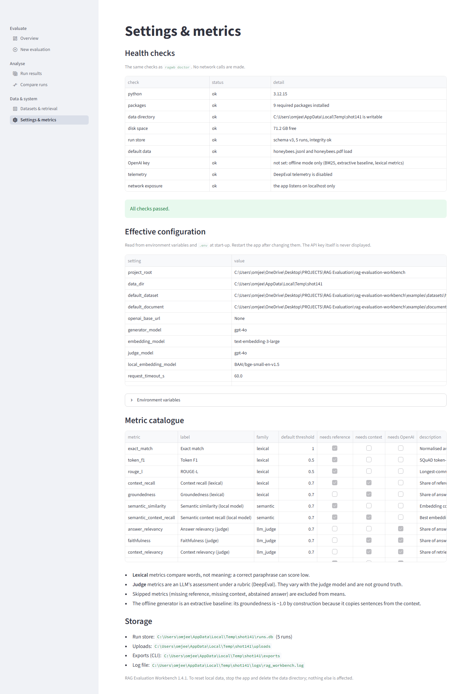

# Part VII — Playbooks for teams and operations

Parts I to VI taught you to run and read an evaluation on your own machine. This Part is for the moment the workbench stops being
"my laptop" and becomes something other people rely on: a classroom that shares it, a team that gates changes with it, an operator
who has to back it up, a budget that has to be respected. Each section is a self-contained playbook with exact commands. Every
command here was run offline against a scratch data directory for this guide unless the text says otherwise, and the output
quoted is real (paths and run ids shortened where it helps reading).

**How the commands are written.** In a checkout, `ragwb` means `uv run ragwb`, or `.venv\Scripts\python.exe -m rag_workbench` on
Windows (`.venv/bin/python -m rag_workbench` elsewhere). The examples below write plain `ragwb`. Where a scheduler or script
runs the tool, use the full interpreter path, as the example scripts do.

**What this Part does not claim.** No live OpenAI run, no Docker build or run, no human calibration, no TLS-proxy test and no
third-party security review exist (see `docs/KNOWN_LIMITATIONS.md`). Where a playbook touches one of those, it says so.

---

## 7.1 Run the workbench for a team

Out of the box the web app listens on `localhost` only and has no login. That is right for one person. The moment a second person
needs it, three things change: who may sign in, what each person may do, and what each person can see.

### 7.1.1 What you are setting up

| Piece | What it gives you | Where it lives |
|---|---|---|
| Named accounts | one login per person, scrypt-hashed passwords, per-user lockout | `<data dir>/users.json` |
| Roles | viewer / editor / admin, read again on every page load | the `role` field of each account |
| Run visibility | `shared` (default) or `own` | `RAGWB_RUN_VISIBILITY` |
| Transport | HTTPS from the app itself | `start.py --ssl-cert/--ssl-key` |
| Listener | which address the web server binds to | `start.py --host` |

The alternative to named accounts is one shared password (`RAGWB_APP_PASSWORD`). It works, but everyone is the same person: no
roles, no `own` visibility, no way to tell who started a run. Use it only for a short demo. If both exist, **accounts take
precedence** (`docs/OPERATIONS.md` §2).

### 7.1.2 Roles: who may do what

| Role | Browse and export | Start runs | Edit tags and notes | Delete runs | Manage accounts |
|---|:---:|:---:|:---:|:---:|:---:|
| viewer | yes | no | no | no | no |
| editor | yes | yes | yes | no | no |
| admin | yes | yes | yes | yes | yes (Accounts page) |

These come from the permission table in the app (`viewer` has no write actions, `editor` has run and tag, `admin` adds delete)
and from the `--role` help text of `ragwb user`. Without named accounts (no login, or the shared password), everyone has full
access, as before roles existed.

> **Pitfall.** Roles guard the **web app**. The command line does not ask who you are: anyone who can run `ragwb` against your
> data directory can run, delete and prune regardless of any role. Roles are a courtesy between colleagues using the browser, not
> a boundary between users of the machine. See §7.1.6.

### 7.1.3 Create the accounts (step by step)

1. Pick the data directory the shared instance will use, and set it for every command (here a scratch folder):

   ```bash
   export RAGWB_DATA_DIR=/srv/ragwb-data      # PowerShell: $env:RAGWB_DATA_DIR = "D:\ragwb-data"
   ```

2. Create the first admin. In a script, feed the password on standard input; interactively, omit `--password-stdin` and you are
   asked twice (the prompt does not echo).

   ```bash
   echo "choose-a-long-password" | ragwb user add alice --role admin --password-stdin
   ```

   ```
   Saved user alice (admin). Sign in on the web app with this username.
   ```

3. Add the rest. The default role is **editor** when you omit `--role`:

   ```bash
   echo "classroom-test-pass-2" | ragwb user add bob --role editor --password-stdin
   echo "classroom-test-pass-3" | ragwb user add carol --password-stdin
   ragwb user set-role carol --role viewer
   ragwb user list
   ```

   ```
   carol is now viewer. The change applies on the next page load.
   alice  (admin)
   bob  (editor)
   carol  (viewer)
   ```

4. Read the rules the tool enforces, so you are not surprised by them:

   | Rule | Real message |
   |---|---|
   | Passwords are 10 to 200 characters | `error: Passwords must be 10-200 characters` |
   | Usernames are 1 to 32 characters: lowercase letters, digits, `.`, `_`, `-`, starting with a letter or digit | (names are lower-cased automatically) |
   | A name cannot be added twice | `error: User 'carol' already exists (use --replace to change the password)` |
   | The last admin is protected | `error: 'alice' is the last admin; removing them would leave nobody able to manage accounts (make another user an admin first, or use --force)` |
   | Demoting the last admin is also refused | `error: 'alice' is the last admin; demoting them would leave nobody able to manage accounts ...` |
   | Unknown user | `No such user: nobody` (exit 1) |

5. Hand people their username and initial password through a channel you trust, and tell them to change it: once signed in, the
   sidebar has **Change password**. An admin can also reset any password from the **Accounts** page or with
   `ragwb user set-password NAME`. There is no e-mail reset flow.

> **Why this works.** Passwords are never stored. Each account keeps a random salt and a scrypt hash (n=2^14, r=8, p=1), the
> comparison takes constant time, and an unknown username costs the same hashing work as a known one, so timing does not reveal
> which names exist (`docs/SECURITY.md`).

### 7.1.4 The Accounts page

Admins see an extra **Accounts** page (`/accounts`) under an *Admin* heading in the sidebar. A non-admin who opens it is told
"Managing accounts needs an admin account." The page has three parts, taken from the page source:

* **Add an account**: username, a password field labelled with the minimum length, and a role selector (default editor).
* **Change an account**: pick an account, then **Set role**, **Reset password**, or remove it. Removal asks you to type the
  username to confirm; you cannot remove the account you are signed in with.
* A table of current accounts and roles above those forms.

Everything the page does is the same code as `ragwb user ...`; use whichever is convenient. A removed user's open session ends
on their next page load, and a role change applies on the next page load (not instantly in a page already open).



*The Settings page also reports health checks, including whether the app is exposed beyond localhost.*

### 7.1.5 What the accounts file looks like

`users.json` is small and readable. This is its structure, with the secret fields masked:

```json
{
 "version": 1,
 "users": {
  "rescue": {
   "salt": "...",
   "hash": "...",
   "role": "admin",
   "created": "2026-10-30T21:04:55+00:00"
  }
 }
}
```

Treat the file as confidential even though it holds only hashes: a copied file allows offline guessing. It is not included in
`ragwb backup`; copy it yourself (§7.2). File permissions are tightened on a best-effort basis, but Windows ignores most mode
bits, so use the operating system's own access controls on the data directory.

### 7.1.6 Run visibility: `RAGWB_RUN_VISIBILITY=own`

By default every signed-in user sees every run. Set the variable before starting the app:

```bash
export RAGWB_RUN_VISIBILITY=own
```

In `own` mode:

* **admins** see every run;
* everyone else sees the runs they started **plus every run that has no owner**. Runs with no owner are the first-launch example
  runs, runs created from the command line, re-runs (a re-run is a new run and does not inherit the original starter), and
  imported bundles.

The consequence is easy to miss: **a nightly job that uses the CLI creates ownerless runs, which every signed-in user can see in
`own` mode.** If those results are confidential, run the scheduled job against a different data directory.

An invalid value is rejected at start-up, before anything runs:

```
error: Invalid configuration: RAGWB_RUN_VISIBILITY: Input should be 'shared' or 'own'
```

### 7.1.7 Exposing the app: `--host`, TLS and what start.py checks

```bash
python start.py --host 0.0.0.0 --ssl-cert cert.pem --ssl-key key.pem
```

`start.py` is deliberately strict. Its checks, exercised here by calling its functions (not by starting a server):

| Situation | Real result |
|---|---|
| `--host 0.0.0.0`, no password and no accounts | `refusing to listen on '0.0.0.0' without a login. Set RAGWB_APP_PASSWORD (environment or .env), or create accounts with `ragwb user add NAME`, first; or use the default localhost.` (a password in `.env` counts, unless `RAGWB_NO_DOTENV=1` is set: `start.py` then ignores `.env` too) |
| `--host 0.0.0.0` with a password or accounts | accepted |
| `--host localhost` | accepted, no login needed |
| `--ssl-cert` without `--ssl-key` | `--ssl-cert and --ssl-key must be given together` |
| a certificate file that does not exist | `--ssl-cert file not found: nofile.pem` |
| a data directory containing a `users.json` with users | counted as "accounts exist" |
| a damaged `users.json` | also counts as "accounts exist": the app locks rather than opens |

Without TLS on a non-local host, `start.py` prints "warning: serving over plain HTTP; sign-in credentials cross the network unencrypted". `start.py` serves HTTPS through
Streamlit's own certificate options; this was probed with a self-signed certificate (HTTPS answered, HTTP refused). **Behaviour
behind a TLS-terminating proxy was not verified.** A self-signed certificate can be made with OpenSSL
(`openssl req -x509 -newkey rsa:2048 -nodes -keyout key.pem -out cert.pem -days 365 -subj "/CN=your-host"`); that command was
not run for this guide, and browsers will warn about a certificate they do not trust.

Useful facts for the operator:

* `--port N` is a *preferred* port; `start.py` takes the first free port from N (it tries 50).
* The web server's health endpoint is `/_stcore/health` and returns `ok`.
* `ragwb doctor` includes a **network exposure** line. When the server address is local it reads
  `the app listens on localhost only`.

### 7.1.8 What is and is not protected

| Protected | Not protected |
|---|---|
| Secrets never appear in logs, tracebacks, the UI or exports (redaction in text and JSON log formats) | Anyone with file access to the data directory can read `runs.db` and `users.json` |
| Sign-in is rate-limited: 5 failures per 60 s per username, plus a global limit | There is no password reset by e-mail, no MFA, no SSO |
| Roles are re-read on every page load; a removed user's session ends | Roles and visibility are enforced **in the application only**, not in the database |
| `own` visibility hides other people's runs in the UI | The CLI ignores roles and visibility entirely |
| Uploads are sanitised, CSV exports neutralise formula cells, stored values are HTML-escaped when shown | No audit trail beyond the log file; sign-ins are logged, **changes to runs are not** |
| Run bundles are validated on import and their summaries recomputed | Sessions live in server memory and end on restart; one shared deployment is one process |
| Telemetry from DeepEval and Streamlit is disabled | Dependencies were audited at a point in time only; no third-party penetration test was done |

### 7.1.9 Provider data flow, for the privacy conversation

With the offline provider nothing leaves the machine. With a provider, the **questions, the retrieved text and the answers** are
sent to it; judge metrics send more (every answer and its context) than generation alone. A local embedding model is downloaded
once from a public hub, and no project data is sent. Tell your users which mode a shared instance runs in.

### 7.1.10 Hardening checklist for a shared instance

1. Named accounts (not the shared password); one or two admins; everyone else editor or viewer.
2. TLS (`--ssl-cert/--ssl-key` or a proxy); keep the port off the public internet.
3. `RAGWB_RUN_VISIBILITY=own` if users should not see each other's runs, and scheduled CLI jobs on a separate data directory.
4. The data directory on an encrypted disk with owner-only permissions; `ragwb backup` on a schedule; a restore rehearsal (§7.2).
5. The API key in the service environment, not in a file that a sync or backup tool uploads (§7.7); a rotation procedure you have read (§7.1.12).
6. A look at the log for repeated `sign-in failed` lines.
7. `docs/KNOWN_LIMITATIONS.md` read, so the limits you accept are the limits you stated.

### 7.1.11 When the last admin is gone

You removed the last admin with `--force`, or `users.json` is damaged. On the server, with the app stopped:

```bash
echo "rescue-admin-pass-9" | ragwb user add rescue --role admin --password-stdin
```

If the file is malformed, every `ragwb user` command refuses, with a clear message:

```
error: The users file users.json is unreadable or malformed (Expecting property name enclosed in double quotes: line 1 column 3 (char 2)); fix or delete it to continue
```

Move the damaged file aside (`mv users.json users.json.bad`) and the tool falls back to "no accounts":

```
No user accounts (the app uses RAGWB_APP_PASSWORD, or no login).
```

Then add a fresh admin. **Before you expose the host again, make sure a password or an account exists**: with neither, anyone
who reaches the port has full access (and `start.py --host` will refuse to start, which is the safety net).

### 7.1.12 Handling the provider key: where it lives, how to rotate it

The key (`OPENAI_API_KEY`) is the one secret on a workbench that talks to a provider. Four facts decide how you handle it:

* **Only this project's loader reads `<project>/.env`.** DeepEval, the evaluation library underneath the judge metrics, used to read
  dotenv files by itself; the package now sets `DEEPEVAL_DISABLE_DOTENV=1` by default, so a stray `.env` in the current folder cannot
  feed it settings. With `RAGWB_NO_DOTENV=1` nothing reads `.env` at all, which is how every offline example in this guide was run
  (`start.py` honours that switch too when it checks whether a password is configured).
* **`.env` is ignored by git and by Docker builds, but it is not excluded from a zip, a copy or a sync client** (OneDrive, Dropbox,
  a shared drive). Anything that copies the folder copies the key (§7.7.5).
* **The environment wins over `.env`.** A key set in the service's environment overrides the file, so a scheduler or container
  does not need a `.env` at all.
* **The key is never written to run stores, exports, bundles or logs.** It is held as a secret and redacted. What can leak it is
  your own habits: pasting it into a chat, a ticket, a command line or a screenshot.

**Install or replace a key without it appearing on screen.** The project ships a helper, `scripts/set_api_key.py`. It replaces only
the `OPENAI_API_KEY` line of `.env` (every other line and comment stays; a missing `.env` is created from `.env.example`), reads the
key from a hidden prompt, and reports only its length:

```text
python scripts/set_api_key.py              # hidden prompt; the key is never echoed or printed
python scripts/set_api_key.py --stdin      # read the first line of standard input (for a password manager)
python scripts/set_api_key.py --remove     # blank the key: back to offline mode
python scripts/set_api_key.py --check      # after saving, send ONE request to <OPENAI_BASE_URL>/models and print the HTTP status
python scripts/set_api_key.py --help
```

`--check` is the only option that uses the network, and it contacts your configured provider; leave it out on a machine that must
stay offline. The script was not run for this guide (running it would write the real `.env`); its options were confirmed with `--help`.

**The rotation procedure (a key was shown to someone or somewhere it should not be):**

1. **Rotate at the provider first.** In the provider's console, create a new key and revoke the exposed one. The workbench cannot do
   this for you; until the old key is revoked, anyone who saw it can use your quota.
2. **Install the new key** with `python scripts/set_api_key.py` (or set it in the service environment and delete the line in `.env`).
3. **Test it once** with `python scripts/set_api_key.py --check`, or with a one-case live run (`--limit 1`, Part IV §4.13.2).
4. **Look for other copies:** shell history, a synced `.env`, backups or zips of the project folder, screenshots, and any log or
   ticket where it was pasted. `ragwb doctor` tells you whether a key is configured, never what it is.
5. **Restart the web app.** It reads settings once per process (Part VIII §8.11).

> **Pitfall.** Do not type or paste the key as a command-line argument (it lands in shell history and process lists) and do not
> ask an assistant or a colleague to "look at your `.env`". If you need help, say that a key is set, not what it is.

---

## 7.2 Backups, restore and upgrades

### 7.2.1 What a backup covers

| Item | In `ragwb backup`? | What to do |
|---|:---:|---|
| `runs.db` (every run, case, score) | yes | automatic |
| `users.json` | no | copy it yourself (it is small) |
| `uploads/`, `exports/`, `logs/` | no | copy if you need them; exports can be regenerated from runs |
| `models/` (downloaded embedding model) | no | re-downloaded on demand |
| `.env` | no | **never** copy it into a backup location you do not control |
| your dataset and document files | no | they are yours; keep them in version control. The run store records file *hashes*, so you can prove which version a run used |

A backup uses SQLite's online backup API, so it is safe **while the app is running**.

### 7.2.2 Take a backup

```bash
ragwb backup
```

```
Backup written and verified: <data dir>\backups\runs-20261030-205134-178225.db (393,216 bytes)
```

"Verified" means SQLite's `integrity_check` passed on the copy. To write somewhere else (an external disk, a network share),
use `--out-dir`.

### 7.2.3 Rehearse a restore (do this before you need it)

The following was run for this guide on a *copy* of a data directory. First, a store with five runs was backed up. Then a sixth
run was added, so the live store and the backup differ:

```bash
ragwb run --name extra-after-backup --limit 5 --quiet     # live store now has 6 runs
ragwb restore <backup.db>                                  # without --yes
```

```
error: re-run with --yes to proceed (stop the web app first)
This replaces the run store <data2>\runs.db with <data1>\backups\runs-20261030-205134-178225.db.
A safety copy of the current store is written first, so the restore can be undone.
```

Nothing changed: `restore` refuses to act without `--yes`. With it:

```bash
ragwb restore <backup.db> --yes
```

```
This replaces the run store <data2>\runs.db with <data1>\backups\runs-20261030-205134-178225.db.
A safety copy of the current store is written first, so the restore can be undone.
Restored <data2>\runs.db. Previous store saved as <data2>\backups\pre-restore-runs-20261030-205203-928808.db.
```

`ragwb list` now shows the five original runs; `extra-after-backup` is gone, but it is not lost: it lives in the
`pre-restore-...` file. **Undo the restore** by restoring that file:

```bash
ragwb restore <data2>\backups\pre-restore-runs-20261030-205203-928808.db --yes
```

The six runs came back, and a *second* `pre-restore-...` file was written (the state you just undid). Each restore is itself
reversible, so you can move back and forth safely.

> **Why this works.** The safety copy is written *before* anything is replaced, from a consistent snapshot, and the restore swaps
> the file in with an atomic replace of a staged copy. If anything fails midway, the original store is still there.

### 7.2.4 What a restore refuses to do (all reproduced)

| You try to restore... | Real message |
|---|---|
| a file that is not a database | `error: corrupt.db is not a readable run store: file is not a database` |
| a path that does not exist | `error: Backup not found: <path>` |
| a backup made by a newer version (schema 99 in the test) | `error: newer.db was made by a newer version (schema 99); upgrade first` |
| into a store with a recently active run | `error: Run 20261030-205006-bees-k1-1ebcf6 is still active; stop it first or pass --force` |
| while the web app holds the file open (Windows) | "The run store is in use by another process ...; stop the web app and any running evaluation, then try again. Nothing was changed." (message from the code; not reproduced, no app was running) |

"Recently active" means a run with status `running` whose last committed case is less than 15 minutes old. `--force` overrides
it; use it only when you are sure nothing is still writing.

A restore also works when the **live store is the damaged one**, which is exactly when you need it. A live `runs.db` replaced by
garbage gave:

```
[FAIL] run store         <data3>\runs.db cannot be read: Run store error (runs.db): file is not a database
8 ok, 0 warning(s), 1 failure(s)
```

(`ragwb doctor` exits 1 with any failed check.) After `ragwb restore good.db --yes` the output ended
`Previous store saved as <data3>\backups\pre-restore-damaged-20261030-205303-856409.db.` and `doctor` reported
`schema v3, 5 runs, integrity ok`. A raw copy of the damaged file is kept, named `pre-restore-damaged-...`, so even the wreckage
can be inspected.

### 7.2.5 Upgrades and rollback

The release procedure in `docs/OPERATIONS.md` §5 is four steps. Here is each, with what to check:

1. **`ragwb backup`** and keep the file. Also copy `users.json`.
2. **Stop the app**, replace the code, run `uv sync` (or `python start.py --setup-only`). Network access is needed for this step
   only; it was not run for this guide.
3. **Start.** The store migrates in place. The schema is currently **version 3**; migrations only *add columns*
   (`heartbeat_at`, `tags_json`). `ragwb doctor` should report `schema v3`.
4. **Rollback:** stop, put the old code back, `ragwb restore` the backup from step 1. An older version refuses a newer store by
   design, so the restore is required, not optional.

**Proof that migration works.** A version-1 store was simulated: the two columns were dropped from a copy of a backup and its
`user_version` set to 1. Restoring it with the current code and then running `doctor` gave

```
[ok  ] run store         schema v3, 5 runs, integrity ok
```

so the restore opened the old file, added the missing columns, and stamped version 3. (Dropping columns used SQLite 3.53 in this
environment; the test simulates an old file, it is not a file from a real earlier release.)

### 7.2.6 A retention routine that is safe

```bash
ragwb backup                              # 1. snapshot first
ragwb prune --keep-last 20                # 2. dry run: lists what would go
ragwb prune --keep-last 20 --yes          # 3. delete
```

> **Pitfall.** `prune` selects runs by age and count, and the only tag it respects is **`keep`**. A run tagged `baseline` (or
> `reference`, or anything else) is still prunable: it is deleted as soon as it is older than the newest N. Tag every baseline you
> care about `keep` as well. Real output on a scratch store with six runs, where `ref-k3` is tagged `baseline,keep` and `try-1` is
> tagged only `baseline`:
>
> ```text
> $ ragwb prune --keep-last 2
> 1 run(s) tagged 'keep' are never pruned.
>   20261030-214719-try-3-84434e  completed   2026-10-30  try-3
>   20261030-214716-try-2-607efe  completed   2026-10-30  try-2
>   20261030-214714-try-1-4cfad5  completed   2026-10-30  try-1
> 3 run(s) would be deleted. Re-run with --yes to delete them (consider `ragwb backup`).
> ```
>
> `ref-k3` is the oldest run and is spared because of `keep`; `try-1`, tagged only `baseline`, is on the list. The habit is
> `ragwb tag RUN --add baseline,keep`. As a second safety net, export baselines as JSON bundles
> (`ragwb export RUN_ID --format json`) before pruning. Runs that are `running` and fresh are never selected.

`prune` refuses to run with no policy (`error: Give keep_last and/or older_than_days; refusing to select every run`). With both
`--keep-last` and `--older-than-days`, a run must satisfy both conditions to be deleted.

### 7.2.7 Moving a run to another machine

Backups move a whole store. To move *one run*, use a bundle: `ragwb export RUN_ID --format json --out-dir DIR` on the source,
`ragwb import FILE.json` on the target. The bundle stores dataset and document paths relative to the project, and the import
validates it and recomputes the summary instead of trusting it. Importing the same bundle twice is harmless:

```
20261030-205009-bees-k3-1bf34f.json: already present, skipped
```

A file that is not a bundle is rejected: `error: broken.jsonl is not valid UTF-8 JSON: Extra data: line 2 column 1 (char 54)`.

### 7.2.8 Checklist: backup and upgrade

- [ ] A backup exists from today and `ragwb restore` has been rehearsed on a copy.
- [ ] `users.json` is copied next to it, and `.env` is not.
- [ ] The app is stopped before restore or upgrade.
- [ ] `ragwb doctor` reports schema v3 and `integrity ok` afterwards.
- [ ] You know where the `pre-restore-*` files are, and when you will delete them.

---

## 7.3 Schedule recurring regression checks

The goal: every night (or after every deployment), repeat a known run, compare it with the baseline, and make the scheduler
notice when it gets worse. Two commands carry the whole idea: `ragwb rerun` repeats a stored run from its recorded configuration,
and `ragwb regress` turns a paired comparison into an exit code.

### 7.3.1 The exit codes you can build on

| Command | Exit code | Meaning |
|---|---:|---|
| `ragwb rerun RUN_ID` | 0 | completed |
| | 2 | partial or failed (some or all cases errored) |
| | 1 | configuration error |
| `ragwb regress BASELINE CANDIDATE` | 0 | no significant regression |
| | 3 | a regression was detected |
| | 4 | **not judged**: nothing could be verified |
| | 1 | error (for example an unknown run id) |
| `ragwb doctor` | 0 / 1 | all ok / a check failed |

Exit 4 matters. It means the gate had nothing to stand on, which a naive script would treat as success. Real cases, all
reproduced:

```bash
ragwb regress A B --min-pairs 50       # only 20 questions
```

```
token_f1              insufficient      20     0.346      0.346   +0.000  [+0.000, +0.000]
...
NOT JUDGED: no metric had at least 50 paired questions; nothing was verified.
[exit 4]
```

Also exit 4: comparing runs from different datasets (zero paired questions). A **metric name that is not in both runs**
(`--metrics nothing`, an easy typo to make) is no longer a "not judged" case: it is an error with exit 1, and the message lists
what you could have asked for:

```text
$ ragwb regress docA docB --metrics token_f2
error: Metric(s) not present in both runs: token_f2. Shared metrics: context_recall, groundedness, rouge_l, token_f1
[exit 1]
```

Always treat anything other than 0 as a failure that a person must look at.

### 7.3.2 How the verdicts are decided

`regress` pairs the two runs question by question and reports, per metric, one of: `ok`, `improved`, `regression`, `possible` or
`insufficient`. In the real run below, the candidate (k = 3) is worse than the baseline (k = 1) on token F1 and ROUGE-L, with
confidence intervals that exclude zero:

```
metric                verdict        pairs  baseline  candidate     diff  95% CI of diff
token_f1              regression        20     0.404      0.346   -0.057  [-0.116, -0.008]
rouge_l               regression        20     0.373      0.317   -0.056  [-0.108, -0.010]
context_recall        ok                20     0.857      0.885   +0.028  [+0.000, +0.062]
groundedness          ok                20     1.000      1.000   +0.000  [+0.000, +0.000]
error rate: baseline 0.0%, candidate 0.0%
FAIL: regression detected.
[exit 3]
```

Swap the arguments and the same data reads as an improvement on those two metrics; a context-recall drop of 0.028 whose interval
touches zero is labelled `possible`, which does **not** fail the gate:

```
context_recall        possible          20     0.885      0.857   -0.028  [-0.062, +0.000]
PASS: no significant regression.
Note: a 'possible' drop is larger than 0.02 but its interval includes zero; gather more questions before trusting either reading.
```

The three thresholds are options, with these defaults:

| Option | Default | Meaning |
|---|---:|---|
| `--max-drop` | 0.02 | the largest tolerated drop in a metric mean |
| `--min-pairs` | 10 | paired questions required to judge a metric |
| `--max-error-increase` | 0.05 | the largest tolerated rise in the share of failed cases |
| `--metrics` | all shared | comma-separated list to gate |

A candidate that errors on more cases is a regression too, even if its remaining scores look fine (the error-rate line).

> **Why this works.** The gate fails only when a drop is both larger than `--max-drop` **and** its bootstrap interval excludes
> zero. A twenty-question suite is noisy; this rule keeps you from paging someone at 3 a.m. for jitter, and the `possible` note
> tells you when you need more questions instead.

### 7.3.3 What "rerun" repeats, and what it does not

`ragwb rerun RUN_ID --name NAME --quiet` rebuilds the configuration from the stored run (dataset path, document path, provider,
retriever, k, metrics, thresholds, models) and runs it as a **new** run named `<old name>-rerun` unless you give `--name`. The new
run's notes say `Re-run of <old id>`. It does not copy the starter, and it uses the **current content of the files at the recorded
paths**: if someone edited the dataset or document, the rerun measures the new files while the baseline measured the old ones.
Compare the dataset hashes in `ragwb show` (or in the Markdown export, which prints a short sha256) when a gate fails
unexpectedly.

A run that used a paid provider will cost money every time it is repeated. For scheduled gates prefer an offline or free
configuration, or a small `--limit`; see §7.4.

### 7.3.4 A bash script (cron)

This script finds the newest run tagged `baseline`, repeats it, and returns the `regress` exit code. It was run for this guide on
a scratch data directory: exit 0 with a matching baseline, and exit 10 when no run carried the tag. The function wrapper keeps
paths with spaces working (an early version without it failed on this project's own folder name).

```bash
#!/usr/bin/env bash
# nightly_regress.sh - repeat the run tagged "baseline" and gate it with `ragwb regress`.
# Exit codes: 0 ok, 3 regression, 4 not judged, 1 error, 10 no baseline run found.
set -u
PYTHON="${PYTHON:-python}"              # full path of the project interpreter, e.g. /srv/ragwb/.venv/bin/python
ragwb() { "$PYTHON" -m rag_workbench "$@"; }   # a function, so paths with spaces survive
STAMP="$(date +%Y%m%d-%H%M%S)"
LOG="${LOG_DIR:-.}/nightly-$STAMP.log"

BASELINE="$(ragwb list --tag baseline | awk 'NR==2 {print $1}')"
if [ -z "$BASELINE" ]; then
  echo "no run tagged baseline; tag one with: ragwb tag RUN_ID --add baseline" | tee -a "$LOG"
  exit 10
fi

ragwb rerun "$BASELINE" --name "nightly-$STAMP" --quiet >>"$LOG" 2>&1 || {
  echo "rerun failed (exit $?)" | tee -a "$LOG"; exit 1; }

CANDIDATE="$(ragwb list --search "nightly-$STAMP" | awk 'NR==2 {print $1}')"
ragwb regress "$BASELINE" "$CANDIDATE" --max-drop 0.02 --min-pairs 10 >>"$LOG" 2>&1
CODE=$?
echo "regress exit code: $CODE" | tee -a "$LOG"
exit $CODE
```

`list` prints newest first with a header line, so `NR==2` is the newest match. The log ends with

```
baseline  = bees-k3 [20261030-205009-bees-k3-1bf34f]
candidate = nightly-20261031-022556 [20261030-205600-nightly-20261031-022556-6e9ff5]
...
PASS: no significant regression.
regress exit code: 0
```

Install it with cron (the crontab syntax is standard; this line was not installed for this guide):

```cron
# every night at 02:15; the environment must be explicit in cron
15 2 * * * RAGWB_DATA_DIR=/srv/ragwb-data PYTHON=/srv/ragwb/.venv/bin/python LOG_DIR=/var/log/ragwb /srv/ragwb/nightly_regress.sh || mail -s "ragwb gate failed" you@example.com < /dev/null
```

### 7.3.5 A PowerShell script (Windows Task Scheduler)

The same logic for Windows. It was run with `powershell -File` for this guide: exit 0 on a matching baseline, exit 10 with no
tagged run.

```powershell
# nightly_regress.ps1 - repeat the run tagged "baseline" and gate it with `ragwb regress`.
# Exit codes: 0 ok, 3 regression, 4 not judged, 1 error, 10 no baseline run found.
param(
    [string]$Project = "C:\path\to\rag-evaluation-workbench",
    [string]$LogDir  = "$env:USERPROFILE\ragwb-logs"
)
$Python = Join-Path $Project ".venv\Scripts\python.exe"
New-Item -ItemType Directory -Force $LogDir | Out-Null
$Stamp = Get-Date -Format "yyyyMMdd-HHmmss"
$Log = Join-Path $LogDir "nightly-$Stamp.log"

function Ragwb { & $Python -m rag_workbench @args }

# newest run that carries the tag "baseline": first data row of `list`
$Rows = @(Ragwb list --tag baseline)
if ($Rows.Count -lt 2) {
    "no run tagged baseline; tag one with: ragwb tag RUN_ID --add baseline" | Tee-Object -FilePath $Log -Append
    exit 10
}
$Baseline = ($Rows[1].Trim() -split "\s+")[0]

Ragwb rerun $Baseline --name "nightly-$Stamp" --quiet *>> $Log
if ($LASTEXITCODE -ne 0) { "rerun failed (exit $LASTEXITCODE)" | Tee-Object -FilePath $Log -Append; exit 1 }

$Rows = @(Ragwb list --search "nightly-$Stamp")
$Candidate = ($Rows[1].Trim() -split "\s+")[0]
Ragwb regress $Baseline $Candidate --max-drop 0.02 --min-pairs 10 *>> $Log
$Code = $LASTEXITCODE
"regress exit code: $Code" | Tee-Object -FilePath $Log -Append
exit $Code
```

Register it with `schtasks` (the option names were checked against `schtasks /Create /?`; the task itself was **not** created):

```powershell
schtasks /Create /SC DAILY /ST 02:15 /TN "ragwb-nightly" /F /TR "powershell.exe -NoProfile -ExecutionPolicy Bypass -File C:\ops\nightly_regress.ps1 -Project C:\ragwb"
```

Set `RAGWB_DATA_DIR` as a *user* or *machine* environment variable (System Properties, Environment Variables), because a
scheduled task does not read your shell profile. Task Scheduler's "Last Run Result" column shows the script's exit code; a
non-zero value (3 or 4) is your alarm.

### 7.3.6 Make the gate worth trusting

- **Tag the baseline deliberately** (`ragwb tag RUN_ID --add baseline,keep`; `keep` is what protects it from `prune`), and write down why (`ragwb note RUN_ID "k=3 reference run"`).
  When you accept a new configuration as the standard, tag the new run and remove the tag from the old one
  (`ragwb tag OLD --remove baseline`).
- **Re-baseline when the dataset changes**, not before: a changed dataset makes every pair different and the gate exits 4.
- **Use enough questions.** With the default `--min-pairs 10` and a `--max-drop` of 0.02, only larger suites can ever *prove* a
  small drop; with 20 questions you detect big regressions and get `possible` for small ones. See Part V §5.8.
- **Judge metrics make the gate noisy.** The same answer can score differently on two calls (Part V §5.9). If you gate a judge
  metric, measure its noise first with `ragwb judge-noise`, and widen `--max-drop` accordingly.
- **Alert on 4 as well as 3.** A gate that silently stops judging is worse than a loud one.
- **Keep the log** and let the scheduler keep the exit code. Prune old nightly runs (`ragwb list --search nightly`, then
  `prune`) but never the baseline, which is why it carries the `keep` tag (§7.2.6).

### 7.3.7 Checklist: scheduled regression

- [ ] A baseline is tagged `baseline` and `keep`, and its dataset/document hashes are recorded in a note.
- [ ] The script returns the `regress` exit code unchanged, and exit 4 raises an alert.
- [ ] The scheduler runs with the right interpreter, working directory and `RAGWB_DATA_DIR`.
- [ ] The job uses a configuration whose cost you have accepted (offline, or capped with `--limit`).
- [ ] Old nightly runs are pruned on a schedule; the baseline is exported before any prune.

---

## 7.4 Control cost and quota on a metered or free-tier provider

> **Source note.** Every provider number in this section comes from `docs/LIVE_VERIFICATION.md` (runs on Groq's free tier, with
> `openai/gpt-oss-20b`, `openai/gpt-oss-120b` and `qwen/qwen3.8-27b`, made on 2026-10-28) or `docs/KNOWN_LIMITATIONS.md`. **No run
> against OpenAI itself exists.** Prices, quotas and limits belong to your provider and change; treat the numbers as examples of
> orders of magnitude on one free tier.

### 7.4.1 Where the tokens go

| Spend | Which runs | Notes from the record |
|---|---|---|
| Generation (answer + retrieved context in the prompt) | every case, once | live run 1: 658 prompt and 179 completion tokens for 2 cases; run 4: 3,375 in and 1,105 out for 10 cases; run 17: 5,688 in and 613 out for 20 cases |
| Lexical and semantic metrics | every case | **no API cost**; run locally (semantic ones need the optional local model) |
| Judge metrics (`answer_relevancy`, `faithfulness`, `context_relevancy`, `correctness`) | every case, per metric | one measurement can make several API calls (faithfulness extracts claims, then verifies each); DeepEval reported no cost for the tested provider, and judge token counts are not available |
| Embedding retrieval (`embedding`, `hybrid`) | indexing the document + every query | not exercised live (the tested provider had no embedding models) |
| Agent pipeline | several model calls per question | live run 12: 3 questions, 1,104 to 1,166 prompt tokens and 153 to 283 completion tokens per case |

**Judge metrics are the expensive ones**, and not equally. In live run 17 the long-output judges (`faithfulness`,
`context_relevancy`) were the ones that hit the provider's cap; `answer_relevancy` and `correctness` fit. Lexical metrics were
free and complete.

### 7.4.2 The controls, ordered from cheapest decision to most invasive

| Control | How | Effect |
|---|---|---|
| Stay offline first | default provider is offline | zero cost, deterministic; develop datasets and configuration here |
| Fewer metrics | `--metrics token_f1,correctness` | each judge metric you drop removes about one judge measurement per case |
| Fewer cases | `--limit N` | evaluates the **first N** cases in file order (not a random sample; see §7.4.4) |
| Pacing | `RAGWB_MAX_REQUESTS_PER_MINUTE` | spaces operations so you do not hit the per-minute quota |
| Fewer workers | `--workers 1` | less parallel pressure, fewer 429s |
| Retry budget | `RAGWB_MAX_RETRIES` (default 3, max 10), `RAGWB_RETRY_BASE_DELAY_S` (default 1 s, max 60) | how long a transient failure is tried before the case is recorded as an error |
| Timeouts | `RAGWB_REQUEST_TIMEOUT_S` (60 s), `RAGWB_CASE_TIMEOUT_S` (600 s, max 3600) | stop a hung call; the abandoned HTTP call may still finish in the background |
| Cost tracking | `RAGWB_PRICE_INPUT_PER_MTOK`, `RAGWB_PRICE_OUTPUT_PER_MTOK` (USD per million tokens) | cost appears in the run; unset means `cost: — USD` (unknown), never a guess |
| Cheaper models | `--model`, `--judge-model` | the biggest lever, and the one you must validate (Part III §3.8) |

### 7.4.3 Pacing, tested

`RAGWB_MAX_REQUESTS_PER_MINUTE` counts *operations*: one answer generation or one judge measurement. A judge measurement may be
several API calls, so choose a value well below the provider's request quota divided by that fan-out. One limiter is shared by
every thread, so several workers cannot exceed the budget together. Because pacing is client-side, it also applies to the offline
provider, which makes it easy to verify without spending anything:

```bash
RAGWB_MAX_REQUESTS_PER_MINUTE=6 ragwb run --limit 4 --name paced --quiet
```

The four cases took **32 seconds** (the first goes immediately, then one every ten seconds), against well under a second
unpaced. Invalid values are rejected: `RAGWB_MAX_REQUESTS_PER_MINUTE: Input should be greater than 0`, and
`RAGWB_MAX_RETRIES: Input should be less than or equal to 10`.

**Plan with arithmetic.** For N cases, a generator and J judge metrics there are at least N x (1 + J) operations. Twenty cases
and four judge metrics is 100 operations, so at 10 operations per minute pacing alone takes 10 minutes. That is the minimum,
before any retry.

> **Pitfall.** Pacing cannot create quota. On the free tier used for verification each model had a **200,000-token daily
> budget**; a 10-case run with four judge metrics consumed most of one model's budget, and a later 20-case run (run 5) was
> stopped with 199,638 of 200,000 tokens used. Retries wait at most 60 s per attempt, so a daily reset is never waited out.

### 7.4.4 Sampling: do not use `--limit` as a random sample

`--limit N` takes the first N rows. If your dataset is ordered (easy questions first, one topic at a time), the first N are not
representative. In a real offline check on the volcano dataset, the same configuration gave:

| Cases evaluated | Context recall (mean, 95% CI) | Token F1 |
|---|---|---:|
| all 30 | 0.660 (0.539 to 0.774), 25 scored | 0.199 |
| the first 10 (`--limit 10`) | 0.652 (0.478 to 0.830), 9 scored | 0.241 |
| a random 10 (seed 7) | 0.765 (0.634 to 0.905), 8 scored | 0.280 |

The two ten-case runs differ from each other by more than 0.1 in context recall, and both intervals contain the full-set value:
10 cases cannot tell these apart. A small, reproducible random sample needs a helper; this one (tested) writes the sample as a new
dataset file:

```python
"""Write a reproducible random sample of a JSONL dataset: python sample_dataset.py IN.jsonl OUT.jsonl N [SEED]"""
import random
import sys

src, dst, n = sys.argv[1], sys.argv[2], int(sys.argv[3])
seed = int(sys.argv[4]) if len(sys.argv) > 4 else 1
lines = [ln for ln in open(src, encoding="utf-8") if ln.strip()]
picked = sorted(random.Random(seed).sample(range(len(lines)), min(n, len(lines))))
with open(dst, "w", encoding="utf-8", newline="\n") as out:
    out.writelines(lines[i] if lines[i].endswith("\n") else lines[i] + "\n" for i in picked)
print(f"kept {len(picked)} of {len(lines)} rows (seed {seed}): lines {[i + 1 for i in picked]}")
```

```
kept 10 of 30 rows (seed 7): lines [2, 3, 4, 5, 11, 12, 13, 18, 19, 21]
```

Run `ragwb validate` on the sample before using it. For a stratified sample, sample within each `metadata.type` value instead.

### 7.4.5 A staged plan for an expensive evaluation

1. **Offline pass over the whole dataset.** Fix dataset and document problems for free (Part II).
2. **Live smoke test, 2 to 3 cases, lexical metrics only.** Confirm the key, base URL and model names work. (The project's own
   `scripts/live_smoke.py` did this with 2 cases; reading it is optional.)
3. **Add one judge metric** on 5 to 10 cases, paced. Read the token usage in the run. Multiply to forecast the full cost.
4. **Add the remaining judge metrics** if the forecast fits your budget and quota. Do the expensive long-output metrics last.
5. **Full run**, with pacing, `--workers 1` or 2, and a retry budget raised if you know the quota resets within minutes.
6. **Never re-run a paid run just to read it again.** Export (CSV, Markdown, JSON bundle) and slice from the stored results.
   Re-scoring offline metrics from stored answers needs no API calls (`ragwb calibrate ... --rescore`).

### 7.4.6 What an incomplete run looks like, and how to read it

Live run 17 (20 honeybee questions, four judge metrics, one model both roles, paced at 10 operations per minute) is the
cautionary example. All 20 answers were produced, yet 34 of 80 judge measurements kept hitting a 1,000-output-tokens-per-minute
cap until the retry budget ran out. The summary showed this:

| Metric | Scored | Failed (rate limit) |
|---|---:|---:|
| Token F1, Context recall, Groundedness (lexical) | 20 each | 0 |
| Answer relevancy (judge) | 20 | 0 |
| Correctness (judge) | 19 | 1 |
| Faithfulness (judge) | 6 | 14 |
| Context relevancy (judge) | 1 | 19 |

The failures were recorded as errors and **left out of the means, never counted as zero**, so the faithfulness mean (1.000)
rests on 6 cases and the context-relevancy mean on 1. Read the *Scored* column before the mean (Part V §5.3). The honest
conclusion is "these two metrics are missing", not "faithfulness is perfect". The record says a paid tier, another provider
without the cap, or a longer retry budget would complete the run, and that none of those was available.

### 7.4.7 Cost control for scheduled jobs

A nightly gate (§7.3) multiplies cost by the number of nights. Options in order of preference: gate on offline metrics only;
gate on a small fixed sample (a dataset file of 20 to 30 questions, not `--limit`); run the judged evaluation weekly rather than
nightly; or set a hard ceiling by pacing and a small retry count so a bad night fails fast instead of running for hours.

### 7.4.8 Checklist: before a paid run

- [ ] The same configuration ran offline on the full dataset first.
- [ ] You know your provider's per-minute and per-day request and token limits (they are not in this tool).
- [ ] Pacing is set below quota divided by judge fan-out; workers are 1 or 2.
- [ ] A 2-to-3-case smoke test succeeded with the exact model names and base URL.
- [ ] Prices are set if you want a cost figure, and you accept `—` if not.
- [ ] You can state the sample (all cases, or which sample) when you report the result.

---

## 7.5 Use the workbench for teaching

The workbench is a good teaching instrument because the offline path is **fast, free, deterministic and honest**: a class of
thirty can run exactly the same experiment and compare numbers cell by cell, with no key and no network. Everything in this
section runs offline.

### 7.5.1 Lab setup (10 minutes, once)

1. Install the project on the lab machines (or give each student the folder). Students do not need any key. Running
   `python start.py --no-browser --setup-only` prepares the environment (this step needs network access to fetch packages).
2. Give each student a **separate data directory** so nobody's runs collide:
   `set RAGWB_DATA_DIR=C:\lab\<student>` (Windows cmd) or `export RAGWB_DATA_DIR=~/lab/<student>`.
3. Confirm with `ragwb doctor`. All nine checks should be `ok`. A classroom with no key will read
   `OpenAI key  not set: offline mode only`, which is correct.
4. For a shared demo machine, create accounts (§7.1) and use `own` visibility so each student sees only their runs.

### 7.5.2 Why offline numbers can be compared exactly

The offline path (BM25 retrieval, extractive answers, lexical metrics) is deterministic, and the confidence intervals use a fixed
seed, so the same inputs give the same numbers to the printed decimals on any machine. Every student who runs
`ragwb run --name bees-k3 -k 3` gets a context recall of 0.885 with the interval 0.839 to 0.930. If a student's number differs,
something else differs (dataset, document, k, an edited file): a great debugging lesson in itself.

### 7.5.3 Six exercises with answer keys

All answers below come from real runs on the bundled data.

**Exercise 1: What does a score mean? (10 min)**

Task: score four candidate answers to "How many queens does a typical honeybee colony have?" against the reference "A colony
normally has a single queen." with the context "The queen is the only fully fertile female in the colony. A colony normally has
a single queen." Use `ragwb score --question ... --answer ... --expected ... --context ...`.

Answer key (token F1 / context recall / groundedness):

| Candidate answer | Token F1 | Context recall | Groundedness | The lesson |
|---|---:|---:|---:|---|
| "A colony normally has a single queen." | 1.000 | 1.000 | 1.000 | copying the reference is perfect on every lexical metric |
| "Usually just one." | 0.000 | 1.000 | 0.000 | a **correct** answer scores zero: lexical metrics count shared words, not meaning |
| "A hive has thousands of queens." | 0.200 | 1.000 | 0.333 | a **wrong** answer scores above the correct paraphrase on token F1 |
| "The Eiffel Tower is in Paris." | 0.000 | 1.000 | 0.000 | context recall depends on the context and reference only, not on the answer |

Discussion: which metric detected the nonsense answer? (Groundedness: `unsupported: eiffel, paris, tower`.) Which one detected
the correct-but-differently-worded answer as a failure? (All the answer-based ones, wrongly.) This is why Part V §5.4 insists on
reading each metric for what it measures.

**Exercise 2: The k experiment (15 min)**

Task: run the honeybees dataset at k = 1, 3 and 5, then compare k = 1 with k = 3.

Answer key:

| k | Token F1 (mean) | Context recall (mean) | Groundedness |
|---:|---:|---:|---:|
| 1 | 0.404 | 0.857 | 1.000 |
| 3 | 0.346 | 0.885 | 1.000 |
| 5 | 0.346 | 0.892 | 1.000 |

`ragwb compare` (k = 1 as A, k = 3 as B): token F1 difference **-0.057**, interval -0.116 to -0.008 (excludes zero), 3 cases
better, 10 ties, 7 worse; context recall **+0.028**, interval 0.000 to 0.062 (does not exclude zero). Going from k = 3 to k = 5
changes token F1 by exactly 0.000 and context recall by +0.007.

Discussion: more context raised recall slightly, but *lowered* token F1, because the extractive baseline picks sentences from the
extra chunks and its answers get longer and less precise. A higher k is not automatically better: it depends on what consumes the
context (Part III §3.5). Ask students why groundedness is 1.000 everywhere (the extractive generator can only copy sentences from
the context, so it is grounded by construction).

**Exercise 3: Is the difference real? (10 min)**

Task: using the exercise 2 comparison, decide for each metric whether to claim a difference.

Answer key: token F1 yes (interval excludes zero, but the effect is small and the suite has only 20 questions); context recall no
(the interval touches zero); groundedness no (all ties). Then run `ragwb regress` (baseline k = 1, candidate k = 3): the gate exits
**3** because token F1 and ROUGE-L regress; swap the arguments and it exits **0** with a note that the recall drop is only
`possible`. Discussion: the same data supports "k = 3 regressed token F1" and "k = 3 improved recall", so the question to ask is
which metric matches your goal.

**Exercise 4: Slices (10 min)**

Task: run the volcano set and slice by `type`, then by `difficulty`:

```bash
ragwb run --name volc --dataset examples/datasets/volcanoes.jsonl --document examples/documents/volcanoes.pdf --quiet
ragwb slices RUN_ID --by type
```

Answer key (token F1 / context recall; n scored in brackets):

| type | cases | Token F1 | Context recall |
|---|---:|---:|---|
| factual | 14 | 0.276 | 0.746 (14) |
| list | 4 | 0.128 | 0.686 (4) |
| numeric | 2 | 0.064 | 0.500 (2) |
| unanswerable | 5 | 0.042 | not scored (0) |
| why | 5 | 0.251 | 0.463 (5) |

By difficulty: easy 0.150, medium 0.223, hard 0.175 token F1 (6, 18 and 6 cases). Discussion: "why" questions retrieve worst
(context recall 0.463), which a flat mean of 0.660 hides. And "easy" scores *below* "medium": with 6 cases per slice this
ordering means nothing, and the tool says so (`small slices have wide uncertainty`).

**Exercise 5: Unanswerable questions (15 min)**

Task: run `examples/datasets/honeybees_unanswerable.jsonl` (four unanswerable and two answerable questions) with the defaults and
then with `--min-evidence 0.6`.

Answer key:

| Setting | Token F1 | Context recall | Groundedness scored |
|---|---:|---:|---:|
| default | 0.039 | 1.000 (2 scored, 4 skipped) | 6 |
| `--min-evidence 0.6` | 0.531 | 1.000 (2 scored, 4 skipped) | 2 (4 skipped) |

At the default the baseline answers everything, including questions the document cannot answer. With `--min-evidence 0.6` it
abstains on some, which raises token F1 (abstaining matches the reference sentence) and *skips* groundedness for abstained answers
(nothing to ground). Then run `ragwb tune-abstention`: it chose `min_evidence=0.8` on a development half, and on the held-out
half declined 10 of 12 unanswerable questions but answered only 9 of 33 answerable ones (balanced accuracy 0.553 against 0.500 for
never abstaining). Discussion: abstention buys fewer wrong answers at the price of missed answers; a threshold tuned on 51
questions does not generalise comfortably.

**Exercise 6: Break it on purpose (10 min)**

Task: `ragwb run --name partial --inject-failures 0.3 --quiet`, then check the exit code, then `ragwb list --status partial`.

Answer key: 17 of 20 cases ok, 3 errors; status `partial`; **exit code 2**; every metric shows `scored 17 ... err 3`, and the means
are computed over the 17 only. With `--inject-failures 1`, all 20 error, status `failed`, exit 2, and the metric rows show `-`
(no mean). Discussion: errors are excluded, not zero (Part V §5.3). What would the mean have been if errors had counted as zero?
(Students compute: 17 of 20 scored at a mean of 0.344 is 0.344 x 17/20 = 0.292, a number that looks like a worse system but is not.)

### 7.5.4 A 90-minute session plan

| Minutes | Activity |
|---:|---|
| 0-10 | Orientation: what a RAG evaluation is, the three questions (did it retrieve, did it answer, how do we know). Demo `ragwb run`. |
| 10-25 | Exercise 1 in pairs: break the metrics with candidate answers. |
| 25-45 | Exercise 2 and 3: k sweep, compare, regress. Whole-class table on the board; check everyone matches. |
| 45-55 | Break; students open the web app (Run results, case detail) on their own runs. |
| 55-70 | Exercise 4: slices on volcanoes; each pair writes one sentence they could defend. |
| 70-85 | Exercise 5 or 6 (choose by audience). |
| 85-90 | Discussion: what would you need before trusting this on a real product? (answer: a bigger, human-checked dataset, Part II §2.9 and Part V §5.10) |

### 7.5.5 Assessment ideas

- **Interpretation report.** Give each student a stored run bundle (`ragwb export --format json`; students `ragwb import` it) and
  ask for a one-page honest write-up using Part V §5.12.
- **Spot the misleading claim.** Show "Configuration B improved token F1 from 0.346 to 0.404" and ask what is missing (the sample
  size, the interval, which metrics got worse).
- **Design a dataset.** Students write ten questions on a short document of their own (including two unanswerable), validate
  with `ragwb validate`, and defend each reference answer.

> **Pitfall for teachers.** Do not let the classroom conclude that the offline baseline is "a bad RAG system". It is an
> extractive reference point, not a language model; its job is to make the *metrics and statistics* visible. Say so, and point to
> `docs/KNOWN_LIMITATIONS.md` ("Methodological limits").

---

## 7.6 Evaluate several documents or corpora and aggregate

The workbench's unit of evaluation is **one dataset against one document**. A product that answers questions over many
documents needs one run per document (or per corpus), and then a deliberate choice about how to combine them. There is no
built-in aggregation command; the stored results and the Python API make it a short script.

### 7.6.1 Three designs, and when to use each

| Design | How | Choose it when |
|---|---|---|
| One run per document, reported separately | loop in a shell; compare per document | documents differ a lot, or owners differ, or you need to see *where* quality is low |
| One combined document | concatenate the sources into one `.md` or `.txt`, with one dataset | the product retrieves across all documents at once: then the evaluation should too (distractors between documents are part of the test) |
| Per-document runs plus a pooled summary | run each, then pool case scores | you want one headline figure and the per-document breakdown |

The first is the most informative. The second is the most realistic for a real multi-document retriever, but a concatenated file
can exceed `RAGWB_MAX_DOCUMENT_BYTES` (default 25 MB). The third needs the care in §7.6.3.

### 7.6.2 A tested script

This script evaluates the four bundled corpora with one configuration, prints each run's context recall with its interval, then
the **macro** average (mean of corpus means) and the **pooled** mean with a bootstrap interval over all cases:

```python
import statistics
from pathlib import Path

from rag_workbench.aggregate import bootstrap_ci
from rag_workbench.config import load_settings
from rag_workbench.models import RunConfig
from rag_workbench.services import open_context

CORPORA = ["honeybees", "volcanoes", "coffee", "lighthouses"]
METRIC = "context_recall"

ctx = open_context(load_settings(), console_logging=False)
root = ctx.settings.project_root / "examples"

per_corpus: dict[str, list[float]] = {}
for name in CORPORA:
    config = RunConfig(
        name=f"corpus-{name}",
        dataset_path=str(root / "datasets" / f"{name}.jsonl"),
        document_path=str(root / "documents" / f"{name}.pdf"),
        k=3,
        metrics=["token_f1", METRIC],
    )
    run = ctx.runner().run(config)
    cases = ctx.store.get_case_results(run.id)
    scores = [c.score(METRIC) for c in cases if c.score(METRIC) is not None]
    per_corpus[name] = scores
    s = run.summary.metrics[METRIC]
    print(f"{name:11s} run={run.id} status={run.status} n_scored={s.n_scored} "
          f"mean={s.mean:.3f} CI=[{s.ci_low:.3f}, {s.ci_high:.3f}]")

macro = statistics.fmean(statistics.fmean(v) for v in per_corpus.values())
pooled = [x for v in per_corpus.values() for x in v]
lo, hi = bootstrap_ci(pooled)
print(f"macro average of corpus means : {macro:.3f}")
print(f"pooled mean over {len(pooled)} cases  : {statistics.fmean(pooled):.3f}  CI=[{lo:.3f}, {hi:.3f}]")
```

Real output (run ids shortened):

```
honeybees   status=completed n_scored=20 mean=0.885 CI=[0.839, 0.930]
volcanoes   status=completed n_scored=25 mean=0.660 CI=[0.539, 0.774]
coffee      status=completed n_scored=25 mean=0.765 CI=[0.649, 0.859]
lighthouses status=completed n_scored=25 mean=0.819 CI=[0.747, 0.888]
macro average of corpus means : 0.782
pooled mean over 95 cases  : 0.777  CI=[0.727, 0.823]
```

Run it with `-I` or from outside the project's source folder so no stray file shadows the package, and set the environment
variables (`RAGWB_NO_DOTENV=1`, `RAGWB_DATA_DIR=...`) as you would for any scratch evaluation.

### 7.6.3 Pooled or macro? Read the caveats

- The **pooled** figure weights each corpus by its number of scored questions; the **macro** figure weights each corpus equally.
  They differ slightly here (0.777 against 0.782) because the corpora have 20 and 25 scored cases.
- The pooled interval treats all 95 cases as one sample. It ignores the fact that questions cluster within documents, so it is
  **narrower than it should be** if documents differ systematically (here they do: 0.660 to 0.885). For a defensible headline,
  report the per-corpus table and say the pooled number is a convenience.
- **Skipped scores are excluded**: volcanoes and coffee have unanswerable questions, which have no reference to recall, so their
  `n_scored` is 25 rather than 30. Pool only the scored ones, as the script does.
- **Do not pool different metrics' thresholds** or pass rates across runs unless every run used the same thresholds (the run
  record stores them).
- Pooling judge-metric scores across different documents mixes judge noise with document differences. Keep the judge model and
  rubric identical for every corpus.

### 7.6.4 Comparing two configurations across corpora

For "does configuration B beat A across all four corpora?", run both configurations on each corpus, then use `ragwb compare` or
`ragwb regress` **per corpus** (paired comparison only makes sense within one dataset). Report the number of corpora where B wins
with an interval that excludes zero, rather than one blended p-value-like statement. If B wins on three corpora and loses on one,
the loss is the finding.

### 7.6.5 Naming and tagging at scale

Names are free text; use a convention you can search: `<corpus>__<config>__<date>`. Tag with `ragwb tag RUN_ID --add
corpus-volcanoes,candidate`, and find sets with `ragwb list --tag corpus-volcanoes --status completed`. Every word given to
`list --search` must match somewhere in the run's id, name, notes, tags, status, provider, retriever or file names.

---

## 7.7 Keep the data directory healthy

### 7.7.1 What is in it

| Path | Contents | Grows with | Safe to delete? |
|---|---|---|---|
| `runs.db` | all runs and case results | every run | only via `delete`/`prune`, after a backup |
| `users.json` | accounts | accounts | no (back up) |
| `uploads/` | files uploaded in the web app | uploads | yes, if no stored run needs the path (runs keep absolute paths to their files) |
| `exports/` | exports written from the web app | exports | yes; they can be regenerated |
| `logs/rag_workbench.log` | rotating log | activity | rotates itself |
| `backups/` | backups and `pre-restore-*` files | backups, restores | yes, old ones, once newer ones are verified |
| `models/` | downloaded local embedding model | one model | yes; re-downloaded on demand |

The run store keeps absolute paths to the dataset and document of each run (exported bundles do not). If you move the files, old
runs still display but `rerun` will not find them.

### 7.7.2 The routine

Weekly, or from a scheduler:

```bash
ragwb doctor            # exit 1 if a check fails, so it is schedulable
ragwb backup
ragwb prune --keep-last 50          # dry run first; add --yes after reading the list
```

`doctor` is the single best health check. Real output on a healthy scratch store:

```
[ok  ] python            3.12.15
[ok  ] packages          9 required packages installed
[ok  ] data directory    <data dir> is writable
[ok  ] disk space        71.8 GB free
[ok  ] run store         schema v3, 5 runs, integrity ok
[ok  ] default data      honeybees.jsonl and honeybees.pdf load
[ok  ] OpenAI key        not set: offline mode only (BM25, extractive baseline, lexical metrics)
[ok  ] telemetry         DeepEval telemetry is disabled
[ok  ] network exposure  the app listens on localhost only

9 ok, 0 warning(s), 0 failure(s)
```

What each line can warn about: **run store** warns when a `running` run looks abandoned (it will be marked `interrupted` at the
next start); **telemetry** warns if `DEEPEVAL_TELEMETRY_OPT_OUT` is not set; **network exposure** *fails* when the server
address is non-local and no password is configured; **default data** warns when the default dataset or document cannot be
loaded. `doctor` makes no network calls and does not verify that a key works.

### 7.7.3 Disk

A small store is tiny: 5 runs of 20 to 30 cases is about 0.4 MB; the measured capacity figure is 21 MB of database for 5,000
cases (`docs/OPERATIONS.md` §7). What fills a disk is backups (each is a full copy) and the local model cache. Delete old
backups by hand. There is no automatic backup retention.

### 7.7.4 Windows: keep paths short

The local embedding model cache nests folders deeply and can exceed Windows' 260-character path limit under a long data
directory. A data directory such as `C:\ragwb-data` is safe; one buried under several long folder names inside a user profile may
not be. Symptoms and a fix are in Part VIII §8.12. Set `RAGWB_DATA_DIR` to a short absolute path.

### 7.7.5 Cloud-synced folders (OneDrive, Dropbox, and similar)

Two separate risks, both from `docs/SECURITY.md` and `docs/OPERATIONS.md`:

1. **Secrets leak into the sync.** `.env` is excluded from git, Docker builds and wheels, but **not from a zip, a copy, or a sync
   client**. If the project folder lives inside OneDrive (this project's own folder is under OneDrive's Desktop), `.env` is
   uploaded. Either move the folder out of the synced area, exclude `.env` from sync, or keep the key in a user environment
   variable and delete `.env`. A key that was pasted anywhere visible should be rotated at the provider; §7.1.12 gives the
   procedure and the helper script that installs the new key without showing it.
2. **Corruption.** A sync client that rewrites `runs.db` while the app is writing can corrupt it: the operations runbook's
   corruption row blames "disk or sync-tool corruption". Do not keep the data directory in a folder a sync tool rewrites while
   the app runs. Point `RAGWB_DATA_DIR` at a local, unsynced folder; back up with `ragwb backup` to a synced folder if you want
   off-machine copies (the backup file is a finished snapshot, not a live database).

### 7.7.6 Logs

`<data dir>/logs/rag_workbench.log` rotates. It records sign-ins and failures, throttling, password changes, retries and run
lifecycle, but never passwords or keys. For a log collector set `RAGWB_LOG_FORMAT=json` (one object per line; secrets are redacted
in both formats), and `RAGWB_LOG_LEVEL` to `DEBUG`, `INFO`, `WARNING`, `ERROR` or `CRITICAL`. Check periodically for repeated
`sign-in failed` lines.

### 7.7.7 Stale runs

A `running` run whose process died keeps showing `running` until no case has been committed for 15 minutes; the next start-up then
marks it `interrupted`. `ragwb list --status running` shows what is active. `ragwb rerun RUN_ID` repeats an interrupted run as a new
one (Part IV §4.7). Old stale runs are eligible for `prune`; fresh running ones are never selected.

### 7.7.8 Checklist: a healthy data directory

- [ ] `ragwb doctor` ends `0 failure(s)`.
- [ ] The data directory is short-pathed, local and not rewritten by a sync client.
- [ ] A backup from this week exists off the machine, with `users.json`.
- [ ] `backups/` and `models/` are within your disk budget.
- [ ] `.env` is not inside any synced or backed-up location you do not control.

---

## 7.8 Install as a CLI-only wheel, and in a container

### 7.8.1 The CLI-only wheel

You may want just the command-line tool on a build server or a scheduler host. The project builds a wheel; the record of a clean
install is `scripts/wheel_check.py` (live verification run 14): it builds the wheel, installs it with all dependencies into a
fresh virtual environment, and uses it from a neutral folder. Its 10 checks passed: the wheel builds; it installs; the package
imports from `site-packages`; `--version` prints `ragwb 1.4.0` (at the time of that check); an offline evaluation completes; data
is written to the current directory and nothing lands in `site-packages`; `doctor` reports 9 ok and 0 failures;
`tune-abstention` finds the bundled examples; and the run store reads back. The check found one defect (the example folder was
resolved relative to the project), which was fixed, and the check now guards it.

The commands (from `docs/OPERATIONS.md` §1; **not run for this guide**, because they need network access to fetch packages):

```bash
uv build --wheel
uv pip install dist/*.whl
```

What to know about a wheel install:

- It installs the **whole dependency set** (including Streamlit and DeepEval); "CLI-only" describes what you *use*, not what is
  installed. The optional local-embedding extra is separate (`semantic`, which adds `fastembed`).
- **Where data goes.** There is no checkout, so the "project root" is `RAGWB_HOME` if set, otherwise the **current directory**.
  Data lands in `<root>/data`. To avoid scattering stores in whatever folder a script happens to run from, always set
  `RAGWB_DATA_DIR` (or `RAGWB_HOME`) explicitly.
- **Bundled examples.** The wheel contains the example datasets and documents, so `ragwb run` and `ragwb tune-abstention` work out
  of the box.
- **A relative path in `RAGWB_DATASET` and similar** resolves against the project root, not the current directory.
- The web app is not the point of a wheel install, but its code is present.

### 7.8.2 The container (Docker): the honest caveat

> **Not built, not run.** The repository's `Dockerfile` has **never been built or run**: no Docker was available where the project
> was developed (`docs/KNOWN_LIMITATIONS.md`). Treat it as a starting point, build it yourself, and test it before relying on it.
> Nothing in this guide was checked against a running container.

What the file contains, so you can judge it before you build:

- Base image `python:3.12-slim`; it installs `uv`, copies `pyproject.toml`, `uv.lock`, `README.md`, `src`, `examples`,
  `.streamlit`, `start.py`, `streamlit_app.py` and `scripts`, and runs `uv sync --frozen --no-dev`.
- `VOLUME ["/app/data"]` and `EXPOSE 8501`. Data (the run store, accounts, backups) belongs in that volume.
- A start command that **refuses to start** unless `RAGWB_APP_PASSWORD` is set or a non-empty `/app/data/users.json` exists,
  because the server listens on `0.0.0.0` inside the container. The message is
  `Set RAGWB_APP_PASSWORD, or create accounts first (ragwb user add) in the data volume.`
- No TLS. Put the container behind a TLS-terminating proxy before exposing it beyond a trusted network. Behaviour behind such a
  proxy has not been verified either.
- The `.dockerignore` excludes `.env`, `.git`, `.venv`, `data` and `tests`. Pass the provider key at run time with `-e`; never
  bake it into the image.
- Example runs are not pre-created; use the New evaluation page, or run once
  `docker exec <id> uv run --no-sync python scripts/seed_demo_runs.py`.

The commands from the file's own comments (unverified):

```bash
docker build -t rag-workbench .
docker run --rm -p 8501:8501 -e RAGWB_APP_PASSWORD=choose-a-password -v ragwb-data:/app/data rag-workbench
```

Questions to answer when you test it: does `uv sync --frozen --no-dev` complete during the build? does the health endpoint
`/_stcore/health` answer? is the volume writable by the container user? do backups taken with `docker exec` land in the volume?
Report what you find, because nobody has yet.

To run the CLI inside a container you would use `docker exec <id> uv run --no-sync ragwb ...` (the same pattern as the seed
command above), also unverified.

### 7.8.3 Checklist: packaging

- [ ] You built the wheel or image yourself, on your platform, and ran `ragwb --version` and `ragwb doctor` from it.
- [ ] Data lives in an explicit, persistent location (`RAGWB_DATA_DIR`, a volume).
- [ ] No key is baked into any image or file in the package.
- [ ] A login exists before any non-local listener starts.

---

## 7.9 Use the Python API for custom pipelines

Everything the CLI does is available in-process; there is no HTTP API (`docs/API_REFERENCE.md`). Two patterns cover most needs:
run an evaluation the workbench's way from a script, and score a pipeline of your own with the workbench's data and metrics.

### 7.9.1 Pattern 1: run and read an evaluation from Python

This is the reference example, verified here:

```python
from rag_workbench.config import load_settings
from rag_workbench.models import RunConfig
from rag_workbench.services import open_context
from rag_workbench.reporting import export_markdown

ctx = open_context(load_settings(), console_logging=False)   # settings + SQLite store
config = RunConfig(
    name="scripted-k3",
    dataset_path=str(ctx.settings.default_dataset),
    document_path=str(ctx.settings.default_document),
    k=3,
    metrics=["token_f1", "context_recall"],
)
run = ctx.runner().run(config, progress=lambda p: print(p.done, "/", p.total))
print(run.status, run.summary.metrics["context_recall"].mean)
print(export_markdown(run, ctx.store.get_case_results(run.id)))
```

Output ended `completed 0.8846608946608946` followed by the Markdown report. The run is stored like any other and appears in
`ragwb list` and the web app.

Key objects (from the API reference): `load_settings()` reads environment and `.env` and raises `ConfigError` naming the bad
variable; `RunConfig` is validated (k from 1 to 50, unique metrics, and so on); `EvaluationRunner.prepare()` / `.execute()` /
`.run()` validate then execute, and `cancel` is a `threading.Event`; `RunStore(path)` offers `list_runs`, `get_run`,
`get_case_results`, `delete_run`; `bootstrap_ci`, `summarize_run`, `paired_comparison` are the statistics; `export_run`,
`comparison_dataframe` produce tables; `load_bundle`, `import_bundle` handle bundles; `validate_file`, `parse_dataset`,
`load_dataset` handle datasets; `load_chunks` turns a document into chunks.

> **Pitfall.** `load_settings()` loads the project's `.env` unless `RAGWB_NO_DOTENV=1` is set. In tests, notebooks you share and
> classroom scripts, set it, and set `RAGWB_DATA_DIR`, so a real key or a real store can never be touched by accident.

### 7.9.2 Pattern 2: score your own pipeline with the workbench's metrics

Often your system is not "BM25 plus the extractive baseline": it is a service you already have. You can keep the workbench's
**datasets, retriever, metrics and statistics** and replace only the answering function. This script, tested offline, uses the
BM25 retriever and a toy "generator" (the first sentence of the best chunk) standing in for your system:

```python
import statistics

from rag_workbench.aggregate import bootstrap_ci
from rag_workbench.config import load_settings
from rag_workbench.datasets import load_dataset
from rag_workbench.documents import load_chunks
from rag_workbench.metrics import MetricInput, build_metrics
from rag_workbench.retrieval import BM25Retriever

settings = load_settings()
cases = load_dataset(settings.default_dataset)
retriever = BM25Retriever(load_chunks(settings.default_document))
metrics = build_metrics(["token_f1", "context_recall", "groundedness"], settings)


def my_answer(question: str) -> tuple[str, list[str]]:
    hits = retriever.retrieve(question, 2)          # replace with your own retrieval + generation
    contexts = [h.text for h in hits]
    return contexts[0].split(". ")[0] + ".", contexts


scores = {m.name: [] for m in metrics}
for case in cases:
    answer, contexts = my_answer(case.question)
    inp = MetricInput(case.question, answer, case.expected_answer, contexts)
    for metric in metrics:
        result = metric.evaluate(inp)               # default threshold from the catalogue
        if result.status == "ok":
            scores[metric.name].append(result.score)

for name, values in scores.items():
    lo, hi = bootstrap_ci(values)
    print(f"{name:15s} n={len(values):2d} mean={statistics.fmean(values):.3f} CI=[{lo:.3f}, {hi:.3f}]")
```

```
token_f1        n=20 mean=0.200 CI=[0.103, 0.307]
context_recall  n=20 mean=0.875 CI=[0.830, 0.920]
groundedness    n=20 mean=1.000 CI=[1.000, 1.000]
```

Notes on this pattern:

- `Metric.evaluate(MetricInput, threshold)` returns a `MetricResult` with `status` (`ok`, `skipped`, `error`), `score`, `passed`
  and a `reason`. It does the same skip logic as a run: a metric that needs a reference is *skipped* if there is none. Honour the
  status: **only `ok` results have a score**, and skipped or errored ones must be left out, not set to zero.
- You get the workbench's statistics but **not its storage or comparison**, unless you store your results as a run. To compare
  your pipeline with the baseline through `ragwb compare`, produce a **run bundle** (the JSON format of §9.4.3 in Part IX) and
  `ragwb import` it; the bundle is validated on import (duplicate case ids, wrong format or version, invalid JSON and files
  over 50 MB are rejected).
- A judge metric in this pattern needs `OPENAI_API_KEY` and costs money; `build_metrics` raises `ConfigError` when the key is
  missing, which is also a safe default in scripts.
- Retrieval, generation and metrics are separate objects (`Retriever` and `Pipeline` are protocols), so a custom retriever only
  needs a `retrieve(query, k)` method returning `RetrievedChunk` objects (chunk id, text, page, score, rank).

### 7.9.3 Pattern 3: notebooks and dashboards

`ctx.store.list_runs()` and `reporting.summary_dataframe(runs)` give pandas tables for your own plots. Keep `RAGWB_DATA_DIR`
pointing at the same store as the app, and remember the app caches imported modules: restart it after editing package code.

### 7.9.4 Rules for scripts that other people will run

1. Set `RAGWB_NO_DOTENV=1` and `RAGWB_DATA_DIR` explicitly.
2. Open the context with `console_logging=False` for clean output.
3. Treat `run.status` as part of the result: `partial` and `failed` need handling (the CLI returns exit 2 for them).
4. Never put keys in the script; read them from the environment.
5. Keep the dataset and document paths in the run configuration absolute or relative to a known root (stored runs keep absolute
   paths).

### 7.9.5 Checklist: custom pipelines

- [ ] Skipped and errored metric results are excluded, not zero.
- [ ] The same dataset, document and k are used when you compare your system with the baseline.
- [ ] The script runs from a clean environment with `RAGWB_NO_DOTENV=1`.
- [ ] You report the sample size and the interval, not only the mean.
